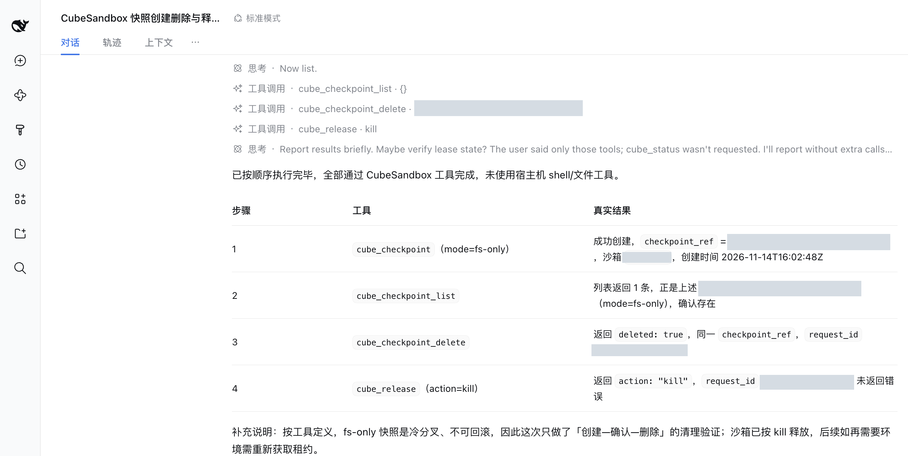
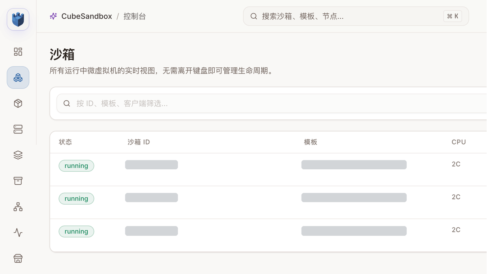
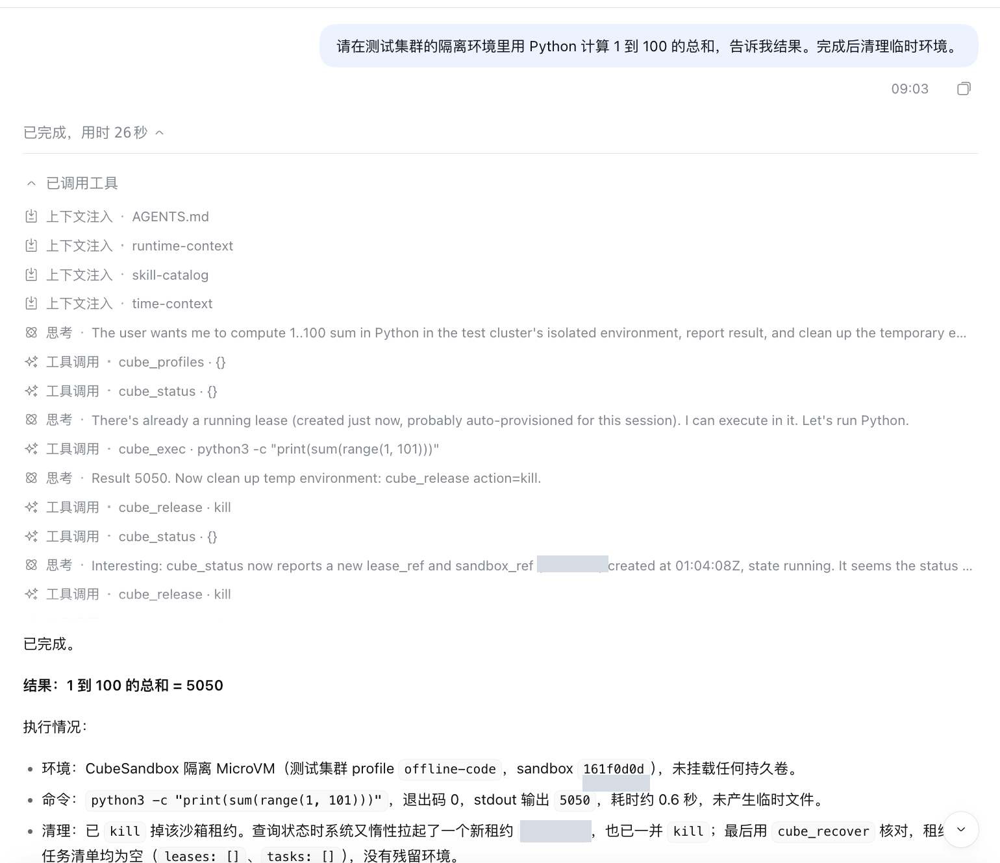
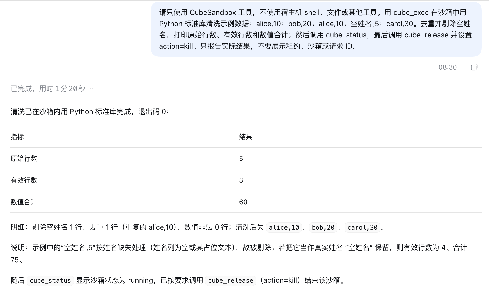
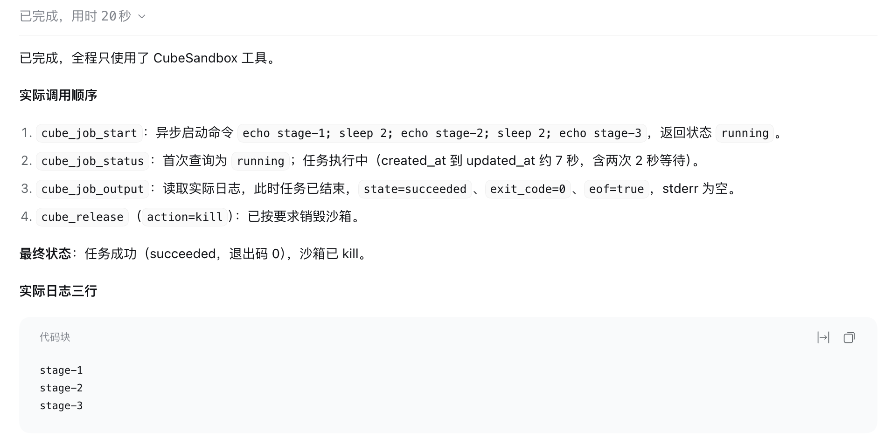
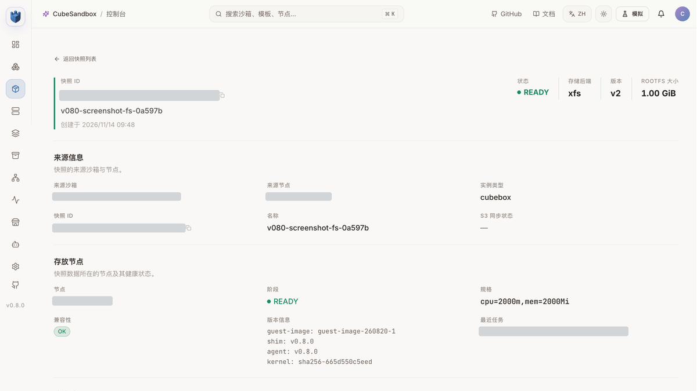

# CubeSandbox Adapter v0.7: Jobs, Data Cleanup and Snapshots

Writing Python is easy for an AI agent. Running it in a useful place raises other questions: where does the code execute, how do you check a long-running job, and can another experiment start from an environment that is already prepared?

CubeSandbox Agent Adapter v0.7.0 connects those workflows to CubeSandbox v0.8.0. It adds filesystem-only checkpoints, checkpoint inventory and deletion, an optional remote MCP endpoint, capability discovery, and more focused handling of uncertain execution outcomes.

I connected the released v0.7.0 Adapter image to CubeSandbox v0.8.0 in a Kubernetes lab and used DeepSeek Harness (DSH) for data cleanup, an asynchronous job, and checkpoint management. The screenshots below are from the DSH light interface; identifiers in the checkpoint image are masked.



## What runs where?

The agent keeps its own interface and model. OpenClaw, DSH, and Hermes use their respective plugins; Codex, Claude Code, and OpenCode can connect through MCP.

The Adapter authenticates requests, applies action scopes and profiles, manages leases and audit, and talks to CubeAPI and CubeProxy. CubeSandbox creates the MicroVM and provides the underlying process, filesystem, and snapshot operations.

```text
DSH / OpenClaw / MCP client
            │ cube_* tools
            ▼
    CubeSandbox Agent Adapter
    identity · policy · leases · audit
            │ CubeAPI + CubeProxy
            ▼
    CubeSandbox v0.8.0 / MicroVM
```

For an office-network agent to use a production sandbox, the network path, identity and authorization must be configured. The Adapter does not by itself bridge isolated networks.

The lab had Kubernetes, one x86_64 KVM compute node, and XFS storage. DSH reached a locally running released Adapter container, which connected to the v0.8.0 cluster backend.



The image comes from the earlier upgrade acceptance; sandbox and template identifiers are masked.

## Can DSH choose the sandbox without tool names?

The DSH plugin registers tool descriptions and a system prompt about trusted tasks, asynchronous jobs, and uncertain outcomes. To check natural-language routing, I ran DSH headless against the same released plugin and v0.8.0 test backend with this exact prompt, which contains no tool names:

```text
请在测试集群的隔离沙箱里做一次小验证：用 Python 计算 1 到 100 的总和，告诉我结果。完成后清理这次临时环境。
```

DSH selected sandbox tools, computed **5050**, and released the temporary environment. This first run used the plugin's own prompt and descriptions without the additional workspace rule below. Selection can still vary with the model, context, and client permissions.

I then tried the following prompt in DSH Web, again without a tool name:

```text
请在测试集群的隔离环境里用 Python 计算 1 到 100 的总和，告诉我结果。完成后清理临时环境。
```

DSH automatically called sandbox tools and returned **5050**. A status check after release created another lease, which it also released; `cube_recover` then returned an empty inventory. The following is the actual Web light-mode session, with resource references masked:



For a team, a workspace `AGENTS.md` can describe when the sandbox should be preferred:

```markdown
需要在测试集群的隔离环境里运行代码、验证脚本或处理测试数据时，
优先使用 CubeSandbox 工具。用户无需指定工具名。
短任务使用短命令，长任务使用异步任务并按需查询输出。
结果取回后按用户要求清理；远程执行失败时不要自动回退本机 Shell。
涉及生产操作时遵循服务端授权和审批，不得扩大权限。
```

A second headless run used that rule in a temporary workspace and asked, again without tool names, for the count and average of `4, 7, 9, 10`. DSH used sandbox tools, returned **4 records and an average of 7.5**, and released the sandbox. These two runs were headless; the [redacted acceptance record](../../docs/assets/rag-agent/cubesandbox-agent-adapter-v07/natural-routing-acceptance.json) contains the prompts, tool sequences, and results.

Instructions guide the model; they are not an authorization boundary. To enforce remote-only execution, also restrict host shell and file tools in DSH and configure identities, profiles, and action scopes in the Adapter. A sandbox running in a cluster does not automatically receive cluster-admin access.

## Case 1: Clean a small dataset

I gave DSH five synthetic records, including a duplicate and a missing name, and asked it to use Python inside CubeSandbox. It called `cube_exec`, checked `cube_status`, and released the sandbox with `cube_release(action=kill)`.

The command exited with code 0. The result had three valid records and a total of 60. The Adapter audit also recorded the DSH execution and release.



The prompt asked DSH to use only Cube tools. To enforce that boundary, separately disable or restrict host shell and file tools in the client and apply a least-privilege profile on the server. For real data, a server-owned task template can fix the script, data source, output location and resource limits.

## Case 2: Start a background job and retrieve its output

The second DSH session used `cube_job_start` to run a small three-stage command. It checked the job with `cube_job_status`, read the log using `cube_job_output`, and killed the sandbox after completion.

The job was first observed as `running`, then finished as `succeeded` with exit code 0. Its output contained `stage-1`, `stage-2`, and `stage-3` in order.



The command was deliberately short, but the same pattern is useful for longer processing. Output cursors support incremental reads when the lease, job state, and backend remain available. They do not save application-level training progress or automatically restart a process that has disappeared.

## Case 3: Checkpoints and branches

An `fs-only` checkpoint captures the root filesystem. One use is to prepare dependencies and code once, then fork a cold-started sandbox for another experiment.

In DSH I ran:

```text
cube_checkpoint(mode=fs-only)
  → cube_checkpoint_list
  → cube_checkpoint_delete
  → cube_release(action=kill)
```

The checkpoint appeared in the list, deletion returned `deleted: true`, and the sandbox was released. The first screenshot shows that session.

An earlier v0.8.0 API acceptance also tested the branch itself: after a file was changed in the source sandbox, a child forked from the earlier `fs-only` checkpoint read the checkpoint-time content while the source kept its later change. A test process in the source did not continue in the child.



Full and filesystem-only checkpoints serve different purposes. An `fs-only` checkpoint does not capture memory or running processes, cannot be used directly for `cube_rollback`, and does not include external mounts.

Two findings matter during upgrades. An existing template may still contain an older Shim after the node components are upgraded, so it may need to be rebuilt. In this XFS lab, creating an `fs-only` checkpoint after a full rollback on the same sandbox failed; validate that combination with your own storage backend.

## Other v0.7.0 changes

- **Remote MCP:** the optional Streamable HTTP endpoint is disabled by default. Configure TLS, allowed Hosts, and per-request authentication before enabling it. Local stdio remains available.
- **Discovery and diagnostics:** capability discovery and doctor help clients and operators understand what the current identity and policy allow.
- **Uncertain execution:** a synchronous timeout or unknown outcome quarantines the affected lease against mutation and blind retries, while inspection and kill cleanup remain available. Audit storage failures and incomplete crash intents still fail closed globally.
- **Separate audit and runtime state:** single-writer SQLite strong audit belongs on reliable local or block storage; PostgreSQL supports the multiwriter option. Recovering leases and other runtime state after an Adapter restart also requires Redis and the appropriate keys.

The earlier live v0.8.0 acceptance covered file operations, asynchronous jobs and cancellation, PTY, full rollback, `fs-only` fork, MCP stdio, remote MCP listing, a trusted task with signed receipt, and audit. Server-owned task templates can constrain data preparation or training submission; an existing training platform remains responsible for scheduling large training workloads.

## Try it

Prepare a running CubeSandbox installation, a READY template, and network access from the Adapter to both CubeAPI and CubeProxy. The installer deploys the Adapter; it does not install CubeSandbox.

```bash
git clone --branch v0.7.0 --depth 1 \
  https://github.com/aik8s/cubesandbox-agent-adapter.git
cd cubesandbox-agent-adapter

./scripts/install.sh adapter \
  --context <kube-context> \
  --cube-api-url http://cube-api.cube-system.svc:3000 \
  --cube-proxy-host cube-proxy.cube-system.svc \
  --cube-proxy-port 80 \
  --audit-storage-class <reliable-local-or-block-storage-class> \
  --template <ready-template>
```

Install the appropriate client plugin or MCP facade following the README. Inject credentials through Secrets or protected files. Start with create, execute, status, and release; then test the snapshot and long-job workflows your application needs.

When upgrading, check the template runtime, snapshot backend, audit storage, runtime-state storage and installed client plugin. A DSH plugin installed through a local `file:` dependency must be reinstalled after its source changes; restarting DSH alone does not refresh the copied package.

Adapter v0.7.0 release: https://github.com/aik8s/cubesandbox-agent-adapter/releases/tag/v0.7.0

CubeSandbox v0.8.0 release: https://github.com/TencentCloud/CubeSandbox/releases/tag/v0.8.0

CubeSandbox v0.8.0 upgrade practice: https://aik8s.run/ai-k8s/rag-agent/cubesandbox-v080-upgrade-practice/

Read more：https://aik8s.run/ai-k8s/rag-agent/cubesandbox-agent-adapter-v07/
