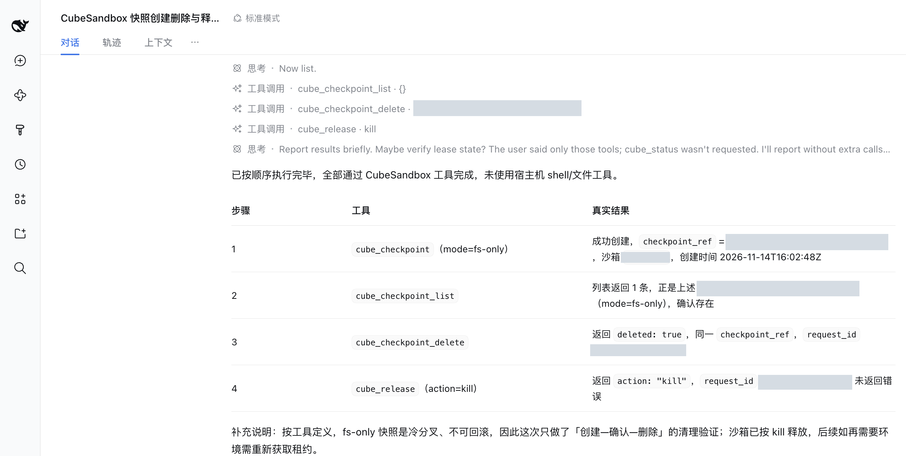
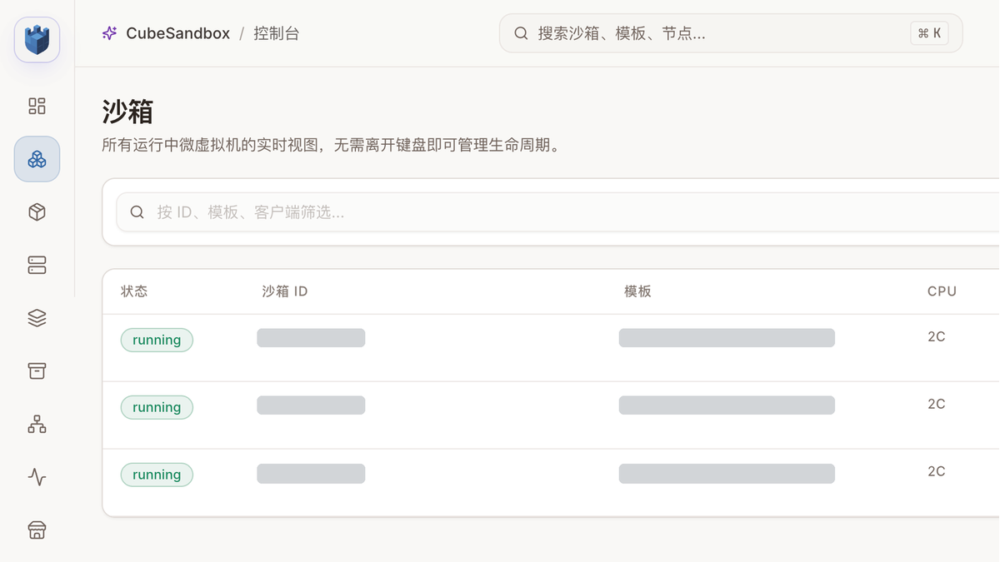
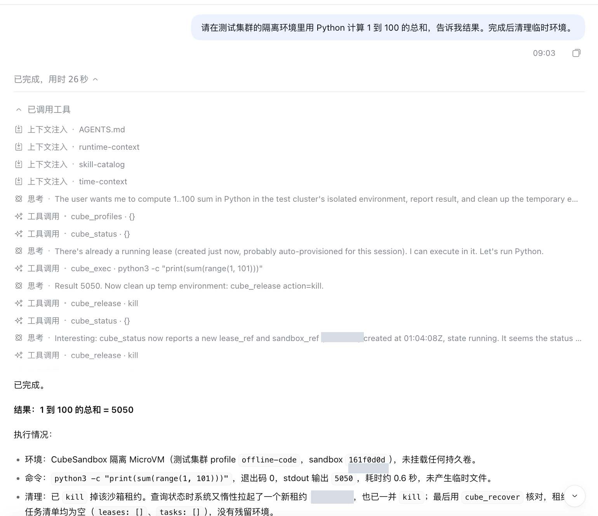
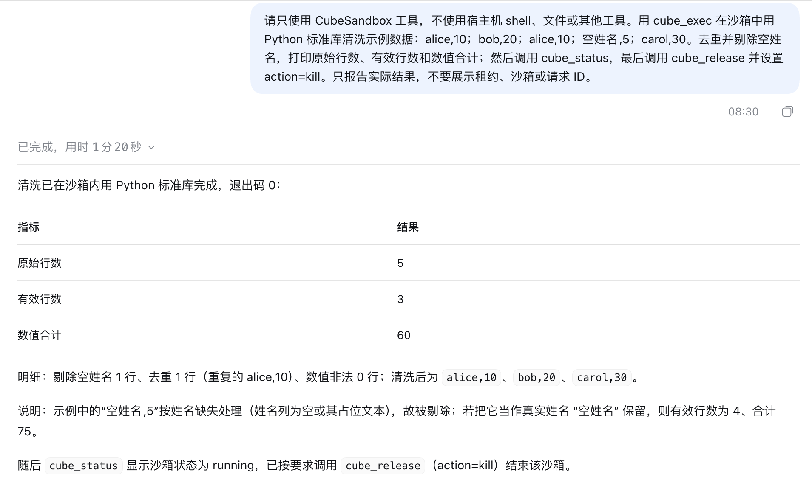
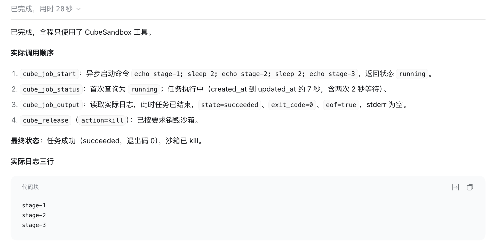
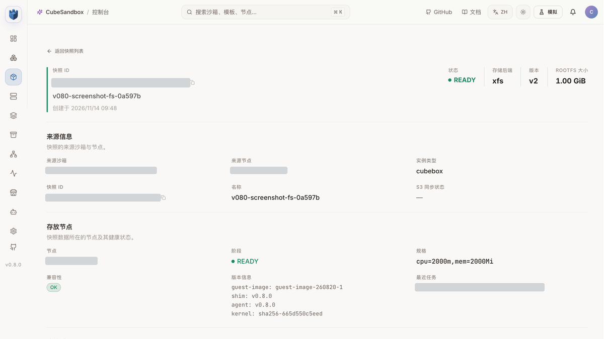

# CubeSandbox Agent Adapter v0.7：让 Agent 在沙箱里清洗数据、跑任务、做快照

让 AI Agent 写一段 Python 不难。真正接到业务环境后，问题就变成了：代码在哪里执行？任务跑久了怎么查看进度？换一套数据，能不能从准备好的环境再开一份？操作结束后，又怎么知道沙箱和快照有没有清理？

CubeSandbox Agent Adapter v0.7.0 刚好围绕这些问题做了一次更新。它接入了 CubeSandbox v0.8.0 的文件系统快照，也补上了快照清单、删除、远程 MCP、能力发现和更细的异常隔离。

这次我把 Adapter v0.7.0 接到 Kubernetes 测试集群上的 CubeSandbox v0.8.0，用 DSH 实际跑了数据清洗、异步任务和快照管理，再结合接口验收，看看这些能力怎么用。



上图是 DSH 的真实会话：Agent 创建、列出并删除文件系统快照，最后释放沙箱。截图中的资源标识已遮盖。

## Agent、Adapter 和 CubeSandbox 各做什么

Agent 保留原有的界面、模型和对话方式。OpenClaw、DSH、Hermes 通过各自的插件调用 `cube_*` 工具；Codex、Claude Code 和 OpenCode 可以通过 MCP 接入。

Adapter 负责接收工具请求、验证身份、匹配权限和 Profile、管理租约与审计，再通过 CubeAPI 和 CubeProxy 操作 CubeSandbox。后者负责创建和运行 MicroVM 沙箱，提供进程、文件、快照等底层能力。

```text
DSH / OpenClaw / MCP Client
            │ cube_* 工具
            ▼
    CubeSandbox Agent Adapter
    身份 · 策略 · 租约 · 审计
            │ CubeAPI + CubeProxy
            ▼
    CubeSandbox v0.8.0 / MicroVM
```

这样，本地 Agent 不必直接保存底层沙箱凭据。办公网的 Agent 能否使用生产侧沙箱，仍取决于网络、身份和授权是否打通；Adapter 不能自动穿透网络隔离。

这轮测试使用单个 x86_64 KVM 计算节点、XFS 后端和 Kubernetes 测试集群。DSH 接的是本地运行的 v0.7.0 正式 Adapter 镜像，Adapter 再连接集群中的 v0.8.0 CubeSandbox。



上图来自前一次 v0.8.0 升级验收：通过新模板创建的三个测试沙箱均处于运行状态，资源标识已经遮盖。

## 普通用户不认识工具，也能让 DSH 自动选择吗？

实际使用时，用户不应该先记住 `cube_exec` 或 `cube_job_start`。安装并启用 DSH 插件后，模型会看到每个工具的用途；插件也会注入一段系统提示，介绍可信任务、长任务和超时后的处理方式。

我在 DSH headless 中接入同一个 v0.7.0 插件和 v0.8.0 测试后端，先用一句**没有工具名**的话做测试：

```text
请在测试集群的隔离沙箱里做一次小验证：用 Python 计算 1 到 100 的总和，告诉我结果。完成后清理这次临时环境。
```

DSH 主动选择了沙箱工具，执行结果为 **5050**，并释放了临时环境。这轮依靠插件自身的工具描述和系统提示，没有额外添加本文下面的工作区规则。它是一次真实调用；工具选择仍然受模型、上下文和客户端权限影响。

随后我在 DSH Web 又问了一次，同样没有指定工具名：

```text
请在测试集群的隔离环境里用 Python 计算 1 到 100 的总和，告诉我结果。完成后清理临时环境。
```

DSH 自动调用沙箱工具，得到 **5050**；释放后又因查询状态创建了一个新租约，随后也将其释放。最终 `cube_recover` 返回空清单。下面是这次 Web 会话的真实 Light 截图，资源标识已遮盖：



团队希望这个行为更稳定，可以在 DSH 工作区的 `AGENTS.md` 中写清楚执行规则。下面是一个起点：

```markdown
需要在测试集群的隔离环境里运行代码、验证脚本或处理测试数据时，
优先使用 CubeSandbox 工具。用户无需指定工具名。
短任务使用短命令，长任务使用异步任务并按需查询输出。
结果取回后按用户要求清理；远程执行失败时不要自动回退本机 Shell。
涉及生产操作时遵循服务端授权和审批，不得扩大权限。
```

第二轮把这段规则放进临时工作区，再让 DSH 计算测试分数 `4、7、9、10` 的数量和平均分。提问同样没有工具名，DSH 自动执行后返回 **4 条、平均 7.5**，并释放了沙箱。这两轮由 DSH headless 发起；[脱敏验收记录](../../docs/assets/rag-agent/cubesandbox-agent-adapter-v07/natural-routing-acceptance.json)保留了提问、调用顺序和结果。

`AGENTS.md` 是给模型的行为指引，不能代替权限控制。想强制只在远端执行，还要在 DSH 中限制宿主 Shell、文件等工具，并在 Adapter 配置身份、Profile 和操作权限。沙箱部署在集群里，也不意味着它自动拥有集群管理员权限。

## 实战一：让 DSH 在沙箱里清洗数据

先给 Agent 一组虚构数据：`alice,10`、`bob,20`、重复的 `alice,10`、一条姓名缺失记录和 `carol,30`。要求它只通过 CubeSandbox 工具运行 Python，去重、剔除缺失姓名并计算合计。

DSH 调用了 `cube_exec`，随后查询 `cube_status`，最后调用 `cube_release` 并选择 `kill`。命令退出码为 0，5 条原始记录清洗后剩 3 条，数值合计 60。



Adapter 审计记录中也能对上这次 DSH 的执行和释放操作。这一小组数据适合演示流程；实际使用时，可以把清洗脚本、数据来源、输出位置和资源限制固化到平台维护的任务模板中。

这里通过提示词要求 DSH 只使用 Cube 工具。要把它变成可靠约束，还需要在客户端关闭或限制宿主机 Shell、文件等其他工具，并在服务端配置最小权限 Profile。

## 实战二：异步任务不必一直等在一次调用里

数据处理、依赖安装、模型准备往往比一条短命令跑得久。把它们全塞进同步 `exec`，容易遇到调用超时，也不方便中途查看状态。

我让 DSH 用 `cube_job_start` 启动一个分三段输出的示例任务，再用 `cube_job_status` 查状态、`cube_job_output` 读取日志。实际观察到任务先是 `running`，之后返回 `succeeded`、退出码 0，日志按顺序包含 `stage-1`、`stage-2`、`stage-3`；最后释放沙箱。



这里跑的是几秒钟的演示任务，但工具调用方式同样适用于需要更长时间的处理。Adapter 还提供按输出游标读取的能力；对话中断后，可以在租约、任务状态和后端仍可用的前提下继续查看输出。它不会替应用自动保存训练进度，也不会在进程消失后自动重新执行任务。

## 实战三：文件系统快照与环境分支

v0.8.0 新增的 `fs-only` 快照，只保存沙箱根文件系统。比如在一个沙箱里装好依赖、放好代码后，可以创建快照，再通过 fork 冷启动一份新沙箱用于另一组实验。

DSH 这次依次调用：

```text
cube_checkpoint(mode=fs-only)
  → cube_checkpoint_list
  → cube_checkpoint_delete
  → cube_release(action=kill)
```

创建成功后，清单中返回该快照；删除返回 `deleted: true`，沙箱也已释放。上文第一张图记录了这次会话。

此前的 v0.8.0 接口验收还做了更完整的分支测试：源沙箱写入文件并创建 `fs-only` 快照，之后修改源文件，再从快照 fork。子沙箱读到快照时的内容，源沙箱保留修改后的内容；源沙箱的测试进程没有在子沙箱中继续运行。这正是文件系统快照冷启动的含义。

完整快照和 `fs-only` 的用途不同：前者可用于支持的回滚场景；后者不保存内存与运行中的进程，不能直接用于 `cube_rollback`。外部挂载也不包含在文件系统快照里，需要单独处理。



测试时还遇到两个值得留意的细节：旧模板里的 Shim 即使随节点升级，仍可能停留在旧版本，需要重建模板后才能使用新快照；在本次 XFS 环境中，对完整快照回滚后的同一沙箱再创建 `fs-only` 快照失败，因此这条组合路径需要在自己的存储后端单独验证。

## v0.7.0 还更新了什么

除了快照，本次还有几项和日常使用直接相关：

- **远程 MCP**：新增可选的 Streamable HTTP MCP 入口。默认关闭，启用时需要按文档配置 TLS、允许的 Host 和逐请求认证；原有本地 stdio 方式仍可用。
- **能力发现和诊断**：客户端可以查看当前身份和策略允许的能力，排查时也可以使用 doctor。工具能否使用，仍由服务端权限决定。
- **超时后的租约隔离**：同步执行超时或结果未知时，Adapter 会隔离受影响的租约，禁止继续修改和盲目重试，同时允许检查与 kill 清理。审计存储故障或崩溃遗留未决意图，仍会触发全局失败闭锁。
- **审计和状态分别持久化**：SQLite 强审计适合单写入者，放在可靠的本地盘或块存储；多写入者方案可使用 PostgreSQL。若希望 Adapter 重启后恢复租约等运行状态，还要配置 Redis 和相应密钥，不能只保存审计库。

前一轮通过真实 v0.8.0 后端验证了文件读写、异步 Job 和取消、PTY、完整快照回滚、`fs-only` fork、MCP stdio、远程 MCP 列表、可信任务与签名回执。任务模板适合把训练任务提交、数据预处理等动作收敛成固定参数和输出；大规模训练仍交给已有训练平台调度。

## 想自己试，怎么开始

先准备一个可用的 CubeSandbox、READY 状态的模板，以及 Adapter 到 CubeAPI、CubeProxy 的网络。安装器只安装 Adapter，不会替你部署 CubeSandbox。

```bash
git clone --branch v0.7.0 --depth 1 \
  https://github.com/aik8s/cubesandbox-agent-adapter.git
cd cubesandbox-agent-adapter

./scripts/install.sh adapter \
  --context <kube-context> \
  --cube-api-url http://cube-api.cube-system.svc:3000 \
  --cube-proxy-host cube-proxy.cube-system.svc \
  --cube-proxy-port 80 \
  --audit-storage-class <可靠本地盘或块存储类> \
  --template <READY模板>
```

部署好以后按 README 安装 DSH 或 OpenClaw 插件；Codex、Claude Code、OpenCode 可以选择 MCP。Token 使用 Secret 或受限文件注入，不要放进提示词、截图或公开配置。安装完成后，先跑一次创建、执行、查询、释放，再按业务需要测试快照和长任务。

**如果已经在使用旧版本，升级时先看模板运行时、快照存储、审计盘和状态存储，再核对客户端是否加载了新版插件。** DSH 使用本地 `file:` 安装时，修改插件源码后需要重新安装，仅重启 DSH 不会更新已复制的插件。

项目与 v0.7.0 Release：https://github.com/aik8s/cubesandbox-agent-adapter/releases/tag/v0.7.0

CubeSandbox v0.8.0 Release：https://github.com/TencentCloud/CubeSandbox/releases/tag/v0.8.0

CubeSandbox v0.8.0 升级实战：https://aik8s.run/ai-k8s/rag-agent/cubesandbox-v080-upgrade-practice/

阅读原文：https://aik8s.run/ai-k8s/rag-agent/cubesandbox-agent-adapter-v07/
