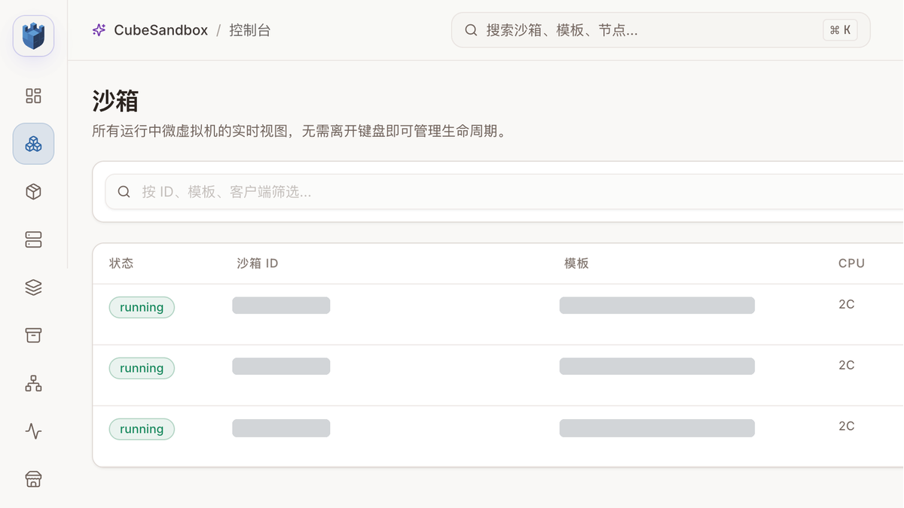
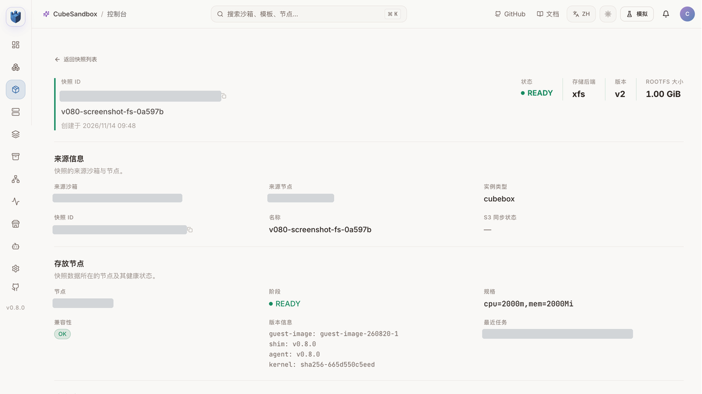
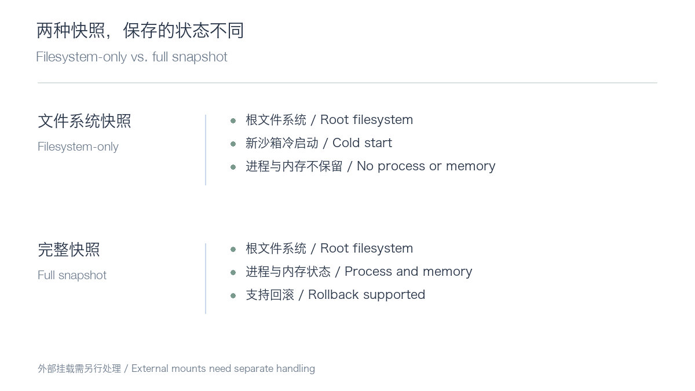
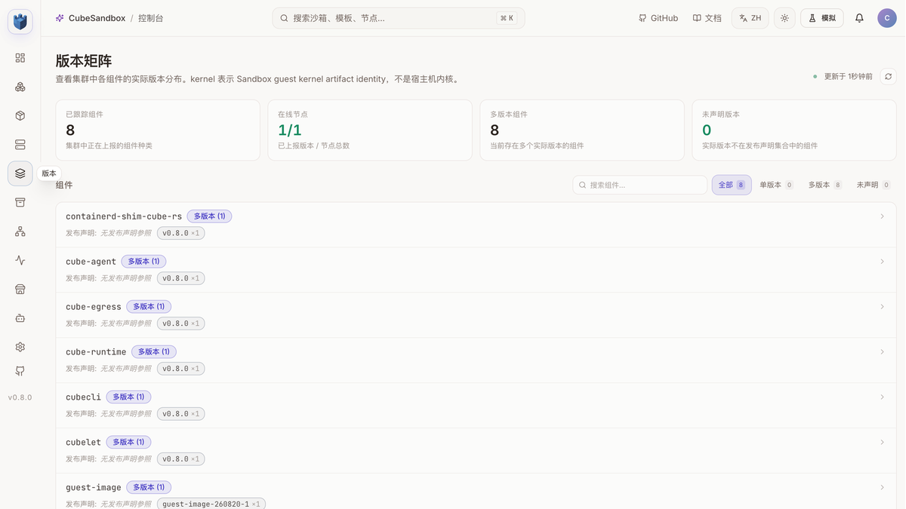

# Upgrading CubeSandbox to v0.8.0: Why Couldn't the Old Template Use the New Snapshot?

On November 12, 2026, Tencent Cloud's open-source sandbox project CubeSandbox released v0.8.0. CubeSandbox uses MicroVMs to manage isolated environments for AI agents, code execution and automation. This release introduces filesystem-only snapshots, a JuiceFS copy-on-write backend, sandbox restart policies, extensible scheduling, resource metrics and wider E2B SDK compatibility.

A sandbox platform upgrade raises a practical question: **will existing sandboxes, templates and data keep working?** We upgraded a Kubernetes test environment from v0.7.3 to v0.8.0, created actual sandboxes, tested snapshots and the E2B SDK, and exercised restart and networking behavior. The environment used Kubernetes v1.30, Cilium and one x86_64 KVM compute node; results do not establish cross-node production behavior.



These three test sandboxes were created from the new template; each executed a command and wrote and read a file. Resource identifiers are redacted. This screenshot does not represent complete data-cleaning or training workloads.

## Results first

- CubeSandbox components moved from v0.7.3 to v0.8.0 with existing templates, snapshots and persistent volumes retained. All eight official Helm tests passed.
- The old template could create sandboxes and use full snapshots, but filesystem-only snapshots failed because its embedded Shim remained at v0.7.1. Rebuilding a template from the existing rootfs passed the test.
- Filesystem-only snapshots, fork, the tested E2B Python SDK 2.64.0 calls, resource metrics, and specified single-node JuiceFS and S3 external-volume cases passed.
- Same-node port mapping returned `Connection refused`. In restart testing, a file without an explicit `sync` was missing afterwards; in a comparison run with `sync`, it remained readable. The cause and scope require further investigation.

## An old template can start without supporting a new feature

The most useful finding came from a simple snapshot call:

```python
snapshot = source.create_snapshot(mode="fs-only")
```

A sandbox created from the old template started normally, but the call returned `snapshot_filesystem_only_unsupported_node`. The error identified Shim v0.7.1 inside the sandbox: upgrading node components to v0.8.0 does not replace a runtime already baked into a template.

We built a separate new template from the existing rootfs and repeated the test. The filesystem-only snapshot succeeded. A sandbox created from it read the file as it was at snapshot time, while later writes in the source sandbox did not alter the child's copy.



The console shows a READY snapshot and reports runtime v0.8.0; the creation request established the snapshot mode. Upgrade acceptance should check **node component versions, the runtime inside each template, and the specific features applications use**.



A filesystem-only snapshot captures the root filesystem, not Guest memory or running processes. A sandbox created from it starts cold. A full snapshot can capture memory and filesystem state and support rollback. Filesystem-only snapshots do not record external mounts, which must be declared again for the new sandbox.

The distinction matters for agent recovery. Filesystem-only snapshots can be considered when reusing dependencies and a workspace; restoring running state calls for a full snapshot and application-level recovery tests.

## Check networking and databases before upgrading

The v0.8.0 Chart defaults to host networking. Our existing installation used Pod networking, so the upgrade explicitly retained `cubeNode.hostNetwork: false`. Recreating `cube-node` destroys the Pod network namespace and breaks networking for existing sandboxes on that node.

We isolated the compute node, waited at least 60 seconds, verified it was drained, upgraded with Helm, then returned the node to service and ran Helm tests. This abbreviated sequence requires environment-specific backups, rendering checks, image locations and a recovery plan:

```bash
helm get values cube -n cube-system -o yaml > values-before.yaml
kubectl -n cube-system exec deploy/cube-cubemastercli -- \
  cubeopscli -a cube-ops node isolate <node-id>
# Wait at least 60 seconds and verify that all node sandboxes are drained.
helm upgrade cube ./deploy/kubernetes/chart -n cube-system \
  -f values-before.yaml -f values-v080.yaml --reset-values --wait
kubectl -n cube-system exec deploy/cube-cubemastercli -- \
  cubeopscli -a cube-ops node unisolate <node-id>
helm test cube -n cube-system --timeout 10m
```

CubeMaster and CubeOps run database migrations at startup. Back up the database and validate recovery before upgrading; Helm rollback does not automatically restore the old database. Old values may pin an individual component image tag; our CubeOps tag needed an explicit update. Exported values may contain credentials and must not be published as-is.



This is the real post-upgrade version matrix. Without release-declaration references, the UI marks some components as “multiple versions (1)”; that does not establish that multiple different versions were detected.

## Testing snapshots, fork and E2B

From a sandbox created with the new template, `fork(count=2)` produced two child sandboxes. Both saw the pre-fork file; changing one child left the source and the other child unchanged.

With E2B Python SDK 2.64.0, we tested sandbox creation, command execution, reconnection, another command and deletion. These calls worked; CubeSandbox-specific snapshot functionality still requires its own SDK. This does not demonstrate compatibility with every E2B API.

The JuiceFS CoW backend remains Preview. Our single-node test covered template building, creation, pause and resume, full snapshot rollback, filesystem-only snapshots and fork; cross-node template sharing and recovery were not tested. Enabling it adds a separate metadata Redis, persistent volume and node FUSE mount, so plan it as a separate storage change.

The S3 external-volume test also illustrated the data boundary: after root filesystem rollback, the external volume still contained later writes. A sandbox snapshot is not a unified rollback of all external data.

## Restart and networking: two results requiring follow-up

The sandbox failure restart policy was triggered, with states progressing through `Running`, `BackOff`, `Restarting` and `GaveUp`, and the restart count reaching 2. In a separate workspace-file test, the file was missing after restart without an explicit `sync`; in a comparison run where `sync` ran before probe failure, the original contents were readable after restart.

These observations make write and persistence timing worth investigating. The missing-file cause is unresolved; the result does not establish the behavior of all unsynced writes or storage backends.

For networking, the API returned a sandbox port-mapping address, but a same-node connection returned `Connection refused` in this Pod-network environment. The failure layer is unknown. This was not a passing test and cannot be generalized to every network mode.

## Next steps

These single-node results support further testing of the basic lifecycle, filesystem-only snapshots, fork and the E2B calls exercised. Before a production upgrade, prioritize draining nodes and verifying network mode; backing up the database and rehearsing restoration; retesting each commonly used old template; and validating port mapping, restart persistence and cross-node recovery in the target environment.

Official v0.8.0 release: https://github.com/TencentCloud/CubeSandbox/releases/tag/v0.8.0

Official Kubernetes upgrade guide: https://github.com/TencentCloud/CubeSandbox/blob/v0.8.0/docs/guide/kubernetes/upgrade.md

Full upgrade walkthrough, test data and additional screenshots: https://aik8s.run/en/ai-k8s/rag-agent/cubesandbox-v080-upgrade-practice/
