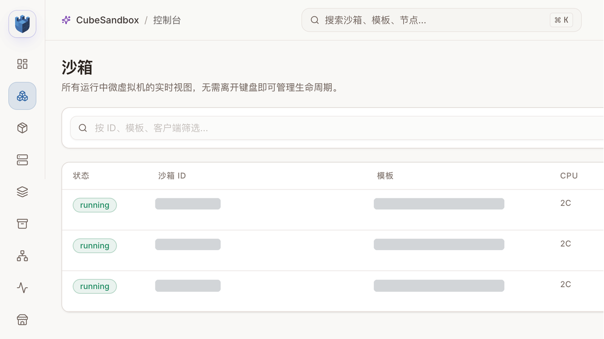
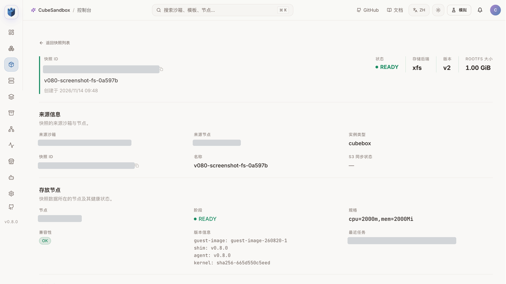
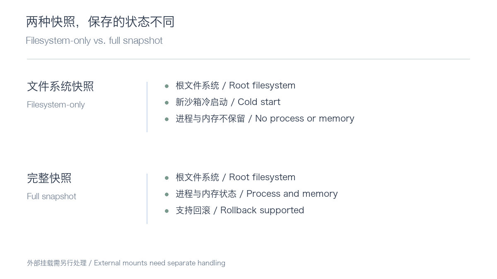
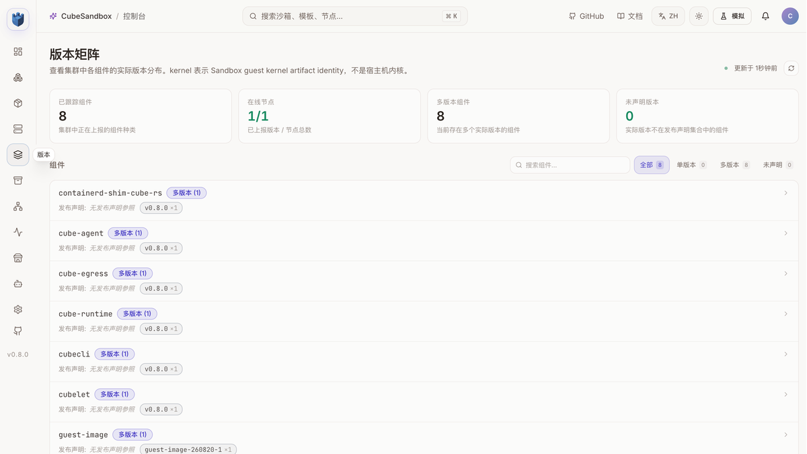

# CubeSandbox 升级到 v0.8.0：旧模板为什么用不了新快照？

2026 年 11 月 12 日，腾讯云开源的沙箱项目 CubeSandbox 发布 v0.8.0。它面向需要隔离执行环境的 AI Agent、代码运行和自动化任务，使用 MicroVM 管理沙箱生命周期。这次更新带来了仅保存文件系统的快照、JuiceFS 写时复制后端、沙箱重启策略、可扩展调度、资源指标与更广的 E2B SDK 兼容范围。

新版本功能不少，但升级一个正在使用的沙箱平台，真正的问题是：**旧沙箱、旧模板和已有数据，还能不能继续用？** 我们在 Kubernetes 测试环境中从 v0.7.3 升级到 v0.8.0，实际创建沙箱、验证快照、接入 E2B SDK，也测试了故障重启和网络。测试环境为 Kubernetes v1.30、Cilium、单个 x86_64 KVM 计算节点，结果不代表跨节点生产环境。



升级后通过新模板创建的三个测试沙箱，均完成命令执行和文件写入、读回。画面中的资源标识已经遮盖；这不是完整的数据清洗或训练任务。

## 一次升级，先看结论

- CubeSandbox 组件从 v0.7.3 升级至 v0.8.0，已有模板、快照和持久卷得到保留；官方 Helm tests 共 8 项通过。
- 旧模板可以创建沙箱和使用完整快照，但文件系统快照报错：模板携带的 Shim 仍为 v0.7.1。基于已有 rootfs 重建模板后通过。
- 新模板上的文件系统快照、fork、E2B Python SDK 2.64.0 基础调用、资源指标，以及单节点 JuiceFS 与 S3 外挂卷的指定场景通过。
- 同节点端口映射返回 `Connection refused`；重启测试中，未显式 `sync` 的测试文件重启后缺失，执行 `sync` 的对照轮次则可读。原因和适用范围仍需继续验证。

## 旧模板能启动，不代表新能力能用

这次最有价值的发现，来自一次看起来很普通的快照调用：

```python
snapshot = source.create_snapshot(mode="fs-only")
```

旧模板创建的沙箱可以正常启动，但调用返回 `snapshot_filesystem_only_unsupported_node`。错误显示沙箱内的 Shim 是 v0.7.1：节点组件升级到 v0.8.0，并不会自动替换已经固化在旧模板里的运行时。

我们以原有 rootfs 重新构建独立模板，再执行相同测试：新建文件系统快照成功；从快照创建的新沙箱能读取快照时的文件，源沙箱后续写入不会改变新沙箱里的内容。



控制台中快照为 READY，运行时上报 v0.8.0；快照模式由创建请求确认。升级验收时，应分别核对**节点组件版本、模板内部运行时版本和业务使用的具体功能**。



文件系统快照保存根文件系统，不保存 Guest 内存和运行中的进程；从它创建的沙箱会冷启动。完整快照可以保存内存和文件系统，支持回滚。文件系统快照也不记录外部挂载，新沙箱需要重新声明这些卷。

这个区别直接关系到 Agent 的恢复方式：如果只想复用依赖和工作目录，可以考虑文件系统快照；如果要恢复运行时状态，应使用完整快照，并验证应用自身能否正确恢复。

## 升级前先看网络和数据库

v0.8.0 Chart 默认使用宿主机网络。我们的旧环境使用 Pod 网络，因此升级时显式保留 `cubeNode.hostNetwork: false`。如果 `cube-node` 被重建，Pod 网络命名空间随之销毁，节点上的现有沙箱网络也会中断。

本次先隔离计算节点、等待至少 60 秒并确认沙箱排空，再执行 Helm 升级；升级后恢复节点并运行 Helm tests。下面是顺序示意，实际升级还需要自己的备份、渲染检查、镜像地址和恢复预案：

```bash
helm get values cube -n cube-system -o yaml > values-before.yaml
kubectl -n cube-system exec deploy/cube-cubemastercli -- \
  cubeopscli -a cube-ops node isolate <node-id>
# 等待至少 60 秒，并确认节点上的沙箱已经排空
helm upgrade cube ./deploy/kubernetes/chart -n cube-system \
  -f values-before.yaml -f values-v080.yaml --reset-values --wait
kubectl -n cube-system exec deploy/cube-cubemastercli -- \
  cubeopscli -a cube-ops node unisolate <node-id>
helm test cube -n cube-system --timeout 10m
```

CubeMaster 和 CubeOps 启动时会执行数据库迁移。升级前应备份数据库并验证恢复方案；Helm 回滚不会自动把数据库恢复到旧版本。旧 values 还可能固定单个组件的镜像标签，本次就需要显式更新 CubeOps 的旧标签。导出的 values 可能含凭据，不能直接公开。



这是升级后的真实版本矩阵。界面在没有发布声明参照时将部分组件显示为“多版本 (1)”，不能据此理解为发现了多套不同版本。

## 新功能实测：快照、fork 和 E2B

在新模板沙箱中，`fork(count=2)` 派生出两个子沙箱：两者读到 fork 前的文件，修改一个子沙箱后，源沙箱与另一个子沙箱的数据保持不变。

使用 E2B Python SDK 2.64.0，我们验证了创建沙箱、执行命令、重新连接、再次执行和销毁。这说明所测的这组调用可用；CubeSandbox 的专属快照能力仍需使用 CubeSandbox SDK，不能据此推断 E2B 全部接口均已兼容。

JuiceFS CoW 后端仍是 Preview。本次单节点验证了模板构建、创建、暂停恢复、完整快照回滚、文件系统快照和 fork；跨节点模板共享、跨节点恢复没有实测。启用它还会新增独立元数据 Redis、持久卷和节点 FUSE 挂载，应当作为单独的存储变更规划。

S3 外挂卷测试也说明了数据边界：根文件系统回滚后，外挂卷依然保留后续写入。不要把沙箱快照理解为所有外部数据的统一回滚。

## 重启与网络：两项需要继续验证的结果

沙箱的失败重启策略触发后，状态经历 `Running`、`BackOff`、`Restarting` 到 `GaveUp`，重启次数达到 2。另一组测试在工作目录写入文件：没有显式 `sync` 的轮次，重启后文件缺失；在探针失败前执行 `sync` 的轮次，重启后读回了原内容。

这两次观察提醒我们关注应用写入和落盘时机。文件缺失的原因尚未定位，不能推断所有未执行 `sync` 的写入或所有存储后端都会发生相同问题。

网络方面，API 返回了沙箱端口映射地址，但在本次 Pod 网络环境中，同节点连接返回 `Connection refused`。故障层次尚未确定；它既不是通过项，也不能外推为其他网络模式都会失败。

## 怎么安排下一步

这次单节点结果表明，基础生命周期、文件系统快照、fork 和所测 E2B 调用可以继续用于测试环境。准备生产升级时，优先做四件事：排空节点并确认网络模式；备份数据库并演练恢复；逐个重测常用旧模板；针对端口映射、重启持久性和跨节点恢复补充验收。

官方 v0.8.0 Release：https://github.com/TencentCloud/CubeSandbox/releases/tag/v0.8.0

官方 Kubernetes 升级指南：https://github.com/TencentCloud/CubeSandbox/blob/v0.8.0/docs/guide/kubernetes/upgrade.md

阅读原文：https://aik8s.run/ai-k8s/rag-agent/cubesandbox-v080-upgrade-practice/
