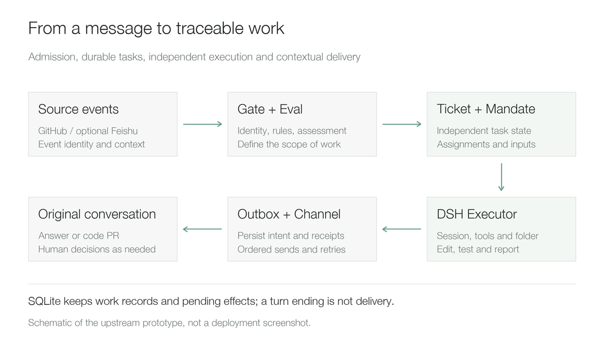

# Deploying DeepSeek Super-agent on Kubernetes: From Chat Requests to Code PRs

DeepSeek recently published **dsh-superagent-prototype**, a research prototype for a team coding agent built on DeepSeek Harness. It listens to collaboration events, turns authorized requests into traceable tasks, executes them in independent sessions, and returns results to their original discussions. GitHub records the repository's creation on October 31, 2026; this is a repository-creation date, not an official product-release date.

The official description is explicit: this is a research reference, and the public implementation differs from the internal version and design article. It introduces no new model weights; its focus is organizing work around the model. This article uses commit `6337fc823ce20251c8de8085948165c81aaa701e`, with principles drawn from the official README, domain model, and execution documentation.

I adapted it into a Kubernetes demo with Mattermost for requests and Gitea for code. Real tasks checked admission, parallel execution, follow-up requirements, and continuation after restart. Of three complex tasks, two produced reviewable Pull Requests (PRs) and one did not finish. First, the design; then the deployed demo and its results.

## How Super-agent turns messages into tasks

DeepSeek Harness, or DSH, provides model access, sessions, context, file tools, and command execution. Super-agent runs on Harness as a Bundle, a combination of plugins and configuration that adds task lifecycles and team-work rules.

A piece of work passes through six steps: receive an event, check identity and rules, establish scope, create a work item, assign an executor, and deliver a result.



This diagram simplifies the official prototype. Its built-in sources are GitHub and optional Feishu, scoped around one GitHub repository. Mattermost and Gitea are adapters added for this demo.

Three distinctions explain much of the design.

**A message and a task have separate identities.** A Source translates a message into an immutable Trigger, while a Thread holds ongoing discussion context. Accepted work creates a Ticket and records its Mandate. Later discussion can add context without automatically expanding authority.

A task is also distinct from an execution attempt. An Assignment binds a Ticket to an executor. An interrupted execution can be reassigned while the work item, discussion relationships, and pending inputs remain. A model turn ending establishes only that generation ended, not that code was delivered.

Finally, finishing and delivering are separate. The Outbox persists pending messages and receipts, then a Channel writes them back to the original conversation. SQLite and durable pending effects make unfinished dispatches, input deliveries, and replies recoverable after restart. External writes still need reconciliation: a remote write can succeed before its local receipt is recorded, leaving a duplication window on retry.

Proactive admission also has boundaries. The prototype provides `off`, `observe`, and `auto` for work inferred from team rules. The default, `observe`, records the judgement without accepting that inferred work. Valid explicit requests can execute in all three modes, so disabling proactive admission and stopping an active task are separate operations.

## Why the demo uses Mattermost and Gitea

To make the interactions visible, I retained full chat and code-review interfaces. A person submits a request in Mattermost, the agent creates a branch and PR in Gitea, and the original chat thread receives the link and test results.

The demo has four long-running Pods: DSH, Gitea, Mattermost, and PostgreSQL. Gitea uses SQLite; PostgreSQL stores Mattermost data. No Redis, message broker, or object store was added. The orchestration and tool-execution layer requests no GPUs and uses an existing model API for inference.

The versions are DSH `0.2.2-alpha.2`, image `0.2.2-alpha.2-r1`, Gitea `28.2.0`, Mattermost Team Edition `12.0.1`, and PostgreSQL `17.11`. The DSH image comes from `runzhliu/deepseek-harness-docker`. An independent Profile, or runtime configuration, and new persistent volumes hold the experiment; no personal session directory is mounted.


The two executors are DSH sessions sharing this demo instance, each with its own working directory and code branch. Directory separation in the diagram does not establish independent sandboxes.

**Mattermost and Gitea require source adapters.** Identity, event cursors, thread context, reply channels, and PR-to-Ticket binding all need implementation; replacing a GitHub hostname is insufficient. Dedicated demo-channel and repository permissions were configured for the bot.

One practical issue involved Mattermost's `update_at`, which can change with thread-related metadata. Using it as a message identity treated old requests as new inputs. The corrected identity uses the message ID and body-edit version, `edit_at`, so an actual edit creates a new event. Such deduplication details determine whether an agent accepts the same work repeatedly.

This integration includes custom code. The following is a design and acceptance record, not a one-click deployment supplied by the upstream image.

## How users submit tasks and follow results

The initial request was small: fix a total-price function that did not multiply by quantity. State the scope, tests, and delivery conditions together. For example, this Chinese request is preserved in its original language:

```text
@demo-agent 修复 src/pricing.js 中未乘 quantity 的错误。
补充数量大于 1 的回归测试，运行 npm test。
创建 Gitea PR，等待人工审核，不要合并。
```

After making the change, the agent opened PR #1 and reported back in the original thread. A follow-up in that thread requested zero-quantity behavior. It updated the existing branch and PR. The initial run had 5 tests and the follow-up had 7; both actual runs passed.


Chinese screenshot pixels remain unchanged. Users can continue the discussion in chat, inspect code in Gitea, and follow task state in DSH's Superagent panel.

To check concurrency, I submitted three independent projects restricted to different subdirectories. The panel actually showed two executors running and a third task queued.


Each task has an independent session, working directory, and branch, avoiding repeated branch switches in one shared workspace. Changes to a common interface still require integration tests. Increasing execution slots also increases requests and budget pressure on the downstream model service.

## What the complex tasks delivered

The first project was a reliable Webhook delivery service: an enqueue API, idempotency keys, SQLite persistence, bounded retries, a fixed destination, and a hash-based message authentication code using SHA-256 (HMAC-SHA256). Independent acceptance started local receivers and checked two failures before success, permanent HTTP 400 responses, signatures, stable event IDs, and delivery after a service restart.

It delivered 15 files, passed 11 component tests, and passed 5 independent acceptance groups. Delivery is at least once, so receivers still need event-ID deduplication. This is a single-process demo without API authentication, TLS, multi-instance coordination, or dead-event replay.

The second project was a streaming log-analysis CLI, or command-line interface. It reads JSON Lines incrementally, supports time and service filters, handles invalid lines, aggregates latency, and produces a directly viewable HTML report.


PR #2 contains 19 files and two commits, ending at `66fc963`. It passed 31 component tests and 6 independent acceptance groups, including 100,000 records with bounded key cardinality under a 64 MiB Node heap limit.


This is output from the delivered code. The synthetic input contains 100,000 records, including 5,000 errors, with mean latency 144.50 ms. These are test-data statistics, not production monitoring. Aggregation tables still grow with service, time-bucket, and error-text cardinality; incremental reading does not imply constant memory for arbitrary inputs.

The third project was a durable Directed Acyclic Graph (DAG) task runner with dependency validation, concurrency, retry, timeout, and process recovery. It delivered no implementation, so its 5 predefined independent acceptance groups were not run.

| Complex task | Final delivery | Independent acceptance |
| --- | --- | --- |
| Webhook delivery service | PR #3, `8ba2da4` | 5 / 5 groups passed |
| Log-analysis CLI | PR #2, `66fc963` | 6 / 6 groups passed |
| DAG task runner | Output budget exhausted; stopped at the deadline | 5 groups not run |

Independent acceptance uses real HTTP, CLI, and process checks, recorded separately from the agent's tests. One group failed in the initial log-analysis run because the oracle compared a floating-point average strictly. After retaining that result, only the oracle was changed to a `1e-9` tolerance. Product code did not change; the second run passed.

Both complex projects remain PRs awaiting human review. Including the initial small fix, PR #1, #2, and #3 are all unmerged, and main has not been modified.

## Continuation after restart depends on what was recovered

I recreated the DSH Pod while the pricing-function follow-up was executing. Recovery reused the same Ticket, session, directory, branch, and PR, eventually passing 7 tests. This validates continuation on the same test node with retained volumes.

Recovery relies on durable task records, session history, and the working tree. After restart, the executor checks files, Git history, and the remote PR before deciding what to repeat. It does not resume a terminated shell process at its interrupted CPU instruction. Node power loss, local-disk loss, and cross-node recovery were not tested.

A separate case needs distinguishing: after the original Webhook and DAG windows expired and were stopped, continuation requests in the original threads created new Tickets and directories. An unchanged chat thread does not establish same-task recovery after a stop.

Complex work also exposed two types of failure.

First was the demo model bridge's transport implementation. Initial long requests were cut off at 300 seconds with `Stream ended without finish_reason`. The bridge synchronously returned each tiny Server-Sent Events (SSE) chunk, waiting for a network round trip every time. It was changed to aggregate over roughly 50 ms or 64 KiB and distinguish a 180-second idle limit from a 15-minute total limit. Failed attempts were retained for subsequent validation. This defect belonged to the demo bridge.

Second was the effective output budget. The DAG repeatedly ended with `max-tokens` at 8,192 output tokens without an implementation. A minimal API probe with thinking disabled and a 32,768-token budget returned a tool call, but complete DSH sessions still showed the original limit. Effective parameters across the client, bridge, and upstream need inspection; this evidence does not establish that the model cannot implement the task.

Dispatch semantics also affected progress: the main session once requested a status-only report, and the executor accordingly did not continue implementation. Status inspection and implementation continuation are separate operations in the prototype. Restoring durable records must be followed by checking that subsequent instructions are correct.

## How I would adopt this design

The best starting point suggested by this demo is bounded engineering work with reviewable outputs: bug fixes, regression tests, and analysis tools, followed by human PR review. Instant Messaging (IM) provides the entry, Gitea holds deliverables, Super-agent manages task state in between, and Harness supplies execution.

I would establish four conditions first:

1. Use a dedicated instance, bot, and test repository. Restrict who may initiate work and where changes may occur, then validate event deduplication and reply receipts.
2. Persist tasks, sessions, and working directories, beginning with single-instance recovery. The SQLite state directory is locked; increasing replicas does not create a concurrently writable highly available control plane.
3. Implement execution isolation below the task model. Separate sessions and directories organize work, and authorization is recorded explicitly; operating-system permissions, networking, credentials, and malicious-code isolation still need separate designs.
4. Define acceptance and deadlines, retaining incomplete tasks. Reviewable outputs, human interventions, invocation cost, and duplicate side effects are more useful measures than the number of active agents.

Super-agent is worth studying for how it organizes ongoing team discussion into scoped, identifiable, traceable work with deliverables. This demo already lets a person request work in chat, follow progress in a panel, and inspect code in Gitea. Its two complex deliveries and one failed task also show the engineering details required to make that path work.

The full deployment design, acceptance summary, and original interfaces are in the public practice article linked below.

## Sources and public records

Official research prototype and disclaimer: https://github.com/deepseek-ai/dsh-superagent-prototype

Domain model: https://github.com/deepseek-ai/dsh-superagent-prototype/blob/6337fc823ce20251c8de8085948165c81aaa701e/docs/001-domain.md

Execution and recovery: https://github.com/deepseek-ai/dsh-superagent-prototype/blob/6337fc823ce20251c8de8085948165c81aaa701e/docs/003-execution.md

Deployment boundaries and source adapters: https://github.com/deepseek-ai/dsh-superagent-prototype/tree/6337fc823ce20251c8de8085948165c81aaa701e/docs

DSH container image: https://github.com/runzhliu/deepseek-harness-docker

Public principles analysis: https://aik8s.run/ai-k8s/rag-agent/deepseek-superagent-prototype-analysis/

Public demo practice: https://aik8s.run/ai-k8s/rag-agent/deepseek-superagent-kubernetes-practice/
