# 把 DeepSeek Super-agent 部署到 Kubernetes：从群聊需求到代码 PR

DeepSeek 最近公开了 **dsh-superagent-prototype**，一套基于 DeepSeek Harness 的团队编程 Agent 研究原型。它监听协作系统中的消息，把获准的请求变成可追踪的任务，交给独立会话执行，再将结果送回原来的讨论。后续的补充需求和评审意见，也可以继续进入同一项任务。

为了实际感受 DeepSeek Super-agent 怎么参与团队开发，我在 Kubernetes 上设计了一套 Demo：在聊天里提交需求，让 Agent 修改代码、运行测试，再交付拉取请求（Pull Request，PR），由人审核。

这次测试从修复一个计价函数开始，再增加三个多文件项目，观察多个任务能否并行推进、追加要求能否回到原任务，以及执行过程中重启服务后能否继续。所有任务都在独立演示仓库里完成。

## Demo 是怎么搭起来的

我用 Mattermost 作为聊天入口，Gitea 作为代码仓库和评审入口。用户在私有频道里给机器人发需求，Super-agent 接单后创建独立的执行会话和代码分支，完成修改与测试，再把 PR 链接和结果发回原线程。用户可以在聊天里追加要求，也可以去 Gitea 审核代码。

整套 Demo 只有四个长期运行的 Pod：DeepSeek Harness（DSH）、Gitea、Mattermost 和 PostgreSQL。Super-agent 装在 DSH 实例中，负责接单与派工。Gitea 使用 SQLite，PostgreSQL 为 Mattermost 提供存储；没有增加 Redis、消息队列或对象存储。控制与工具执行部分没有申请 GPU，推理使用已有模型 API。

本次版本为 DSH `0.2.2-alpha.2`、镜像 `0.2.2-alpha.2-r1`，Gitea `28.2.0`、Mattermost Team Edition `12.0.1`、PostgreSQL `17.11`。DSH 镜像来自 `runzhliu/deepseek-harness-docker`。独立 Profile，也就是运行配置，以及新的持久卷用于保存本次实验，没有挂入个人会话目录。

部署时先启动 PostgreSQL、Mattermost 和 Gitea，创建私有频道、演示仓库和专用机器人。随后给独立的 DSH 实例加载编译后的 Super-agent Bundle，接入模型 API，配置允许发起任务的用户、唯一可修改的仓库和两个执行名额。这样就形成了“聊天提需求 → 接单与派工 → 修改和测试 → PR → 原线程反馈”的流程。

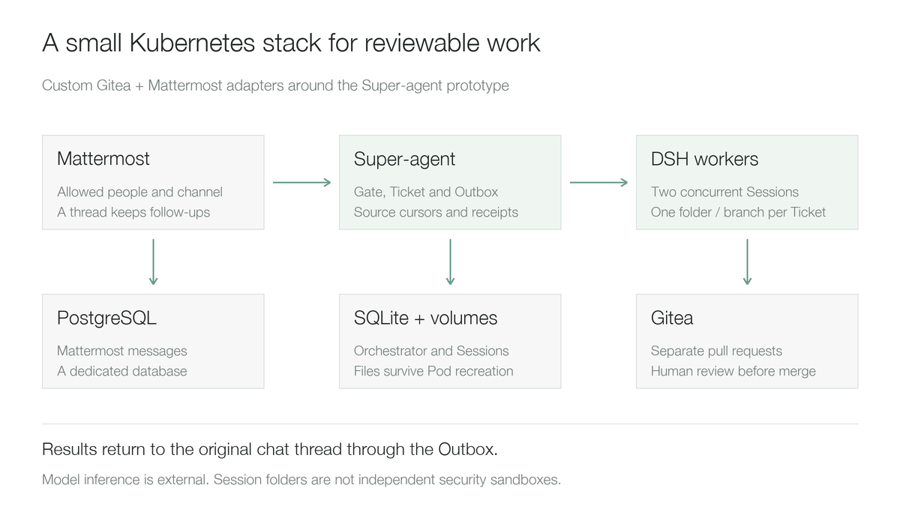

两个执行器是 DSH 会话，共享这个演示实例，各自有工作目录和代码分支；图中的目录隔离不等于独立沙箱。

**Mattermost、Gitea 的接入需要实现来源适配。** 要处理账号身份、事件游标、线程上下文、回复通道，以及 PR 与原工单的绑定，不能只替换 GitHub 域名。本次也为机器人单独配置了演示频道和仓库权限。

实际接入时遇到过一个小问题：Mattermost 的 `update_at` 会随线程相关元数据变化。用它构造消息身份，会把旧需求再次当作新输入。修正后，事件身份使用消息 ID 和正文编辑版本 `edit_at`，原文真正被编辑才产生新事件。这样的去重细节，直接决定 Agent 会不会重复接活。

这套集成包含自定义代码，下面展示的是设计与验收记录，不是上游镜像直接附带的一键部署方案。

## Gitea、Mattermost 怎样接到 Super-agent

### 先准备两个专用身份

Gitea 使用专用账号 `demo-agent`，由它持有私有演示仓库 `demo-agent/agent-demo`。本次令牌范围为 `write:repository`、`write:issue`、`read:user`，分别供仓库操作、工单评论和身份读取使用。它不是 Gitea 系统管理员，但它拥有这个演示仓库，不能把这套配置描述成服务端只授予了某个子目录的权限。

代码写入 `agent/<ticket-name>` 分支。仓库的 `main` 配置为禁止推送、禁止强制推送，合并要求一人批准，并将合并白名单限定为人工演示账号 `demo-admin`。这些仓库规则与任务里的“不合并”要求共同控制交付，不能只靠提示词约束主分支。

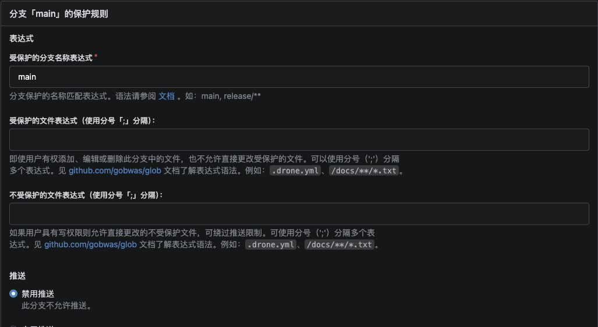

图中选中了“禁用推送”。其他合并约束在同一条分支规则中配置；本次没有修改或合并主分支。

Mattermost 创建机器人 `@demo-agent`，显示名称为 **DSH Super-agent**，角色是普通 `Member`。将它加入演示团队和私有的 Coding Demo 频道，不启用 `post:all` 或 `post:channels` 这两项额外的全局发帖权限。机器人使用自己的 API 令牌读取消息和回复，不借用管理员令牌。

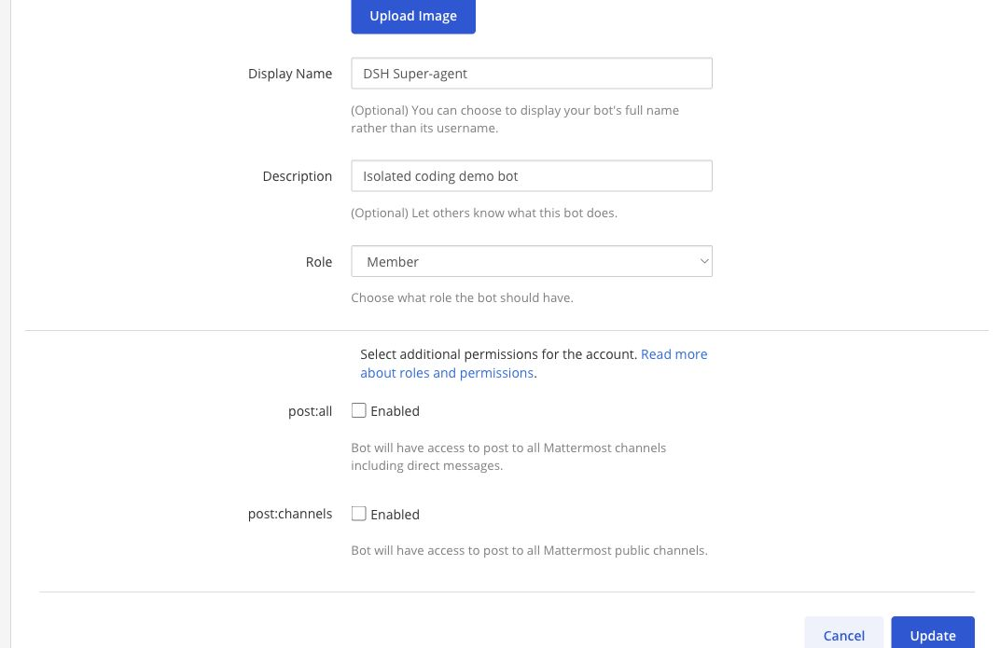

这张图是实际机器人配置：Member 角色，两项额外权限均未勾选。本文使用的都是演示身份，截图不包含令牌。

### API 凭据怎样进入 DSH

本次增加了一个名为 `demo-bridge` 的专用命令行适配器，负责调用 Gitea、Mattermost 的 REST API。它与前面访问模型的桥接进程是两个不同组件。

协作系统配置通过 Kubernetes Secret `agent-integrations` 只读挂载为 `/run/demo/integrations.json`。适配器默认读这个文件，也可以通过 `DSH_DEMO_CONFIG_FILE` 指定路径。关键字段如下，名称来自本次定制代码：

| 字段 | 本次用途 |
| --- | --- |
| `giteaURL`、`giteaToken` | Gitea 内网 API 地址和机器人令牌；本例服务地址为 `http://gitea:3000` |
| `repository` | 固定仓库 `demo-agent/agent-demo` |
| `mattermostURL`、`mattermostToken` | Mattermost 内网 API 地址和机器人令牌；本例服务地址为 `http://mattermost:8065` |
| `channelId`、`botId` | 固定频道 ID、机器人用户 ID，用于读取消息、过滤自身消息和原线程回复 |

这是关键字段说明，不是上游官方配置格式，也不是完整可直接运行的配置文件。真实令牌没有放进文章、聊天提示词或截图。只读挂载约束的是文件写入；同一容器内具备文件读取能力的工具仍可能读到凭据，因此它也不构成恶意代码的隔离边界。

编译后的自定义插件向 Super-agent 注册 `gitea`、`mattermost` 两种 Source。Source 通过适配器读取事件、补齐线程上下文和发送回复。Git 凭据助手另行检查主机名和完整仓库路径，PR 创建工具也固定到该演示仓库；这些是本次集成的实现，不能省略后只填写一个机器人名字。

### 页面里启用来源，再配置谁可以提任务

安装适配后的 Bundle，进入 **Superagent → 设置 → 来源**，启用 Gitea 和 Mattermost。本次分别每 10 秒、5 秒轮询一次，使用的是 API 轮询，没有为这条链路配置 Mattermost 出站 Webhook。

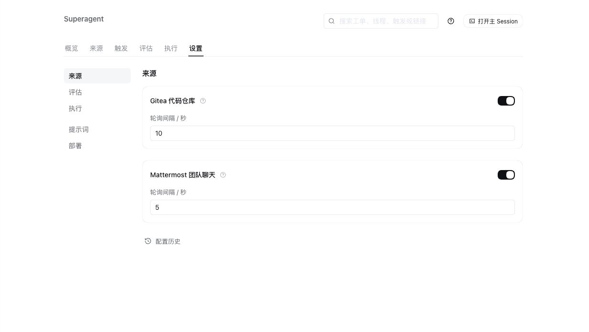

这里的页面管理启用状态和轮询频率；URL、令牌由前面的 Secret 和适配器读取，页面里没有让用户粘贴这两类凭据的输入框。

然后进入 **设置 → 评估 → 在各来源上**，配置允许发起任务的人。Gitea 按登录名允许 `demo-admin`；Mattermost 按该演示用户的 ID 允许。这个白名单标识的是发需求的人，与机器人自己的 `botId` 是不同身份。

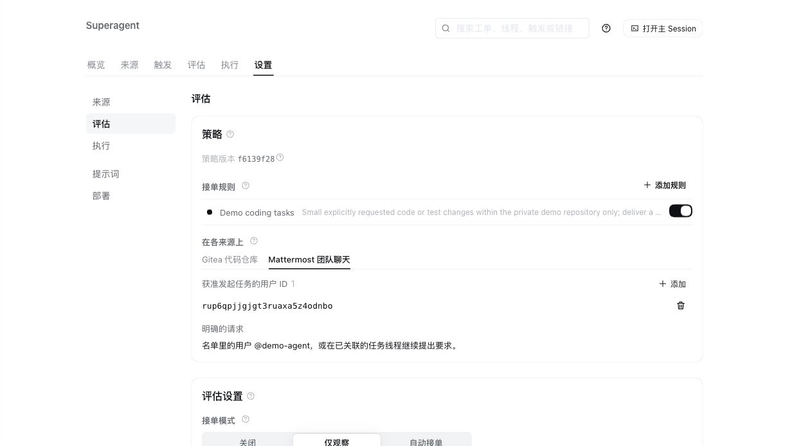

图中只允许一个演示用户。接单模式保持 `observe`（仅观察），合法的明确请求仍然可以接单；不能把它理解成所有任务都停用。执行名额设为两个。

最后用同一条小需求核对整条链路：频道消息被读取，出现对应工单和执行会话，Gitea 出现新分支及 PR，机器人把结果发回原消息线程。来源显示正常只能证明轮询在工作，完成这些检查才证明身份、工具调用和交付都已连通。

## Super-agent 怎样把消息变成任务

DSH 提供模型接入、会话、上下文、文件与命令工具。Super-agent 以 Bundle，也就是插件和配置组合的形式运行在 Harness 上，增加任务生命周期与团队协作规则。

可以把一次工作分成六步：接收事件，检查身份与规则，确定授权范围，建立工单，派给执行器，交付结果。

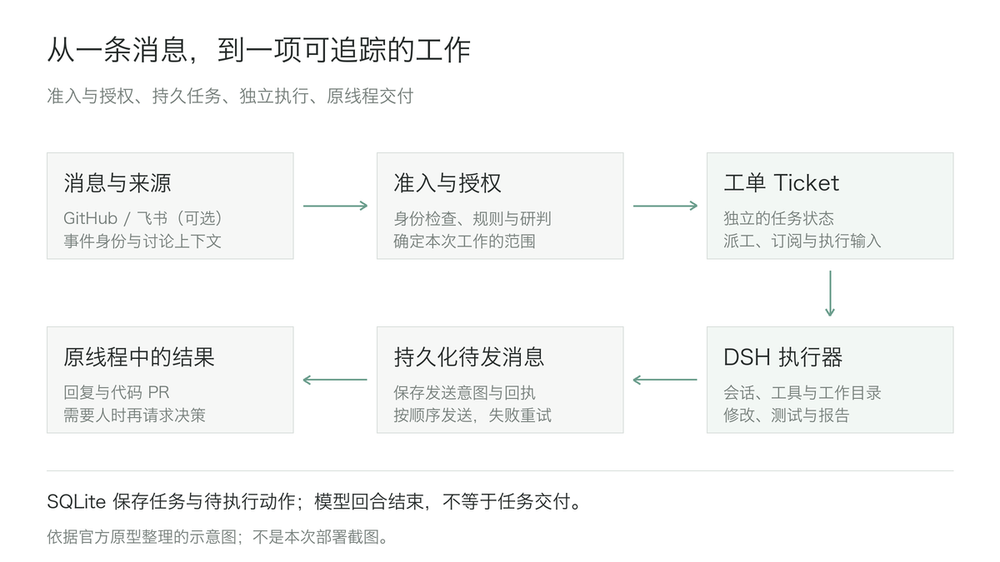

图中是官方原型的简化流程。它内置 GitHub 来源和可选的飞书入口，围绕一个 GitHub 仓库工作；本文 Demo 中的 Mattermost、Gitea 是本次增加的适配。

这里最值得理解的是三个区别。

**消息和任务有各自的身份。** 来源 Source 把消息转换成不可变事件 Trigger，讨论 Thread 保存持续上下文。接受工作后才创建工单 Ticket，并记录授权 Mandate。后续讨论可以补充上下文，但不会自动扩大任务权限。

任务和某次执行也分开管理。一次派工 Assignment 将工单交给执行器；执行中断后可以重新派工，而工单、讨论关系与待处理输入仍然保留。一个模型回合结束，只能说明这轮生成结束，不能据此认定代码已经交付。

最后，做完和送达是两件事。Outbox 保存待发送的消息与回执，再通过 Channel 写回原线程。SQLite 和持久化待执行动作，使重启后能够找回尚未完成的派工、输入投递和回复。外部写入仍需核对：远端已经成功、本地还没记录时，重试存在重复窗口。

主动接单也有范围。原型提供 `off`、`observe`、`auto` 三种模式，分别控制规则推断出来的工作；默认 `observe` 只记录判断，不实际接这种任务。合法的明确请求在这三种模式下仍可执行，因此关闭主动接单与停止正在运行的任务需要分别操作。

## 用户怎样提交任务、追踪结果

第一项需求很小：修复商品总价函数没有乘数量的问题。提交任务时，把范围、测试和交付条件一起写清楚。例如：

```text
@demo-agent 修复 src/pricing.js 中未乘 quantity 的错误。
补充数量大于 1 的回归测试，运行 npm test。
创建 Gitea PR，等待人工审核，不要合并。
```

Agent 完成修改后创建 PR #1，并回到原线程报告结果。随后在同一线程追加“数量为 0 时结果应为 0”的要求，它继续修改原来的分支与 PR。第一次为 5 项测试，追加后为 7 项，实际运行均通过。

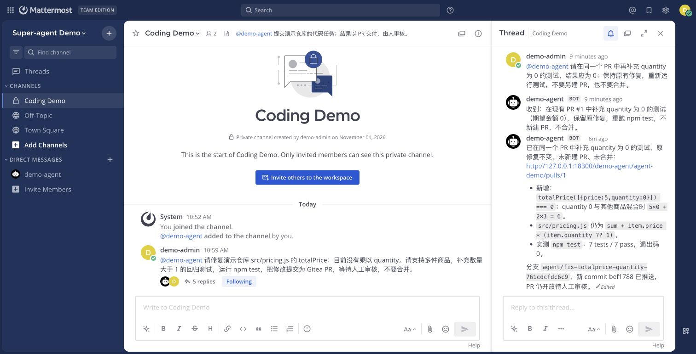

截图中的中文保留原样。用户可以在聊天里继续提要求，去 Gitea 看代码，在 DSH 的 Superagent 面板查看任务状态。

为了检查并发，再提交三个独立项目，修改范围分别限定在不同子目录。控制台实际出现两个执行器运行、第三个任务排队的状态。

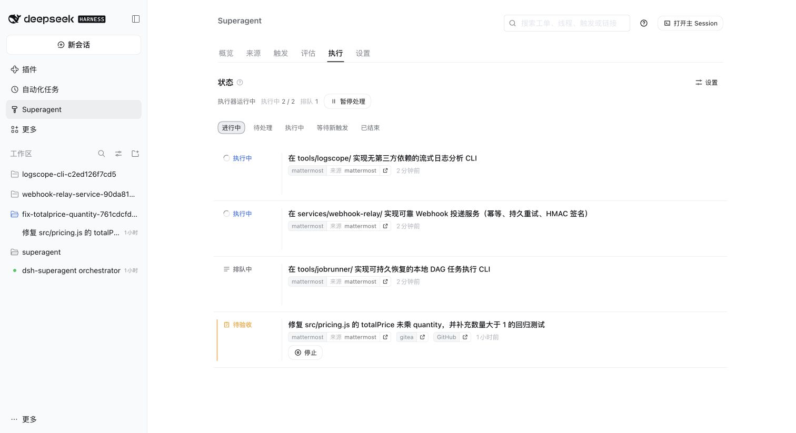

每个任务使用独立会话、工作目录和分支，减少多个任务反复切换同一个工作区的问题。如果它们修改共同接口，仍然需要集成测试；增加执行名额，也会增加下游模型服务的请求和预算压力。

## 打开 DSH，看看任务具体做了什么

任务列表展示的是编排状态。要检查实际工作，在 **Superagent → 执行** 中打开对应执行会话，切到 **轨迹**，再搜索文件名、工具名或测试输出。左侧是调用记录，点开后可以分别查看参数、结果和计时；主 Session 负责接单与派工，真正的文件修改和测试要到该任务的执行 Session 中查看。

以日志分析工具为例，在轨迹中搜索 `component_exit=0`，可以定位最后一次测试的 `bash` 调用。工具结果保留了命令输出，而不是只有一段“测试已通过”的自然语言报告。

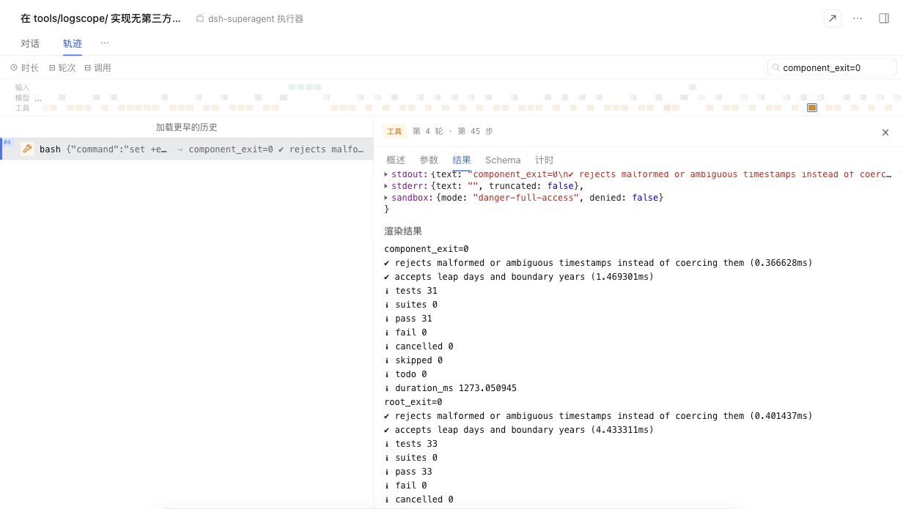

图中组件命令退出码为 0，31 项测试通过；仓库命令退出码也为 0，33 项测试通过。后者包含 31 项组件测试和原有的 2 项测试，不能相加写成 64 项。这里是 Agent 执行的自测，后面的 6 组独立验收另行记录。

这也给排查提供了具体入口：收到需求但没有执行会话，查接单和派工；会话一直生成文字却没有文件工具调用，查有效输出预算；已经调用测试但返回非零，查命令和失败输出；代码及测试完成但没有 PR 或线程回复，再查外部写入与回执。测试退出码为 0 只覆盖被执行的用例，仍需要检查断言和独立验收，不能直接等同于产品正确。

截图保留实际工具调用与输出，没有把模型的内部推理当作交付证据。下文的未完成 DAG 任务也保留在结果中，不因为其他任务成功而省去。

## 复杂任务做到了什么

第一个项目是可靠 Webhook 投递服务。要求包含入队 API、幂等键、SQLite 持久化、有限重试、固定投递目标和基于 SHA-256 的哈希消息认证码（HMAC-SHA256）。独立验收实际启动本地接收端，检查失败两次后成功、永久 HTTP 400、签名、稳定事件 ID，以及服务重启后继续投递。

它最终交付 15 个文件，组件自测 11 项通过，独立验收 5 组通过。投递语义是至少一次，接收端仍要按事件 ID 去重。这是单进程演示服务，没有 API 鉴权、TLS、多实例协调和死信重放接口。

第二个项目是流式日志分析 CLI，也就是命令行工具。它逐行读取 JSON Lines，支持时间和服务筛选、坏行处理、延迟汇总，并输出可直接打开的 HTML 报告。

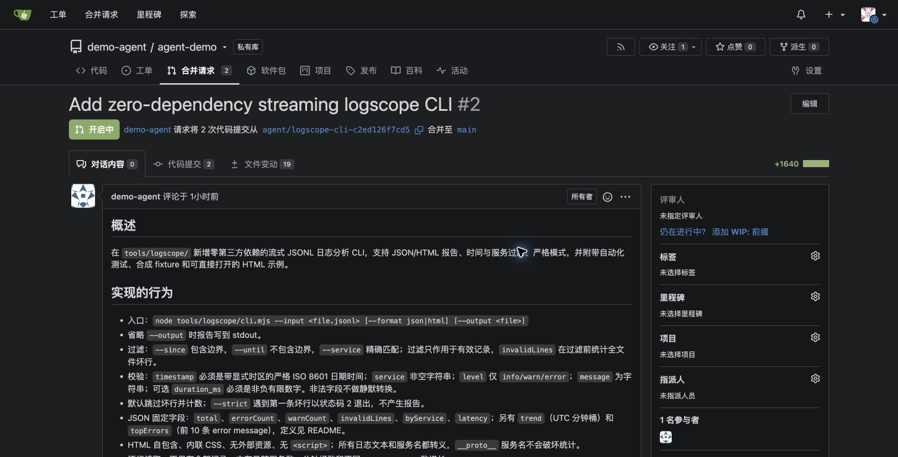

PR #2 包含 19 个文件、两次提交，最终代码为 `66fc963`。组件自测 31 项通过，独立验收 6 组通过，其中包括在 64 MiB 的 Node 堆限制下处理 100,000 条有限基数合成记录。

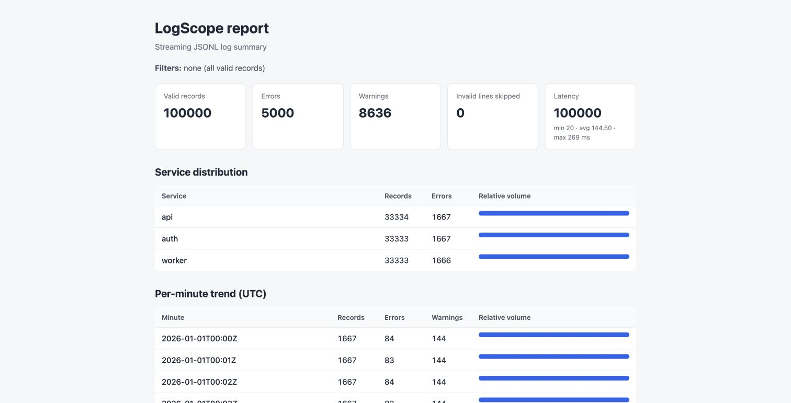

这张图是交付代码的实际输出。输入包含 100,000 条合成记录，其中 5,000 条为 error，延迟均值 144.50 ms；这些是测试数据的统计，不是生产监控。统计表仍会随服务名、时间桶、错误文本的基数增长，逐行读取不意味着任意输入都恒定内存。

第三个项目是持久化的有向无环图（Directed Acyclic Graph，DAG）任务执行器，要求支持依赖校验、并发、重试、超时和进程恢复。它没有交付实现，预先定义的 5 组独立验收未执行。

| 复杂任务 | 最终交付 | 独立验收 |
| --- | --- | --- |
| Webhook 投递服务 | PR #3，`8ba2da4` | 5 / 5 组通过 |
| 日志分析 CLI | PR #2，`66fc963` | 6 / 6 组通过 |
| DAG 任务执行器 | 输出预算耗尽，期限结束后停止 | 5 组未执行 |

独立验收通过真实 HTTP、CLI 和进程检查来判断结果，与 Agent 自己写的测试分开记录。日志验收首轮有一项因严格比较浮点均值而失败；保留结果后，只将验收器改为 `1e-9` 数值容差，产品代码没有变化，第二轮通过。

两个复杂项目都停在待人工审核的 PR。包括最初的小修复在内，PR #1、#2、#3 均未合并，主分支没有被修改。

## 重启能续跑，但要看恢复了哪一层

计价函数追加要求执行期间，我重建了 DSH Pod。恢复后仍沿用同一个工单、会话、目录、分支和 PR，最终跑通 7 项测试。这验证了同一测试节点、保留数据卷条件下的继续工作。

恢复依靠持久任务记录、会话历史和工作树。重启之后，执行器需要检查文件、Git 历史和远端 PR，再决定接着做什么；原来的 Shell 进程没有因此恢复到被中断的 CPU 指令处。本次也没有验证节点断电、本地磁盘丢失和跨节点恢复。

另一种情况要分开看：原始 Webhook、DAG 窗口到期并停止后，原线程中的继续请求创建了新工单和目录。聊天线程相同，不意味着停止后仍是同一次任务恢复。

复杂任务还暴露了两类问题。

首先是演示模型桥接的传输实现。首轮长请求在 300 秒时被截断，出现 `Stream ended without finish_reason`。桥接逐小块同步回传服务端事件流（Server-Sent Events，SSE），每块都等待网络往返。修正为按约 50 ms 或 64 KiB 聚合，并区分 180 秒空闲时限与 15 分钟总时限后，保留失败记录继续验证。这个问题属于本次桥接实现。

其次是有效输出预算。DAG 多次在 8,192 输出 token 后以 `max-tokens` 结束，未生成实现。显式关闭思考并指定 32,768 token 的最小 API 探测能调用工具，但完整 DSH 会话仍观察到原来的上限。需要继续核对客户端、桥接与上游实际生效的参数；现有证据不足以归因于模型不会完成这个任务。

派工语义也影响推进：主会话曾请求“只报告状态”，执行器便按要求没有继续实现。原型中状态查询与继续实施是不同操作，持久化记录恢复了，也还要检查后续指令是否正确。

## 这套设计适合怎样落地

从这次 Demo 看，最适合先验证的是范围清楚、结果能审核的研发任务：修复缺陷、补测试、生成分析工具，再由人检查 PR。即时通信（Instant Messaging，IM）提供入口，Gitea 提供交付物，Super-agent 管理中间的任务状态，Harness 提供实际执行能力。

落地时我会先守住四个条件：

1. 使用专用实例、机器人和测试仓库，先限定谁能发起工作、能修改哪里，再检查事件去重与回复回执。
2. 持久化任务、会话和工作目录，先做单实例恢复。SQLite 状态目录有锁，直接增加副本不能得到可并发写入的高可用控制面。
3. 把执行隔离放在底层实现。独立会话和目录方便组织工作，任务授权也有明确记录；操作系统权限、网络、凭据和恶意代码隔离仍需要单独设计。
4. 给实验定义验收和期限，保留未完成任务。观察可评审结果、人工纠偏次数、调用成本和重复副作用，比单看“运行中几个 Agent”更有用。

Super-agent 值得研究的地方，是把持续发生的团队讨论组织成有身份、有范围、能追踪并交付的工作。这次 Demo 已经能让人从聊天里发起任务、在控制台看进展、去 Gitea 审查代码；两个复杂项目的交付和一个失败任务，也说明了把这条链路做好需要哪些工程细节。

完整部署设计、验收摘要与原始界面见“阅读原文”对应的公开实战文档。

## 资料与公开记录

官方研究原型与声明：https://github.com/deepseek-ai/dsh-superagent-prototype

领域模型：https://github.com/deepseek-ai/dsh-superagent-prototype/blob/6337fc823ce20251c8de8085948165c81aaa701e/docs/001-domain.md

执行与恢复：https://github.com/deepseek-ai/dsh-superagent-prototype/blob/6337fc823ce20251c8de8085948165c81aaa701e/docs/003-execution.md

部署边界与来源扩展：https://github.com/deepseek-ai/dsh-superagent-prototype/tree/6337fc823ce20251c8de8085948165c81aaa701e/docs

DSH 容器镜像：https://github.com/runzhliu/deepseek-harness-docker

公开原理解析：https://aik8s.run/ai-k8s/rag-agent/deepseek-superagent-prototype-analysis/

公开 Demo 实战：https://aik8s.run/ai-k8s/rag-agent/deepseek-superagent-kubernetes-practice/
