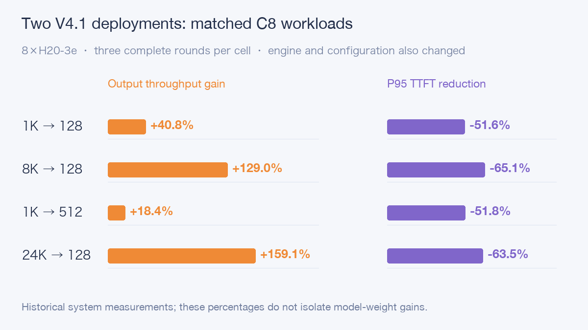

# DeepSeek 1017 Day0: Eight-H20 Tests Compared with the Original V4.1

DeepSeek-V4.1-Flash-1017 updates the weights of V4.1-Flash, accepting text and images and producing text. It retains the mixture-of-experts architecture and Engram conditional memory. The update focuses on reasoning, coding, agent tasks, and vision; the publisher also reports shorter task execution time and output length.

Enterprise deployment raises practical questions beyond benchmark scores: can existing GPUs run it, how much waiting does concurrency add, and can a million-token request actually complete?

This test used **8×H20-3e** with vLLM, completed 36 core load-test rounds, and submitted three independent inputs exceeding one million tokens.

## The tested configuration

The pinned model has 48 weight shards totaling approximately 475.25 GiB. Native mixed precision combines FP4 experts and FP8 for other major weights. MoE activates only some experts per token, but deployment still requires the full weights. Engram is a built-in parameter table; placing it on CPU or GPU changes resource requirements and memory paths.

| Item | Measured conditions |
| --- | --- |
| GPUs | 8×H20-3e, 143,771 MiB reported per GPU |
| vLLM | 0.32.0rc1.dev329+g39983a5e7 |
| Base service | TP8, 32,768 context, maximum sequences 32 |
| Long-context service | 1,048,576 context, maximum sequences 1 |
| Engram and caching | GPU Engram; prefix caching disabled; DSpark not enabled |
| Load test | Four input/output shapes, C1/C8/C32, three rounds per cell |

All eight ranks passed numerical collective-communication checks, and GPU pairs reported NV18 connections. Weights were loaded from a read-only shared filesystem. The public document contains the exact image identity, launch arguments, and per-round data.

## Throughput gains and waiting costs

Input and output lengths were fixed, with separate warmup. TTFT measures first-token wait, TPOT the average time per subsequent output token, and E2E the entire request. Fixed-length tests used `temperature=0` and `ignore_eos=true` to examine system performance; natural tasks were tested separately.

| Input → output | C | Output tok/s | P95 TTFT s | Valid rounds |
| --- | ---: | ---: | ---: | ---: |
| 1,024 → 128 | 1 | 125.9 | 0.163 | 3/3 |
| 1,024 → 128 | 8 | 569.2 | 0.569 | 3/3 |
| 1,024 → 128 | 32 | 1,036.8 | 1.844 | 3/3 |
| 8,192 → 128 | 1 | 97.3 | 0.461 | 3/3 |
| 8,192 → 128 | 8 | 223.6 | 3.209 | 3/3 |
| 8,192 → 128 | 32 | 270.2 | 12.512 | 2/3 |
| 1,024 → 512 | 1 | 141.2 | 0.164 | 3/3 |
| 1,024 → 512 | 8 | 727.0 | 0.567 | 3/3 |
| 1,024 → 512 | 32 | 1,566.9 | 1.850 | 3/3 |
| 24,576 → 128 | 1 | 58.1 | 1.364 | 3/3 |
| 24,576 → 128 | 8 | 90.9 | 9.568 | 3/3 |
| 24,576 → 128 | 32 | 98.3 | 36.957 | 2/3 |

Metrics are medians over complete valid rounds. The core matrix executed 36 rounds, of which 34 had every request complete; **1,054/1,056 requests succeeded**. The two failed requests occurred at C32 for 8K→128 and 24K→128. Those cells therefore have only two complete rounds, with failures retained in the original denominators.

For 1K→128, C1 to C32 raised throughput from 125.9 to 1,036.8 tok/s, or **8.24×**, while P95 TTFT increased from 162.9 to 1,843.8 ms, or **11.32×**.


Both series use C1 as the baseline on a shared multiplier scale. Concurrency increased total output while also increasing user waiting time.

Long inputs show the trade-off more sharply. For 24K→128, C8 to C32 increased throughput only from 90.9 to 98.3 tok/s, about 8.1%, while P95 TTFT increased from 9.57 to 36.96 seconds. Interactive long-document workloads need a waiting-time target before an admission concurrency limit is chosen.

The long-output workload reached 1,566.9 tok/s at C32 with P95 TPOT of 19.73 ms. It amortizes Prefill and should not be treated as capacity for short-answer workloads.


Sampled peaks in this window were 100% GPU utilization, approximately 121 GiB per-GPU memory, 402 W, and 62°C. Memory includes weights, cache preallocation, and workspace; it is not pure weight residency.

## What changed from the original V4.1-Flash deployment?

The earlier V4.1-Flash test also used eight H20-3e GPUs, GPU Engram, and a 32K serving context. C8 is selected consistently across all four workloads: both deployments have three complete rounds and 48/48 successful requests per cell. Metrics are medians of per-round statistics.

| Input → output / C8 | Output tok/s: previous → 1017 | P95 TTFT s: previous → 1017 |
| --- | ---: | ---: |
| 1K → 128 | 404.2 → 569.2 | 1.18 → 0.57 |
| 8K → 128 | 97.6 → 223.6 | 9.19 → 3.21 |
| 1K → 512 | 613.7 → 727.0 | 1.18 → 0.57 |
| 24K → 128 | 35.1 → 90.9 | 26.23 → 9.57 |



Throughput increased by 18.4%–159.1%, while P95 first-token wait decreased by approximately 51.6%–65.1%. Long inputs improved more, but 24K input still required about 9.57 seconds before output began.

The vLLM build and PyTorch also changed. The batch token budget changed from 8,192 to 4,096, expert-parallelism settings and CPU requests differed, and synthetic inputs were not byte-for-byte replays. This compares **the overall original V4.1 deployment with this 1017 deployment**; it cannot isolate gains caused by the model weights.

The original core matrix completed 1,051/1,056 requests, compared with 1,054/1,056 here, with incomplete requests in both runs. The original model also advertised 1M context, but the earlier experiment did not verify it. This test extends actual coverage to million-token inputs.

## How many tokens actually reached the service?

The separate long-context service progressed through 64K, 128K, 256K, and 512K before receiving three independent 1M seeds. Each synthetic document placed three random codes at approximately 10%, 50%, and 90% of the body. The model retrieved codes for specified project names.

The core instruction was:

```text
Return only a JSON object mapping each requested project name to its access_code.
```

| Context / seed | Input tokens | TTFT s | E2E s |
| --- | ---: | ---: | ---: |
| 64K | 57,285 | 3.25 | 4.52 |
| 128K | 122,881 | 6.81 | 8.92 |
| 256K | 253,900 | 15.28 | 16.66 |
| 512K | 516,033 | 36.12 | 37.20 |
| 1M / 101701 | 1,040,333 | 97.23 | 98.56 |
| 1M / 101702 | 1,040,325 | 97.18 | 98.38 |
| 1M / 101703 | 1,040,323 | 97.07 | 98.28 |

All seven samples passed. Native local encoding counts matched server input Usage. The three 1M requests each contained approximately **1.04 million input tokens**. First-token time was about 97 seconds, the full request about 98 seconds, and codes at all three positions were retrieved correctly.


This stage reached sampled peaks of approximately 128 GiB per-GPU memory, 387 W, and 64°C. It verifies single-request long-context reachability and synthetic retrieval, not multi-user million-token serving capacity.

## Tools, images, and natural tasks

Basic text, multi-turn memory, complete streaming, tool calls, and image-content sensitivity checks passed. Tool validation checked function names, arguments, simulated results, and final answers. Vision checks varied image content and order to establish that the model actually read its input.

The natural task set contained 12 tasks repeated three times each, using `temperature=1.0` and `top_p=1.0`. Two actual prompts were:

```text
Compute 19 * 23. Reply with the integer only.

Extract fields into JSON with keys name, department, seats: Ada works in platform and requested 6 seats.
```

The corresponding results were 437 and JSON containing Ada, platform, and 6. Strict validation passed 33/36. All three failures were the same order task: the prompt did not specify whether `items` meant an item count or an item-detail array. The model calculated the total correctly but used a different field structure. This ambiguity is retained in the results and is not used for capability ranking.

## Choosing a deployment configuration

**Treat short and long requests separately.** Short inputs gain throughput from concurrency. Long inputs impose larger first-token costs and benefit from concurrency limits, separate queues, and overload protection. These finite batches do not directly establish sustained production capacity.

**Plan 1M capacity separately.** The long-context service used maximum sequences 1. Mixing short requests or raising concurrency requires further measurements of scheduling interference, workspace, and cache budgets.

**Make Engram placement explicit.** This test used `--engram-config '{"cpu_offload":false}'`. CPU offloading changes host-memory and PCIe paths and needs separate measurement rather than being mixed with GPU Engram results.

**Check eight-GPU interconnects and NUMA.** Non-Uniform Memory Access (NUMA) affects paths between CPUs, memory, and devices. Investigate bottlenecks using GPU topology, process affinity, and host-memory policy. Merely seeing eight GPUs is insufficient to establish a sound deployment.

A separate historical-length auxiliary matrix executed 6/12 rounds with one complete round before stopping after consecutive failures. The rate-controlled SLO scan did not run. This article therefore reports fixed-configuration performance and long-context results, without claiming long-term stability or production SLO capacity.

References:

DeepSeek-V4.1-Flash-1017: https://huggingface.co/deepseek-ai/DeepSeek-V4.1-Flash-1017

vLLM V4.1 Recipe: https://github.com/vllm-project/recipes/blob/main/models/deepseek-ai/DeepSeek-V4.1-Flash.yaml

Read the full article: https://aik8s.run/ai-k8s/practices/deepseek-v41-flash-1017-day0/
