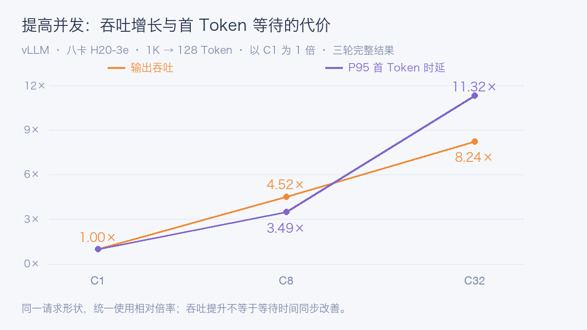
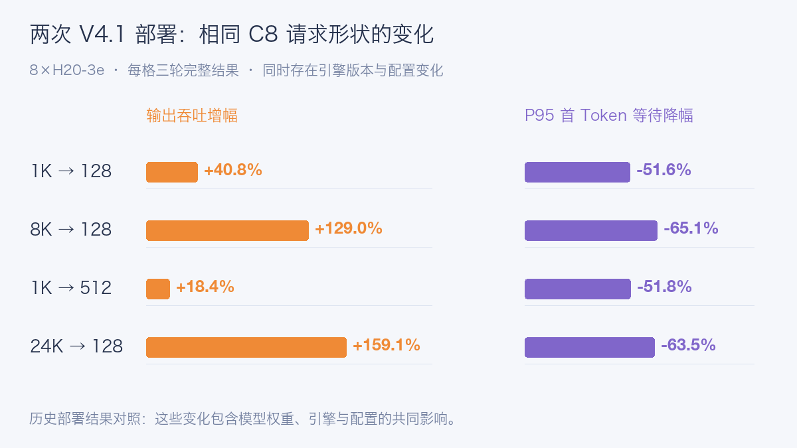

# DeepSeek 1017 Day0：八卡 H20 实测，对比原版 V4.1

DeepSeek-V4.1-Flash-1017 是 V4.1-Flash 的权重更新，支持文本和图片输入、文本输出。它延续混合专家与 Engram 条件记忆架构，本次更新重点是推理、代码、智能体任务和视觉能力；官方还报告了更短的任务执行时间和输出长度。

对企业部署来说，模型成绩之外，还需要回答几个实际问题：现有 GPU 能否运行、并发增加后要等多久，以及百万 Token 上下文究竟能否真正完成请求。

这次用一台 **8×H20-3e** 运行 vLLM，完成了 36 轮核心压测，并实际发送了三组超过一百万 Token 的输入。

## 这次用什么配置

锁定模型有 48 个权重分片，约 475.25 GiB，原生格式混用专家 FP4 和其他主要权重 FP8。MoE 每次只激活部分专家，但完整部署仍要容纳全部权重。Engram 是模型自带的参数表，放在 CPU 还是 GPU，会改变资源需求与访存路径。

| 项目 | 实测条件 |
| --- | --- |
| GPU | 8×H20-3e，每卡报告 143,771 MiB |
| vLLM | 0.32.0rc1.dev329+g39983a5e7 |
| 基础服务 | TP8，32,768 上下文，最大序列 32 |
| 长上下文服务 | 1,048,576 上下文，最大序列 1 |
| Engram 与缓存 | Engram 放 GPU；前缀缓存关闭；未启用 DSpark |
| 压测 | 四种输入输出长度，C1/C8/C32，每格三轮 |

单机八个 rank 的集合通信数值检查通过，GPU 两两显示 NV18 连接。模型从只读共享文件系统加载；实际镜像、启动参数和逐轮数据列在公开文档中。

## 吞吐提高了多少，等待增加了多少

输入输出长度固定，预热单独执行。TTFT 是首 Token 等待，TPOT 是后续每 Token 的平均耗时，E2E 是整次请求耗时。本次固定长度压测使用 `temperature=0`、`ignore_eos=true`，用于观察系统性能；自然问答另测。

| 输入 → 输出 | 并发 | 输出 tok/s | P95 TTFT 秒 | 完整轮次 |
| --- | ---: | ---: | ---: | ---: |
| 1,024 → 128 | 1 | 125.9 | 0.163 | 3/3 |
| 1,024 → 128 | 8 | 569.2 | 0.569 | 3/3 |
| 1,024 → 128 | 32 | 1,036.8 | 1.844 | 3/3 |
| 8,192 → 128 | 1 | 97.3 | 0.461 | 3/3 |
| 8,192 → 128 | 8 | 223.6 | 3.209 | 3/3 |
| 8,192 → 128 | 32 | 270.2 | 12.512 | 2/3 |
| 1,024 → 512 | 1 | 141.2 | 0.164 | 3/3 |
| 1,024 → 512 | 8 | 727.0 | 0.567 | 3/3 |
| 1,024 → 512 | 32 | 1,566.9 | 1.850 | 3/3 |
| 24,576 → 128 | 1 | 58.1 | 1.364 | 3/3 |
| 24,576 → 128 | 8 | 90.9 | 9.568 | 3/3 |
| 24,576 → 128 | 32 | 98.3 | 36.957 | 2/3 |

表中是完整有效轮次的中位数。核心矩阵共执行 36 轮，34 轮全部请求完整，**成功请求为 1,054/1,056**。两个失败请求分别在 8K→128、24K→128 的 C32 档位，因此这两格只有两轮完整数据；失败仍留在原分母中。

短请求 1K→128 从 C1 到 C32，输出吞吐由 125.9 增至 1,036.8 tok/s，提高到 **8.24 倍**；P95 首 Token 等待从 162.9 ms 增至 1,843.8 ms，提高到 **11.32 倍**。



这张图把吞吐与首 Token 等待都按 C1 归一化，使用同一倍率刻度。并发确实增加了整机产出，也增加了用户等待。

长输入更明显：24K→128 从 C8 到 C32，吞吐只从 90.9 增至 98.3 tok/s，约增加 8.1%；P95 TTFT 却从 9.57 秒增至 36.96 秒。交互式长文问答需要先定等待目标，再决定准入并发。

长输出的 C32 吞吐达到 1,566.9 tok/s，P95 TPOT 为 19.73 ms。它摊薄了 Prefill 成本，不能直接当作短答案服务的容量。


该时间窗口的采样峰值为 GPU 利用率 100%、单卡显存约 121 GiB、功耗 402 W、温度 62°C。显存包括权重、缓存预分配和工作区，不能把它理解成纯权重占用。

## 与原版 V4.1-Flash 相比，有哪些变化

之前的 V4.1-Flash 测试也使用八卡 H20-3e、GPU Engram、32K 服务上下文。取四类请求的 C8 做对照：两次每格都是三轮完整、48/48 请求成功，按轮次中位数统计。

| 输入 → 输出 / C8 | 输出 tok/s：原版 → 1017 | P95 TTFT 秒：原版 → 1017 |
| --- | ---: | ---: |
| 1K → 128 | 404.2 → 569.2 | 1.18 → 0.57 |
| 8K → 128 | 97.6 → 223.6 | 9.19 → 3.21 |
| 1K → 512 | 613.7 → 727.0 | 1.18 → 0.57 |
| 24K → 128 | 35.1 → 90.9 | 26.23 → 9.57 |



四个场景的吞吐增加 18.4%–159.1%，P95 首 Token 等待降低约 51.6%–65.1%。长输入改善更明显，但 24K 输入仍要等待约 9.57 秒才开始输出。

这次还更换了 vLLM 构建和 PyTorch，每批 Token 预算从 8,192 改为 4,096，专家并行开关和 CPU 请求也不同；合成文本不是逐字回放。因此，这里对照的是**原版 V4.1 部署与本次 1017 部署的整体表现**，还无法把收益单独归给模型权重。

原版核心矩阵成功请求为 1,051/1,056，本次为 1,054/1,056，均存在不完整请求。旧模型本身也声明 1M 上下文，只是原实验未验证；这次把实际测试推进到了百万 Token 输入。

## 百万 Token，实际输入是多少

长上下文使用独立服务配置。从 64K、128K、256K、512K 逐步验证，再提交三个独立种子的 1M 请求。每条合成长文把三个随机代码放在约 10%、50%、90% 的位置，模型根据项目名称找回对应代码。

实际指令核心如下：

```text
Return only a JSON object mapping each requested project name to its access_code.
```

| 上下文 / 种子 | 输入 Token | TTFT 秒 | E2E 秒 |
| --- | ---: | ---: | ---: |
| 64K | 57,285 | 3.25 | 4.52 |
| 128K | 122,881 | 6.81 | 8.92 |
| 256K | 253,900 | 15.28 | 16.66 |
| 512K | 516,033 | 36.12 | 37.20 |
| 1M / 101701 | 1,040,333 | 97.23 | 98.56 |
| 1M / 101702 | 1,040,325 | 97.18 | 98.38 |
| 1M / 101703 | 1,040,323 | 97.07 | 98.28 |

七个样例全部通过。本地原生编码器计数与服务端 Usage 的输入 Token 数一致，三个 1M 样例实际输入均约 **104 万 Token**。首 Token 约 97 秒，完整请求约 98 秒，三个位置的代码均正确召回。


该阶段单卡显存采样峰值约 128 GiB，功耗峰值 387 W，温度峰值 64°C。这里验证的是单请求长上下文可达性和合成召回，尚不能据此推断多用户百万 Token 服务容量。

## 工具、图片与自然任务

基础文本、多轮记忆、完整流式输出、工具调用和图片内容敏感性检查通过。工具链路检查了函数名、参数、模拟返回值和最终回答；图片测试通过改变内容及顺序检查模型是否实际读取输入。

自然任务另有 12 题，每题三次，采用 `temperature=1.0`、`top_p=1.0`。以下是两个实际 Prompt：

```text
Compute 19 * 23. Reply with the integer only.

Extract fields into JSON with keys name, department, seats: Ada works in platform and requested 6 seats.
```

对应结果为 437，以及包含 Ada、platform、6 的 JSON。完整小任务集严格验收为 33/36；三次未通过来自同一道订单题，Prompt 没有明确 `items` 要件数还是明细数组，模型总价计算正确，但字段结构与预期不同。这个歧义保留在结果中，不作为模型能力排名。

## 部署时怎样选择配置

**短请求与长请求分开考虑。** 短输入可以通过提高并发获得吞吐；长输入的首 Token 代价更大，适合限制并发、独立队列和过载保护。本次是有限请求批次，不能直接换算成持续线上容量。

**1M 服务应单独做容量规划。** 本次长上下文使用最大序列 1。需要混跑短请求或提高并发时，还要验证调度干扰、显存工作区和缓存预算。

**Engram 位置必须明确。** 本次显式设置 `--engram-config '{"cpu_offload":false}'`。CPU 卸载会改变主机内存与 PCIe 路径，应单独测量，不能与 GPU Engram 成绩混用。

**检查八卡互联和 NUMA。** NUMA，即非一致性内存访问，会影响 CPU、内存和设备间的数据路径。结合 GPU 拓扑、进程亲和性与主机内存策略排查瓶颈；仅看到八张 GPU 并不足以判断部署合理。

这次还尝试了独立的历史长度辅助矩阵，执行 6/12 轮、1 轮完整，连续失败后停止；限速 SLO 扫描未执行。因此，本文给出固定配置的性能与长上下文结果，不给出长期稳定性或线上 SLO 容量结论。

参考资料：

DeepSeek-V4.1-Flash-1017：https://huggingface.co/deepseek-ai/DeepSeek-V4.1-Flash-1017

vLLM V4.1 Recipe：https://github.com/vllm-project/recipes/blob/main/models/deepseek-ai/DeepSeek-V4.1-Flash.yaml

阅读原文：https://aik8s.run/ai-k8s/practices/deepseek-v41-flash-1017-day0/
