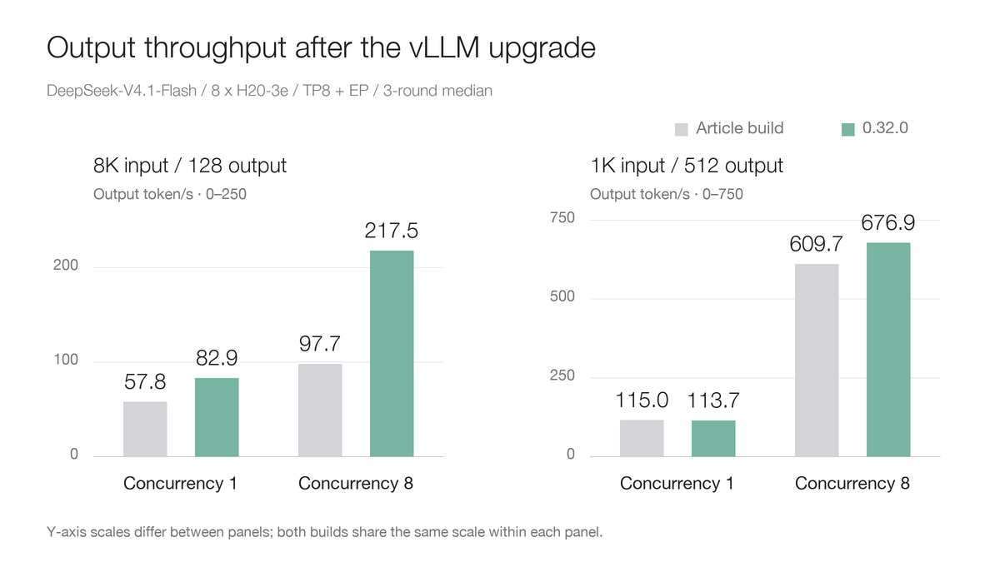
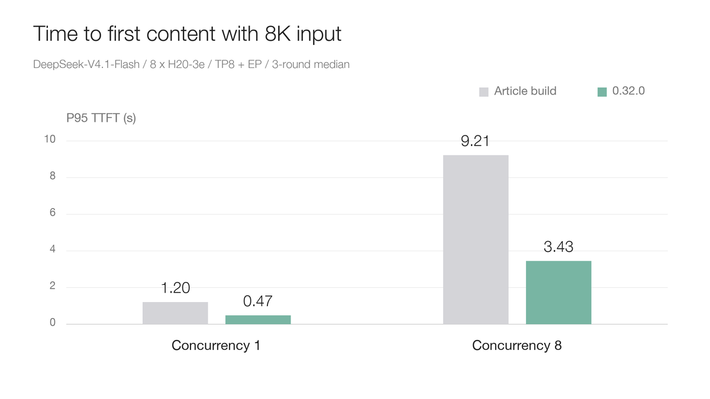
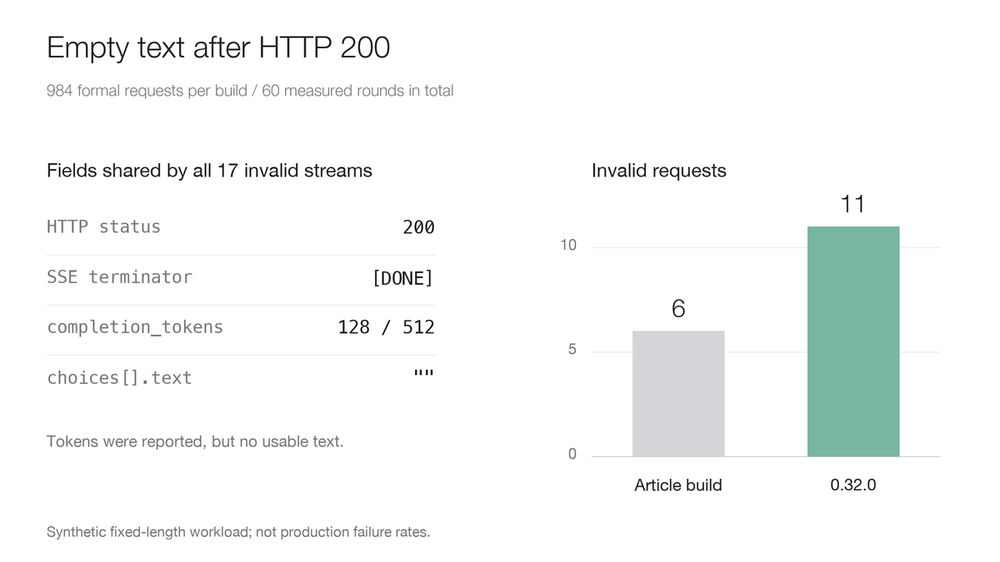
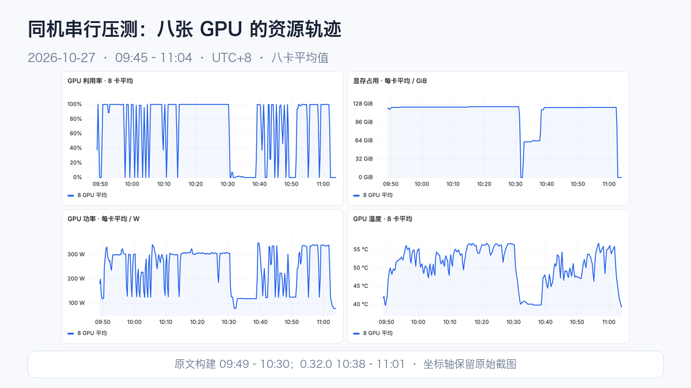
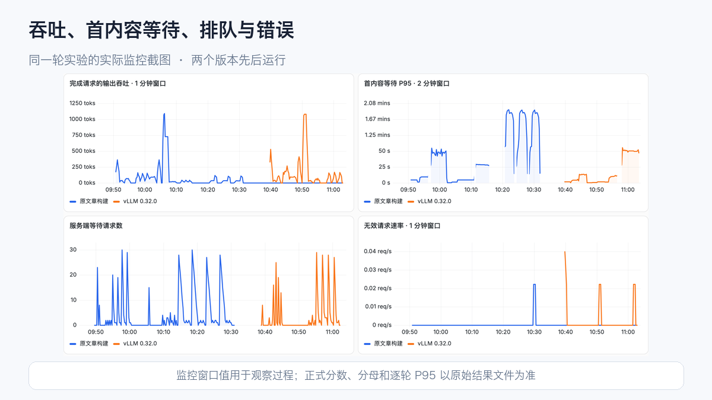

# Does vLLM 0.32.0 Make DeepSeek V4.1 Faster? A Test on Eight H20-3e GPUs

DeepSeek-V4.1-Flash combines a mixture of experts with Engram conditional memory and accepts text and image input. At its release, we tested deployment, functionality and performance on eight H20-3e GPUs using a pinned support build. The vLLM implementation has since changed considerably.

Recent WeChat and public discussions suggest newer vLLM builds perform well on DeepSeek. What does that mean for the H20-3e hardware we actually have? Do long input and long output benefit equally, and do functionality and output completeness survive the upgrade?

We restored the earlier article's image and ran it sequentially against the formal **0.32.0** release on the same eight-GPU machine, completing **60 rounds and 1,968 formal requests** in the follow-up.

There are clear gains and unresolved issues. With 8K input at concurrency 8, throughput increases from **97.69 to 217.46 tokens/s, approximately 123%**. Single-request long-output throughput is almost unchanged. Complete-output validation records 6 invalid requests on the old build and 11 on the new build.

## What does “the new version is fast” refer to?

On October 7, the vLLM team described DeepSeek-V4.1-Flash improvements on AgentX relative to its Day 0 implementation. That article predates 0.32.0. Its multipliers are not a promise that installing this release makes every machine equally faster.

0.32.0 was released on **October 18**, with changes such as preferring Humming on Hopper. That is a reason to measure again, but the gain still depends on hardware, request length and concurrency.

This experiment uses neither a rolling nightly nor 1017 model weights. It compares the original DeepSeek-V4.1-Flash checkpoint on the earlier article's build and 0.32.0.

## Identical startup arguments can select different execution paths

Both builds use **TP8 plus expert parallelism**, a 32K serving context, 32 running sequences, 8,192 batched tokens and GPU memory utilization of 0.85. Engram remains on GPU, text prefix caching is disabled, and DSpark is not enabled.

The earlier build reports `0.1.dev1+g79a7108d9`; the new build reports `0.32.0`. Both use Torch 2.13.0+cu130. Humming changes from 0.1.12 to 0.1.17, while Transformers and FlashInfer also change with the image. The client and per-round inputs remain fixed.

The logs expose a material difference: **SWA bounded replay is enabled by default in the new build**, whereas the old build has no such configuration option.

SWA means Sliding Window Attention. Bounded replay reduces part of the work on long inputs. The new log states that during eager prefill, layer 20 writes KV for every token, while the remaining relevant work and layers 21–39 process only each request's final 128 tokens. This decoder path can operate even with prefix caching disabled.

The new build also selects Humming's MXFP8 linear and expert-computation paths. These results describe **the whole upgrade**, rather than attributing every gain to one kernel. Separating bounded replay's contribution requires another on/off experiment.

## Long input benefits; long output depends on concurrency

Each input-length/concurrency case has three formal rounds, with warmup separate. C1, C8 and C32 send 8, 16 and 64 requests per round respectively. The chart includes only cases with every request valid on both builds. Each bar shows the median of three rounds.

Long-input and long-output workloads use separate panels with different y-axis scales; both builds share the same scale within each panel.

For 8K input and 128 output tokens, single-request throughput rises from 57.76 to 82.94 tokens/s; at concurrency 8, it rises from 97.69 to 217.46 tokens/s, approximately **2.23 times the original**.

For 1K input and 512 output tokens, single-request throughput changes from 115.00 to 113.69 tokens/s, approximately −1.1%. Near parity is the appropriate description for these short repeats. At concurrency 8, it increases from 609.73 to 676.93 tokens/s, approximately 11%.

An upgrade can therefore feel quite different for long-input retrieval and for one user's sustained generation.

At 8K/C8, P95 time to first content falls from **9.206 to 3.429 seconds, approximately 62.8%**. We calculate P95 per round and then take the median of three rounds. Single-request long-output P95 time per output token instead changes from 8.342 to 8.520 ms.

An earlier same-node batch also completed the 4K-input, 128-output, C32 case: 203.22→463.20 tokens/s, approximately +127.9%, with 384/384 valid requests on each build. That batch used another node with the same hardware specification and remains statistically separate from this follow-up.

## Both builds returned “200, but no text”

Each build executes 30 formal rounds and 984 requests in this follow-up. The old build has 978 valid and 6 invalid requests; the new build has 973 valid and 11 invalid requests. Five and nine rounds respectively contain invalid requests.

These failures share a pattern: HTTP 200, a `[DONE]` stream terminator and usage reporting generated tokens, while **text remains empty throughout**.

Checking only HTTP status, health or the benchmark process's exit code could classify them as successful. Here the original denominator is retained and empty text is rejected. Cases with failures remain recorded but are not included in the failure-free gain chart.

The cause cannot yet be attributed to Humming, a GPU kernel or the new version alone. Both builds show the behavior. Diagnosis should fix synthetic prompts and token IDs, compare streaming, nonstreaming, special-token handling and decoded output, then toggle optimizations individually. These synthetic-workload proportions are not production failure rates.

## What the run looked like

The capture spans October 27, 09:45–11:04, UTC+8. The article build runs first and 0.32.0 second. The intervening memory drop and rise corresponds to switching versions, loading and initialization. Resource panels average eight GPUs. Chinese labels in genuine captures remain unchanged.

Both builds execute cases in the same order, but the new build takes a different amount of time per case. Compare corresponding cases, rather than equal wall-clock coordinates. Windowed throughput and histogram P95 explain the process; per-round files determine formal scores.

Both builds pass the follow-up's text, basic complete-stream gate, tool parsing and single/two-image ordering examples. Vision retains the original 2,048-token budget. Passing these examples does not replace accuracy or long-task regression testing.

## Deployment choices

For **long prompts, RAG or long agent histories**, 0.32.0 merits a canary rollout focused on first-content waiting, queues and usable-output ratios. RAG means Retrieval-Augmented Generation. Include the new bounded replay default in task-quality regression testing.

For **one user, short input and sustained long generation**, do not expect a version change alone to double decode speed. The single-request long-output case is nearly unchanged. Test against the actual per-token latency objective.

Before raising concurrency, diagnose empty text and complete acceptance checks. Pin image digests, model snapshots and dependencies, retain rollback images, and establish capacity with real prompts.

This upgrade clearly benefits long-input workloads. The more useful operational lesson is to evaluate request shape, default execution paths and complete output together, rather than remember only the fastest throughput number.

The full configuration, all 10 cases, failure denominators and sanitized per-round data are available in the public document.

## References

vLLM 0.32.0 Release: https://github.com/vllm-project/vllm/releases/tag/v0.32.0

DeepSeek-V4.1-Flash on vLLM: https://vllm.ai/blog/2026-10-07-deepseek-v41-flash

Humming technical introduction: https://vllm-project.github.io/2026/10/19/humming.html

Public document: https://aik8s.run/en/ai-k8s/practices/deepseek-v41-vllm032-upgrade/
