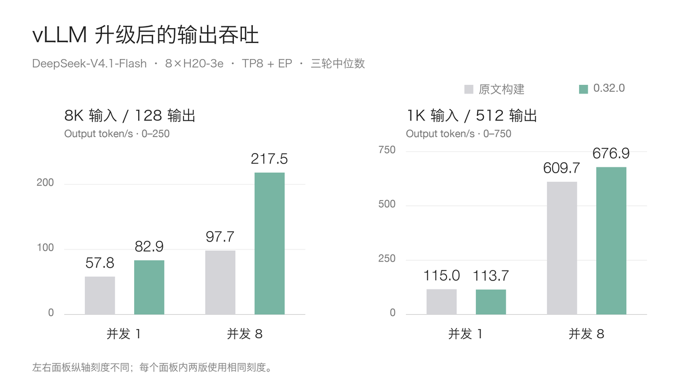
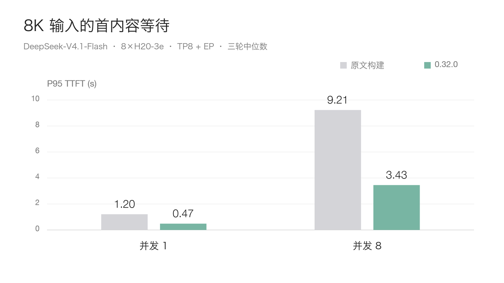
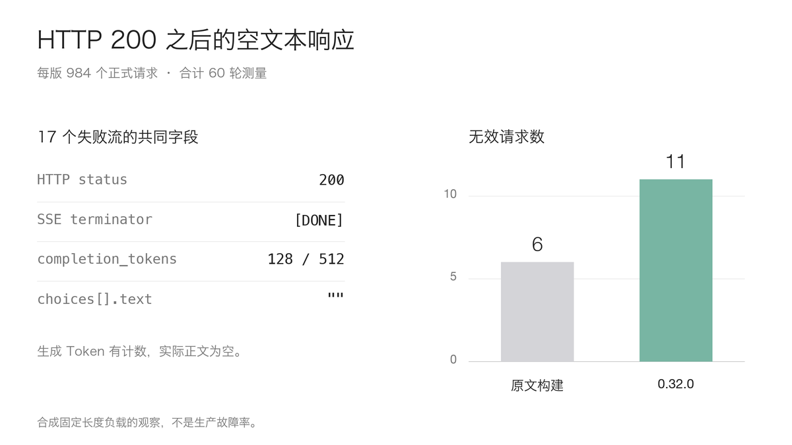

# vLLM 升到 0.32.0，DeepSeek V4.1 真的快了吗？八卡 H20-3e 实测

DeepSeek-V4.1-Flash 把混合专家架构与 Engram 条件记忆结合在一起，支持文本与图片输入。模型发布时，我们已经在八张 H20-3e 上跑过部署、功能和压测。当时用的是固定支持构建，如今 vLLM 的实现已经有不少变化。

最近一些公众号和公开文章都在讨论：新版 vLLM 跑 DeepSeek，效果很好。具体到手里的 H20-3e，换一个版本到底能快多少？长输入、长输出是否都会受益？原来的功能和输出完整性还能不能保证？

这次把原文章使用的镜像找回来，与正式版 **0.32.0** 在同一台八卡机器上先后运行，补齐了 **60 轮、1,968 个正式请求**。

结果有明显收益，也有需要继续定位的问题。8K 输入、并发 8 的吞吐从 **97.69 提高到 217.46 Token/s，约提高 123%**；单并发长输出却基本持平。完整输出检查中，两版分别留下 6 个和 11 个失败请求。

## 先把“新版很快”的背景说清楚

vLLM 团队 10 月 7 日发布过一篇性能文章，介绍 DeepSeek-V4.1-Flash 在 AgentX 场景相对其 Day 0 实现的提升。这比 0.32.0 的发布时间还早，不能把其中的倍率理解成“升级这个版本，任何机器都会这么快”。

0.32.0 于 **10 月 18 日**发布，Hopper 上优先选择 Humming 等默认行为也发生了变化。这给了我们重新测试的理由，但具体收益仍要放到自己的硬件、请求长度和并发里看。

本次没有追 nightly，也没有换成 1017 模型权重。比较的就是原版 DeepSeek-V4.1-Flash，以及此前文章里的 vLLM 构建和 0.32.0。

## 同一条启动命令，实际路径也会变

两版都用 **TP8 加专家并行**，32K 服务上下文，最大运行序列 32，批处理 Token 上限 8,192，显存比例 0.85。Engram 放 GPU，关闭文本前缀缓存，没有开启 DSpark。

原文章版本是 `0.1.dev1+g79a7108d9`，新版本是 `0.32.0`。Torch 都是 2.13.0+cu130，Humming 从 0.1.12 变为 0.1.17，Transformers、FlashInfer 也随镜像升级。客户端与逐轮输入保持一致。

核对日志时，有个差异必须单独说明：**新版默认启用了 SWA bounded replay**，旧构建没有这个配置项。

SWA 是 Sliding Window Attention，滑动窗口注意力。有界重放会减少部分长输入计算。新版日志明确写出，eager Prefill 中的第 20 层为全部 Token 写入 KV，其余相关工作与第 21–39 层只处理每个请求末尾的 128 个 Token。即使前缀缓存关闭，这条 decoder 优化路径仍然可以生效。

新版也实际选用了 Humming 的 MXFP8 线性层和专家计算路径。因此这次得到的是**整套版本升级的结果**，没有把收益全部归给一个算子。要分清有界重放贡献多少，需要额外做开关实验。

## 长输入受益，长输出要看并发

每个输入长度与并发组合做三轮正式测量，预热另算。C1、C8、C32 每轮分别发 8、16、64 个请求。下图只选两版全部请求成功的场景，每个柱子的数值为三轮中位数。

长输入和长输出分图展示，左右纵轴刻度不同；同一面板内两版使用相同刻度。

8K 输入、128 输出，单并发从 57.76 提高到 82.94 Token/s，并发 8 从 97.69 提高到 217.46 Token/s。后者为原来的约 **2.23 倍**。

把请求改成 1K 输入、512 输出，单并发却从 115.00 变为 113.69 Token/s，约下降 1.1%；这组短时重复更适合描述为接近持平。并发 8 从 609.73 提高到 676.93 Token/s，增幅约 11%。

同样是“升级后跑模型”，长输入检索和单用户连续生成，得到的体感很可能不同。

8K/C8 的 P95 首内容等待从 **9.206 秒降到 3.429 秒，缩短约 62.8%**。这里先算每轮 P95，再取三轮中位数。单并发长输出的 P95 每 Token 时间则是 8.342→8.520 毫秒，没有同步变快。

前一批同机配对实验还保留了一组完整的 4K 输入、128 输出、并发 32：吞吐 203.22→463.20 Token/s，约提高 127.9%，两版均为 384/384 请求成功。那批使用另一台同规格节点，单独统计，没有和这批的轮次混在一起。

## 这两个版本都遇到了“200，但没有正文”

本轮两版各执行 30 轮、984 个正式请求。原版 978 个成功、6 个失败；新版 973 个成功、11 个失败。对应 5 轮与 9 轮包含失败请求。

这些失败有一个共同点：HTTP 是 200，流里有 `[DONE]`，usage 也说生成了 Token，**实际的 text 却一直为空**。

如果只看 HTTP 状态、健康检查或压测进程退出码，就容易把它们算成成功。这里保留原分母，把空文本判失败；含失败的场景仍记录结果，但没有拿来计算上面那张无失败收益图。

目前还不能把根因指向 Humming、某个 GPU kernel，或认定它只属于新版。两版都能出现，下一步应固定合成 Prompt 和 Token IDs，对照流式、非流式、特殊 Token 与解码输出，再逐项切换优化。这些比例来自合成固定长度负载，也不能直接当成生产故障率。

## 看一下实际运行的过程

时间为 10 月 27 日 09:45–11:04，UTC+8。前半段是原文章构建，后半段是 0.32.0。显存中间的下降和重新上升，对应版本切换、加载和初始化；图中资源指标为八卡平均。

两版按同样的场景顺序运行，但新版每个场景的耗时不同。看图时要按场景对应，不能比较同一个横坐标时刻。监控窗口的吞吐和直方图 P95 用来解释过程，正式分数以逐轮文件为准。

本轮两版的文本、完整流基础检查、工具解析与单图/双图顺序样例均通过。视觉仍用原来的 2,048 Token 预算。它说明这些样例能运行，不能代替完整的准确率和长任务回归。

## 部署上怎么取舍

如果服务以 **长 Prompt、RAG 或 Agent 历史**为主，0.32.0 值得安排灰度，重点看首内容等待、排队与有效输出比例。RAG 是 Retrieval-Augmented Generation，检索增强生成。新版默认的有界重放也要进入任务质量回归范围。

如果主要是**单用户、短输入、长时间连续生成**，不要预期仅换版本就让 Decode 翻倍。本轮单并发长输出接近持平，应该围绕实际的逐 Token 延迟目标测试。

如果准备提高并发，先把空文本的定位与验收补齐。固定镜像 Digest、模型快照和依赖，保留旧镜像与回滚方式，再用真实 Prompt 建立容量结论。

这次升级确实带来了明显的长输入收益。更有用的经验是：升级验收要同时看请求形状、默认执行路径和完整输出，不能只记住一个最快的吞吐数字。

完整配置、10 个场景的成绩与失败分母、脱敏逐轮数据，见「阅读原文」。

## 参考资料

vLLM 0.32.0 Release：https://github.com/vllm-project/vllm/releases/tag/v0.32.0

DeepSeek-V4.1-Flash on vLLM：https://vllm.ai/blog/2026-10-07-deepseek-v41-flash

Humming 技术介绍：https://vllm-project.github.io/2026/10/19/humming.html

公开文档：https://aik8s.run/ai-k8s/practices/deepseek-v41-vllm032-upgrade/
