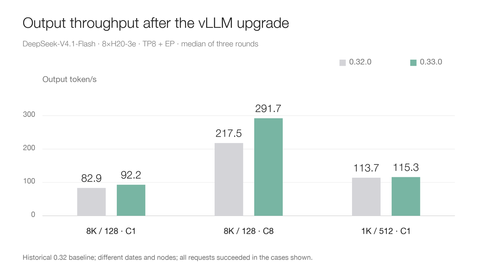
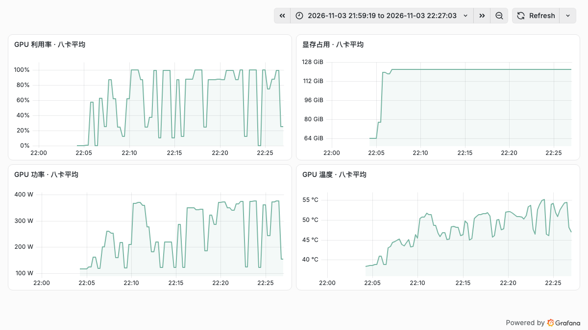

# Testing vLLM 0.33 on Eight H20-3e GPUs: How Does DeepSeek-V4.1-Flash Compare with 0.32?

DeepSeek-V4.1-Flash is a multimodal Mixture-of-Experts model. Engram conditional memory, sparse attention, and bounded replay are among the design choices intended to reduce long-context inference costs, making it a useful sample for examining inference-engine upgrades.

We previously tested vLLM 0.32.0 on eight H20-3e GPUs. After 0.33.0 was released with optimizations including DeepSeek V4/V4.1 expert computation on Hopper, we kept the same model, requests, and measurement methodology, ran only 0.33.0, and compared the results with retained 0.32.0 data.

Two findings stand out: some long-input cases were faster, while streaming output completeness remains worth checking during an upgrade.

## How was it tested?

The model is the original `DeepSeek-V4.1-Flash`, not the 1017 version. The server uses one node with eight H20-3e GPUs, tensor parallelism TP8, expert parallelism EP, and a 32,768-token maximum context. Prefix caching and DSpark speculative decoding are disabled.

The main matrix covers 10 input-length, output-length, and concurrency combinations, with three rounds each; three supplementary cases also have three rounds each. Both versions use the same client, tokenizer, and random seeds. Request fingerprints match for the 30 formal main-matrix rounds and 10 warmups. Warmups are recorded separately, and failed requests remain in their original denominators.

The 0.32.0 values are historical: the tests occurred on different dates and nodes. Both machines have eight H20-3e GPUs, but this is not a strictly paired same-node, same-period A/B test and cannot attribute differences to a single optimization. The historical open-loop arrival-rate test was not repeated.

## Long inputs and concurrency: gains vary by workload

The chart includes only cases where all requests succeeded on both versions. Each bar is the median output throughput of three rounds, in output token/s.

For 8K input, 128 output and concurrency 1, the historical comparison is **82.94 → 92.22 token/s**; at concurrency 8 it is **217.46 → 291.74 token/s**, approximately 11.2% and 34.2% higher, respectively. With 1K input, 512 output and concurrency 1, the result is **113.69 → 115.32 token/s**, a much smaller difference.

Latency also changed. For 8K input at concurrency 8, the median of the three per-round P95 waits for first nonempty content was **3.43 → 2.36 seconds**. This is an observation for that synthetic workload, not a latency claim for all production users.

Other cases matter too. For short input at concurrency 32, the 0.33 throughput median was 1322.74 token/s, with **191/192** valid requests; for 8K input at concurrency 32, **190/192** were valid. We preserve observed throughput and failure denominators for these cases without reporting their throughput differences as unconditional upgrade gains.

## What did the eight GPUs do during the test?

The panels show average GPU utilization, memory, power, and temperature across eight cards during the main run. The curves include model loading, different cases and gaps. Averages help describe overall activity but can hide an individual GPU problem, so diagnosis still requires per-card metrics.

The main and supplementary tests ran separately. The 1K→128 C1 and C8 and 4K→128 C32 supplementary cases completed all 456 formal requests. Tool calling and single-image and two-image recognition checks passed as well. These are specific examples, not validation of every tool or image task.

## Which 0.33 optimizations were actually selected?

The 0.33.0 startup log recorded the Humming MXFP4 MoE backend, MXFP8 activations running as block FP8 on Hopper, and SWA bounded replay. This confirms that the paths were selected.

However, more than one kernel changed between 0.32.0 and 0.33.0. The respective images used Torch 2.13.0 and 2.14.0, Humming 0.1.17 and 0.1.19, and FlashInfer 0.7.0.post1 and 0.7.2.post1. The new image's dependency check also reported NCCL and OpenTelemetry version-constraint mismatches; successful startup and the tests above do not mean all dependency constraints were met. Retain image digests, dependency inventories and startup logs when upgrading.

The official Humming optimization PR used four H200 GPUs and DeepSeek-V4-Flash; some decode cases improved, while low-concurrency cases regressed. It provides useful context, but those numbers cannot be transferred directly to H20-3e and V4.1-Flash.

## HTTP 200 does not guarantee usable output

The 0.33.0 main matrix had **974/984** valid responses; the historical 0.32.0 result was **973/984**. These limited samples come from different nodes and dates and cannot establish a change in the true failure rate.

We parsed the 10 failed 0.33 streams. All had HTTP 200, a stream-end marker and usage, and `finish_reason` was `length`, but their text fragments were empty. Seven reported 128 generated tokens and three reported 512.

The cause is not yet identified. A careful follow-up should record output token IDs, compare streaming and non-streaming behavior with identical inputs, and regress real natural-language requests and configurations without `ignore-eos`. The failure ratio in this synthetic fixed-length workload is not a production failure rate.

## How should an upgrade be evaluated?

For workloads dominated by long inputs and high concurrency, prioritize representative tests of those loads. For low-concurrency, long-output workloads, recognize that the gain may be smaller. Before deployment, pin the model revision and image, validate output quality, complete streams, tool calling and vision with real prompts, and then weigh time to first token, throughput, memory and power against the actual traffic distribution.

References:

- DeepSeek-V4.1-Flash model card: https://huggingface.co/deepseek-ai/DeepSeek-V4.1-Flash
- vLLM 0.33.0 release notes: https://github.com/vllm-project/vllm/releases/tag/v0.33.0rc3
- Hopper Humming optimization PR: https://github.com/vllm-project/vllm/pull/61875
