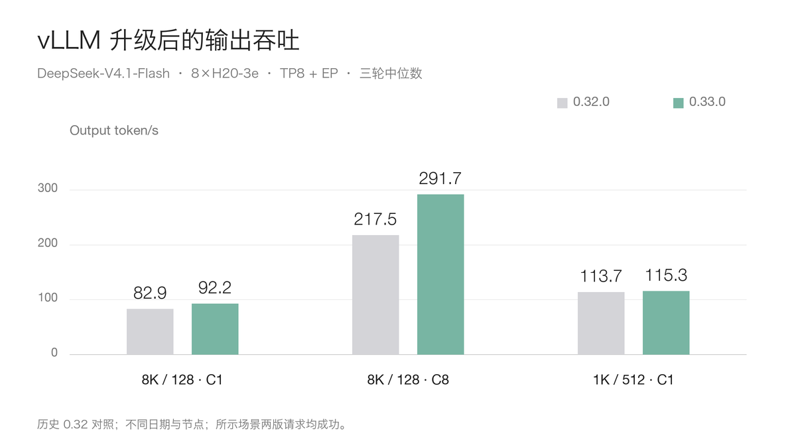
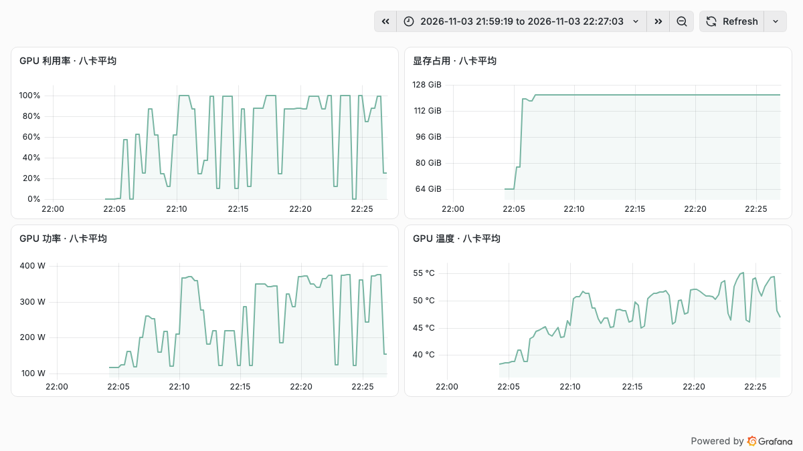

# 八张 H20-3e 实测 vLLM 0.33：DeepSeek-V4.1-Flash 比 0.32 快多少？

DeepSeek-V4.1-Flash 是一个支持图文输入的混合专家模型。它结合 Engram 条件记忆、稀疏注意力和有界重放等设计，试图降低长上下文推理的成本，也适合作为观察推理框架升级效果的一个样本。

之前我们用八张 H20-3e 测过 vLLM 0.32.0。这次 0.33.0 发布后，官方提到了 Hopper 上 DeepSeek V4/V4.1 专家计算等优化。于是我们沿用此前的模型、请求和测试口径，只运行 0.33.0，再与保存的 0.32.0 数据对比。

结果有两个值得关注的方向：部分长输入场景更快，流式输出的完整性仍值得在升级时检查。

## 这次怎么测？

模型固定为原版 `DeepSeek-V4.1-Flash`，不是 1017 版本。服务运行在单节点八张 H20-3e 上，使用张量并行 TP8 和专家并行 EP，最大上下文长度为 32,768 Token；前缀缓存和 DSpark 推测解码均关闭。

主矩阵覆盖 10 组输入、输出长度与并发组合，每组三轮；另有三组补充场景，同样各测三轮。两版使用相同的客户端、Tokenizer 和随机种子，主矩阵的 30 个正式轮次与 10 次预热的请求指纹均已核对一致。预热单独记录，失败请求保留原始分母。

有一点需要交代：0.32.0 是此前的历史结果，两次测试发生在不同日期、不同节点。两台机器均为八卡 H20-3e，但这不是同机同时期的严格 A/B，也不能把差异全部归因于一个优化。本轮没有重复历史的开放到达率测试。

## 长输入与并发：有收益，也有不同的曲线

下图只列出两版请求全部成功的场景。每根柱子是三轮输出吞吐的中位数，单位为 output token/s。

8K 输入、128 输出、并发 1 的历史对照为 **82.94 → 92.22 token/s**；并发 8 为 **217.46 → 291.74 token/s**，分别高约 11.2% 和 34.2%。1K 输入、512 输出、并发 1 则为 **113.69 → 115.32 token/s**，差距小得多。

延迟也有变化。8K 输入、并发 8 场景中，每轮 P95 首内容等待的三轮中位数为 **3.43 → 2.36 秒**。这是该合成负载的观测值，不能直接代表线上所有用户请求。

其他场景也值得看：短输入、并发 32 的 0.33 吞吐中位数为 1322.74 token/s，但有 **191/192** 个有效请求；8K 输入、并发 32 为 **190/192**。这些场景保留原始观测值和失败分母，不把吞吐差额直接写成升级收益。

## 八张卡在测试期间做了什么？

图中依次是 GPU 利用率、显存、功率和温度，展示的是主测试时间窗内八张卡的平均值。曲线包含模型加载、不同场景和场景之间的间隔；平均值可以帮助理解整体负载，也可能掩盖单卡异常，排查时仍需查看逐卡指标。

主测试和补充测试分别运行。补充的 1K→128 并发 1、并发 8，以及 4K→128 并发 32 场景共有 456 个正式请求，全部有效；工具调用和单图、双图识别的功能检查也通过。它们是特定样例的结果，不代表所有工具或图像任务都已验证。

## 0.33 的优化，实际走到了哪一步？

0.33.0 的启动日志记录了 Humming MXFP4 MoE backend、Hopper 上将 MXFP8 激活按 block FP8 执行，以及 SWA bounded replay。这说明这些路径确实被选中。

不过，从 0.32.0 到 0.33.0，变化的不只是一个 kernel。两版实际镜像的 Torch 分别为 2.13.0 和 2.14.0，Humming 分别为 0.1.17 和 0.1.19，FlashInfer 也从 0.7.0.post1 变为 0.7.2.post1。镜像的依赖检查还提示 NCCL 和 OpenTelemetry 版本约束不一致；服务及上述测试能够运行，并不等于所有依赖约束已满足。升级时需要保留镜像摘要、依赖清单和实际启动日志。

官方 Humming 优化 PR 的基准使用的是四张 H200 与 DeepSeek-V4-Flash，部分解码场景有收益，低并发也有回退。它提供了理解方向，但数字不能直接外推到这里的 H20-3e 和 V4.1-Flash。

## HTTP 200，不等于一定有可用输出

主矩阵中，0.33.0 的有效响应为 **974/984**；此前 0.32.0 为 **973/984**。这两个有限样本来自不同节点和日期，不足以判断真实失败率的变化。

我们逐条解析了 0.33 的 10 条失败流：它们都有 HTTP 200、流结束标志和 usage，`finish_reason` 均为 `length`，但文本片段为空。其中 7 条报告生成了 128 个 Token，3 条报告生成了 512 个 Token。

原因目前还没有定位。更稳妥的后续办法，是记录输出 Token ID，对相同输入做流式与非流式对照，再用真实自然语言请求和关闭 `ignore-eos` 的配置做回归。合成固定长度负载里的失败比例，不能直接当作生产故障率。

## 升级时怎么取舍？

如果业务以长输入、高并发为主，可以优先复测自己的典型负载；如果以低并发、长输出为主，也要关注收益可能较小。上线前至少固定模型快照和镜像，验证真实提示词的输出质量、完整流、工具调用和视觉能力，再结合首 Token 延迟、吞吐、显存、功耗与实际流量分布决定是否升级。

参考资料：

- DeepSeek-V4.1-Flash 模型卡：https://huggingface.co/deepseek-ai/DeepSeek-V4.1-Flash
- vLLM 0.33.0 发布说明：https://github.com/vllm-project/vllm/releases/tag/v0.33.0rc3
- Hopper Humming 优化 PR：https://github.com/vllm-project/vllm/pull/61875
