# MiniMax-H3-Image on One H20-3e: 2K and 4K Generation and Concurrency Tests

MiniMax-H3-Image was released with open weights on November 10, 2026; MiniMax published its [official introduction](https://www.minimax.io/blog/minimax-h3-image) on November 11. Built on H3, the image model combines text-to-image, reference-based generation and image editing, and supports 4096×4096 output. MiniMax also highlights support for up to 16 reference images, realistic details and prompt adherence.

Speed is another focus: the model uses six distilled diffusion steps, and MiniMax claims 4096×4096 generation can take under 10 seconds, a figure that cannot be applied to every hardware setup. In our single-H20-3e runs, 4K text-to-image concurrency-1 request P50 was about 45–47 seconds. According to the [official vLLM recipe](https://recipes.vllm.ai/MiniMaxAI/MiniMax-H3-Image), the generation backbone has about 33.1B parameters, the paired text encoder about 33.4B, and a separate image VAE.

We used one H20-3e each in separate vLLM-Omni and SGLang runs to test text-to-image generation, image editing and multiple references, then measured different concurrency levels at 2048×2048, 2720×1536 and 4096×4096. The nodes and offload strategies differ, so results compare these deployment configurations. The pictures below came from actual requests; monitoring comes from the experiment's Grafana.

## Actual images

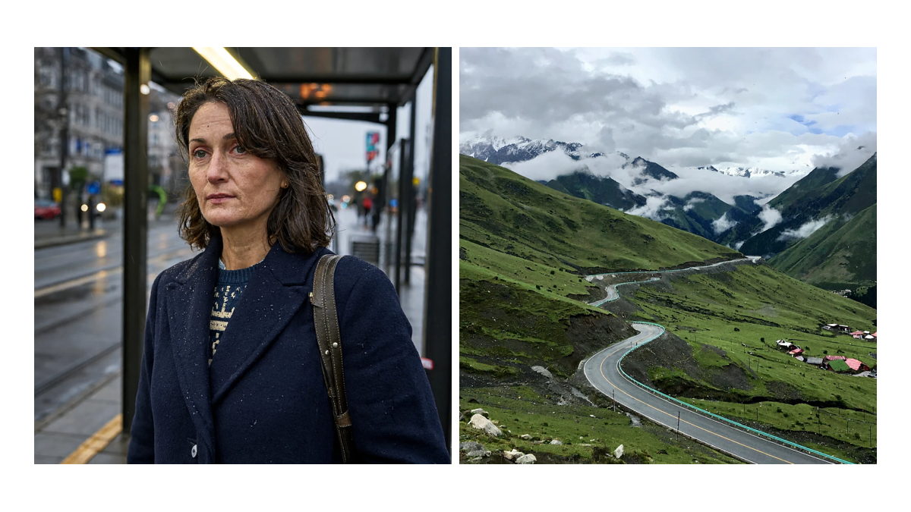

The left image depicts a portrait at a rainy tram stop; the right shows a road through a valley after rain. Both are real model outputs resized and arranged for display. The person is model-generated.

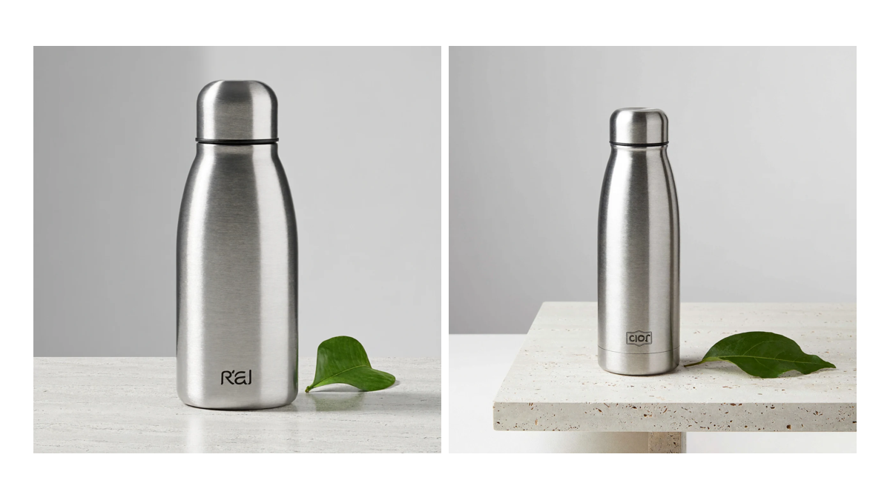

The same product prompt produced the 2048×2048 image on the left and the 4096×4096 image on the right; the latter came from a warmup request. The model added an unrequested mark to the bottle, so commercial assets still require human review.

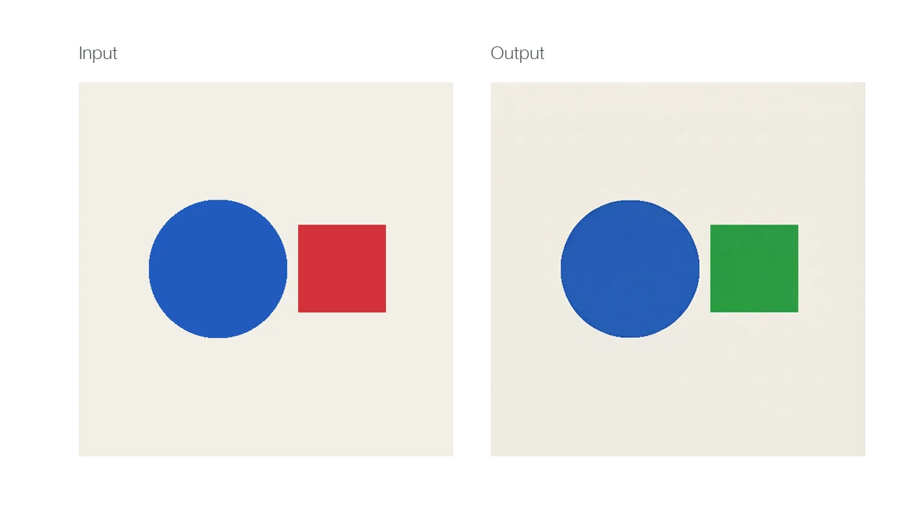

We supplied an image containing a blue circle and a red square and asked the model to turn the square green. The input is on the left, and the output is on the right: the requested color changed, but unchanged regions are not guaranteed to be pixel-identical.

Multiple references expose the difference between a successful response and correct visual understanding. The eight-reference request succeeded, but the output contained a nine-cell grid and did not fully preserve the number and order of references. The current image rejected 16 references with HTTP 400 and stated a maximum of nine. Exactly nine references were not tested.

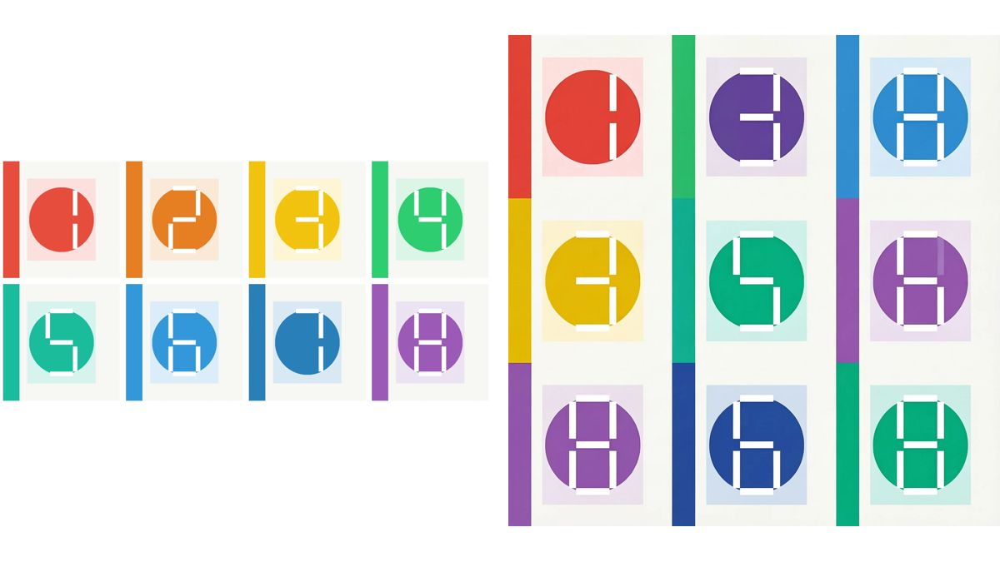

The inputs are arranged in submission order on the left; the actual output is on the right. Image count and semantics require separate verification.

## One GPU still needs substantial host memory

The test used 1 × H20-3e, vLLM 0.33.0 and vLLM-Omni `0.1.dev4171+gc958c8f5f`, with six default steps. The text encoder used layerwise CPU offload and the model directory was mounted read-only. The container requested 16 CPUs and 256 GiB of memory, with limits of 32 CPUs and 384 GiB.

From server process start to `/v1/models` readiness took about 385 seconds, excluding image pull and Pod queueing. Across one-second GPU samples for the run, peak memory use was about 72.66 GiB. A container cgroup query during the test showed a peak of about 230 GiB, including file page cache; the final peak at exit was not recorded. The observed GPU usage exceeds 48 GB, so the same configuration should not be assumed to fit on a single L20; additional offload or quantization needs its own test.

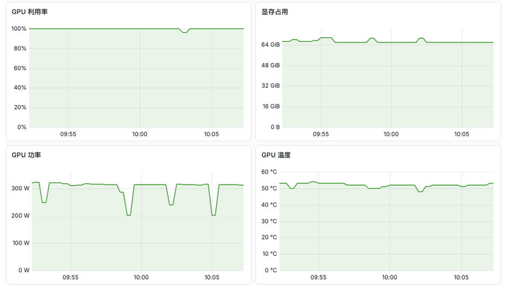

This is an actual light-theme Grafana screenshot during requests. The monitoring job restarted during the experiment; the two periods were not joined into a continuous curve. The GPU also had a separate one-second sampling log.

## Higher concurrency, longer waits

The formal vLLM-Omni benchmark contained 51 batches and 504 requests, all returning decodable images of the requested dimensions. Warmups, quality samples and boundary tests were counted separately. The original script counted the expected 16-image HTTP 400 as a failure. Latency runs from client submission until receipt of the full HTTP response, including data transfer, over loopback.

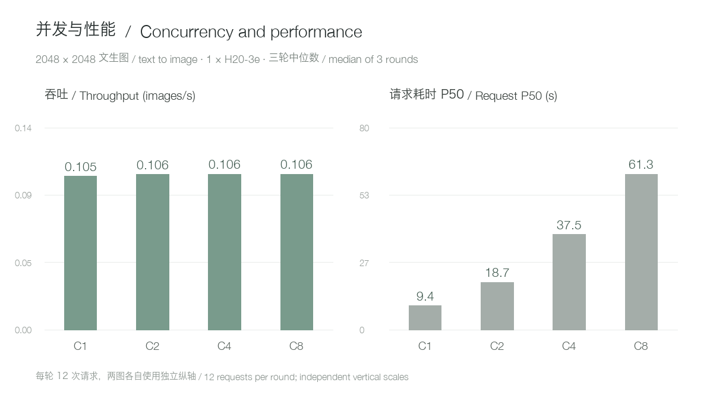

At concurrency 1, 2, 4 and 8, median throughput across three 2048×2048 text-to-image rounds was approximately 0.105, 0.106, 0.106 and 0.106 images/s. The corresponding medians of round P50s were 9.44, 18.72, 37.53 and 61.26 seconds. Each round had 12 requests; the short concurrency-8 batch does not represent sustained production queueing.

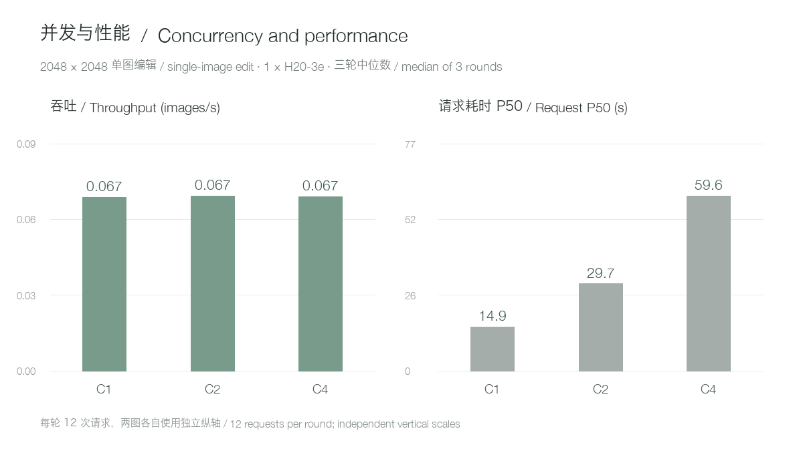

For single-reference editing at concurrency 1, 2 and 4, median throughput was about 0.06665, 0.06710 and 0.06687 images/s, with P50s of 14.93, 29.72 and 59.59 seconds. On this single-GPU setup, simply increasing simultaneous requests mainly increased waiting time rather than throughput.

## How much slower is 4K than 2K?

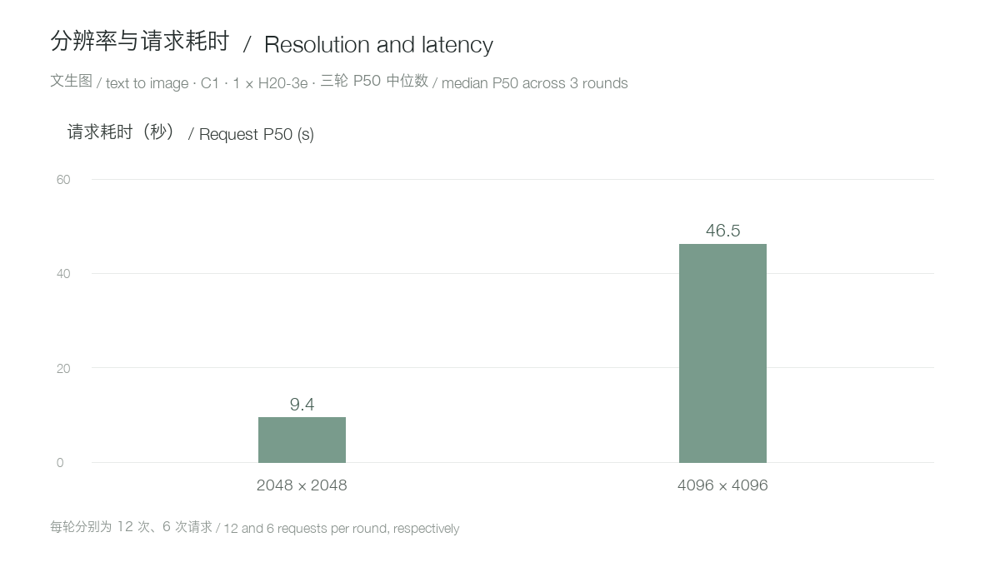

With the same product prompt and concurrency 1, the median of round P50s was 9.44 seconds for 2048×2048 text-to-image and 46.50 seconds for 4096×4096, approximately 4.9 times as long. Each round used 12 and 6 requests respectively. This is an observation for this hardware and configuration. Returning the larger image also transfers more data, so end-to-end time is not pure model compute.

For 4K single-reference editing, median P50 was about 54.94 seconds at concurrency 1 and 109.11 seconds at concurrency 2. For 2720×1536 text-to-image at concurrency 1, median P50 was about 9.40 seconds. Two and four references at 2048×2048 and concurrency 1 took about 20.94 and 35.48 seconds respectively.

The experiment had exclusive use of one GPU, but CPU and shared storage were not completely isolated. Sample retrieval overlapped I/O with individual batches, which remain in the original records. Fixtures, per-request data and calculation details are available in the public article linked below.

## Reproduce the deployment and requests

In a GPU container with the tested vLLM-Omni version, mount the model read-only at `/models/MiniMax-H3-Image`, including `text_encoder/`. This image required a temporary view when the local encoder and an external model-index locator coexisted; the following writes only to `/work` and leaves the model source unchanged. `/work/MiniMax-H3-Image` must not already exist. See the resources and versions above; other loader versions may not require the workaround.

The Linux example starts the matching image with host networking and requires port 8000 to be free. Inside the container create the temporary view and start the server, then use another host terminal for generation and editing. The editing fixture `edit-source-blue-circle-red-square.png` is available in the public article's reference bundle.

```bash
export MODEL_DIR=/path/to/MiniMax-H3-Image
docker run --rm -it --gpus 1 --network host --ipc host \
  -v "$MODEL_DIR:/models/MiniMax-H3-Image:ro" \
  --entrypoint /bin/bash \
  vllm/vllm-omni@sha256:77c3f76764346918576ba4183daf169240070b659c919c7fff45df31bbf333c9
```

```bash
export MODEL_SOURCE=/models/MiniMax-H3-Image
python3 - <<'PY'
import json, os
from pathlib import Path
src = Path(os.environ['MODEL_SOURCE'])
dst = Path('/work/MiniMax-H3-Image')
dst.mkdir(parents=True, exist_ok=False)
for item in src.iterdir():
    if item.name not in ('model_index.json', 'v1'):
        (dst / item.name).symlink_to(item.resolve(), target_is_directory=item.is_dir())
data = json.loads((src / 'model_index.json').read_text())
enc = data.get('text_encoder')
if not isinstance(enc, list) or not (src / 'text_encoder').is_dir():
    raise ValueError('Unexpected local text encoder layout')
if len(enc) == 3 and isinstance(enc[2], dict) and enc[2].get('subfolder') == 'text_encoder':
    data['text_encoder'] = enc[:2]
elif len(enc) != 2:
    raise ValueError('Unexpected encoder metadata')
(dst / 'model_index.json').write_text(json.dumps(data, indent=2) + '\n')
PY
```

```bash
export HF_HUB_OFFLINE=1 TRANSFORMERS_OFFLINE=1
vllm serve /work/MiniMax-H3-Image \
  --omni --host 127.0.0.1 --port 8000 --num-gpus 1 \
  --diffusion-offload-config '{"mode":"layer","components":["text_encoder"]}'
```

```bash
curl -sS http://127.0.0.1:8000/v1/images/generations \
  -H 'Content-Type: application/json' \
  -d '{"model":"/work/MiniMax-H3-Image","prompt":"A brushed silver water bottle on a pale stone table beside a single green leaf, clean studio product photography.","size":"2048x2048","seed":42,"response_format":"b64_json"}' \
  > response.json
python3 -c 'import base64,json; open("generated.png","wb").write(base64.b64decode(json.load(open("response.json"))["data"][0]["b64_json"]))'
```

```bash
curl -sS http://127.0.0.1:8000/v1/images/edits \
  -F 'model=/work/MiniMax-H3-Image' \
  -F 'image=@edit-source-blue-circle-red-square.png;type=image/png' \
  -F 'prompt=<Picture 1> shows simple geometric shapes. Change the red square to green while keeping the blue circle and background unchanged.' \
  -F 'size=2048x2048' -F 'seed=42' -F 'response_format=b64_json' \
  > edit-response.json
python3 -c 'import base64,json; open("edited.png","wb").write(base64.b64decode(json.load(open("edit-response.json"))["data"][0]["b64_json"]))'
```

`--num-gpus 1` selects one GPU and `--diffusion-offload-config` enables layerwise text-encoder offload. This test binds `127.0.0.1`; production deployments need their own networking, authentication, queue and rate limits. Use the model name returned by `/v1/models`. These are the tested vLLM-Omni commands; the next section covers SGLang startup and requests.

## Starting SGLang

Using the same model and fixtures on a different single-H20-3e node, one text-to-image and one single-reference editing smoke test succeeded; all 504 / 504 formal benchmark requests succeeded; including warmups and functional tests, 566 / 566 requests succeeded. Readiness took about 375 seconds; the first requests took 46.11 and 16.90 seconds and cannot establish an engine performance ranking. SGLang completed three 2048×2048 text-to-image concurrency-1 rounds with 36 successes and a median P50 of about 8.38 seconds; the vLLM-Omni result was about 9.44 seconds, but the nodes and offload strategies differ, so the difference cannot be attributed to the engine alone. SGLang returned a decodable image for the 16-reference request in about 164.38 seconds; some inputs are repeated, and count, order and identity have not been validated. The tested vLLM-Omni image returned HTTP 400 for the same input.

Text-to-image concurrency 1, 2, 4 and 8 each completed three rounds with 12 successful requests per round. This figure compares round medians; different nodes and offload strategies make it a comparison of these specific deployments.

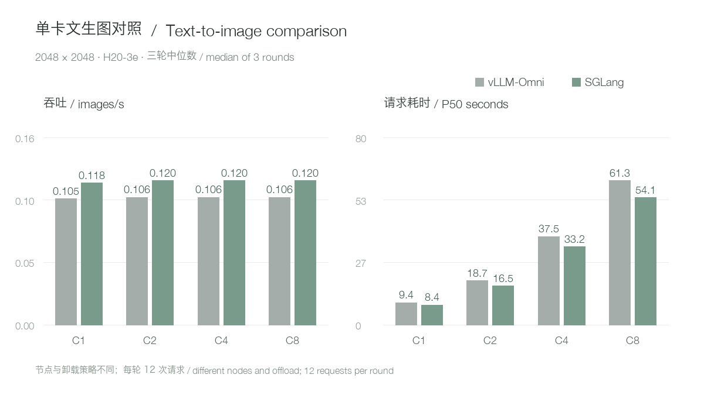

For `2720×1536` text-to-image, concurrency 1 and 4 completed with SGLang median P50 values of 8.320 and 33.000 seconds, versus 9.400 and 37.354 seconds for vLLM-Omni. For single-reference editing at the same aspect ratio and concurrency 1 and 4, median P50 values were 13.047 and 51.956 seconds for SGLang versus 14.849 and 59.130 seconds for vLLM-Omni.

For `2048×2048` single-reference editing, concurrency 1, 2 and 4 each completed three rounds with all requests successful. SGLang median P50 values were 13.21, 26.22 and 52.54 seconds; vLLM-Omni values were 14.93, 29.72 and 59.59 seconds.

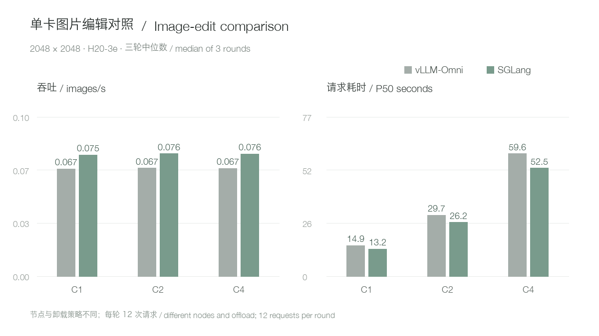

Three `4096×4096` text-to-image concurrency-1 rounds have also completed: median P50 was about 45.13 seconds for SGLang and 46.50 seconds for vLLM-Omni. All concurrency-2 rounds also succeeded, with median P50 of about 89.37 seconds for SGLang and 92.27 seconds for vLLM-Omni. Three 4K single-reference editing rounds at concurrency 1 also succeeded, with median P50 about 52.85 seconds for SGLang and 54.94 seconds for vLLM-Omni. All three 4K editing concurrency-2 rounds succeeded, with median P50 about 104.77 seconds for SGLang and 109.11 seconds for vLLM-Omni. Three two-reference editing rounds also succeeded, with median P50 about 18.44 seconds for SGLang and 20.94 seconds for vLLM-Omni; three four-reference rounds also succeeded, with median P50 about 30.74 seconds for SGLang and 35.48 seconds for vLLM-Omni. Different nodes and offload configurations remain part of the comparison.

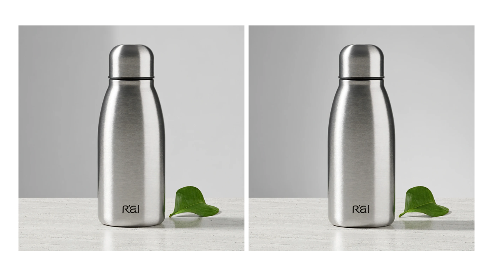

vLLM-Omni is on the left and SGLang on the right, using the same product prompt and seed 42. Both are actual first-request outputs, resized and arranged side by side; one image is not a quality ranking.

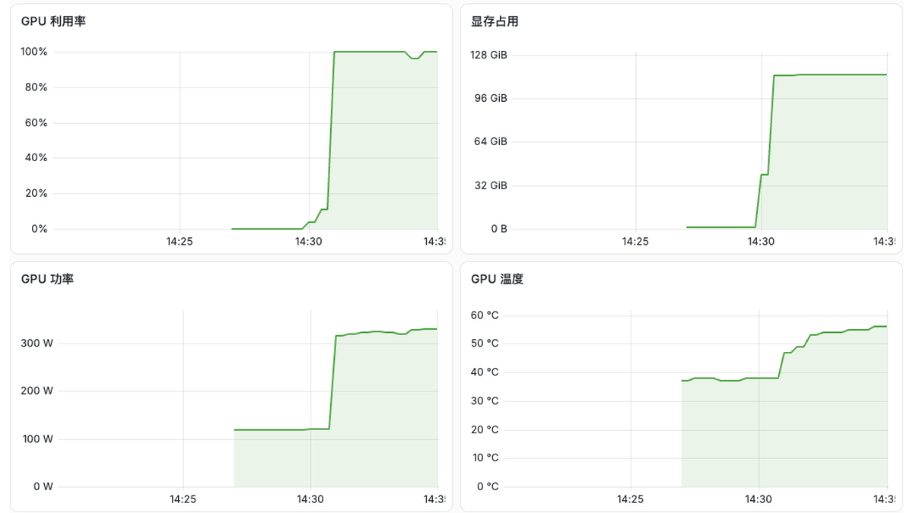

Light-theme Grafana screenshot during SGLang loading and sample generation. From 14:23 to 17:15 Beijing time, its one-second sampled GPU-memory peak was about 121.06 GiB, including a 16-reference request; the 72.66 GiB vLLM-Omni figure came from another run. Nodes, offload and workloads differ, so the peak difference cannot simply be attributed to engine implementation.

Enter the upstream candidate image below on Linux, then run the same `MODEL_SOURCE` temporary-view code from the previous section. The cluster used an internal mirror, and synchronization can change manifest digests, so verify the version in your environment:

```bash
export MODEL_DIR=/path/to/MiniMax-H3-Image
docker run --rm -it --gpus 1 --network host --ipc host \
  -v "$MODEL_DIR:/models/MiniMax-H3-Image:ro" \
  --entrypoint /bin/bash \
  lmsysorg/sglang@sha256:dc9929c7f471f31d66aa11da7779a49e1fdb75fd2b120257ff181c55b52c2b74
```

```bash
export HF_HUB_OFFLINE=1 TRANSFORMERS_OFFLINE=1
sglang serve --model-type diffusion \
  --model-path /work/MiniMax-H3-Image \
  --host 127.0.0.1 --port 8000 --num-gpus 1 \
  --warmup-mode off --text-encoder-cpu-offload true \
  --served-model-name minimax-h3-image
```

The second block is the command actually used: `--model-type diffusion` selects the image backend, `--warmup-mode off` skips startup warmup, `--text-encoder-cpu-offload true` enables text-encoder CPU offload, and `--served-model-name` sets the served name. Reuse the generation and editing requests above with `model` changed to `minimax-h3-image`. This image's diffusion CLI did not list `--text-encoder-path`. SGLang component offload differs from the vLLM layerwise offload above; retain that distinction in a formal comparison. [Official SGLang recipe](https://docs.sglang.io/cookbook/diffusion/MiniMax/MiniMax-H3-Image)

## Deployment guidance

A single H20-3e can run this model and image API for low-concurrency validation or internal creative tools. Start with a bounded queue and visible queue state, and configure client timeouts to include both waiting and generation. Monitor host memory, GPU memory and shared storage together.

For higher throughput, measure multi-GPU and multi-replica configurations independently. Text accuracy, identity consistency, complex references and long-term stability also require application-specific evaluation.

References: [MiniMax-H3-Image model card](https://huggingface.co/MiniMaxAI/MiniMax-H3-Image) · [vLLM-Omni recipe](https://recipes.vllm.ai/MiniMaxAI/MiniMax-H3-Image). See the linked public article for full reproducibility details and data.

Official announcement and model introduction: https://www.minimax.io/blog/minimax-h3-image

Weights release and license date: https://huggingface.co/MiniMaxAI/MiniMax-H3-Image/blob/main/LICENSE
