# 单卡 H20-3e 跑 MiniMax-H3-Image：2K、4K 出图与并发实测

MiniMax-H3-Image 是 MiniMax H3 系列的开放权重图片模型，支持根据文字生成图片，也可以结合参考图进行编辑。按照 [vLLM 官方配方](https://recipes.vllm.ai/MiniMaxAI/MiniMax-H3-Image)，图片生成骨干约 33.1B 参数，配套文本编码器约 33.4B 参数，另有图像 VAE，默认使用 6 个蒸馏扩散步。

这次我们分别用单张 H20-3e，通过 vLLM-Omni 和 SGLang 跑通文本生成、图片编辑与多参考图，并测试 2048×2048、2720×1536 和 4096×4096 的不同并发。两次节点和卸载策略不同，结果需要按部署配置比较。下面的图片来自实际请求，监控来自本次实验的 Grafana。

## 先看看图片

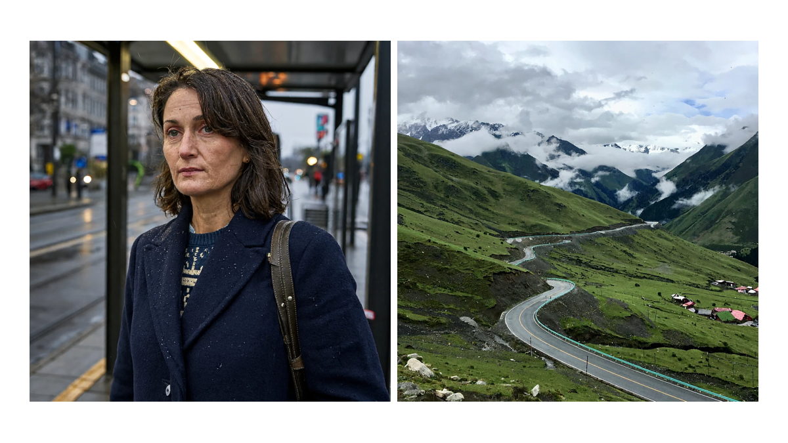

上图左侧是雨天电车站的人像，右侧是雨后山谷的公路。两张都是实际输出，展示时经过缩放拼接，人物为模型生成。

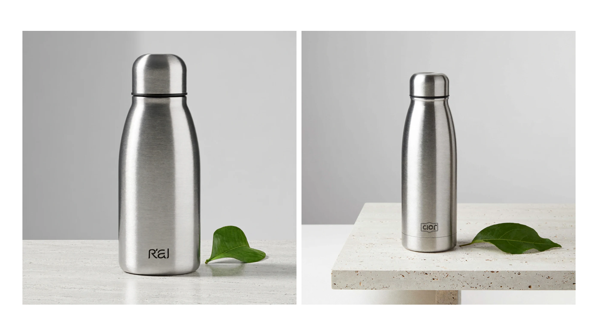

上图使用相同产品提示词，左侧为 2048×2048，右侧为 4096×4096；4K 图来自预热请求。模型在瓶身加入了提示词没有要求的标识，商业素材仍需人工检查。

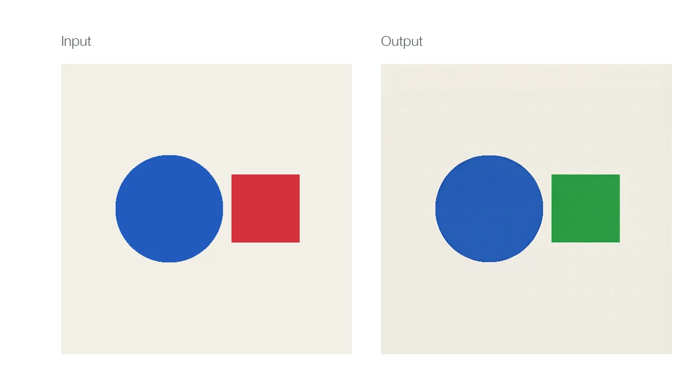

我们给模型一张蓝色圆形、红色方块的参考图，要求把方块改成绿色。图中左边是输入，右边是输出：颜色变化符合要求，但未修改区域不保证逐像素一致。

多参考图更能暴露生成成功与理解正确的区别。8 张参考图请求成功返回，但输出出现了九宫格，没有完整遵循参考图数量和顺序；16 张参考图则被当前镜像以 HTTP 400 拒绝，错误提示最多支持 9 张。恰好 9 张没有测试。

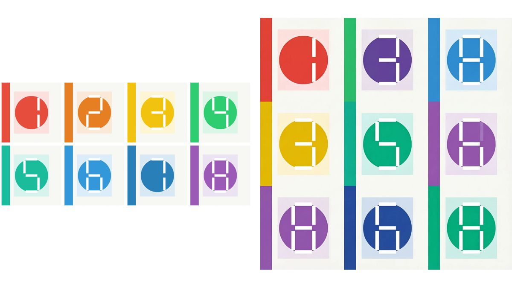

左边是按提交顺序拼接的 8 张输入，右边是实际输出。图像数量与语义是否准确，需要独立验收。

## 一张卡，主机内存也不能少

测试使用 1 × H20-3e，vLLM 0.33.0、vLLM-Omni `0.1.dev4171+gc958c8f5f`，默认 6 步。文本编码器采用逐层 CPU offload，模型目录只读挂载；容器申请 16 CPU、256 GiB 内存，限制为 32 CPU、384 GiB。

从服务进程启动到 `/v1/models` 就绪约 385 秒，不包含镜像拉取和 Pod 排队。整轮每秒 GPU 采样中，显存最高约 72.66 GiB；测试期间一次查询的容器内存峰值约 230 GiB，包含文件页缓存，退出时的最终峰值未记录。相同配置的已观测显存超过 48 GB，不能直接照搬到单张 L20；进一步卸载或量化需要另测。

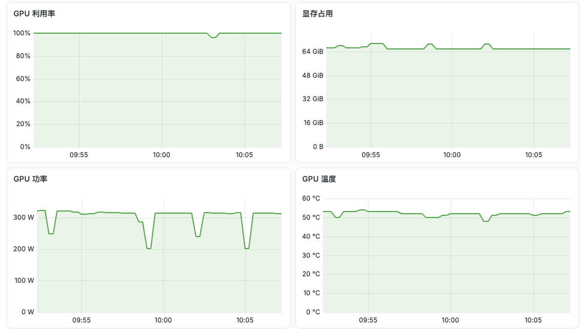

这是请求期间的真实浅色 Grafana 截图。监控任务中途重启过，前后数据没有拼成连续曲线；GPU 另有每秒采样记录。

## 并发提高，等待增加

vLLM-Omni 正式压测共 51 个批次、504 次请求，全部返回可解码且尺寸正确的图片。预热、质量样例和超限测试单独计数；16 图的预期 HTTP 400 被原脚本计为一次失败。请求耗时从客户端提交到收到完整 HTTP 响应，包含返回数据传输，使用本机回环访问。

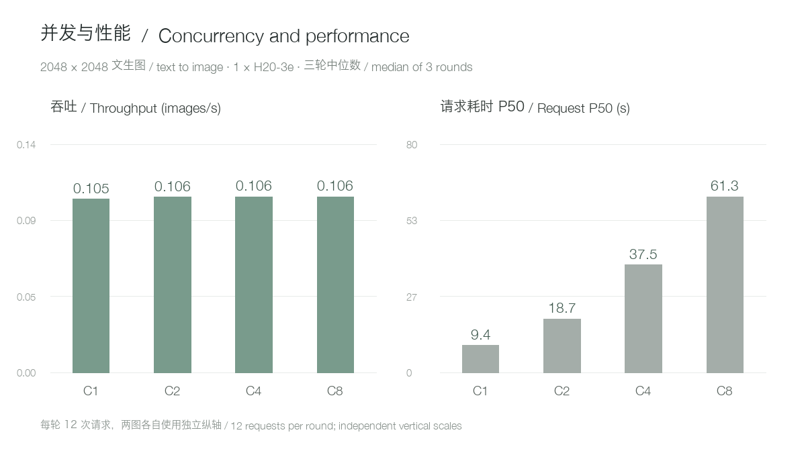

2048×2048 文生图从并发 1 提高到 2、4、8，三轮中位吞吐分别约为 0.105、0.106、0.106、0.106 图/秒；请求 P50 的三轮中位数约为 9.44、18.72、37.53、61.26 秒。每轮 12 次请求，并发 8 的短批次排队形态不代表长期线上流量。

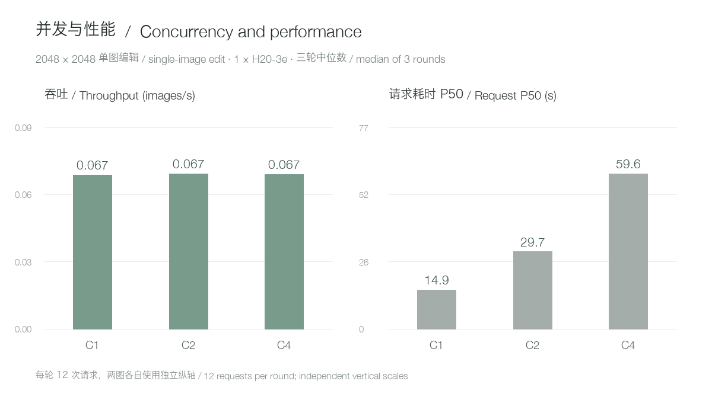

单图编辑的并发 1、2、4 中位吞吐约为 0.06665、0.06710、0.06687 图/秒，P50 分别约 14.93、29.72、59.59 秒。在这套单卡配置下，简单增加同时请求主要增加等待，并没有明显提高吞吐。

## 4K 比 2K 慢多少？

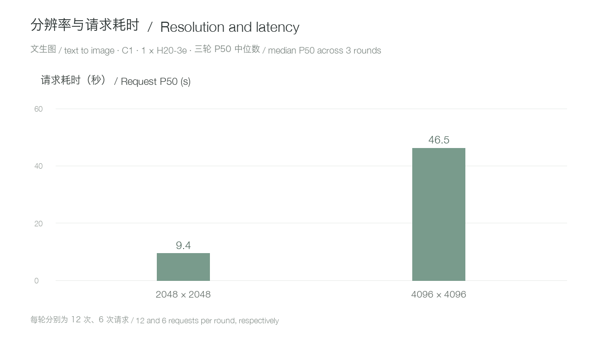

相同产品提示词、并发 1 下，2048×2048 文生图的三轮 P50 中位数为 9.44 秒；4096×4096 为 46.50 秒，约为前者的 4.9 倍。两种尺寸每轮分别为 12 次和 6 次请求；这是当前硬件与配置的观察值。4K 图像返回的数据量也更大，不能把端到端耗时全部归为模型计算。

4K 单图编辑并发 1 的 P50 中位数约 54.94 秒，并发 2 为 109.11 秒。2720×1536 文生图并发 1 的 P50 中位数约 9.40 秒。双参考图、四参考图在 2048×2048 并发 1 下分别约 20.94 秒、35.48 秒。

测试独占一张 GPU，但 CPU 和共享存储并非完全隔离；个别批次与样图回传有 I/O 重叠，原始记录中保留这些轮次。压测素材、逐请求结果和具体统计口径见文末公开文档。

## 复现部署：启动与请求

在已安装对应 vLLM-Omni 版本的 GPU 容器内，把模型目录只读挂载到 `/models/MiniMax-H3-Image`，并确保其中包含 `text_encoder/`。本次镜像在本地编码器和模型索引外部定位信息并存时需要临时视图；下面只写 `/work`，不会修改模型源目录。`/work/MiniMax-H3-Image` 必须预先不存在。实际镜像版本及 1 卡、16 CPU、256 GiB 内存申请见上文；不同版本的加载器可能不需要这一处理。

以下 Linux 示例先启动对应镜像容器，再在容器内创建临时视图并启动服务；使用 host 网络并要求端口 8000 空闲。服务就绪后在主机另开终端请求文生图和单图编辑。编辑示例的 `edit-source-blue-circle-red-square.png` 可从阅读原文中的参考素材包取得。

```bash
export MODEL_DIR=/path/to/MiniMax-H3-Image
docker run --rm -it --gpus 1 --network host --ipc host \
  -v "$MODEL_DIR:/models/MiniMax-H3-Image:ro" \
  --entrypoint /bin/bash \
  vllm/vllm-omni@sha256:77c3f76764346918576ba4183daf169240070b659c919c7fff45df31bbf333c9
```

```bash
export MODEL_SOURCE=/models/MiniMax-H3-Image
python3 - <<'PY'
import json, os
from pathlib import Path
src = Path(os.environ['MODEL_SOURCE'])
dst = Path('/work/MiniMax-H3-Image')
dst.mkdir(parents=True, exist_ok=False)
for item in src.iterdir():
    if item.name not in ('model_index.json', 'v1'):
        (dst / item.name).symlink_to(item.resolve(), target_is_directory=item.is_dir())
data = json.loads((src / 'model_index.json').read_text())
enc = data.get('text_encoder')
if not isinstance(enc, list) or not (src / 'text_encoder').is_dir():
    raise ValueError('Unexpected local text encoder layout')
if len(enc) == 3 and isinstance(enc[2], dict) and enc[2].get('subfolder') == 'text_encoder':
    data['text_encoder'] = enc[:2]
elif len(enc) != 2:
    raise ValueError('Unexpected encoder metadata')
(dst / 'model_index.json').write_text(json.dumps(data, indent=2) + '\n')
PY
```

```bash
export HF_HUB_OFFLINE=1 TRANSFORMERS_OFFLINE=1
vllm serve /work/MiniMax-H3-Image \
  --omni --host 127.0.0.1 --port 8000 --num-gpus 1 \
  --diffusion-offload-config '{"mode":"layer","components":["text_encoder"]}'
```

```bash
curl -sS http://127.0.0.1:8000/v1/images/generations \
  -H 'Content-Type: application/json' \
  -d '{"model":"/work/MiniMax-H3-Image","prompt":"A brushed silver water bottle on a pale stone table beside a single green leaf, clean studio product photography.","size":"2048x2048","seed":42,"response_format":"b64_json"}' \
  > response.json
python3 -c 'import base64,json; open("generated.png","wb").write(base64.b64decode(json.load(open("response.json"))["data"][0]["b64_json"]))'
```

```bash
curl -sS http://127.0.0.1:8000/v1/images/edits \
  -F 'model=/work/MiniMax-H3-Image' \
  -F 'image=@edit-source-blue-circle-red-square.png;type=image/png' \
  -F 'prompt=<Picture 1> shows simple geometric shapes. Change the red square to green while keeping the blue circle and background unchanged.' \
  -F 'size=2048x2048' -F 'seed=42' -F 'response_format=b64_json' \
  > edit-response.json
python3 -c 'import base64,json; open("edited.png","wb").write(base64.b64decode(json.load(open("edit-response.json"))["data"][0]["b64_json"]))'
```

`--num-gpus 1` 固定单卡，`--diffusion-offload-config` 对文本编码器启用逐层卸载；本次绑定 `127.0.0.1`，生产部署还需要配置网络、认证、排队和限流。模型名以 `/v1/models` 实际返回为准。以上命令对应本次 vLLM-Omni 实测；SGLang 的启动和请求方式见下一节。

## SGLang 怎么启动？

同一模型和测试素材在另一台单卡 H20-3e 上，已经完成文生图和单图编辑各一次冒烟，正式压测共 504 / 504 成功，包含预热和功能测试在内共 566 / 566 成功。服务就绪约 375 秒；首次请求分别约 46.11 秒和 16.90 秒，不能作为引擎性能排名。SGLang 的 2048×2048 文生图并发 1 已完成三轮、共 36 次成功，P50 中位数约 8.38 秒；vLLM-Omni 对应结果约 9.44 秒，但两次在不同节点且卸载策略不同，不能把差异简单归因于引擎。SGLang 的 16 张参考图请求返回了可解码图片，单次约 164.38 秒；其中有重复素材，数量、顺序和身份是否正确还未完成验收。相比之下，本次 vLLM-Omni 镜像对相同输入返回 HTTP 400。

文生图并发 1、2、4、8 各完成三轮，每轮 12 次全部成功。下图比较三轮中位数；不同节点和卸载策略使它成为具体部署配置的对照。

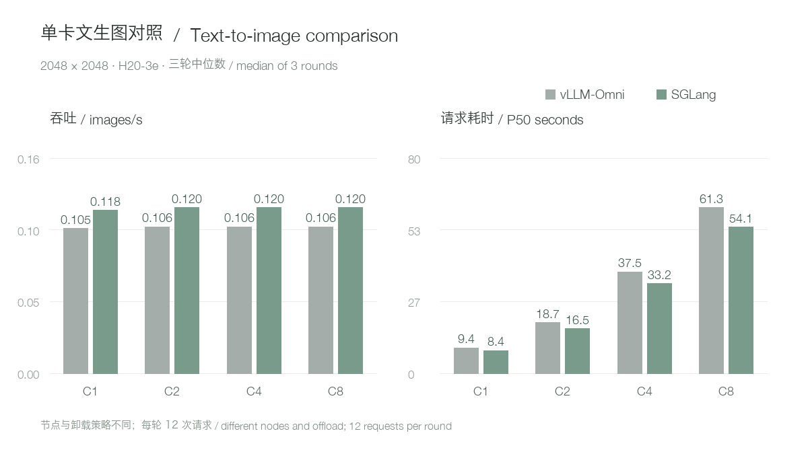

`2720×1536` 文生图并发 1 和 4 已完成，SGLang 的 P50 中位数分别为 8.320 和 33.000 秒，vLLM-Omni 分别为 9.400 和 37.354 秒。相同画幅的单图编辑并发 1 和 4，SGLang P50 中位数分别为 13.047 和 51.956 秒，vLLM-Omni 分别为 14.849 和 59.130 秒。

`2048×2048` 单图编辑并发 1、2、4 也已各完成三轮，所有请求成功。SGLang 的 P50 中位数分别为 13.21、26.22、52.54 秒；vLLM-Omni 分别为 14.93、29.72、59.59 秒。

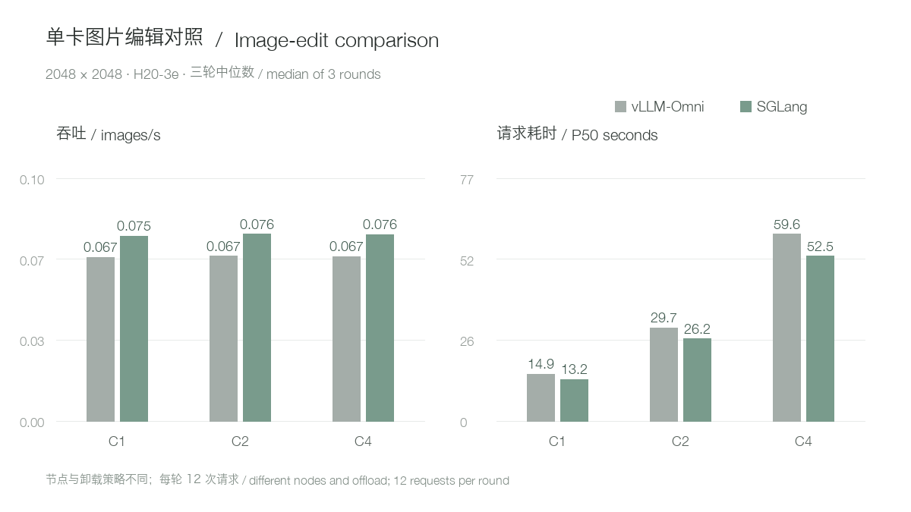

`4096×4096` 文生图并发 1 的三轮也已完成，SGLang P50 中位数约 45.13 秒，vLLM-Omni 约 46.50 秒；并发 2 的三轮也全部成功，SGLang P50 中位数约 89.37 秒，vLLM-Omni 约 92.27 秒。4K 单图编辑并发 1 的三轮也全部成功，SGLang P50 中位数约 52.85 秒，vLLM-Omni 约 54.94 秒。4K 编辑并发 2 的三轮也全部通过，SGLang P50 中位数约 104.77 秒，vLLM-Omni 约 109.11 秒。双参考图编辑三轮全部通过，SGLang P50 中位数约 18.44 秒，vLLM-Omni 约 20.94 秒；四参考图三轮也全部通过，SGLang P50 中位数约 30.74 秒，vLLM-Omni 约 35.48 秒。不同节点与卸载配置仍需保留在比较条件中。

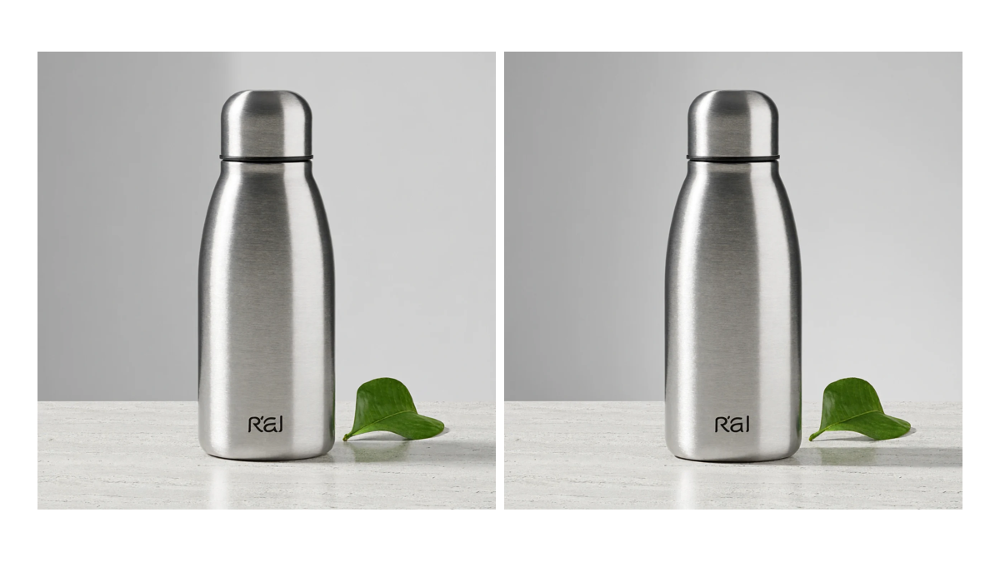

左侧为 vLLM-Omni、右侧为 SGLang，使用相同产品提示词和种子 42；均为首次请求的实际输出，仅缩放拼接，不把单张画面作为质量排名。

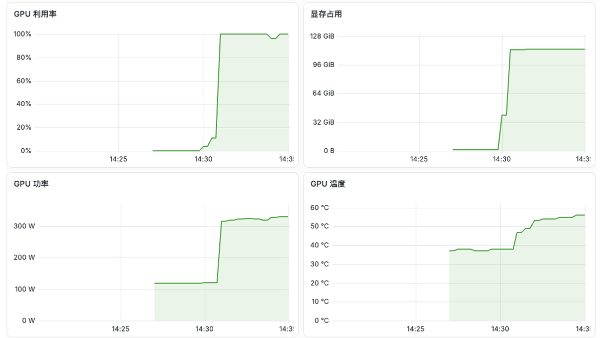

SGLang 加载和样图阶段的浅色 Grafana 截图。北京时间 14:23 至 17:15，SGLang 每秒采样的显存峰值约 121.06 GiB，期间包含 16 参考图请求；vLLM-Omni 的 72.66 GiB 来自另一轮测试。两次节点、卸载方式和工作负载不同，峰值差不能简单解释为引擎本身的差距。

先在 Linux 上进入下面的上游候选镜像，再执行上一节相同的 `MODEL_SOURCE` 临时视图代码；实际集群使用内部镜像，镜像同步可能改变 manifest 摘要，部署前请核对版本：

```bash
export MODEL_DIR=/path/to/MiniMax-H3-Image
docker run --rm -it --gpus 1 --network host --ipc host \
  -v "$MODEL_DIR:/models/MiniMax-H3-Image:ro" \
  --entrypoint /bin/bash \
  lmsysorg/sglang@sha256:dc9929c7f471f31d66aa11da7779a49e1fdb75fd2b120257ff181c55b52c2b74
```

```bash
export HF_HUB_OFFLINE=1 TRANSFORMERS_OFFLINE=1
sglang serve --model-type diffusion \
  --model-path /work/MiniMax-H3-Image \
  --host 127.0.0.1 --port 8000 --num-gpus 1 \
  --warmup-mode off --text-encoder-cpu-offload true \
  --served-model-name minimax-h3-image
```

第二段是本次实际启动参数：`--model-type diffusion` 指定图片后端，`--warmup-mode off` 跳过启动预热，`--text-encoder-cpu-offload true` 开启文本编码器 CPU 卸载，`--served-model-name` 指定对外模型名。请求沿用上面的文生图和编辑命令，把 `model` 改为 `minimax-h3-image`。本次镜像 diffusion CLI 没有列出 `--text-encoder-path`；SGLang 的组件卸载和前述 vLLM 的逐层卸载不同，正式对比需保留配置差异。[SGLang 官方配方](https://docs.sglang.io/cookbook/diffusion/MiniMax/MiniMax-H3-Image)

## 部署时怎么选

单张 H20-3e 能跑通这套模型和图像接口，适合低并发验证和内部创作工具。接入服务时，建议先设置有界队列、显示排队状态，并让客户端超时覆盖排队加生成时间；同时监控主机内存、显存和共享存储。

需要更高吞吐时，应另测多卡和多副本的实际性能；文字准确性、人物一致性、复杂参考图及长期稳定性也要针对业务单独评估。

模型与接口参考：[MiniMax-H3-Image 模型卡](https://huggingface.co/MiniMaxAI/MiniMax-H3-Image) · [vLLM-Omni 配方](https://recipes.vllm.ai/MiniMaxAI/MiniMax-H3-Image)。完整复现步骤与数据见阅读原文。
