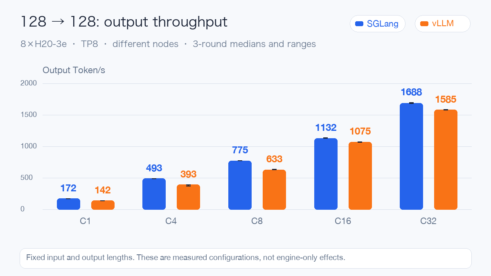
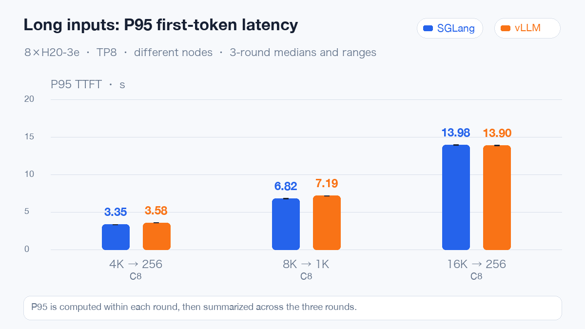
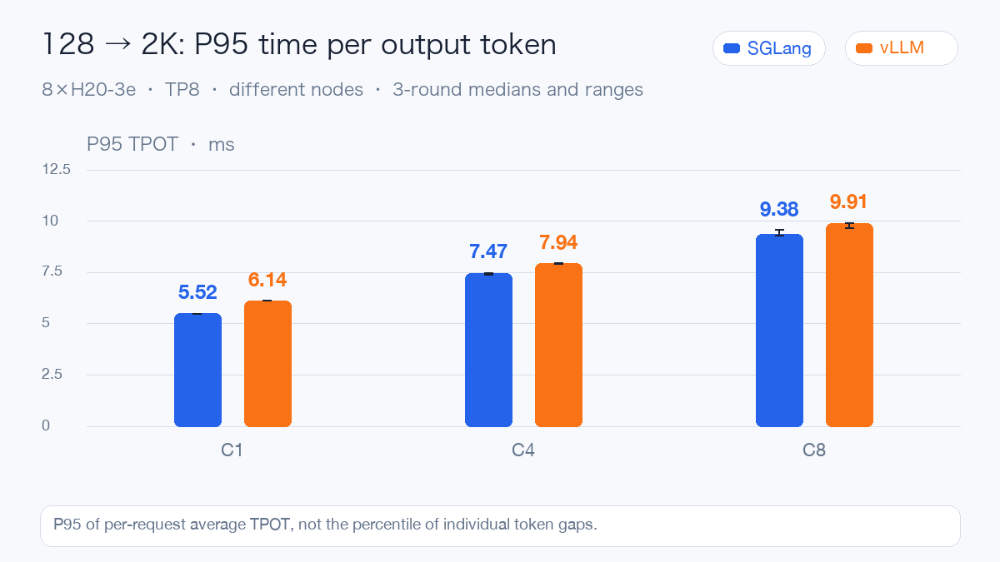
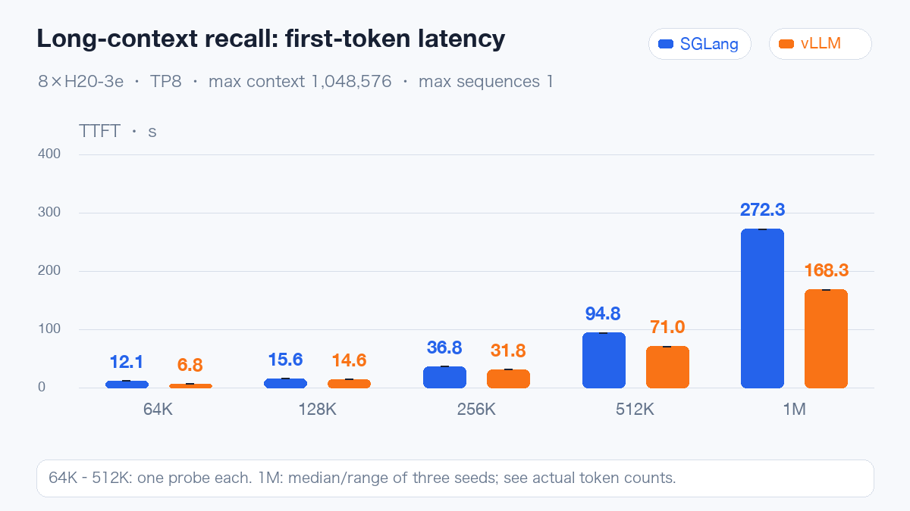

# MiniMax-M3.1-Flash Day0: eight H20-3e GPUs and actual million-token inputs

MiniMax officially released MiniMax-M3.1-Flash on October 19, 2026, and opened its weights on October 23. It is a native multimodal Mixture of Experts (MoE) model designed for coding, agent workflows and computer use. It has approximately **428B total parameters and 23B active parameters per token**, accepts text, images and video, produces text, and supports up to 1M tokens of context.

Building on MiniMax-M3, the publisher attributes efficiency improvements to sparse attention throughout the model, quantization-aware training and DSpark speculative decoding. MiniMax Sparse Attention (MSA) targets long-context computation efficiency; the mixed-quantization weights also require matching inference kernels.

This article records Day0 self-hosting tests following the weight release. vLLM and SGLang each use one eight-H20-3e node to validate functions, throughput, latency and million-token input. **Together, the engines completed 132 formal performance rounds and 3,888 requests, with 0 failures.**

## Configuration and common conditions

Both use the same pinned model snapshot. Its 48 main shards contain approximately 232.93 GiB of indexed tensor data, mixing MXFP8 with packed NVFP4 experts. H20 uses Hopper, and both deployments process experts with Marlin.

| Condition | vLLM | SGLang |
| --- | --- | --- |
| GPUs and parallelism | 8×H20-3e, TP8 | 8×H20-3e, TP8 |
| Main service | 32,768 context, maximum sequences 32 | 32,768 context, maximum running requests 32 |
| Long context | 1,048,576 context, maximum sequences 1 | 1,048,576 context, maximum running requests 1 |
| Key-Value Cache (KV Cache) | FP8 | Automatic FP8 selection confirmed in logs |
| Prefix cache / DSpark | Disabled / not enabled | Disabled / not enabled |
| Memory fraction parameter | 0.85 | 0.85 |

The experiments use different physical nodes, software versions and attention implementations. SGLang explicitly uses 8 tokenizer workers. These are measurements of two concrete deployment configurations; node and frontend settings also contribute to the results.

Each case has three rounds. Figures show per-metric medians and ranges across rounds. Each engine runs 57 main rounds plus 9 historical-protocol rounds, with warmups and calibration separate. Fixed-length traffic uses the same client, model tokenizer and request seeds, enforcing output lengths to measure serving performance. Natural-language, tool and image checks are evaluated separately.

TTFT is time to first token, TPOT is average time per subsequent output token, and E2E is complete-request duration. P95 TPOT below is a percentile of per-request averages.

## Short requests: first-token latency matters at low concurrency

Start with 128 input tokens and 128 output tokens.

Across these five concurrency levels, SGLang's output throughput is approximately **5.4%–25.4%** higher. At C1, results are 172.5 versus 141.6 tokens/s; at C32, 1,688.4 versus 1,585.4 tokens/s.

First-token latency is particularly relevant to interactive traffic. C1 P95 TTFT is 45.6 ms for SGLang and 126.2 ms for vLLM. At C8, it is 152.5 ms versus 404.7 ms.

At C32, P95 TPOT is 16.40 ms versus 16.42 ms. Sustained decoding performance converges at higher concurrency, so the low-concurrency throughput improvement should not be applied to every traffic shape.

The following screenshots cover the respective main test windows, including functional checks, warmups and formal rounds.

The maximum single-card framebuffer use in the vLLM window is approximately 121 GiB. SGLang's corresponding measurement: peak single-card memory of approximately 123.9 GiB, power of 431 W and temperature of 62°C. This measures total framebuffer allocation, including weights, preallocated caches, workspaces and graph capture.

## Long inputs and outputs need separate latency targets

At concurrency 8, first-token latency changes with input shape.

With 16K input and 256 output tokens, P95 TTFT is 13.98 seconds for SGLang and 13.90 seconds for vLLM. These requests must process substantial input first. Throughput alone does not establish whether first-token latency meets the business target.

With 8K input and 1K output tokens at C16, output throughput is 601.2 versus 591.4 tokens/s, but P95 complete-request duration is 27.37 versus 36.72 seconds. Similar aggregate throughput can still produce different request tails. Measure complete duration directly rather than adding P95 TTFT and P95 TPOT from different requests.

Short inputs with long outputs depend more on sustained decoding. The following figure shows request-level P95 TPOT for 128 input and 2K output tokens.

At C8, P95 TPOT is 9.38 ms for SGLang and 9.91 ms for vLLM. Complete-request P95 is 19.29 seconds versus 20.48 seconds. Short chats, long-document retrieval and sustained generation need separate admission limits and latency targets.

## Million-token context: account for the wait

The long-context probes place independent random codes near 10%, 50% and 90% of the input and require exact JSON answers. Both services are restarted separately with a maximum context of 1,048,576 and maximum running requests of 1, with prefix caching disabled.

Both pass all 7 probes, including all three codes in each million-token seed. Actual SGLang server inputs are 1,040,383, 1,040,384, 1,040,384 tokens; vLLM inputs are 1,040,383, 1,040,384 and 1,040,384 tokens.

Median TTFT across the three million-token seeds is **272.26 seconds** for SGLang and **168.29 seconds** for vLLM. This validates single-request long-input handling and targeted recall; complex document reasoning still needs evaluation on real tasks. Short-request throughput ordering should not determine the choice of a million-token service.

In the long-context window, peak single-card memory is approximately 137.2 GiB for SGLang and 128 GiB for vLLM. The 0.85 setting is a runtime memory-planning parameter; caches, workspaces and graph capture also affect actual peaks. Keep million-token inputs single-request initially, then measure headroom before increasing concurrency.

## Tools, images and deployment compatibility

| Check | vLLM | SGLang |
| --- | --- | --- |
| Text and complete streams | 3/3 | 3/3 |
| Tools | 4/4 | 4/4 |
| Images | 4/4 | 4/4 |
| Reasoning parameters | 5/5 | 5/5 |

Tool cases cover a single tool, mock results returned to the model, streaming arguments and nested objects. Images cover shape counting, receipt totals, chart values and two-image identification. These are fixed small integration probes, with local stubs supplying tool results. Video and UI grounding are outside the scores.

Web interaction was checked separately after formal performance tests: the model returned 703 and recalled jade-628 within the same conversation on the next turn. The Chinese interface is preserved in the original screenshot.

vLLM encountered a PTX toolchain mismatch during expert-weight repacking and passed after prioritizing CUDA compatibility libraries in the image. Streaming parsing also needed a narrower scope for initial state detection, preventing format examples in the system prompt from being mistaken for the current answer state.

SGLang's first attempt stopped because the test launcher assumed a standalone torchrun executable existed. It continued after switching to the module entry point of the same Python environment. Startup also included DeepGEMM compilation and graph capture. File, node and compilation caches affect these records, so they are not used as a controlled cold-start ranking.

## Deployment recommendations

For a new low-concurrency interactive service, prioritize validating the SGLang configuration tested here. At 128→128 and C8, P95 TTFT is 152.5 ms, versus 404.7 ms for vLLM, a difference directly relevant to perceived latency. Reproduction should also check tokenizer workers, attention implementations and software versions.

For an existing vLLM system dominated by higher-concurrency traffic, retaining the deployment and running workload regressions is a reasonable first choice. The short-request C32 throughput gap is approximately 6.5%, with similar sustained decoding time. Both pass the functional probes. Migration should depend on real prompts, tool protocols and image distributions as well as peak throughput.

For inputs close to one million tokens, prioritize validating vLLM, which has the lower first-token wait in this run: three-seed median TTFT is 272.26 seconds for SGLang and 168.29 seconds for vLLM. Configure long-context services and concurrency limits separately. Only single-request operation was tested, without queueing. Retrieval, segmentation and prefix reuse require separate measurements.

Pin image digests, verify mixed-weight kernels, compatibility libraries and protocol parsing, then warm the required shapes. These are development builds: after upgrades, check whether the local patches are still needed.

Official model card: https://huggingface.co/MiniMaxAI/MiniMax-M3.1-Flash

Official launch announcement: https://www.minimax.io/blog/minimax-m31f

Official weight announcement: https://x.com/MiniMax_AI/status/2113436864904610008

Read the full MiniMax-M3.1-Flash Day0 article:

https://aik8s.run/en/ai-k8s/practices/minimax-m31-flash-day0/
