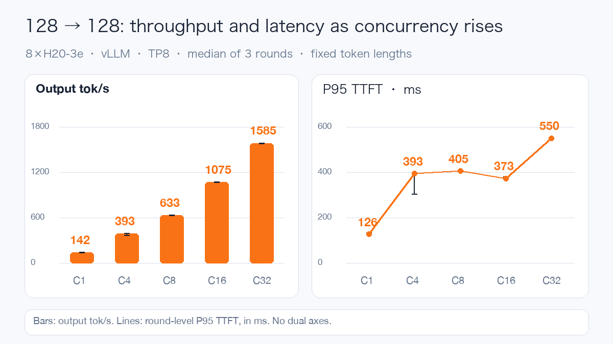
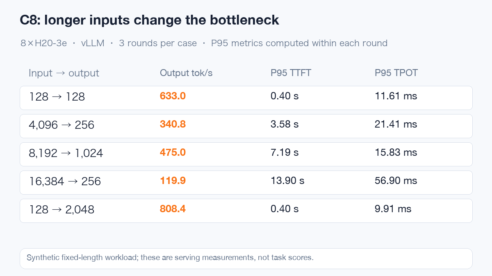
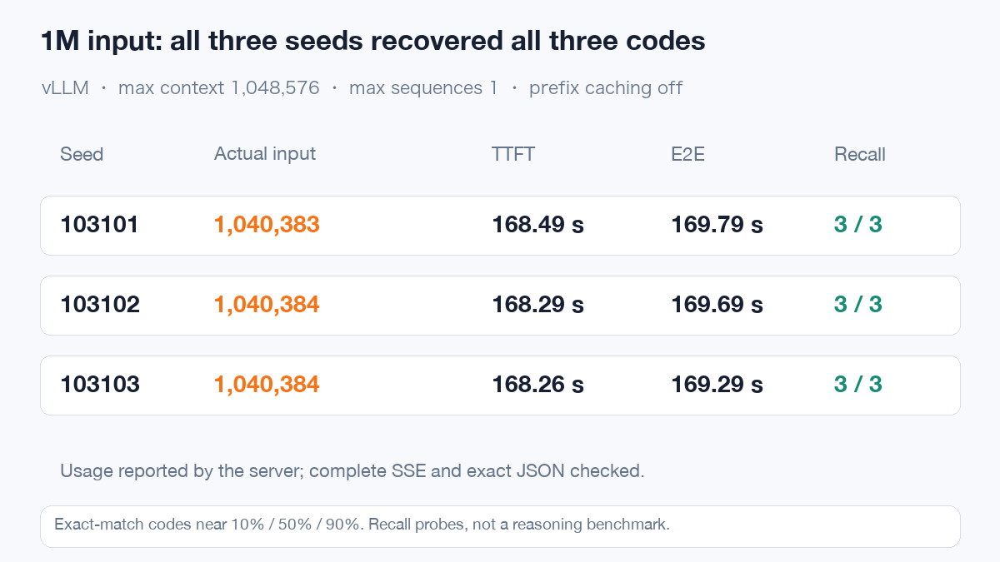

# MiniMax-M3.1-Flash Day0: eight H20-3e GPUs and actual million-token inputs

After MiniMax-M3.1-Flash released its weights, I wanted to answer two practical questions: could an existing H20-3e system run it reliably, and how long would a million-token input take?

The initial vLLM test used eight GPUs with TP8 and completed 66 formal performance rounds, covering 1,944 requests with 0 failures. Seven separate long-context recall probes also passed, including three inputs exceeding one million tokens.

Beyond throughput, two deployment failures were particularly useful: one happened after the weights had loaded, and another appeared after the model could already answer questions.

## A 428B model still needs a close look at weight formats

MiniMax-M3.1-Flash is a native multimodal Mixture of Experts model. The publisher reports approximately 428B total parameters and 23B active parameters, text, image and video inputs, text output, and up to 1M tokens of context. [Official model card](https://huggingface.co/MiniMaxAI/MiniMax-M3.1-Flash)

Active parameters affect computation per token, but a complete deployment still needs all weights. The pinned snapshot has 48 main shards whose indexed tensor data totals approximately 232.93 GiB. Runtime caches and workspaces require additional memory.

The format deserves particular attention. The outer configuration specifies MXFP8, while experts use packed NVFP4. H20 is a Hopper GPU; this run uses Marlin's W4A16 path for experts. That should not be interpreted as native Blackwell FP4 execution on H20.

The test used a single node with eight H20-3e GPUs and TP8. The main performance configuration had a 32,768-token maximum context, 32 maximum sequences and a GPU memory utilization parameter of 0.85. Prefix caching and DSpark speculative decoding were disabled, with FP8 KV and index caches. Million-token tests restarted the service separately with maximum sequences reduced to 1.

## Loading the weights was only the first gate

The first startup read all 48 shards, then failed during Marlin expert-weight repacking with an unsupported PTX toolchain error.

The image contained CUDA 13.4 components, but the process initially saw driver API 13.0. I reduced the same repacking operation to a small probe on the same GPU: it failed with the default library path and passed when the image's CUDA compatibility libraries were loaded first. The process then reported API 13.4. The formal service used that container configuration without changing the host driver.

The second service could answer questions, but streaming validation found reasoning markers and reasoning text inside the answer. Code inspection showed why: the system prompt described the marker format, while the parser inspected the entire prompt to decide whether reasoning had ended. It counted the example closing marker as current answer state.

The fix narrows only the initial-state inspection, preserving the original generated-stream extraction. After prefix regressions and chunked-stream replays passed inside the image, real requests checked complete streams, tools and images. The full command, version digest and plugin are available in the linked public article.

Both failures show why deployment acceptance needs actual requests and client-field checks. Loading all weights, or receiving some text, does not establish that the integration works.

## Throughput as concurrency increases

Start with 128 input tokens and 128 output tokens. Each case has three rounds of fixed-length synthetic traffic. The chart shows medians, with error bars preserving the range across rounds.

Raising concurrency from 1 to 32 increases output throughput from approximately 142 to 1,585 tokens/s, about 11.2 times. Meanwhile, P95 time per output token rises from 6.14 ms to 16.42 ms, and P95 time to first token rises from approximately 126 ms to 550 ms.

The first-token statistic at concurrency 16 is lower than at concurrency 8. That is what the original data shows. Queuing, batching and overlapping computation affect finite batches, making the three-round range more useful than an artificially perfect curve.

The following screenshot captures the actual performance window. The eight GPUs approach full utilization during computation. Maximum single-card framebuffer use is approximately 121 GiB, power peaks at 428 W and temperature at 62°C. These are maxima of individual-card metrics, not summed power.

## Long inputs need their own capacity estimate

Holding concurrency at 8 and changing request shape produces substantial differences.

A 16K-input, 256-output request reaches 13.90 seconds P95 time to first token. A 128-input, 2K-output request still starts in approximately 0.40 seconds, but its P95 complete-request duration reaches approximately 20.48 seconds.

The former must process substantial input while competing with ongoing decoding. The latter spends more time generating. Long inputs are common in Retrieval-Augmented Generation and agent workflows, so capacity estimates should follow real request distributions. Choosing concurrency from short-chat throughput alone can lead to unexpectedly long waits.

## Put a million tokens through the service

Setting the context parameter to 1M is not the test. I placed random codes near 10%, 50% and 90% of a long document and requested an exact JSON answer. Validation checked server input counts, complete streams and exact code matches.

The 64K, 128K, 256K and 512K tiers passed first. Three independent million-token seeds then produced actual server inputs of 1,040,383, 1,040,384 and 1,040,384 tokens. All three codes were recovered in every run.

The cost is concrete: approximately 168 seconds to the first token and 169–170 seconds for the complete request. This establishes single-request long-input handling and targeted recall. Complex document reasoning and long-running task completion need their own evaluations.

The next screenshot shows the actual long-context resource window, where maximum single-card framebuffer use reaches approximately 128 GiB. Both service parameters and traffic differ from the earlier performance configuration, so the memory difference is not a direct estimate of KV cost per million tokens.

## Exercise tools and images through real requests

Text and complete-stream checks passed 3/3, tools 4/4 and images 4/4. Tool coverage includes a single tool, a mock result returned to the model, streaming arguments and nested objects. Images cover shape counting, receipt totals, chart values and two-image identification.

These small cases establish whether templating, reasoning fields, tool arguments and visual inputs work together. Tool results come from a local stub without connecting to production systems. That differs from evaluating complete agent tasks. Video and UI grounding are outside this run's scores.

For existing H20-3e systems, this provides a tested eight-GPU deployment path. Before connecting business traffic, I would define separate latency targets for short chats, long inputs and long outputs, then tune concurrency and caching. Million-token capacity works under the tested conditions; where retrieval or segmentation can reduce prefill, measure those alternatives too.

All performance results in this article come from vLLM. Complete SGLang results are not yet available, so there is no engine ranking or claimed improvement over earlier runs with different weights and versions.

The public article includes the complete configuration, per-round data, all 7 long-context probes, and diagnosis and fixes for both deployment issues:

[Read the full MiniMax-M3.1-Flash Day0 article](https://aik8s.run/en/ai-k8s/practices/minimax-m31-flash-day0/)
