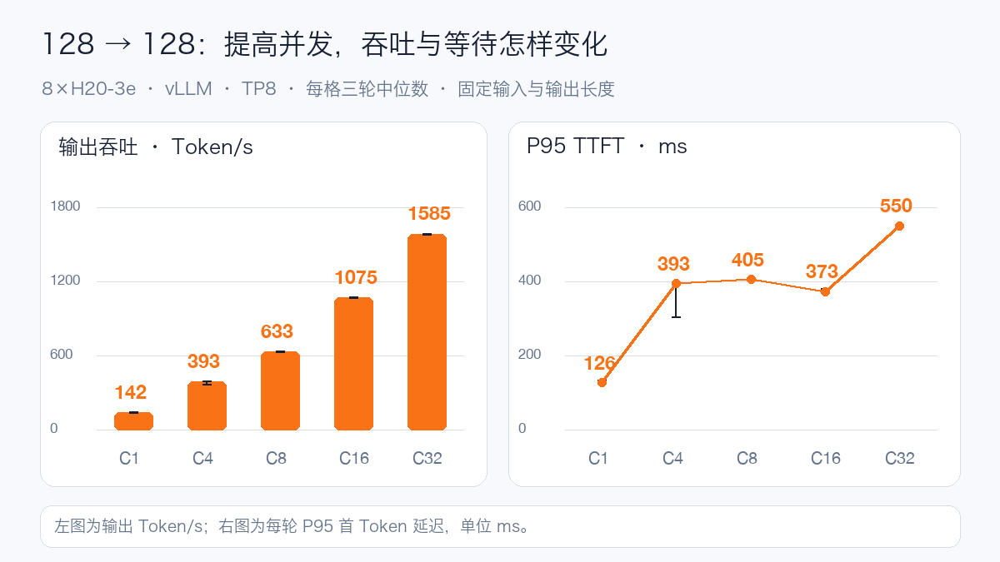
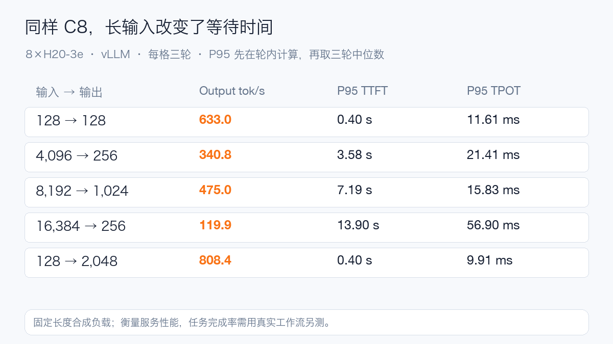
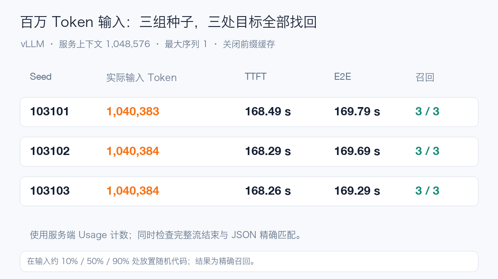

# MiniMax-M3.1-Flash Day0：八张 H20-3e，实测百万 Token

MiniMax-M3.1-Flash 开放权重后，我最想确认两件事：现有的 H20-3e 能不能把它跑稳，百万 Token 上下文到底要等多久。

这次先用 vLLM 完成了一套测试：八卡 TP8，66 轮正式性能测试、1,944 个请求，失败数为 0；另外做了 7 个长上下文召回样例，其中三次实际输入都超过一百万 Token。

结果里最有意思的，除了吞吐，还有两次部署问题：一次发生在权重加载之后，一次发生在已经能正常回答之后。

## 428B 的模型，为什么还要看权重格式

MiniMax-M3.1-Flash 是原生多模态混合专家模型，官方给出的规模约为 428B 总参数、23B 激活参数，支持文字、图片、视频输入和文字输出，最长上下文为 1M Token。[官方模型卡](https://huggingface.co/MiniMaxAI/MiniMax-M3.1-Flash)

激活参数影响每个 Token 的计算量，完整部署仍需放下全部权重。本次固定快照的 48 个主分片，索引张量数据约 232.93 GiB，运行时还要为缓存和计算留空间。

更需要注意的是格式：配置外层写着 MXFP8，专家部分却是打包的 NVFP4。H20 使用 Hopper 架构，本轮通过 Marlin 的 W4A16 路径处理专家，不能把它理解成在 H20 上获得 Blackwell 原生 FP4 计算。

实测使用单节点八张 H20-3e、张量并行 TP8。基础性能阶段最大上下文为 32,768，最大序列为 32，显存利用率参数为 0.85；关闭前缀缓存和 DSpark 投机解码，KV 与索引缓存采用 FP8。百万上下文单独重启服务，最大序列降到 1。

## 第一关，读完权重也不等于能生成

第一次启动，48 个分片已经全部读完，专家权重进入 Marlin 重排时，才报出 PTX 工具链不受支持。

镜像里有 CUDA 13.4 组件，但进程默认看到的驱动 API 是 13.0。我把同一个重排操作缩成小检查，在同一卡上验证：默认库路径失败，优先加载镜像内 CUDA 兼容库后通过，进程报告的 API 也变成 13.4。正式运行沿用了这个容器配置，没有修改主机驱动。

第二次服务可以回答问题了，流式验收却发现推理标记和推理内容混进正文。继续查代码，才发现系统提示词里有标记的格式说明，而解析器用整个提示词判断推理是否结束，把说明里的结束标记也算了进去。

修复只缩小初始状态的检查范围，保留原来的生成流提取逻辑。镜像内的前缀回归与切块重放通过后，再用真实请求验证完整流、工具和图片链路。完整命令、版本摘要和插件放在文末公开文档里。

这两个问题都说明，部署验收要走到真实请求和客户端字段；看见权重加载完成，或者收到一段文字，还不够。

## 并发拉高之后，八卡能输出多快

先看 128 Token 输入、128 Token 输出的短请求。每格三轮，使用固定长度合成负载；图中为三轮中位数，误差线保留轮间范围。

并发从 1 提到 32，输出吞吐从约 142 增至 1,585 Token/s，提高约 11.2 倍。与此同时，P95 的每输出 Token 耗时从 6.14 ms 增至 16.42 ms，P95 首 Token 延迟从约 126 ms 增至 550 ms。

并发 16 的首 Token 统计比并发 8 更低，原始结果就是如此。有限批次里的排队、合批和计算交错会影响统计，所以保留三轮范围，比画一条看似完美的曲线更有用。

这是压测窗口内的实际资源曲线。八卡在计算阶段接近满载，窗口内单卡显存峰值约 121 GiB、功率峰值 428 W、温度峰值 62°C；这些是各单卡指标的最大值，功率没有相加。

## 换成长输入，短问答的成绩就不够用了

把并发固定在 8，再改变输入输出长度，差别很明显。

16K 输入、256 输出的首 Token P95 达到 13.90 秒；128 输入、2K 输出的首 Token 仍约 0.40 秒，但完整请求 P95 要约 20.48 秒。

前者要先处理大量输入，还会与在途解码竞争资源；后者主要是在持续生成。对检索增强生成和智能体而言，输入越来越长很常见，容量估算应使用实际请求形态。只拿短问答吞吐来定并发，上线后的等待时间很容易超出预期。

## 百万 Token，实际送进去再看

长上下文不是把服务参数设成 1M 就算测完。我在长文约 10%、50%、90% 的位置放入随机代码，要求模型用 JSON 返回全部代码，并检查服务端输入计数、完整流和精确匹配。

64K、128K、256K、512K 四档先通过，再运行三组独立种子的百万输入。三次服务端实际输入分别为 1,040,383、1,040,384、1,040,384 Token，三处代码全部找回。

代价也很具体：首 Token 都要约 168 秒，完整请求约 169–170 秒。它证明了单请求长输入处理与目标召回，复杂文档推理和长任务完成率还需要用对应任务评估。

下面是这组长上下文实验的资源曲线。窗口内单卡显存峰值约 128 GiB。与前面的基础性能配置相比，服务参数和负载都变了，不能把显存差值直接当成每百万 Token 的 KV 成本。

## 工具和图片，也过了一遍真实链路

文本与完整流检查 3/3，工具调用检查 4/4，图片检查 4/4。工具部分覆盖单工具、模拟结果回传、流式参数和嵌套对象；图片部分覆盖形状计数、票据金额、柱状图数值和双图识别。

这组小样例主要确认模板、推理字段、工具参数和视觉输入是否贯通。工具结果来自本地测试桩，没有连接生产系统；它与真实智能体长任务的评估是两回事。视频和界面定位没有进入本轮成绩。

对现有 H20-3e 集群，本文已经给出一条可运行的八卡路径。真正接入业务时，我会先按短问答、长输入、长输出分别确定延迟目标，再调并发和缓存。百万上下文的容量已经验证，但对于能用检索或分段解决的请求，仍值得测量减少预填充的收益。

本篇性能结果均来自 vLLM。SGLang 的完整结果尚未形成，不做引擎排名，也不拿此前不同权重与版本的成绩直接宣称提升。

公开文档包含完整配置、逐轮数据、7 个长上下文样例，以及这次两类问题的定位与修复：

[阅读全文：MiniMax-M3.1-Flash Day0](https://aik8s.run/ai-k8s/practices/minimax-m31-flash-day0/)
