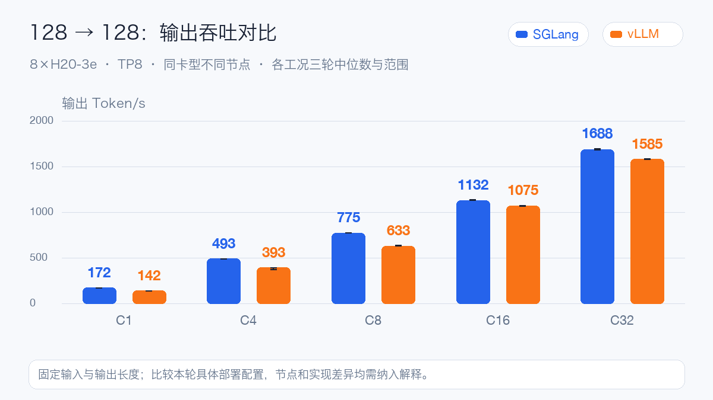
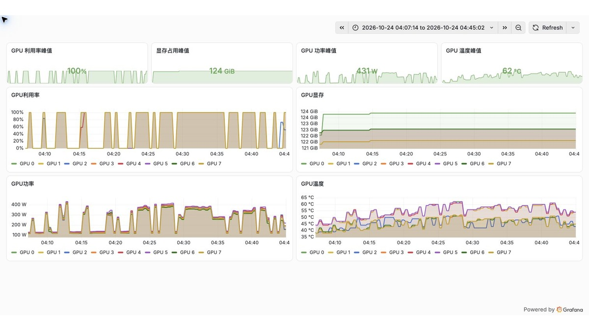
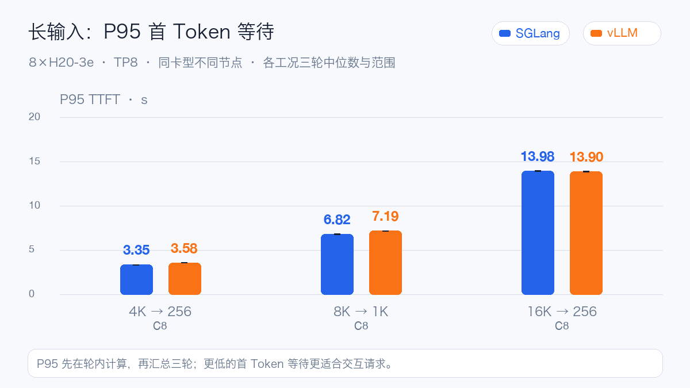
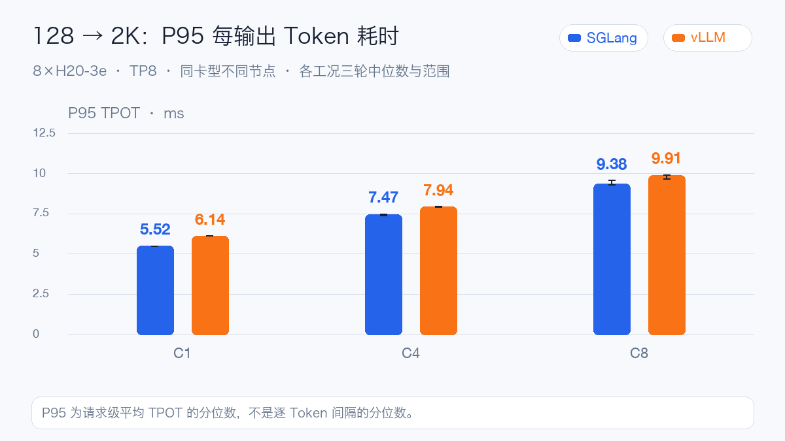
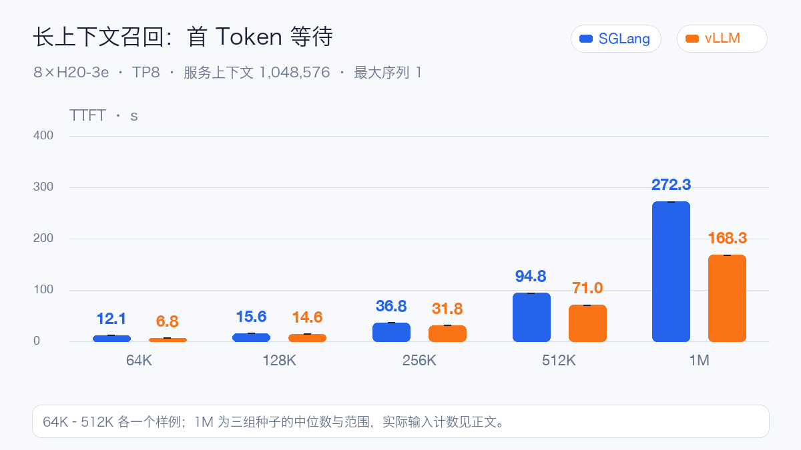
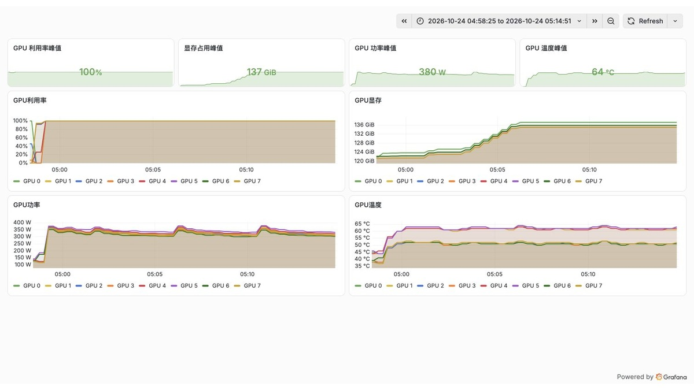
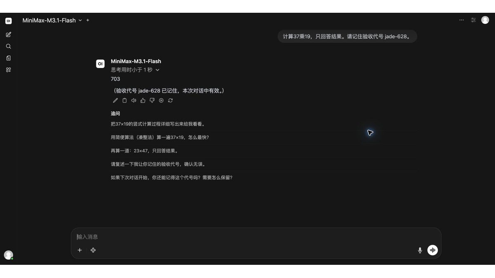

# MiniMax-M3.1-Flash Day0：八张 H20-3e，实测百万 Token

2026 年 10 月 19 日，MiniMax 正式发布 MiniMax-M3.1-Flash，并于 10 月 23 日开放模型权重。它是一款原生多模态混合专家模型（Mixture of Experts，MoE），面向代码开发、智能体工作流和计算机操作等场景。模型约 **428B 总参数、每 Token 激活 23B 参数**，支持文字、图片、视频输入和文字输出，最长上下文为 1M Token。

它在 MiniMax-M3 的基础上演进，官方将效率改进归纳为全模型稀疏注意力、量化感知训练和 DSpark 推测解码。MiniMax Sparse Attention（MSA）用于改善长上下文计算效率；开放的混合量化权重则需要推理框架提供匹配的计算内核。

本文记录权重开放后的 Day0 自部署测试。vLLM 和 SGLang 各使用一台八卡 H20-3e 节点，分别验证功能、吞吐、延迟和百万 Token 输入。**两套引擎合计完成 132 轮正式性能测试、3,888 个请求，失败数为 0。**

## 实测配置：相同的条件有哪些

模型固定为同一个权重快照，48 个主分片的索引张量数据约 232.93 GiB。权重混用 MXFP8 和打包的 NVFP4；H20 属于 Hopper 架构，两套服务都通过 Marlin 处理专家权重。

| 条件 | vLLM | SGLang |
| --- | --- | --- |
| GPU 与并行 | 8×H20-3e，TP8 | 8×H20-3e，TP8 |
| 基础服务 | 32,768 上下文，最大序列 32 | 32,768 上下文，最大运行请求 32 |
| 长上下文 | 1,048,576 上下文，最大序列 1 | 1,048,576 上下文，最大运行请求 1 |
| 键值缓存（KV Cache） | FP8 | 日志确认自动选择 FP8 |
| 前缀缓存 / DSpark | 关闭 / 未启用 | 关闭 / 未启用 |
| 显存比例参数 | 0.85 | 0.85 |

两个实验使用不同的物理节点，软件版本与注意力实现也不同；SGLang 显式配置了 8 个分词 worker。下面比较的是这两套具体部署配置，节点和前端配置也参与最终结果。

每个工况测三轮，使用逐指标中位数，图中保留轮间范围。主矩阵每引擎 57 轮，另有 9 轮历史口径补测；预热与校准单列。固定长度负载使用相同客户端、模型编码器和请求种子，强制输出规定长度，衡量服务性能。自然问答、工具与图片另行验收。

TTFT 是首 Token 等待，TPOT 是后续每输出 Token 的平均耗时，E2E 是完整请求耗时。下文的 P95 TPOT 是请求级平均值的分位数。

## 短请求：低并发的等待差异更明显

先看 128 Token 输入、128 Token 输出。

本轮五个并发档位中，SGLang 的输出吞吐高出约 **5.4%–25.4%**。C1 分别为 172.5 与 141.6 Token/s；C32 分别为 1,688.4 与 1,585.4 Token/s。

首 Token 的差别更值得交互业务注意：C1 的 P95 TTFT，SGLang 为 45.6 ms，vLLM 为 126.2 ms；C8 分别为 152.5 ms 和 404.7 ms。

到了 C32，P95 TPOT 分别为 16.40 ms 和 16.42 ms。高并发下持续解码的差距已经收窄，不能用低并发的吞吐增幅估算所有流量。

下面分别是两次基础测试窗口的实际资源曲线，包含功能检查、预热和正式轮次。

vLLM 窗口内的单卡显存峰值约 121 GiB。SGLang 的对应数据：单卡显存峰值约 123.9 GiB，功率峰值约 431 W，温度峰值 62°C。这里统计整卡显存，包含权重、预分配缓存、工作区和图捕获占用。

## 长输入与长输出：分开确定延迟目标

固定并发为 8，首 Token 等待随输入形态变化。

16K 输入、256 输出时，SGLang 的 P95 TTFT 为 13.98 秒，vLLM 为 13.90 秒。这类请求要先处理大量输入，吞吐之外，还要看首 Token 等待是否符合业务目标。

8K 输入、1K 输出在 C16 下，输出吞吐分别为 601.2 与 591.4 Token/s，P95 完整请求却分别为 27.37 秒和 36.72 秒。整机吞吐接近时，请求尾延迟仍可能不同；应直接测量完整耗时，也不能把不同请求的 P95 TTFT 与 P95 TPOT 简单相加。

短输入、长输出则更依赖持续解码。下面是 128 输入、2K 输出的请求级 P95 TPOT。

C8 时，SGLang 的 P95 TPOT 为 9.38 ms，vLLM 为 9.91 ms；完整请求 P95 分别为 19.29 秒、20.48 秒。短问答、长文检索和持续生成，应分别设置准入并发与等待目标。

## 百万 Token：容量可用，等待也要算进去

长上下文测试在输入约 10%、50%、90% 的位置放入独立随机代码，要求模型以 JSON 精确返回。两套服务都单独切换到 1,048,576 上下文、最大运行请求 1，关闭前缀缓存。

两边均通过 7 个样例，其中三组百万输入分别找回全部三处代码。SGLang 三次服务端实际输入为 1,040,383、1,040,384、1,040,384 Token；vLLM 为 1,040,383、1,040,384、1,040,384 Token。

三组百万输入的 TTFT 中位数，SGLang 为 **272.26 秒**，vLLM 为 **168.29 秒**。这验证了单请求长输入与目标召回；复杂文档推理仍需用真实任务评价。短请求的吞吐顺序不能直接用于选择百万上下文服务。

长上下文窗口中，SGLang 的单卡显存峰值约 137.2 GiB，vLLM 约 128 GiB。0.85 是运行时的显存规划参数，实际峰值还受缓存、工作区和图捕获等影响。百万输入先保持单请求，再另测更高并发的余量。

## 工具、图片和部署适配

| 检查 | vLLM | SGLang |
| --- | --- | --- |
| 文本与完整流 | 3/3 | 3/3 |
| 工具调用 | 4/4 | 4/4 |
| 图片理解 | 4/4 | 4/4 |
| 推理参数 | 5/5 | 5/5 |

工具样例覆盖单工具、模拟结果回传、流式参数和嵌套对象；图片样例覆盖形状计数、票据金额、图表数值和双图识别。这里验证的是固定小样例的链路，工具结果由本地测试桩提供。视频和界面定位没有进入本轮成绩。

网页交互在正式压测结束后另行验证：模型返回计算结果 703，下一轮能复述当前对话中的代号 jade-628。

部署时，vLLM 在专家权重重排阶段遇到 PTX 工具链不匹配，改为优先加载镜像内 CUDA 兼容库后通过；流式解析还需要针对当前模板缩小初始状态判断范围，避免把系统提示里的格式示例当作当前回答状态。

SGLang 的首次尝试停在测试脚本假定存在独立 torchrun 命令，改用同一 Python 环境的模块入口后继续运行。正式启动还经历了 DeepGEMM 编译和图捕获。这些启动记录受文件缓存、节点与编译缓存影响，没有用它们做受控冷启动排名。

## 部署建议：按业务负载选择

新建低并发交互服务，可以优先验证本轮 SGLang 配置。128→128、C8 的 P95 首 Token 为 152.5 ms，对应的 vLLM 为 404.7 ms；这是与用户体感直接相关的差异。复现时要同时核对分词 worker、注意力实现与软件版本。

已有 vLLM 服务体系、流量又集中在高并发区间，可以优先保留现有部署，再做业务负载回归。本轮短请求 C32 的吞吐差距约 6.5%，持续解码耗时接近。两边的功能小样例都通过，是否迁移应结合真实提示词、工具协议和图片分布，而不仅看峰值吞吐。

接近百万 Token 的原文请求，可以优先验证本轮首 Token 等待更低的 vLLM 配置：SGLang 三组 TTFT 中位数为 272.26 秒，vLLM 为 168.29 秒。长上下文建议独立配置服务与并发限制；本轮仅验证单请求，未覆盖排队。检索、分段和前缀复用能否减少预填充，需要另测。

部署时还应固定镜像摘要，提前验证混合权重内核、兼容库和协议解析，再预热需要的形状。对于本轮使用的开发构建，升级后要重新核对补丁是否仍然需要。

官方模型卡：https://huggingface.co/MiniMaxAI/MiniMax-M3.1-Flash

官方发布说明：https://www.minimax.io/blog/minimax-m31f

官方权重公告：https://x.com/MiniMax_AI/status/2113436864904610008

阅读全文：MiniMax-M3.1-Flash Day0

https://aik8s.run/ai-k8s/practices/minimax-m31-flash-day0/
