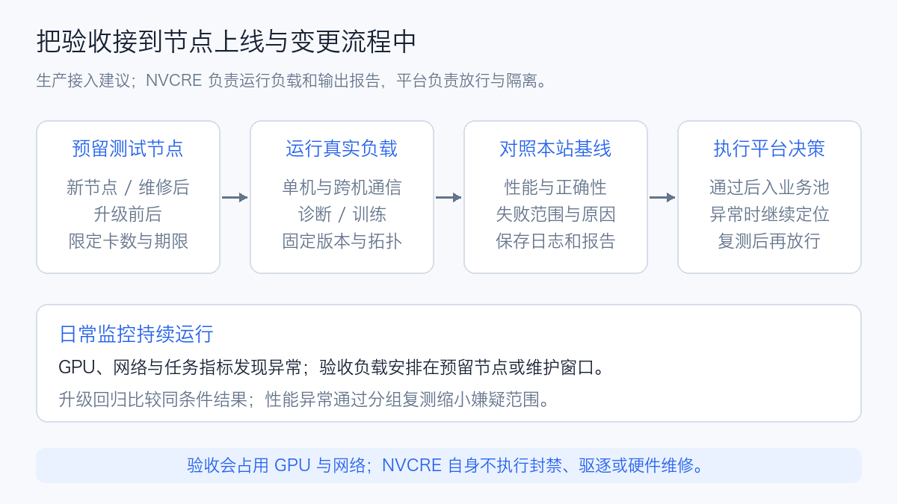
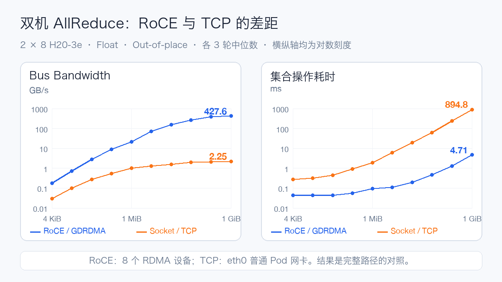
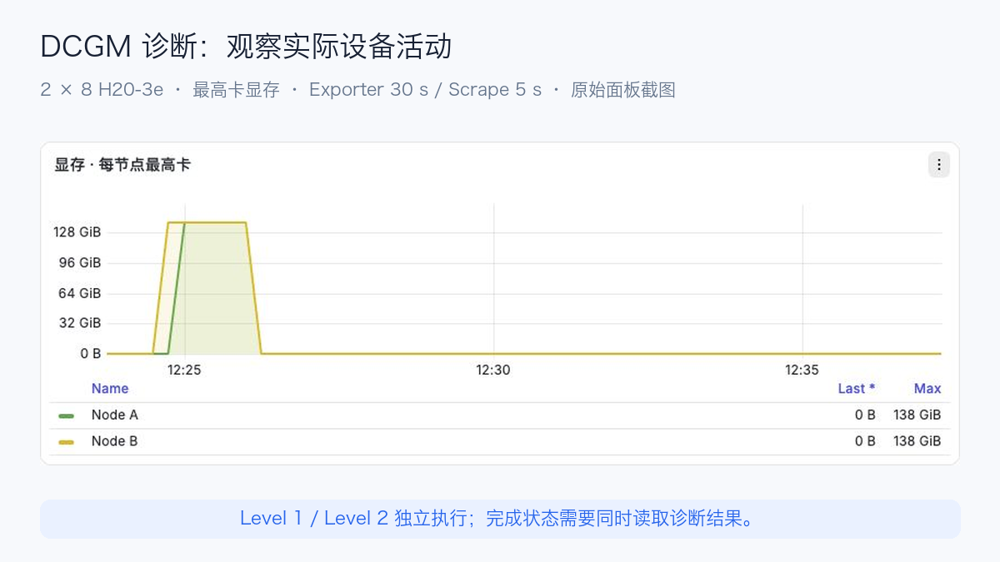
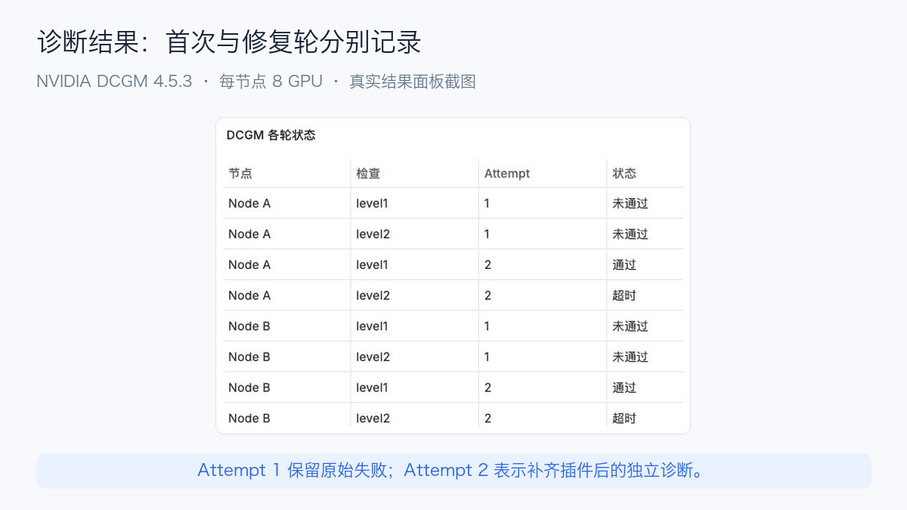
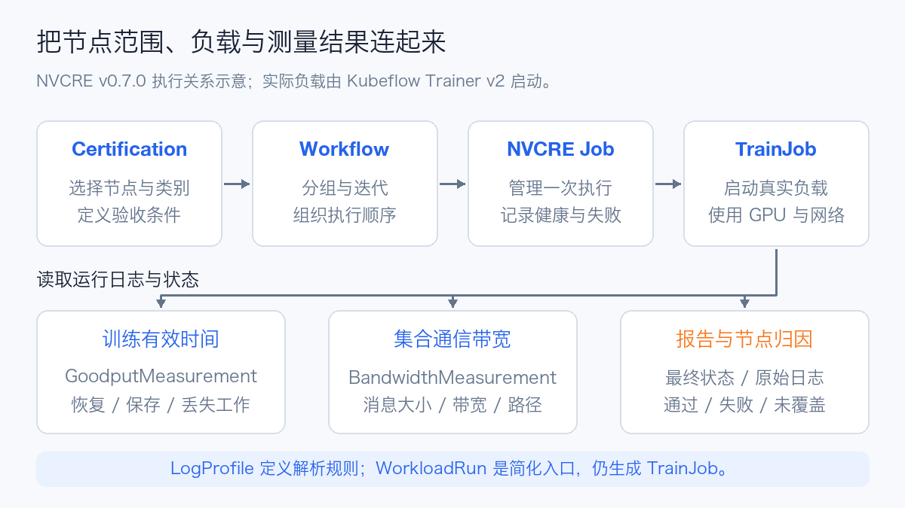

# NVIDIA NVCRE 解析：附 NCCL/DCGM 实测

2026 年 10 月 12 日，NVIDIA 在开放计算项目 OCP 全球峰会相关发布中，将 **NVIDIA Cluster Readiness Engine，简称 NVCRE**，列入 DSX AI Factory 的开源组件。这个近期公开的 Kubernetes 工具，面向的是 GPU 集群上线和变更后的验收。

它在 9 月已经有公开记录：GitHub 的稳定版 v0.1.0 发布于 9 月 1 日，NVIDIA 在 9 月 23 日发布了官方技术介绍，项目采用 Apache 2.0 许可证。10 月 12 日是最近一次集中发布，不能直接当作首次开源日。

它要解决的问题很实际：节点都显示 Ready，GPU 没有报错，多机训练却可能跑不快。一条没有使用预期网卡的通信路径，或者某个节点在负载下变慢，都可能让其他 GPU 一起等待。NVCRE 在指定节点上主动运行通信、诊断和训练负载，用测量结果判断这批资源能否承担工作。

本文分为工具原理分析与独立验机实测。**本轮没有部署 NVCRE 控制器，也没有执行其 Certification 验收流程。** 下文的成绩和设备曲线来自两台八卡 H20-3e 上的独立 NCCL Tests、DCGM 任务，使用普通 Kubernetes Job；NVCRE 部分基于 v0.7.0 的源码与依赖分析。

## 生产里，哪些时候值得运行 NVCRE

最直接的用途是新节点入池。设备发现正常，只证明平台看见了 GPU；节点内多卡通信、跨机网络和实际训练负载，还需要分别验证。可以先在验收资源池运行测试，满足本站条件后再开放业务调度。

另一个用途是升级回归。驱动、固件、NCCL 或节点镜像改变后，使用相同硬件、拓扑、消息大小和测试参数复测，对照性能与正确性。这样更容易在扩大灰度前发现变化，而不是等长训练任务运行后再追查。

| 场景 | 结果如何用于生产 |
| --- | --- |
| 新节点交付 | 核对诊断、单机与跨机性能，再决定是否入池 |
| 软件栈升级 | 比较升级前后结果，决定继续灰度或排查、回退 |
| 多机训练异常 | 分组复测，缩小节点或拓扑范围 |
| 设备维修后 | 重跑原失败项目及关联测试，再恢复使用 |
| 训练或存储变更 | 配置训练负载，比较步骤耗时、检查点与恢复成本 |

例如，单机通信都正常，只有跨机带宽异常，就应优先看网卡选择、跨机配置和网络链路。NVCRE 的诊断策略还能拆分失败的节点组并复测，输出嫌疑范围，减少人工逐组试验。嫌疑节点不等于已经确认的坏机器，仍要结合网络和设备证据定位。

**它负责测试和报告，平台负责放行、隔离与修复。** NVCRE 自身不封禁或驱逐节点，也不自动维修硬件；可以对接现有运维流程，或与 NVSentinel 的在线健康治理配合。日常监控持续运行，主动验收安排在预留节点或维护窗口，因为测试会占用 GPU 和网络。

生产收益可以落到具体数据上：上线前发现多少异常、升级后性能是否变化、定位需要多少次复测，以及验收消耗多少 GPU 小时。对同步训练而言，提前找出拖慢整个任务的节点，比单独追求某张卡的利用率更有意义。

## 独立 NCCL/DCGM 实测：两台机器的测试条件

NCCL 是 NVIDIA 的 GPU 集合通信库；DCGM 是 Data Center GPU Manager，提供设备管理、监控与诊断能力。已有 DCGM Exporter，只能说明具备某些监控能力，是否能执行完整诊断还要核对具体依赖。

| 项目 | 本轮条件 |
| --- | --- |
| GPU | 两节点各 8 张 H20-3e，每卡报告 143,771 MiB |
| Kubernetes / 驱动 | 1.30.0 / 580.126.20 |
| 通信软件 | CUDA 12.9，NCCL 2.27.3，NCCL Tests v2.17.9 |
| 进程规模 | 每 GPU 一 Rank，单机 8 Rank，双机 16 Rank |
| 消息矩阵 | 4 KiB–1 GiB，4 倍递增，共 10 档，Float |
| 每档与重复 | 10 次预热、50 次计时、开启校验，每场景三轮 |
| 诊断 | DCGM 4.5.3，Level 1、Level 2；修复轮使用官方 CUDA 13 插件 |

开测前核对 GPU 资源申请、驱动错误、ECC、拓扑及网卡状态。两台机器的 GPU 两两显示 NV18；八个 RDMA 设备与相邻 GPU 显示 PIX。网卡端口为 Ethernet、ACTIVE、200 Gb/s，所以跨机路径称为 **RoCE，即以太网上的远程直接内存访问**。

GPU 0–3、4–7 靠近不同 NUMA 域，也就是不同的非统一内存访问域。测试记录这一分布，MPI 使用 `--bind-to none`，NCCL Algorithm 与 Protocol 保持自动选择。

镜像里同时有系统 NCCL 2.27.3 与 PyTorch 依赖的 2.28.9。我们固定动态库路径，从加载日志核对实际版本；两台机器使用同一份校验过哈希的测试二进制。

## 单机八卡：两台机器的结果相近

下面是 1 GiB 消息下三轮中位数，单位为 GB/s，使用 Out-of-place Bus Bandwidth：

| 操作 | 单机 A | 单机 B（补测） |
| --- | ---: | ---: |
| AllReduce | 465.56 | 465.73 |
| AllGather | 341.38 | 341.85 |
| AllToAll | 293.55 | 288.66 |

AllReduce 耗时约 4.03–4.04 ms，AllGather 约 2.75 ms，AllToAll 约 3.20–3.25 ms。Node A 的 AllReduce 三轮集中在 465.02–466.02 GB/s，Node B 在 465.63–465.77 GB/s。

Bus Bandwidth 是 NCCL Tests 按集合操作换算的指标，不是某张网卡或 NVLink 的瞬时线速。不同操作不能仅凭这一列直接排序；日志显示 NVLS 拓扑初始化，解读归一化带宽时还要看具体算法。

Node B 首轮因执行器准备问题，九个单机项目未执行成功。补齐后作为独立 attempt 重测，上表使用补测数据；首次记录保留。最终得到 30 轮有效通信测量、300 条消息档位数据，数值校验错误均为零。

## 跨机 RoCE：AllReduce 不能代替全部通信

双机 16 Rank 在 1 GiB 下的三轮 Bus Bandwidth，同样以 GB/s 表示：

| 操作 | R1 | R2 | R3 |
| --- | ---: | ---: | ---: |
| AllReduce | 363.76 | 427.58 | 452.28 |
| AllGather | 172.73 | 149.15 | 187.97 |
| AllToAll | 42.26 | 37.69 | 37.87 |

AllReduce 中位数为 **427.58 GB/s**，对应约 **4.71 ms**；AllGather 为 172.73 GB/s、5.83 ms；AllToAll 为 37.87 GB/s、26.58 ms。

AllReduce 三轮最高与最低相差约中位数的 21%，跨机波动明显大于本轮单机结果。当前记录不足以把波动归为交换机、CPU 放置或其他任务争用，应结合网络端口、NUMA、CPU 与同拓扑历史数据继续分析。

这也说明，训练使用什么集合操作，验机就应覆盖什么。大量使用专家并行的任务，应单独建立 AllToAll 基线，不能用一次 AllReduce 成绩代替。

RoCE 场景强制 `NCCL_NET=IB`，初始化日志出现 `NET/IB/.../GDRDMA`。这里的 `IB` 是 NCCL 后端名称，物理链路仍是 Ethernet；日志确认的是 GPUDirect RDMA 路径。

## 切到 TCP，测试仍能结束，等待却大幅增加

同样双机 16 Rank、1 GiB AllReduce：

| 路径 | BusBW 中位数 | 耗时中位数 |
| --- | ---: | ---: |
| RoCE | 427.58 GB/s | 4.71 ms |
| Socket/TCP | 2.25 GB/s | 894.75 ms |

本轮 RoCE 使用八个 RDMA 设备，TCP 使用普通 Pod 的 `eth0` 网卡。约 190 倍描述的是两条完整部署路径的差距；单独研究协议开销，需要另外对齐网卡、链路限额和路由。

TCP 三轮都结束且校验正确。只检查退出码，就会漏掉这个性能差异。站点验收还应确认传输路径，并设立适合硬件拓扑的性能基线。

两台节点的八卡平均 GPU 利用率都曾达到 100%，其中也包括带宽很低的 TCP 阶段。利用率与有效通信进度需要一起看。

通信阶段单卡功耗采样峰值分别约 255 W 和 161 W，温度峰值约 46°C 和 49°C，显存最高约 6.48 GiB。面板每 5 秒抓取指标；现有 Exporter 的设备刷新周期为 30 秒，短轮次的瞬时峰值可能落在两次采样之间；曲线用于关联设备状态，成绩仍来自 NCCL 原始输出。

## DCGM：监控镜像不一定能做完整诊断

首轮两台节点的 Level 1、Level 2 都退出失败。原始错误指出：无法进入 `plugins/cuda13` 目录。检查包清单后确认，镜像只有 DCGM 4.5.3 核心包，没有对应 CUDA 诊断插件。

我们从 NVIDIA 官方仓库取同版本 CUDA 13 插件，核验包 SHA-256、解包后的 15 个文件及动态库依赖，再只在实验容器里挂载。宿主机与既有监控 Pod 保持原配置，首轮失败单独留档。

补齐依赖后，两台 Level 1 的 Software 检查都报告 **8/8 GPU Pass**，耗时分别为 3 秒和 5 秒。Level 2 则未取得最终诊断结果，两台都在 720 秒期限加 10 秒终止宽限后收尾，退出码 137。

等待期间，NVVS 父进程处于 epoll 等待，子进程处于 futex 等待；Hostengine 还记录了查询库缺失及 HangDetect 警告。这只能证明诊断执行链没有完成，具体根因仍需拆分子项排查，不能据此判定 GPU 硬件损坏。Level 2 的完整诊断结论保持未完成。

| 节点 | 首轮 Level 1、Level 2 | 修复 Level 1 | 修复 Level 2 |
| --- | --- | --- | --- |
| Node A | 缺插件，失败 | 8/8 Pass，3 s | 超时，730 s |
| Node B | 缺插件，失败 | 8/8 Pass，5 s | 超时，730 s |

修复轮的单卡显存采样峰值约 138 GiB，随后降回很低的占用，温度也逐步回落。设备确实有过活动，但后半段主要在等待；这些曲线不能替代 Level 2 的最终诊断结果。

诊断结果要区分“依赖没加载”“指定检查已通过”和“没有完成”。这次未执行 Level 3、Level 4 或训练 Goodput，也没有预先设定 H20-3e 的站点入池性能阈值。

## NVCRE 把这些验证组织成什么

主要执行关系是 **Certification → Workflow → NVCRE Job → Kubeflow TrainJob**。

Certification 定义节点范围与验收条件，Workflow 组织分组和迭代，Job 管理一次执行，Trainer v2 启动实际负载。BandwidthMeasurement 从 NCCL 日志提取带宽，GoodputMeasurement 计算训练有效时间；LogProfile 描述日志解析规则。加上 WorkloadRun 简化入口，v0.7.0 一共提供七种 CRD。

WorkloadRun 的 `torch`、`mpi`、`exec` 入口最终都生成 TrainJob；已有旧版 TFJob 或 PyTorchJob Operator 不会自动补齐 Trainer v2 依赖。单独运行 NCCL/DCGM 可以用普通 Job，安装完整 NVCRE 则需要核对其依赖链。

Goodput 看的是训练时间有多少形成了有效进度，涉及恢复、保存检查点、重做丢失步骤等开销。当前 Runtime Goodput 实现从分母排除了重调度时间，平台容量分析还要另外记录排队与整体完成耗时。

## 生产接入，先解决版本、目录与运行边界

| 关注点 | 本次核查 |
| --- | --- |
| Kubernetes | NVCRE 0.7.0 与 Trainer 2.2.1 Chart 声明 1.29+；JobSet 0.11.0 列出的测试版本为 1.32–1.34，1.30 需验证完整组合 |
| 硬件目录 | 默认表没有 H20/L20；未知型号回退四卡、零 Mellanox NIC，应按实际设备配置 |
| 发现标签 | 依赖 `gpu.present` 与 `gpu.product`，有 GPU 可分配资源不等于发现标签完整 |
| 网络判定 | transport 在 v0.7.0 中只记录，不参与通过判定；站点规则需识别 TCP 回退 |
| 故障归因 | 性能阈值失败、负载失败与节点健康异常分别处理，不能直接自动判硬件故障 |

可以先用预留节点建立同机与双机基线，再做带检查点的训练回归。测试时明确 GPU 与网卡申请、NUMA 放置、并发和总期限；不能靠利用率为零推断设备未分配。

DCGM 镜像需要验证实际诊断插件、版本和依赖，Hostengine 也要确认可达。默认 Level 4 目录包含较长功耗与压力项目、特权容器和 HostNetwork，不能照搬进日常在线巡检。

NVCRE 部分 Gauge 会在测量结束后清理，最终报告与历史曲线应分别保存。Prometheus 接入还要核对选择器、认证及 TLS，并保留现有 GPU、控制面和存储采集。

这轮实测先建立了一个小范围的通信对照，同时暴露了诊断运行环境的问题。接入 NVCRE 的下一步，是验证完整控制器依赖链，再把实际硬件、通信路径、站点阈值和结果归档写进可重复执行的验收目录。

参考资料：

- NVIDIA Cluster Readiness Engine：https://github.com/NVIDIA/cluster-readiness-engine
- v0.1.0 发布记录（9 月 1 日）：https://github.com/NVIDIA/cluster-readiness-engine/releases/tag/v0.1.0
- NVIDIA 技术介绍（9 月 23 日）：https://developer.nvidia.com/blog/validate-gpu-cluster-readiness-before-ai-workloads-land/
- OCP/DSX 开源组件发布（10 月 12 日）：https://blogs.nvidia.com/blog/ocp-global-summit-vera-rubin-scale-ai-factories/
- NVCRE v0.7.0：https://github.com/NVIDIA/cluster-readiness-engine/tree/v0.7.0
- NCCL Tests v2.17.9：https://github.com/NVIDIA/nccl-tests/tree/v2.17.9
- DCGM Diagnostics：https://docs.nvidia.com/datacenter/dcgm/latest/user-guide/dcgm-diagnostics.html
- DCGM 安装与 CUDA 包：https://docs.nvidia.com/datacenter/dcgm/latest/user-guide/getting-started.html
- JobSet 0.11.0：https://github.com/kubernetes-sigs/jobset/tree/v0.11.0

阅读原文：https://aik8s.run/ai-k8s/practices/nvidia-cluster-readiness-engine/
