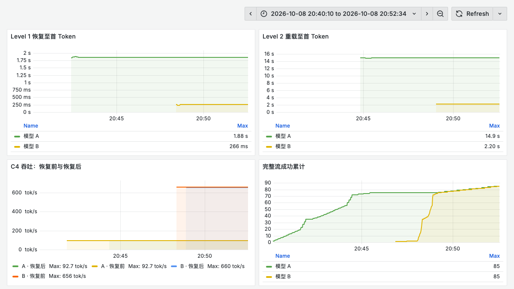

# 一张 L20 轮流跑两个模型：vLLM Sleep 实测与 DRA 思考

低频模型一直放在 GPU 上，会占住显存；每次使用时重新启动服务，又会重复加载与初始化。vLLM 的 Sleep Mode 可以保留服务进程，暂时释放大部分显存，在需要时恢复引擎。

这次选用此前已在 L20 上运行过的 Qwen3.8-27B-FP8，再搭配 Qwen3-1.7B，分别测试休眠恢复、恢复后的吞吐和两个模型交替运行。下文 A 为 27B FP8，B 为 1.7B BF16。

## 从重启到唤醒，差多少时间

27B 模型在缓存条件下重新启动进程，至首 Token 中位数为 **55.63 秒**；Level 1 休眠后恢复为 **1.86 秒**。

| 模型 | 进程重启 | Level 1 恢复 | Level 2 重载 |
| --- | ---: | ---: | ---: |
| A | 55.63 s | 1.86 s | 14.91 s |
| B | 36.05 s | 0.24 s | 2.17 s |

首次启动 A 用了 219.20 秒，B 为 84.06 秒；表中重启取随后 2 次的中位数，Level 1 为 5 次，Level 2 为 3 次。重启发生在同一个 Pod 中，镜像已经就绪，编译缓存可以复用；这里没有把镜像拉取与 Kubernetes 调度时间算进重启。

首次休眠也有成本：A 第一次 Level 1 休眠用了 18.47 秒，随后四次降至 1.33—1.34 秒。这里没有把主机内存分配与传输开销分别剖析，后续切换速度不能直接代替第一次。

Level 1 把权重保存到 CPU 内存，丢弃 KV Cache；Level 2 丢弃权重内容，恢复时需要重新加载。恢复计到第一个有效内容 token，包含唤醒后的真实正确性请求。

## 显存交出来，另一个模型才能接上

本次只申请一张 L20，两个独立 vLLM 引擎放在同一容器里。切换前让当前请求结束，休眠 A，确认状态和显存，再唤醒 B，通过正确性探针后开放请求。

| 交接方向 | 次数 | 至首 Token 中位数 | 最小—最大 |
| --- | ---: | ---: | ---: |
| A→B | 10 | 1.82 s | 1.78—2.18 s |
| B→A | 9 | 2.26 s | 2.23—2.28 s |

A 运行时物理显存约 33.05 GiB，B 运行时约 8.31 GiB，两者都休眠时约 1.03 GiB。进程与 CUDA 环境还在，显存不会降到零。

19 次实际交接之外，还有 1 次双模型均休眠后的初始激活，后者不混入方向统计。

这组模型没有做同时唤醒或并发共存对照。按独立测量估算，显存合计可能仍在 L20 容量内；本次数据关注温备恢复与交接成本，不用于比较这组模型串行切换和并行共存的性价比。

状态与显存曲线对应，能看到谁正在使用这张卡。Level 1 的代价是 CPU 内存：休眠模型的权重需要留在主机上。图中的 RSS 按进程求和，含共享页重复计量，规划容器内存还应看 cgroup 实际占用。

## 恢复后，还能保持原来的吞吐吗

每个模型配置 4K 上下文、4 GiB KV Cache，Prefix Cache 关闭，保留默认编译与 CUDA Graph。性能请求使用短中文提示词，强制生成 128 token，以 C1、C4 做前后对照，每配置 8 请求×2 轮。

| 配置 | 吞吐 tok/s | P95 TTFT ms | P95 TPOT ms |
| --- | ---: | ---: | ---: |
| A前 C1 | 25.35 | 125.97 | 38.96 |
| A前 C4 | 92.64 | 240.95 | 41.93 |
| A后 C1 | 25.35 | 124.43 | 38.96 |
| A后 C4 | 92.68 | 227.02 | 41.93 |
| B前 C1 | 175.85 | 19.66 | 5.58 |
| B前 C4 | 655.61 | 34.65 | 5.89 |
| B后 C1 | 175.89 | 19.19 | 5.57 |
| B后 C4 | 657.60 | 39.30 | 5.88 |

前/后指 Level 1 恢复前后；每格 16/16 条性能请求成功。吞吐为两轮中位数，P95 为两轮成功请求合并后计算，最近秩法。TTFT 是首 Token 延迟，TPOT 是每输出 Token 的平均时间。每配置只有 16 个性能请求，适合检查恢复前后是否发生明显退化，不能替代长时间容量验收。

延迟曲线是 C4 请求的一分钟滑动均值，与表中的整轮 P95 分开阅读。128 条性能请求与 42 条正确性请求均完成。

正确性提示词是“只回答一个数字，不要解释：3 加 4 等于多少？”，要求完整输出 7、结束标记和有效 usage。性能提示词是“用中文简要解释 Kubernetes 的 Pod 和 Deployment 的关系。”，采用 ignore_eos 固定输出工作量，不用于回答质量评分。

这张聊天界面截图来自独立的 1.7B 交互验证，未混入正式性能统计。

## 配合 DRA，能给两个 Pod 共用一张卡吗

Sleep 后显存下降，但 Kubernetes 的 GPU 分配还在。两个独占申请整张卡的 Pod，不会因为第一个模型休眠就自动得到同一张 GPU。

DRA 是 Dynamic Resource Allocation，即动态资源分配。ResourceClaim 表达设备申请；支持共享的驱动和申请方式，才可能让不同 Pod 访问同一个设备。这次完成的是同容器复用，DRA 仅作设计分析。

可以让两个常驻引擎取得允许共享的设备访问，再由控制器授予唯一的活跃模型租约。DRA 负责哪些 Pod 有权使用设备，控制器负责此刻谁能唤醒并分配显存。NVIDIA 的可消费容量功能仍为 Alpha，调度上的显存记账也不是运行时硬隔离。

## 部署时要把这几件事一起考虑

先按模型运行峰值、休眠残留和安全余量计算显存，预留 CPU 权重备份空间；每个引擎固定缓存预算，避免初始化顺序改变容量估算；同时核对 GPU 与 CPU 内存的 NUMA 位置及 PCIe 通路。切换控制需要排空、互斥、唤醒探针和失败回滚，控制接口放在可信路径。

KV Cache 的内容在休眠时丢弃，恢复长对话仍要重新预填充。低频模型温备和有明确轮流执行阶段的任务更适合这种方式；持续高 QPS 服务则要把切换等待纳入延迟预算。

参考资料：

- vLLM 0.31.0 Sleep Mode：https://docs.vllm.ai/en/v0.31.0/features/sleep_mode/
- Kubernetes DRA：https://kubernetes.io/docs/concepts/resource-management/dynamic-resource-allocation/
- NVIDIA 可消费容量：https://dra-driver-nvidia-gpu.sigs.k8s.io/docs/guides/gpu-allocation/consumable-capacity/

阅读原文：https://aik8s.run/ai-k8s/practices/vllm-sleep-model-switch-l20/
