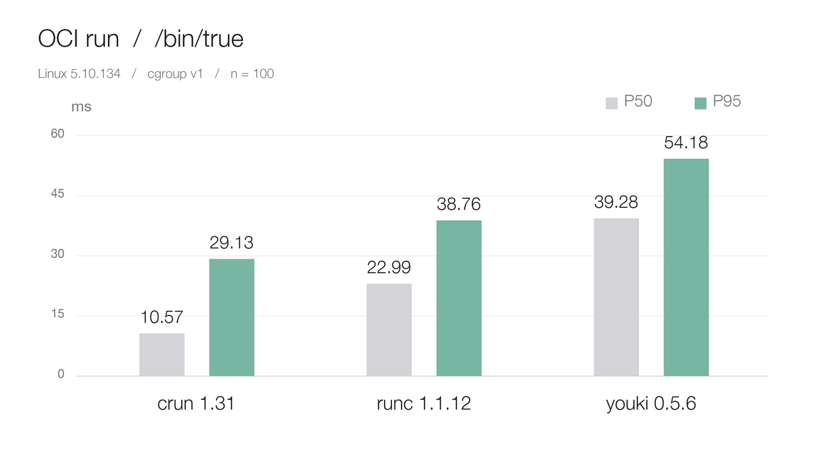

# 从 cgroup v1 到 v2：在 Kubernetes 节点实测 youki、crun 和 runc

如果你在维护一个已经使用 runc 的 Kubernetes 集群，我会保留 runc 作为默认，只在频繁新建容器的 cgroup v2 节点上灰度 crun。这次最有说服力的结果有两个：crun 1.31 把一个立即退出的 OCI 容器的中位耗时从 runc 1.1.12 的 18.80 ms 降到了 9.35 ms，而且通过 kubelet 创建的 systemd Pod 也进入了正确的资源层级。youki 0.5.6 的同项耗时为 12.68 ms，却没能在这台 Linux 5.10.134、systemd 239 的 v2 节点上创建 Pod sandbox。

## 应该从 runc 换到哪一个？

| 选择 | 能得到什么 | 要承担什么 | 适合谁 |
| --- | --- | --- | --- |
| 保留 runc | 在这台节点的 v1 和 v2 上，systemd Pod 都正常运行，资源也计入正确的 Pod。可以沿用发行版的交付、升级和排障流程。 | v2 短容器中位耗时比 crun 多约 9.45 ms。频繁创建并销毁容器的平台值得量一下这部分开销。 | 长驻 API、GPU 推理服务，以及暂时要保留同类 v1 节点的团队。生产基线应选发行版仍维护的版本。 |
| 灰度 crun | 在 v2 上，短容器 P95 从 runc 的 31.11 ms 降到 20.42 ms。systemd 模式下，宿主机网络和独立网桥的 Pod 都运行成功。 | 同机 v1 的 systemd Pod 创建失败。改用 cgroupfs 虽然能启动，但进程落在 kubelet 预期的 Pod 层级之外。团队还需维护第二个 handler 的分发和升级。 | 每个任务都新建容器的 CI、批量短 Job、按需创建执行环境的 Agent 平台。 |
| 评估 youki | 0.5.6 在 v2 完成了 100/100 次 OCI 短容器测试。开发 Rust 执行器的团队还可以复用其容器管理库。[youki libcontainer](https://docs.rs/libcontainer/latest/libcontainer/) | 0.5.6 和 0.7.0 在本机 v2 都没能创建 systemd Pod sandbox。0.5.6 在 v1 虽能 Ready，进程却落在错误的层级。 | 有 Rust 集成需求，或能在目标内核、systemd 与真实 Pod 上单独做兼容验证的团队。这批节点继续用 runc。 |

怎样判断 9.45 ms 值不值得追？看业务多久创建一次容器。一个 Agent 平台若为每次代码执行都新建容器，这段开销就会反复出现；若复用预热容器，池内的每次调用都省不到这笔启动时间。对加载一次权重、随后连续服务数天的 GPU Pod，更值得先看模型加载到首个请求成功要多久。本次计时覆盖一次完整的 OCI CLI `run`，包括创建、执行和退出。Pod 冷启动、运行时峰值内存、GPU 显存和推理吞吐都没有在这组数据中测量。[v2 逐轮耗时](../../assets/oci-runtime-v1/timings-v2.csv) · [v2 Pod 实测记录](../../assets/oci-runtime-v1/pods-v2.csv)

## 三个运行时位于哪一层

kubelet 通过 CRI 请求 containerd 创建 Pod 沙箱和容器。containerd 的 shim 管理容器任务生命周期，调用低层 OCI 运行时。runc 用 Go 实现，crun 用 C，youki 用 Rust。三者读取 bundle 中的 `config.json` 和 rootfs，建立 namespace、配置 cgroup、完成挂载，再启动容器的第一个进程。语言和二进制体积无法单独预测这条路径要花多少时间。[OCI Runtime Specification](https://github.com/opencontainers/runtime-spec)、[runc](https://github.com/opencontainers/runc)、[crun](https://github.com/containers/crun)、[youki](https://github.com/youki-dev/youki)

我们分别从 OCI 命令行和 containerd 的 `io.containerd.runc.v2` shim 进入这条路径。前者便于测量一个极短进程，后者可以检查 shim 的参数、环境变量和 cgroup 管理方式。通过 kubelet 创建 Pod 还涉及 CRI、镜像和 CNI，本次没有测量这段时间。

## cgroup v1 的实验环境与方法

实验使用一台已 cordon 的 x86-64 节点，内核为发行版提供的 Linux 5.10.134，kubelet 1.30.4，containerd 1.7.14。默认运行时是 runc 1.1.12，配置为 `SystemdCgroup=true`。我们从容器 PID 在宿主机的 `/proc/<pid>/cgroup` 找到 CPU、内存和 PID 控制器，逐项确认它们使用 v1 文件接口。机器上还挂载了一处 cgroup2，单看该挂载点容易误判工作负载使用的控制器版本。

测试以 root 身份在临时目录运行官方 x86-64 二进制。共用的只读 rootfs 由节点自身的 shell、sleep、true 和动态库组成。每个容器有独立的 mount、PID、network、UTS 和 IPC namespace。生命周期测试启动 `/bin/sleep`，依次核对 `created`、`running`、`exec`、发送 KILL 后的 `stopped` 及删除，再用独立容器检查退出码 17 是否传回调用者。以下命令适用于已备好该 rootfs、配置了长运行进程的测试 bundle。

```bash
RUNTIME=/path/to/runtime
BUNDLE=/path/to/bundle
STATE=$(mktemp -d)
ID=oci-sample-$$
"$RUNTIME" --root "$STATE" create --bundle "$BUNDLE" "$ID"
"$RUNTIME" --root "$STATE" state "$ID"
"$RUNTIME" --root "$STATE" start "$ID"
"$RUNTIME" --root "$STATE" exec "$ID" /bin/sh -c 'printf "OCI_OK\n"'
"$RUNTIME" --root "$STATE" kill "$ID" KILL
"$RUNTIME" --root "$STATE" delete "$ID"
```

## cgroup v1 能否执行资源限制

runc 1.1.12、crun 1.31 和 youki 0.5.6 都通过了上述 OCI 生命周期检查。测试配置给每个容器半核 CPU、128 MiB 内存、32 个 PID，宿主机读到的 `cpu.cfs_quota_us / cpu.cfs_period_us` 是 `50000 / 100000`，`memory.limit_in_bytes` 为 `134217728`，`pids.max` 为 `32`。在容器中运行短时间的 CPU 忙循环，三个运行时的 `nr_throttled` 都增加了。内存和 PID 两项核对的是内核限额，本轮没有触发 OOM 或打满 PID。

youki 0.7.0 在相同配置下未完成 `create`。对失败重跑一次 `strace -f`，可以看到内核成功创建 proc 文件系统的挂载对象，随后设置挂载属性失败。以下保留了关键调用的顺序，省略中间调用及部分参数。

```text
fsopen("proc", 0) = 10
fsconfig(10, FSCONFIG_CMD_CREATE, NULL, NULL, 0) = 0
fsmount(10, 0, 0) = 12
mount_setattr(12, "", AT_EMPTY_PATH, ..., 32) = -1 ENOSYS (Function not implemented)
```

这给旧节点提供了两个独立的排查方向。资源控制器可以继续使用 v1，而容器运行时采用的挂载系统调用也必须得到节点内核支持。0.7.0 在这条 proc 挂载路径上调用 `mount_setattr`；0.5.6 使用不同的挂载实现，在相同节点和配置上成功。发行版可能回移系统调用，核查实际返回值比只看内核大版本更可靠。[youki 0.7.0 挂载实现](https://github.com/youki-dev/youki/blob/v0.7.0/crates/libcontainer/src/rootfs/mount.rs)、[youki 0.5.6 挂载实现](https://github.com/youki-dev/youki/blob/v0.5.6/crates/libcontainer/src/rootfs/mount.rs)

## cgroup v1 下一个立即退出的容器要多久

计时从创建 OCI CLI 子进程前开始，到前台 `run` 返回为止，容器内执行 `/bin/true`。每个通过功能检查的版本预热 5 次，再测 100 次。每轮各执行一次，按固定随机种子打乱顺序，串行运行。三方共用 rootfs、资源限额和宿主机缓存。P95 取排序后的第 95 个样本。

| 同一轮中的运行时 | 成功次数 | 中位耗时 | P95 |
| --- | ---: | ---: | ---: |
| crun 1.31 | 100/100 | 10.57 ms | 29.13 ms |
| runc 1.1.12 | 100/100 | 22.99 ms | 38.76 ms |
| youki 0.5.6 | 100/100 | 39.28 ms | 54.18 ms |

首次实验中只有 crun 和 runc 通过门槛，两者中位数分别为 9.06 ms 和 20.58 ms。表中使用兼容性复测时三方交错运行的数据。对频繁创建短进程的服务，这台节点上约 12 ms 的中位差值得单独测量；对长时间运行的推理服务，还需要从实际 Pod 事件中看镜像准备、网络、模型加载和就绪探针各占多久。



图中每组来自同一轮的 100 个成功样本。CSV 同时包含首轮、复测和预热记录，可以自行重算分位数。[下载逐轮耗时 CSV](../../assets/oci-runtime-v1/timings.csv)

## 通过 containerd 启动，结果有何不同

我们新建了独立的 containerd namespace，在每次 `ctr run` 时指定运行时二进制。两种管理方式都显式传入 `PATH=/bin`、半核 CPU 和 128 MiB 内存。进程运行期间，从宿主机读取 CPU 和内存限额，用 `systemctl show` 检查预期 scope 是否存在，同时核对进程在 `/proc/self/cgroup` 中的实际路径。

| 运行时 | cgroupfs | 请求 systemd scope |
| --- | --- | --- |
| runc 1.1.12 | 进程成功，限额正确 | 进程成功，预期 scope 为 active，限额正确 |
| crun 1.31 | 进程成功，限额正确 | 创建失败，写 `devices.allow` 返回 `Operation not permitted` |
| youki 0.5.6 | 进程成功，限额正确 | 进程成功，限额正确，预期 scope 为 inactive |
| youki 0.7.0 | 容器未启动，proc 挂载失败 | 容器未启动，proc 挂载失败 |

youki 0.5.6 一项最容易看错。请求的路径格式是 `system.slice:ocitest:<id>`。runc 的进程实际进入了 `/system.slice/ocitest-<id>.scope`，而 youki 进程的 CPU 控制组路径仍是带冒号的 `/system.slice:ocitest:<id>`。如果验收脚本只检查退出码，两个结果都会呈现绿色，只有前者通过了本轮的 systemd scope 检查。

复测还发现一个输入差异。直接把目录传给 `ctr --rootfs` 时没有镜像提供环境变量，youki 0.5.6 起初报 `PATH environment variable is not set`。四个版本统一显式传入 `PATH=/bin` 后得到了上表的结果。crun 的设备规则错误仍可复现，具体哪条设备规则或父组策略导致拒绝，现有证据还不能确定。

下面是 systemd 分支的复现命令。使用独立测试节点，在同一 shell 中设好运行时的绝对路径和 bundle 目录。做 cgroupfs 对照时，去掉 `--runc-systemd-cgroup`，并把 cgroup 路径改为 `"/$ID"`。要观察 scope，可在四秒的存活窗口内从另一终端查询。

```bash
ROOTFS=$(realpath "$BUNDLE/rootfs")
NS="oci-demo-$$"
ID="task-$$"
ctr namespaces create "$NS"
(
  set -e
  ctr -n "$NS" run --rm --runtime io.containerd.runc.v2 \
    --runc-binary "$RUNTIME" --runc-systemd-cgroup \
    --cgroup "system.slice:ocitest:$ID" --env PATH=/bin \
    --cpus 0.5 --memory-limit 134217728 --rootfs "$ROOTFS" "$ID" \
    /bin/sh -c 'echo OCI_SHIM_OK; while IFS= read -r line; do echo "$line"; done </proc/self/cgroup; /bin/sleep 4'
)
rc=$?
ctr -n "$NS" tasks list
ctr -n "$NS" containers list
ctr namespaces remove "$NS"
printf 'task exit code: %s\n' "$rc"
```

## 创建 Pod 时能选择 crun 或 youki 吗？

可以按 Pod 选择。以 crun 为例，管理员先在候选节点安装二进制，在 containerd 的 CRI 配置中增加命名 handler，通过 `BinaryName` 指向该文件。随后创建 RuntimeClass，将 `handler` 指向同名的节点配置。应用只需在 Pod 的 `spec.runtimeClassName` 填写 RuntimeClass 名称，kubelet 就会在 CRI 的 `RunPodSandbox` 请求中传递相应 handler。这项选择适用于整个 Pod。只有部分节点支持它时，可在 RuntimeClass 的 `scheduling.nodeSelector` 中指定这些节点的标签。[Kubernetes RuntimeClass](https://kubernetes.io/docs/concepts/containers/runtime-class/)、[containerd 1.7 CRI 配置](https://github.com/containerd/containerd/blob/release/1.7/docs/cri/config.md)

实验前，目标节点的 CRI 插件只报告了 `runc`，kubelet 与默认 handler 均使用 systemd。我们保留默认配置，仅在已 cordon 的实验节点追加命名 handler。RuntimeClass 通过节点选择器限定到这台机器，测试 Pod 通过 `spec.nodeName` 明确绑定。下面两条命令分别在管理端和目标节点执行。

```bash
kubectl get runtimeclass -o custom-columns='CLASS:.metadata.name,HANDLER:.handler'
crictl --runtime-endpoint unix:///run/containerd/containerd.sock info |
  jq '.config.containerd | {defaultRuntimeName, handlers: (.runtimes | keys)}'
```

### cgroup v1 的真实 Pod 验证

先让四个 Pod 走节点原有的 CNI，四组都在创建网络时失败，包括默认的 runc 对照。事件指向同一个缺失的本地 CNI socket。这一轮还无法区分 OCI 运行时。随后用同一份 Pod 规格执行两个对照，一个启用 `hostNetwork`，一个在实验 handler 的 `cni_conf_dir` 中指定独立网络。在后者中，首次尝试的 dummy 接口在创建时返回 `file exists`，随后改用无上联的 Linux 网桥和 host-local IPAM。网桥只连接实验 Pod，未配置网关或地址转换。

| 运行时及请求的 cgroup 管理方式 | hostNetwork | 独立网桥、独立 Pod IP | 业务容器的 systemd scope |
| --- | --- | --- | --- |
| runc 1.1.12 / systemd | Ready | Ready | active，位于 Pod slice 下 |
| crun 1.31 / systemd | sandbox 创建失败 | sandbox 创建失败 | 未创建，设备规则写入被拒绝 |
| crun 1.31 / cgroupfs | 未测 | Ready | inactive，进程在带冒号的控制组路径下 |
| youki 0.5.6 / systemd | Ready | Ready | inactive，进程在带冒号的控制组路径下 |
| youki 0.7.0 / systemd | sandbox 创建失败 | sandbox 创建失败 | 未创建 |

三组在网桥上成功的 Pod 都有独立网络命名空间和 Pod IP。`kubectl logs` 读到了业务进程输出，`kubectl exec` 以 UID 65534 执行成功。我们同时核对了 CRI sandbox 和业务容器的运行时信息。宿主机读取到的业务容器限额均是半核 CPU 和 128 MiB，但只有 runc 的进程位于 kubelet 预期的 Pod slice 下。实验网络只验证了单节点 Pod 网络创建，没有覆盖 Service、跨节点流量或集群原有的网络策略。[Pod 验证数据 CSV](../../assets/oci-runtime-v1/pods.csv)

v1 阶段结束时只保留用于隔离实验的 crun/cgroupfs handler，再提交一个新 Pod。它依次输出 `CRUN_POD_STARTED` 和 `CRUN_POD_COMPLETED`，最终状态为 `Succeeded`。复现时，将样例中的命名空间、节点名和 RuntimeClass 替换为自己的实验配置，并预先缓存指定镜像。测试完成后，临时 Pod 均已删除；节点维持 cordon，原有 14 个 containerd task ID 保持一致。[可下载的 Pod YAML](../../assets/oci-runtime-v1/pod-example.yaml)

## 切到 cgroup v2 后，真实 Pod 有什么变化？

我们让同一台节点保持 cordon，为现有内核增加独立的启动项，带上 `systemd.unified_cgroup_hierarchy=1` 单次试启动。kubelet 仍是 1.30.4，containerd 仍是 1.7.14，systemd 为 239。重启后在宿主机核对了以下三处，确认 kubelet 和真实 Pod 都在使用统一层级。通过 Pod 验证后，才把 v2 设为后续默认启动项，同时保留原 v1 启动项供回退。

```bash
stat -fc %T /sys/fs/cgroup        # cgroup2fs
cat /proc/1/cgroup                # 0::/init.scope
cat /sys/fs/cgroup/cgroup.controllers
```

节点插件也需要检查。这台机器上的定制 Koordlet 启动命令会先写入 v1 布局下的 `/host-cgroup/memory/system.slice/memory.priority` 和对应的 `user.slice` 文件。迁移后路径变了，前置命令失败，后面的 Koordlet 进程没有启动。实验把该节点从 DaemonSet 的节点亲和性中排除，其余 9 个实例全部就绪，Pod UID 和重启次数均与变更前一致。该节点此后由 kubelet 提供基础统计，依赖本地 Koordlet 的采集与调优功能须另行验证。

### kubelet → containerd → OCI 运行时

保持默认 runc，再添加 `SystemdCgroup=true` 的 crun handler，通过 RuntimeClass 选中它。每个业务容器的上限都是 500m CPU、128 MiB 内存。我们先用 `hostNetwork` 验证 runc 和 crun，再用无上联的独立网桥对照 crun 与 youki。运行期间分别取 sandbox 和业务容器的宿主机 PID，核对各自的 `/proc/<pid>/cgroup`、预期 Pod UID 以及 systemd scope 的状态。

| 运行时与管理方式 | 网络 | 从 kubelet 看到的结果 | 宿主机上的层级 |
| --- | --- | --- | --- |
| runc 1.1.12 / systemd | hostNetwork | Ready，随后 Succeeded | sandbox 和业务进程均在预期的 Pod slice 和 active scope 内 |
| crun 1.31 / systemd | hostNetwork、独立网桥均通过 | 两个 Pod 均 Ready，随后 Succeeded | 两类进程均在相应 active scope 的 `container` 子组内，归属于正确的 Pod |
| crun 1.31 / cgroupfs | 独立网桥 | Ready，随后 Succeeded | 实际路径包含字面冒号，预期 scope 未激活，未进入对应 Pod slice |
| youki 0.5.6、0.7.0 / systemd | 独立网桥 | 两个版本分别报 `FailedCreatePodSandBox` | 业务容器未启动 |

在四个成功的对照 Pod 中，日志和 exec 都正常，业务进程所在 cgroup 的 `cpu.max` 为 `50000 100000`，`memory.max` 为 `134217728`。老的 crun/cgroupfs handler 也给出了这两个数值，却把资源挂到了错误的父组。核对时要同时看进程的祖先路径：crun 允许 PID 处于 scope 下的子组，若要求路径与 scope 根完全相等，会误判为失败。测试覆盖本机网络建立和进程归属，跨节点连通性、Service 与网络策略仍需单测。[下载 v2 Pod 实测记录](../../assets/oci-runtime-v1/pods-v2.csv)

两个 youki Pod 的 CRI 事件只给出运行时退出码 1。另用 OCI CLI 请求 systemd 管理 cgroup，在两个版本都捕获了 `Systemd(CpuSet(OldSystemd))`，错误提示设置 cpuset 限制需要高于 243 的 systemd，实验机为 239。这个对照定位了一处可复现的兼容问题；要把某次 Pod 失败精确归因到同一位置，还需要那次 shim 调用的底层日志。另在使用 cgroupfs 的独立测试里，0.7.0 挂载 proc 仍返回 `ENOSYS`。

### 同一台机器上复跑 100 轮短容器

两次启动使用相同的运行时二进制、rootfs、资源上限和前台 `/bin/true`。每个通过功能检查的版本预热 5 次，再与其他运行时交错执行 100 次。表中单位均为毫秒。重启、后台负载与 Koordlet 状态都可能影响两轮差异，因此跨列比较只能描述这台节点的两次观测。

| 运行时 | v1 中位数 | v1 P95 | v2 中位数 | v2 P95 |
| --- | ---: | ---: | ---: | ---: |
| crun 1.31 | 10.57 | 29.13 | 9.35 | 20.42 |
| runc 1.1.12 | 22.99 | 38.76 | 18.80 | 31.11 |
| youki 0.5.6 | 39.28 | 54.18 | 12.68 | 24.48 |

三个版本在 v2 下各成功 100/100 次。独立 OCI 生命周期测试还验证了 `pids.max=32`、半核 CPU 和 128 MiB 内存限制，CPU 忙循环触发了节流。youki 0.7.0 未通过创建检查，所以没有耗时数据。要估算业务扩容速度，还需测量从提交 Pod 到应用 Ready 的整段时间。[下载 v2 逐轮耗时](../../assets/oci-runtime-v1/timings-v2.csv)

## 如何复用这套测试

下载 [OCI 配置样例](../../assets/oci-runtime-v1/config.json)，保存到空测试目录的 `$BUNDLE/config.json`。样例使用固定的 `/oci-sample` 控制组路径，适合在一台节点上逐个执行；并发运行时应为每次创建选用唯一的测试路径。以下是构造本次最小 rootfs 的方法，适用于带动态链接 shell 和 GNU 用户态工具的 Linux 测试机。然后可使用前面的生命周期命令，计时前将 `process.args` 改为 `["/bin/true"]` 并从外部测量前台 `run`。

```bash
mkdir -p "$BUNDLE/rootfs"
python3 - "$BUNDLE/rootfs" <<'PY'
import pathlib, re, shutil, subprocess, sys
root = pathlib.Path(sys.argv[1])
for src in ("/bin/sh", "/bin/sleep", "/bin/true"):
    libs = subprocess.check_output(["ldd", src]).decode()
    for path in [src] + re.findall(r"(/[^\s()]+)", libs):
        target = root / path.lstrip("/")
        target.parent.mkdir(parents=True, exist_ok=True)
        shutil.copy2(path, str(target))
for sub in ("proc", "dev", "tmp"):
    (root / sub).mkdir(exist_ok=True)
PY
```

## 如何决定是否扩大 crun 灰度

1. **选一种确实频繁冷启动的业务。** 在带标签的 v2 节点上增加 crun handler，保留默认 runc，通过 RuntimeClass 的节点选择器限定试点范围。准备两份相同的工作负载模板，一份使用默认运行时，另一份指定 crun。这样应用可以逐个加入试点。[Kubernetes RuntimeClass](https://kubernetes.io/docs/concepts/containers/runtime-class/)
2. **按用户实际等待的时间验收。** 在同类节点上固定镜像摘要、业务 CNI、资源和并发，分别测试镜像已缓存、需要拉取两种情况。短 Job 记录从提交到任务完成的 P50/P95，按需服务记录从提交到首次成功请求的 P50/P95，两组都保留启动失败数与总数。再核对 sandbox 和业务进程是否在对应 Pod slice 下、限额和统计是否正确。试点涉及 GPU 时，用真实设备验证分配和最小推理请求。
3. **按结果决定扩大或退回。** 如果真实业务的 P95 改善足以满足事先约定的目标，且创建成功率、资源归属和业务功能均通过，再扩大到同类节点。若只有 OCI 短容器变快，或再次出现 Pod 资源记错层级，就保留 runc。回退时从工作负载模板移除 `runtimeClassName`，按原发布策略重建；已有 Pod 在重建时才会切回默认运行时。
