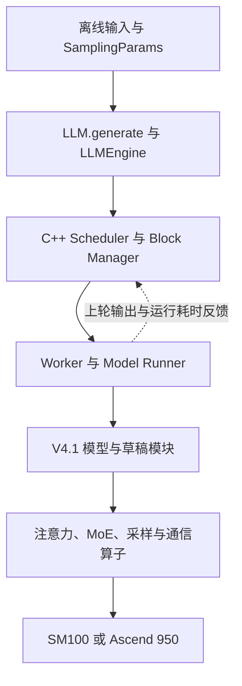
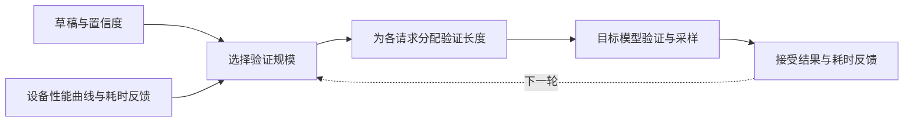

# DeepInfer 深度解析：DeepSeek 推理引擎的架构、性能口径与生产边界

DeepInfer 把 DeepSeek 推理系统中很值得研究的一部分公开了：围绕自家模型，把草稿生成、验证长度、批处理、专家放置、缓存布局和底层算子一起优化。它的价值在于让外界看到这些优化如何在同一个执行链路里协作，而不只是多了一个模型加载入口。

但企业采用它时，需要区分两个范围：**DeepSeek 生产服务所使用的推理框架，以及这次仓库实际交付的离线推理能力。** 两者有共同的引擎基础，公开仓库尚未包含完整在线服务所需的全部系统。

本文核对日期为 **2026-10-20**，代码固定到首次公开提交 [`d585e6542c05`](https://github.com/deepseek-ai/DeepInfer/tree/d585e6542c0571176272d703f03c4807ae901284)。该提交时间为北京时间 2026-10-20 12:09；提交时间不等于精确的对外开放时间。以下内容来自源码审阅、官方说明及上游性能图，**没有把它描述为本地部署或独立复测结果**。

## 1. 这次到底开放了什么

最直接的入口是 `deepinfer.entrypoints.llm.LLM`：构造模型与执行环境，向 `generate()` 提交一组输入，内部组织批处理并返回生成结果。模型注册表目前只有 `DeepseekV41ForCausalLM`，默认示例加载 `DeepSeek-V4.1-Flash-1017`。这是一条围绕特定模型架构打磨的路径，不能仅凭参数名 `model` 就推断它能加载任意 Hugging Face 模型。

| 层次 | 当前代码与交付 | 对使用者意味着什么 |
| --- | --- | --- |
| 调用入口 | 离线 `LLM.generate()`、样例与评测脚本 | 适合批处理、正确性回归及引擎研究 |
| 执行引擎 | C++ 调度与块管理、Python Worker、设备算子 | 可以研究和扩展实际执行链路 |
| 模型实现 | V4.1 的视觉、注意力、MoE、Engram、草稿模块 | 优化与模型结构紧密结合 |
| 完整服务系统 | 官方列出的 KV cache system、VE/P/D 分离系统、DP 副本负载均衡尚未交付完整配套 | 线上接入仍有系统工程工作 |
| 协议与平台 | 公开入口未提供现成的通用 OpenAI 服务部署方案 | 不能把离线命令直接替换为线上 API 服务 |

源码定位：[离线 API](https://github.com/deepseek-ai/DeepInfer/blob/d585e6542c0571176272d703f03c4807ae901284/deepinfer/entrypoints/llm.py)、[模型注册表](https://github.com/deepseek-ai/DeepInfer/blob/d585e6542c0571176272d703f03c4807ae901284/deepinfer/model_executor/models/__init__.py)、[示例公共配置](https://github.com/deepseek-ai/DeepInfer/blob/d585e6542c0571176272d703f03c4807ae901284/examples/_config.py)。完整服务缺口见[官方 README](https://github.com/deepseek-ai/DeepInfer/blob/d585e6542c0571176272d703f03c4807ae901284/README.md)。

## 2. 从请求到设备：架构应该怎样读



这条路径上有两种反馈。第一种是生成状态：本轮真正接受了多少草稿 Token、请求是否结束、缓存和回退位置怎样变化。第二种是性能状态：不同图规模的前向耗时、采样耗时及专家负载如何变化。引擎利用这些反馈改变后续执行安排。

几个目录分别承担不同职责：

| 阅读入口 | 重点问题 |
| --- | --- |
| `deepinfer/entrypoints/llm.py` | 输入如何进入引擎，结果如何返回 |
| `deepinfer/engine/llm_engine.py` | 调度、执行、后处理与缓存扩展点如何衔接 |
| `csrc/engine/scheduler.hpp`、`block_manager.hpp` | 请求状态、批次、缓存块与抢占如何管理 |
| `deepinfer/worker/worker.py` | CPU 与设备如何流水执行 |
| `csrc/engine/mtp_varlen.hpp` | 怎样决定本轮验证规模 |
| `deepinfer/model_executor/models/v4_modules/` | 模型结构如何影响运行时 |
| `deepinfer/model_executor/eplb/` | 专家复制、放置与迁移 |
| `examples/benchmark.py`、`examples/sweep/plot_pareto.py` | 性能数字究竟如何产生 |

底层依赖也有分工：FlashMLA 面向注意力，DeepGEMM 面向矩阵计算，DeepEP 面向专家通信，DeepSelect 与自定义 TileLang 算子承担选择和数据处理等工作。DeepInfer 的工程价值是把这些部件接成可执行的模型路径；单个 Kernel 快，并不能保证请求延迟同比下降。依赖及后端构建路径可以从 [`.gitmodules`](https://github.com/deepseek-ai/DeepInfer/blob/d585e6542c0571176272d703f03c4807ae901284/.gitmodules) 和 [`build_vendor.sh`](https://github.com/deepseek-ai/DeepInfer/blob/d585e6542c0571176272d703f03c4807ae901284/scripts/build_vendor.sh) 交叉核对。

## 3. DSpark：最重要的是少验证无效草稿

### 3.1 为什么草稿越长不一定越快

投机解码先提出一段草稿，再由目标模型验证。草稿接受得多，就可以摊薄目标模型的执行成本；如果后半段大多被拒绝，验证它们仍然会占用算力、内存访问和批次容量。

可以把它理解为审稿：助手一次写出五段，主编不是写得越多就越省事。前两段可靠、后三段需要推倒重来时，逐段核查后面的内容可能拖慢其他稿件。

DSpark 论文把半自回归草稿生成与基于置信度的验证调度结合起来。DeepInfer 中尤其值得看的，是后半部分如何落地：**本轮为每个请求验证多少 Token，由预期收益和运行成本共同决定。** 论文中的线上收益有其特定基线和负载条件，不能直接转成任意部署的提速承诺。[DSpark 论文](https://arxiv.org/html/2607.05147v1)

### 3.2 源码里的决策过程

`MTPVarlen::schedule()` 不是简单设置一个固定阈值。它把请求的候选草稿置信度汇总排序，枚举验证规模，并结合设备前向性能曲线及采样耗时估计，选择预期产出与耗时之比更高的方案。

下面是对算法目标的概括，不是源码中的独立 API：

```text
expected_yield ≈
  (base_output + sum(expected_accepted_draft_contributions))
  / (forward_time + runtime_correction + sampler_time)
```

分子是各请求的基础产出加上所选草稿的预期接受贡献；分母是对应图规模的前向耗时、运行时修正和采样耗时。



实现中有几个容易忽略的细节：

- `ForwardRuntimeEstimator` 用近期观测修正启动时的性能曲线，补偿上下文等因素带来的变化；它并非只相信一张静态表。
- `SamplerRuntimeEstimator` 对耗时取滑动窗口中位数，并优先采用相同请求数的历史估计，样本不足时回退到全局估计。
- 计算总验证预算与分配请求长度使用了不同轮次的置信度信息。源码明确要求后续位置的置信度不能影响较早草稿位置是否被验证；异步流水下还要处理反馈滞后一轮的情况。
- `schedule_cnt` 与 `process_cnt` 跟踪调度和后处理配对，避免把在途轮次误当成已经完成的反馈。

这说明 DSpark 的收益不只来自“多猜几个词”，还来自**给验证工作定价**。低负载时可为交互速度投入更多验证容量；高负载时则要防止低收益草稿占满批次。具体是否更快，仍取决于草稿质量、验证成本和运行负载，不能只看接受率一个数。

源码定位：[`mtp_varlen.hpp`](https://github.com/deepseek-ai/DeepInfer/blob/d585e6542c0571176272d703f03c4807ae901284/csrc/engine/mtp_varlen.hpp)、[运行时耗时反馈](https://github.com/deepseek-ai/DeepInfer/blob/d585e6542c0571176272d703f03c4807ae901284/deepinfer/engine/llm_engine.py#L984)。官方开关为 `DEEPINFER_ENABLE_MTP_VARLEN=1`，`DEEPINFER_USE_NEXTN_DECODE` 控制最大草稿长度，默认值为 5。

## 4. 异步调度：把 CPU 工作放进设备执行的时间里

普通的同步执行容易出现这样的空隙：设备完成计算，CPU 读取结果、更新请求状态、组织下一批，然后设备才继续工作。每步 CPU 开销看似不大，Decode 的步数很多，累计下来就会影响卡的有效工作时间。

`Worker.execute_model_step()` 的执行顺序很清楚：

1. 提交当前步主模型前向。
2. 后处理上一轮结果。
3. 执行当前步采样。
4. Decode 开启异步模式时，把当前步后处理留到下一轮；Prefill 或同步模式则当轮完成。

CUDA 工作异步下发后，CPU 才有机会与设备执行重叠。为了提前组织下一轮，代码还需要修正序列长度、映射上轮与本轮请求、处理已经结束或被抢占的请求。

因此，“zero-overhead scheduler”应理解为把调度开销尽量移出关键路径的设计目标。代码仍有事件同步、元数据处理及资源回收；它不意味着 CPU 成本为零，也不意味着所有工作负载都能完全隐藏这些成本。[Worker 执行链路](https://github.com/deepseek-ai/DeepInfer/blob/d585e6542c0571176272d703f03c4807ae901284/deepinfer/worker/worker.py#L89)、[在途状态结构](https://github.com/deepseek-ai/DeepInfer/blob/d585e6542c0571176272d703f03c4807ae901284/deepinfer/worker/zos_status.py)

对生产系统的启发是：排查低吞吐时，除了看 GPU 利用率，还要看设备步间空隙、CPU 调度时间、同步等待和序列元数据处理。只增加并发，可能把 CPU 瓶颈放大。

## 5. DP、CP、EP 为什么会同时出现

这些缩写作用在不同部分，不能全部理解为“把完整模型复制几份”。

| 缩写 | 全称 | 在这里解决的问题 |
| --- | --- | --- |
| DP | Data Parallelism，数据并行 | Attention 侧不同副本处理不同请求或 Token 工作量 |
| CP | Context Parallelism，上下文并行 | 在多个设备之间拆分上下文计算，并尽量平衡因果注意力负载 |
| EP | Expert Parallelism，专家并行 | 把混合专家模型的不同专家放到不同设备 |
| EPLB | Expert Parallel Load Balancing，专家并行负载均衡 | 调整专家副本与放置，缓解热点专家拖慢整组设备 |
| VE | Vision Encoder，视觉编码器 | 把图像变为模型可消费的表示 |

同一组设备可以在 Attention 部分按 DP 处理不同请求，进入 MoE（Mixture of Experts，混合专家）部分后，再通过 EP 交换 Token，访问分布在其他设备上的专家。因此 **EP64DP64 不能按 64×64 算成 4096 张卡**。需要看进程组复用了哪些 rank。

这不是只靠文档推测：`ParallelConfig` 在 CP=1 时可默认令 DP 等于 EP；进程组实现分别从同一个 rank 集合创建 DP、CP、EP 组。CP 元数据中还有 mirror 布局；其动机是避免简单连续切片使因果注意力后段承担过多工作，但实际收益仍受上下文长度和通信成本影响。[并行配置](https://github.com/deepseek-ai/DeepInfer/blob/d585e6542c0571176272d703f03c4807ae901284/deepinfer/config.py#L150)、[进程组实现](https://github.com/deepseek-ai/DeepInfer/blob/d585e6542c0571176272d703f03c4807ae901284/deepinfer/model_executor/parallel_utils/parallel_state.py)、[CP 元数据](https://github.com/deepseek-ai/DeepInfer/blob/d585e6542c0571176272d703f03c4807ae901284/csrc/engine/input_metadata/prepare_tensor_input_base.cpp#L142)

### EPLB：多放几个热点专家，换掉最慢的等待

MoE 每个 Token 只选择部分专家，但请求分布不会保证每个专家同样忙。一张卡上的热点专家可能让其他卡等待，平均 GPU 利用率会掩盖这种拖尾。

`rebalance_experts_global()` 分两步处理：先依据历史 Token 负载给热点逻辑专家分配冗余副本，再用贪心策略把物理专家副本放到各个 rank。策略考虑的是各历史步中最忙 rank 的负载，而不只是让长期总量平均。

例如某个专家经常被选择，增加它的物理副本就能分担访问；但新增副本需要显存，重新放置也有统计、搬运和同步代价。它是在**内存、通信与负载拖尾之间做交换**，不能假定冗余越多越好。这里复制的是同一个逻辑专家的权重，并非改变模型定义的专家数量。

源码定位：[`policy.py`](https://github.com/deepseek-ai/DeepInfer/blob/d585e6542c0571176272d703f03c4807ae901284/deepinfer/model_executor/eplb/policy.py)、[`shuffle.py`](https://github.com/deepseek-ai/DeepInfer/blob/d585e6542c0571176272d703f03c4807ae901284/deepinfer/model_executor/eplb/shuffle.py)。

## 6. SWA bounded replay：140 Token 不等于砍掉长上下文

SWA 是 Sliding Window Attention，滑动窗口注意力。结合 V4.1 的跨层复用结构，一部分后续层可以消费前面已经构造的状态，不必在预填充阶段把整个历史逐层重复计算。

`yoco_enabled()` 检查 `n_prefill_layer` 是否小于总层数，并把后续层识别为 consumer。`compact_yoco_boundary()` 在层边界收拢需要保留的查询及关联数据；需要的历史状态和共享信息仍然存在。

所以 `DEEPINFER_YOCO_PREFILL_KEEP_TOKENS=140` 表示特定 Decoder 路径的有限后缀重放长度，**不表示把用户输入裁成 140 Token，也不表示整个模型只保存最近 140 Token**。

源码还检查：

```text
keep_tokens >= window_size + max_backtracking_tokens
```

原因是投机验证发生回退后，仍要有足够的滑动窗口历史。只按窗口大小保留、不考虑回退，可能破坏缓存与注意力边界。

官方给出了 `mask` 与 `compact` 等价性验证：一层检查元数据，一层沿固定轨迹比较 logprob 与 top-K。它要求兼容的 V4.1 YoCo checkpoint。这个约束说明优化依赖模型结构，不能把相同环境变量套到所有 Transformer 上。

源码定位：[`yoco.py`](https://github.com/deepseek-ai/DeepInfer/blob/d585e6542c0571176272d703f03c4807ae901284/deepinfer/model_executor/models/v4_modules/yoco.py)、[长度约束检查](https://github.com/deepseek-ai/DeepInfer/blob/d585e6542c0571176272d703f03c4807ae901284/csrc/engine/input_metadata/prepare_tensor_input_v4.cpp#L348)、[等价性验证说明](https://github.com/deepseek-ai/DeepInfer/blob/d585e6542c0571176272d703f03c4807ae901284/examples/yoco/README.md)。

## 7. “批次不变”和“确定性采样”解决不同问题

批次变化可能改变矩阵计算或归约路径，浮点舍入差异经过后续计算，可能影响采样结果。Batch-invariant inference 关注的是同样的输入，放进不同批次时能否保持数值结果一致；确定性采样还要控制随机数与执行条件。

官方给出的确定性用法同时要求：

```bash
export DEEPINFER_BATCH_INVARIANT=1
export DEEPINFER_ENABLE_MTP_VARLEN=0
```

并为 `SamplingParams` 设置固定 `seq_seed`。当前说明限定 NVIDIA。这里关闭的是变长验证调度，不应误写成必须把所有草稿能力关闭。

测试也值得仔细读：`test_batch_invariant.py` 先批量生成，再用相同生成轨迹作为 `golden_token_ids` 单独执行，比较 Token、logprob 和 top-logprob；采样正确性另有统计测试。**沿固定轨迹验证数值一致，不等于已经证明任意随机运行都逐 Token 相同。**

对 Agent 回归与强化学习采样，这些能力能减少基础设施引入的噪声；但更换硬件后端、算子版本或验证策略后，仍要重新确认结果。参考[批次不变测试](https://github.com/deepseek-ai/DeepInfer/blob/d585e6542c0571176272d703f03c4807ae901284/tests/models/test_batch_invariant.py)、[采样测试](https://github.com/deepseek-ai/DeepInfer/blob/d585e6542c0571176272d703f03c4807ae901284/tests/models/test_sampler.py)。

结构化输出则使用 XGrammar 约束 Token 选择，支持正则、JSON Schema 与 EBNF。它控制格式合法性；字段内容正确、工具参数安全、调用符合权限仍属于上层应用责任。[匹配器实现](https://github.com/deepseek-ai/DeepInfer/blob/d585e6542c0571176272d703f03c4807ae901284/deepinfer/structure_output/matcher.py)

## 8. 官方性能图应该怎样读

以下两图直接保留上游原图，来源为 DeepSeek-AI / DeepInfer，仓库采用 Apache-2.0；这里用于解释指标口径。图中的值为官方结果，未进行独立复测。完整许可证见[上游 LICENSE](https://github.com/deepseek-ai/DeepInfer/blob/d585e6542c0571176272d703f03c4807ae901284/LICENSE)，本站同时保留[许可证副本](../../assets/deepinfer/LICENSE.txt)。

### 8.1 Prefill：测的是非缓存输入和单步延迟


原图条件：4 张 SM100，EP4DP4，384 个逻辑专家加 32 个冗余专家，上下文 131,072，Decoder bounded replay 为 140 Token。横轴是 **ms / prefill step**，纵轴是非缓存输入 **tokens/s/GPU**，点上数字是每 DP rank 的批次 Token 数。图源：[官方 Prefill 原图](https://github.com/deepseek-ai/DeepInfer/blob/d585e6542c0571176272d703f03c4807ae901284/doc/images/prefill_pareto.png)。

较大的批次带来了更高吞吐，也使单步延迟变长。32768 到 65536 这一段吞吐增幅已经较小，步耗时却明显增长。这可以帮助选择引擎批次，但不能把单步延迟当作请求首 Token 延迟。

端到端 TTFT（Time To First Token，首 Token 延迟）还包含排队、输入处理、多个预填充块、可能的图像编码、状态传输与首 Token 返回。图里 4 卡的 Prefill 配置，也不等于已经说明完整在线服务的最低卡数。

### 8.2 Decode：接受率是图表换算条件


原图条件：64 张 SM100，EP64DP64，384+64 个专家，上下文 131,072，固定 `nextn=3`，逐 Token 接受率按 75% 换算。横轴为每用户生成速度，纵轴为每卡输出吞吐，点上的 8～256 是**每个 DP rank** 的请求数，不是整组只有这些请求。图源：[官方 Decode 原图](https://github.com/deepseek-ai/DeepInfer/blob/d585e6542c0571176272d703f03c4807ae901284/doc/images/decode_pareto.png)。

源码中的换算为：

```text
tau = 1 + nextn * a
per_user_tokens_per_s = avg_SPS * tau
tokens_per_s_per_gpu = avg_SPS * requests_per_DP_rank * tau / CP
```

`avg_SPS` 是实测的每秒执行步数；图中 `a=0.75`，所以 `τ=3.25`。这里的 `a` 是脚本用于换算平均接受草稿数的系数，不能直接把另一个项目不同定义的“接受率”代入。图表脚本还明确拒绝用这套口径绘制 `MTP_VARLEN=1` 的数据，避免重复计入接受率。

因此，这张图体现了固定草稿设置下的吞吐与交互速度取舍，**不能单凭它证明变长 DSpark 在真实用户流量中的收益**。

### 8.3 还有四个会影响比较的条件

| 条件 | 代码或原图体现的事实 | 比较时需要注意 |
| --- | --- | --- |
| 路由分布 | `benchmark.py` 设置 `DEEPINFER_FORCE_LOAD_BALANCE=1`，最终进入 Gate 的 `force_random` 路径 | 属于受控路由负载，不能默认等同真实业务热点 |
| 统计窗口 | 跳过预热，测量区间剔除与 MoE 负载统计 flush 冲突的间隔；关闭 profiler 参与正式扫点 | 适合看干净的稳态执行性能，长期容量还需计入周期性开销 |
| 缓存与请求构造 | 共享前缀后 fork 请求，再处理非缓存后缀；Prefill 与 Decode 分阶段计量 | 不是冷缓存、随机到达的 HTTP 请求压测 |
| 硬件与版本标识 | 两阶段各在一个 scale-up domain；图底标注 V4.1 Flash，而示例默认 checkpoint 已是 1017 | 普通跨机网络不能直接复用数字；图中精确权重版本需原始运行记录确认 |

以上来自 [`benchmark.py`](https://github.com/deepseek-ai/DeepInfer/blob/d585e6542c0571176272d703f03c4807ae901284/examples/benchmark.py)、[`plot_pareto.py`](https://github.com/deepseek-ai/DeepInfer/blob/d585e6542c0571176272d703f03c4807ae901284/examples/sweep/plot_pareto.py)、[Gate 调用路径](https://github.com/deepseek-ai/DeepInfer/blob/d585e6542c0571176272d703f03c4807ae901284/deepinfer/model_executor/models/v4_modules/mlp.py#L375) 和[基准说明](https://github.com/deepseek-ai/DeepInfer/blob/d585e6542c0571176272d703f03c4807ae901284/examples/README.md)。

这里没有同配置 vLLM 或 SGLang 对照组，所以不应从两张单引擎曲线得出“全面领先多少倍”。工程上真正要比较的是：**同模型质量、同硬件资源和同请求分布下，满足延迟目标的有效吞吐及成本**。

## 9. 质量评测：分数、采样次数和覆盖率要一起看

仓库提供 AIME 2026、GPQA Diamond、HLE 的离线评测。生成与评分分开，原始输出保存在磁盘，可以重新评分而不重新生成。

| 数据集 | 官方默认规模 | 官方参考 Pass@1 |
| --- | --- | --- |
| AIME 2026 | 30 题，每题 32 次采样 | 99.9% |
| GPQA Diamond | 198 题，每题 8 次采样 | 93.4% |
| HLE-Full | 2500 题，每题 1 次采样 | 42.6% |

这些是**上游参考值**。AIME 的 32 次采样用于估计单次成功概率，不能把“任意一次答对”当作 Pass@1。`coverage_complete=true` 才说明需要的 rank 与样本齐全；丢失的输出不能直接忽略。

评分默认依赖 LLM Judge。AIME、GPQA 也有规则评分；HLE 的自由文本答案不能靠简单精确匹配替代。比较引擎正确性时，数据、Prompt 编码、采样参数、Judge 与覆盖率都应固定，不能只对齐最终百分比。[官方评测说明](https://github.com/deepseek-ai/DeepInfer/blob/d585e6542c0571176272d703f03c4807ae901284/eval/README.md)

## 10. H20、L20、RTX PRO 5000 能直接部署吗

当前官方支持范围是 **NVIDIA SM100 与 Huawei Ascend 950**，不是“所有 CUDA GPU”和“所有昇腾”。

| 硬件 | 当前判断 | 理由 |
| --- | --- | --- |
| B200 / GB200 的 SM100 设备 | 在官方声明的架构范围内 | 仍需满足容量、设备数量、互联和依赖条件 |
| H20 / H20-3e | 不能视为当前官方支持配置 | 首次发布没有承诺该硬件路径 |
| L20 | 不能视为当前官方支持配置 | 不能仅依据 CUDA 能运行就推断定制算子兼容 |
| RTX PRO 5000 Blackwell | 不能因 Blackwell 名称就视为支持 | NVIDIA 标注其计算能力为 12.0，与 SM100 的 10.0 不同 |
| Ascend 950 | 官方列出独立后端 | 需要对应 CANN、torch-npu 和 Ascend 算子，不能复用 CUDA 构建产物 |

NVIDIA 的[计算能力表](https://developer.nvidia.com/cuda/gpus)把 B200 / GB200 列在 10.0，把 RTX PRO 5000 Blackwell 列在 12.0。同属一个产品架构品牌，不代表使用同一组底层指令与 Kernel 构建目标。

更稳妥的判断顺序是：**硬件/算子支持 → 模型与运行状态容量 → 通信拓扑 → 正确性 → 性能**。即使多张卡的总显存能放下权重，也不代表当前算子可以在这些卡上执行。反过来，硬件架构受支持也不能推出“任意四卡能跑完整服务”。

### 构建成本也要算进去

官方要求 Linux、Python 3.12、GCC≥13；NVIDIA 使用 CUDA 13，Ascend 使用 CANN 9.2。首次提交的依赖还固定到 `torch==2.13.0+cu132`，构建脚本会安装 NCCL 2.32.3；Ascend 路径使用 CPU 版 PyTorch 与 `torch-npu==2.13.0rc1`。

因此应单独构建并固定镜像、驱动条件和 vendor 子模块版本。把它装进现有 vLLM 环境里，可能改变已有 PyTorch/NCCL 依赖，给对照实验引入额外变量。[构建脚本](https://github.com/deepseek-ai/DeepInfer/blob/d585e6542c0571176272d703f03c4807ae901284/build.sh)、[NVIDIA 依赖](https://github.com/deepseek-ai/DeepInfer/blob/d585e6542c0571176272d703f03c4807ae901284/requirements-nvidia.txt)、[Ascend 依赖](https://github.com/deepseek-ai/DeepInfer/blob/d585e6542c0571176272d703f03c4807ae901284/requirements-ascend.txt)

## 11. “缺少 KV cache system”，为什么代码又有 CacheEngine

这是理解项目边界时最容易产生的疑问。

`cache_engine.py` 确实管理引擎内的 KV 与状态，包括压缩注意力、索引缓存、SWA 环形状态及跨层复用；`block_manager.hpp` 负责块管理。这些是模型执行的基础。官方所说完整服务仍需要 KV cache system，不能解读成“引擎连注意力缓存都没有”。

更准确的系统划分是：引擎内缓存负责本次计算所需状态的存放与访问；跨实例缓存系统还涉及状态命名、定位、传输、共享、生命周期及与请求路由的协作。这些是企业补齐分离服务时需要处理的责任，不应仅凭存在缓存类就认定已经实现。

代码也给了直接证据：`LLMEngine` 中存在 `init_pd_split()`、`do_save_kvcache()`、`send_processed_prompts()` 等扩展点，但基础实现保留为空或默认行为。**有接口和状态结构，与交付可用的分布式缓存服务，是不同阶段。** [CacheEngine](https://github.com/deepseek-ai/DeepInfer/blob/d585e6542c0571176272d703f03c4807ae901284/deepinfer/worker/cache_engine.py)、[服务扩展点](https://github.com/deepseek-ai/DeepInfer/blob/d585e6542c0571176272d703f03c4807ae901284/deepinfer/engine/llm_engine.py#L801)

## 12. 与 vLLM、SGLang 怎么比较和选择

DeepInfer 的源码保留了多处来自 vLLM 的标记，README 也明确说明主要基于 vLLM 起步，并借鉴 SGLang、TensorRT-LLM。把它描述成完全独立于现有生态重新发明全部组件，并不准确。

| 比较维度 | DeepInfer 本次交付 | vLLM / SGLang 的采用路径 |
| --- | --- | --- |
| 主要目标 | 围绕 DeepSeek 模型公开高性能核心执行路径 | 通用模型服务与持续扩展的模型生态 |
| 使用入口 | 离线批处理、评测、源码扩展 | 已有在线服务与 OpenAI 兼容 API 文档 |
| 研究价值 | 模型结构、验证调度、专家负载与算子协同 | 多模型适配、服务工程与各自优化实现 |
| 硬件判断 | 以 SM100、Ascend 950 的明确范围为准 | 按具体引擎版本、模型与后端支持矩阵确认 |
| 迁移成本 | 需要补齐在线协议、分离服务与运维接入 | 已接入的系统可沿既有服务接口演进 |
| 性能结论 | 官方曲线不能直接构成跨引擎排名 | 同负载实测后才有可比较结果 |

vLLM 的[在线服务文档](https://docs.vllm.ai/en/latest/serving/online_serving/)和 SGLang 的[服务请求文档](https://docs.sglang.io/docs/basic_usage/send_request)展示了它们的在线使用入口；这不代表两者每个版本、每个模型、每项特性都同样成熟。

如果目标是尽快上线多模型 API，现有引擎通常有更直接的接入路径。如果团队长期服务 DeepSeek、大量部署在匹配的硬件上，并愿意维护模型专用执行系统，DeepInfer 值得重点研究。即便不直接迁移，它公开的调度和状态管理思路也能帮助解释既有引擎为什么快、又在哪里变慢。

## 13. 放进 Kubernetes，平台侧还缺什么

下面是依据引擎边界提出的**集成设计建议**，不是上游已交付的 Kubernetes 产品，也不是本文的部署结果。

| 平台责任 | 为什么不能省略 |
| --- | --- |
| 硬件与拓扑调度 | EP/CP 的性能依赖互联；卡数相同，不代表通信条件相同 |
| 多进程组生命周期 | rank、rendezvous、退出与失败恢复要以一致的组为单位管理，不能只独立重启一个容器 |
| 在线请求适配 | 实现协议、流式输出、取消、超时、背压与鉴权，并正确释放引擎请求状态 |
| 分离部署与缓存 | VE/P/D 各阶段需要明确状态格式、所有权、传输失败处理与版本兼容 |
| 负载路由 | 不仅看请求数，还要考虑输入长度、Decode 在途负载与缓存位置 |
| 可观测性 | 设备指标与引擎、请求指标必须能按同一时间窗口关联 |

观测时至少应分开这些维度：

- **用户体验**：TTFT、TPOT（Time Per Output Token，单位输出 Token 耗时）、端到端延迟的 P50/P95/P99，以及取消和失败数。
- **真实产出**：实际接受并返回的输出 Token/s；把提出、验证、接受的草稿数分别统计。
- **引擎执行**：队列等待、Prefill/Decode 步耗时、批次 Token 数、图规模、CPU 空隙与同步等待。
- **内存与专家**：KV/状态占用、抢占与重算、每 rank 专家负载、冗余副本数量、重排耗时。
- **设备与通信**：显存、功耗、互联吞吐、集合通信等待和硬件错误。

这些是建议的观测语义，不能直接当成 DeepInfer 已暴露的 Prometheus 指标名。当前 `StatsLogger` 已记录部分步级统计，生产接入还需要确认导出方式与标签成本。[统计实现](https://github.com/deepseek-ai/DeepInfer/blob/d585e6542c0571176272d703f03c4807ae901284/deepinfer/engine/stats_logger.py)

## 14. 如果现在上手，先验证官方离线路径

在符合官方硬件和软件条件的独立环境中，可以按固定提交构建：

```bash
git clone https://github.com/deepseek-ai/DeepInfer.git
cd DeepInfer
git checkout d585e6542c0571176272d703f03c4807ae901284

python3.12 -m venv .venv
source .venv/bin/activate
export DEEPINFER_ACCELERATOR=nvidia
./build.sh

export DEEPINFER_HF_MODEL_DIR=/path/to/DeepSeek-V4.1-Flash-1017
python examples/offline_inference.py --ep 8 --check_structured_output
```

这里 `--ep 8` 来自官方离线示例，不是通用最低卡数结论。构建脚本会初始化 vendor 子模块并构建依赖；上述命令是根据源码整理的上手路径，本文未执行 GPU 推理。Ascend 应切换独立构建后端，而不是沿用 NVIDIA 环境。

还要注意两个“看起来像已经测过”的误区：默认离线示例的 `max_model_len` 是 32768；`--long_context` 使用 16389 Token 输入和 4096 Token 输出。**参数名 long_context 不表示它验证了 1M 上下文。** 模型支持的上下文上限、引擎配置的上限和某次实际请求长度应分别记录。[离线样例源码](https://github.com/deepseek-ai/DeepInfer/blob/d585e6542c0571176272d703f03c4807ae901284/examples/offline_inference.py)、[样例与基准说明](https://github.com/deepseek-ai/DeepInfer/blob/d585e6542c0571176272d703f03c4807ae901284/examples/README.md)

对这次开源的判断是：DeepInfer 提供了一份很有价值的模型专用推理系统实现。最值得学习的，是它把验证收益、设备成本、缓存结构和专家拖尾放在同一条执行路径里处理。企业可以据此判断哪里值得投入适配，但生产采用应建立在匹配硬件、正确性回归和端到端服务验证之上，而不是仅凭一条吞吐曲线完成选型。

## 相关资料

- [DeepInfer 固定版本源码](https://github.com/deepseek-ai/DeepInfer/tree/d585e6542c0571176272d703f03c4807ae901284)
- [DSpark 论文](https://arxiv.org/abs/2607.05147)
- [DeepSeek-V4.1-Flash-1017 模型说明](https://huggingface.co/deepseek-ai/DeepSeek-V4.1-Flash-1017)
- [推理引擎选型](engines.md)
- [KV Cache 原理、应用与 Kubernetes](kv-cache-overview.md)
- [分布式与 P/D 分离推理](distributed-serving.md)
