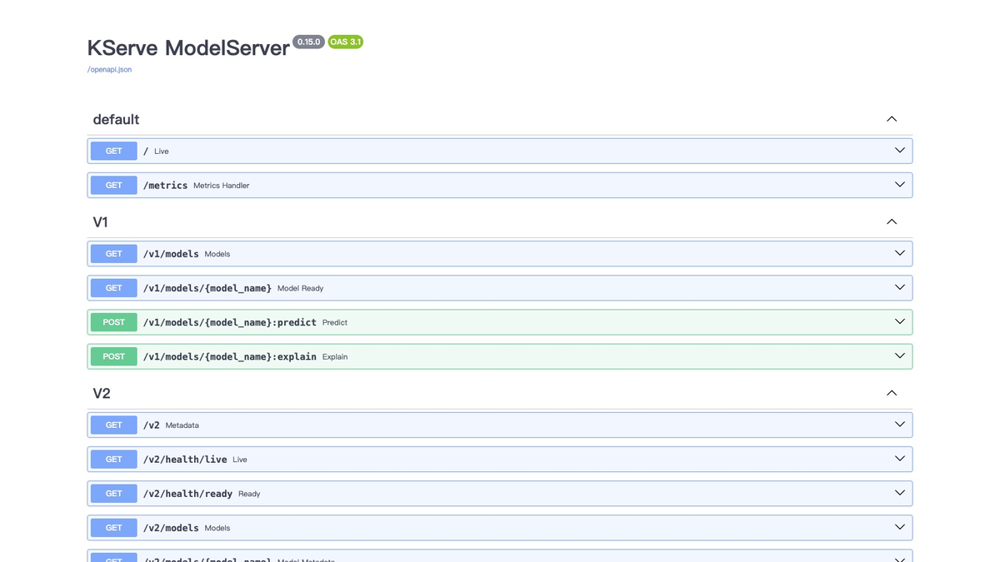
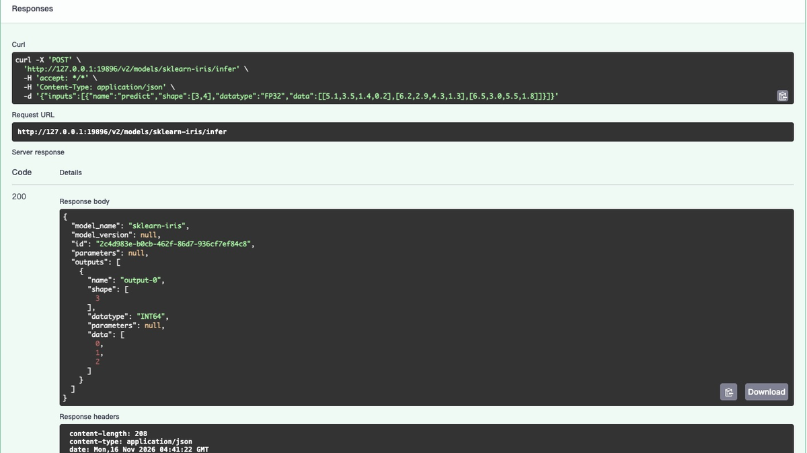

# KServe Kubernetes 实战：部署模型并调用推理接口

把模型包装成容器并创建 Deployment，就能提供推理接口。KServe 在此之上解决什么问题？本次在 Kubernetes 测试集群部署 KServe，用一个真实的 scikit-learn Iris 分类模型，走通模型制品、`InferenceService`、运行时选择、推理调用和副本调整。

**结论：KServe 的核心价值是把模型部署描述成 Kubernetes 资源，由控制器协调运行时、模型存储和服务生命周期。** 它不替代 vLLM 等推理引擎，而是可以管理使用这些引擎的模型服务。本实验是 CPU 分类模型的功能验证，没有测试大语言模型、GPU 性能或生产高可用。

## 实验结果与范围

| 项目 | 本次结果 |
| --- | --- |
| Kubernetes / KServe | v1.30.4 / v0.15.0 |
| 部署模式 | RawDeployment，不安装 Knative |
| 模型 | Iris 数据集训练的 SVC，scikit-learn 1.5.1，150 条训练样本 |
| 存储 | 1 GiB 本地 PVC，`ReadWriteOnce` |
| 推理 | V1 和 V2 HTTP 接口均成功，三组输入返回类别 `[0, 1, 2]` |
| 副本 | 最小副本从 1 改为 2 后观察到 2/2 就绪，改回 1 后恢复 1/1 |
| 访问 | ClusterIP + 本地端口转发；没有创建外部 Ingress |

三组输入只是功能样例，不是独立测试集准确率，也不是吞吐或延迟基准。调整最小副本验证的是控制面和 HPA 按配置收敛，**不是请求负载触发的自动扩容**。



*图：本次运行的 KServe ModelServer 官方 Swagger 页面，展示 V1/V2 API；这是模型运行时的接口文档，不是完整的 KServe 管理控制台。*

## 1. 为什么选这个版本和模式

KServe v0.15 官方文档要求 Kubernetes 至少 1.30，适合本次已有的 1.30.4 测试集群。该版本已较旧，不能将实验结果直接作为新版本或生产安全性的证明。当前新版安装文档要求 Kubernetes 1.32 及以上；生产应结合当前支持策略和安全公告选择受支持版本，必要时先升级集群。[v0.15 安装文档](https://kserve.github.io/archive/0.15/admin/kubernetes_deployment/) · [当前安装要求](https://kserve.github.io/website/docs/admin-guide/kubernetes-deployment/) · [发布支持策略](https://github.com/kserve/kserve/blob/master/RELEASES.md)

| 方式 | 工作原理 | 弹性特点 |
| --- | --- | --- |
| RawDeployment（v0.15） | 控制器创建 Deployment、Service、HPA，可配置 Ingress | 使用 Kubernetes HPA；HTTP 请求从零唤醒不受该模式支持 |
| Serverless（v0.15） | 配合 Knative Serving 和网络层 | 可以使用请求驱动扩缩容、缩零与 Revision；依赖更多组件 |

后续版本把 RawDeployment 称为 Standard，具体选项以对应版本为准。本次只验证第一行，没有验证 Knative、缩零、灰度或请求驱动扩容。[v0.15 Serverless 安装](https://kserve.github.io/archive/0.15/admin/serverless/serverless/)

## 2. KServe 在链路中的位置

```text
InferenceService → KServe controller → Deployment + Service + HPA
                       ↓                        ↓
                ServingRuntime            ModelServer + PVC
                                                  ↓
                                           HTTP V1 / V2
```

`InferenceService` 声明模型格式、运行时、存储和副本等；`ClusterServingRuntime` 提供模型服务容器及启动参数；控制器把声明协调为具体 Kubernetes 资源。推理过程由实际运行时完成。本次用 KServe SKLearn Server 加载 PVC 中的 `model.joblib`，不是让控制器本身执行分类。

这里的 PVC 是单节点本地盘、RWO。它限制 Pod 的放置和共享方式，不能代表跨节点可用、共享存储或高可用方案。模型服务生产化还需设计制品版本、权限、缓存和故障恢复。

## 3. 安装和环境准备

实验通过镜像中转准备控制器、代理及 SKLearn Server；使用独立实验命名空间、关闭 Ingress 创建，并采用实验用自签名 Webhook 证书。为避免额外安装共享 cert-manager，我们在渲染安装资源时注入 CA，限制命名空间内的准入规则。证书仅用于本实验，不提供自动轮换；控制器 RBAC、CRD 和部分 Webhook 仍是集群级资源，独立命名空间不等于完整隔离。

下面给出更常规的上游 Helm 安装方式，**依赖已经安装并正常运行的 cert-manager**；它不是本次自签名证书处理的逐字复现。先检查现有 CRD、Webhook 和 release，确认不会覆盖已有部署。需要 Helm、kubectl、metrics-server、可访问镜像和集群管理员权限；禁止在不了解影响的共享生产集群上直接执行。[安装依赖](https://kserve.github.io/archive/0.15/admin/kubernetes_deployment/)

```bash
kubectl create namespace kserve-lab
helm install kserve-crd oci://ghcr.io/kserve/charts/kserve-crd \
  --version v0.15.0 -n kserve-lab
helm install kserve oci://ghcr.io/kserve/charts/kserve \
  --version v0.15.0 -n kserve-lab \
  --set kserve.controller.deploymentMode=RawDeployment \
  --set kserve.controller.gateway.disableIngressCreation=true \
  --wait --timeout 10m
kubectl -n kserve-lab get pods
```

如需使用内部镜像仓库，应分别配置控制器、代理、存储初始化器和模型运行时镜像；确保镜像版本匹配。不要在公开文档中包含内部仓库地址或凭据。示例模型是可信的本地制品；`joblib` 基于 pickle，**不能加载不可信来源的模型文件**。

## 4. 准备模型与 PVC

下例直接在 KServe SKLearn Server 镜像内训练样例并写入 PVC；它与本次最终使用的模型训练方式一致，省略了第一次导入旧版本示例模型的过程。Job 以 root 写入实验卷，目的是适配本次卷权限，生产应通过合适的 UID、fsGroup 和存储权限设计避免不必要的 root。PVC 的 StorageClass 和容量根据环境调整。

```yaml
apiVersion: v1
kind: PersistentVolumeClaim
metadata:
  name: iris-model-pvc
  namespace: kserve-lab
spec:
  accessModes: [ReadWriteOnce]
  resources:
    requests:
      storage: 1Gi
---
apiVersion: batch/v1
kind: Job
metadata:
  name: iris-model-train
  namespace: kserve-lab
spec:
  backoffLimit: 1
  template:
    spec:
      restartPolicy: Never
      containers:
        - name: train
          image: kserve/sklearnserver:v0.15.0
          securityContext: {runAsUser: 0}
          command: ['/prod_venv/bin/python', '-c']
          args:
            - |
              import os, sklearn
              from joblib import dump
              from sklearn import datasets, svm
              data = datasets.load_iris()
              model = svm.SVC(gamma='scale').fit(data.data, data.target)
              dump(model, '/output/model.tmp')
              os.replace('/output/model.tmp', '/output/model.joblib')
              print('scikit-learn:', sklearn.__version__, 'training examples:', len(data.target))
          resources:
            requests: {cpu: 100m, memory: 256Mi}
            limits: {cpu: '1', memory: 1Gi}
          volumeMounts:
            - {name: output, mountPath: /output}
      volumes:
        - name: output
          persistentVolumeClaim: {claimName: iris-model-pvc}
```

保存为 `iris-storage.yaml` 并执行：

```bash
kubectl apply -f iris-storage.yaml
kubectl -n kserve-lab wait --for=condition=complete job/iris-model-train --timeout=120s
kubectl -n kserve-lab logs job/iris-model-train
```

本次日志为 `scikit-learn: 1.5.1 training examples: 150`。起初我们载入的上游示例由 scikit-learn 1.0.1 序列化，运行时 1.5.1 报版本不一致警告；于是改用相同运行时重新训练和序列化，再重新加载，警告不再出现。第一次写入还遇到 PVC 目录权限不足，调整实验 Job 的运行身份后完成。

## 5. 创建 InferenceService

```yaml
apiVersion: serving.kserve.io/v1beta1
kind: InferenceService
metadata:
  name: sklearn-iris
  namespace: kserve-lab
  annotations:
    serving.kserve.io/deploymentMode: RawDeployment
spec:
  predictor:
    minReplicas: 1
    maxReplicas: 2
    model:
      modelFormat:
        name: sklearn
      runtime: kserve-sklearnserver
      storageUri: pvc://iris-model-pvc/
      args:
        - --enable_docs_url=True
      resources:
        requests:
          cpu: 100m
          memory: 512Mi
        limits:
          cpu: '1'
          memory: 1Gi
```

保存为 `iris-isvc.yaml`：

```bash
kubectl apply -f iris-isvc.yaml
kubectl -n kserve-lab get inferenceservice,deploy,svc,hpa,pvc
kubectl -n kserve-lab port-forward svc/sklearn-iris-predictor 19896:80
```

`InferenceService` 的状态可能显示示例域名，但本实验关闭了 Ingress 创建，该域名不代表可从外部访问。上面的端口转发只监听本机，使用结束后通过 Ctrl-C 停止。

## 6. 实际调用 V1 和 V2

另开终端执行 V1 请求：

```bash
curl -sS -H 'Content-Type: application/json' \
  -d '{"instances":[[5.1,3.5,1.4,0.2],[6.2,2.9,4.3,1.3],[6.5,3.0,5.5,1.8]]}' \
  http://127.0.0.1:19896/v1/models/sklearn-iris:predict
```

返回 `{"predictions":[0,1,2]}`。再使用 V2 协议：

```bash
curl -sS -H 'Content-Type: application/json' \
  -d '{"inputs":[{"name":"predict","shape":[3,4],"datatype":"FP32","data":[[5.1,3.5,1.4,0.2],[6.2,2.9,4.3,1.3],[6.5,3.0,5.5,1.8]]}]}' \
  http://127.0.0.1:19896/v2/models/sklearn-iris/infer
```

V2 返回的 `outputs[0].data` 同样是 `[0, 1, 2]`。下面的截图是在运行时 Swagger 页面中实际提交 V2 请求后的响应。



*图：桌面浏览器中的实际 V2 请求、HTTP 200 和三项预测结果；地址为本机端口转发。截图不代表对外暴露服务。*

## 7. 调整副本并观察资源

```bash
kubectl -n kserve-lab patch inferenceservice sklearn-iris --type=merge \
  -p '{"spec":{"predictor":{"minReplicas":2}}}'
kubectl -n kserve-lab wait --for=jsonpath='{.status.readyReplicas}'=2 \
  deployment/sklearn-iris-predictor --timeout=90s
kubectl -n kserve-lab get inferenceservice,deploy,hpa
kubectl -n kserve-lab patch inferenceservice sklearn-iris --type=merge \
  -p '{"spec":{"predictor":{"minReplicas":1}}}'
```

实际观察到 2/2 就绪，恢复配置后回到 1/1。HPA 指标有采样和控制周期，状态显示可能短暂滞后于 Deployment。由于这里使用本地 RWO PVC，两个副本落在允许访问该卷的同一节点，这**不等于跨节点容灾**。

## 8. 与 Knative、vLLM 的关系

| 项目 | 主要职责 | 本次关系 |
| --- | --- | --- |
| KServe | 模型服务声明、运行时选择、存储接入和资源协调 | 本次实际部署与验证 |
| Knative Serving | 容器服务的请求驱动弹性、Revision 和流量管理 | 可作为 KServe Serverless 模式的底座；本次未安装 |
| vLLM / SGLang | 大语言模型推理引擎，负责模型加载和生成 | 可由平台封装或管理；本次没有部署，也没有测 GPU |
| 普通 Deployment | 运行容器并管理副本 | KServe RawDeployment 在底层生成和协调它 |

选择时先确定模型类型、存储和性能目标，再决定是否需要统一模型接口、制品管理及多框架运行时。直接使用 Deployment 更少依赖；KServe 能提供统一抽象，但控制器、CRD、Webhook、证书和升级兼容性都需要维护。[KServe 项目](https://github.com/kserve/kserve) · [Knative Serving](https://knative.dev/docs/serving/)

## 9. 边界与清理

本次测试没有覆盖负载驱动 HPA、Knative 缩零、GPU、大模型流式输出、认证、多租户隔离或多节点恢复。上线之前还要验证模型制品可信性、资源配额、身份与网络策略、持久化、监控告警和滚动升级。

实验遇到的模型卷挂载路径冲突，通过改为 `pvc://` 直接挂载并重建实验预测 Deployment 解决；镜像中转曾发生网络中断，重试后完成。集群级 Webhook 和 CRD 需要认真评估影响，证书到期会影响对应准入。

清理时先删除本次 `InferenceService`、测试 Job 和 PVC，再按实际安装方式移除控制器；删除 PVC 可能删除其模型数据。集群级 CRD 和 RBAC 可能被其他安装使用，确认无依赖后才能删除，避免盲目清理共享资源。
