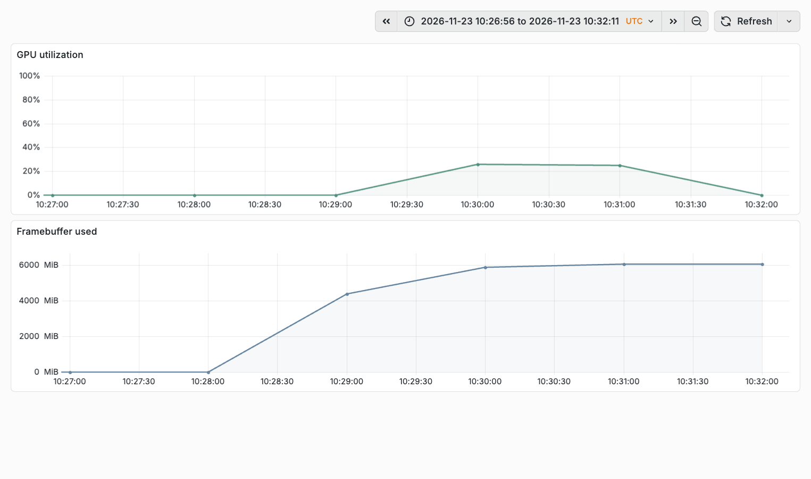

# AIBrix ModelClaim 单卡实测：小模型双活、14B 轮换与 L20 的显存边界

模型库里有两个访问量不高的模型，如果各自的 Pod 申请一张整卡，Kubernetes 就得为它们预留两张 GPU。AIBrix 的做法是让一个常驻 Pod 持有一张卡，让多个 vLLM 引擎在里面独立加载、接流量、休眠。2026 年 10 月 12 日，上游公布了在 8 张 H20 上放置 39 个模型的实验。这次把问题缩小到一张 L20：同一张卡同时服务两个千问，读者究竟能省下什么，用户会察觉什么？[上游设计与 H20 实验](https://aibrix.github.io/posts/2026-10-12-modelclaim-gpu-sharing/)

**两个模型能共用一张 L20；要付出的代价首先出现在请求等待上。** 在 1,024 输入、128 输出、总并发 4 时，Qwen3 独自接收全部流量是 **276.1 tok/s**，两个模型各接并发 2 是 **279.0 tok/s**。但把 Qwen3 自身的并发固定为 2，让邻居也开始接请求，它的 P95 首 token 延迟从 **54.6 ms 升到 73.1 ms**。如果再把 Qwen3 设为闲时休眠，首位用户还会遇到一次 503 和约十秒的重试等待。换成两份合计 55.02 GiB 的 14B 权重，这张卡只能轮流服务。在接近整卡的 22B 实验里，休眠引擎剩下的 950 MiB 又改变了结果。

## 1. 两个模型怎样放进一个 GPU Pod？

这次集群里只有 **1 个推理池 Pod、1 个运行时容器、1 张物理 L20**。在同一个容器里，Qwen3-0.6B 和 Qwen2.5-0.5B-Instruct 各有一个 vLLM 服务，权重分别加载。双活测试中，两者能同时收请求。要复原这个部署，可以按发生顺序看三个动作。

![两份 ModelClaim 在同一个运行时容器内启动两个 vLLM 服务，共用一张 L20][pod-topology]

1. **Kubernetes 先给容器一张卡。** 池的 Deployment 只有一个副本，Pod 模板里只有一个业务容器 `aibrix-runtime`。它的 requests 和 limits 都写了 `nvidia.com/gpu: 1`。调度器据此选择有空闲 GPU 的节点，kubelet 通过设备插件为该容器分配设备。到这一步，集群已扣减一张卡，池还可以是空的。[池的部署清单](https://github.com/vllm-project/aibrix/blob/v0.8.0/samples/modelclaim/warm-runtime-pool.yaml) · [Kubernetes 的 GPU 调度说明](https://kubernetes.io/docs/tasks/manage-gpus/scheduling-gpus/)
2. **AIBrix 再把两个模型放进已运行的 Pod。** 两份 ModelClaim 分别写明模型名、权重位置和相同的池选择器。控制器核算预算后，为它们选中同一个 Pod。容器里的 runtime 为每份 Claim 分配端口和独立的 kvcached 通信名，通过 `subprocess.Popen` 分别启动 `vllm.entrypoints.openai.api_server`。这两个服务都能用容器已经获配的那张卡。现场引擎注册表中，Qwen3 为 PID 28、端口 20000，Qwen2.5 为 PID 29、端口 20001。这里的 PID 指 API 服务进程，vLLM 还可启动自己的 GPU worker。[运行时启动引擎的源码](https://github.com/vllm-project/aibrix/blob/v0.8.0/python/aibrix/aibrix/runtime/model_runtime.py)
3. **网关按请求里的模型名选端口。** 客户端访问同一个入口。请求体中的 `model` 决定转给哪个引擎。两个目的地址的 Pod IP 相同，端口不同。我们对两个引擎分别直连和经由网关提问，四次都是 HTTP 200。Qwen2.5 回答 `Paris`，Qwen3 回答 `7 plus 5 equals 12.`，后者算对了，但没有遵守“只返回数字”的要求。

### 为什么两个 vLLM 不会各自把显存算一遍？

一个容器可以启动多个使用 CUDA 的进程，两个小模型本来也有机会手动共卡。麻烦在后面：每个引擎除了权重，还要为生成中的请求保存 KV 缓存，即已经计算过的注意力键和值。上下文越长、同时进行的请求越多，缓存需求越高。手动启动两套服务时，需要为两边留好各自的空间。

ModelClaim 给每个模型登记非 KV 开销和最低 KV 额度。本例每个模型声明 6 GiB 加 1 GiB，两份合计至少需要 **14 GiB**，运行时报告这张卡可分配 **44.39 GiB**。控制器再给两个引擎分别设置 KV 上限，kvcached 随请求实际用到的缓存映射物理显存。双活快照中两者各自获准使用 16.20 GiB KV，整卡当时只实际用了 3,752 MiB。AIBrix 管的是显存预算和引擎生命周期；两个引擎仍会竞争同一张卡的计算资源。后面的首 token 延迟对照正好能观察到这一点。[显存预留实现](https://github.com/vllm-project/aibrix/blob/v0.8.0/pkg/controller/modelclaim/ledger.go) · [KV 分配实现](https://github.com/vllm-project/aibrix/blob/v0.8.0/pkg/controller/modelclaim/division.go)

这个部署也有明确的故障范围。让 Qwen3 的引擎休眠时，Qwen2.5 仍然回答；如果把整个池 Pod 缩到零，里面的两个服务都会停止，Kubernetes 才收回这张 GPU。若另建两个普通 Pod、各申请一张独占 GPU，调度器会计算两份整卡需求。

<details markdown="1">
<summary>如何自己核对是否真的同 Pod、同卡？</summary>

在下文的复现环境中，等两份 Claim 都进入 Active，再运行下面的只读命令。先核对两行里的 Pod 名相同、端口不同，再进入该 Pod 核对设备数、型号及引擎注册表。单看 GPU 利用率曲线不能识别模型。

```bash
NS=modelclaim-demo
kubectl -n "$NS" get modelclaims -o json | jq -r '
  .items[] | .spec.modelName as $model | .status.instances[]
  | [$model, .phase, .pod, .port] | @tsv'
POD=$(kubectl -n "$NS" get modelclaim qwen3-0-6b -o jsonpath='{.status.instances[0].pod}')
kubectl -n "$NS" get pod "$POD" -o json | jq '
  .spec.containers[] | {name, gpu: .resources.limits["nvidia.com/gpu"]}'
kubectl -n "$NS" exec "$POD" -c aibrix-runtime -- nvidia-smi -L
kubectl -n "$NS" exec "$POD" -c aibrix-runtime -- cat /var/run/aibrix/engines.json \
  | jq -r '.engines[] | [.model_name, .phase, .pid, .port] | @tsv'
```

</details>

## 2. 哪些条件固定，怎样算一次成功

### H20 演示用的什么模型，为什么 L20 还测 Qwen2.5？

| 场景 | 硬件与模型 | 可以读出什么 |
| --- | --- | --- |
| 官方博客的分步视频 | 1 张 H20，四份 Claim 都指向 DeepSeek-R1-Distill-Llama-8B | 画面中的 model-a 到 model-d 是同一套权重的四份独立声明。视频逐步展示放置、等待、休眠和让出空间，四份声明会经历不同状态。 |
| 官方规模压力测试 | 单机 8 张 H20，39 个模型，规模 1.5B–32B | 上游报告平均每卡约放 5 个、约 3 个醒着。该文没有列全 39 个型号，不能由视频推断所有模型都是这款 DeepSeek。 |
| 本文的 L20 实验 | 1 张 L20，Qwen3-0.6B 与 Qwen2.5-0.5B-Instruct 两套不同权重 | 两个模型同时处于 Active，混合负载给每个模型各开两路请求。单独的休眠实验再让 Qwen3 睡下，验证 Qwen2.5 能继续回答。 |

选用较早的 Qwen2.5，是因为 AIBrix v0.8.0 的双模型样例就提供了这组可复现的权重和显存声明。两个模型足够小，可以在一张卡上先回答“能否双活、请求有没有路由到正确引擎、睡掉一个另一个还能否服务”。两者双活也说明这一步本身用不着先把谁卸载。对于新的业务模型，需要用实际精度、最大上下文和并发数重新测量非 KV 峰值、KV 需求及延迟；本文的 6 GiB 声明和 tok/s 只对应这组配置。[官方 H20 压力测试与分步视频](https://aibrix.github.io/posts/2026-10-12-modelclaim-gpu-sharing/#demo) · [v0.8.0 双模型样例](https://github.com/vllm-project/aibrix/blob/v0.8.0/samples/modelclaim/modelclaims.yaml)


| 条件 | 实测设置 |
| --- | --- |
| 集群与设备 | Kubernetes v1.30.4，1 个实验池 Pod，1 张 NVIDIA L20；驱动 580.173.02，设备报告 46,068 MiB |
| 控制面与引擎 | AIBrix 从 v0.7.0 原地升级到 v0.8.0；容器内实读 vLLM 0.30.0、kvcached 0.1.6 |
| 运行时镜像 | `aibrix/kvcached-runtime:453ab36db68ac859f86ac94e32d0e02cec4c1505`；上游 linux/amd64 manifest 为 `sha256:6adf0756fac893df3503cf2cf94cb9739bb46b3994ce92e06306ccaa6c12401f` |
| 模型与资源 | Qwen3-0.6B（A）、Qwen2.5-0.5B-Instruct（B）从独立只读卷加载；Pod 请求 / 上限为 4 / 12 CPU、28 / 44 GiB 主存 |
| 每模型参数 | 1 个副本，`maximumFootprint: 6Gi`、`kvFloor: 1Gi`；`--max-model-len 2048 --max-num-seqs 4 --enforce-eager` |
| 压测协议 | 集群内客户端经 Envoy 调用 `/v1/completions`，SSE 流式响应，温度 0，`ignore_eos=true`；功能问答单独使用 `/v1/chat/completions` |

两个引擎在整套吞吐对照中始终常驻。A2、B2 分别让一个模型接并发 2，另一个保持空闲；A4 将 4 路全部给 A；AB 让 A、B 各接 2 路。每一路连续发送 6 个请求，上一个结束才发下一个，较快的模型可能先完成。两档输入 / 输出为 256 / 64 和 1,024 / 128 token，四种负载各跑三轮，轮间轮换顺序。各组使用不同随机种子生成同分布的输入，并逐请求核对服务端实际 token 数。

一轮开始前，两种长度都用两个模型试过流式协议。正式请求要求 HTTP 200、模型名正确、有非空文本、收到 `[DONE]`、`finish_reason=length`，且输入和输出 token 数均命中。**24 轮共 432/432 个正式请求通过**，另有 4 个协议预检请求。输出吞吐按成功输出 token 总数除以整轮墙钟时间。TTFT 从发起请求计到首段非空文本，TPOT 用首末非空文本时间差除以输出 token 数减一。每轮取请求的最近秩 P95，表里取三轮中位数；12 或 24 个请求一轮的尾部值只用于这组对照。[逐请求 CSV](../../assets/practices/aibrix-modelclaim-l20/requests.csv) · [逐轮和分模型 CSV](../../assets/practices/aibrix-modelclaim-l20/rounds.csv)

## 3. 两个模型忙起来，谁在等？

| 输入 / 输出 | 流量 | 成功 / 请求 | 输出 tok/s | P95 TTFT (ms) | P95 TPOT (ms) | P95 E2E (s) |
| --- | ---: | ---: | ---: | ---: | ---: | ---: |
| 256 / 64 | A2 | 36 / 36 | 139.9 | 52.2 | 14.09 | 0.925 |
| 256 / 64 | B2 | 36 / 36 | 176.2 | 43.9 | 10.95 | 0.720 |
| 256 / 64 | A4 | 72 / 72 | 271.5 | 59.4 | 14.05 | 0.924 |
| 256 / 64 | AB | 72 / 72 | 271.7 | 53.3 | 14.09 | 0.935 |
| 1,024 / 128 | A2 | 36 / 36 | 141.0 | 54.6 | 14.07 | 1.822 |
| 1,024 / 128 | B2 | 36 / 36 | 180.6 | 46.8 | 11.15 | 1.453 |
| 1,024 / 128 | A4 | 72 / 72 | 276.1 | 75.9 | 14.15 | 1.842 |
| 1,024 / 128 | AB | 72 / 72 | 279.0 | 59.9 | 14.12 | 1.845 |

![单卡总吞吐与分模型 P95 首 token 延迟的两个受控对照][throughput-latency]

**先固定总并发看卡。** 256 / 64 这一档，A4 与 AB 分别为 271.5、271.7 tok/s；1,024 / 128 这一档为 276.1、279.0 tok/s，差约 1%。这两组支持在此次配置和负载下保留近似的整卡输出能力。它们同时改变了模型组合，不能据此声称开启共享会令 vLLM 提速。

**再固定单个模型的并发看用户。** 1,024 / 128 时，B 从单独接并发 2 变为与 A 各接并发 2，B 的 P95 TTFT 从 46.8 变成 59.9 ms；A 从 54.6 变成 73.1 ms。A 的 P95 TPOT 仅从 14.07 变为 14.26 ms。这个例子里，更明显的差异发生在首段内容到达前。客户端计时覆盖网关、排队和引擎执行，缺少分阶段追踪，无法把这段增量归到某一个组件。只看混流汇总的 59.9 ms 会漏掉 A 的尾部体验。

设备侧也有两种采样粒度。正式窗口为 11 月 23 日北京时间 18:27:52 至 18:32:02。按实验 Pod 和单卡筛出的 DCGM 利用率只有 4 个原始样本（0%、26%、25%、0%）。最短一轮约 4 秒，用分钟图很容易把一轮完整的工作量漏掉。运行时内的 250 个秒级 NVML 样本显示，GPU 利用率最高达到 98%，整卡已用显存从 4,659.9 到 6,911.9 MiB。两套监控采样间隔不同；短时峰值和分钟图上的低读数可以同时成立。吞吐和 TTFT 都来自客户端。[浅色 Grafana 实测原图](../../assets/practices/aibrix-modelclaim-l20/grafana-light.png) · [DCGM 原始采样](../../assets/practices/aibrix-modelclaim-l20/dcgm.csv) · [秒级 NVML 采样](../../assets/practices/aibrix-modelclaim-l20/nvml.csv)



图中横轴为 UTC，比北京时间早 8 小时。上方是同一张 L20 的利用率，下方是整卡已用显存。这两条曲线包含两个引擎的活动；区分模型要看上方压测表的分组和逐请求记录。


## 4. 模型睡着，能给邻居多少显存？

吞吐对照之外，我们在同一张卡上依次记录双活、让 A 休眠、唤醒 A、移除 B 四个快照。这里的“移除”确实停止了 B 的引擎；前面吞吐表中的 A2、A4 都保留了 B 的常驻进程。

| 快照 | A 的 KV 上限 | B 的 KV 上限 | 整卡实际已用 |
| --- | ---: | ---: | ---: |
| 双活 | 16.20 GiB | 16.20 GiB | 3,752 MiB |
| A 休眠，B 继续回答 | 0.33 GiB | 37.63 GiB | 2,528 MiB |
| A 唤醒 | 16.20 GiB | 16.20 GiB | 3,754 MiB |
| 移除 B，只留 A | 38.39 GiB | — | 2,021 MiB |

![Qwen3 休眠前后，Qwen2.5 的缓存上限与整卡物理显存变化][memory]

运行时报告可分配 **44.39 GiB**。双活时，扣掉两个模型各 6 GiB 的非 KV 预算，剩余缓存约为 `(44.39 - 6 - 6) / 2 = 16.20 GiB` 每个模型。默认策略给休眠模型保留唤醒所需的预算。开启 `noWakeReserveWhileAsleep` 后，A 的睡眠进程仍占 **782 MiB**，B 的 KV 上限因此可到 `44.39 - 6 - 782/1024 ≈ 37.63 GiB`。B 获取了约 21.43 GiB 的额外额度，但此时整卡实际用量只减少 **1,224 MiB**。前者回答“B 以后最多能用多少缓存”，后者回答“这次睡眠实际腾出了多少物理显存”。[四阶段快照数值](../../assets/practices/aibrix-modelclaim-l20/results.json)

这也解释了我们做的反例：第三份 Claim 声明 96 GiB 非 KV 开销，加上 1 GiB 缓存保底，控制器返回 `TooLargeForAnyCard`，给出需要 97.0 GiB、单卡最多提供 44.4 GiB。即使 `nvidia-smi` 看起来有大量空闲，控制器也会先核算承诺给模型的预算。

### 如果 A 接近占满一张 L20，B 能轮到吗？

先看“占满”的口径。池 Pod 申请一整张 GPU，只表示 Kubernetes 为这个容器分配了一张设备。GPU 利用率达到 100% 表示采样时设备繁忙。决定另一套引擎能否加载到这张卡上的，是 **AIBrix 的显存预算和当时已占用的 KV 页**。即使显存放得下，两套模型也可能争抢计算资源，让首 token 变慢。

每个模型的最低预留是 `maximumFootprint + kvFloor`。前者由部署者按权重精度、CUDA Graph 和工作区等非 KV 峰值填写，后者是目标上下文需要保障的最低缓存。控制器先检查各模型的最低预留合计能否放下，再检查此刻能否腾出空间。一个活跃模型按非 KV 声明加上“KV 保底与已映射 KV 的较大值”计账。调低缓存上限，并不会立即收回正在使用的页。因此最低预留合计能放下，也可能需要等当前请求完成、缓存释放。[控制器的显存账本](https://github.com/vllm-project/aibrix/blob/v0.8.0/pkg/controller/modelclaim/ledger.go) · [放置时的两次检查](https://github.com/vllm-project/aibrix/blob/v0.8.0/pkg/controller/modelclaim/placement.go)

沿用本次实测的单卡可用容量 **44.39 GiB**。假设另一个工作负载的 A 最低需要 **42 GiB**、B 需要 **12 GiB**，A 睡下后实测残留为 **1 GiB**。这三个数用于推演，没有作为本轮实测成绩。

| 单卡池里的状态 | 控制器如何判断 | B 或调用方会看到什么 |
| --- | --- | --- |
| A 正在处理请求，B 首次申请放置 | 双活至少需要 42 + 12 = 54 GiB，超过 44.39 GiB | B 等待放置，A 继续完成在途请求。持续访问 A 可能让 B 一直等下去。 |
| A 已休眠，沿用默认唤醒预留 | 仍给 A 留 42 GiB，最多只能给 B 2.39 GiB | 即使设备显示显存空了，B 的 12 GiB 申请仍然放不进来。 |
| A 已休眠，开启 `noWakeReserveWhileAsleep`，且已测得残留 | 给 A 记 1 GiB，剩 43.39 GiB，足以容纳 B | B 可以开始加载，完成后可接请求。若 B 从未加载过，此步要付首次加载的时间。 |
| B 服务期间又有人请求 A | A 的唤醒需要重新找到 42 GiB；B 活跃时两者仍合计 54 GiB | 网关返回 503 和 `Retry-After`。单卡没有其他落点时，A 可以停在 `WaitingForRoom`。客户端须在自己的请求期限内重试。 |

轮换还要**两个方向都算得过来**。B 上卡要求“A 的休眠残留 + B 的最低预留”放得下；A 回来要求“B 的休眠残留 + A 的最低预留”也放得下。例如 B 睡后若仍占 3 GiB，则 3 + 42 = 45 GiB，A 连等到 B 睡下也回不来。此时需要完全卸载 B 以清掉残留，或者给 A 提供另一张有足够空间的卡。休眠中的权重转入主机内存，也要给 Pod 留够主存。[官方的休眠与唤醒过程](https://aibrix.github.io/posts/2026-10-12-modelclaim-gpu-sharing/#waking-through-the-controller)

池可以用 `sleepAfterSeconds` 设置空闲多久后主动休眠，用 `sleepToMakeRoomAfterSeconds` 设置为了给其他模型腾位置，邻居至少要空闲多久。正在执行或排队的请求会阻止这种让位。网关返回的重试间隔是下次尝试的建议时间，不能保证轮到该模型。吞吐对照中两个小千问的最低预留合计仅 14 GiB，验证的是双活以及有余量时的原地唤醒；文中约 11 秒的等待不能用于估算这类整卡轮换。如果业务要求 A、B 任意时刻都能在一两秒内首响，就应按双活峰值留容量，或给它们各自安排一张卡。[池策略参数](https://github.com/vllm-project/aibrix/blob/v0.8.0/pkg/controller/modelclaim/pool_policy.go)

### 实测一：两份 14B 权重能否轮流使用同一张卡？

把上文的假设换成两套真实权重。A 为 Qwen3-14B，B 为 DeepSeek-R1-Distill-Qwen-14B，均为 BF16。按权重索引，两者分别为 **27.51 GiB、27.51 GiB**，合计约 **55.02 GiB**，单是权重就已超过卡的可用容量。两份 Claim 各声明 33 GiB 非 KV 开销和 1 GiB KV 保底。运行参数为 `--enforce-eager --max-model-len 2048 --max-num-seqs 2`。实验池只申请一张 L20，主存请求 / 上限提高至 110 / 144 GiB，供加载及睡眠卸载权重使用。下面是一次完整的往返。

| 阶段 | Qwen3-14B | R1-Distill-Qwen-14B | 整卡实占 | 请求与控制器证据 |
| --- | --- | --- | ---: | --- |
| A 服务，B 申请 | Active | Pending | 29,151 MiB | A 回答 Paris。B 首访 503。控制器报告单卡还可承诺 10.4 GiB，B 需要 34 GiB。 |
| A 睡下，保留唤醒预算 | Sleeping | Pending | 1,043 MiB | A 的睡眠残留为 950 MiB。整卡已有大量空闲，B 再次访问仍是 503。 |
| 允许让出预算，B 首次加载 | Sleeping | Active | 30,400 MiB | B 首次答出 Tokyo。从记录策略更新到 B 首次正确响应结束约 85.3 秒，其中包含首次加载引擎和权重。 |
| B 持续接流量，调用 A | Sleeping | Active | 30,400 MiB | A 首访 503，实例原因为 `WaitingForRoom`。接着发给 B 的 7 个请求全部成功。 |
| 停止 B 流量，A 恢复 | Active | Sleeping | 30,400 MiB | B 睡后残留 1,062 MiB。A 再次答出 Paris，Pod UID、GPU UUID、A 的服务 PID 和端口都与首次一致。 |

![同一张 L20 上 Qwen3-14B 与 DeepSeek-R1-Distill-Qwen-14B 轮换的实测显存与状态][switching-14b]

上图逐秒读取实验 Pod 可见的整卡已用显存，色带来自独立轮询的 Claim 状态。右侧显存回到 30,400 MiB 时，接流量的模型已从 B 换回 A。只看整卡曲线分辨不出这个变化。[整卡采样](../../assets/practices/aibrix-modelclaim-l20/switch-device.csv) · [状态变化](../../assets/practices/aibrix-modelclaim-l20/switch-states.csv) · [阶段快照](../../assets/practices/aibrix-modelclaim-l20/switch-stages.csv) · [逐请求记录](../../assets/practices/aibrix-modelclaim-l20/switch-requests.csv)

复现这一轮，先单独创建 A 并验证网关回答，再创建 B。先设 `sleepAfterSeconds: 35` 且保留唤醒预算，观察 A 入睡而 B 仍 Pending；随后改为 `noWakeReserveWhileAsleep: true`、`sleepAfterSeconds: 240`、`sleepToMakeRoomAfterSeconds: 20`。控制器拿到 A 的休眠残留量后，B 获准加载。在 B 服务期间向 A 发送一次请求触发回切，并继续访问 B 约半分钟，再停止 B 流量。本轮 A 首访的重试头是 10 秒。控制器从唤醒请求到可路由记录了 **86 秒**；从 A 首访到客户端再次拿到正确答案共 **90.35 秒**，包括人为保持 B 忙碌、等待其符合休眠条件、搬移权重及探测。这是一次编排实验的端到端耗时。

### 实测二：Qwen 已经休眠，为什么 22B 仍然上不了卡？

把 B 换成 22B 的 Mistral-Small-Instruct-2409。BF16 权重索引约 **41.44 GiB**，给它声明 43 GiB 非 KV 开销和 1 GiB KV 保底，共 **44 GiB**。保留前一轮的单卡池规格与 2,048 token 上下文上限。这里的 44 GiB 是部署者为这次配置填写的预算。[Mistral 官方模型卡](https://huggingface.co/mistralai/Mistral-Small-Instruct-2409)

| 做了什么 | 实际观察到什么 | 对部署有什么影响 |
| --- | --- | --- |
| Qwen3-14B 进入休眠，允许归还唤醒预算 | 整卡实占 1,043 MiB，其中休眠引擎仍占 950 MiB。可分配量为 44.3922 − 950 / 1,024 ≈ **43.46 GiB**。控制器报最多 43.5 GiB，Mistral 仍 Pending，网关返回 503。 | 这次差了约 0.54 GiB。继续等 Qwen 空闲也不会释放保留进程的这部分开销。 |
| 手动删除本轮 Qwen Claim，等引擎退出 | Mistral 在原 Pod 获准放置。vLLM 加载权重用了 41.45 GiB，kvcached 的进程预算约 40.84 GiB，扣除权重及激活开销后，可用 KV 为 **−0.87 GiB**。两次启动均报 `No available memory for the cache blocks`。 | 放置通过后，还要检查 vLLM 能否用这套启动参数建立缓存。 |
| 重建 Mistral Claim，只增加 `--kv-cache-memory-bytes=1073741824` | 控制器从 `Activating` 到 `Activated` 约 **53 秒**。Mistral 随后闲置休眠，残留 726 MiB。再次访问，网关先返回 503，重试后返回 **HTTP 200** 并答出 Tokyo。Active 快照的整卡实占为 **43,305 MiB**。 | 比对 Qwen 与 Mistral 快照，两者使用同一 Pod、同一物理 GPU。1 GiB 是这次显式指定的启动参数，运行时控制器随后把 KV 上限调到约 1.4 GiB。 |

这次完整卸载 Qwen 由实验人员触发，验证了在单卡上为 22B 服务腾出空间的办法。恢复 Qwen 需要重新创建它的 Claim。固定给 KV 1 GiB 的试次只验证了一个短请求；要服务更长上下文或更多并发，还要按业务输入测试。办公机中途断连，因此冷启动采用集群事件记时，网关答案取自恢复连接后的真实调用。[两次启动参数、控制器事件与网关响应](../../assets/practices/aibrix-modelclaim-l20/switch-edge.json)

## 5. 两个小模型从冷启动、休眠到首个成功响应

初次创建池时，节点拉取镜像用了 **114.13 秒**；两份 Claim 从 `Activating` 到 `Activated` 又用了 **61 秒**，两者并行加载。可扩到零的 Pod 恢复时需要考虑镜像是否已缓存。这两个冷启动阶段取自 Kubernetes 事件，没有作为用户一次请求的端到端计时。

休眠实验保持池 Pod 常驻，策略为 `sleepAfterSeconds: 60`、`noWakeReserveWhileAsleep: true`。持续访问 B，让 A 空闲到 `Sleeping`，再向 A 发送真实问答。首次访问返回 `503` 和 `Retry-After: 10`；唤醒请求写入后由控制器恢复引擎和路由，客户端等满建议间隔后重试。首次功能实验核对了唤醒前后的 Pod UID、GPU UUID、两个 PID 和端口，全部相同。

| 试次 | 首次 → 重试 HTTP | 恢复为可路由 | 客户端等到正确回答 |
| --- | ---: | ---: | ---: |
| 功能轮 | 503 → 200 | 3 s | 10.92 s |
| 复测 1 | 503 → 200 | 2 s | 11.31 s |
| 复测 2 | 503 → 200 | — | 13.37 s |
| 复测 3 | 503 → 200 | — | 11.47 s |

四次首访均得到 503，按重试建议再发均答对，客户端中位数为 **11.39 秒**，范围为 **10.92–13.37 秒**。末两轮没有采到可与本轮对应的独立 Woken 时间戳，保留为空；四轮样本也不足以估计唤醒 P95。

“可路由”取控制器记录的唤醒请求到 `Woken` 事件，时间戳精确到秒。“用户拿到答案”从 Pod 内首次发送请求计到重试响应结束，包含等待、推理和两次在 Pod 内发起请求之间的调度间隔。原始功能轮还记录了外层脚本的 11.64 秒，其中包含调用 `kubectl exec` 的开销。容量有余时可以原地唤醒；若把休眠模型让出的额度承诺给其他模型，恢复前还需要重新找到空间。表中四次小模型唤醒都发生在有余量时。[逐次唤醒记录](../../assets/practices/aibrix-modelclaim-l20/wake.csv)

## 6. 如何复现，遇到 503 先看哪里

以下命令假设已有 AIBrix v0.8.0 与 Envoy Gateway，并可下载上游权重。在专用命名空间复现。离线环境先把两个模型挂为只读卷，再将 Claim 的 `artifactURL` 改为容器内路径；本次预检用无 GPU 的 Pod 逐个读取配置与权重文件首字节，并验证集群 DNS 到网关的路径。[上游清单](https://github.com/vllm-project/aibrix/tree/v0.8.0/samples/modelclaim) · [锁定的运行时配方](https://github.com/vllm-project/aibrix/blob/v0.8.0/build/container/Dockerfile.kvcached-runtime)

<details markdown="1">
<summary>展开池与模型部署命令</summary>

```bash
git clone --depth 1 --branch v0.8.0 https://github.com/vllm-project/aibrix.git
cd aibrix
DEMO=$(mktemp -d)
cp samples/modelclaim/{warm-runtime-pool,modelclaims}.yaml "$DEMO/"
cat > "$DEMO/kustomization.yaml" <<'YAML'
apiVersion: kustomize.config.k8s.io/v1beta1
kind: Kustomization
namespace: modelclaim-demo
resources:
  - warm-runtime-pool.yaml
  - modelclaims.yaml
images:
  - name: aibrix/kvcached-runtime
    newTag: "453ab36db68ac859f86ac94e32d0e02cec4c1505"
patches:
  - target:
      kind: Deployment
      name: warm-runtime-pool
    patch: |-
      - op: replace
        path: /spec/template/spec/containers/0/resources
        value:
          requests: {cpu: "4", memory: 28Gi, nvidia.com/gpu: "1"}
          limits: {cpu: "12", memory: 44Gi, nvidia.com/gpu: "1"}
  - target:
      group: model.aibrix.ai
      kind: ModelClaim
    patch: |-
      - op: add
        path: /spec/engineConfig/args/--enforce-eager
        value: ""
      - op: add
        path: /spec/engineConfig/args/--max-num-seqs
        value: "4"
YAML
kubectl create namespace modelclaim-demo
kubectl apply -k "$DEMO"
kubectl -n modelclaim-demo wait --for=jsonpath='{.status.phase}'=Active \
  modelclaim/qwen3-0-6b modelclaim/qwen25-0-5b --timeout=20m

ENVOY=$(kubectl -n envoy-gateway-system get svc \
  -l gateway.envoyproxy.io/owning-gateway-name=aibrix-eg \
  -o jsonpath='{.items[0].metadata.name}')
kubectl -n envoy-gateway-system port-forward "svc/$ENVOY" 18888:80
```

</details>

在另一终端下载客户端后执行下面的 Bash 命令。公开样例用上游模型名。实测客户端位于集群内，端口转发适合核对协议；从办公机测出的网络延迟需要单独标注。脚本保留每次失败的分母，并将每轮 JSON 写入新建目录。[可复用的标准库压测客户端](../../assets/practices/aibrix-modelclaim-l20/stream_bench.py)

<details markdown="1">
<summary>展开三轮压测命令</summary>

```bash
MODELS=(--model-a qwen3-0.6b --model-b qwen2.5-0.5b)
URL=http://127.0.0.1:18888/v1/completions
OUT=$(mktemp -d)
for profile in "256 64" "1024 128"; do
  read -r input output <<< "$profile"
  python3 stream_bench.py "$URL" probe "$input" "$output" 0 --per-lane 1 "${MODELS[@]}" > "$OUT/probe-$input.json"
  jq -e 'all(.records[]; .ok)' "$OUT/probe-$input.json" || exit 1
done
for round in 1 2 3; do
  case "$round" in
    1) modes=(A2 AB B2 A4); sizes=(256 1024) ;;
    2) modes=(AB B2 A4 A2); sizes=(1024 256) ;;
    3) modes=(B2 A4 A2 AB); sizes=(256 1024) ;;
  esac
  for input in "${sizes[@]}"; do
    output=64
    if [[ "$input" == 1024 ]]; then output=128; fi
    for mode in "${modes[@]}"; do
      python3 stream_bench.py "$URL" "$mode" "$input" "$output" "$round" "${MODELS[@]}" >> "$OUT/rounds.jsonl"
    done
  done
done
```

</details>

| 现象 | 本次怎么判定 | 对应动作 |
| --- | --- | --- |
| 503、`NoMatchingPods` | 空池阶段两个模型名都能被网关识别 | 核对池副本、选择器、Pod Ready，再查 Claim 的 Scheduled 条件 |
| 503、`Sleeping`、带重试头 | 第一次访问触发唤醒，之后出现 `Waking` 与 `Woken` | 客户端在请求期限内按头退避，监控首次失败和最终成功两个计数 |
| `TooLargeForAnyCard` | 声明的最低需求比候选单卡还大 | 用实际负载校准非 KV 开销和 KV 保底，或更换有足够显存的池 |
| 修改权重地址或设为两个副本时被拒 | 本次两条 API Server dry-run 均拒绝 | v0.8.0 的已有 Claim 更换权重需新建对象，再切换流量 |

要单独复测唤醒，保持端口转发，在压测结束后执行下列步骤。循环给 B 发请求，让 A 独自进入休眠，再记录 A 的首访和重试。最后一步将实验池副本缩到零，释放整卡。

<details markdown="1">
<summary>展开休眠、唤醒与释放命令</summary>

```bash
kubectl -n modelclaim-demo annotate deployment/warm-runtime-pool --overwrite \
  'claim.model.aibrix.ai/pool-policy={"lifecycle":{"sleepAfterSeconds":60,"noWakeReserveWhileAsleep":true}}'
CHAT=http://127.0.0.1:18888/v1/chat/completions
B='{"model":"qwen2.5-0.5b","messages":[{"role":"user","content":"Capital of France?"}],"max_tokens":32,"temperature":0}'
A='{"model":"qwen3-0.6b","messages":[{"role":"user","content":"What is 7 plus 5?"}],"chat_template_kwargs":{"enable_thinking":false},"max_tokens":64,"temperature":0}'

# Keep B active while A idles. Stop after at most 20 polls.
phase=
for ((i=0; i<20; i++)); do
  curl -fsS --max-time 15 -H 'Content-Type: application/json' -d "$B" "$CHAT" >/dev/null || break
  phase=$(kubectl -n modelclaim-demo get modelclaim/qwen3-0-6b -o jsonpath='{.status.phase}')
  [[ "$phase" == Sleeping ]] && break
  sleep 8
done
if [[ "$phase" == Sleeping ]]; then
  tmp=$(mktemp -d)
  http=$(curl -sS --max-time 30 -D "$tmp/headers" -o "$tmp/first.json" -w '%{http_code}' \
    -H 'Content-Type: application/json' -d "$A" "$CHAT")
  delay=$(awk 'tolower($1)=="retry-after:" {gsub(/\r/,"",$2); print $2}' "$tmp/headers")
  printf 'First HTTP %s, Retry-After %s\n' "$http" "$delay"
  if [[ "$http" == 503 && "$delay" =~ ^[0-9]+$ ]] && ((delay <= 60)); then
    sleep "$delay"
    curl -fsS --max-time 30 -H 'Content-Type: application/json' -d "$A" "$CHAT" | jq -r '.choices[0].message.content'
  fi
fi
kubectl -n modelclaim-demo get events --field-selector involvedObject.kind=ModelClaim \
  --sort-by=.lastTimestamp
kubectl -n modelclaim-demo scale deployment/warm-runtime-pool --replicas=0
```

</details>

## 7. 哪些服务值得先接

- **低频内部模型目录。** 两个模型同卡可被独立调用，空闲模型可以释放缓存额度。若调用方能够重试，先在低风险别名上试点，分别观察每个模型的 P95 TTFT、完整成功率、唤醒频次和主机可用内存。
- **有严格首响应时限的交互服务。** 本轮的重试建议本身就占十秒。若首问预算只有一两秒，应让关键模型常驻，并用真实租户并发验证同卡邻居对尾延迟的影响。共享池 Pod 仍持有其申请的那张 GPU；要把整卡交还给 Kubernetes，需缩减池副本。
- **外推到大模型前。** 吞吐对照只用了两个小模型、短上下文和最多四路请求。两个 14B 模型完成了一次显存紧张时的往返切换；22B 实验单独验证了邻居的休眠残留能否阻止放置。跨卡迁移、长上下文、反复切换的尾延迟和引擎故障隔离仍待测试。扩大试点时应先测真实型号的非 KV 峰值、休眠权重转入主存后的内存峰值，以及最繁忙租户的延迟预算。

[throughput-latency]: ../../assets/practices/aibrix-modelclaim-l20/throughput-latency.png

[memory]: ../../assets/practices/aibrix-modelclaim-l20/memory.png

[pod-topology]: ../../assets/practices/aibrix-modelclaim-l20/pod-topology.png

[switching-14b]: ../../assets/practices/aibrix-modelclaim-l20/switching-14b.png
