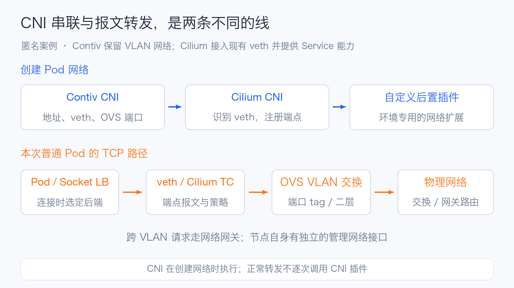
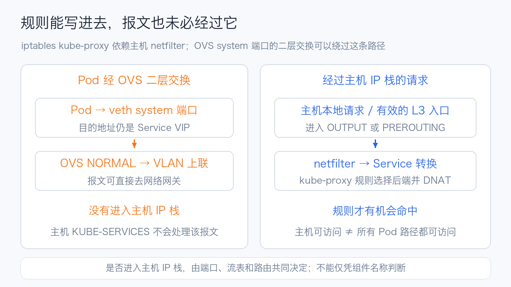
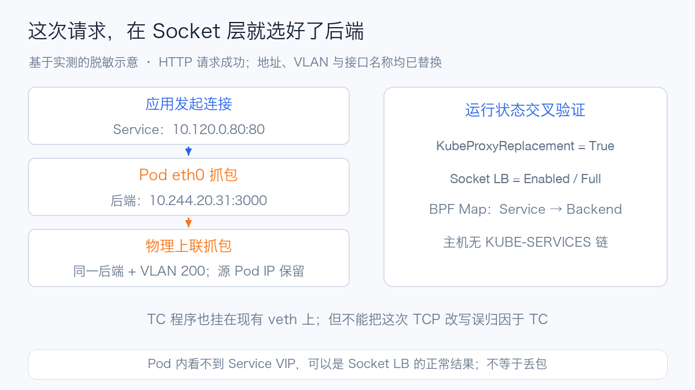

# Contiv、OVS 与 Cilium 串联网络实战：kube-proxy 为什么可能接不到报文

排查 Kubernetes 网络时，很容易把“Pod 能访问”“Service 能访问”和“kube-proxy 正常”当成同一件事。在一套保留 Contiv 与 Open vSwitch 的测试环境里，它们由不同的机制负责：Contiv 创建 Pod 网络，OVS 把 Pod 接入物理 VLAN，Cilium 则串联到已有网络上，提供 Service 转换等能力。

**本次检查确认：集群使用 Cilium 的 kube-proxy 替代，当前没有 kube-proxy Pod，抽查节点也没有 kube-proxy 进程；DNS、API Service 和跨节点应用 Service 均能访问。** 因此，当前状态应描述为“Service 代理由 Cilium 接管”。对于过去为什么不能直接使用 kube-proxy，需要进一步看它所依赖的主机网络路径。

OVS 二层交换可能让 Pod 报文直接经过交换机去往网络网关，绕过主机 IP 栈中的 netfilter 规则。这样一来，即便 kube-proxy 进程正常、iptables 规则已经写入，Pod 访问 Service 仍可能失败。本文结合实际配置和抓包解释这条路径；此次没有取得历史 kube-proxy 失败日志，也没有停用 Cilium 重现故障，不能据此认定某次历史启动失败的根因。

本文使用匿名集群作为案例。集群名、节点名、IP、MAC、VLAN、私有插件名和内部路径均已替换；图中的地址是示例值。检查仅使用现有工作负载和只读命令，没有重启组件、变更路由或修改流表。

## 1. 先把几层网络职责分开

可以把集群网络想成一座园区。Contiv 给每个房间分配地址并接好网线；OVS 是楼里的交换机；VLAN 是相互隔离的网络分区；网络网关负责不同分区之间的通信。Service 则像一个固定的总机号码，拨打总机需要有人把请求转到具体房间。

kube-proxy 通常在节点的主机网络路径里完成这个转换。Cilium 还可以在应用建立 Socket 连接时提前选择房间，也可以在网卡的报文处理位置完成转换。如果报文沿交换机直接走了另一条路，主机上的“转接规则”就接不到它。

| 名称 | 全称或含义 | 在这套环境中的职责 |
| --- | --- | --- |
| CNI | Container Network Interface，容器网络接口规范 | 约定容器运行时如何调用网络插件，创建和删除网络附件 |
| Contiv Netplugin | 容器网络实现 | 创建 veth、分配 Pod 地址、配置网关和 OVS 端口 |
| IPAM | IP Address Management，IP 地址管理 | 管理网络地址的分配与回收；本案例 Pod 地址由前置网络提供 |
| veth | Virtual Ethernet，虚拟以太网设备对 | 一端作为 Pod 的 `eth0`，另一端接入节点上的 OVS |
| OVS | Open vSwitch，开放虚拟交换机 | 按端口、VLAN 与转发表进行交换 |
| VLAN | Virtual Local Area Network，虚拟局域网 | 将不同 Pod 网络隔离，同一物理上联承载多个 VLAN |
| Cilium | 基于 eBPF 的网络实现 | 识别已有 veth，注册端点，执行策略及 Service 代理 |
| eBPF | extended Berkeley Packet Filter | 在内核指定位置运行受验证的程序 |
| TC | Traffic Control，流量控制子系统 | Cilium 在 veth 等接口挂载报文处理程序的位置 |
| kube-proxy | Kubernetes Service 代理组件 | 根据 Service 与 EndpointSlice 维护转发规则，本案例由 Cilium 替代 |

CNI 是接口规范，不是“一台代理服务器”。网络插件主要在网络创建和删除时执行，业务报文不会每次都调用一次 CNI。CNI 的插件串联顺序，也不能直接当成每个报文的转发顺序。[CNI 规范](https://www.cni.dev/docs/spec/)



## 2. 实际部署是什么样的

这套测试环境有 12 个节点，检查时 11 个节点 Ready，Cilium DaemonSet 也是 11/12 Ready。详细数据路径抽查了三个在线节点，并对一个现有普通 Pod 做了 Service 访问和抓包。

| 项目 | 检查结果 | 解读 |
| --- | --- | --- |
| Kubernetes | 1.30.4 | 本文按这个运行环境分析，没有套用新版本代理模式的默认值 |
| 容器运行时 | containerd 1.7.14 | CNI 配置目录为 `/etc/cni/net.d`，`max_conf_num=1` |
| 内核 | 5.10 系列定制构建 | eBPF 能力还需看实际探测与程序挂载，不能只按版本号推断 |
| OVS | 2.14.0 | 节点运行 `ovsdb-server` 与 `ovs-vswitchd` |
| Contiv | 节点上的定制 netplugin 构建 | 没有作为 Kubernetes DaemonSet 部署；不能把包目录名直接当成社区版本 |
| OVS 模式 | `normal` | 主要抽查节点的流表为 `actions=NORMAL` |
| Cilium | 1.16.1，定制镜像 | 运行状态显示 `CNI Chaining: generic-veth` |
| kube-proxy 替代 | `True` | Service 转换由 Cilium 承担 |
| Socket LB | `Enabled`，覆盖范围 `Full` | TCP 请求可以在发出报文之前选择后端 |
| 主机路由 | `Legacy` | 保留原有主机网络路径，不启用 BPF Host Routing |
| IPv4 Masquerade | Disabled | 检查的跨节点请求在物理上联保留源 Pod IP |

其中，DaemonSet 11/12 Ready 是节点与组件可用性信息；它不能代替所有业务网络的连通性验证。本文的 Service 冒烟结果也只覆盖实际检查的路径。

### 2.1 Contiv 没有 Pod，不代表它没在运行

只执行 `kubectl get pods -n kube-system`，能够看到 Cilium，却看不到 Contiv 和 OVS。继续进入已授权的节点检查环境后，能看到宿主机上的 `netplugin`、`ovsdb-server` 和 `ovs-vswitchd` 进程。

这类环境里，网络组件可能通过操作系统包、主机服务或平台脚本管理。排障需要同时检查 Kubernetes 资源、主机进程和实际端口状态；只盯着 DaemonSet 会遗漏真正建立底层网络的组件。

Contiv 的网络状态存储与 Cilium 的状态存储也需要区分。本次看到 netplugin 指向网络系统自己的 etcd 端点，Cilium 则报告 `KVStore: Disabled`，使用 Kubernetes 资源管理相关状态。后者并不表示整个网络系统都不使用 etcd。

社区 Contiv Netplugin 本来就包含多主机、租户网络、物理网络对接等能力；这里讨论的是 OVS 路线，不应与使用 VPP 数据面的 Contiv-VPP 混为一谈。[Contiv Netplugin](https://github.com/contiv/netplugin)

## 3. CNI 如何串联：先接网，再接入 Cilium

节点的实际配置包含三个插件，调用顺序为：

```text
containerd 创建 Pod 网络命名空间
  → Contiv CNI：创建网卡、地址、网关和 OVS 端口
  → Cilium CNI：发现已有 veth，向 agent 注册端点
  → 自定义后置插件：执行环境相关的网络扩展
```

下面只展示结构。`custom-gateway-plugin` 是匿名占位名称，协议版本使用社区文档的示例值；它不是可直接安装的配置，也不是原始文件的完整复制。

```json
{
  "name": "generic-veth",
  "cniVersion": "0.3.1",
  "plugins": [
    { "type": "contivk8s.bin" },
    { "type": "cilium-cni" },
    { "type": "custom-gateway-plugin", "advmss": 1420 }
  ]
}
```

Cilium 的 `generic-veth` 模式接入前置插件创建的 veth。核对 1.16.1 源码可以看到，它解析前一个插件的结果，进入 Pod 网络命名空间查找 veth、地址与 peer index，再确定宿主机侧接口。它没有要求底层一定使用 Cilium 自己分配的 Pod 网络。[Cilium 1.16.1 generic-veth 实现](https://github.com/cilium/cilium/blob/v1.16.1/plugins/cilium-cni/chaining/generic-veth/generic-veth.go)

本案例的运行配置还包括：

```yaml
cni-chaining-mode: generic-veth
custom-cni-conf: "true"
read-cni-conf: /tmp/cni-configuration/cni-config
write-cni-conf-when-ready: /host/etc/cni/net.d/05-cilium.conflist
routing-mode: native
enable-host-legacy-routing: "true"
enable-local-node-route: "false"
auto-direct-node-routes: "false"
enable-ipv4-masquerade: "false"
kube-proxy-replacement: "true"
```

这几项一起表达了一个方向：保留原有网络和路由，再叠加 Cilium 的能力。它们不是适用于所有 CNI 的通用部署模板。

### 3.1 不要看到多份配置，就认为每份都会执行

检查时，节点同时保留串联用的 `05-cilium.conflist` 和旧的 Contiv 单插件配置。containerd 设置了 `max_conf_num=1`。因此，需要核对运行时实际选中的网络配置与网络创建结果，不能把目录中每个文件都当成生效的默认网络。

本次通过以下结果进一步确认普通 Pod 进入了串联链路：Pod 地址、宿主机 veth、OVS 端口与 Cilium Endpoint 可以对应起来，veth 上还挂有 `cil_from_container` 和 `cil_to_container` 程序。

### 3.2 配置中的地址池不一定就是业务 Pod 地址池

Cilium 状态里存在它自己的 router 地址和地址池，而普通 Pod 使用的是前置网络分配的地址。核算地址容量、判断地址冲突时，要分别看 Pod 实际 IP、Contiv 网络配置和 Cilium 内部地址用途。仅依据 `cluster-pool-ipv4-cidr` 推导全体 Pod 的网段，会得到错误的组网图。

### 3.3 自定义后置插件需要单独验证

这里还有一个带 `advmss=1420` 的自定义插件；相关初始化逻辑涉及 IP-in-IP 内核模块。它属于环境扩展，本次确认了配置与部署入口，没有核验全部分支实现，不能直接套用社区 Contiv 或 Cilium 的行为说明。

MSS 是 Maximum Segment Size，即 TCP 最大报文段大小。配置里出现 MSS 参数，不代表它作用于所有连接；本次应用连接抓到的 SYN 仍通告 MSS 1460。也不能因为节点存在 `tunl0`，就认定普通 Pod 流量使用 IP-in-IP 隧道。本文检查的请求通过带 VLAN 的物理上联发送，未观察到这条请求的 IP-in-IP 封装。

## 4. OVS 怎样把 Pod 接到物理网络

抽查节点的 OVS 结构可以归纳为：

```text
Bridge br-pod                 # 原桥名已替换
  Port veth-a, tag=200         # Pod A 的宿主机端
  Port veth-b, tag=200         # 同 VLAN 的另一个 Pod
  Port veth-c, tag=201         # 另一 Pod 网络
  Port bond-uplink            # 物理上联
  Port br-pod, type=internal   # OVS 本机端口

table=0, priority=0, actions=NORMAL
```

这里的物理上联先由 Linux bonding 将两张网卡组成聚合接口，再作为一个接口加入 OVS。它不是“OVS 里直接创建的两端口 bond”；排查链路聚合、哈希和成员口错误时，要检查 Linux bond 的状态。

`NORMAL` 表示进入 OVS 的常规交换流水线，结合 OVSDB 中的端口配置、VLAN 和 MAC 学习决定输出端口。它并不意味着“交给 Linux 主机的普通三层路由”，也不会自动把 Kubernetes Service 转成后端。[OVS NORMAL Pipeline](https://docs.openvswitch.org/en/latest/ref/ovs-actions.7/#the-ovs-normal-pipeline)

### 4.1 同节点、同 VLAN

源 Pod 从 `eth0` 发出报文，经 veth 到 OVS。如果目的 MAC 已经学习在同一 VLAN 的本地端口，OVS 可以直接送到目标 Pod 的端口。未知单播和广播如何处理，受常规交换行为及端口配置影响。

这条路径不必绕到节点的主机三层路由，也不必离开物理上联。

### 4.2 跨节点、同 VLAN

OVS 将源 Pod 的以太帧送到承载该 VLAN 的物理上联，交换网络送到目标节点，目标节点再从相应 Pod 端口送入 Pod。Pod 端口作为 access 端口时，Pod 一般看到不带 VLAN 标签的以太帧；上联则携带对应 VLAN 标签。

本案例的主干是 VLAN 接入物理网络，没有在抽查桥上看到用于普通 Pod 转发的 VXLAN 端口。VXLAN 是 Virtual Extensible LAN，一种常见的网络覆盖封装；Contiv 支持这种路线，不等于当前环境就启用了它。

### 4.3 不同 VLAN 或不同子网

Pod 根据自己的路由表，将非本地网段流量送给默认网关。以脱敏示例表示：

```text
Pod A：10.244.8.23/22
默认网关：10.244.8.1
Pod B：10.244.20.31/22

Pod A → veth → OVS → VLAN 200 上联
      → 网络网关路由 → 目标 VLAN → 目标节点 OVS → Pod B
```

本次抓包中，上联报文的目的 MAC 对应源 Pod 的默认网关，目的 IP 已是另一子网中的后端 Pod。这与“先选择后端，再通过原有网络网关路由”的路径一致。抓包只覆盖节点侧，没有登录物理交换机核对中间每一跳。

### 4.4 管理网络与 Pod 网络不是同一个入口

节点自己的管理 IP 放在 bond 的管理 VLAN 子接口，Pod 则通过 OVS 上的多个 VLAN 端口接入。Kubernetes API 访问、节点默认路由、Pod 默认路由和 Cilium 检测到的设备，不能画成一个接口。

同样，`ip link` 显示 `ovs-system` 或某个 OVS internal 接口为 DOWN，不足以证明整个 OVS 数据面停了。还要看 `ovs-vswitchd`、实际端口、流表、计数器和连通性；交换与本机 IP 协议栈是两件事。

## 5. 为什么 kube-proxy 可能“运行了，却没有转发”

kube-proxy 的 iptables 模式监听 Service 和 EndpointSlice，在主机的 netfilter 中维护规则，把 Service 的虚拟地址转换到真实后端。DNAT 是 Destination Network Address Translation，目的地址转换；规则要发挥作用，报文首先得经过它所在的处理位置。[Kubernetes Service 代理机制](https://kubernetes.io/docs/reference/networking/virtual-ips/#iptables-proxy-mode)

典型的 Pod 请求需要经过主机 IP 栈的相关入口，才有机会命中 `PREROUTING` 中的 Service 规则；主机本地发起的请求则通常从 `OUTPUT` 进入。

OVS 的 system 端口接收报文后，可以直接进行二层交换。OVS 官方 FAQ 明确解释：这类端口的报文会在普通主机包过滤钩子之前被 OVS 接走；OVS internal 端口与主机 IP 栈的交互则不同。[OVS 与 iptables 的关系](https://docs.openvswitch.org/en/latest/faq/issues/)



对本案例这样的 VLAN 网络，如果没有其他机制提前转换 Service，请求可能这样走：

```text
Pod 访问 Service VIP
  → 按默认路由发给网络网关的 MAC
  → 宿主机 veth 被 OVS 接管
  → OVS NORMAL 将报文送到 VLAN 上联
  → 物理网络网关收到目的 IP 为 Service VIP 的报文
```

如果网关没有 Service 的路由和转换能力，请求就失败了。节点里的 kube-proxy 即便已经生成 `KUBE-SERVICES` 与后端 DNAT 规则，也没有机会处理这条报文。这是由当前端口和路由结构推导出的兼容性风险，不是本次重新复现出的故障结果。

### 5.1 要区分三种不同的问题

| 现象 | 应当检查什么 | 本次是否观察到 |
| --- | --- | --- |
| kube-proxy 启动失败、退出或 CrashLoop | 日志、配置、权限、内核模块、API 访问 | 没有：当前未部署该组件，也未取得历史失败日志 |
| kube-proxy 正常生成规则，但 Pod Service 不通 | 报文是否经过主机 IP 栈、规则计数、OVS 端口与流表、回程 | 数据路径存在这种风险；未停用现有代理进行故障复现 |
| 没有 kube-proxy，但 Service 正常 | 是否由 CNI 的 Service 实现接管 | 已确认：Cilium KubeProxyReplacement 为 True，实际请求成功 |

因此，不能写成“Contiv 导致 kube-proxy 进程无法启动”，也不能写成“所有 OVS 网络都不能用 kube-proxy”。OVS internal 端口、路由接入、OpenFlow 转发和不同 Service 实现都可能形成不同路径。

### 5.2 换成 IPVS，不会自动改变路径

IPVS 是 IP Virtual Server，Linux 内核中的四层负载均衡实现。kube-proxy 的 IPVS 模式仍需要报文进入相应主机协议栈与 netfilter 处理路径。它可以改变后端选择和查表方式，但不能让一条直接经 OVS 交换离开的报文自动进入主机 IP 栈。[Kubernetes IPVS 代理机制](https://kubernetes.io/docs/reference/networking/virtual-ips/#ipvs-proxy-mode)

### 5.3 `br_netfilter` 不是 OVS 的通用补丁

Linux Bridge 与 OVS 是不同实现。不能因为 Linux Bridge 场景需要 `bridge-nf-call-iptables`，就认为加载 `br_netfilter` 可以补齐所有 OVS 的 Service 路径。这里应该检查具体的 system/internal 端口及报文走向，不能用一个 sysctl 代替路径分析。

### 5.4 主机能访问，Pod 不能访问，并不矛盾

主机发起请求可以经过 `OUTPUT`，Pod 的报文却可能直接从 OVS 上联离开。排查时至少分别使用主机、普通 Pod 和 `hostNetwork` Pod 作为来源；只在节点执行一次 `curl`，无法验收普通 Pod 的 Service。

## 6. Cilium 如何在这套网络里完成 Service 转换

Cilium 不必先拆掉 Contiv 和 OVS。`generic-veth` 让它识别已创建的 Pod 网卡；Service 状态则同步为 eBPF 负载均衡映射。在适用的 Socket 路径上，应用调用 `connect()` 时就能选好后端；在需要报文级转换的路径上，还可以由 TC 程序处理。[Cilium Socket LB 与 TC 回退机制](https://docs.cilium.io/en/stable/network/kubernetes/kubeproxy-free/#socket-loadbalancer-bypass-in-pod-namespace)

本次抽查的宿主机 veth 存在以下程序，名称中的原端口名已替换：

```text
veth-a ingress：cil_from_container-veth-a  direct-action
veth-a egress ：cil_to_container-veth-a    direct-action
```

这证明 Cilium 已接入该端点的数据路径。但 **TC 程序存在，不代表每次 TCP Service 转换都发生在 TC**。本次具体请求的证据指向更早的 Socket LB。

### 6.1 一个容易误读的配置：写着 false，实际却开启了

原配置中存在 `bpf-lb-sock: "false"`，但运行状态显示：

```text
KubeProxyReplacement: True
Socket LB:           Enabled
Socket LB Coverage:  Full
EnableSocketLB:      true
BPFSocketLBHostnsOnly: false
```

核对社区 Cilium 1.16.1 的 `initKubeProxyReplacementOptions`，当 `kubeProxyReplacement=true` 时，它会自动启用 Socket LB、NodePort、ExternalIPs、HostPort 和 Session Affinity。因此，仅看到 ConfigMap 里的旧值，就推断 Socket LB 已关闭，会画错转发路径。此处运行结果与这段社区启动逻辑一致。[Cilium 1.16.1 kube-proxy 替代初始化](https://github.com/cilium/cilium/blob/v1.16.1/daemon/cmd/kube_proxy_replacement.go)

### 6.2 抓包为什么看不到 Service IP

选择一个已有的普通 Pod，访问另一节点上应用的 Service 健康接口。脱敏后的地址关系如下：

| 对象 | 示例地址 |
| --- | --- |
| 源 Pod | `10.244.8.23` |
| 应用 Service | `10.120.0.80:80` |
| 实际后端 Pod | `10.244.20.31:3000` |
| 源网络 VLAN | `200` |

请求输出显示它连接的是 Service，最终返回 HTTP 200：

```text
Connecting to 10.120.0.80 (10.120.0.80:80)
HTTP/1.1 200 OK
```

与此同时，Cilium 的 BPF LB Map 中可以找到相应前端与后端：

```text
Service frontend：10.120.0.80:80
Service backend ：10.244.20.31:3000
```

在源 Pod 的 `eth0` 抓包，看到的 SYN 已经是：

```text
IP 10.244.8.23.<源端口> > 10.244.20.31.3000: Flags [S]
```

在物理上联抓包，看到的目的 IP 也是后端，报文带有源网络 VLAN，源 Pod IP 保留：

```text
ethertype 802.1Q, vlan 200,
10.244.8.23.<源端口> > 10.244.20.31.3000: Flags [S]
```

以上是实际输出的节选，地址、MAC、VLAN 等已替换。只按原始 Service IP 过滤 Pod 抓包时，未捕获到该请求的报文；改为按后端过滤后，能看到连接报文。结合 Socket LB 运行状态、BPF Map、Pod 内无 TC 程序及无 NAT 转换规则的检查，这与 TCP 连接在 Socket 层选定后端的行为一致。



所以，抓包时应同时准备 Service IP 与后端 IP。尤其是启用 Socket LB 时，“Pod 内没有 VIP 报文”可以是正常现象；直接据此认定 CNI 丢包，会把排查方向带偏。

### 6.3 kube-proxy 替代，不等于替换全部底层网络

Cilium 在这里完成 Service 转换后，后续报文仍使用原来的 Pod 地址、默认网关、OVS VLAN 和物理网络。`routing-mode=native` 与 `Host Routing: Legacy` 描述的是 Cilium 自身的模式，不能据此推断它已经接管外部交换网络的所有路由。

本次保留 `enable-host-legacy-routing=true`。社区历史上也出现过 `generic-veth` 与 BPF Host Routing 配合后绕过原路由的问题，但那是另一版本、另一环境的案例，只能作为迁移前应验证路由兼容性的参考，不能当成本次故障证据。[Cilium 社区问题 #20135](https://github.com/cilium/cilium/issues/20135)

## 7. 实际连通性检查结果

为了区分“直连后端成功”和“Service 成功”，检查了不同来源和协议。没有新建压测任务，也没有用一次成功宣称全网健康。

| 检查 | 来源 | 结果 | 能说明什么 |
| --- | --- | --- | --- |
| DNS Service，UDP 53 | 已有工具 Pod | `NOERROR`，返回正确记录 | UDP DNS Service 请求在该路径成功 |
| DNS Service，TCP 53 | 已有工具 Pod | `NOERROR`，返回正确记录 | TCP DNS 路径也可用 |
| API Service `/version` | 已有工具 Pod | HTTP 200 | 经 Service 的 TCP 请求可到达 API |
| 直接访问 API 后端 `/version` | 已有工具 Pod | HTTP 200 | 将后端直连与 Service 路径分开检查 |
| API Service `/version` | 有 Cilium Endpoint 的普通 Pod | HTTP 200 | 当前串联网络中的普通 Pod 可访问 API Service |
| 应用 Service `/api/health` | 同一普通 Pod，后端在另一节点 | HTTP 200 | 跨节点应用 Service 可访问，与 BPF Map 和抓包对应 |

API 请求使用未携带业务凭据的健康/版本访问；其中 HTTPS 冒烟关闭了证书校验，只用于检查网络可达性，不是 TLS 信任链验收。HTTP 200 也不代表业务权限或所有 API 都已验证。

### 7.1 没有 `KUBE-SERVICES`，不代表 Service 坏了

抽查节点同时检查了 iptables 的 nft 与 legacy 后端，均未看到 kube-proxy 的 `KUBE-SERVICES` 转换链，只有部分 Cilium 和 kubelet 相关规则。Service 仍然成功，原因在于它由 eBPF 实现。

`KUBE-KUBELET-CANARY` 是 kubelet 相关的标识，不能把它当成 kube-proxy Service 规则已经存在的证据。同样，命令提示“存在 legacy 表”只说明机器上有两套接口需要检查，不表示发现了本次 Service 失败。

### 7.2 一条历史 OVS 规则值得注意

一个抽查节点额外保留了类似下面的高优先级规则，其地址已脱敏：

```text
priority=1000,ip,nw_dst=10.120.0.0/24,actions=LOCAL
```

它试图将某个目的网段的报文送给 OVS 本机端口。不过，这只覆盖一个 `/24`，不能代表整个 Service 地址范围；送到 `LOCAL` 后，是否存在正确的主机 IP 栈、地址、路由、转换及回程仍需核对。检查时该规则长期没有活跃命中，不能认为它解释了当前全部 Service 的成功。

这类残留规则会让节点之间的行为变得不同。迁移或排障时，应保存各节点流表并比较差异，明确每条例外规则的负责人、覆盖范围和退出条件。

### 7.3 Service 能访问，不等于策略已经覆盖

另一个发现是：历史工具 Pod 没有出现在对应节点的 Cilium Endpoint 列表中，它的宿主机 veth 也没有相应 TC 程序，但 Service 请求仍然成功。Socket LB 的节点级覆盖可以与端点级策略接入呈现不同结果。

因此，**Service 可达性和 NetworkPolicy 覆盖要分别验收**。新增 CNI 串联配置也不会自动重新为所有存量 Pod 执行网络创建。对存量工作负载，应逐个核对 Endpoint、接口程序和拒绝策略，再按维护计划处理，不能只看一次 `curl`。

## 8. 下一次排障，按这条证据链检查

先确定“网络是谁创建的”和“Service 是谁代理的”，再追踪报文。下面的命令是通用只读示例，Pod、接口、桥名需要替换为实际对象；宿主机命令应在已授权的节点诊断环境运行。

### 第一步：看 Kubernetes 资源与真实运行状态

```bash
kubectl -n kube-system get ds,pods -o wide
kubectl -n kube-system get cm cilium-config -o yaml
kubectl -n kube-system exec <cilium-pod> -c cilium-agent -- \
  cilium-dbg status --verbose
```

还要在节点检查 kube-proxy、netplugin 与 OVS 进程。没有 DaemonSet 不能排除宿主机部署；ConfigMap 的值不能代替运行状态。

### 第二步：把 Pod、veth、OVS 与 Cilium Endpoint 对应起来

```bash
cat /etc/cni/net.d/05-cilium.conflist
ip -d link show
ovs-vsctl --timeout=5 show
ovs-vsctl --timeout=5 get Port <pod-veth> tag
ovs-ofctl dump-flows <pod-bridge>
tc filter show dev <pod-veth> ingress
tc filter show dev <pod-veth> egress
```

确认 Pod 的地址和默认网关，再根据接口 index、OVS 的端口信息和 Cilium Endpoint 关联对象。此时可以判断报文会去主机协议栈、另一个本地端口，还是 VLAN 上联。

### 第三步：同时核对 Service 的控制面与数据面

```bash
kubectl -n <namespace> get svc <service> -o yaml
kubectl -n <namespace> get endpointslice \
  -l kubernetes.io/service-name=<service> -o wide
kubectl -n kube-system exec <cilium-pod> -c cilium-agent -- \
  cilium-dbg service list
kubectl -n kube-system exec <cilium-pod> -c cilium-agent -- \
  cilium-dbg bpf lb list
iptables-save -t nat
iptables-legacy-save -t nat
```

Service 没有 Ready 后端时，应先解决后端问题。API 对象已经更新、BPF Map 却没更新时，再查 agent 同步、容量或 API watch。使用 kube-proxy 的环境，还需要看对应规则计数与同步日志。

### 第四步：抓包要覆盖转换前后

```bash
# 在源 Pod 的网络命名空间：同时考虑 Service 和后端地址
tcpdump -p -nn -i eth0 -s 96 -c 20 \
  'tcp and (host 10.120.0.80 or host 10.244.20.31)'

# 在宿主机物理上联：观察 VLAN、后端地址和源地址
tcpdump -p -nn -e -i <uplink> -s 96 -c 20 \
  'tcp and host 10.244.20.31'
```

抓包需要设定时限和包数。接口位置会影响看到的地址：Socket、TC、主机协议栈和 OVS 的处理可能发生在抓包位置之前。某一个位置没有报文，应该与请求日志、相邻位置和运行状态交叉判断。

### 第五步：把监控和主动验证配合起来

| 维度 | 建议持续关注 | 能定位的问题 |
| --- | --- | --- |
| 节点网络 | 物理口、bond 成员口和 Pod veth 的流量、错误、丢包 | 链路异常、接口错误、局部拥塞 |
| OVS | 端口 `ofport`、错误、丢弃、流表计数及上联状态 | 端口未创建、例外流表、不一致转发 |
| Cilium | agent Ready、Endpoint 状态、丢包原因、Service/Backend 映射容量 | 端点缺失、策略拒绝、状态同步或容量问题 |
| 服务发现 | Service、EndpointSlice 与 Ready 后端一致性 | 选择器错误、就绪变化、同步滞后 |
| 主动探测 | Pod → DNS、Pod → Service、Pod → 后端、跨节点与跨 VLAN | 基础指标正常但用户路径失败 |

网卡带宽曲线可以证明流量存在，不能证明 Service 转换正确；agent Ready 也不能证明存量 Pod 的策略已接入。需要把这些指标与端点、规则和真实请求放在同一条时间线上。

## 9. 部署与迁移建议

如果需要继续保留 VLAN 和 Contiv，首先应把 CNI 调用顺序、接口归属、Service 代理、地址池和默认网关做成明确的配置清单。Cilium 串联是否满足业务要求，要按实际版本验证；不能从原生 Cilium 部署直接复制参数，假定所有高级能力都适用。[Cilium generic-veth 部署与限制](https://docs.cilium.io/en/stable/installation/cni-chaining-generic-veth/)

| 方案 | 适用考虑 | 应重点验证 |
| --- | --- | --- |
| 保留 Contiv/OVS，串联 Cilium 并由其代理 Service | 需要保留现有 Pod IP、VLAN 和物理网络接入 | Socket/TC 路径、存量 Endpoint、回程、策略与自定义插件 |
| 保留 OVS，设计可进入主机 IP 栈的 Service 路径 | 必须使用 kube-proxy，且能维护配套网络集成 | internal 端口、完整 Service 范围、路由、VLAN、转换和反向路径 |
| 采用具备 Service 实现的 OVS 网络方案 | 希望 Service 转换留在交换数据面 | 该方案的具体控制器、OpenFlow/连接跟踪实现和 API 语义 |
| 迁移到另一套统一管理的 CNI | 有计划替换旧网络并承担迁移成本 | Pod 重建、地址变化、物理网连通、安全策略与回滚路径 |

本案例当前由 Cilium 完整接管 Service，不适合直接再启动一套默认 kube-proxy 来“看看能不能好”。同一个 Service 由多个机制同时处理，会增加地址转换、连接跟踪和回程分析的复杂度。受支持的部分替代或迁移模式应遵循具体版本的文档，不能把“不能随意叠加”扩大成“永远不能共存”。

验收矩阵建议覆盖同节点、跨节点、同 VLAN、跨 VLAN、ClusterIP、NodePort、UDP、TCP、`hostNetwork` 和虚拟机或沙箱运行时。涉及 Sidecar、Kata、KubeVirt 等场景时，还要确认 Socket LB 是否适用、是否需要 TC 回退；本文只检查了普通 Pod 的实际 Service 路径，没有用它替代其他运行时的验收。

升级前保留 CNI 文件、运行时配置、OVSDB 端口清单、流表、路由与 agent 运行状态，升级后逐项对照。对旧配置、未接入的存量 Pod 和单节点例外规则，明确处理计划。这样才能避免“新 Pod 正常，旧 Pod 仍走旧路径”的混合状态。

这次排查最有价值的判断方法，是先确认报文在哪里完成 Service 转换，再确认它沿什么网络送到后端。组件进程、配置文件、规则列表和抓包各自只能说明一部分；把它们对应起来，才能解释为什么同样是 OVS 网络，一条请求经过 kube-proxy，另一条请求却根本不会走到它。

## 参考资料

- [CNI 规范：配置、调用协议与插件串联](https://www.cni.dev/docs/spec/)
- [Contiv Netplugin 项目](https://github.com/contiv/netplugin)
- [Open vSwitch：常见配置问题与 iptables 边界](https://docs.openvswitch.org/en/latest/faq/issues/)
- [Open vSwitch：NORMAL 流水线](https://docs.openvswitch.org/en/latest/ref/ovs-actions.7/#the-ovs-normal-pipeline)
- [Kubernetes：虚拟 IP 与 Service 代理](https://kubernetes.io/docs/reference/networking/virtual-ips/)
- [Cilium 1.16.1：generic-veth 实现](https://github.com/cilium/cilium/blob/v1.16.1/plugins/cilium-cni/chaining/generic-veth/generic-veth.go)
- [Cilium 1.16.1：kube-proxy 替代初始化](https://github.com/cilium/cilium/blob/v1.16.1/daemon/cmd/kube_proxy_replacement.go)
- [Cilium：Socket LB 与 TC 回退](https://docs.cilium.io/en/stable/network/kubernetes/kubeproxy-free/)
- [Cilium：generic-veth 部署与限制](https://docs.cilium.io/en/stable/installation/cni-chaining-generic-veth/)
- [Cilium 社区问题 #20135：generic-veth 与 BPF Host Routing](https://github.com/cilium/cilium/issues/20135)
