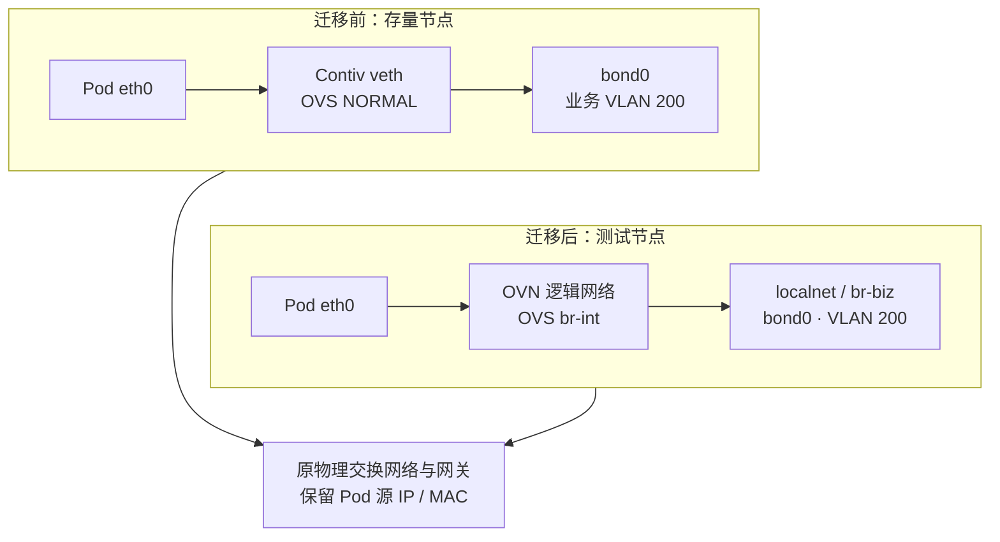
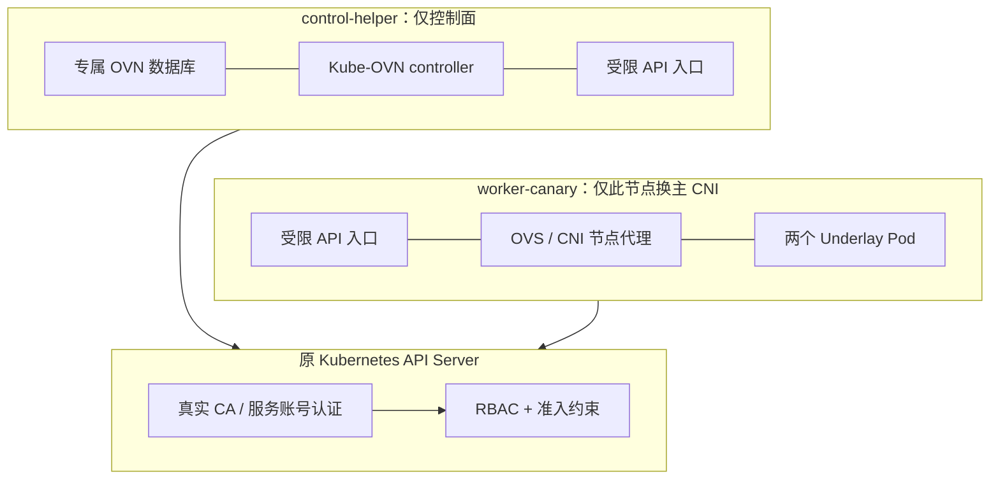
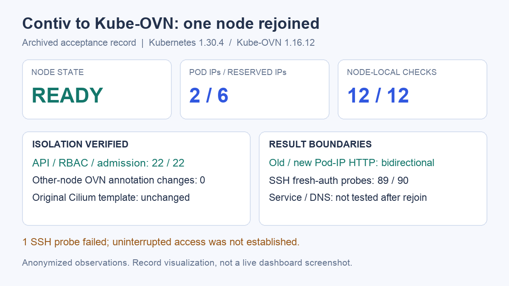

# 从 Contiv 到 Kube-OVN：保留物理 VLAN 的单节点迁移实战

更换容器网络，最难的往往不是让新 Pod 启动，而是让它继续遵守现有机房的规则：使用原有业务网段，经原有 VLAN 出口，由原物理网关路由，同时不打断宿主机的管理网络。

这次实验从一个使用定制 Contiv 的 Kubernetes 测试集群中选出一台节点，先退出原集群验证 Kube-OVN Underlay，再接回原集群。**接回后，节点恢复 Ready，两个普通 Pod 使用物理网络地址，与原 Contiv Pod 双向 HTTP 通信通过；其他节点保留原网络。** 目标节点没有运行 Contiv netplugin、Cilium 或 kube-proxy。

本文整理已归档的实验记录，没有为写文章再次切换网络。集群名、节点名、内部域名、IP、MAC、VLAN 和内部路径均已替换；示例地址不代表原环境。测试数量、报文长度和成功／失败记录保持原值。下文的 `worker-canary` 是测试节点，`control-helper` 是放置新网络控制组件的辅助节点。

## 1. 原网络有什么必须保留

原环境的 Contiv 是内部维护的定制实现，不能用社区项目的维护状态代替对这套部署的判断。实际职责是：Netmaster 管理共享地址池，宿主机上的 netplugin 创建 Pod 网络接口，Open vSwitch（OVS，开放虚拟交换机）将业务接入物理 VLAN；原节点上的 Cilium 以串联方式补充 Service 等能力。原链路详见[Contiv、OVS 与 Cilium 串联网络实战](contiv-ovs-cilium-network.md)。

| 项目 | 实验基线与要求 |
| --- | --- |
| Kubernetes / containerd | 1.30.4 / 1.7.14 |
| 新 CNI | Kube-OVN 1.16.12；镜像在内部镜像仓库完成分发，使用固定 digest |
| 物理上联 | 保留 Linux `bond0`、两个物理成员口及 802.3ad 链路聚合 |
| 业务网络 | 示例 VLAN 200，Pod 子网 `10.244.8.0/22`，物理网关 `10.244.8.1` |
| 管理网络 | 示例 VLAN 210，`bond0.210` 保留管理 IP 与原 SSH 回程 |
| 改造范围 | 只更换 `worker-canary` 的主 CNI；其他节点继续使用原链路 |
| 业务要求 | Pod IP 可直接访问，新旧网络双向通信；接回阶段不要求 Service 可用 |

CNI 是 Container Network Interface，即容器网络接口规范；IPAM 是 IP Address Management，即 IP 地址管理；VLAN 是 Virtual Local Area Network，即虚拟局域网。Underlay 在本文中指 Pod 直接使用物理网络的地址和 VLAN 转发，而不是另建一套业务隧道地址。Kube-OVN 用 Open Virtual Network（OVN）维护逻辑网络，再由 OVS 执行数据转发。

迁移希望保留的是物理网络契约，并不要求新旧软件生成完全相同的网桥、流表或 Pod MAC。原 Contiv 的 `NORMAL` 交换路径与 OVN 编译的流表结构不同；使用相同 VLAN，并不意味着控制面和故障恢复方式也相同。



图中展示的是两类节点通向同一物理网络的路径。管理接口 `bond0.210` 保持原配置，但仍与业务共享底层 Bond，故障域没有因此完全隔离。

## 2. 分两次验证，避免混淆实验结果

一开始就在原集群安装新 CNI，会同时引入控制器范围、旧 sandbox 清理、物理接线和地址池冲突等问题。这次先将已清空工作负载的节点作为独立实验集群，验证网络本身；随后才把它接回原集群。

| 阶段 | 实际部署与结果 | 不能据此推出的结论 |
| --- | --- | --- |
| 独立节点验证 | 普通 Pod 从最初的混合网络改为纯 Underlay；6 个普通 Pod、10 项功能检查通过；包含 Service 与 DNS 测试 | 不代表接回原集群后仍有同一套 Service 路径 |
| 接回原集群 | 2 个普通 Underlay Pod；12 项节点内验收通过，另行验证原 Pod 反向 HTTP 与办公端直连 | 没有验证 Service、ClusterIP DNS、NodePort，也没有完成全量 CNI 迁移 |

独立阶段曾使用 Underlay–Overlay Interconnection（U2O，Underlay 与 Overlay 互通）。它会额外占用一个 Underlay 地址，并可能改变 Pod 的路由选择。这不符合保留物理网关的最终目标，因此后续删除默认业务 Overlay 子网、关闭 U2O，将业务 Underlay 设为默认网络，确认普通 Pod 的默认网关回到物理网关。

节点内部的 `join` 网络仍保留，用于节点与 OVN 的内部连接；它不是分配给普通业务 Pod 的 Overlay 地址池。判断是否为纯 Underlay，要看普通 Pod 的地址、路由、逻辑交换机 localnet 端口及真实报文，不能只凭某个 daemon 参数里出现 `geneve` 就下结论。

独立阶段的“纯 Underlay 调整及验收”记录为 **43.8 秒**。这个时间不含之前的节点清理、镜像准备和 Bond 接线，也不能作为完整迁移耗时。

交接时保留了原 kubelet 身份、运行时和 CNI 配置，以及 OVSDB、接口、路由与地址分配记录。旧 Pod 应在旧 CNI 服务仍可用时先完成退出，让 CNI DEL 正常回收网络；清理残留 sandbox 的实际问题见后文。随后停止目标节点的旧网络代理，确认没有另一套 OVS 管理进程同时接管同一物理接口，再交给 Kube-OVN。不能只替换一个 CNI 配置文件，就让两套代理同时维护同一上联，也不能用删除整个 OVS 数据库代替有对象范围的交接。

## 3. 先解决 IPAM 所有权，再启动新 Pod

最容易出错的做法，是从旧网段里找几个 ping 不通的地址，直接交给新 CNI。没有应答，只能说明当时没有观察到应答，无法阻止 Netmaster 下一秒把这个地址分给别的节点。

本次先通过原 Netmaster 的正式分配接口创建占位端点，使六个地址进入原共享池的已占用状态，再允许 Kube-OVN 从这六个地址中分配。占位端点只有控制面记录，不在物理网络上创建一份同 IP 网卡。随后逐个核对占位所有者和原池的分配位图。

下面用脱敏后的地址表示这六个位置：

```text
10.244.8.18  10.244.8.29  10.244.8.33
10.244.8.38  10.244.8.43  10.244.8.57
```

Kube-OVN 的 `Subnet` 仍使用原 `/22` 掩码和物理网关，只通过 `excludeIps` 排除其余地址。不能为了只用几个 IP，就把 Pod 掩码随意缩成一个更小子网；那会改变 Pod 判断哪些目的地址需要经过网关的行为。

| 阶段 | 原分配器正式占用 | Kube-OVN 已使用 | Kube-OVN 可用 |
| --- | --- | --- | --- |
| 独立纯 Underlay | 6 | 6，包括 CoreDNS 与探测 Pod | 0 |
| 接回原集群 | 6，继续保留 | 2，业务 client / server | 4 |

这里的可用数是人为限制后的实验池容量，不是整个物理 `/22` 的剩余容量。滚动升级的额外副本同样需要地址，六个名额全部用完时，不能直接增加普通 Pod。

占位方案适合有界实验，生产环境更适合由网络平台明确委派互不重叠的地址范围，并确定回收流程。单纯在 Kube-OVN 中配置 IPPool，并不会自动让 Netmaster 排除同一批地址。若继续逐 Pod 对接旧 IPAM，还要实现幂等分配、并发冲突处理、失败补偿、删除回收与控制器重启后的状态对账。

## 4. 接线选择：为什么最终直接使用 bond0

同一个业务 VLAN，可以在不同层添加标签。区别在于谁负责这一层，以及管理接口是否需要搬迁。

| 接法 | ProviderNetwork 上联 | Kube-OVN `Vlan.id` | 标签由谁添加 |
| --- | --- | --- | --- |
| Linux VLAN 子接口接入 | `bond0.200` | `0` | Linux 子接口处理 VLAN 200；OVN localnet 不再额外加标签 |
| 原始 Bond 接入，本次最终采用 | `bond0` | `200` | OVN / OVS 处理业务 VLAN 200 |

两种方式都可能接入同一个物理 VLAN，但不能把“已在 Linux 子接口处理标签”和“OVN 再处理同一业务标签”直接叠加。错配可能导致重复标签或错误分类，不能认为填了同一个 VLAN 数字就一定互通。

原接线已经是业务通过 OVS 使用 `bond0`，管理地址保留在 Linux 管理 VLAN 子接口。为了尽量保持这个结构，最终采用第二种方式，不额外创建 `bond0.200`，也没有为本次实验修改交换机配置。[Kube-OVN Underlay 接口与 VLAN 定义](https://kubeovn.github.io/docs/v1.16.x/en/start/underlay/#create-vlan)

### 4.1 三个资源分别管什么

`ProviderNetwork` 指定节点的物理接口，`Vlan` 将业务标签绑定到这个接口提供者，`Subnet` 定义 Pod 地址、网关和分配范围。下面是已应用配置的脱敏结构；**它没有包含实验的权限隔离和安装配置，不能单独作为存量集群的安装包使用。**

```yaml
apiVersion: kubeovn.io/v1
kind: ProviderNetwork
metadata:
  name: biz
spec:
  defaultInterface: bond0
  nodeSelector:
    matchLabels:
      kubernetes.io/hostname: worker-canary
      example.net/cni-canary: "true"
  exchangeLinkName: false
  autoCreateVlanSubinterfaces: false
  preserveVlanInterfaces: false
  vlanInterfaces: []
---
apiVersion: kubeovn.io/v1
kind: Vlan
metadata:
  name: business-vlan
spec:
  id: 200
  provider: biz
---
apiVersion: kubeovn.io/v1
kind: Subnet
metadata:
  name: business-underlay
spec:
  protocol: IPv4
  cidrBlock: 10.244.8.0/22
  gateway: 10.244.8.1
  vlan: business-vlan
  namespaces: [cni-canary]
  default: true
  logicalGateway: false
  u2oInterconnection: false
  natOutgoing: false
  enableLb: false
  disableGatewayCheck: false
  mtu: 1500
  excludeIps:
    - 10.244.8.1..10.244.8.17
    - 10.244.8.19..10.244.8.28
    - 10.244.8.30..10.244.8.32
    - 10.244.8.34..10.244.8.37
    - 10.244.8.39..10.244.8.42
    - 10.244.8.44..10.244.8.56
    - 10.244.8.58..10.244.11.254
```

`logicalGateway: false` 保留物理网关；`u2oInterconnection: false` 关闭两类业务网络互通；`natOutgoing: false` 与保留源 Pod IP 的目标一致。接回阶段不验收 Service，因此 `enableLb` 为 `false`。`default: true` 也不是“仅对某一节点生效”的开关，本实验依靠后文的控制器隔离约束其作用范围。

### 4.2 preserveVlanInterfaces 不是“不动原接口”

这个名字容易产生误解。核对固定版本源码可以看到，相关流程会建立 OVS internal 端口，并转移原 VLAN 接口上的地址和路由。它可以保留网络功能，但不等于原 Linux 接口的身份、地址归属和接线完全不变。[1.16.12 的 VLAN 接口配置实现](https://github.com/kubeovn/kube-ovn/blob/v1.16.12/pkg/daemon/ovs_linux.go)

本次为了保留管理 VLAN 子接口，未启用这一流程；切换前后核对了管理接口的 ifindex、MAC、地址、MTU、回程和 Bond 成员。这是本次节点上验证通过的配置，不能推成所有 Linux 发行版、网络管理服务和网卡组合的通用保证。

管理与业务共用底层上联，OVS 异常仍可能影响远程管理。生产设计若能提供独立管理物理接口和带外控制台，会比只依靠同一 Bond 上的 VLAN 分离更容易恢复。

### 4.3 从 OVS 结构一直看到线上报文

接线摘要如下，桥名、端口名和 VLAN 已替换：

```text
Bridge br-biz
  Port bond0                     trunks: [0, 200]
  Port patch-localnet-to-br-int   type: patch

Bridge br-int
  Pod veth ports
  patch port to br-biz

Management: bond0.210             existing IP / route retained
Absent:     bond0.200             no new business VLAN subinterface
```

`br-int` 处理 OVN 的逻辑网络流表；localnet 将逻辑交换机接到物理提供者网络；patch 端口连接两个 OVS Bridge。业务报文随后通过 `bond0` 的 VLAN 200 出口。跨网段时，Pod 按默认路由把报文交给原物理网关。

独立纯 Underlay 阶段抓到了下面这组 ICMP 头部；这里只保留验证所需字段，地址与 MAC 已替换：

```text
02:00:00:00:20:29 > 02:00:00:00:20:01, ethertype 802.1Q,
length 1518: vlan 200, ethertype IPv4,
10.244.8.29 > 10.244.8.1: ICMP echo request, length 1480

02:00:00:00:20:01 > 02:00:00:00:20:29, ethertype 802.1Q,
length 1518: vlan 200, ethertype IPv4,
10.244.8.1 > 10.244.8.29: ICMP echo reply, length 1480
```

配合 1472 字节 ICMP payload、DF（Don't Fragment，不允许分片）标记、3 发 3 收的结果，可以确认这条已测路径承载了 1500 字节 IP 报文。1518 是带单层 802.1Q 标签、未计 FCS（Frame Check Sequence，帧校验序列）的以太帧长度。这不是所有路径、所有报文尺寸或长期吞吐的证明。

## 5. 接回原集群：只限制 DaemonSet 还不够

Kube-OVN 的节点代理可以通过 DaemonSet 选择器限制在一台节点，但 controller 仍可能监听和处理全局 Node、Namespace 与 Pod。只限定谁安装 CNI，不等于限定谁被控制器处理。固定版本的默认子网选择逻辑还会读取 Pod 与 Namespace 的网络注解。[1.16.12 的 Pod 网络处理实现](https://github.com/kubeovn/kube-ovn/blob/v1.16.12/pkg/controller/pod.go)

因此，不能在存量集群执行默认全量安装脚本，再用“只选中了一台节点”解释隔离性。本次接回原集群前，额外构建并验证了有界的实验控制面。



图中受限 API 入口是本实验自建的代理，不是 Kube-OVN 官方提供的“单节点主 CNI 模式”。图中的连线表示组件关联与 API 访问边界，不是业务报文逐跳路径。

| 层次 | 实际约束 | 验证方式 |
| --- | --- | --- |
| 节点代理 | OVS / CNI DaemonSet 只落测试节点；辅助节点不安装节点代理，不挂载主机 CNI 目录 | 检查工作负载落点、挂载和运行进程 |
| API 可见范围 | Node 列表与 Watch 只看到测试节点；Namespace 只看到实验命名空间；Pod 只看到允许范围 | 对真实 API 执行允许／拒绝请求；12 项通过 |
| RBAC | 基于角色的访问控制，限制对其他 Node、Namespace、Pod 的修改 | 5 项授权检查通过，包含预期拒绝 |
| 准入 | ValidatingAdmissionPolicy 限制实验 Pod 落点，阻止 Cilium 通过直接绑定或 DaemonSet 节点亲和性进入测试节点 | 5 项准入检查通过，包含预期拒绝 |
| 调度 | 测试节点保留专用标签和 NoSchedule 污点 | 普通业务不进入；实验 Pod 显式选择并容忍污点 |
| 前后差异 | 其他 Node / Pod 的 OVN 注解没有发现变化；原 Cilium 模板哈希与选择器保持一致 | 接回前后快照对比，9 项后置检查通过 |

受限代理使用真实 API Server 的 CA 和投射的 ServiceAccount 令牌，没有用伪造的 API 数据让组件“看起来成功”。但它依赖对具体版本客户端行为的适配，仍然是一套定制实验机制。准入规则也只覆盖本次定义的资源与放置方式，并不是对任意特权主体或任意网络插件的通用防护。

污点同样不能单独承担隔离：DaemonSet 可能自带容忍，直接指定 `nodeName` 也会绕过正常调度选择。正因为如此，本次还检查了实际落点，并用准入用例验证两条已知的 Cilium 放置路径被拒绝。

辅助节点使用独立 OVN 数据目录运行数据库和 controller，不接管它的网卡或 OVS。控制面能在别处运行，与数据面能否只安装在一台节点，是两个需要分别检查的问题。

## 6. NotReady 的真实排查：权限、缓存与保护流程

接回过程曾出现持续 NotReady。它不是一个原因对应一个修复，而是旧运行时状态、受限 API 规则与保护流程共同作用的结果。

| 观察到的现象 | 实际原因 | 处理与复核 |
| --- | --- | --- |
| 旧 sandbox 清理失败 | 旧实验 CNI 的本地 socket 已停止，运行时仍保留依赖它的网络沙箱记录 | 区分已停止的残留记录与活动容器；确认旧控制面和业务容器已停止，不为清理记录误启旧网络 |
| controller 的权限自检被拒绝 | 受限入口没有允许 SelfSubjectAccessReview，即查询调用者自身权限的 API | 允许真实自身权限查询；继续验证修改其他节点仍被拒绝 |
| 节点短暂 Ready，随后再次 NotReady | CNI 的 informer 缓存需要读取 TLS Secret；入口拒绝后缓存未就绪，阶段到期触发看护，kubelet 被停止 | 仅允许实验命名空间中 `kube-ovn-tls` 的只读 Get / List / Watch，强制名称筛选，再重新验收 |

这里的 TLS 是 Transport Layer Security，即传输层安全协议。修复缓存启动，不需要开放全局 Secret 读取，更不需要授予任意 Secret 写入。按资源、名称、动词收紧规则后，再验证组件能启动以及越界请求仍被拒绝。

最后一次恢复中，从启动恢复到 CNI 就绪约 **9 秒**，两个普通 Pod 就绪约 **13 秒**，12 项节点内验收完成约 **15 秒**。这些只是最后一次恢复窗口，不包含前面排障时间。

Node Ready 只证明节点健康条件达标，不能代替 Pod 数据面测试；Node NotReady 也不一定说明 SSH 断了。本次其中一次 NotReady，是保护流程主动停止 kubelet 后心跳中断的结果。

仍有一个已知遗留项：controller 周期性尝试读取 CertificateSigningRequest（CSR，证书签名请求）缓存，被隔离入口拒绝。本实验关闭了 OVN IPsec，没有开放全局证书读取或审批；该日志未阻断本次已测数据通信，但它说明这套定制入口还不能直接当作生产支持方案。

## 7. SSH 看护：恢复入口优先于继续实验

业务与管理共享 Bond，切换不应只靠一条持续打开的 SSH 会话。已有连接暂时存活，也不能证明新连接仍能建立。

本次采用三层保护：

1. **节点独立看护**：通过系统服务运行，检查管理 IP、回程接口与网关、Bond 模式和成员口、接口身份、MTU 以及 SSH 监听状态，不依赖 Kubernetes 正常工作。
2. **外部新认证探测**：办公端周期性重新建立 SSH 认证链，成功后写入带当前运行标识的心跳；节点不把旧会话存活当作健康依据。心跳超过 45 秒未更新时终止阶段。
3. **独立阶段截止**：预先设置回退期限；即便安装进程卡住或当前会话退出，也不能无限等待。验收结果落盘且外部探测仍新鲜，才解除阶段回退。

回退脚本先标记实验中止、停止 kubelet 和可能重新接桥的 CNI 代理，摘除实验业务桥上的 Bond 上联，再恢复管理地址与路由。它不会自动恢复测试，也不承诺自动重建原 Contiv 的全部服务。

完整回到旧网络，还需要按备份恢复原运行时身份、唯一 CNI 配置、主机网络服务和旧插件，并新建 Pod 验证；在 Kube-OVN 使用者完全退出之前，不能释放原 IPAM 中的占位地址。

接回阶段外部 SSH 观察窗口共有 **90 次样本：89 次成功、1 次失败**。失败记录在约 0.232 秒内从认证链提前退出，后续恢复；现有证据无法区分跳板认证失败与目标节点连接失败，因此不能写成“全程 SSH 零中断”。

## 8. 最后验收了什么

下面的图从脱敏后的归档 JSON 生成，展示节点内验收与隔离检查。它是实验记录的可视化，不是实时监控或 Grafana 截图；原始内网文件没有进入公开附件。



可下载[脱敏验收数据](../../assets/practices/contiv-to-kubeovn-underlay/acceptance-evidence.json)，其中保留两个阶段的计数、测试项和 SSH 失败记录。

| 接回后的真实通信路径 | 记录结果 | 能说明什么 |
| --- | --- | --- |
| 新 Kube-OVN Pod → 新 Pod | HTTP 返回预期 Nginx 正文 | 单节点普通 Pod 网络可用 |
| 新 Pod → 原 Contiv Pod | 两个原网络 HTTP 端点均返回预期内容 | 新旧节点经原物理业务网络互通 |
| 原 Contiv Pod → 新 Pod | HTTP 200，612 字节 Nginx 正文 | 反向直连通过，不只验证单向出口 |
| 办公端 → 新 Pod | 直接 HTTP 访问成功 | 物理 Pod IP 可从办公网络到达 |
| 新 Pod → 物理网关 | 2 次 ICMP，零丢包 | 该样本的物理网关路径可用 |
| 新 Pod → 控制面管理地址 | 2 次 ICMP，零丢包 | 跨网段物理路由路径可用 |
| 宿主机 → 新 Pod | HTTP 正文正常 | 本机到 Underlay Pod 的路径可用 |

接回后的两个 Pod 默认网关都是物理网关，MTU 为 1500；实际 MAC 由 Kube-OVN 生成，与原 Contiv 占位记录不同。双向 HTTP 与网关通信证明本次物理网络接受这些新 MAC，但没有登录交换机核对端口安全策略。其他环境若存在 MAC 数量限制、静态 IP–MAC 绑定或 DHCP snooping / ARP 检查，必须先核对对应规则。

独立阶段的 Service / DNS 通过结果保留在独立阶段。本次接回原集群没有安装 kube-proxy，也没有启用 Cilium 或 Kube-OVN 的 Subnet 负载均衡，不能把前一阶段结果挪到这里。Kube-OVN Underlay 本身具备 Service 能力，不代表任意混合 CNI 的集群都能自动获得正确的发现、转发和返回路径。

## 9. 复用这套排查方法时，按层取证

以下命令只读取状态。Pod 名、命名空间和地址均为示例；进入节点的方式使用自己的授权通道。

```bash
kubectl get node worker-canary -o wide
kubectl -n cni-canary get pods -o wide
kubectl get provider-network biz -o yaml
kubectl get vlan business-vlan -o yaml
kubectl get subnet business-underlay -o yaml

# On the canary host
ip -j -d link show bond0
ip -j addr show bond0.210
ip route get 192.0.2.10
ovs-vsctl show
ovs-vsctl port-to-br bond0
ovs-vsctl list-ports br-int

# Inside an ordinary Pod
kubectl -n cni-canary exec underlay-client -- ip addr show eth0
kubectl -n cni-canary exec underlay-client -- ip route
kubectl -n cni-canary exec underlay-client -- curl -fsS http://10.244.8.33
```

排查顺序可以固定为：运行时选中了哪个 CNI 配置 → controller 是否分配地址和注解 → 本地 CNI 缓存及 socket 是否就绪 → veth 是否接入 OVS → localnet / ProviderNetwork 是否正确 → VLAN、ARP 与回程是否匹配 → 新旧 Pod 双向请求 → Service 与 DNS 单独验收。

OVN 的流表不能只找 `NORMAL` 这一条规则。需要进一步定位逻辑交换机、端口、流表计数与 trace；某个 OVS internal 接口显示 DOWN，也不足以单独证明整个数据面停了。

## 10. 距离生产替换，还差哪些验证

这次完成的是**保留物理 VLAN 契约的一台节点主 CNI 替换**。它支持继续评估 Kube-OVN Underlay，但没有给出整集群直接替换的结论。

| 后续要解决的问题 | 生产推进条件 |
| --- | --- |
| 共享地址池 | 明确委派、排除和回收的唯一责任方，覆盖并发分配与故障补偿；不长期依靠临时占位 |
| Service 与发现 | 验证 ClusterIP、DNS、NodePort、外部流量策略、回程与网络策略；明确由谁实现 Service |
| 控制面支持方式 | 将版本相关的实验代理替换为可维护的迁移架构，或优先新建独立 Kube-OVN 集群迁移工作负载 |
| 高可用与恢复 | OVN 数据库及 controller 高可用、持久数据备份、控制面故障与升级验证 |
| 节点生命周期 | Pod 删除重建、地址回收、节点重启、运行时重启、Bond 故障与完整回退演练 |
| 容量与性能 | 多节点吞吐与延迟、Pod 创建速率、控制器队列、OVS CPU 和流表规模、ARP 压力与 IP 余量 |
| 物理网络契约 | VLAN trunk、聚合、MTU、多 MAC 接入、网关和返回路由；配置变更由网络团队确认 |

本轮没有做持续吞吐、长连接、跨节点 Kube-OVN 迁移或生产规模压测，也没有证明它比原 Contiv 更快。数据面能对接原物理网络，解决的是迁移可行性中的一部分；生产落地还取决于地址管理、Service、控制面运维和故障恢复能否形成闭环。

对计划新建的集群，预先委派独立地址范围、明确业务 VLAN 与物理网关、完整部署 Kube-OVN，通常比在存量集群长期维护两套主 CNI 更容易管理。对必须保留的旧环境，则应先把单节点边界、双向通信和回退验证做扎实，再决定如何扩大范围。

## 参考资料

- [Kube-OVN 1.16 Underlay 安装与物理网络要求](https://kubeovn.github.io/docs/v1.16.x/en/start/underlay/#environment-requirements)
- [Kube-OVN 1.16.12 ProviderNetwork 字段定义](https://github.com/kubeovn/kube-ovn/blob/v1.16.12/pkg/apis/kubeovn/v1/provider-network.go)
- [Kube-OVN 1.16.12 节点 VLAN 与 OVS 接线实现](https://github.com/kubeovn/kube-ovn/blob/v1.16.12/pkg/daemon/ovs_linux.go)
- [Kube-OVN 1.16.12 Pod 网络选择与处理](https://github.com/kubeovn/kube-ovn/blob/v1.16.12/pkg/controller/pod.go)
- [本案例的脱敏验收数据](../../assets/practices/contiv-to-kubeovn-underlay/acceptance-evidence.json)
