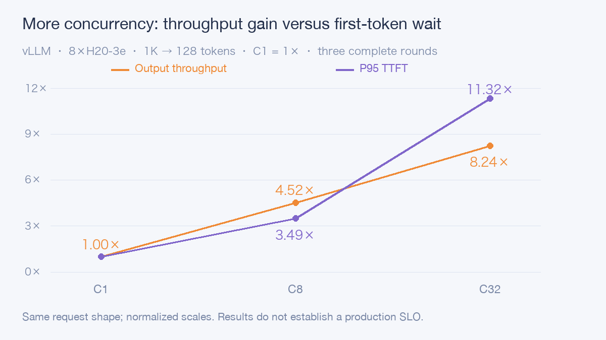
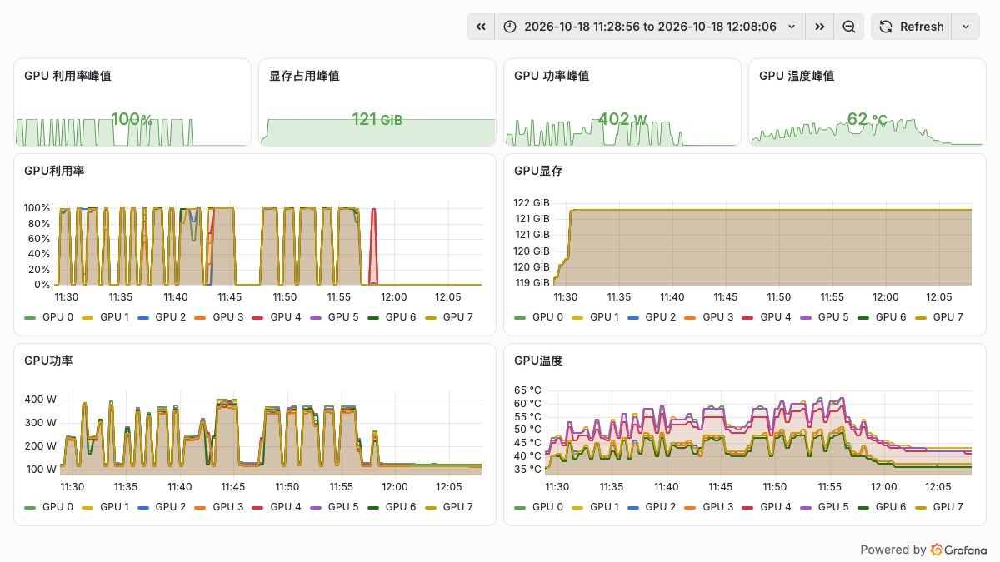
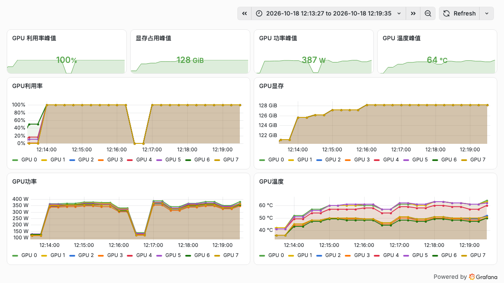

# DeepSeek-V4.1-Flash-1017 Day0：八卡 H20 的 vLLM 部署与百万 Token 实测

## 1. 1017 更新了什么

DeepSeek-V4.1-Flash-1017 是 DeepSeek 对 V4.1-Flash 的一次权重更新，支持文本和图片输入、文本输出。它延续混合专家（Mixture of Experts，MoE）与 Engram 条件记忆的架构，官方将本次改进重点放在推理、代码、智能体任务和视觉能力，并报告完成任务的时间与输出长度有所减少。[官方模型卡](https://huggingface.co/deepseek-ai/DeepSeek-V4.1-Flash-1017)

对部署而言，需要区分计算量与存储量：每个 Token 只激活部分专家，但服务仍要存放整套权重。Engram 是模型自带的参数表；键值缓存（Key-Value Cache，KV Cache）则保存请求的注意力状态，随上下文和并发增长。把 Engram 卸载到 CPU 与开启前缀缓存，改变的是不同的资源路径。

本次锁定模型 revision `1bae0e1088993b9b82de08f59de5be5a34e42170`，架构为 `DeepseekV41ForCausalLM`。48 个权重分片约 **475.25 GiB**，采用专家 FP4、其他主要权重 FP8 的原生混合量化格式，带 UE8M0 scale。[锁定的配置](https://huggingface.co/deepseek-ai/DeepSeek-V4.1-Flash-1017/blob/1bae0e1088993b9b82de08f59de5be5a34e42170/config.json)

官方报告的 Terminal-Bench 4.0 从 31.2 提升到 42.3，DeepSWE v1.1 从 74.2 提升到 77.0，分别使用其指定的 Claude Code 与 Mini-SWE-V2 测试环境。这些是发布方成绩；本文用实际部署、固定长度压测及独立功能样例回答三个问题：八卡能否运行、并发代价如何、百万 Token 输入能否真正完成召回。

## 2. 八卡部署与版本

测试采用单节点 **8×H20-3e**。核心性能矩阵完成 36 轮，其中 34 轮全部请求完整，成功请求为 **1,054/1,056**；工具和基础视觉检查通过。独立长上下文配置完成 7 个样例，含三个超过一百万 Token 的输入，均找回三个位置的目标代码。

| 条件 | 实测配置 |
| --- | --- |
| GPU 与驱动 | 每卡报告 143,771 MiB；驱动 580.126.20 |
| 互联 | GPU 两两为 NV18；GPU 0–3 关联 NUMA 0，4–7 关联 NUMA 1 |
| vLLM | 0.32.0rc1.dev329+g39983a5e7 |
| 关键依赖 | PyTorch 2.14.0+cu130；Transformers 5.19.0；FlashInfer 0.7.2；NCCL 2.30.7 |
| 并行与 Engram | 张量并行 TP8；显式关闭 Engram CPU 卸载；未显式启用专家并行 |
| 基础服务 | 最大上下文 32,768；最大序列 32；每批 Token 预算 4,096；显存利用率参数 0.85 |
| 长上下文服务 | 最大上下文 1,048,576；最大序列 1；其余关键开关保持一致 |
| 缓存与推测解码 | 关闭前缀缓存，不启用 DSpark |
| 容器资源 | 48/128 CPU 请求与上限；512/1,024 GiB 主机内存；64 GiB 共享内存 |

镜像内 vLLM 提交为 `39983a5e7a5a575a7829f5d5ada50a33d9337ec1`，本次镜像内容摘要为 `sha256:9c482f0f927b7064777c7baf0faafe5721804a9eb8b9bfea9d939cfbc3138348`。摘要用于标识本次构建，不是可直接拉取的公开镜像地址；按[官方 Recipe](https://github.com/vllm-project/recipes/blob/main/models/deepseek-ai/DeepSeek-V4.1-Flash.yaml)准备支持该模型的构建后，仍需核对实际版本。

八个 rank 的 AllReduce 数值检查均通过。这里检查单机通信正确性，不把它写成跨节点网络带宽测试。模型从只读共享文件系统加载；不同阶段会受文件缓存影响，因此没有将启动耗时当作受控冷启动对照。

本次基础服务启动参数如下，`/model` 为容器内模型目录：

```bash
vllm serve /model \
  --served-model-name deepseek-v41-flash-1017 \
  --host 0.0.0.0 --port 30000 \
  --tensor-parallel-size 8 \
  --tokenizer-mode deepseek_v41 \
  --reasoning-parser deepseek_v41 \
  --tool-call-parser deepseek_v41 --enable-auto-tool-choice \
  --max-model-len 32768 --max-num-seqs 32 \
  --max-num-batched-tokens 4096 --gpu-memory-utilization 0.85 \
  --no-enable-prefix-caching \
  --limit-mm-per-prompt '{"image":2}' \
  --engram-config '{"cpu_offload":false}'
```

长上下文阶段单独重启服务，将 `--max-model-len` 改为 `1048576`，`--max-num-seqs` 改为 `1`。本次 vLLM 自动配置曾打开 Engram CPU 卸载，正式测量前显式设置 `--engram-config '{"cpu_offload":false}'`，下文均使用这一 GPU Engram 基线。

## 3. 压测怎样计数

固定长度负载通过 `/v1/completions` 提交，使用同一锁定版本的 vLLM bench 客户端与原生编码器。输入/输出长度为 1,024/128、8,192/128、1,024/512、24,576/128 Token，各测并发 C1、C8、C32，每格三轮；每轮请求数分别为 8、16、64。请求不做速率限制，客户端并发有上限；它是有限批次压测，不是持续开放到达的线上容量测试。

固定长度使用 `temperature=0`、`ignore_eos=true`，预热和校准单列。成功条件包括完整流结束、非空内容、有效 Usage 和规定输出长度。失败请求保留在原分母内，不用重跑成绩覆盖。

- TTFT（Time to First Token）：发出请求到第一个非空输出片段的时间。
- TPOT（Time per Output Token）：每请求首个至最后输出片段的耗时除以生成 Token 数减一；表中为这些请求平均值的 P95，不是逐 Token 间隔的 P95。
- E2E（End-to-End）：完整请求耗时。吞吐为成功输出 Token 除以整轮耗时。
- 表格对每项指标取完整有效轮次的中位数，不是把三轮请求合并后重新算 P95。延迟统计成功请求；样本量较小，尤其 C1 不适合外推生产尾延迟。

客户端校验适配器 SHA-256 为 `bb3bb2f170bd3c398d146aa5471a5f5fd71be2d27a7eb8b86cd64ade3281e0d6`。[逐轮数值 CSV](../../assets/practices/deepseek-v41-flash-1017-day0/core-rounds.csv)保留全部 36 轮，包括两轮不完整结果；[汇总 JSON](../../assets/practices/deepseek-v41-flash-1017-day0/benchmark-summary.json)提供图表数值。

## 4. 吞吐增加，等待也会增加

| 输入 → 输出 | 并发 | 完整轮次 | 成功 / 请求数 | 输出 tok/s | P95 TTFT ms | P95 TPOT ms |
| --- | ---: | ---: | ---: | ---: | ---: | ---: |
| 1,024 → 128 | 1 | 3/3 | 24/24 | 125.9 | 162.9 | 6.80 |
| 1,024 → 128 | 8 | 3/3 | 48/48 | 569.2 | 568.5 | 12.68 |
| 1,024 → 128 | 32 | 3/3 | 192/192 | 1,036.8 | 1,843.8 | 28.12 |
| 8,192 → 128 | 1 | 3/3 | 24/24 | 97.3 | 461.0 | 6.74 |
| 8,192 → 128 | 8 | 3/3 | 48/48 | 223.6 | 3,208.9 | 30.96 |
| 8,192 → 128 | 32 | 2/3 | 191/192 | 270.2 | 12,511.8 | 107.41 |
| 1,024 → 512 | 1 | 3/3 | 24/24 | 141.2 | 163.5 | 6.79 |
| 1,024 → 512 | 8 | 3/3 | 48/48 | 727.0 | 566.8 | 10.67 |
| 1,024 → 512 | 32 | 3/3 | 192/192 | 1,566.9 | 1,850.3 | 19.73 |
| 24,576 → 128 | 1 | 3/3 | 24/24 | 58.1 | 1,363.8 | 6.66 |
| 24,576 → 128 | 8 | 3/3 | 48/48 | 90.9 | 9,568.1 | 74.01 |
| 24,576 → 128 | 32 | 2/3 | 191/192 | 98.3 | 36,957.3 | 213.99 |

8K→128 的 C32 第二轮、24K→128 的 C32 第三轮各有一个请求未满足完整流验收，分别为 191/192 成功；对应单元只有两轮完整数据，表内已标明。其余十格均为三轮完整结果。

1K→128 从 C1 提高到 C32，输出吞吐由 125.9 增至 1,036.8 tok/s，是 **8.24 倍**；P95 TTFT 则由 162.9 ms 增至 1,843.8 ms，是 **11.32 倍**。单看吞吐，容易忽略请求等待的增长。



图中橙线为输出吞吐、紫线为 P95 TTFT，二者均以 C1 为 1 倍，没有使用双纵轴。

输入变长后，继续加并发的收益更有限。24K→128 从 C8 到 C32，吞吐由 90.9 增至 98.3 tok/s，约增加 8.1%；P95 TTFT 从 9.57 秒增至 36.96 秒，约为 3.86 倍，而且 C32 出现不完整请求。对于交互式长文问答，这个档位更需要限流与队列保护。

1K→512 的 C32 得到 1,566.9 tok/s，P95 TPOT 为 19.73 ms。较长输出可以摊薄 Prefill 成本，因此不能把这项吞吐直接当作短答案服务的吞吐。



上图为实际压测时间窗口。采样峰值为 GPU 利用率 100%、单卡显存约 121 GiB、功耗 402 W、温度 62°C。显存包含权重、缓存预分配和运行工作区；不是权重本身占了 121 GiB，也不是八张卡同时达到每一个峰值。

## 5. 与原版 V4.1-Flash 的历史实测对照

此前的 [V4.1-Flash 八卡实测](deepseek-v41-flash-h20-day0.md)已经使用 8×H20-3e、GPU Engram、32K 服务上下文，以及相同的四种输入输出长度。两次都使用固定长度合成请求、关闭前缀缓存，每格重复三轮，因此可以对照相同请求形状下的部署表现。

这里统一选择四类负载的 **C8**：两次每格都是三轮完整、48/48 请求成功，避免混入完整轮次数不同的 C32 档位。指标从保留的逐轮数据重新取中位数；两次合成文本并非逐字回放。

| 输入 → 输出 / C8 | 原版 tok/s | 1017 tok/s | 变化 | 原版 TTFT 秒 | 1017 TTFT 秒 |
| --- | ---: | ---: | ---: | ---: | ---: |
| 1K → 128 | 404.25 | 569.24 | +40.8% | 1.176 | 0.569 |
| 8K → 128 | 97.63 | 223.56 | +129.0% | 9.194 | 3.209 |
| 1K → 512 | 613.74 | 726.95 | +18.4% | 1.177 | 0.567 |
| 24K → 128 | 35.09 | 90.92 | +159.1% | 26.228 | 9.568 |


四类 C8 负载中，这次部署的吞吐增加 18.4%–159.1%，P95 TTFT 降低约 51.6%–65.1%。24K 输入的等待从 26.23 秒降至 9.57 秒，但对交互服务仍然不短；短请求则从约 1.18 秒降至 0.57 秒。它们反映两套实际部署的变化。

影响对比的配置差异如下：

| 项目 | 原版 V4.1-Flash 部署 | 1017 部署 |
| --- | --- | --- |
| vLLM | 0.1.dev1+g79a7108d9 | 0.32.0rc1.dev329+g39983a5e7 |
| PyTorch | 2.13.0+cu130 | 2.14.0+cu130 |
| 每批 Token 预算 | 8,192 | 4,096 |
| 专家并行 | 显式启用 | 未显式启用 |
| CPU 请求 / 上限 | 64 / 128 | 48 / 128 |
| 模型 revision | fb2764a5cf321eaa5070ca8f9e892818f477c16d | 1bae0e1088993b9b82de08f59de5be5a34e42170 |

模型权重、引擎实现和调度预算同时变化，无法从这组记录单独分离 1017 权重带来的收益。更准确的结论是：**本次 1017 + 新版 vLLM 配置，在这些相同长度与并发的历史场景中更快**。固定输出长度测试也不验证“自然任务输出更短”的官方结论。

原版核心矩阵为 32/36 轮完整、1,051/1,056 请求成功；本次为 34/36、1,054/1,056。两次均有不完整请求，短时样本还不足以判断稳定性是否改善。旧模型本身也声明 1M 上下文，原实验只测到 24K；本次新增的是超过 104 万输入 Token 的实际召回证据。[历史对照数值与条件](../../assets/practices/deepseek-v41-flash-1017-day0/v41-deployment-comparison.json)随文提供。

## 6. 功能验证与实际 Prompt

基础文本、中英文与多轮记忆、完整流式输出、工具调用及图片内容敏感性检查通过。工具测试包含函数名称和参数检查、模拟工具返回、模型读取返回值后的最终回答；视觉测试检查图片内容与顺序，避免只验证接口接受图片。

另有 12 个小任务，每个重复三次，使用 `temperature=1.0`、`top_p=1.0` 和低推理强度。严格 JSON 验收为 **33/36**。部分原始 Prompt 如下：

```text
Compute 19 * 23. Reply with the integer only.

Extract fields into JSON with keys name, department, seats: Ada works in platform and requested 6 seats.

Return JSON with keys items and total: 3 apples at 4 credits each, 2 books at 11 credits each.
```

第一题应返回 437；字段提取题应给出 Ada、platform、6。三次未通过均来自订单题：预期把 `items` 写成件数 5，但模型将它解释成商品明细数组，总价仍为 34。这个 Prompt 没有明确字段类型，属于验收歧义。保留原始 33/36 记录，不据此推断算术错误，也不把这组小样例当作能力榜单。

## 7. 百万 Token 输入到底跑到了哪里

每条合成文档包含三个独立随机代码，分别放在正文约 10%、50%、90% 的位置。模型按指定项目名称找回代码，返回精确匹配的 JSON。指令核心为：

```text
Return only a JSON object mapping each requested project name to its access_code.
```

先用原生编码器计数，再核对服务端 Usage。输出预算为 4,096 Token，实际输出可提前结束。以下 TTFT 从首个生成内容片段计时，可能包含推理内容；E2E 包含完成最终 JSON 所需时间。

| 上下文 / 种子 | 实际输入 Token | 输出 Token | TTFT 秒 | E2E 秒 | 召回 |
| --- | ---: | ---: | ---: | ---: | --- |
| 64K / 101701 | 57,285 | 187 | 3.25 | 4.52 | PASS |
| 128K / 101701 | 122,881 | 309 | 6.81 | 8.92 | PASS |
| 256K / 101701 | 253,900 | 206 | 15.28 | 16.66 | PASS |
| 512K / 101701 | 516,033 | 168 | 36.12 | 37.20 | PASS |
| 1M / 101701 | 1,040,333 | 209 | 97.23 | 98.56 | PASS |
| 1M / 101702 | 1,040,325 | 192 | 97.18 | 98.38 | PASS |
| 1M / 101703 | 1,040,323 | 194 | 97.07 | 98.28 | PASS |

七条记录的本地编码 Token 数与服务端输入 Usage 差值全部为零。三个 1M 种子的输入都约为 **104 万 Token**，三个位置的代码全部召回；首 Token 约 97 秒，完整请求约 98 秒。每个种子只有一次请求，这是长上下文可达性与合成召回验证，不是多用户 1M 服务容量或复杂长文推理评估。



长上下文窗口的采样峰值为利用率 100%、单卡显存约 128 GiB、功耗 387 W、温度 64°C。基础服务与长上下文服务的显存预算不同；两张图分别对应各自阶段，不跨阶段拼接成一条性能曲线。

## 8. 部署建议与测试边界

**交互服务先定等待目标。** 短请求可以通过并发获得吞吐，但长输入已经出现明显排队代价。可以按输入长度分队列，限制长请求并发，并为过载设置拒绝或超时策略；不宜把 C32 的结果直接作为线上准入值。

**32K 与 1M 分开配置。** 本次 1M 使用单序列服务，实际请求接近上下文上限。若需要长短请求混部，应另外测调度干扰、工作区与缓存容量；仅增大最大上下文参数无法回答这些问题。

**固定原生协议与 Engram 位置。** 模型仓库采用 V4.1 原生编码；tokenizer、推理解析器和工具解析器须匹配。CPU 卸载会改变主机内存与 PCIe 路径，启用前应单独测试，避免把不同 Engram 放置的成绩混在一起。

**按拓扑分配 GPU、CPU 与内存。** 非一致性内存访问（Non-Uniform Memory Access，NUMA）会影响主机到设备的数据路径。检查八卡是否位于预期的互联域，结合进程 CPU 亲和性与内存策略定位瓶颈；本轮没有进行绑核策略的 A/B 测试。

本次还执行了独立的历史长度辅助矩阵：计划 12 轮，实际执行 6 轮，其中 1 轮完整；因连续失败停止，另外 6 轮未执行。限速 SLO（Service Level Objective，服务级别目标）扫描未执行，因为没有形成所需的完整基准。它们不并入上面的 36 轮核心矩阵，本文不据此给出长期稳定性或线上 SLO 容量结论。

RTX PRO 5000 Blackwell 48GB 没有进入本次实测。约 475.25 GiB 是原生权重文件体积，单张 48GB 卡不能按本文 GPU Engram 配置容纳整套权重；多卡或卸载需要另外验证内存、带宽和引擎支持。

## 参考资料

- [DeepSeek-V4.1-Flash-1017 模型卡](https://huggingface.co/deepseek-ai/DeepSeek-V4.1-Flash-1017)
- [锁定版本的模型配置](https://huggingface.co/deepseek-ai/DeepSeek-V4.1-Flash-1017/blob/1bae0e1088993b9b82de08f59de5be5a34e42170/config.json)
- [vLLM V4.1 Recipe](https://github.com/vllm-project/recipes/blob/main/models/deepseek-ai/DeepSeek-V4.1-Flash.yaml)
