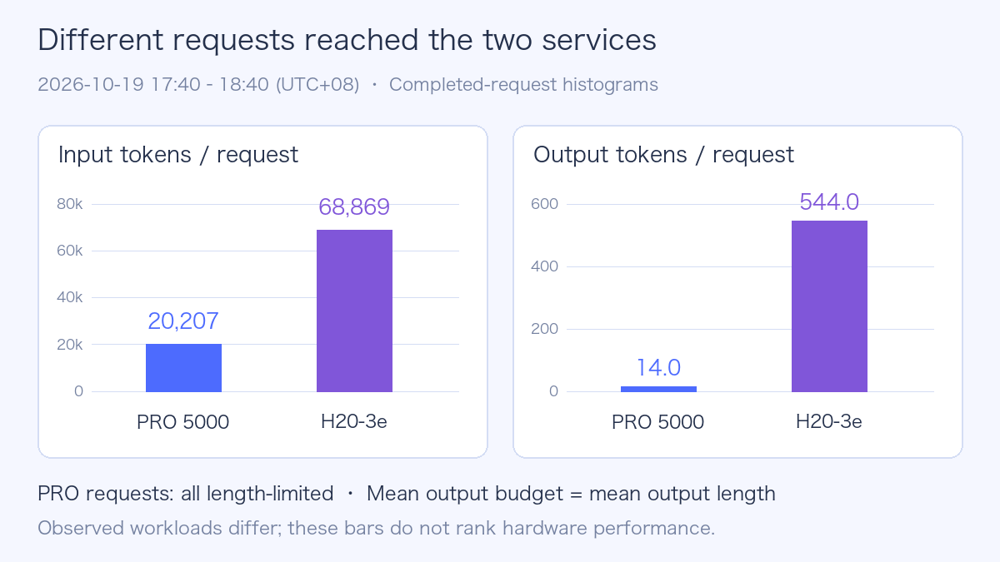
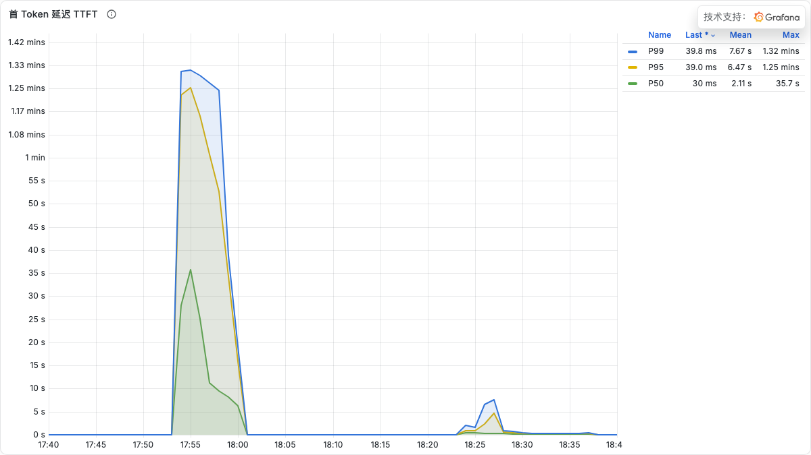
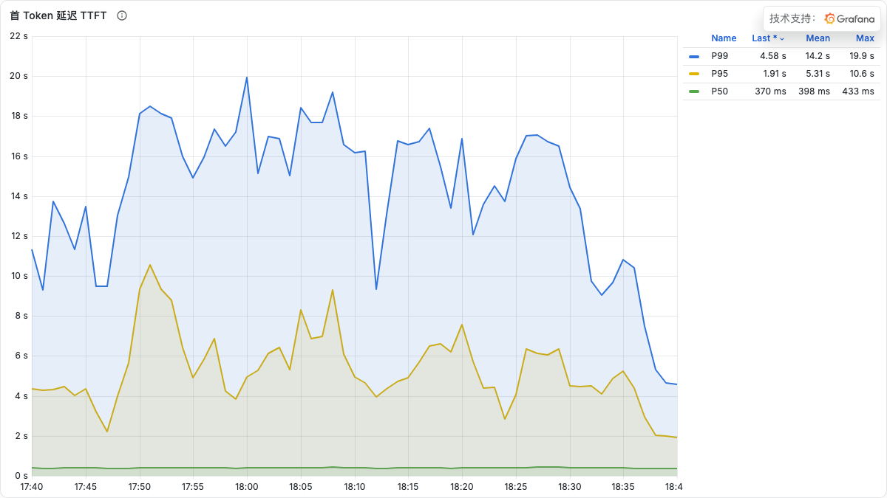
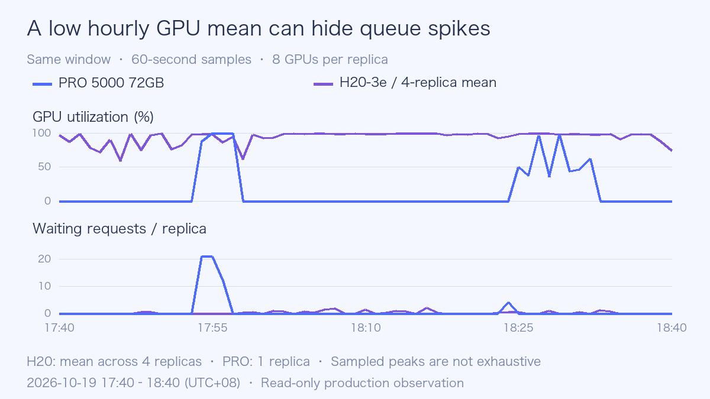

# DeepSeek 1017：PRO 5000 与 H20 的线上性能观察

看到 RTX PRO 5000 上已经有 DeepSeek-V4.1-Flash 服务，最想知道的是：它能不能替代此前的 H20 部署，响应和成本会怎样变化？

这次直接读取已有生产监控与部署配置，没有发送推理请求、生成压测流量或修改服务。观测中，**H20 组的首 Token 等待和请求级 Token 延迟更低；PRO 5000 组出现短时排队，但平均 GPU 利用率只有 14.27%**。继续往下看，会发现两组请求和缓存路径差异很大，直接把输出吞吐相除，会得到一个没有硬件比较意义的倍数。

本文使用的窗口是 **2026 年 10 月 19 日 17:40–18:40，北京时间（UTC+08:00）**。公司、集群、业务域、节点及实例名称均已脱敏，实例以 PRO-01、H20-01 至 H20-04 表示。

## 1. 先确认比较的是哪两组服务

PRO 组有 1 个副本，H20 组有 4 个副本，**每副本均分配 8 张 GPU**。监控上报的 PRO 型号是 **NVIDIA RTX PRO 5000 72GB Blackwell**，并不是此前计划讨论的 48GB 版本。

两组部署配置都引用 **DeepSeek-V4.1-Flash-1017** 目录。这个结论来自配置读取，没有重新校验生产权重哈希，也没有读取运行进程确认实际并行度；下文不把“分配 8 卡”直接写成“已确认 TP8”。模型名称相同，也不能代替配置核对。

| 项目 | PRO 5000 组 | H20 组 |
| --- | --- | --- |
| 样本规模 | 1 个八卡副本 | 4 个八卡副本 |
| 型号标签 | RTX PRO 5000 72GB Blackwell | H20-3e |
| DCGM 上报 Used + Free | 每卡 72,830 MiB，约 71.12 GiB | 每卡 143,155 MiB，约 139.80 GiB |
| 镜像标签系列 | v0.31.0，10 月 14 日构建 | v0.31.0，10 月 19 日构建 |
| Engram CPU 卸载 | 显式开启 | 显式开启 |
| KV Cache 数据类型 | 显式设置 FP8；Indexer KV 同样指定 FP8 | 追加参数中没有显式指定，本文不猜实际默认值 |
| Block size | 128 | 64 |
| 最大上下文 / 最大序列数 | 204,800 / 32 | 204,800 / 32 |
| DSpark 草稿 Token 数 | 5 | 5 |
| 自适应验证 | 关闭 | 开启 |
| 外部 KV 连接器 | MooncakeStoreConnector | 追加参数中未配置；窗口内外部缓存查询增量为 0 |
| CPU Request / Limit | 120 / 240 核 | 每副本 80 / 160 核 |
| 内存 Request / Limit | 700 / 700 GiB | 每副本 1,920 / 1,920 GiB |

DCGM 是 NVIDIA Data Center GPU Manager，表中的容量是监控字段之和，不是产品标称容量，也不等同于全部物理显存。镜像标签不能证明包版本或代码提交相同：这次没有进入生产容器读取实际运行时包，因此保留两个构建之间的实现差异。

### 1.1 硬件差异：72GB GDDR7 与 141GB HBM3e

两组虽然都分配八张卡，硬件基础却不一样。PRO 5000 是 Blackwell 架构的专业工作站 GPU；H20-3e 属于 Hopper 数据中心 GPU。架构更新，不等于在所有大模型服务中都更快。

| 硬件维度 | RTX PRO 5000 72GB Blackwell | H20-3e 141GB |
| --- | --- | --- |
| 架构与产品形态 | Blackwell，PCIe 专业显卡 | Hopper，SXM5 / HGX 服务器平台 |
| 单卡标称显存 | 72 GB GDDR7，支持 ECC 纠错 | 141 GB HBM3e |
| 八卡标称容量之和 | 576 GB | 1,128 GB，约为前者的 1.96 倍 |
| 标称显存带宽 | 1,344 GB/s，即 1.344 TB/s | 所引官方材料未列出这个 141GB SKU 的带宽，本文不填推测值 |
| 主机接入与多卡通信 | PCIe 5.0 ×16；本轮未采集本机 GPU 间的实际通信路径 | SXM5；此前同型号 H20 验机记录为 GPU 两两 NV18，本轮生产副本未重查拓扑 |
| 算子适配 | 第五代 Tensor Core，支持 FP4；CUDA 计算能力为 12.0 | Hopper 路径；具体量化与注意力算子仍由运行时选择 |
| 板卡功耗与散热 | 官方总板卡功耗 300 W，主动散热 | 本轮未核实这批板卡的功耗上限；运行功耗另见后文 |

PRO 的容量、带宽、接口、功耗和 Tensor Core 规格来自 [NVIDIA 产品页](https://www.nvidia.com/en-us/products/workstations/professional-desktop-gpus/rtx-pro-5000/)及[官方规格书](https://www.nvidia.com/content/dam/en-zz/Solutions/products/workstations/professional-desktop-gpus/rtx-pro-5000-blackwell/workstation-datasheet-blackwell-rtx-pro-5000-5488550-nvidia.pdf)。H20 的 Hopper / SXM5 归属见 [NVIDIA vGPU 文档](https://docs.nvidia.com/ai-enterprise/release-8/latest/infra-software/vgpu/reference/hopper.html)；[NVIDIA R595 发布说明](https://docs.nvidia.com/595trd1-trusted-computing-solutions-release-notes.pdf)明确把 H20 141GB HBM3e、H20A 96GB HBM3 与 H200 分列。因此，不能把 96GB H20 或 H200 的带宽、算力和功耗直接套给这里的 H20-3e。

八卡容量之和只是容量预算的起点，不是一块可以随意使用的统一显存。权重如何切分、每卡 KV Cache、临时工作区和通信缓冲区，都要分别放得下。产品标称 GB 也不能直接替换前表 DCGM 的 MiB / GiB。

### 1.2 这些差异怎样影响 DeepSeek 推理

**显存容量影响部署余量。** 同样八卡，H20 的标称容量接近 PRO 的两倍，在相同权重切分与缓存精度下，通常能留出更多 KV Cache 和工作区空间。本轮 PRO 显式使用 FP8 KV，且单卡显存已经接近监控可见容量；但 KV 使用率没有满，不能据此认定显存容量就是排队原因。

**显存带宽影响读取，不能与 PCIe 带宽混为一谈。** GPU 读取本卡权重和 KV Cache，走的是 GDDR7 或 HBM；从 CPU 内存搬数据，才涉及主机内存和 PCIe。Prefill（输入预填充）通常更容易利用矩阵计算能力；小批量 Decode（逐步生成）更容易受权重与 KV 读取带宽制约，批量、上下文和缓存命中会改变瓶颈。[NVIDIA 推理优化说明](https://developer.nvidia.com/blog/mastering-llm-techniques-inference-optimization/)。因此，PRO 支持 PCIe 5.0，不能替代对显存读取带宽的评估；本窗口也没有实测两种显存的有效带宽。

**多卡互联影响每一步协作的代价。** 张量并行需要交换中间结果，专家并行可能需要跨卡分发 Token。历史 H20 的 `NV18` 表示 GPU 间有聚合 NVLink 路径，具体记录见[此前 H20 首测](deepseek-v41-flash-1017-day0.md)。PRO 的 PCIe 多卡路径则需要核对交换芯片、CPU 插槽和 Peer-to-Peer（P2P，设备间直接传输）支持，不能假定与 HGX 等价，也不能反过来断言所有传输都必须绕经 CPU 内存。历史拓扑不能代替这次生产主机的拓扑核对。

**新架构的低精度能力，要有对应算子才能兑现。** NVIDIA 列出的 PRO 5000 计算能力是 12.0，而 B200 是 10.0；同叫 Blackwell，也不是同一个编译目标。[CUDA GPU 计算能力表](https://developer.nvidia.com/cuda/gpus)。PRO 支持 FP4，不代表这次 FP8 模型实际采用了 FP4 核函数，更不能把 FP4 稀疏 AI TOPS 与另一张卡的 FP8 / BF16 稠密峰值直接比较。

**CPU 卸载和整机配置同样重要。** 本轮两组都开启 Engram CPU 卸载，因此除了 GPU，还应关注主机内存带宽、NUMA（Non-Uniform Memory Access，非统一内存访问）放置和 CPU–GPU 传输。PRO 的外部 KV 缓存又引入另一条数据路径。这是需要关联排查的方向，现有排队曲线尚不能证明其中哪一项是瓶颈。

功耗也要对应同一种口径：PRO 的 300 W 是官方板卡规格，后文约 95 W 是这批流量下的板卡平均值；H20 的约 317–327 W 同样是运行观测值。它们既不是同负载能效测试，也不包括 CPU、内存和网络开销。用于企业选型时，应比较满足相同延迟要求的整机吞吐与总成本，而不是只比较架构代际或八张卡的价格。

## 2. 数据怎样取，哪些数字要谨慎读

应用指标来自现有 vLLM 采集，GPU 指标来自现有 DCGM 采集。五个实例在窗口内各有 **60 个应用采样点**，每张 GPU 也有 60 个利用率采样点；生成 Token 计数器在窗口内没有观察到重置。

统计采用以下口径：

- Token 与完成请求增量使用一小时 `increase`；它会对窗口边界外推，因此是估算值，出现小数正常，不能当作逐请求审计数量。
- 全时钟输出速率为生成 Token 增量除以 3,600 秒。H20 总量再除以 4，得到每副本均值；这不是满载容量。
- 请求均值用直方图的 `_sum` 增量除以 `_count` 增量。H20 的 P95 先合并四副本的桶，再计算分位数，没有平均四个 P95。
- GPU 平均利用率按有效 GPU 采样点加权。下文的 H20 资源曲线是四个八卡副本的平均，单副本范围另外列出。

`request_success_total` 的名称容易误导。这里按它的结束原因观察 `stop`、`length`、`abort`、`error` 等计数，并没有客户端完整流、最终答案或业务正确性验收，不能据此宣布请求成功率为 100%。

## 3. 先看请求形态，再看吞吐

| 一小时窗口指标 | PRO 5000 | H20 |
| --- | ---: | ---: |
| 完成计数增量，约 / 副本 | 2,142.7 | 2,867.5 |
| 完成速率 / 副本 | 0.595 请求/秒 | 0.797 请求/秒 |
| 每请求平均输入 | 20,206.8 Token | 68,868.6 Token |
| 每请求平均输出 | 14.03 Token | 544.03 Token |
| 请求输出上限均值 | 14.03 Token | 各副本约 23,260–24,304 Token |
| 全时钟输出速率 / 八卡副本 | 8.35 tok/s | 433.59 tok/s |

H20 的完成计数、输出速率按四副本折算；输入输出长度按完成请求加权。PRO 的输出 Token 总计数增量约 3.01 万，H20 四副本合计约 624.37 万。表中是这批流量实际产生的输出，没有把两组服务都推到相同负载。



PRO 组的完成请求全部以 `length` 结束，且输出上限均值与实际输出均值一致。输出上限不超过 20 Token 的计数占比约 **82.15%**，不超过 50 Token 的约 **95.82%**。这组流量主要是短输出；仅凭现有直方图，不能判断它们来自什么业务，也不能推断回答质量。

H20 组则以 `stop` 为主，`length` 约占完成计数 **2.11%**。两组 `abort`、`error`、`repetition` 在所选计数器中增量为 0，但请求进入引擎之前的失败、客户端断流或未暴露错误，不在这个结论内。

所以，8.35 与 433.59 tok/s 可以描述线上产出，却不能拿来宣称 H20 快几十倍。请求输出预算、流量持续时间和配置都不同。

## 4. 当前等待体验：H20 组更好，差异集中在哪里

TTFT（Time to First Token）是服务端记录的首 Token 等待；TPOT（Time per Output Token）是每个完成请求的平均输出 Token 耗时；E2E（End-to-End）是服务端整条请求耗时。这些是已有引擎指标，不是重新发送请求测得的客户端最终答案延迟。

| 请求级指标 | PRO 均值 | H20 均值 | PRO P95 | H20 P95 |
| --- | ---: | ---: | ---: | ---: |
| TTFT | 2.333 s | 1.050 s | 16.663 s | 5.000 s |
| TPOT | 64.17 ms | 6.01 ms | 373.71 ms | 17.11 ms |
| E2E | 3.009 s | 4.319 s | 20.458 s | 17.718 s |
| 排队耗时 | 1.704 s | 0.245 s | 13.514 s | 0.299 s |

H20 组在这个窗口的 TTFT 和 TPOT 更低。PRO 的 E2E 均值看起来更短，却只生成了平均 14 Token；H20 平均生成 544 Token。不能用 3.009 秒小于 4.319 秒，就说 PRO 完成同一任务更快。

PRO 的平均排队耗时约占平均 TTFT 的 **73.0%**。这是均值之间的比例，不是把两个 P95 相减或相除得到的归因。现有证据说明排队是等待的重要组成部分，还不能确定是 CPU 卸载、调度预算、外部 KV 传输或其他环节造成。



*PRO 组的真实原生面板，已隐藏与数据无关的推广浮层。曲线是 5 分钟滚动 P50/P95/P99；短时 P95 曾达到约 75 秒，不能把它当作整小时 P95。*



*H20 组采用相同时间窗口。两张原生图的纵轴自动缩放不同，应比较刻度和数值；图例 Mean 是折线采样点的均值，不是上表的请求均值。*

还有一个容易混淆的口径：`inter_token_latency_seconds` 按连续输出事件记录间隔，推测解码时一次事件可能带多个 Token；本文选用的是 `request_time_per_output_token_seconds`。该版本文档说明，输出不超过一个 Token 的请求在服务端 TPOT 直方图中记为 0，而 benchmark 客户端会排除它们。因此线上 TPOT 和此前压测 TPOT 也不能直接合并。[vLLM 指标设计](https://docs.vllm.ai/en/v0.31.0/design/metrics/)

## 5. GPU 利用率低，为什么仍然会排队

| 资源观察 | PRO-01 | H20 单副本范围 |
| --- | ---: | ---: |
| 平均 GPU 利用率 | 14.27% | 91.93%–95.48% |
| 单卡平均显存使用 | 68.82 GiB | 127.06–127.57 GiB |
| 单卡显存采样最大值 | 69.44 GiB | 127.06–127.57 GiB |
| 单卡平均 GPU 功耗 | 95.02 W | 317.30–327.39 W |
| Running 请求采样均值 | 0.53 | 2.65–3.30 |
| Waiting 请求采样均值 | 0.97 | 0.18–0.55 |
| Waiting 请求采样最大值 | 21 | 4–8 |
| KV 使用率采样最大值 | 17.57% | 1.77%–2.71% |



PRO 的繁忙阶段集中在少数分钟。17:54、17:55、17:56 的采样中，排队分别为 21、21、12，请求运行数为 3、4、8，八卡平均利用率为 88.5%、100%、100%。一小时低均值，与这几分钟的明显排队并不矛盾。

18:24 还有一个值得跟进的采样点：Running 为 11、Waiting 为 4，而 GPU 利用率采样为 0。应用状态与 GPU 忙碌程度不是同一个量，而且独立采集的时间未必完全对齐。它提示需要沿同一时段继续检查执行和传输路径，不能仅凭这一点认定网卡、CPU 或 GPU 有故障。

等待原因指标中，PRO 的 `capacity` 采样最大值为 21，`deferred` 为 4。这是调度器暴露的分类，不能直接把前者翻译成“显存耗尽”，或把后者认定为“Mooncake 故障”。窗口中抢占计数增量为 0；Xid 与容器内存工作集查询没有返回序列，本文也不把“没有数据”写成“没有问题”。

另外，显存使用量接近设备可用容量，不代表 KV Cache 已被请求占满。引擎可能预留缓存空间，显存还包含权重和运行工作区；`kv_cache_usage_perc` 表示逻辑缓存块的使用比例，1 才是 100%。[对应版本指标定义](https://github.com/vllm-project/vllm/blob/v0.31.0/vllm/v1/metrics/loggers.py)

## 6. 缓存与 DSpark，改变了实际计算路径

两组服务的输入都存在较高复用。H20 的平均输入接近 6.9 万 Token，不意味着每个请求都重新计算 6.9 万 Token。

| 一小时缓存与推测解码指标 | PRO 5000 | H20 |
| --- | ---: | ---: |
| 本地前缀缓存 Token 命中率 | 92.53% | 96.36% |
| 外部 KV 查询 Token 命中率 | 33.40% | 查询增量为 0，不计算比例 |
| 本地实际计算的输入 Token，约 / 副本 | 215.31 万 | 716.31 万 |
| 草稿 Token 接受率 | 47.06% | 50.58% |
| 每次验证平均输出长度，含 bonus Token | 3.35 | 3.53 |

前缀命中率按查询 Token 计数计算，不是“多少请求全部命中”。外部 KV 的 33.40% 使用自己的外部查询分母，不能与 92.53% 直接相加。PRO 的外部输入传输来源计数确有增量，说明它经过了另一条缓存路径；这既可能节省计算，也会引入查找和传输过程。

PRO 的 Mooncake 操作计数在窗口内有实际读取和写入，失败 key 计数增量均为 0；`load_get` 平均操作耗时约 101.8 ms。它是存储操作的均值，不是每请求平均增加的等待，更不足以解释 13.5 秒的排队 P95。没有逐请求关联数据，不能把长尾归因给 Mooncake。

DSpark 是推测解码路径。本表的草稿接受率由接受 Token 数除以草稿 Token 数得到；平均输出长度用 `1 + accepted / drafts` 计算。它们解释验证时一次推进多少 Token，不等于服务整体提速 3.35 倍或 3.53 倍。两组自适应验证配置还不相同。[接受率指标说明](https://docs.vllm.ai/en/v0.31.0/features/speculative_decoding/acceptance_metrics/)

## 7. 与此前 H20 Day0 数据怎样放在一起看

此前的 [1017 H20 Day0 实测](deepseek-v41-flash-1017-day0.md)采用固定输入输出长度、并发上限和三轮重复。这次观察的生产流量没有这些控制条件。

| 条件 | 此前 H20 实验 | 本次线上观察 |
| --- | --- | --- |
| 负载 | 固定长度合成请求，明确 C1/C8/C32 | 读取既有请求直方图，未采集 Prompt |
| Engram | 留在 GPU | 两组均配置 CPU 卸载 |
| 前缀缓存 / DSpark | 均关闭 | 有缓存命中，DSpark 草稿数为 5 |
| 服务上下文 | 基础矩阵 32,768；长上下文独立配置 1M | 两组配置 204,800 |
| 引擎标识 | 实测 vLLM 0.32.0rc1.dev329+g39983a5e7 | 镜像标签系列 v0.31.0，两个构建不同 |
| 延迟统计 | 每轮成功请求 P95，再取完整轮次中位数 | 合并一小时直方图桶后估算 P95 |

保留此前四类 C8 请求作为固定负载的历史参照：

| 历史输入 → 输出 / C8 | 输出吞吐 | P95 TTFT | P95 TPOT |
| --- | ---: | ---: | ---: |
| 1,024 → 128 | 569.2 tok/s | 568.5 ms | 12.68 ms |
| 8,192 → 128 | 223.6 tok/s | 3,208.9 ms | 30.96 ms |
| 1,024 → 512 | 727.0 tok/s | 566.8 ms | 10.67 ms |
| 24,576 → 128 | 90.9 tok/s | 9,568.1 ms | 74.01 ms |

这些数字回答“当时那套 H20 配置，在规定长度和并发下跑到什么水平”。线上观察回答“当前流量与配置实际表现如何”。两组资料能互相补充，但不存在一个可靠的换算系数，可以把线上 14 Token 输出折算成历史 512 Token 压测结果。

## 8. 这次观察对选型和排查有什么帮助

**部署可行性已经有运行证据。** 监控中可以看到八卡 PRO 5000 72GB 的服务及实际生成计数，部署配置包含 CPU Engram 卸载、FP8 KV 和外部缓存。它证明这条组合路径在工作，不能推广成单卡可部署，也不能推广成 48GB 版本同样成立。

**当前服务表现需要优先关注 PRO 的排队长尾。** 先沿 17:54–17:56 等具体时段对照已有调度、缓存、CPU 和网络指标；如已有请求追踪，可进一步关联等待阶段。本次没有修改采集配置、打开追踪或调整线上参数。

**H20 在本窗口交付了更低的 TTFT 与 TPOT。** 这是现有部署和这批流量下的观察。不同输出预算、缓存、构建、CPU 资源和 DSpark 配置同时存在，不能把全部差异归给 GPU。

**成本暂时只能拆开看。** PRO 的 GPU 平均功耗较低，同时运行时间和输出量也明显不同。GPU 板卡功耗不包含 CPU、内存、网络、存储和整机空闲功耗；两组还都依赖 CPU 卸载。没有相同服务目标下的有效任务量和整机成本，不能据此给出“每百万 Token 更便宜”的结论。

在生产服务上，只读监控已经足以发现配置不一致、请求形态不同和短时排队。这比先写一个显卡性能排名，更接近这次数据真正能回答的问题。

## 9. 复核口径与公开数据

以下是脱敏选择器示例，复用时替换为实际 Pod 选择器；没有向线上新增这些标签或规则。

```promql
# Whole-window request-level P95; merge buckets before estimating.
histogram_quantile(0.95,
  sum by (le) (
    increase(vllm:time_to_first_token_seconds_bucket{
      pod_name=~"pro-model-.*"
    }[1h])
  )
)
```

```promql
# Request-weighted mean output length.
sum(increase(vllm:request_generation_tokens_sum{pod_name=~"pro-model-.*"}[1h]))
/
sum(increase(vllm:request_generation_tokens_count{pod_name=~"pro-model-.*"}[1h]))
```

```promql
# GPU-sample-weighted utilization, including allocated GPUs at zero utilization.
sum(sum_over_time(DCGM_FI_DEV_GPU_UTIL{pod_name=~"pro-model-.*"}[1h]))
/
sum(count_over_time(DCGM_FI_DEV_GPU_UTIL{pod_name=~"pro-model-.*"}[1h]))
```

公开的[观测数据](../../assets/practices/deepseek-v41-pro5000-h20-observation/observation.json)保留脱敏聚合值、五副本时间序列与统计说明；[图表生成程序](https://github.com/runzhliu/aik8s/blob/main/scripts/generate_deepseek_pro5000_observation_assets.py)只读取这份公开数据。原生面板截图保持原始图形和数值，隐藏了无关推广浮层，未保留内部标识。

参考资料：[vLLM 生产指标](https://docs.vllm.ai/en/v0.31.0/usage/metrics/)、[DeepSeek 1017 模型卡](https://huggingface.co/deepseek-ai/DeepSeek-V4.1-Flash-1017)、[此前原版 V4.1-Flash H20 实测](deepseek-v41-flash-h20-day0.md)。
