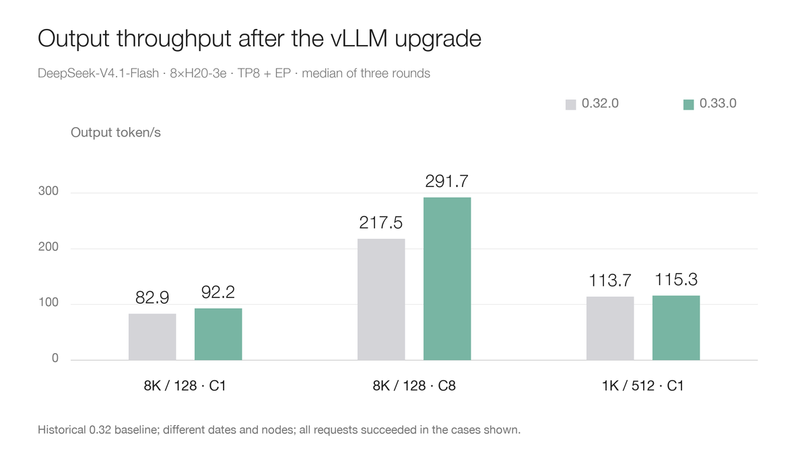
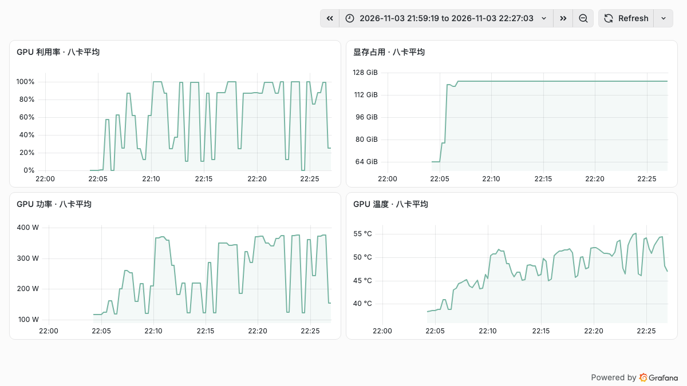

# vLLM 0.33.0 升级实测：DeepSeek-V4.1-Flash 在 H20-3e 上与 0.32.0 对比

DeepSeek-V4.1-Flash 是支持图像和文本的混合专家（Mixture of Experts，MoE）模型，包含 Engram 条件记忆。此前我们在八张 H20-3e 上[测试了 vLLM 0.32.0](deepseek-v41-vllm032-upgrade.md)。新版本 0.33.0 发布后，值得继续追问：同一个模型和相近的测试配置下，升级带来了多少变化？

本文使用 0.33.0 重新运行基准，将结果与已保存的 0.32.0 数据对比。两次测试发生在不同日期和不同节点，属于历史对照，不能视为同机同时期的严格 A/B。

## 1. 0.33.0 有哪些与模型相关的变化

[vLLM 0.33.0 发布说明](https://github.com/vllm-project/vllm/releases/tag/v0.33.0rc3)提到了 Hopper 上 DeepSeek V4/V4.1 的 Humming 混合精度专家计算优化，以及推测解码、上下文并行等变化。官方所列不同结果使用的 GPU、模型和配置各不相同，不能直接当作 H20-3e 上的预期收益。

例如，Humming 优化的[原始 PR](https://github.com/vllm-project/vllm/pull/61875)使用四张 H200、DeepSeek-V4-Flash 报告部分解码收益，同时也记录了低并发场景的回退。0.33.0 的本次启动日志记录了 Humming MXFP4 MoE backend、MXFP8 激活按 block FP8 在 Hopper 执行，以及 SWA bounded replay；这证明这些路径被选中，但不能据此量化它们各自的性能贡献。本次比较是两个完整镜像和默认执行路径的差异，不能仅凭总吞吐变化归因到某一个 kernel。

## 2. 测试方法

| 项目 | 配置 |
| --- | --- |
| 模型 | `deepseek-ai/DeepSeek-V4.1-Flash` 原版；revision `fb2764a5cf321eaa5070ca8f9e892818f477c16d`；不是 1017 版本 |
| GPU 与并行 | 单节点 8×H20-3e；张量并行 TP8，启用专家并行 EP |
| 上限 | 32,768 Token 上下文、32 个并发序列、8,192 batched tokens；显存利用比例 0.85 |
| 其他条件 | Engram 留在 GPU，关闭前缀缓存，不启用 DSpark；使用相同 Tokenizer、客户端和随机种子 |
| 0.32.0 | 使用此前实测的历史结果，不再重跑 |
| 0.33.0 | 固定官方镜像；关闭前缀缓存的实际配置为 `--disable-prefix-caching` |

主矩阵覆盖 10 个输入、输出和并发组合，每个组合三轮正式请求；每轮预热单独统计。请求成功要求 HTTP 200、有效文本、完整流结束、有效 usage 和符合测试设定的输出长度。无效响应保留在分母中；延迟分位数仅涵盖有效响应。吞吐按每轮有效输出 Token 除以该轮完整耗时，再取三轮中位数。

### 镜像与启动参数

0.33.0 使用上游官方镜像的 amd64 平台清单摘要 `sha256:91ee972ab751fb7180bc71c175865e36b091686600dca783d52b2511399810b3`。比较的是包含依赖的完整镜像：

| 组件 | 0.32.0 | 0.33.0 |
| --- | --- | --- |
| Torch | `2.13.0+cu130` | `2.14.0+cu130` |
| Transformers | `5.19.0` | `5.20.2` |
| FlashInfer | `0.7.0.post1` | `0.7.2.post1` |
| Humming | `0.1.17` | `0.1.19` |

0.33 镜像的 `pip check` 报告 NCCL 与 OpenTelemetry 的版本约束不一致。实际 NCCL 通信、模型启动及文中的请求测试可以运行，但这些结果不代表依赖约束已全部满足，应在自己的环境中验证。

以下命令中的 `/model` 是只读模型目录的容器挂载点：

```bash
vllm serve /model \
  --served-model-name deepseek-v41-flash \
  --tensor-parallel-size 8 --enable-expert-parallel \
  --max-model-len 32768 --max-num-seqs 32 --max-num-batched-tokens 8192 \
  --gpu-memory-utilization 0.85 --tokenizer-mode deepseek_v41 \
  --reasoning-parser deepseek_v41 --tool-call-parser deepseek_v41 \
  --enable-auto-tool-choice --engram-config '{"cpu_offload":false}' \
  --disable-prefix-caching --host 0.0.0.0 --port 30000
```

逐轮统计、结果文件哈希和补充测试保存在[公开数据文件](../../assets/practices/deepseek-v41-vllm033-upgrade/results.json)中。

## 3. 主矩阵结果

单位为输出 token/s，吞吐是三轮中位数；每个成功数保留原请求分母。两版均无失败时才列出观察差异；有失败的场景保留吞吐作为描述，不计算升级收益。

| 输入→输出 / 并发 | 0.32.0 历史 | 0.33.0 | 0.32 成功 / 请求 | 0.33 成功 / 请求 | 观察差异 |
| --- | ---: | ---: | ---: | ---: | ---: |
| 1,024→128 / C32 | 1015.77 | 1322.74 | 190/192 | 191/192 | — |
| 8,192→128 / C1 | 82.94 | 92.22 | 24/24 | 24/24 | +11.2% |
| 8,192→128 / C8 | 217.46 | 291.74 | 48/48 | 48/48 | +34.2% |
| 8,192→128 / C32 | 263.14 | 375.20 | 190/192 | 190/192 | — |
| 1,024→512 / C1 | 113.69 | 115.32 | 24/24 | 24/24 | +1.4% |
| 1,024→512 / C8 | 676.93 | 760.58 | 48/48 | 47/48 | — |
| 1,024→512 / C32 | 1576.39 | 1933.22 | 190/192 | 190/192 | — |
| 24,576→128 / C1 | 52.25 | 63.37 | 23/24 | 23/24 | — |
| 24,576→128 / C8 | 87.57 | 123.56 | 47/48 | 47/48 | — |
| 24,576→128 / C32 | 94.78 | 137.79 | 189/192 | 190/192 | — |



主矩阵的 30 轮正式请求和 10 次预热均与历史请求指纹匹配。本轮未重复历史的开放到达率测试；此前 0.300 请求/秒曾有失败，不能将其当作无失败的容量上限。


### 首内容等待与输出延迟

以下每格是逐轮 P95 的三轮中位数，单位为毫秒；P95 TTFT 是首段非空内容等待，P95 TPOT 是每个请求平均每输出 Token 的耗时。只列两版全部请求有效的场景。

| 场景 | TTFT 0.32 | TTFT 0.33 | TPOT 0.32 | TPOT 0.33 |
| --- | ---: | ---: | ---: | ---: |
| 8,192→128 / C1 | 472.40 | 328.86 | 8.46 | 8.35 |
| 8,192→128 / C8 | 3,428.99 | 2,356.67 | 32.85 | 24.48 |
| 1,024→512 / C1 | 164.59 | 157.13 | 8.52 | 8.41 |



真实监控截图显示主测试时间窗内八卡的平均值；均值不能替代逐卡故障检查。图中的波动包括不同场景和测试间隔，不能作为单一负载的固定利用率。

## 4. 空文本与升级验收

在已完成场景中，部分流式请求返回了 HTTP 200，但未通过非空内容、结束标志和 usage 的完整性检查。此前 0.32.0 也出现过无有效文本的响应。应进一步区分每个失败是空文本、缺失结束标志还是缺失 usage，并保留响应作为诊断证据；接口返回 200 本身不足以证明生成成功。

主矩阵中，0.33.0 有 974/984 个有效响应，10 个无效响应均有结束标志和 usage，但没有通过非空文本检查；历史 0.32.0 为 973/984。两次样本均有限，且跨节点、跨日期，不能据此断言失败率改善或回退。

对这 10 个失败请求逐个解析原始流后，HTTP 状态均为 200，结束标志与 usage 均存在，`finish_reason` 均为 `length`，但所有 `choices[].text` 片段均为空；其中 7 个记录了 128 个完成 Token，3 个记录了 512 个。原因尚未定位：后续应保存输出 Token ID，在相同条件下重放，并与非流式响应、自然语言请求及取消 `ignore-eos` 的请求进行对照。当前合成固定长度负载的失败比例不能当成生产故障率。

## 5. 工具、图像与部署建议

主矩阵及补充测试中的工具调用和视觉功能检查均通过：覆盖工具参数解析、工具结果回灌，以及单图与双图顺序识别，不能外推为所有工具和图像任务均通过。以下补充场景的历史 0.32.0 数据来自另一批次，需要单独解读；两版的逐轮请求指纹均匹配。

| 输入→输出 / 并发 | 历史 0.32.0 | 0.33.0 | 两版各自成功 / 请求 | 观察差异 |
| --- | ---: | ---: | ---: | ---: |
| 1,024→128 / C1 | 103.80 | 105.21 | 24/24 | +1.4% |
| 1,024→128 / C8 | 535.18 | 622.88 | 48/48 | +16.4% |
| 4,096→128 / C32 | 463.20 | 642.71 | 384/384 | +38.8% |

吞吐单位为 token/s，数值为三轮中位数；4K/C32 每轮 128 个请求。


升级时应先固定模型版本、推理镜像、依赖、并行配置和服务入口；使用业务真实请求核对完整流和质量，再对照吞吐、首 Token 延迟及显存、功耗。新版本中的不同优化可能对低并发与高并发表现不同，应按业务流量分布评估。

## 参考资料

- [DeepSeek-V4.1-Flash 模型卡](https://huggingface.co/deepseek-ai/DeepSeek-V4.1-Flash)
- [vLLM 0.33.0 发布说明](https://github.com/vllm-project/vllm/releases/tag/v0.33.0rc3)
- [DeepSeek V4 Hopper Humming 优化 PR](https://github.com/vllm-project/vllm/pull/61875)
- [此前的 vLLM 0.32.0 实测](deepseek-v41-vllm032-upgrade.md)
