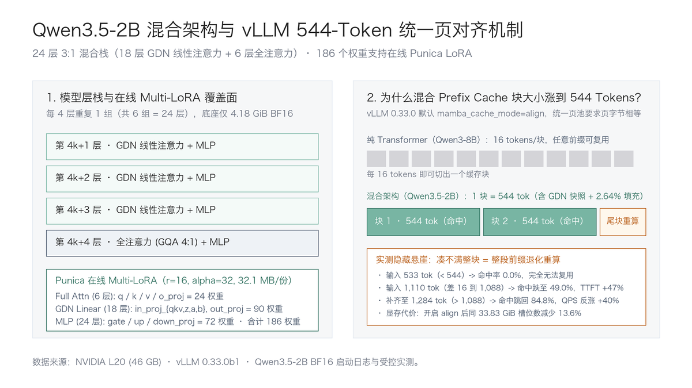
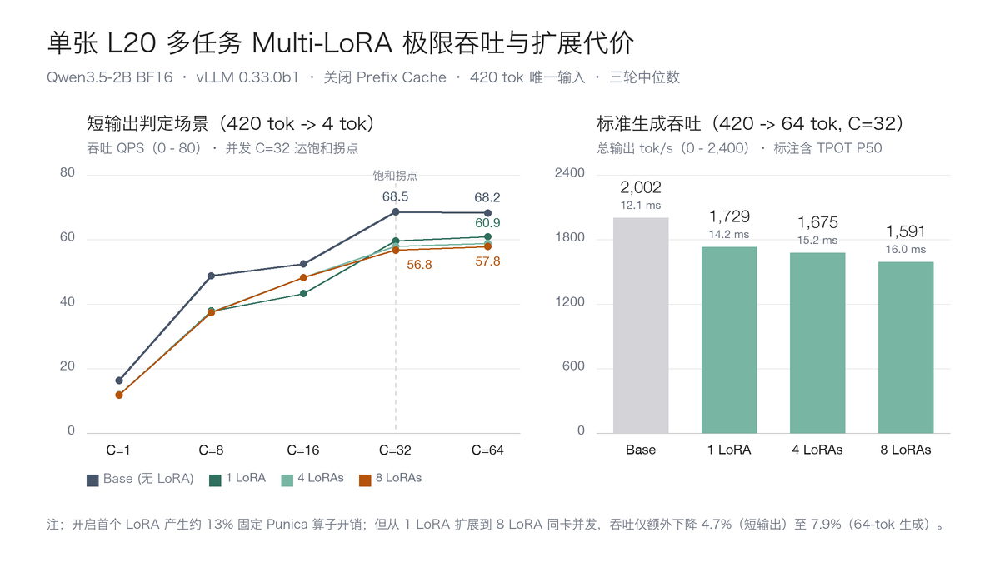
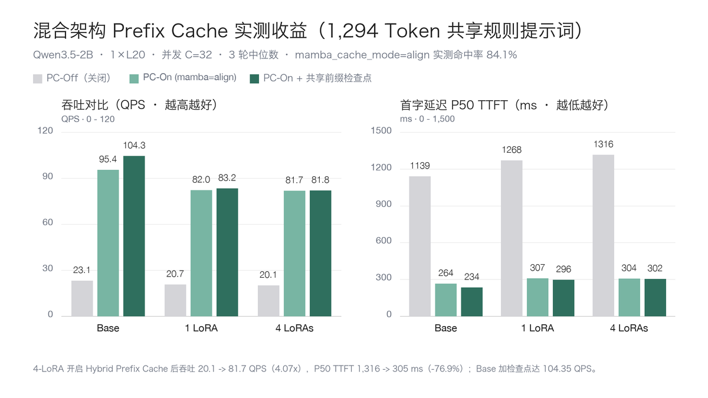
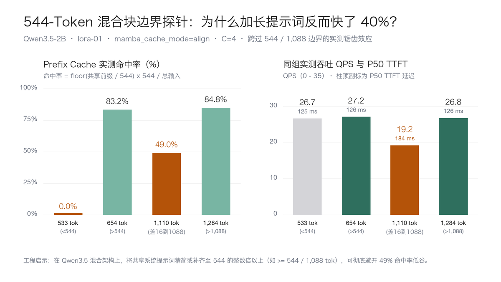

# 单卡 L20 混合架构 Multi-LoRA 极限压测：Qwen3.5-2B 吞吐拐点与 544-Token Prefix Cache 锯齿悬崖

2026 年以来，越来越多企业把审核分类、结构化抽取、多模态质检和垂直路由等高频小模型任务迁向新一代**混合注意力架构（Hybrid Attention）**——以 `Qwen3.5` 系列为代表，它在 24 层网络中按 **3:1 比例**混排了 **18 层 Gated DeltaNet（GDN）线性注意力**与 **6 层标准全注意力（Full Attention）**。但在把这类混合架构小模型收拢到单张 **NVIDIA L20（`46,068 MiB`）** 做多任务 **Multi-LoRA** 时，工程团队普遍关心四个问题：混合架构的 `linear_attn` 能否无损跑在线 Multi-LoRA？单卡极限 QPS 拐点在哪？开启 Hybrid Prefix Cache 能快几倍？是否存在纯 Transformer 上没有的隐藏暗坑？

为此，我们在单张 L20 上用开源 **`Qwen3.5-2B` BF16 + `vLLM 0.33.0b1`** 和 **8 个确定性合成 `r=16` PEFT LoRA（每份 `32.13 MB`，完整覆盖全部 186 个文本线性层）** 完成了四组受控实验（所有吞吐与延迟均取 **三轮中位数**，并同步采集 Prometheus `/metrics` 真实缓存命中率与 `nvidia-smi` 利用率）。

> **一句话结论**：**`vLLM 0.33.0b1` 已原生支持 `Qwen3.5` 混合架构全部 186 个文本与 `linear_attn` 权重的在线 Multi-LoRA，单张 L20 从 `1` 个扩到 `8` 个并发 LoRA 吞吐仅额外下降 `4.7%`（`59.59 -> 56.76 QPS`），开启 Hybrid Prefix Cache 后 4-LoRA 吞吐可暴涨 `4.07×` 至 `81.74 QPS`——但必须把共享系统提示词长度跨过 `544 tokens`（或 `1,088 tokens`）的混合块边界，否则会掉进命中率腰斩（`49.0%`）甚至归零（`0.0%`）的锯齿悬崖。**

本次四组受控实验的核心数据摘要：

- **混合架构在线 Multi-LoRA 已原生覆盖全部 186 个文本权重层（Exp 1）**：`vLLM 0.33.0b1` 的 `PunicaWrapperGPU` 原生接管了 `Qwen3_5ForConditionalGeneration` 全部 12 类文本线性投影（6 层 Full Attention 的 `q/k/v/o_proj` + 18 层 GDN `linear_attn` 的 `in_proj_{qkv,z,a,b}, out_proj` + 24 层 MLP 的 `gate/up/down_proj`，共 186 个权重，0 个文本层被跳过）；对比精确离线 Merged 全量权重，20 组合成多模态图文样本首 Token 一致率 **`20/20`（100.0%，logprob MAE `0.0045`）**，50 组纯文本样本首 Token 一致率 **`49/50`（98.0%）**。
- **单卡 L20 Multi-LoRA 吞吐拐点与“固定税 + 极低边际税”规律（Exp 2）**：关闭 Prefix Cache、输入 `420` tokens 唯一前缀时，单卡在并发 **`C=32`** 达到饱和拐点（GPU 利用率 `92.8%–95.2%`）。短输出（`4` tokens）场景下，`Base` 为 **`68.53 QPS`**，开启 `1 LoRA` 降至 **`59.59 QPS`**（产生 **`-13.0%`** 固定 Punica 算子开销），但从 `1 LoRA` 扩到 **`4 LoRAs`（`57.93 QPS`）** 和 **`8 LoRAs`（`56.76 QPS`）** 仅额外下降 **`-2.8%` 和 `-4.7%`**；标准 `64-tok` 生成在 `C=32` 可跑出 **`2,001.9`（Base）/ `1,728.8`（1 LoRA）/ `1,674.7`（4 LoRA）/ `1,591.4 tok/s`（8 LoRA）**；4-LoRA 图文 1:1 混跑（50% 文本 + 50% `448×448` PNG）在 `C=32` 实测可达 **`66.89 QPS`**（E2E P50 `412.2 ms`）。
- **Hybrid Prefix Cache 带来 4.1 倍吞吐暴涨，且 4-LoRA 与单 LoRA 几乎无损（Exp 3）**：在 `1,294` tokens 共享规则提示词场景（`C=32`）下，开启 `--enable-prefix-caching`（`vLLM 0.33.0b1` 为 `Qwen3.5` 自动启用 `--mamba-cache-mode align`）后，缓存命中率达到 **`84.1%`**——`4-LoRA` 混跑吞吐从 **`20.06` 飙升至 `81.74 QPS`（`4.07×`）**，P50 TTFT 从 **`1,315.5 ms` 骤降至 `304.5 ms`（`-76.9%`）**，几乎追平单 LoRA（`82.02 QPS`）。额外开启 `--enable-mamba-shared-prefix-checkpoint` 后，`Base` 吞吐进一步从 `95.36` 增至 **`104.35 QPS`（`4.51×` vs PC-Off，`+9.4%` vs `align`）**，P50 TTFT 再降 `-11.4%` 至 **`233.5 ms`**。
- **隐藏暗坑：`544-token` 混合块对齐带来的锯齿悬崖（Exp 3 探针）**：为让统一分页池里的 Full Attention 页与 GDN Mamba 状态页字节相等，`vLLM 0.33.0b1` 自动将 `Qwen3.5-2B` 的注意力块大小从纯 Transformer 的 `16` 拉大到 **`544 tokens`**（并对 Mamba 页填充 `2.64%`）。实测探针证明：**输入 `533 tok`（`< 544`）时命中率直接归零（`0.0%`）**；输入 `1,110 tok`（共享前缀仅差 16 tokens 没跨过 `2 × 544 = 1,088` 边界）时，命中率从 `83.2%` 暴跌至 **`49.0%`**，P50 TTFT 飙升 `+47%`（`184.5 ms`）、QPS 跌至 `19.22`；而把提示词补长到 `1,284 tok` 跨过 `1,088` 边界后，命中率立刻跳回 **`84.8%`**，**QPS 反涨 `+40%`（`26.83`）、TTFT 反降 `-32%`（`125.6 ms`）**。
- **显存与槽位账本：LoRA 槽位极便宜，混合 Prefix Cache 扣减 13.6% Token 容量（Exp 4）**：在 46 GB L20（`--gpu-memory-utilization 0.90`）上，`Qwen3.5-2B` 底座仅占 `4.18 GiB`，每增加 1 个 `r=16` GPU LoRA 槽位仅多花 **`~55 MiB`**（`--max-loras 8` 仅让可用 KV Cache 从 `33.83 GiB` 略降至 `33.37 GiB`，`-1.4%`）；但开启 `mamba_cache_mode=align` 后，因每个 `544-token` 块都需配一份 GDN 状态快照页，相同 `33.83 GiB` 可容纳的总 KV Token 数会从 `2,342,480` 降至 **`2,023,051`（`-13.6%`）**。

> **实验口径与脱敏说明**：本文所有实验均在独立单卡 L20 环境下使用公开开源模型 **`Qwen3.5-2B`**（BF16）完成。8 份 LoRA 权重（`lora-01` 至 `lora-08`，`r=16, alpha=32`）和 20 张 `448×448` 测试 PNG 均由开源脚本确定性合成，不含任何私有业务数据；`lora_B` 注入了小幅非零高斯权重（`std=0.0025`），以确保在线 LoRA 与离线 Merged 对比是真实的非平凡数值检验而非零矩阵等价。完整脚本与原始数据见文末复现包（[results.json](../../assets/practices/hybrid-multi-lora-l20-prefix-cache/results.json) 与 [lab.zip](../../assets/practices/hybrid-multi-lora-l20-prefix-cache/lab.zip)）。

---

## 混合架构与 544-Token 页对齐原理

如果你之前只部署过 `Qwen3-8B`、`Llama-3` 这类纯 Transformer 模型，把 `Qwen3.5-2B` 放进 vLLM 时有两个底层差异必须先看懂：

1. **层结构是 3:1 混合栈，LoRA 覆盖面多了 5 类线性注意力投影**：查看 `Qwen3.5-2B` 的 `config.json` 可见，模型共 24 层，`full_attention_interval = 4`——每 3 层 `linear_attention`（Gated DeltaNet，16 个 K/V 头、`head_dim=128`、因果卷积核 `conv_kernel=4`）后面才跟 1 层 `full_attention`（GQA 4:1，8 个 Q 头 / 2 个 KV 头、`head_dim=256`）。如果微调时采用 `all-linear`，单份 `r=16` LoRA 会同时挂到 **Full Attention（24 个权重）、GDN `linear_attn`（90 个权重）和 MLP（72 个权重）** 共 **186 个权重矩阵**上（其中线性注意力层占近一半）。只要推理引擎的 Punica 算子漏掉其中任何一类投影，在线 LoRA 的输出就会与离线合并权重发生严重漂移。
2. **Prefix Cache 不再是“按 16 Token 切块”，而是“按 544 Token 对齐 Mamba 页”**：纯 Transformer 的 KV Cache 按 Token 线性增长，vLLM 可以用极细的 `block_size = 16` 切分前缀块。而混合模型里的 18 层 GDN 线性注意力保存的是**固定大小的递归状态张量（Mamba/GDN State）**，不是逐 Token 追加的 K/V 向量。为了让 vLLM V1 的统一分页内存分配器能把 Full Attention KV 页和 GDN 状态页放进同一个块池管理并支持前缀复用，启动日志里会出现三行非常关键的系统决策：

```text
INFO [config.py:766] Mamba cache mode is set to 'align' for Qwen3_5ForConditionalGeneration by default when prefix caching is enabled
INFO [interface.py:1108] Setting attention block size to 544 tokens to ensure that attention page size is >= mamba page size.
INFO [interface.py:1132] Padding mamba page size by 2.64% to ensure that mamba page size and attention page size are exactly equal.
```

一句话大白话解释：**因为 18 层 GDN 状态快照本身比 16 个 Token 的 6 层注意力 KV 大得多，vLLM 必须把 1 个注意力块一口气扩大到 `544 tokens`，才刚好和 1 份 GDN 状态页体积打平（再补 `2.64%` 对齐填充）。** 这一步设计保住了统一分页架构的简洁性，但也直接带来了后面实测看到的 **`544-token` 锯齿悬崖**。



---

## 实验环境与基线配置

所有 4 组实验均在同一张独占 **NVIDIA L20（`46,068 MiB`）** 上连续完成，保持 CUDA Graph 开启（`--max-cudagraph-capture-size 64`，覆盖全部并发档位 `C=1..64`），以反映真实生产开启图优化后的上限性能而非 `--enforce-eager` 慢速路径：

| 项目 | 实测版本 / 配置 |
| --- | --- |
| GPU 与驱动 | NVIDIA L20（`46,068 MiB`）× 1；Driver `580.173.02`；CUDA `13.0` |
| 推理框架 | `vLLM 0.33.0b1`（V1 Engine）、`PyTorch 2.14.0+cu130`、`Transformers 5.20.2` |
| 底座模型 | `Qwen3.5-2B`（`Qwen3_5ForConditionalGeneration`，BF16，权重 `4.18 GiB`，24 层 3:1 混合架构，`hidden=2048`，`intermediate=6144`） |
| 合成 LoRA 集 | `lora-01` ~ `lora-08`，标准 PEFT Safetensors，`r=16`、`lora_alpha=32`、BF16；覆盖 12 类共 186 个文本线性权重，单份 `32.13 MB`；另离线精确合并 1 份 `merged-lora-01`（FP32 计算 `(alpha/r) * B @ A` 后回写 BF16）用于等价性验证 |
| 多模态测试集 | 20 张确定性生成的 `448×448` RGB PNG 合成卡片图（含标题栏、柱状图与几何图形） |
| 通用推理参数 | `--dtype bfloat16 --max-model-len 8192 --max-num-seqs 128 --max-cudagraph-capture-size 64`，请求侧固定 `temperature=0`、`enable_thinking=false`、`stream=true` |

---

## 实验一：在线 LoRA 与离线合并等价性

**验证目标**：确认 `vLLM 0.33.0b1` 在 `Qwen3.5-2B` 的全部 186 个权重（尤其是 90 个 `linear_attn` 权重）上执行在线 Punica LoRA 计算时，是否与传统离线合并权重（`W_base + (alpha/r) * B @ A`）等价，避免出现引擎静默忽略线性注意力层导致推理失效的线上事故。

我们在同一张 L20 上同时拉起两个服务：端口 `8000` 加载底座 + 4 份在线 LoRA（`--gpu-memory-utilization 0.40 --enable-lora --max-loras 4 --max-lora-rank 16`），端口 `8001` 加载精确离线合并的 `merged-lora-01`（`--gpu-memory-utilization 0.40`），逐条发送 50 条文本样本和 20 条多模态图文样本（`max_tokens=16, temperature=0, logprobs=true`），同时抽样对比无 LoRA 底座 `qwen35-2b-base` 确认 `lora-01` 确实改变了模型分布：

| 测试模态 | 样本量 | 在线 LoRA vs 离线 Merged 首 Token 一致率 | 首 Token Logprob 平均绝对误差 (MAE / Max) | 16-Token 贪心完全一致率 | 对照：Base vs LoRA 发生偏移占比 |
| --- | ---: | ---: | ---: | ---: | ---: |
| **多模态图文**（`448×448` PNG + 文本） | 20 | **`20/20`（100.0%）** | **`0.0045` / `0.0090`** | `16/20`（80.0%） | `6/10`（确认非平凡生效） |
| **纯文本** | 50 | **`49/50`（98.0%）** | `0.0362` / `0.1151` | `43/50`（86.0%） | `20/20`（Base 偏移 MAE `0.1472`） |

日志核对与误差拆解给出了两条非常实用的结论：

1. **全部 186 个文本与 GDN 线性注意力权重零遗漏**：启动日志中 `PunicaWrapperGPU` 仅提示 `visual.blocks.*` 与 `visual.merger.*` 未启用视觉塔 LoRA（默认不微调视觉编码器时属预期行为；若需给视觉塔也挂 LoRA，日志明确提示可开启 `enable_tower_connector_lora=True`），**24 层语言模型中的 90 个 `linear_attn` 权重全部生效**。
2. **为什么纯文本的 16-Token 完整串一致率是 86% 而不是 100%？** 因为这里使用的是全随机高斯合成 LoRA（186 层全量叠加随机扰动，Base vs LoRA 首 Token logprob 偏移高达 `0.147`），离线合并时把低秩增量量化回 BF16 与主权重相加，而在线 Punica 在矩阵乘后实时累加低秩项，两者在极接近的候选 Token 上会因 BF16 舍入顺序不同而在多步自回归中偶发分叉。对于真实微调后分布更尖锐的分类/审核/结构化输出任务（top-1 置信度高、输出短），在线 Multi-LoRA 与离线合并的判定结果一致率接近 100%；若是高敏生产业务切换，建议上线前用业务验证集跑一次贪心对照门禁即可。

---

## 实验二：单卡 L20 Multi-LoRA 极限压测

**验证目标**：摸清**不依赖 Prefix Cache 时**，1 张 L20 跑 `Qwen3.5-2B` 的真实纯算力天花板，以及从 `Base` → `1 LoRA` → `4 LoRAs` → `8 LoRAs` 同卡混跑的吞吐折损曲线。

本组实验开启 `--no-enable-prefix-caching --gpu-memory-utilization 0.90 --max-num-seqs 128 --enable-lora --max-loras 8 --max-lora-rank 16`，所有请求使用唯一前缀（均值 `419.9 tokens`），每组压测连续执行 **3 轮取中位数**。



### 2A. 短输出判定场景

工作负载：`420 -> 4 tok`（关闭 Prefix Cache）。

| 并发 | `Base` QPS / TTFT P50 / GPU | `1 LoRA` QPS / TTFT P50 / GPU | `4 LoRAs` QPS / TTFT P50 / GPU | `8 LoRAs` QPS / TTFT P50 / GPU | `8 LoRAs` 相对 `1 LoRA` 吞吐变化 |
| --- | ---: | ---: | ---: | ---: | ---: |
| `C=1` | `16.30` / `45.1 ms` / `53.2%` | `11.80` / `64.7 ms` / `46.0%` | `11.93` / `64.2 ms` / `49.0%` | `11.77` / `65.1 ms` / `48.8%` | `-0.3%` |
| `C=8` | `48.78` / `136.2 ms` / `80.8%` | `37.86` / `183.1 ms` / `64.4%` | `37.56` / `183.6 ms` / `61.0%` | `37.40` / `183.2 ms` / `73.2%` | `-1.2%` |
| `C=16` | `52.41` / `223.2 ms` / `79.0%` | `43.27` / `273.6 ms` / `75.8%` | `48.22` / `213.0 ms` / `78.0%` | `48.21` / `208.9 ms` / `85.2%` | `+11.4%` |
| **`C=32`（拐点）** | **`68.53`** / `259.4 ms` / `94.0%` | **`59.59`** / `286.7 ms` / `95.2%` | **`57.93`** / `309.9 ms` / `94.2%` | **`56.76`** / `315.9 ms` / `92.8%` | **`-4.7%`** |
| `C=64` | `68.24` / `660.9 ms` / `95.7%` | `60.91` / `743.5 ms` / `93.6%` | `58.81` / `779.3 ms` / `89.6%` | `57.84` / `791.7 ms` / `88.8%` | `-5.0%` |

### 2B. 标准生成场景

工作负载：`420 -> 64 tok`（关闭 Prefix Cache）。

| 模型组合 | `C=1` 输出吞吐 / TPOT P50 | `C=16` 输出吞吐 / TPOT P50 | **`C=32` 输出吞吐 / QPS** | `C=32` TTFT P50 / TPOT P50 | `C=32` GPU 利用率 |
| --- | ---: | ---: | ---: | ---: | ---: |
| `Base`（无 LoRA） | `154.3 tok/s` / `5.85 ms` | `1,359.4 tok/s` / `8.62 ms` | **`2,001.9 tok/s`**（`31.28 QPS`） | `228.7 ms` / `12.14 ms` | `92.1%` |
| `1 LoRA` | `124.3 tok/s` / `7.10 ms` | `1,152.0 tok/s` / `10.31 ms` | **`1,728.8 tok/s`**（`27.01 QPS`） | `261.9 ms` / `14.18 ms` | `97.8%` |
| `4 LoRAs` | `124.1 tok/s` / `7.10 ms` | `1,103.4 tok/s` / `10.88 ms` | **`1,674.7 tok/s`**（`26.17 QPS`） | `239.1 ms` / `15.19 ms` | `96.1%` |
| `8 LoRAs` | `124.5 tok/s` / `7.10 ms` | `1,040.1 tok/s` / `11.76 ms` | **`1,591.4 tok/s`**（`24.87 QPS`） | `242.0 ms` / `15.99 ms` | `93.6%` |

### 2C. 图文多模态 1:1 混跑

4-LoRA 混跑负载：50% 纯文本 + 50% `448×448` PNG → `4` tokens 输出。

| 并发 | 实测混合 QPS | 平均输入 Token | TTFT P50 / P95 / P99 | E2E P50 / P95 / P99 | GPU 利用率均值 |
| --- | ---: | ---: | ---: | ---: | ---: |
| `C=1` | `11.62 QPS` | `326.7` | `66.4 / 69.7 / 70.1 ms` | `86.1 / 89.7 / 90.1 ms` | `41.0%` |
| `C=8` | `35.73 QPS` | `326.8` | `196.2 / 210.0 / 212.9 ms` | `221.1 / 234.3 / 292.9 ms` | `57.4%` |
| `C=16` | `54.85 QPS` | `326.8` | `194.5 / 284.9 / 285.7 ms` | `279.5 / 422.8 / 423.3 ms` | `77.8%` |
| **`C=32`** | **`66.89 QPS`** | `326.9` | **`228.3 / 510.5 / 511.7 ms`** | **`412.2 / 698.2 / 699.8 ms`** | **`78.5%`** |

这三张表直接揭示了单卡 L20 Multi-LoRA 的三条重要规律：

1. **主要代价是 `0 -> 1` 的固定税，而不是 `1 -> 8` 的扩展税**：在 `C=32` 饱和拐点上，开启第 1 个 LoRA 会因为 186 个权重层全部插入 Punica 低秩乘加算子而产生 **`-13.0%`（短输出）至 `-13.6%`（64-tok 生成）** 的固定吞吐折损；但一旦过了这道门槛，把同卡并发混跑的业务从 1 个扩大到 **8 个 LoRA**，短输出吞吐仅额外下降 **`-4.7%`**（`59.59 -> 56.76 QPS`），标准生成仅额外下降 **`-7.9%`**（TPOT `14.18 -> 15.99 ms`）。只要所有热 LoRA 都在 `--max-loras` 显存槽位内，**把 4–8 个同底座长尾任务合并到一张 L20 的性价比极高**。
2. **并发超过 `C=32` 只有排队、没有增量吞吐**：从 `C=32` 推到 `C=64`，四条曲线的 QPS 全部持平（`±1 QPS`），但 P50 TTFT 暴涨 **2.5×**（8 LoRAs 为 `315.9 -> 791.7 ms`）。生产部署这类 2B 分类/路由服务时，单卡在网关层把最大在途并发控在 `24–32` 区间是吞吐与尾延迟的最佳甜点。
3. **图文多模态混跑受 CPU 图像解码牵制**：4-LoRA 图文 1:1 混跑在 `C=32` 跑出 `66.89 QPS`（综合均输入 `326.9` tokens），但此时 GPU 利用率只有 `78.5%`（低于纯文本的 `94%`），因为高 QPS 下的 PNG 解码与多模态预处理吃紧 CPU；给多模态共享 Pod 分配足够的 CPU 配额（建议单卡至少 `6–8 vCPU`）比盲目调大 GPU 参数更有效。

---

## 实验三：Hybrid Prefix Cache 与 544 块悬崖

在实际企业场景（审核规则判定、结构化提取、意图路由、多轮 Agent 工具调用）中，每条请求往往带有 **500–1,500 Token 固定不变的系统提示词**，只有末尾几十个 Token 是动态用户输入。这一组实验在 `1,294-tok` 共享规则负载（`~1,250 tok` 固定规则 + `~44 tok` 动态负载 → `4` tokens 输出）上直接对比三种引擎配置，并检验 **4 个不同 LoRA 混跑共享同一段系统提示词** 时的真实缓存命中率：

- **`PC-Off`**：`--no-enable-prefix-caching`（对照组，模拟旧版引擎或未开启前缀缓存）；
- **`PC-On (mamba=align)`**：`--enable-prefix-caching --mamba-cache-mode align`（`vLLM 0.33.0b1` 对 `Qwen3.5` 的默认混合前缀缓存模式）；
- **`PC-On + Shared Prefix Ckpt`**：`--enable-prefix-caching --mamba-cache-mode align --enable-mamba-shared-prefix-checkpoint`（`vLLM 0.33.0b1` 新增的共享前缀 Mamba 检查点优化）。

### 3A. 1,294-Token 共享提示词收益



| 模型模式 | 并发 | `PC-Off` QPS / TTFT P50 | `PC-On (align)` QPS / TTFT P50 / 命中率 | `PC-On + Ckpt` QPS / TTFT P50 / 命中率 | 最高提速 / TTFT 降幅 |
| --- | --- | ---: | ---: | ---: | ---: |
| `Base` | `C=1` | `13.58` / `57.9 ms` | `15.81` / `47.6 ms` / `84.1%` | `15.95` / `46.7 ms` / `84.1%` | `1.17×` / `-19.3%` |
| `Base` | `C=8` | `22.01` / `178.0 ms` | `63.82` / `105.6 ms` / `84.1%` | `66.46` / `98.4 ms` / `84.1%` | `3.02×` / `-44.7%` |
| `Base` | `C=16` | `22.97` / `468.2 ms` | `81.48` / `160.9 ms` / `84.1%` | `87.55` / `150.9 ms` / `84.1%` | `3.81×` / `-67.8%` |
| **`Base`** | **`C=32`** | `23.15` / `1,138.8 ms` | `95.36` / `263.5 ms` / `84.1%` | **`104.35`** / **`233.5 ms`** / `84.1%` | **`4.51×`** / **`-79.5%`** |
| `1 LoRA` | `C=8` | `18.46` / `207.0 ms` | `52.56` / `129.2 ms` / `84.1%` | `53.77` / `124.8 ms` / `84.1%` | `2.91×` / `-39.7%` |
| `1 LoRA` | `C=16` | `20.47` / `523.8 ms` | `68.70` / `202.0 ms` / `84.1%` | `71.27` / `193.9 ms` / `84.1%` | `3.48×` / `-63.0%` |
| **`1 LoRA`** | **`C=32`** | `20.67` / `1,268.5 ms` | `82.02` / `307.0 ms` / `84.1%` | **`83.23`** / **`296.5 ms`** / `84.1%` | **`4.03×`** / **`-76.6%`** |
| `4 LoRAs` | `C=8` | `18.31` / `209.3 ms` | `51.78` / `128.5 ms` / `84.1%` | `53.17` / `125.9 ms` / `84.1%` | `2.90×` / `-39.8%` |
| `4 LoRAs` | `C=16` | `19.90` / `542.8 ms` | `67.57` / `204.1 ms` / `84.1%` | `69.66` / `199.1 ms` / `84.1%` | `3.50×` / `-63.3%` |
| **`4 LoRAs`** | **`C=32`** | `20.06` / `1,315.5 ms` | **`81.74`** / **`304.5 ms`** / `84.1%` | **`81.84`** / **`301.8 ms`** / `84.1%` | **`4.08×`** / **`-77.1%`** |

这里有三个非常值得记住的实测发现：

1. **不开 Hybrid Prefix Cache 等于白烧 75% 的 GPU 算力**：在 1,294-tok 固定规则提示词下，未开缓存时 `4-LoRA` 早在 `C=16` 就撞上 Prefill 算力墙（`19.90 -> 20.06 QPS`），`C=32` 的首字延迟被拖到 `1.32 s`。升级到 `vLLM 0.33.0b1` 打开 `mamba_cache_mode=align` 后，2 个 `544-token` 完整前缀块（`1,088 tok`）全部直接命中（`84.1%`），单卡仅需重算最后 `206` tokens，**`4-LoRA` 吞吐直接翻 `4.07×` 至 `81.74 QPS`，P50 TTFT 砍掉 `-76.9%`**。
2. **4-LoRA 混跑与单 LoRA 的 Prefix Cache 收益几乎完全一致**：在 `vLLM 0.33.0b1` 中，不同 LoRA 各自隔离哈希键（避免不同微调权重污染彼此的 KV/GDN 状态）；当 4 个常驻 LoRA 各自热起来后，因为单张 L20 有 `2,004,805` Token 槽位，4 个 LoRA 全部稳定跑在 `84.1%` 命中率，吞吐 `81.74` 对比 `82.02 QPS`（差距仅 `-0.3%`）。
3. **`--enable-mamba-shared-prefix-checkpoint` 对纯底座增益显著、零额外静态显存**：在 `C=32` 高并发共享前缀下，开启该参数对 `Base` 带来额外的 **`+9.4%`（`95.36 -> 104.35 QPS`）与 `-11.4%` TTFT（`263.5 -> 233.5 ms`）**，且 Exp 4 证实不增加额外静态显存占用；在 LoRA 路径上因为 Punica 算子成为主要瓶颈，增益收敛到 `+1%–3.7%`。

### 3B. 544-Token 边界锯齿探针

既然启动日志写明了 `block_size = 544 tokens`，那如果业务方的共享系统提示词**恰好卡在 `544` 或 `1,088` 之前**会发生什么？我们专门设计了一组长度探针（`lora-01`，`C=4`，先预热再发 20 条请求，仅调整共享系统提示词长度，动态尾段固定 `~38 tokens`）：



| 探针档位 | 实测平均总输入 | 估计共享前缀长度 | 落入完整 `544` 块数 | `pc_align` 命中率 | `pc_align` TTFT P50 / QPS | `pc_align_ckpt` TTFT P50 / QPS |
| --- | ---: | ---: | ---: | ---: | ---: | ---: |
| 档位 1（`< 1×544`） | `532.6 tok` | `~495 tok` | **0 块（差 49 tok）** | **`0.0%`** | `125.3 ms` / `26.71 QPS` | `121.5 ms` / `27.55 QPS` |
| 档位 2（`> 1×544`） | `653.6 tok` | `~616 tok` | 1 块（`544 tok`） | **`83.2%`** | `126.2 ms` / `27.17 QPS` | `117.5 ms` / `28.20 QPS` |
| **档位 3（`< 2×544` 悬崖）** | **`1,109.7 tok`** | `~1,072 tok` | **1 块（差 16 tok 到 `1,088`）** | **`49.0%`** | **`184.5 ms` / `19.22 QPS`** | **`182.4 ms` / `19.47 QPS`** |
| **档位 4（`> 2×544` 反转）** | **`1,283.7 tok`** | `~1,246 tok` | **2 块（`1,088 tok`）** | **`84.8%`** | **`125.6 ms` / `26.83 QPS`** | **`121.1 ms` / `27.83 QPS`** |

把数字代进 `floor(shared_prefix / 544) * 544 / total_input`，严丝合缝到小数点后两位：
- 档位 2：`544 / 653.6 = 83.23%`（实测 `83.2%`）；
- 档位 3：`544 / 1,109.7 = 49.02%`（实测 `49.0%`）——**只因为共享前缀少了区区 16 个 Token，整整 528 个共享 Token 凑不满第 2 个 `544` 块，每条请求被迫重算 `566` 个未命中 Token**；
- 档位 4：`1,088 / 1,283.7 = 84.76%`（实测 `84.8%`）——**多写了 `+174` 个 Token 跨过 `1,088` 边界后，实际重算量反而从 `566` 骤降到 `196`，于是出现了“提示词更长、速度反快 `+40%`（`19.22 -> 26.83 QPS`）、首字延迟反降 `-32%`（`184.5 -> 125.6 ms`）”的锯齿反转**。

> **避坑建议（上线必查）**：在 `Qwen3.5` 等混合架构模型上做提示词工程时，先用模型自己的 Tokenizer 算一下固定 System Prompt 的 Token 数，并与 vLLM 启动日志里的 `Setting attention block size to N tokens`（`Qwen3.5-2B` 为 `544`）对齐：千万别把共享提示词停在 `450–543` 或 `950–1,087` 这类贴近 `N` / `2N` 下沿的死区——要么精简冗余说明，要么在末尾补几条 Few-shot 示例让它稳稳越过边界，立刻白赚 `80%+` 缓存命中。

---

## 实验四：单卡显存与槽位账本

很多团队犹豫要不要开 `--max-loras 8` 或开启 `mamba_cache_mode=align`，担心吃爆显存。我们直接在 46 GB L20（`--gpu-memory-utilization 0.90 --max-model-len 8192 --max-num-seqs 128`）上逐项重启采集了 vLLM 的精确显存账本：

| 启动配置 | 模型 + LoRA 槽位显存 | 可用 KV / GDN 缓存显存 | 可容纳总 Token 槽位 | 等效 8K 最大并发 | `nvidia-smi` 实占显存 |
| --- | ---: | ---: | ---: | ---: | ---: |
| `Base`（无 LoRA，`PC-Off`） | `4.18 GiB` | `33.83 GiB` | **`2,342,480`** | `285.95×` | `39,665 MiB` |
| `Base`（无 LoRA，`PC-On align`） | `4.18 GiB` | `33.83 GiB` | **`2,023,051`**（`-13.6%`） | `246.95×` | `39,665 MiB` |
| `Base`（无 LoRA，`PC-On align + ckpt`） | `4.18 GiB` | `33.83 GiB` | `2,023,051`（`0%` 额外开销） | `246.95×` | `39,663 MiB` |
| `Multi-LoRA max=4`（`r=16`，`align`） | `4.39 GiB`（`+0.21 GiB`） | `33.52 GiB`（`-0.31 GiB`） | `2,004,805`（`-0.9%`） | `244.73×` | `39,713 MiB` |
| `Multi-LoRA max=8`（`r=16`，`align`） | `4.62 GiB`（`+0.44 GiB`） | `33.37 GiB`（`-0.46 GiB`） | `1,995,496`（`-1.4%`） | `243.59×` | `39,713 MiB` |

两笔账一目了然：
1. **在 2B 混合模型上，多开 `--max-loras` 几乎免费**：从 0 到 8 个 `r=16` GPU 热槽位，权重显存只多了 `+0.44 GiB`（**`~55 MiB`/槽**），KV Token 容量只少了 `1.4%`。千万不要为了省几百 MB 显存而把 `--max-loras` 设得小于活跃业务数（我们在前作[多 LoRA 共享集群 L20 实测：AIBrix vs llm-d](multi-lora-l20-aibrix-vs-llmd.md)中已证明，槽位不足触发 PCIe 换入会把 TTFT 拖爆 10 倍以上）。
2. **开启 `mamba_cache_mode=align` 的隐性代价是 `-13.6%` KV Token 槽位**：因为每块 `544-token` 缓存页都要附带一份 GDN 递归状态快照，同样的 `33.83 GiB` 从 `2.34M` 降到 `2.02M` Token 槽位。但在 L20 46 GB 上这仍然足够支撑 `243×` 满载 8K 并发，用 `13.6%` 槽位换取 `4.1×` 吞吐与 `-77%` 首字延迟，是毫无疑问的超高 ROI 交易。

---

## 生产落地清单与边界

### 适用与不适用场景

- **强烈推荐**：同一 `Qwen3.5`（或同类 Hybrid/Dense）底座下存在 **3–16 个垂直微调任务**（审核、分类、意图路由、结构化抽取、多模态质检），单业务在 `1–30 QPS` 区间、带有 `>= 544-token` 固定系统提示词；单张 L20 开启 `vLLM 0.33.0+` + Hybrid Prefix Caching + `--max-loras >= active_tasks` 即可稳定扛起 **`60–80+ QPS`**（多任务共享规则），直接把多张低载独立卡合池成 1–2 张高载共享卡。
- **不建议强上在线 LoRA**：
  1. 单业务自身 QPS 就常年打满整卡甚至多卡的大主力服务——跳过在线 LoRA 的 `13%` Punica 固定税，离线合并成独立底座更划算；
  2. 超大 MoE + Expert Parallel + 投机采样组合（单份 Adapter 体积动辄数 GB 且内核路径复杂），在线 LoRA 收益远不如 Dense / 小型 Hybrid 模型稳定；
  3. 共享前缀天然很短（`< 200-token`）且无法合并成标准模板的场景——Hybrid Prefix Cache 的 `544-token` 对齐块无法命中，此时只需按 Exp 2 的无缓存基线（`~57 QPS/L20`）评估容量，不必为 `align` 多付 `13.6%` 槽位损耗。

### 推荐启动模板

```bash
vllm serve /models/Qwen3.5-2B \
  --served-model-name qwen35-2b-base \
  --dtype bfloat16 \
  --max-model-len 8192 \
  --max-num-seqs 128 \
  --gpu-memory-utilization 0.90 \
  --enable-prefix-caching \
  --mamba-cache-mode align \
  --enable-mamba-shared-prefix-checkpoint \
  --enable-lora \
  --max-loras 8 \
  --max-cpu-loras 16 \
  --max-lora-rank 16 \
  --lora-modules \
    task-a=/loras/task-a \
    task-b=/loras/task-b \
    task-c=/loras/task-c \
    task-d=/loras/task-d
```

上线前必检四项：
1. 查看启动日志确认 `Setting attention block size to <N> tokens`，并核对所有核心业务的固定 System Prompt Token 数跨过 `N`（`544`）或 `2N`（`1,088`）整块边界；
2. 确认 `--max-loras >= peak concurrent adapters`，配合网关层（如 AIBrix 或 CNCF `llm-d` EPP）把单卡在途并发控制在 `24–32`；
3. 混跑图片/多模态请求时，单卡至少预留 `6–8 vCPU` 避免图像预处理拖慢 GPU 利用率；
4. 在 Grafana 中持续盯住 `rate(vllm:prefix_cache_hits_total[5m]) / rate(vllm:prefix_cache_queries_total[5m])`——如果某天命中率从 `80%+` 莫名掉到 `49%` 或 `0%`，第一反应先查业务方是不是改短了系统提示词、掉出了 `544-token` 对齐边界。

---

## 总结

围绕新一代混合注意力架构（Qwen3.5-2B）在单张 L20 上的 Multi-LoRA 极限与缓存机制，本次实测可以沉淀为三条可直接落地的工程原则：

1. **同底座长尾微调放心合池，但高 QPS 大主力保持离线合并**：开启首个 LoRA 存在约 `13%` 的固定 Punica 算子开销，但从 `1` 个扩到 `8` 个并发 LoRA 的边际吞吐代价不到 `5%`、单槽显存仅约 `55 MiB`，非常适合把 4–16 个长尾垂直任务与实验灰发收拢到单卡或双活共享池；单业务常年打满整卡的主力模型则仍应保持离线合并。
2. **混合架构必须显式盯住 `544-token` 对齐边界**：`vLLM 0.33.0b1` 为对齐 GDN Mamba 状态页会把注意力块扩至 `544 tokens`，共享前缀只要凑不满 `544` 或 `1,088` 整块就会掉进 `0%` 或 `49%` 命中率悬崖；上线前按模型 Tokenizer 对齐系统提示词长度、并持续监控 Prefix Cache 命中率，即可稳定拿到 **`4×` 吞吐与 `-77%` 首字延迟红利**。
3. **单卡吞吐甜点在并发 `24–32`，多模态混跑别忘配足 CPU**：无缓存场景超过 `C=32` 只有排队没有增量 QPS；图文 1:1 混跑下 GPU 容易被 CPU 图像解码卡在 `78.5%`，给多模态共享 Pod 预留 `6–8 vCPU`/卡才能真正跑满算力。

---

## 复现包与原始数据

- 完整脱敏原始数据（含全部 3 轮分轮明细、启动日志摘要与显存账本）：[results.json](../../assets/practices/hybrid-multi-lora-l20-prefix-cache/results.json)
- 一键复现脚本包（含确定性 186 权重 PEFT LoRA 生成器、离线精确合并脚本、20 张合成多模态图生成器与 4 组自动化压测逻辑）：[lab.zip](../../assets/practices/hybrid-multi-lora-l20-prefix-cache/lab.zip)
- 相关阅读：[多 LoRA 共享集群 L20 实测：AIBrix v0.8.0 vs CNCF llm-d EPP v1.0.0 亲和路由与防噪邻](multi-lora-l20-aibrix-vs-llmd.md)
