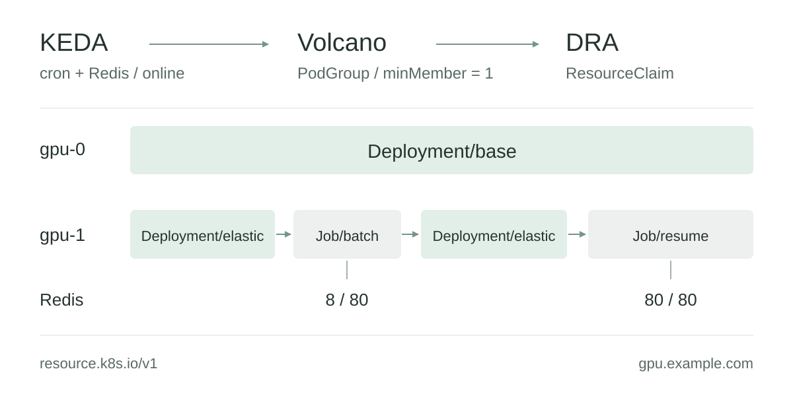
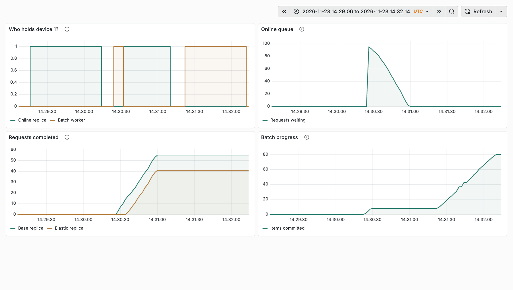

# 夜间把推理 GPU 借给批任务，流量回来要等多久？

晚上十点，一个模型还有零星请求，两份在线副本只需要留一份。另一张卡能不能借给离线推理？如果半夜突然涌进一批请求，正在跑的批任务又该怎么让卡？

我们在本地 Kubernetes 集群里把这个过程跑了一遍。两块模拟设备中，一块始终留给在线服务，另一块先后交给在线副本、离线 Job、在线副本和续跑的 Job。突发的 **96 个请求全部完成**，保底副本处理 55 个，临时拉起的副本处理 41 个。离线任务在第 8 项让卡，回来后完成余下 72 项，80 个编号各执行一次。这个结果能回答谁拿到卡、何时还卡。真实模型的启动、首 token 延迟和训练检查点耗时还需要真卡测量。

## 先选对要交接的资源

| 你的目标 | 可采用的方式 | 唤醒时要付出的代价 |
| --- | --- | --- |
| 同一个实例内，两个模型轮流用显存 | 由持卡实例协调引擎休眠和唤醒，保留 Pod 和设备分配 | 恢复权重、重建缓存、检查剩余显存 |
| 把整张独占卡借给另一个 Kubernetes Job | 排空弹性副本，结束持卡 Pod，让新 Pod 申请独立的 ResourceClaim | 等离线任务交还设备，再拉起在线副本并预热模型 |
| 夜里仍有低延迟请求 | 保留能独立接流量的最小在线容量，只出借额外副本 | 突发期间，保底副本要承受排队，直到额外容量可用 |

vLLM 的一级休眠会把权重转存到主机内存并丢弃 KV 缓存，二级休眠还会丢弃模型参数。SGLang 提供释放和恢复权重、KV 缓存的接口，要求启用内存节省功能，释放前确保引擎已无在途请求。这些调用改变的是进程的显存占用。只要独占设备仍分配给活着的 Pod，另一个 Pod 就拿不到它。本次没有调用这两个引擎的 CUDA 接口。想比较同一张真卡上两个引擎共存和轮换的代价，可以对照之前的 L20 实验。[vLLM Sleep Mode](https://docs.vllm.ai/en/latest/features/sleep_mode/) · [SGLang 内存释放与恢复](https://docs.sglang.io/docs/advanced_features/sglang_for_rl) · [AIBrix 单卡实测](aibrix-modelclaim-l20.md)

## 实验怎么搭

本地三节点集群，Kubernetes v1.37.2。我们在一个工作节点上用示例 DRA 驱动 v0.5.0 发布两个独占设备。常驻副本只选设备 0，弹性副本和批任务都只选设备 1，各自通过模板创建 Claim。这样即使集群还有其他模拟卡，实验也只能靠交还同一个设备取得进展。这里的设备与集群通过设备插件上报的模拟 B300 是两套资源。[DRA 的分配与声明](https://kubernetes.io/docs/concepts/scheduling-eviction/dynamic-resource-allocation/) · [示例驱动 v0.5.0](https://github.com/kubernetes-sigs/dra-example-driver/releases/tag/v0.5.0)



*横向是交接顺序。绿色表示在线副本，灰色表示离线 Job。图中名称对应复现包里的 Kubernetes 对象，8/80 和 80/80 是两次交还设备时已提交的离线进度。*

KEDA v2.21.1 只管理弹性 Deployment。白天的 Cron 触发器要求至少一个副本，夜间由 Redis 队列积压触发；队列和保底副本始终在线。为方便观察，我们把一天压缩到几分钟，轮询间隔设为 3 秒，缩零冷却为 8 秒。新启动的 Volcano v1.16.0 调度器只接收实验指定的调度器名，启用了 DRA 谓词。每个角色有一个最小成员数为 1 的 PodGroup。实验没有配置抢占。[KEDA Cron 触发器](https://keda.sh/docs/2.21/scalers/cron/) · [Redis List 触发器](https://keda.sh/docs/2.21/scalers/redis-lists/) · [Volcano v1.16.0 predicates 源码](https://github.com/volcano-sh/volcano/blob/v1.16.0/pkg/scheduler/plugins/predicates/predicates.go)

借还卡由一个单独的实验脚本协调。它在观察到夜间缩零后才提交批任务。当弹性副本重新需要卡、且 Pod 已在等待时，脚本关闭离线准入。离线 worker 完成手头这一项，提交编号后退出。Volcano 随后按设备选择条件绑定等待的 Pod。KEDA 本身不了解离线任务有没有存好进度。

这是实测 ScaledObject 的主要字段。UTC 14:24 到 14:30 是压缩后的白天。窗口以外，队列从空变为有请求仍然可以唤起在线副本。

```yaml
scaleTargetRef:
  name: elastic
minReplicaCount: 0
maxReplicaCount: 1
pollingInterval: 3
cooldownPeriod: 8
triggers:
  - type: cron
    metadata:
      timezone: Etc/UTC
      start: "24 14 * * *"
      end: "30 14 * * *"
      desiredReplicas: "1"
  - type: redis
    metadata:
      address: tide-redis.keda-tide-lab.svc.cluster.local:6379
      listName: online
      listLength: "2"
      activationListLength: "0"
```

## 对照一：在线进程停工，设备还在谁手里

先让弹性 worker 停止消费并回报暂停确认，保留进程和 Pod，再提交一个同样要求设备 1 的探针 Job。相隔 **9.75 秒**的两次观测中，探针 Pod 都处于 Pending，已经创建 Claim，但没有获配设备。在线 Pod 始终 Running，Claim 标识也没变。这个对照复现了“业务已经空闲，但设备仍有主人”的调度条件。暂停标记只控制 CPU worker，不能据此估算模型休眠能释放多少 GiB。

随后撤掉探针，让 Cron 窗口自然结束。UTC 14:30:00 到达窗口边界，14:30:13 首次观察到弹性副本目标为零且原 Pod 消失。14:30:23 已观察到离线 Job 持有设备 1 并提交了两项结果。整个过程保底 Pod 一直持有设备 0。

## 对照二：借出的卡怎样回到在线服务

一次性向同一条队列写入 96 个唯一编号。脚本分别在入队前后取样，入队发生在 UTC 14:30:24.50 至 14:30:25.68 之间。下表是一次运行的观测时间，各资源和 Redis 是分别读取的，不能据此推算毫秒级先后。

| UTC 观测时间 | 看到了什么 | 怎样解读 |
| --- | --- | --- |
| 14:30:26.84 | 弹性目标为 1，新 Pod Pending，离线 Job 持有设备 1 | KEDA 已发现积压，在线扩容尚未提供服务 |
| 14:30:29.20 | 离线 worker 回报退出，已提交 8 项 | 在任务边界保存进度，关闭新的离线工作 |
| 14:30:30.62 | Job 的 Pod 已成功结束。等待的在线 Pod 仍 Pending，但其 Claim 已获设备 1 | 设备先分配，随后才启动容器。这次在脚本清理旧 Job 前已看到设备交接 |
| 14:30:33.16 | 同一个等待 Pod 已 Running | 没有重建等待者。新旧持有者使用不同 Claim |
| 14:30:35.67 | 已读到弹性副本提交的 3 个结果 | 从入队到首次观测到它有产出约 10–11 秒，包含采样误差 |
| 14:30:59.97 | 96 个编号全部返回，保底 55 个、弹性 41 个 | 可分别核对两个副本的贡献 |
| 14:32:09 | 第二个离线 Job 已提交余下 72 项 | 80 个编号全部存在，逐项执行计数均为 1 |



*左上两条线取自各角色 Claim 的分配结果，1 表示持有设备 1。右下平台期表示离线进度停在 8，恢复后升到 80。截图来自真实 Grafana，将本次集群和 Redis 的离散采样按原始时间戳导入 Prometheus 回看。从白天就绪到离线完成，两次事件之间有 84 个采样点，中位间隔 2.04 秒，最大间隔 2.90 秒。* [逐点数据 CSV](../../assets/practices/keda-volcano-tidal-gpu/observations.csv) · [事件与校验结果 JSON](../../assets/practices/keda-volcano-tidal-gpu/events.json)

这次在线 worker 只处理一个编号并写回结果。真实部署还要加入网关摘流、在途流式请求排空、模型权重读取、引擎预热和首个成功请求。日志里也有一个实际干扰项。KEDA 初次连接 Redis Service 时发生连接超时，随后恢复。因此表中的数字适合检查交接顺序；拿来承诺线上首 token 延迟会高估系统能力。

## 怎样复现，应该盯哪些字段

[下载复现包](../../assets/practices/keda-volcano-tidal-gpu/lab.zip)。包内有环境准备、工作负载、按当前时间生成 Cron 窗口的脚本、实测 ScaledObject 和 Grafana 面板定义。先在独立测试集群准备 KEDA、Volcano 和示例驱动，再按包内说明给独立实验 Redis 和 Kubernetes API 建立本地转发。以下命令都显式选用测试上下文。

```sh
export LAB_CONTEXT=your-test-context
python tidalinfra.py
python workloads.py
kubectl --context "$LAB_CONTEXT" -n keda-tide-lab rollout status deploy/base
python run.py
kubectl --context "$LAB_CONTEXT" -n keda-tide-lab get scaledobject,hpa,pod,resourceclaim
```

排障时顺着四个信号找。① Redis 已积压但弹性目标还是 0，查 ScaledObject 的 Ready/Active 条件、Redis 可达性和外部指标。② 目标变成 1 但 Pod Pending，查 Claim 的设备选择条件和当前持有者。③ 已经分配设备但仍未 Ready，查 kubelet、镜像和推理引擎启动。④ 已 Ready 却没有成功响应，查流量路由和应用日志。测试脚本用返回的唯一编号判定在线恢复，单看期望副本数会提前报喜。

## 哪些工作值得夜间借卡

优先借给可以按条重做、能随时停止取新任务的离线推理，例如批量嵌入或文档标注。输入需要可靠队列，输出要用业务编号去重。本次 Redis 检查点跨 Job 保留，Redis 本身没有持久卷。在线示例取走消息后才写回结果，进程在中途崩溃仍有丢单窗口。线上可用带消费确认和超时重投的队列，并让控制器在重启后从已持久化的设备租用状态恢复。

训练要多算一笔账。能否在限定时间内让卡，取决于最长训练步、所有 rank 到达一致边界所需时间、检查点写入和恢复验证。多卡训练还需要一组可同时分配的设备。生产试点可以先演练离线 worker 拒绝退出、Redis 不可达和模型冷启动超时，测从请求进入到返回首 token 的 P95/P99，再决定可出借的副本数。若业务只能接受两秒额外等待，而本地轻量进程的单次还卡就用了约十秒，首选方案是扩大常驻容量，或让严格时延请求始终走已预热的副本。
