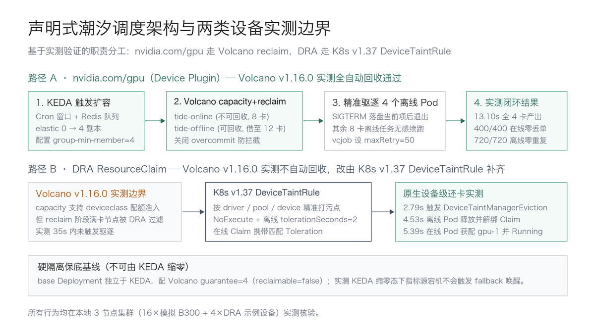
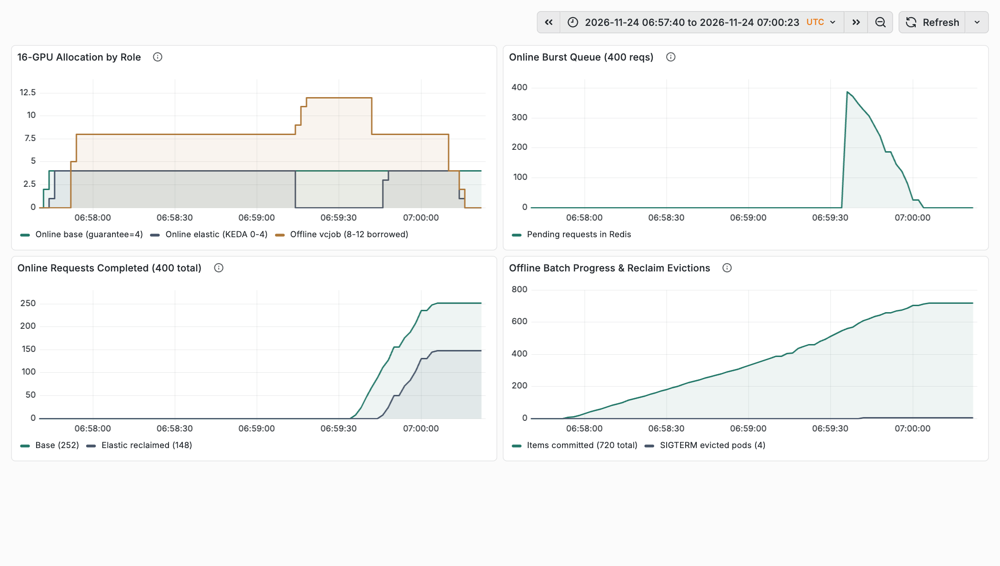
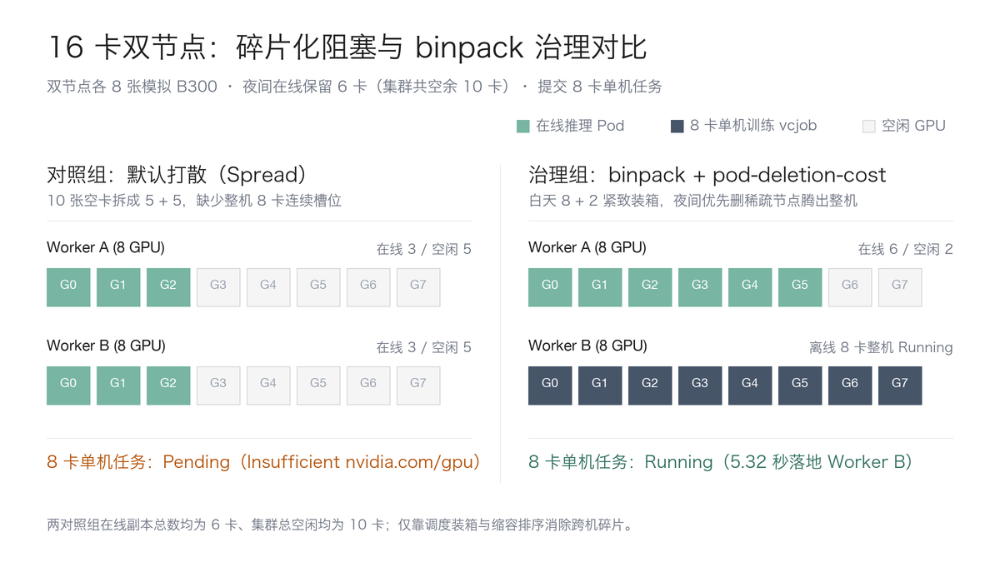
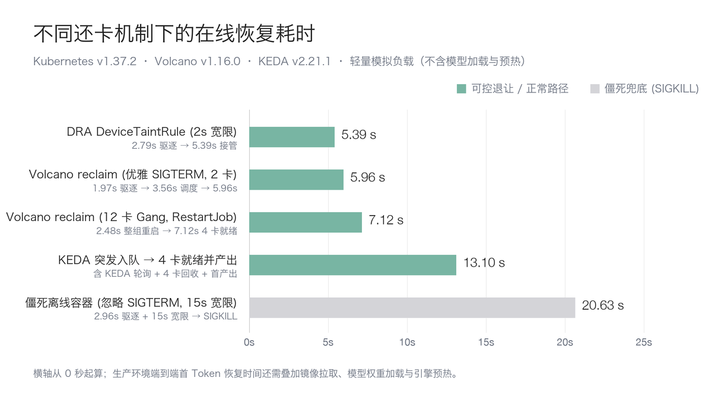

# 夜间把推理 GPU 借给批任务，流量回来要等多久？KEDA、Volcano 与 DRA 实测

晚上十点，一个在线模型只有零星流量，白天占用的 8 张卡只需留 4 张保底。另外 4 张卡能不能自动借给离线批推理或分布式训练？如果半夜突然涌进一批请求，离线任务怎么自动让卡、僵死不退出怎么兜底、跨节点碎片导致 8 卡训练放不下又该怎么治？

我们在本地 3 节点 Kubernetes v1.37.2 集群（2 台 8 卡工作节点共 **16 张模拟 B300 GPU** + **4 块独占 DRA 示例设备**）上完整跑通了五组实战，不写自定义“人工还卡脚本”，直接用 **KEDA v2.21.1 + Volcano v1.16.0 多队列 `reclaim` + Kubernetes v1.37 DRA `DeviceTaintRule`** 验证每条路径的真实表现与生产暗坑：

- **16 卡 `nvidia.com/gpu` 纯声明式借还**：夜间离线 `vcjob` 自动借满 12 卡（集群 16/16 满载）；突发注入 **400 个在线请求**后，KEDA 拉起 4 个弹性副本，Volcano `reclaim` 自动精准驱逐 4 个离线 Pod（其余 8 个无感续跑），入队后 **13.10 秒** 4 个弹性副本全部 Running 并开始吐结果；400 个在线请求（保底 252 / 弹性 148）零丢单，720 个离线项零重复完成。
- **排雷 3 个真实 Volcano + KEDA 生产坑**：默认 `overcommit` 插件在满载时把 4 卡在线 `PodGroup` 拦在 `Pending`；Deployment 默认 `minMember: 1` 让 `reclaim` 拿到第 1 张卡就停手；`vcjob` 默认 `maxRetry: 3` 会在一次回收 4 个 Pod 时把整个离线任务判 `Failed`。
- **DRA `ResourceClaim` 的真实边界与解法**：实测 Volcano v1.16.0 的 `capacity` 支持 DRA 配额准入，但 **`reclaim` 不会自动回收 DRA 设备**（满卡节点在谓词过滤阶段即被排除）；而在 Kubernetes v1.37 上，用原生 **`DeviceTaintRule (NoExecute)`** 配合离线 `tolerationSeconds: 2`，**5.39 秒**即可把 `gpu-1` 从离线 Pod 完整交回在线 Pod。
- **碎片治理、Gang 回收与故障演练**：用 `binpack` + `pod-deletion-cost` 消除“空余 10 卡却放不下 8 卡单机任务”的碎片陷阱（**5.32 秒**落地）；实测 12 卡多节点 Gang `vcjob` 的 `RestartPod`（残留 8 张僵尸卡）vs `RestartJob`（2.48 秒整组退让、7.12 秒在线全就绪）；验证忽略 `SIGTERM` 的僵死容器如何被 `terminationGracePeriodSeconds: 15` 兜底锁死在 **20.63 秒**，以及 KEDA `fallback` 在缩零态与连接建连失败时的两大盲区。

> 本文所有工作负载均为轻量模拟进程，测得的是**控制面检测、调度回收、设备解绑与容器启动**的真实耗时；生产环境端到端首 Token 恢复时间还需叠加镜像拉取、模型权重加载与引擎预热。

---

## 先选对要交接的资源：引擎休眠 vs 整卡回收

| 你的目标 | 可采用的方式 | 唤醒或还卡时要付出的代价 |
| --- | --- | --- |
| 同一个实例内，两个模型轮流用显存 | 由持卡实例协调引擎休眠和唤醒，保留 Pod 和设备分配 | 恢复权重、重建 KV 缓存、核对剩余显存 |
| 把整张独占卡借给另一个 Kubernetes Job | KEDA 缩容弹性副本释放 Pod，由 Volcano 多队列 `reclaim` 或 DRA `DeviceTaintRule` 回收整卡 | 等离线任务落盘退出、设备解绑、再拉起在线副本并预热模型 |
| 夜里仍有低延迟请求 | 把 `base` 保底副本独立在 KEDA 之外并配 Volcano `guarantee`，只出借弹性副本 | 突发前几十秒由保底副本承压排队，直到弹性副本就绪 |

vLLM 的一级休眠会把权重转存到主机内存并丢弃 KV 缓存，二级休眠还会丢弃参数；SGLang 也提供释放和恢复权重与 KV 缓存的接口。**但这些调用只改变进程内的显存占用**——我们在对照探针中让在线进程暂停消费但保留 Pod，相隔 **9.75 秒** 的两次观测里，申请同一独占设备的离线 Pod 始终 `Pending`，原 Pod 的 `ResourceClaim` 归属纹丝不动。想比较同一张真卡上两个引擎共存和轮换的显存代价，可对照之前的 L20 实测。[vLLM Sleep Mode](https://docs.vllm.ai/en/latest/features/sleep_mode/) · [SGLang 内存释放与恢复](https://docs.sglang.io/docs/advanced_features/sglang_for_rl) · [AIBrix 单卡实测](aibrix-modelclaim-l20.md)

因此，只要夜间借卡对象是**独立的批推理或训练 Job**，就必须把在线弹性副本真正缩下去归还整卡，并在流量回流时通过声明式调度把卡抢回来。



---

## 实验拓扑与声明式队列配置

测试集群为 3 节点 Kubernetes v1.37.2（1 个控制面 + 2 台工作节点 `Worker A`、`Worker B`）。两套资源并行验证：

1. **16 张模拟 B300 GPU（`nvidia.com/gpu`）**：通过 `fake-gpu-operator` v0.2.1 在 `Worker A`、`Worker B` 上各上报 8 张 `NVIDIA-B300-SXM6-AC`，用于验证多队列自动回收、跨节点碎片治理、12 卡 Gang 回收、僵死容器与 KEDA 故障演练。
2. **4 块独占 DRA 设备（`gpu.example.com`）**：通过 `dra-example-driver` v0.5.0 在 `Worker A` 上发布 `gpu-0` 至 `gpu-3`，用于验证 Volcano v1.16.0 DRA `reclaim` 能力以及 Kubernetes v1.37 原生 `DeviceTaintRule`。

我们在 `volcano-system` 中拉起独立的 `tide-volcano` 调度器与 `tide-pg-controller`（仅启用 `--controllers=pg-controller --scheduler-name=tide-volcano`），与集群默认调度器完全隔离。队列配额如下：

- **`tide-online`**：`reclaimable: false`，`guarantee: 4 GPU / 1 DRA`，`deserved: 8 GPU / 2 DRA`，`capability: 16 GPU / 4 DRA`，`PriorityClass: tide-online-high (1000)`。
- **`tide-offline`**：`reclaimable: true`，`guarantee: 0`，`deserved: 8 GPU / 2 DRA`，`capability: 16 GPU / 4 DRA`，`PriorityClass: tide-offline-low (100)`。

由于 `tide-online` 声明了 `guarantee: 4`，Volcano `capacity` 插件会自动把 `tide-offline` 的 `realCapability` 限制为 `16 - 4 = 12` 张卡——**离线任务最多借满 12 张卡，物理上永远碰不到在线的 4 张保底卡**；同时一旦超过自身的 `deserved: 8`，超配借用的 4 张卡就随时可被 `tide-online` 回收。

```yaml
# Verified tide-volcano scheduler config after fixing production pitfalls
actions: "enqueue, allocate, backfill, reclaim, preempt"
tiers:
- plugins:
  - name: priority
  - name: gang
    enablePreemptable: false
    enableReclaimable: false   # allow reclaiming minAvailable == replicas Gang jobs
  - name: conformance
- plugins:
  # Intentionally omit default overcommit plugin so 16/16 full utilization does not block enqueue
  - name: drf
    enablePreemptable: true
    enableReclaimable: true
  - name: predicates
    arguments:
      predicate.DynamicResourceAllocationEnable: true
  - name: capacity
    arguments:
      capacity.DynamicResourceAllocationEnable: true
      capacity.DRAConsumableCapacityEnable: true
  - name: nodeorder
  - name: binpack
    arguments:
      binpack.weight: 10
      binpack.resources: nvidia.com/gpu
      binpack.resources.nvidia.com/gpu: 10
```

---

## 实战一：16 卡多队列声明式借还（`nvidia.com/gpu` vs DRA）

### 1A. 16 卡 `nvidia.com/gpu`：零胶水脚本的全自动闭环

在线侧由 `base`（固定 4 副本，不受 KEDA 管理）和 `elastic`（由 KEDA `ScaledObject` 按白天 Cron 窗口 + 夜间 Redis 队列积压在 `0–4` 间伸缩）组成；离线侧是一个 12 副本 Volcano `vcjob`（`batch-elastic`，`minAvailable: 1`，`maxRetry: 50`，`PodEvicted -> RestartPod`），消费 720 条离线任务。每个离线 worker 捕获 `SIGTERM`，收到信号后把当前正在处理的一条任务提交到 Redis 后优雅退出（`exit 0`）。

| UTC 观测时间 | 阶段与集群状态 | 关键指标与解读 |
| --- | --- | --- |
| 06:57:53 | 白天稳态：`base=4`、`elastic=4`、`offline=8`（4 Pending） | 16/16 张卡 100% 占满，离线吃掉余量 8 卡 |
| 06:59:13 | Cron 白天窗口结束，KEDA 将 `elastic` 缩至 0 | 在线只保留 4 张保底卡 |
| 06:59:19 | 离线自动扩至 `12 Running`（0 Pending） | **6 秒内自动借满 4 张空闲卡**，`tide-offline` 达 `12 > deserved 8` |
| 06:59:34.6 | 突发注入 **400 个**在线请求 | 队列瞬时积压，`base` 开始承压 |
| 06:59:42.8 | **+8.2 s**：KEDA 拉起 `elastic=4`，Volcano 自动驱逐 4 个离线 Pod | `worker-4/5/6/7` 收到 `SIGTERM` 优雅落盘退出，**其余 8 个离线 Pod 未中断** |
| 06:59:47.7 | **+13.1 s**：4 个 `elastic` 副本全部 `Running` 且已吐出 25 个结果 | 零人工脚本干预，端到端从入队到 4 卡全产出约 **13.1 秒** |
| 07:00:05.5 | **+30.9 s**：400 个在线请求全部完成 | `base` 完成 **252 个**，`elastic` 完成 **148 个**，零丢单 |
| 07:00:15.0 | **+40.4 s**：KEDA 冷却结束，`elastic` 缩回 0；离线 720 项全部完成 | 逐项执行计数全为 **1**，零重复、零丢失 |



*上图来自真实 Grafana（浅色主题），将本次 16 卡实测按原始时间戳采集的 86 个集群与 Redis 采样点导入 Prometheus 渲染。左上可见三类角色合计始终紧贴 16 卡；右下可见 4 次 `SIGTERM` 优雅退让后，离线进度曲线连续爬升至 720/720。* [原始采样 CSV](../../assets/practices/keda-volcano-tidal-gpu/observations.csv) · [全五组实验校验 JSON](../../assets/practices/keda-volcano-tidal-gpu/events.json)

### 上线前必踩的 3 个 Volcano + KEDA 真实暗坑

在跑通 1A 之前，我们在集群里连续踩中并复现了三个极易在生产静默失败的坑：

1. **暗坑一：`overcommit` 插件在满卡时把在线 `PodGroup` 拦在 `Pending`**。Volcano 默认 Helm 配置启用 `overcommit`（默认系数 `1.2`）。16/16 卡满载时集群准入上限是 `19.2` 卡；4 卡在线 `PodGroup` 入队计算 `16 + 4 = 20 > 19.2`，在 `enqueue` 阶段被 `overcommit.go:129: Resource in cluster is overused, reject job ... to be inqueue` 直接拒绝。由于 `PodGroup` 停在 `Pending`，`reclaim.go:73` 直接跳过它，**表现为离线满载、在线永远抢不到卡**。解法：在启用 `capacity + reclaim` 的潮汐调度器中移除 `overcommit`（由 `capacity` 管控队列配额）。
2. **暗坑二：Deployment 默认 `PodGroup(minMember=1)` 让 `reclaim` 抢完第 1 张卡就停手**。Volcano `pg-controller` 为整个 `ReplicaSet` 创建一个默认 `minMember: 1` 的共享 `PodGroup`，而 `reclaim.go:91` 仅在 `JobStarving (waiting + ready < minMember)` 为真时回收。KEDA 把 `elastic` 从 `0 -> 4` 时，抢回第 1 张卡后 `JobStarving` 就翻为 `false`，调度器打印 `No preemptors in Queue <tide-online>, break.`，**副本 2–4 永久卡在 `Pending`**。解法：对固定步长弹性池在 Deployment 上加注解 `scheduling.volcano.sh/group-min-member: "4"`；若需要任意步长（1/2/3/4）逐个回收，则将弹性槽位拆成独立的单副本 Deployment（或由控制器同步 `minMember`）。
3. **暗坑三：`vcjob` 默认 `maxRetry=3` 会在单次 4 卡回收波中直接杀掉整个离线 Job**。每次 `PodEvicted -> RestartPod` 都会递增 `vcjob.status.retryCount`。当在线一次收回 4 张卡时，第 4 次驱逐直接撞穿默认上限（`retryCount=3 -> Failed`），导致整个 `vcjob` 转入 `Failed` 并连带杀掉其余 8 个原本健康的离线 Pod。解法：对可回收批推理 `vcjob` 显式调大 `spec.maxRetry`（如 `50`）。

### 1B. 同等配置下的 DRA `ResourceClaim`：Volcano v1.16.0 实测不自动回收

紧接着，我们用**同一套 `tide-volcano` 调度器与队列**（已启用 `predicate.DynamicResourceAllocationEnable: true` 与 `capacity.DynamicResourceAllocationEnable: true`，并按官方指南配置了 `deviceclass/gpu.example.com` 的 `capability`/`deserved`/`guarantee`）测试 DRA 4 设备：

- 夜间稳态：`dra-base` 持有 `gpu-0`，`dra-batch`（`tide-offline`）借走 `gpu-1`、`gpu-2`、`gpu-3`（`3 > deserved 2`，4/4 DRA 设备占满）。
- 触发扩容：将 `dra-elastic`（`tide-online`，`deserved: 2`）从 `0 -> 1`，持续观测 35 秒。
- **实测结果：`reclaimed_automatically = false`，0 个离线 Pod 被驱逐**，`dra-elastic` 一直停在 `Pending`。

从 `tide-volcano` 的 `-v=4` 日志可以清楚看到两层根因：
1. **节点在回收选人前就被 DRA 谓词淘汰**：`reclaim.go:183` 在模拟驱逐之前调用 `PredicateForPreemptAction`，`DynamicResources` 插件对满卡节点直接返回 `cannot allocate all claims`，`Worker A` 连进入候选驱逐筛选循环的机会都没有。
2. **`capacity` 回收维度尚未纳入 DRA 设备**：日志 `capacity.go:686` 明确打印 `Queue <tide-online> can reclaim on resource dimensions: [cpu memory]`；同时 `totalResource` 汇总的是 `Node.Status.Allocatable`（不含 DRA 设备），导致标量侧把 `tide-online` 的 `deviceclass/gpu.example.com` `deserved` 截断成了 `guarantee` 值 1。

> **工程结论**：在 Volcano v1.16.0 上，**`deviceclass/<DeviceClass>` 可用于队列准入配额控制，但不要指望它像 `nvidia.com/gpu` 一样自动完成跨队列 `reclaim`**。若生产已采用 DRA，设备级强制还卡需要借助下文的 Kubernetes v1.37 原生 `DeviceTaintRule`。

---

## 实战二：16 卡多节点 GPU 碎片治理与 12 卡 Gang `vcjob` 回收

### 2A. 为什么集群空着 10 张卡，8 卡单机训练还是 Pending？

在 2 台 8 卡节点上，夜间在线服务保留 6 张卡、集群总共空闲 10 张卡，此时提交一个需要整机 8 张卡（模拟单机 NVLink 训练）的 `vcjob`：

- **对照组（默认 Spread 打散）**：在线 6 张卡按 3 + 3 分布在 `Worker A` 与 `Worker B`，每台只剩 5 张空卡。提交 8 卡单机 `vcjob` 后持续 **`Pending`**（`0/3 nodes are unavailable: 3 Insufficient nvidia.com/gpu`）。
- **治理组（Volcano `binpack` + `pod-deletion-cost`）**：白天 10 个在线副本经 `binpack` 紧致装箱为 `Worker A` 8 卡 + `Worker B` 2 卡；夜间缩容前给满载节点上的 Pod 标高删除代价（`controller.kubernetes.io/pod-deletion-cost` 设为 `"100"`），给稀疏节点标负代价（`"-100"`），随后 `10 -> 6` 缩容。ReplicaSet 优先排空 `Worker B`，稳态变成 `Worker A` 6 卡 + `Worker B` 0 卡（整机 8 卡连续空闲）。此时提交同一个 8 卡单机 `vcjob`，**5.32 秒直接落地 `Worker B` 进入 `Running`**。



### 2B. 12 卡多节点 Gang `vcjob` 回收：`RestartPod` 僵尸占卡 vs `RestartJob`

批推理可以按 Pod 逐个回收，但分布式训练往往是多机 Gang 调度（所有 rank 必须在同步屏障汇合才能推进 step）。我们在两台节点上跑了一个 **12 卡跨节点 Gang `vcjob`**（`minAvailable: 12`，分布为 `Worker A` 4 卡 + `Worker B` 8 卡，在 Redis 中模拟 12-rank AllReduce 屏障与按 epoch 落盘），当在线 `elastic` 突发扩容要回 4 张卡时，对比两种策略：

> **前置条件**：Volcano `gang` 插件在 `gang.enableReclaimable: true` 时会执行 `gang.go:113` 的保护逻辑（`ready <= minAvailable` 则拒绝驱逐任何 Pod）。要让在线队列能回收满编运行的离线 Gang 训练任务，必须在调度器配置中为 `gang` 插件设置 `enableReclaimable: false`。

| 策略配置 | 在线 4 卡全就绪耗时 | 突发期间离线残留占卡 | 训练进度表现 | 突发结束后恢复 |
| --- | --- | --- | --- | --- |
| `PodEvicted -> RestartPod`（反模式） | **7.13 s** | **8 张僵尸卡死锁**（`gang_running=8, pending=4`） | 卡在 epoch 4 无法越过 12-rank 屏障，白烧 8 张卡 | 未整组重置 |
| `PodEvicted -> RestartJob` | **7.12 s** | 2.48 秒先整组归零（`gang_running=0`），但需防 `backfill` 回填 | 完整释放并触发整组重启 | 在线缩零后 **18.60 s** 从断点续训至 **epoch 10/10** |

实测 `RestartJob` 还暴露出一个极细微的调度器细节：在 `t+2.48 s` 时 `RestartJob` 确实把全部 12 个旧 Pod 干净清零（`gang_running=0, gang_pending=12`），但当 `vcjob` 重建出 12 个新 Pod 后，由于 `tide-volcano` 开启了 `backfill` 动作，调度器在突发期间仍把其中 8 个新 Pod 回填到了剩余 8 张空闲卡上（`vcjob` 保持 `Pending`，直至在线缩零补齐最后 4 张卡才继续推进到 epoch 10）。**因此对严格的 All-or-Nothing 多机训练，生产上建议搭配关闭该队列的 `backfill` 或使用 `TerminateJob` 交由外层队列（如 Kueue）在资源充足时统一重提。**

---

## 实战三：三组生产故障演练（Chaos Drills）

### 4A. 僵死离线容器（忽略 `SIGTERM`）：用宽限期把最坏 SLA 锁死

生产里最怕离线容器卡在 NCCL 通信或写 Checkpoint，甚至写错信号处理直接忽略 `SIGTERM`。我们在 16 卡满载下把 `terminationGracePeriodSeconds: 15` 设在两组离线任务上，对比在线 `elastic` `0 -> 2` 时的恢复耗时：

- **优雅响应 `SIGTERM`**：`1.97 s` 观测到驱逐 → `3.56 s` 在线完成调度 → **`5.96 s` 在线 2 卡全部 `Running`**。
- **恶意忽略 `SIGTERM`（`trap '' TERM INT`）**：`2.96 s` 观测到驱逐 → kubelet 严格等待 15 秒宽限期后下发 `SIGKILL` 强杀 → `19.16 s` 在线完成调度 → **`20.63 s` 在线 2 卡全部 `Running`**（增量恰好约 `+14.67 s`）。

**落地要点**：潮汐集群必须通过准入策略（Kyverno / ValidatingAdmissionPolicy）强制给 `tide-offline` 队列里的 Pod 设定 `terminationGracePeriodSeconds` 上限（例如 15–30 秒），否则一个不配合退出的训练容器就能把在线恢复 SLA 拖成无穷大。

### 4B. 指标源宕机实测：KEDA `fallback` 的两大真实盲区

很多团队会给 `ScaledObject` 配 `fallback: {failureThreshold: 2, replicas: 2}`，以为 Redis 或 Prometheus 挂掉时 KEDA 会自动保底拉起 2 个副本。我们在 KEDA v2.21.1 上实际把 `tide-redis` 缩到 `0` 做了两组对照，发现了**两个容易让人误判的盲区**：

1. **缩零态下 `fallback` 不会唤醒（`Active=False`）**：当 `elastic` 处于夜间 `0` 副本时停掉 `tide-redis`，观测 51 秒内 `ScaledObject` 状态变为 `Ready=False, Active=Unknown, Fallback=Unknown`，**`elastic` 副本始终停留在 `0`**，不会拉起 `2` 个兜底副本。
2. **连接初始化阶段失败不会累计 `fallback` 计数**：即使在 `elastic` 处于 `4` 副本活跃态（`Active=True`）时停掉 `tide-redis`，KEDA 的 Redis scaler 在 `scalers_builder.go:96` 构建连接池时就直接 TCP 报错（建连失败），尚未进入 `GetMetricsAndActivity` 指标采样路径，导致 `Fallback` 条件始终为 `False`；等 Redis 恢复为空列表时直接触发 `4 -> 0` 缩容。

**架构底线**：**绝对不要把 KEDA `fallback` 当成在线服务保底容量的唯一防线。** 真正可靠的兜底必须是一个**不受 KEDA 管控的独立 `base` Deployment**，并在 Volcano 侧用 `guarantee` + `reclaimable: false` 锁死物理配额。

### 4C. Kubernetes v1.37 原生 DRA `DeviceTaintRule`：5.39 秒补齐 DRA 还卡缺口

前面实战 1B 证实了 Volcano v1.16.0 的 `reclaim` 不会自动驱逐 DRA `ResourceClaim`。但 Kubernetes v1.37 已经将 `DeviceTaintRule`（`resource.k8s.io/v1`）与 Claim 级容忍纳入核心 API：

- 离线 Pod 持有 `gpu-1`，其 Claim 模板为 `tide.aik8s.io/reclaim=online-only:NoExecute` 配置了 **`tolerationSeconds: 2`**（预留 2 秒优雅落盘窗口）。
- 等待中的在线 Pod 携带永久容忍（同时容忍 `NoExecute` 与 `NoSchedule`），初始因 `gpu-1` 被占用处于 `Pending`。
- 对 `driver: gpu.example.com, device: gpu-1` 下发一条 `DeviceTaintRule (effect: NoExecute)`：
  - **`t + 2.79 s`**：Kubernetes 内置驱逐控制器触发 `DeviceTaintManagerEviction: Marking for deletion`（精准遵守 2 秒宽限）。
  - **`t + 4.53 s`**：离线 Pod 捕获 `SIGTERM` 退出，对应 `ResourceClaim` 自动解绑释放，且新离线 Pod 因缺少容忍无法重新抢占 `gpu-1`。
  - **`t + 5.39 s`**：等待中的在线 Pod 获配 `gpu-1` 并进入 **`Running`**。

> 实测排雷：如果集群的 kubelet 根目录不是默认路径，安装 DRA 驱动时必须同步指定 `kubeletPlugin.kubeletRegistrarDirectoryPath` 与 `kubeletPlugin.kubeletPluginsDirectoryPath`，否则虽然调度器和 `DeviceTaintRule` 都能完成分配，Pod 在节点侧会卡在 `FailedPrepareDynamicResources: DRA driver ... is not registered`。



---

## 复现包与生产排障清单

[下载新版脱敏复现包](../../assets/practices/keda-volcano-tidal-gpu/lab.zip)，内含经过实测验证的 `tide-volcano` 调度器配置、`tide-online`/`tide-offline` 队列与 `PriorityClass` YAML、K8s v1.37 `DeviceTaintRule` 示例、三套自动化实测脚本与 Grafana 12.x 浅色面板定义。

```sh
export LAB_CONTEXT=your-test-context
# 1. Apply queues, PriorityClasses, and isolated tide-volcano / tide-pg-controller
kubectl --context "$LAB_CONTEXT" apply -f volcano-scheduler-cm.yaml -f queues-and-priorities.yaml
# 2. Run all three test suites
python3 exp1_multiqueue_reclaim.py
python3 exp2_gang_and_fragmentation.py
python3 exp3_chaos_drills.py
```

上线前建议按以下 6 条核对生产配置：

1. **隔离保底容量**：在线 `base` Deployment 不要交给 KEDA 缩零，用 Volcano `guarantee` + `reclaimable: false` 物理隔离。
2. **检查 `overcommit` 与 `group-min-member`**：满卡集群若出现“离线超配、在线 `PodGroup` 长期 `Pending`”，先查调度器日志是否触发 `overcommit.go` 拒绝入队，再查 Deployment 的 `PodGroup.spec.minMember` 是否仍为 `1`。
3. **调大可回收 `vcjob` 的 `spec.maxRetry`**：按单次最大回收卡数留足余量，避免批量还卡直接把离线 Job 打成 `Failed`。
4. **治理跨机碎片**：对多副本在线推理开启 `binpack`（按 `nvidia.com/gpu` 高权重装箱），并在缩容前用 `controller.kubernetes.io/pod-deletion-cost` 优先排空低占卡节点。
5. **给离线宽限期加硬顶**：通过准入策略强制限制 `tide-offline` 的 `terminationGracePeriodSeconds`，避免僵死容器拖垮在线 SLA。
6. **区分设备栈选型**：当前生产大规模落地潮汐混部，**`nvidia.com/gpu` + Volcano `capacity/reclaim`** 最成熟；若已切换至 Kubernetes v1.37+ DRA，则需用 **`DeviceTaintRule (NoExecute)`** 补齐设备级自动驱逐，并把真实模型冷启动耗时（权重拉取 + 预热 + 首 Token P99）纳入最终可出借卡数的评估预算。
