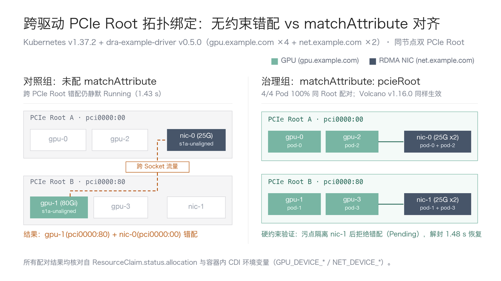
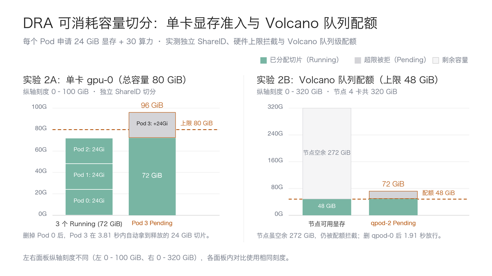
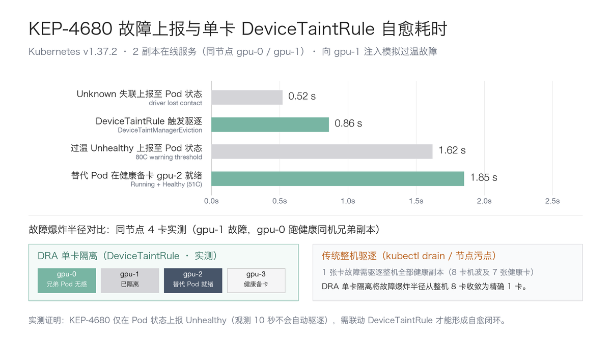

# Kubernetes v1.37 DRA 高级三件套实测：跨驱动 PCIe 拓扑绑定、可消耗容量切分与单卡故障隔离

在上一篇 [夜间借出的推理 GPU 怎样还回来？KEDA、Volcano 与 DRA 实测](keda-volcano-tidal-gpu.md) 里，我们用整卡独占的 DRA 对比了 `nvidia.com/gpu` 的潮汐借还。但真正把 DRA（Dynamic Resource Allocation）推向生产 AI 基础设施的，并不是“换一种方式申领整张卡”，而是 Kubernetes 1.35–1.37 逐步就绪的三项**传统 Device Plugin 根本做不到**的高级能力：

1. **跨驱动 PCIe 拓扑联合调度**：把 `gpu.example.com` 的 GPU 和 `net.example.com` 的 RDMA 网卡绑在同一个 `resource.kubernetes.io/pcieRoot` 下，消除跨 Socket/UPI 通信退化。
2. **原生可消耗容量切分（Consumable Capacity）+ 队列配额**：通过 `allowMultipleAllocations: true` 让多个 Pod 按显存与算力切片共享同一张物理卡（分配独立 `ShareID`），并在 Volcano `v1.16.0` 上直接做按显存/算力维度的队列级配额治理。
3. **KEP-4680 设备健康状态上报 + 单卡 `DeviceTaintRule` 精准隔离**：让 GPU 过温或失联直接浮出到 Pod `allocatedResourcesStatus`，再把坏卡的故障爆炸半径从“整机 `kubectl drain` 赶走 8 张卡”收敛到“只驱逐坏掉的那 1 张卡”。

我们在本地 3 节点 Kubernetes `v1.37.2` 集群（`Volcano v1.16.0` + `dra-example-driver v0.5.0`）上跑完了三套共 8 组对照实验，核心实测结论如下：

- **跨驱动 PCIe Root 绑定（`matchAttribute`）**：不配约束时，对照组 `s1a-unaligned` 在 **1.43 秒** 内静默 `Running`，却被错配成 `gpu-1`（`pci0000:80`）+ `nic-0`（`pci0000:00`）；加上 `matchAttribute: resource.kubernetes.io/pcieRoot` 后，**4/4 Pod 100% 同 PCIe Root 配对**，且污点隔离 `nic-1` 时宁可 `Pending` 也不跨 Socket 错配，解封后 **1.48 秒** 自动恢复；切换到 **Volcano `v1.16.0`** 同样在 **2.06 秒** 完成跨驱动同 Root 绑定。
- **可消耗容量切分与 Volcano 队列显存配额**：在 80 GiB / 100 算力的单卡 `gpu-0` 上，3 个申请 `24Gi` + `30` 的 Pod 成功共置并获得 **3 个独立 `ShareID`**（合计 `72Gi / 80Gi`、`90 / 100`）；第 4 个 Pod（`96Gi > 80Gi`）与越界请求（`90Gi > 80Gi`）均被调度器拦在 `Pending`，删除 Pod 0 后 **3.81 秒** 自动补位。在 Volcano `v1.16.0` 队列 `dra-vgpu-q` 设置 `memory.deviceclass/gpu.example.com: 48Gi` 后，尽管节点还空余 **272 GiB**，第 3 个 Pod 仍被精准拦截（`Queue <dra-vgpu-q> DRA resource insufficient`），释放配额后 **1.91 秒** 放行。
- **KEP-4680 上报边界与单卡自愈**：向 `gpu-1` 注入过温告警后，Pod `allocatedResourcesStatus` 在 **1.62 秒** 变为 `Unhealthy`（失联 `Unknown` 仅 **0.52 秒**），但持续观测 **10 秒** `kubelet` 不会自动驱逐 Pod——**KEP-4680 只做健康上报，不做故障驱逐**。补上针对 `gpu-1` 的单卡 `DeviceTaintRule`（`NoExecute`）后，**0.86 秒** 触发驱逐，Deployment 的替代副本在 **1.85 秒** 避开坏卡、于健康备卡 `gpu-2` 恢复 `Running` + `Healthy`，同节点 `gpu-0` 上的健康兄弟副本全程 **0 重启、UID 不变**。

> 本文所有工作负载均运行在 `dra-example-driver v0.5.0` 提供的模拟 DRA GPU/NIC 设备上，测得的是 Kubernetes `v1.37.2` 与 Volcano `v1.16.0` **控制面拓扑约束、容量账本、CDI 参数注入、健康上报与驱逐自愈**的真实行为和耗时；真实物理卡上的 PCIe 带宽收益与显存硬隔离能力仍取决于底层厂商 DRA Driver 与硬件运行时（如 MIG、MPS 或 RDMA SR-IOV）。

---

## 实验环境与 DRA 资源拓扑

实验集群为 3 节点 Kubernetes `v1.37.2`（1 个控制面节点 + 2 台工作节点），所有 DRA 驱动定向调度在 `Worker A` 上，确保拓扑与单卡切分实验不受多节点分散干扰。我们在集群上同时部署了两套独立 DRA 驱动和一套隔离的 Volcano `v1.16.0` 调度器实例（`dra-volcano` + `dra-pg-controller`）：

| 组件 / 驱动 | 版本 / 角色 | 在 `Worker A` 上发布的设备与拓扑属性 |
| --- | --- | --- |
| `gpu.example.com` | `dra-example-driver v0.5.0`（GPU 实例） | `4` 张卡（`allowMultipleAllocations: true`，每卡 `memory: 80Gi`、`compute: 100`）：`gpu-0` / `gpu-2` 在 `pci0000:00`，`gpu-1` / `gpu-3` 在 `pci0000:80` |
| `net.example.com` | `dra-example-driver v0.5.0`（NIC 实例） | `2` 张网卡（`allowMultipleAllocations: true`，每卡 `ingressBandwidth: 100G`、`egressBandwidth: 100G`、`vfs: 100`）：`nic-0` 在 `pci0000:00`，`nic-1` 在 `pci0000:80` |
| `dra-volcano` | Volcano `v1.16.0` 独立调度器 | 开启 `predicate.DynamicResourceAllocationEnable: true`、`capacity.DynamicResourceAllocationEnable: true`、`capacity.DRAConsumableCapacityEnable: true` |

安装 `dra-example-driver` 时有一个生产环境常见细节：如果你的集群把 `kubelet` 根目录改到了非默认路径（不是 `/var/lib/kubelet`），必须在 Helm values 中显式对齐 `kubeletRegistrarDirectoryPath` 和 `kubeletPluginsDirectoryPath`，否则驱动插件无法向 `kubelet` 注册，集群里看不到任何 `ResourceSlice`。

---

## 实战一：跨驱动 PCIe Root 拓扑绑定（GPU + RDMA NIC）

在传统 Device Plugin 模式下，`nvidia.com/gpu` 和 `rdma/roce_gdr` 各自独立计数，调度器只知道“这台机器有空闲 GPU，也有空闲网卡”，却无法保证分给同一个 Pod 的 GPU 和网卡挂在同一颗 CPU 的同一个 PCIe Root Complex 下。一旦错配，GPUDirect RDMA 流量被迫绕行跨 Socket 总线（UPI/xGMI），在多机训练或 P/D 分离推理的 KV Cache 传输中会出现隐蔽的尾延迟抖动（整卡多卡场景可对照 [8 卡节点的四卡任务，如何避免拿到跨 NUMA 的碎片 GPU](gpu-topology-fragmentation-scheduling.md)）。

DRA 的 `ResourceClaimTemplate` 原生支持在**单次声明**里同时请求两个不同 `DeviceClass` 的设备，并用 `constraints[].matchAttribute` 强制它们的 `resource.kubernetes.io/pcieRoot` 一致：

```yaml
apiVersion: resource.k8s.io/v1
kind: ResourceClaimTemplate
metadata:
  name: gpu-nic-pcie-aligned
spec:
  spec:
    devices:
      requests:
      - name: gpu
        exactly:
          deviceClassName: gpu.example.com
          capacity:
            requests:
              memory: 80Gi
              compute: "100"
      - name: nic
        exactly:
          deviceClassName: net.example.com
          capacity:
            requests:
              ingressBandwidth: 25G
              egressBandwidth: 25G
              vfs: "1"
      constraints:
      - requests: ["gpu", "nic"]
        matchAttribute: resource.kubernetes.io/pcieRoot
```

我们设计了 4 组递进实验（1A–1D），不仅核对 `ResourceClaim.status.allocation`，还直接进容器读取 CDI 注入的环境变量（`GPU_DEVICE_*` / `NET_DEVICE_*`）双重验真：



| 实验编号 | 调度器与约束配置 | 实际分配设备与 PCIe Root | 结果与耗时 | 工程含义 |
| --- | --- | --- | --- | --- |
| 1A 对照组 | `default-scheduler`，不配 `matchAttribute`，`gpu` 指定 `gpu-1`，`nic` 指定 `nic-0` | `gpu-1`（`pci0000:80`）+ `nic-0`（`pci0000:00`） | `Running`（**1.43 s**），`pcie_matched: false` | 无约束时跨 PCIe Root 错配不会报错，会静默带着性能劣化上线 |
| 1B 满载对齐 | `default-scheduler` + `matchAttribute: resource.kubernetes.io/pcieRoot`，并发 4 个 Pod | `pod-0`: `gpu-0`+`nic-0`（`0000:00`）；`pod-1`: `gpu-1`+`nic-1`（`0000:80`）；`pod-2`: `gpu-2`+`nic-0`（`0000:00`）；`pod-3`: `gpu-3`+`nic-1`（`0000:80`） | **4/4 全部 `Running`**（`1.42 s` / `0.07 s` / `0.09 s` / `0.12 s`），**100% 同 Root 配对** | 单张 100G 网卡自动按 `25G × 2` 切片服务同 Root 下的两张 GPU |
| 1C 硬约束反证 | 用 `DeviceTaintRule`（`NoSchedule`）封禁 `nic-1`（`0000:80`），Pod 锁定 `gpu-1`（`0000:80`） | 封禁期 `Pending`（`2 cannot allocate all claims`）；删除污点后落到 `gpu-1` + `nic-1`（`0000:80`） | 拒绝降级错配；解封后 **1.48 s** 自愈 `Running` | `matchAttribute` 是严格硬约束，不会在同 Root 网卡缺货时偷偷跨 Socket 凑合 |
| 1D Volcano 联测 | 切换到 `dra-volcano`（Volcano `v1.16.0`），同样启用 `matchAttribute` | `gpu-1`（`pci0000:80`）+ `nic-1`（`pci0000:80`） | `Running`（**2.06 s**），`pcie_matched: true` | Volcano `v1.16.0` 完整继承了 Kubernetes DRA 跨驱动拓扑求解能力 |

进容器检查 `s1a-unaligned` 与 `s1b-aligned-0` 的 CDI 注入变量，可以看到两套不同驱动各自把设备编号、显存与带宽参数准确注入了同一个容器：

```text
# s1b-aligned-0 container CDI env (gpu-0 + nic-0, both on pci0000:00)
GPU_DEVICE_0=gpu-0
GPU_DEVICE_0_COMPUTE=100
GPU_DEVICE_0_MEMORY=80Gi
GPU_DEVICE_0_SHARING_STRATEGY=TimeSlicing
NET_DEVICE_0_INGRESS_RATE=25000000000
NET_DEVICE_0_EGRESS_RATE=25000000000
```

> **生产排雷**：`matchAttribute` 做的是精确字符串匹配。如果 GPU DRA 驱动发布的是 `pci0000:00` 而 RDMA NIC 驱动发布的是 `0000:00` 或自定义域前缀，所有带 `matchAttribute` 的 Pod 都会永久 `Pending`。上线前务必先用 `kubectl get resourceslices -o yaml` 核对两套驱动的属性键名和值格式完全一致。

---

## 实战二：DRA 可消耗容量切分与 Volcano 队列显存配额

传统 `nvidia.com/gpu` 只能按整数 `1` 分配，要做显存切分往往要引入第三方 Webhook（如 HAMi 或定制 Device Plugin），调度器账本、节点插件和配额系统三处各维护一份状态。Kubernetes DRA 的 **Consumable Capacity**（KEP-5075）把这件事原生收进了标准 API：

- 驱动在 `ResourceSlice` 里给设备标记 `allowMultipleAllocations: true`，并用 `requestPolicy.validRange` 声明可消费资源的最小步长与上限（本实验 `gpu-0` 显存 `1Gi–80Gi` 步长 `1Gi`，算力 `1–100` 步长 `1`）。
- 调度器为每次共享分配生成一个唯一的 `shareID`（UUID），并在 `ResourceClaim.status.allocation.devices.results[].consumedCapacity` 中记录精确扣减量。
- Volcano `v1.16.0` 的 `capacity` 插件进一步打通了 DRA 可消耗容量的**队列级配额**，允许管理员直接在 `Queue.spec.capability` 里按 `<capacityName>.deviceclass/<deviceClassName>` 限制某个业务队列能消耗的显存总 GiB 数与算力总额。



### 2A. 单卡 `gpu-0` 多 Pod 独立 `ShareID` 切分与硬件上限校验

我们用 CEL 表达式 `device.attributes["gpu.example.com"].index == 0` 把所有测试 Pod 定向到单卡 `gpu-0`（总容量 `80Gi` 显存、`100` 算力），每个 Pod 申请 `24Gi` 显存 + `30` 算力：

| Pod | 申请容量 | 状态与耗时 | 分配到的 `shareID`（前 8 位） | 容器内 CDI 注入值 |
| --- | --- | --- | --- | --- |
| `s2a-slice-0` | `24Gi` + `30` | `Running`（**1.40 s**） | `1c426a4c` | `GPU_DEVICE_0_MEMORY=24Gi`, `GPU_DEVICE_0_COMPUTE=30` |
| `s2a-slice-1` | `24Gi` + `30` | `Running`（**0.07 s**） | `21a8516a` | `GPU_DEVICE_0_MEMORY=24Gi`, `GPU_DEVICE_0_COMPUTE=30` |
| `s2a-slice-2` | `24Gi` + `30` | `Running`（**0.13 s**） | `d9e11e1b` | `GPU_DEVICE_0_MEMORY=24Gi`, `GPU_DEVICE_0_COMPUTE=30` |
| `s2a-slice-3` | `24Gi` + `30`（累计 `96Gi > 80Gi`） | 拦截 `Pending` | 无（`cannot allocate all claims`） | — |
| `s2a-overmax` | `90Gi`（超过 `validRange.max: 80Gi`） | 拦截 `Pending` | 无（`cannot allocate all claims`） | — |
| 删除 `s2a-slice-0` 后的 `s2a-slice-3` | 接管释放的 `24Gi` + `30` | **3.81 s** 自动转 `Running` | `054ff523`（全新 `ShareID`） | `GPU_DEVICE_0_MEMORY=24Gi`, `GPU_DEVICE_0_COMPUTE=30` |

实测中还有一个值得记录的细节：在 Pod 刚进入 `Running` 的瞬间，`ResourceClaim.status.allocation.devices.results` 里的 `shareID`、`consumedCapacity` 以及容器内的 CDI 环境变量均已完整落盘，但 `dra-example-driver` 的 `ResourceClaim.status.devices` 列表在本次采样时刻为空（`null`）。因此生产侧监控与对账应以 `ResourceClaim.status.allocation` 为准，而不是强依赖 `status.devices` 扩展字段。

### 2B. Volcano `v1.16.0` 队列级显存/算力配额拦截

仅靠单卡上限只能防“把一张卡撑爆”，多租户平台还需要“整个集群还有 272 GiB 空闲显存，但 A 团队的队列上限就是 48 GiB，绝不能多用”。我们在 Volcano `v1.16.0` 中创建队列 `dra-vgpu-q`：

```yaml
apiVersion: scheduling.volcano.sh/v1beta1
kind: Queue
metadata:
  name: dra-vgpu-q
spec:
  weight: 1
  reclaimable: true
  deserved:
    cpu: "10"
    memory: 16Gi
    memory.deviceclass/gpu.example.com: 48Gi
    compute.deviceclass/gpu.example.com: "60"
  capability:
    cpu: "20"
    memory: 32Gi
    memory.deviceclass/gpu.example.com: 48Gi
    compute.deviceclass/gpu.example.com: "60"
```

在 `Worker A` 拥有 4 张 80 GiB 卡（共 **320 GiB** 显存）的情况下，向 `dra-vgpu-q` 依次提交 3 个同样申请 `24Gi` + `30` 的 Pod：

- `s2b-qpod-0`（**1.83 s**）和 `s2b-qpod-1`（**0.85 s**）顺利 `Running`，队列已消费 `48Gi` 显存 + `60` 算力；
- `s2b-qpod-2`（将把队列推至 `72Gi > 48Gi`）尽管节点还有 **272 GiB** 空闲显存，仍被 Volcano `capacity` 插件精准拦在 `Pending`；
- 删除 `s2b-qpod-0` 后，`s2b-qpod-2` 在 **1.91 秒** 内拿到释放的队列配额并进入 `Running`。

Volcano 调度器日志清晰印证了配额拦截来自 DRA 可消耗容量账本，而不是节点资源不足：

```text
I1124 11:16:28.049636 1 capacity.go:1709] Queue <dra-vgpu-q> DRA resource insufficient for candidate <s2b-qpod-2>
I1124 11:16:28.049654 1 allocate.go:952] Queue <dra-vgpu-q> is overused when considering task <s2b-qpod-2>, ignore it.
```

> **能力边界提醒**：DRA Consumable Capacity 解决的是**控制面调度记账、队列配额与 CDI 参数下发**。把 `GPU_DEVICE_0_MEMORY=24Gi` 真正变成容器内不可突破的硬显存墙，仍依赖底层 GPU 驱动（如 NVIDIA MIG 分区、MPS 显存限制或厂商 vGPU 运行时拦截 CUDA 分配）。

---

## 实战三：KEP-4680 设备健康上报与单卡 `DeviceTaintRule` 自愈

在 8 卡 GPU 服务器上，单张卡出现 XID 报错、过温降频或 PCIe 掉卡是高频故障。传统做法通常由 Node Problem Detector 给**整台节点**打 `NoExecute` 污点或执行 `kubectl drain`，结果为了修 1 张坏卡，把同一台机器上另外 7 张健康卡里正在跑的在线推理或训练任务一锅端。

Kubernetes `v1.37` 同时提供了两块新拼图：

- **KEP-4680（DRA Device Health）**：DRA 驱动可通过 gRPC `NodeWatchResources` 向 `kubelet` 持续上报单张设备的健康态（`Healthy` / `Unhealthy` / `Unknown`），由 `kubelet` 直接写入使用该设备的 Pod 的 `status.containerStatuses[].allocatedResourcesStatus`。
- **`DeviceTaintRule`（`resource.k8s.io/v1alpha3`）**：管理员或自愈控制器可以对单个具体设备（精确到 `driver` + `pool` + `device` 名称）打上 `NoSchedule` 或 `NoExecute` 污点，由控制面 `DeviceTaintManager` 精准驱逐绑定了这张坏卡的 Pod，而不碰同节点其他任何健康卡。

我们在 `Worker A`（4 张卡：`gpu-0` 至 `gpu-3`）上部署了一个 2 副本的在线推理 Deployment `dra-serving`：基线稳定后，受害副本运行在 `gpu-1`（温度 `53°C`，`Healthy`），同节点兄弟副本运行在 `gpu-0`（温度 `53°C`，`Healthy`），`gpu-2` 与 `gpu-3` 为健康备卡。



### 3A. 实测 KEP-4680 状态机与 `kubelet` 边界

通过给 `dra-example-driver` Pod 打注解 `health.example.com/gpu-1=unhealthy` 与 `unknown` 模拟硬件过温与驱动失联，直接观测受害 Pod 的 `status.containerStatuses[0].allocatedResourcesStatus`：

1. **过温 `Unhealthy` 上报耗时 `1.62 s`**：Pod 状态立即出现如下记录，精确到故障卡号与温度阈值：

```text
name: claim:gpu
resources:
- health: Unhealthy
  message: "gpu-1 temperature: 80°C (warning threshold exceeded, safe limit is 85°C)"
  resourceID: k8s.gpu.example.com/gpu=common
```

2. **关键边界验证（持续观测 10 秒）**：在没有任何外部自愈控制器介入的情况下，受害 Pod 一直维持 `phase: Running`、`restarts: 0`，`kubelet` **不会**因为 `allocatedResourcesStatus` 变为 `Unhealthy` 而自动重启或驱逐 Pod。
3. **失联 `Unknown` 上报耗时 `0.52 s`**：切换注解为 `health.example.com/gpu-1=unknown` 后，半秒内状态更新为 `health: Unknown`（`Health of device gpu-1 cannot be determined (driver lost contact with the device)`）。

这个边界非常符合 Kubernetes 的分层设计：`kubelet` 无法判断某个推理服务是希望“立刻杀掉换卡”还是“先从 Service 摘流、等当前长请求跑完再下线”。因此 **KEP-4680 只负责把单卡健康信号标准化暴露在 Pod API 上，真正的隔离策略需要交由策略控制器决策**。

### 3B. 单卡 `DeviceTaintRule` 精准隔离与 1.85 秒换卡自愈

下一步，我们模拟故障监控控制器捕获 `Unhealthy` 后，仅对 `gpu-1` 下发一条 `DeviceTaintRule`：

```yaml
apiVersion: resource.k8s.io/v1alpha3
kind: DeviceTaintRule
metadata:
  name: quarantine-gpu-1
spec:
  deviceSelector:
    driver: gpu.example.com
    device: gpu-1
  taint:
    key: health.example.com/gpu-fault
    value: unhealthy
    effect: NoExecute
```

全链路实测结果如下：

| 阶段 | 实测耗时 / 状态 | 核验证据 |
| --- | --- | --- |
| `DeviceTaintRule` 触发驱逐 | **0.86 s** | 受害 Pod（绑定 `gpu-1`）进入删除流程，事件原因为 `DeviceTaintManagerEviction` |
| Deployment 替代 Pod 避坑就绪 | **1.85 s** | 新副本避开被污点标记的 `gpu-1`，调度至健康备卡 **`gpu-2`**，达到 `Running` + `Healthy`（`temperature: 51°C`） |
| 同节点兄弟副本影响面 | **0 中断、0 重启** | 运行在同节点 **`gpu-0`** 上的 `dra-serving-58f799f5b4-r87vk` 全程 UID 不变、`restarts: 0`、`Healthy`（`53°C`） |

对比传统 `kubectl drain` / 节点污点，单卡 `DeviceTaintRule` 把单卡硬件故障的爆炸半径从**整台 8 卡机收敛为精确 1 张卡**。在生产环境中，可以按故障严重程度分级联动：

- **软故障（过温预警、可纠正 ECC 增多）**：先下发 `effect: NoSchedule` 的 `DeviceTaintRule` 阻止新任务落入，同时对在跑推理 Pod 摘除流量、等优雅排空后重建。
- **硬故障（双比特 ECC、XID 79 掉卡、驱动 `Unknown`）**：直接下发 `effect: NoExecute`（或带短 `tolerationSeconds`）秒级驱逐换卡，待运维更换/复位硬件并通过压测后再删除该 `DeviceTaintRule` 自动回池。

---

## 生产落地清单与踩坑总结

| 场景 | 推荐落地配置 | 必须提前核对的边界与暗坑 |
| --- | --- | --- |
| 跨驱动 GPU + RDMA NIC 对齐 | 在同一 `ResourceClaimTemplate` 中声明两个请求并配 `matchAttribute: resource.kubernetes.io/pcieRoot` | 两套 DRA 驱动发布的 `pcieRoot` 属性名和值格式必须完全一致；`matchAttribute` 为硬约束，同 Root 网卡不足时会直接 `Pending` |
| 单卡显存/算力切分与队列配额 | 驱动开启 `allowMultipleAllocations: true`；Volcano `v1.16.0` 开启 `capacity.DynamicResourceAllocationEnable` 与 `capacity.DRAConsumableCapacityEnable` | 队列配额键名为 `<capacity>.deviceclass/<class>`；DRA 负责调度记账与 CDI 参数传递，运行时硬隔离仍需 MIG/MPS/vGPU 驱动配合 |
| 单卡故障感知与自愈 | 升级至支持 KEP-4680 的 `kubelet` + DRA 驱动，编写轻量 Watchdog 监听 `allocatedResourcesStatus` 并自动生成 `DeviceTaintRule` | KEP-4680 本身不会自动驱逐故障 Pod；`DeviceTaintRule` 目前在 `resource.k8s.io/v1alpha3`（需确认集群已启用对应 API Group） |
| 自定义 `kubelet` 根目录 | 安装 DRA 驱动时显式传入 `kubeletRegistrarDirectoryPath` 与 `kubeletPluginsDirectoryPath` | 路径不匹配会导致插件静默无法注册、集群零 `ResourceSlice` |

---

## 复现实验包与原始观测数据

本文所有三套实验的自动化脚本、核心 YAML 清单与脱敏后的完整实测数据已打包发布，可在任意 Kubernetes `v1.36+`（推荐 `v1.37+`）集群上按顺序复现并自动清理：

- **可复现实验包**：[lab.zip](../../assets/practices/kubernetes-137-dra-topology-sharing-health/lab.zip)（包含 `README.md`、`pcie-aligned-claim-template.yaml`、`volcano-dra-queue.yaml`、`quarantine-device-taint-rule.yaml` 与 `run_dra_suite.py`）
- **脱敏原始实测 JSON**：[results.json](../../assets/practices/kubernetes-137-dra-topology-sharing-health/results.json)（记录三套实验全部 `ShareID`、CDI 环境变量、Volcano 调度器日志摘录、`allocatedResourcesStatus` 载荷与精确耗时）

延伸阅读：

- [夜间借出的推理 GPU 怎样还回来？KEDA、Volcano 与 DRA 实测](keda-volcano-tidal-gpu.md)
- [8 卡节点的四卡任务，如何避免拿到跨 NUMA 的碎片 GPU](gpu-topology-fragmentation-scheduling.md)
- [Kubernetes 官方文档：Dynamic Resource Allocation (DRA)](https://kubernetes.io/docs/concepts/scheduling-eviction/dynamic-resource-allocation/)
- [Kubernetes KEP-4680：Add Resource Health Status to Pod Status](https://github.com/kubernetes/enhancements/tree/master/keps/sig-node/4680-add-resource-health-status-to-pod-status)
- [Volcano DRA 集成设计文档](https://volcano.sh/en/docs/dra/)
