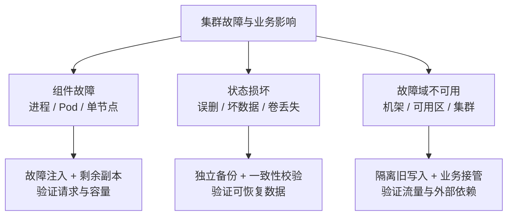
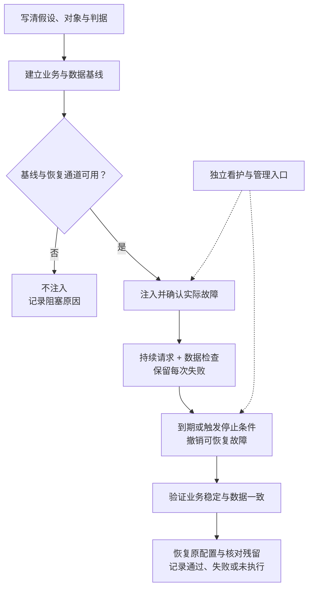
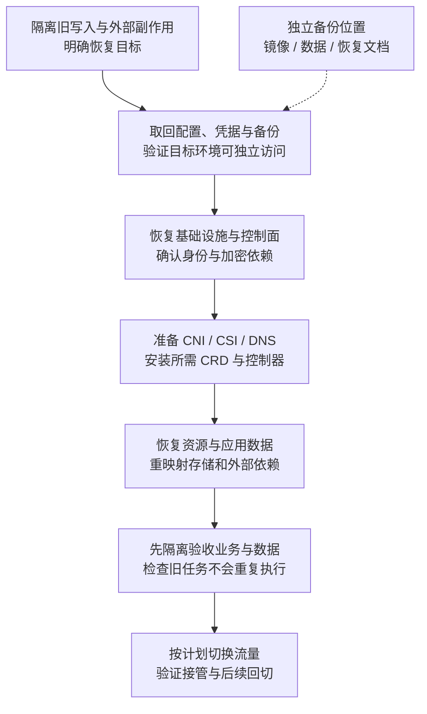
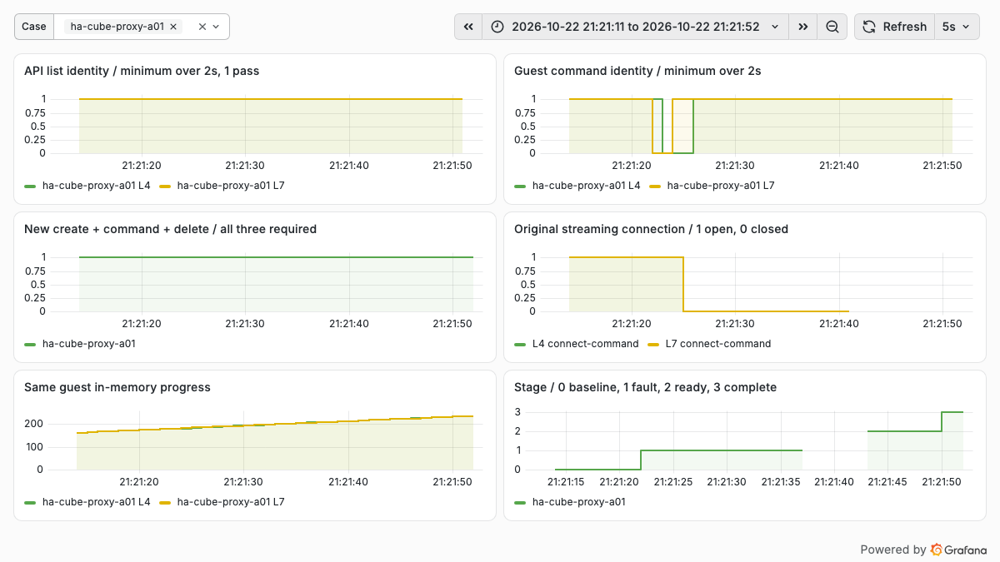

# Kubernetes 容灾演练综述：故障注入、备份恢复与集群管理者的验收方法

“有没有做过 Kubernetes 容灾演练”，真正要回答的是：哪类故障发生后，哪些业务能力仍然可用，已经确认成功的数据会不会丢，多久能恢复，以及这些结论有什么证据。

删除一个 Pod、看到 Deployment 补出新副本，只验证了很小一部分。集群管理员还要面对 API Server 无法访问、etcd 失去多数派、节点失联但进程仍在运行、卷无法重新挂载，以及备份存在却无法在另一套环境恢复等问题。

本文按 2026 年 10 月 23 日查阅的官方资料梳理工具和方法，并引用本仓库已有实测作为有限案例。文中的配置与时间算例属于演练设计，不是本轮新部署或新注入的实战成绩。

## 1. 先区分三件事：高可用、混沌工程和灾难恢复

| 方向 | 要回答的问题 | 典型验证 |
| --- | --- | --- |
| 高可用，High Availability，HA | 单个故障发生后，剩余容量能否继续服务 | 停一个 API Server、代理或工作节点，观察请求与容量 |
| 混沌工程，Chaos Engineering | 对故障行为的假设是否成立 | 有控制地注入延迟、丢包、进程退出或资源压力，持续检查业务 |
| 灾难恢复，Disaster Recovery，DR | 原环境无法继续使用时，能否恢复服务和数据 | 从独立备份恢复到隔离环境，或执行跨集群业务接管 |

混沌工程可以验证高可用设计，也可以验证灾备流程，但故障注入工具通常不会替你重建丢失的数据。反过来，备份工具报告任务完成，也不能证明在线请求能在故障时继续成功。



*同一个业务可能需要三条验证路径。多个副本如果共享宿主机、存储或供电，仍然存在共同故障点。*

## 2. 开源工具怎么选：先选任务，再选产品

下面比较的是主要定位，不是每个功能的完整支持清单。具体故障类型、运行时兼容性和权限应以选定版本为准。

| 工具 | 更适合解决什么 | 组织方式与界面 | 不能替代什么 |
| --- | --- | --- | --- |
| Chaos Mesh | Kubernetes 内的 Pod、网络、资源和依赖故障 | CRD、工作流、调度与 Dashboard | 业务探针、独立备份和整个集群的恢复 |
| LitmusChaos | 团队化实验、故障库和探针驱动验收 | ChaosCenter、实验编排与 Resilience Probes | 正确的业务判据与数据一致性检查 |
| ChaosBlade | 主机、容器、Kubernetes 及应用层故障 | 执行工具、Operator；平台界面是另一个组件 | 安装命令行工具不等于已有完整演练平台 |
| Krkn | 集群与节点、网络、存储等基础设施韧性验证 | 命令行 / 场景容器，也有独立 Dashboard | 跨集群的数据恢复与业务接管流程 |
| Chaos Toolkit | 把自有 API、脚本和检查编排成实验 | 声明式假设、动作、探针与 rollback | 自己实现和维护的注入、恢复与权限逻辑 |
| Velero | Kubernetes 资源及受支持持久卷数据的备份恢复 | Backup / Restore 等资源、命令行与插件 | 在线故障注入、数据库事务恢复和 etcd 全量恢复 |
| `kubectl`、云 API 与定向脚本 | 少量明确动作与设备、云资源级验证 | 易起步，动作与恢复逻辑自己维护 | 自动获得审计、可靠回滚与团队协作能力 |

CRD 是 Custom Resource Definition，即 Kubernetes 自定义资源定义；Operator 是通过控制器持续管理这些资源的程序。Dashboard 指图形化管理页面，不意味着该界面已经在目标集群安装。

### Chaos Mesh：适合从 Kubernetes 管理者视角建立第一套实验

Chaos Mesh 由 Dashboard、Controller Manager 和 Chaos Daemon 等组件组成。Daemon 通常以具备较高权限的 DaemonSet 运行，通过目标命名空间实施故障；因此“只在一个命名空间创建实验对象”不等于底层执行能力也被完全隔离。首次使用应同时核对角色权限、目标选择与执行节点范围。[架构与权限边界](https://chaos-mesh.org/docs/)

它适合把 Pod、网络和资源故障写成可审查的资源，再逐步编排。但 `pod-kill` 是一次 Pod 删除，`pod-failure` 是另一种实现，不能按名字都理解为“模拟断电”。例如官方文档说明 `pod-failure` 会替换容器镜像，未配置有效探针时甚至可能仍显示 Ready。[PodChaos 的具体机制](https://chaos-mesh.org/docs/simulate-pod-chaos-on-kubernetes/)

### LitmusChaos：适合把实验结果与业务探针绑定

Litmus 提供平台化管理与实验能力。其探针可以检查 HTTP、命令、Kubernetes 对象或 Prometheus 查询，并区分故障前、故障中和故障后的检查。这里最有价值的是将“动作执行了”与“业务仍然符合要求”分开。[Litmus 文档](https://docs.litmuschaos.io/)、[探针类型与运行时机](https://docs.litmuschaos.io/docs/concepts/probes/)

探针有重试时，应同时保留第一次失败和最终结果。否则平台显示探针通过，可能只是后来一次重试成功，并不能证明中间没有请求损失。

### ChaosBlade、Krkn 与 Chaos Toolkit：三个补充方向

ChaosBlade 是阿里巴巴开源的项目，覆盖执行工具与平台组件；已有主机和应用层演练需求的团队可以重点考察。Kubernetes Operator 的执行方式与宿主机命名空间有关，不能只看 CR 的 selector 就判断影响范围。[项目概况](https://chaosblade.io/en/docs/)、[Operator 实现介绍](https://chaosblade.io/blog/2022/11/01/chaosblade-operator/)

Krkn 的场景覆盖节点、网络、存储和其他基础设施，并提供不同运行入口。官方建议尽可能从被测集群外运行控制程序，这对控制面或集群级故障特别有意义。[Krkn 场景](https://krkn-chaos.dev/docs/)、[运行方式与 Dashboard](https://krkn-chaos.dev/docs/installation/)

Chaos Toolkit 更适合已有内部运维接口、希望按实验规范复用脚本的团队。其规范将稳态假设、动作、探针和回滚分开；但写了 rollback，并不意味着被删数据、失效连接或外部副作用都可以自动撤销。[实验规范](https://chaostoolkit.org/reference/api/experiment/)

对于第一轮 Kubernetes 实验，我倾向于从 **Chaos Mesh + 独立业务探针** 起步；如果重点是多团队实验管理，比较 LitmusChaos；如果重点是节点、网络域和平台级场景，再评估 Krkn 或 ChaosBlade。**Velero 等恢复工具应作为另一条建设线并行推进。**这是针对管理者入门路径的建议，不是通用性能排名。

## 3. 集群管理员应该覆盖哪些故障

下表中的 LB 是 Load Balancer，即负载均衡器；DNS 是 Domain Name System，即域名系统。

| 层次 | 演练动作示例 | 必须观察什么 | 不能顺带宣称什么 |
| --- | --- | --- | --- |
| 应用 / Pod | 删除一个有控制器管理的副本 | 请求错误、就绪摘除、在途任务与补副本 | 节点断电与卷恢复已验证 |
| 进程 / 运行时 | 在专用节点停止目标进程 | 旧进程是否仍活着、孤儿资源、重建行为 | Pod Running 就代表内部任务恢复 |
| 节点 | 分别做计划 drain 和非计划断连 | 故障发现、驱逐、重调度、容量与旧节点写入 | 两种动作的恢复路径相同 |
| API Server / LB | 停一个后端、测试连接黑洞 | 新连接、长连接、WATCH 与变更请求 | 后端缩容等于所有连接立即切换 |
| scheduler / controller-manager | 切换 Leader 或暂时中断一个实例 | 新 Pod 调度、控制循环积压与恢复 | 已运行业务可用就代表控制面正常 |
| etcd | 在独立环境验证少数成员失效、丧失多数派和快照恢复 | 写入能力、选举、磁盘延迟、恢复后控制器收敛 | 少数成员活着就一定可以写 |
| DNS / 网络 / 入口 | 定向延迟、丢包、DNS 不可用 | 新旧连接、缓存、超时、重试放大 | 一个 Pod 的故障覆盖了机架交换机故障 |
| CNI / CSI | 分开验证插件控制端与节点执行端 | 旧工作负载、新建 Pod、新挂载与数据路径 | 插件控制端退出就一定中断已有数据路径 |
| 存储 | 专用测试卷读写延迟、挂载失败、恢复演练 | 数据校验、重新挂载、重复写入与恢复来源 | 快照存在就覆盖存储集群整体丢失 |
| 外部依赖 | 镜像仓库、对象存储、鉴权或证书服务不可用 | 缓存命中与缓存缺失两条路径 | 老任务可用就代表新任务能启动 |
| 故障域 / 集群 | 隔离一个区、演练异地接管 | 真实容量、写入隔离、DNS / LB 与数据复制 | 同节点多副本实验覆盖了该故障域 |

CNI 是 Container Network Interface，容器网络接口；CSI 是 Container Storage Interface，容器存储接口。它们的控制端与数据路径分离程度依具体实现而异，应按实际部署调查。

### drain、删除 Pod 和节点失联不是一个实验

`kubectl drain` 通常通过 Eviction API 主动驱逐；PDB（PodDisruptionBudget，Pod 中断预算）约束此类自愿中断。直接删除 Pod、硬件失效与节点突然掉电不能依靠 PDB 阻止。计划维护通过，不意味着非计划故障也能按同样时间恢复。[Kubernetes 中断与 PDB](https://kubernetes.io/docs/concepts/workloads/pods/disruptions/)

特别是有状态任务：节点 NotReady 可能只是管理网络断了，原进程仍能访问存储。若此时在另一节点强行启动同一个写入者，就可能发生双写。应验证 fencing，即通过电源、网络或存储权限隔离旧写入者。Kubernetes 的非优雅关机流程也要求先确认旧节点确已关闭，不能把 `out-of-service` 当成普通加速恢复开关。[节点关闭与卷分离条件](https://kubernetes.io/docs/concepts/cluster-administration/node-shutdown/)

## 4. 怎样设计一轮可以判断成败的实验

一份实验说明至少要明确六项：**假设、目标对象、实际故障动作、持续观测、恢复办法、通过条件**。下面是设计示例，数值需要按业务基线调整。

| 项目 | 单副本故障的示例定义 |
| --- | --- |
| 假设 | 两个分散部署的 Web 副本，丢失一个后剩余容量仍满足业务要求 |
| 目标 | 实验命名空间中一个已记录 UID 的 Pod，而不是模糊的“某个服务” |
| 故障 | 删除一个 Pod；保留另一个、副本控制器、存储与探针 |
| 负载 | 固定请求速率；分别记录新连接、复用连接、写入和长流 |
| 停止条件 | 例如错误率连续超标、非目标对象受影响、恢复通道失联 |
| 通过条件 | 故障已确认，业务稳定恢复，数据与副作用检查通过，配置及临时资源清理完成 |



*故障控制器、观测程序与恢复入口应尽可能脱离被测故障域。独立看护用于恢复已知配置，不代表可以复活被删除的数据和进程。*

执行前还要核对宿主机网络与进程命名空间、特权模式及宿主机目录挂载。使用宿主机网络的 Pod 可能与主机共用网络命名空间；使用宿主机 PID 命名空间时，容器内可见的 PID 1 可能就是宿主机进程。目标必须根据实际容器、进程身份与命名空间确认，不能只凭实验标签选择一个 PID 或网卡。

### 一个范围明确的 NetworkChaos 配置示例

以下示例**未执行**，用于说明怎么把影响范围写进配置：只选择 `chaos-lab` 中一个带实验标签的前端 Pod，向同命名空间后端 Pod 的方向增加 100 毫秒延迟，持续 30 秒。不是节点断网，也不是全集群故障。

```yaml
apiVersion: chaos-mesh.org/v1alpha1
kind: NetworkChaos
metadata:
  name: frontend-to-backend-delay
  namespace: chaos-lab
spec:
  action: delay
  mode: one
  selector:
    namespaces:
      - chaos-lab
    labelSelectors:
      app: frontend-demo
      chaos-demo: "true"
  direction: to
  target:
    mode: all
    selector:
      namespaces:
        - chaos-lab
      labelSelectors:
        app: backend-demo
        chaos-demo: "true"
  delay:
    latency: 100ms
  duration: 30s
```

它没有按业务端口进一步过滤；命中的源、目标之间其他流量也可能受影响。应用前需要确认实际候选对象、网络命名空间、CNI 数据路径和内核 `NET_SCH_NETEM` 支持。官方特别要求注入期间 Controller Manager 与 Chaos Daemon 的连接保持可用，否则故障可能无法恢复。[NetworkChaos 行为与前提](https://chaos-mesh.org/docs/simulate-network-chaos-on-kubernetes/)

`duration` 是工具层面的撤销安排，不是脱离控制通道也一定生效的硬保险。还要检查对象状态、实际注入时刻、撤销状态与残留规则；不能直接删 finalizer 后就认为节点恢复。[实验生命周期与清理](https://chaos-mesh.org/docs/run-a-chaos-experiment/)

## 5. RTO、RPO 和“恢复成功”分别怎么算

RTO 是 Recovery Time Objective，即恢复时间目标；RPO 是 Recovery Point Objective，即恢复点目标。目标应在演练前约定，实测恢复耗时和数据损失用于判断是否达标，不要把实测值反过来冒充事先承诺的目标。

| 时间点 | 假设算例：距故障发生 |
| --- | ---: |
| 故障真正发生 | 0 秒 |
| 探针发现异常 | 5 秒 |
| 告警送达值班人 | 12 秒 |
| 新 Pod 达到 Ready | 70 秒 |
| 业务开始持续满足约定指标 | 110 秒 |
| 完成预先约定的 60 秒稳定观察 | 170 秒 |

这个算例中，事后确认的业务恢复起点为 110 秒，完成验收为 170 秒。应同时报告二者，不能把 70 秒的 Pod Ready 当成业务恢复耗时。若目标要求 120 秒内恢复，仍需说明按哪个时间定义验收，避免事后改变口径。

RPO 也不是“每 5 分钟备份一次，所以最多丢 5 分钟”。还要检查备份失败、复制积压、事务提交与应用一致性。测试写入应有唯一 ID、确认记录和校验和；恢复后对账所有已确认 ID，检查遗漏与重复。只比较最大序号可能漏掉中间缺口；请求超时但服务端已提交的结果要单独列为待核实，不能自动重放后覆盖。

## 6. 有备份，为什么还可能恢复不出来

需要区分至少四类材料：

| 材料 | 保护什么 | 经常遗漏什么 |
| --- | --- | --- |
| Git / 基础设施声明 | 集群、网络、工作负载的期望配置 | 运行时创建的资源、数据和外部资产 |
| etcd 快照 | Kubernetes API 中的对象状态 | 持久卷内容、镜像仓库、数据库实际数据 |
| 资源与卷备份 | 命名空间、工作负载及选定卷的数据 | 外部数据库、跨卷事务、驱动与存储系统依赖 |
| 应用原生备份 | 数据库日志、事务状态、训练 checkpoint 等 | 平台证书、入口、权限和资源重建 |

Velero 适合资源和受支持卷的恢复编排；其灾备文档也提供恢复端使用只读 Backup Storage Location 的方式，减少恢复操作影响备份源的风险。[Velero 灾难恢复](https://velero.io/docs/v1.18/disaster-case/)

CSI 快照可能仍依赖原存储系统。若故障模型包含整个存储集群丢失，就要确认数据是否真正搬到独立备份位置，目标端是否具备兼容驱动、StorageClass 和足够容量。Velero 的 CSI Snapshot Data Movement 解决的是数据搬运路径，不能把仅有快照引用当成异地数据副本。[CSI 快照数据搬运](https://velero.io/docs/v1.18/csi-snapshot-data-movement/)

数据库还需要事务一致性设计。备份 hook 可以用于执行应用要求的准备与收尾，但不会自动推导任意数据库的正确备份协议。能读取文件与能恢复到一致事务状态是不同要求。[Velero Backup Hooks](https://velero.io/docs/v1.18/backup-hooks/)

### etcd 恢复要分清“修成员”和“恢复整个逻辑集群”

三成员 etcd 需要两个成员形成多数派；五成员需要三个。少数成员故障与失去多数派的处理不同，也不能通过简单增加 LB 后端来恢复共识。网络分区时，不应把“少数派不能写”误称为两个分区都能提交的脑裂。[etcd 集群规模与多数派](https://etcd.io/docs/v3.6/faq/)

快照恢复应在隔离环境使用匹配版本和拓扑的流程，所有恢复成员使用同一快照，重新形成逻辑集群。Kubernetes 控制器还涉及 revision 回退及缓存问题，etcd 官方恢复文档说明了 `--bump-revision` 与 `--mark-compacted`。这些参数需要按版本和业务写入量规划，不能机械复制某个固定增量。[etcd 灾难恢复](https://etcd.io/docs/v3.6/op-guide/recovery/)

还要独立保护证书、PKI（Public Key Infrastructure，公钥基础设施）材料与加密依赖。启用 Kubernetes 静态数据加密后，只有 etcd 密文、没有对应加密配置或 KMS（Key Management Service，密钥管理服务）的可用密钥，仍可能无法读取恢复的对象。[静态数据加密与密钥备份](https://kubernetes.io/docs/tasks/administer-cluster/encrypt-data/)

### 恢复到另一套环境时，顺序与写入隔离同样重要



*这是依赖关系示意，不是通用一键恢复顺序。恢复原控制面的 etcd，与新建集群后按应用恢复资源，是两条需要分别设计的路径；不能未经规划同时回灌同一批对象。*

恢复环境应阻止定时任务、消费者、通知和支付等副作用提前发生。跨集群接管还要验证真实剩余容量、复制状态、DNS 缓存和 LB 切换。流量切过去不等于数据写入权已经安全移交。

## 7. 指标和证据怎样组织

我建议把证据分成四层，使用同一实验 ID 与时间轴关联：

| 层次 | 需要保存的证据 |
| --- | --- |
| 实验动作 | 目标 UID、版本与配置、动作参数、故障生效确认、撤销与清理结果 |
| Kubernetes 状态 | Pod / Node / EndpointSlice 变化、事件、调度与挂载时间、控制器日志 |
| 客户端与应用 | 逐次请求状态、延迟、长流中断、业务结果、数据 ID 与副作用 |
| 基础设施 | API 延迟、etcd 选举与磁盘延迟、节点资源、网络和存储情况 |

Grafana 适合对齐曲线，但原始请求与日志仍需保留。2 秒采集可能漏掉短于采样间隔的错误；较粗的 `rate` 窗口也可能把短时故障摊平。看板上的聚合窗口和分母要写清楚，监控丢数据要显示为未知，不能填成正常。

### 一个已有实测能说明什么

此前 [CubeSandbox 多副本实验](../rag-agent/cubesandbox-ha-load-balancer-practice.md)中，API、Master、Proxy 都临时扩到同节点两个副本，逐项删除一个 Pod。33 次新建执行删除完成，但 Proxy 的两条既有命令输出流断开，独立 guest 任务继续计数。这说明“新请求能成功”“旧连接仍在”“原任务继续”必须分开验证。



*这是本仓库既有实验的真实截图，不是 Chaos Mesh、Litmus 或其他平台的新安装证明。图中成功探针采用 2 秒窗口最小值；两条原流断开后未自动续接。该实验只覆盖同节点组件故障，不代表 Kubernetes 节点或机房容灾已通过。*

## 8. 从第一轮实验到日常机制

一个可操作的推进顺序是：

1. **先做专用无状态应用。** 两个副本、固定请求、独立探针，验证单 Pod 故障和定向网络延迟，确保撤销后没有残留。
2. **再覆盖控制面与节点。** 分开验证计划维护、非计划失联和 Leader 切换；把状态控制与持续业务流量放到同一时间轴。
3. **单独做有状态恢复。** 使用测试数据与隔离写入环境，验证独立备份、重新挂载、事务一致性及实际数据损失。
4. **再做故障域接管。** 覆盖跨节点、可用区或集群的容量与依赖；不能用同宿主机的多台虚拟机代替真实机架故障。
5. **把已验证场景放进变更验收。** 针对升级、CNI / CSI 更换、入口改造或存储变更重跑相关场景，保存每个版本的结果，形成可以比较的回归记录。

频率应由业务目标、风险和变更决定，而不是要求所有团队机械地每周断电。演练也要覆盖人员：告警是否真正送达，有权限的人能否登录，备份凭据是否可用，恢复文档是否依赖已经失效的集群。

Google SRE 的数据完整性实践强调定期验证真实恢复，而不是仅拥有备份文件；这与 Kubernetes 的场景相同：只有在另一环境读回并验证数据，备份才转化为恢复证据。[Google SRE 数据完整性实践](https://sre.google/sre-book/data-integrity/)

停止条件也应真正接到控制程序。AWS FIS 使用 CloudWatch 告警作为停止条件，是一个可借鉴的产品实现；自建平台同样需要验证“触发后是否停止继续注入”，而不只是发出告警。[AWS FIS 停止条件](https://docs.aws.amazon.com/fis/latest/userguide/stop-conditions.html)

## 9. 最终交付什么，才方便复盘和面试讲清楚

一份有用的报告应能直接回答：

- 哪个架构假设被验证，实际故障域和目标对象是什么？
- 注入是否真实生效，持续多久，哪些对象始终保留？
- 新请求、长连接、在途变更、数据与外部副作用分别怎样？
- 实际恢复耗时与数据损失是否满足预先目标？
- 恢复和清理如何确认，哪些场景失败、阻塞或尚未执行？
- 发现问题后改了什么，复测是否保留原分母并形成可比较结果？

对集群管理员而言，可以讲“如何选择故障、证明影响范围、搭建独立观测、定位恢复瓶颈并复测”。如果只完成过单 Pod 演练，就如实说明边界，再给出跨节点、存储与全量恢复的后续计划；不要把工具安装经历说成已经通过完整容灾验收。

## 延伸阅读

- [可靠性、Checkpoint 与故障恢复](../reliability.md)
- [数百个集群的稳定性建设](kubernetes-fleet-reliability.md)
- [API Server 四层与七层负载均衡](kube-apiserver-load-balancing.md)
- [CubeSandbox 组件故障与恢复](../rag-agent/cubesandbox-failure-recovery-practice.md)
- [多机多卡训练框架与故障恢复](../training/distributed-training-frameworks-recovery.md)
