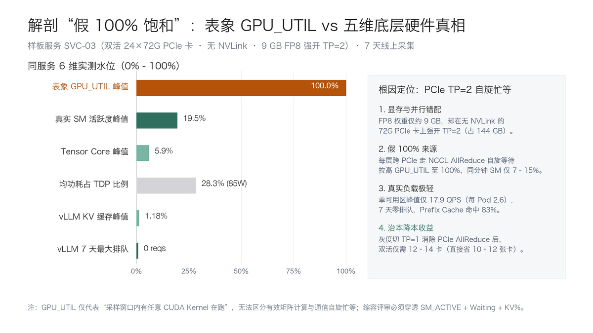
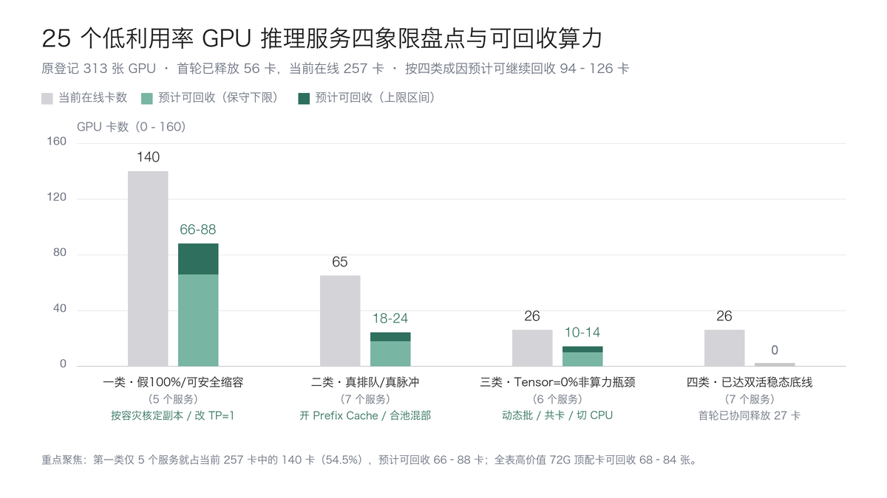
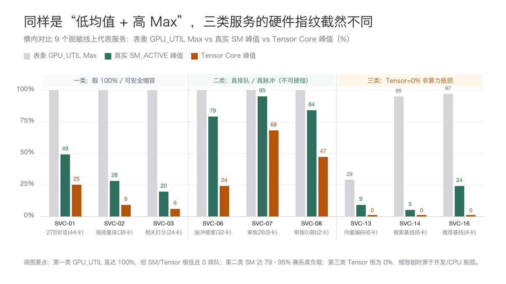

# “低利用率 GPU 推理服务”为什么缩不下去？25 个线上服务的四维硬件穿透与降本实战

几乎每个管理几百张推理 GPU 的平台团队，都经历过同一个困局：监控大盘拉出一张 `DCGM_FI_DEV_GPU_UTIL` 7 天均值低于 `15%` 的低利用率清单，平台方找业务方沟通资源优化，对方通常会给出三条很真实的顾虑——监控 `GPU_UTIL Max` 每天都会打到 `100%`；之前减过 1 张卡线上立刻超时；或者平时闲着但高峰有脉冲怕排队积压。过去这类沟通之所以容易卡壳，并不是业务方不愿配合，而是平台只提供了一条过于粗糙的 `GPU_UTIL` 曲线，导致双方在信息不对称下谁也不敢拍板。

我们对生产环境中一份真实的低利用率巡检清单——**25 个线上推理服务、原登记 `313` 张 GPU**（首轮协同已释放 `56` 张，当前在线占用 **`257` 张 GPU**，覆盖 `72G PCIe` 高配推理卡、`48G PCIe` 中端/数据中心推理卡与 `24G` 入门推理卡跨双可用区部署；本文已对域名、集群、组织、业务与具体 GPU 型号全面脱敏）——做了完整的硬件级与引擎级数据穿透。

> **一句话结论**：**低利用率 GPU 推理服务“缩不下去”，根本不是因为“业务不配合”，而是单一 `GPU_UTIL` 指标掩盖了假 `100%`（无 NVLink 卡误开 `TP=2` 自旋）、真脉冲排队、`Tensor = 0%` 非算力瓶颈与长尾双活地板这四类完全不同的问题**；GPU 平台方不应盲目质疑业务价值，而应把底层硬件与引擎数据采集齐全，用客观证据和工程手段（`TP=1`、Hybrid Prefix Cache、动态批/切 CPU、Multi-LoRA 共享底座）帮业务在不牺牲 SLA 的前提下把 **`257` 张在线卡继续安全优化出 `94–126` 张**。

本次穿透的四项核心数据发现：

- **单一 `GPU_UTIL Max = 100%` 极易制造“假饱和”假象**：`DCGM_FI_DEV_GPU_UTIL` 只统计采样窗口内是否有任意 CUDA Kernel 运行（包括在**无 NVLink 的 PCIe 卡**上跨卡跑 `TP=2` 时产生的 NCCL AllReduce 自旋忙等），无法区分有效计算与通信等待。样板服务 `SVC-03`（24 张无 NVLink 的 `72G PCIe` 卡）在 24 小时内有 `39.3%` 的分钟出现 `GPU_UTIL >= 95%`（峰 `100%`），穿透底层数据后才发现同分钟真实 `PROF_SM_ACTIVE` 只有 **`7.3%–14.7%`**、`PIPE_TENSOR_ACTIVE` 峰值仅 **`5.9%`**、7 天 `vllm:num_requests_waiting` 恒为 **`0`**。
- **25 个服务被数据清晰拆解为 4 类物理成因，各有精准解法**：**第一类“假 100% / 可安全缩容”**（5 个服务占当前 `257` 卡中的 **`140` 卡 / `54.5%`**）在留足 2× 容灾余量下可通过缩副本或改 `TP=1` 释放 **`66–88` 卡**；**第二类“真排队 / 真脉冲”**（7 个服务 / `65` 卡）必须保护 SLA、严禁硬砍，但平台可协助升级引擎开 Hybrid Prefix Cache 或接入共享池优先级混部，安全释放 **`18–24` 卡**；**第三类“`Tensor = 0%` 非算力瓶颈”**（6 个服务 / `26` 卡）印证了业务“一缩就超时”的真实反馈，通过动态批处理、单卡多实例或切 CPU 推理既解决超时又可省 **`10–14` 卡**；**第四类“已达双活稳态底线”**（7 个服务 / `26` 卡，首轮已协同释放 `27` 卡）则可通过 Multi-LoRA 共享底座突破物理地板。
- **80% 的高价值算力优化空间集中在 4 个 72G 高配卡大户**：这 4 个服务当前合计占 `136` 张 `72G PCIe` 卡，协同优化它们即可释放 **`68–84` 张 72G 卡**。
- **平台治理的终点是“数据透明 + 工程赋能”**：当平台把巡检能力从单曲线 `GPU_UTIL` 升级为 `PROF_SM_ACTIVE + PIPE_TENSOR_ACTIVE + Waiting/KV% + 7d QPS` 四维数据底座，治理就不再是“质疑业务值不值这么多卡”，而是和业务站在同一侧把真实瓶颈看清、把架构红利落到实处。

> **延伸阅读关系**：前作 [GPU 利用率为什么很低](low-gpu-utilization.md) 系统梳理了训练与推理通用等待链；本文聚焦**生产推理集群的数据穿透方法与平台协同治理实践**。

---

## 一、样板解剖：假 100% 饱和

在 25 个服务里，最能说明“为什么单看 `GPU_UTIL` 会误导双方”的样板是 **双活相关性打分服务 `SVC-03`**（原部署 `14 + 14 = 28` 张 `72G PCIe` 高配卡，首轮微缩至 `12 + 12 = 24` 卡）。这类 `72G PCIe` 推理卡显存很大，但**卡间没有 NVLink，多卡张量并行（`TP`）只能走 PCIe 总线通信**。

业务方最初看到监控大盘 max 每天都顶到 `100%`，自然不敢继续缩容。平台侧把该服务在两个可用区（`AZ-1` 与 `AZ-2`，各 6 个 `TP=2` Pod）的 **6 维底层硬件与 vLLM 引擎数据** 一次性拉齐后，真相立刻一目了然：



| 监控指标维度 | `AZ-1`（当前 12 卡，6×2 卡） | `AZ-2`（当前 12 卡，6×2 卡） | 数据穿透结论 |
| --- | --- | --- | --- |
| 表象 `DCGM_FI_DEV_GPU_UTIL` | 7d 均 `10.2%` / 单卡 Max **`100%`** | 7d 均 `9.8%` / 单卡 Max **`100%`** | **误导源头**：24h 内 `39.3%` 分钟出现瞬时 `>= 95%` |
| 真实算力 `DCGM_FI_PROF_SM_ACTIVE` | 24h 均 `5.1%–6.1%` / 峰仅 **`13.4%–19.5%`** | 24h 均 `5.3%` / 峰仅 **`19.0%`** | **关键证据**：`GPU_UTIL = 99%` 当分钟，`SM_ACTIVE` 仅 `7.3%–14.7%` |
| 矩阵算力 `DCGM_FI_PROF_PIPE_TENSOR_ACTIVE` | 24h 均 `0%` / 峰仅 **`3.9%–5.9%`** | 24h 峰仅 **`5.0%`** | Tensor Core 超过 `94%` 时间完全空闲 |
| 单卡功耗 `DCGM_FI_DEV_POWER_USAGE` | 24h 均 **`85 W`**（峰 `233 W`） | 24h 均 **`82 W`**（峰 `228 W`） | `300 W` TDP 高配卡长期处于近待机功耗 |
| 7 天集群总 QPS（5m 平滑速率） | 均 `11.8` / P95 `16.5` / Max **`17.9 QPS`** | 均 `11.6` / P95 `16.1` / Max **`17.4 QPS`** | 每个 2 卡 Pod 峰值仅扛 **`2.5–2.6 QPS`** |
| vLLM 排队与 KV（7d Max） | Max Running `6` / **Waiting `0`** / KV **`0.77%`** | Max Running `8` / **Waiting `0`** / KV **`1.18%`** | **7 天零排队**（均 Queue `0.0 ms`），`99%` KV 闲置 |
| 延迟与 Token 画像（24h） | 均 E2E `74.5 ms`（TTFT `37.8 ms` / P99 `652 ms`）均输入 `2,379 tok`（PC 命中 `82.8%`）/ 输出 `6.0 tok` | 均 E2E `70.6 ms`（TTFT `37.6 ms` / P99 `622 ms`）均输入 `2,379 tok`（PC 命中 `84.0%`）/ 输出 `5.5 tok` | P99 尾延迟来自个别较长输出的单条计算，与副本数无关（`Queue = 0`） |

### 无 NVLink 下的 TP=2 自旋忙等

把启动参数和硬件拓扑拼在一起，物理机制非常清晰：
1. 模型原始权重为 `17.5 GiB` BF16，启动时开启了 `--quantization fp8`，**实际权重仅占 `~9 GB`**；
2. 但部署配置沿用了大模型的并行模板，在**没有 NVLink 互联的 `72G PCIe` 卡**上开了 **`TP=2`（占用 `144 GB` 总显存）+ `--disable-custom-all-reduce`**；
3. 由于缺少 NVLink 高速互联，模型每一层推理都必须跨 PCIe 总线走 NCCL AllReduce 同步张量，同步期间 GPU 上的通信等待 Kernel 处于**自旋忙等（spin-wait）**状态——`nvidia-smi` 和 `DCGM_FI_DEV_GPU_UTIL` 只要监测到有 Kernel 占着设备就记作 **`99%–100%`**，但实际上 SM 活跃度只有 `7%–15%`，功耗只有 `85 W`。

### 留足容灾余量的治本方案

即使严格按**单可用区独立承接双倍容灾峰值（`35 QPS`）**留足安全余量：
- **短期零风险方案**：保持 `TP=2`，每可用区缩至 4 Pod（8 卡），双活 16 卡，**释放 8 张 72G 卡**；
- **中长期双赢方案**：平台协助业务灰度验证 `TP=2 -> TP=1`——`~9 GB` 权重放进单张 72G 卡绰绰有余，**彻底消除无 NVLink 卡上的 PCIe AllReduce 通信自旋与跨卡延迟抖动**；每可用区部署 `6–7` 个单卡副本（双活 `12–14` 卡），既改善业务延迟稳定性，又再释放 **`10–12` 张 72G 卡**。

---

## 二、25 个服务的四类成因盘点

把四维硬件 + 引擎数据铺平到全部 **25 个低利用率服务** 后，原本模糊的“低利用清单”清晰分成四类截然不同的技术画像：



把三类核心代表服务的硬件指纹（`GPU_UTIL Max` vs `SM_ACTIVE Peak` vs `Tensor Peak`）画在同一张坐标系里，差异一目了然：



下面逐类拆解全部 25 个脱敏服务的实测数据与平台协同建议。

---

### 第一类：假 100% 与明显超配

这 5 个服务现占 **`140` 卡**（仅占清单数量的 `20%`，却占当前 `257` 张在线 GPU 中的 **`54.5%`**）。用硬件与引擎数据对齐后，业务方能清楚看到即使在 2× 容灾下依然零排队，预计可协同释放 **`66–88` 卡**：

| 脱敏编号与服务形态 | 卡型层级与当前卡数 | 原先顾虑 / 状态 | 硬件与引擎穿透数据 | 协同优化方案与预计释放 |
| --- | --- | --- | --- | --- |
| **`SVC-01`**（27B 双活对话模型） | `44×` 72G PCIe 卡（`24 + 20`） | 尚未补齐说明 | **全表最大优化空间**：BF16 `TP=4`（用 `288 GB` 跑 27B）；SM 均 `2.9%` / 峰 `49%`；24h 均 QPS 仅 `0.3`，7d 单区峰仅 `0.9 QPS`（双区 `< 1.8 QPS`）；7d Max Running `1–2`、**Waiting `0`**、KV 峰 `1.6%–2.4%` | 协助改 `TP=2`（或 FP8 `TP=2`，同时减少无 NVLink PCIe 跨卡同步），双区各留 `2–3` 副本（共 `8–12` 卡）或并入同底座共享池；**预计释放 `32–36` 卡** |
| **`SVC-02`**（双活细粒度重排） | `36×` 72G PCIe 卡（`18 + 18`） | 扇出比大、瞬发峰大，计划改潮汐 | **假 `100%` 二号**：`GPU_UTIL Max = 100%`，但 SM 均 `3.6%` / 峰仅 `27%–28%`、Tensor 峰仅 `9%`；7d 均 `1.3` / 峰仅 `3.4 QPS`（每 Pod `< 0.4 QPS`）；**Waiting `0`**、KV 峰 `7%–10%`、PC 命中 `81%` | 无需等潮汐改造，按 7 天峰值留足余量先缩至 `8–10` 卡/区，依然零排队；**预计释放 `16–20` 卡** |
| **`SVC-03`**（双活相关性打分） | `24×` 72G PCIe 卡（原 `28 → 24`） | 监控 `max 100%` 担心高峰 | 上节解剖样板：`~9 GB` FP8 在无 NVLink 卡上强开 `TP=2`（`144 GB`），SM 峰 `19.5%`、Tensor 峰 `5.9%`、**Waiting `0`**、KV 峰 `1.2%` | 缩至 `8 + 8` 或灰度验证 `TP=1`（`6 + 6` ~ `7 + 7`）；**预计再释放 `8–12` 卡** |
| **`SVC-04`**（双活在线工具模型） | `32×` 48G PCIe-A 卡（原 `48 → 32`：`12 + 20`） | 线上工具调用时间不固定 | 12 卡一侧均利用仅 `2.2%`、SM 均 `1.3%`、功耗 `33 W`、显存 `27 GB`；双区 `12 + 20` 不对称 | 先将双区对齐至 `12 + 12`（省 `8` 卡），二期接入潮汐弹性再省 `8` 卡；**共释放 `8–16` 卡** |
| **`SVC-05`**（14B 内部对话服务） | `4×` 24G 推理卡 | 尚未补齐说明 | SM 均 `1.4%`（峰 `53%`）、Tensor 峰 `16%`、均功耗 `39 W` | 与业务确认依赖范围后按需缩至双卡或下线；**预计释放 `2–4` 卡** |

---

### 第二类：真排队与真脉冲

这 7 个服务现占 **`65` 卡**，如果只看 24h 均值就硬压副本，会**立刻触发线上超时或排队雪崩**——硬件数据清楚证实它们在高峰确实打满了 SM/Tensor（`SM 79%–96%`）甚至已有 `Waiting > 0`。平台方应**主动为业务兜底保卡，并通过升级引擎开 Hybrid Prefix Cache、同底座共享池优先级混部或潮汐弹性协助提效，预计安全释放 `18–24` 卡**：

| 脱敏编号与服务形态 | 卡型层级与当前卡数 | 底层实测真相（确认真瓶颈） | 不降 SLA 的平台赋能方案 |
| --- | --- | --- | --- |
| **`SVC-06`**（27B-FP8 脉冲批跑/摘要） | `32×` 72G PCIe 卡（`16 + 16`） | **真脉冲重负载**：SM 峰 `78%–79%`、KV 峰 `41%`、`Waiting = 2–3`，QPS 从 `0.7 -> 10.0`（`14×` 脉冲），E2E `7.1 s` | 不可单池硬缩；但 `80%+` 时间空转，适合与同底座 27B-FP8 在线服务接入 CNCF `llm-d` EPP 优先级队列（在线 `+10` / 批跑 `-10`，零 `429` 拒流混部）；**合池省 `12–16` 卡** |
| **`SVC-07` & `SVC-08`**（2B / 0.8B 混合架构高频审核） | `9 + 2 = 11×` 48G PCIe-A 卡 | **真高并发突发**：SM 峰 **`95% / 84%`**、Tensor 峰 `68% / 47%`、Max QPS `194 / 137`、**`Waiting = 43 / 458`** | **必须保卡、绝不能硬缩**！但数据穿透发现二者跑在旧版 vLLM（v0.27）未开 Hybrid Prefix Cache（`0%` 命中），每次都在重算 `500–930 tok` 固定规则；同业务线另一 1B 视觉模型开启 Prefix Cache（命中 `97.2%`）仅 2 卡就扛住 `460 QPS` 峰值。平台协助升级至 `vLLM 0.33.0+` 开启 Hybrid Prefix Cache（见前作[单卡 L20 混合架构实测](hybrid-multi-lora-l20-prefix-cache.md) `4.1×` 收益）+ 同权重合池，**提效后安全省 `6–8` 卡** |
| **`SVC-09`**（14B 旧引擎相关性打分） | `8×` 48G PCIe-A 卡（`4 + 4`） | 每区仅 2 个 `TP=2` Pod，瞬时扇出已触发 `Waiting = 16–17`、E2E `718 ms` | 不可再减副本（剩 1 Pod 丧失高可用）；但跑在旧版 vLLM v0.12.0（Prefix Cache 命中仅 `39%`，远低于新版 `83%`），协助业务升级引擎或平滑迁移至新版服务 |
| **`SVC-10`**（双活搜索重排） | `8×` 72G PCIe 卡（原 `16 → 8`） | 首轮砍半后 7d Max Running `12–14`、已出现 `Waiting = 3–5`，PC 命中 `74%` | 首轮减半已压到健康水位，尊重业务水位观察一周不继续施压 |
| **`SVC-11` & `SVC-12`**（图像编辑 / 视觉选品） | `4×` 48G PCIe-A 卡 + `2×` 48G PCIe-B 卡 | **真批量突发打满**：SM 峰 **`87% / 96%`**、Tensor 峰 `37% / 90%` | 未做上游异步削峰前不可硬减卡；提供 KEDA 潮汐弹性 / 异步队列或 Scale-to-Zero 方案（参考[KEDA + Volcano + DRA 潮汐实测](keda-volcano-tidal-gpu.md)） |

---

### 第三类：Tensor 为零的非算力瓶颈

这 6 个服务现占 **`26` 卡**，最容易产生沟通误会：**业务方反馈“减一张卡就超时”完全属实，但硬件数据证明 `Tensor = 0%`，超时并不是因为 GPU 算力不够**；协助打通并发或迁回 CPU 后，既消除超时又可释放 **`10–14` 卡**：

| 脱敏编号与服务形态 | 卡型层级与当前卡数 | 业务真实反馈 | 硬件穿透真相（为什么一缩就超时） | 平台协同治本方向 |
| --- | --- | --- | --- | --- |
| **`SVC-13`**（视觉双塔向量编码） | `6×` 24G 推理卡 | 小模型单实例不能并发，缩容影响核心转化 | `GPU_UTIL` 7d 峰仅 `29%`、SM 峰 **`9%`**、**`Tensor = 0%`**、显存仅 **`4 GB / 24 GB`**、均功耗 `41 W` | 6 张 24G 卡干不到 0.5 张卡的算力！平台协助开启 Triton / ONNX Dynamic Batching 或单卡多进程（1 张 24G 卡跑 3 个 4 GB 实例），从 `6 -> 2` 卡双活，**省 `4×` 24G 卡且并发能力反而更强** |
| **`SVC-14`**（搜索精排基线模型） | `6×` 48G PCIe-B 卡（`3 + 3`） | 核心基线，尝试缩容超时严重 | SM 均 `0.8%–1.0%`、峰仅 **`4%–5%`**、**`Tensor = 0%`**，但显存预占 `34 GB`（48G 卡） | 典型进程级并发/显存预占瓶颈而非 GPU 算力瓶颈；协助评估同卡多实例（MIG / MPS）、降配或迁回 CPU 推理，释放 48G 卡 |
| **`SVC-15` & `SVC-16`**（搜索/推荐对照组） | `4 + 4 = 8×` 24G 推理卡 | 对照组缩过超时高，部分正试点切 CPU | 全部 **`Tensor = 0%`**；SM 峰仅 `6%–14%` 与 `8%–24%`，显存各占 `15 GB` | 配合业务加速验证 CPU 推理性能与一致性，验证通过后平滑迁移释放 **`4–8×` 24G 卡** |
| **`SVC-17`**（视觉识别新模型） | `4×` 72G PCIe 卡（`2 + 2`） | 新实验刚推全，流量爬坡中 | SM 均 `3.6%` / 峰仅 `9%–10%`、Tensor 仅 `2%`，却预占 `62 GB` 显存 | 先护航推全观察一周；若 SM 仍 `< 20%`，协助排查显存预占并迁移至 48G 卡型 |
| **`SVC-18`**（目标检测双活接口） | `2×` 24G 推理卡 | 在线核心接口需双活至少两卡 | 显存仅 **`1 GB / 24 GB`**、SM 均 `4.1%`、功耗 `43 W` | 完整保留双活高可用，与其他 `1–4 GB` 视觉小模型做单卡共卡混部 |

这类服务的共同根因是**单进程同步阻塞 / 框架默认显存预占 / CPU 特征预处理成为瓶颈**，导致业务不得不为了买“进程并发数”而按整卡水平堆 Pod。平台主动帮业务把动态批处理、单卡多实例或 CPU 推理通道打通，既解除了业务“动不动超时”的隐患，又自然释放了 GPU 资源。

---

### 第四类：已达双活稳态底线

首轮数据对齐中，以下 7 个服务的业务团队已将规模从 **`53 → 26` 卡**迅速压至最低高可用或单卡水位（实时核验首轮已协同释放 `27` 卡）：
- **语音 / ASR / TTS 灰度双活（4 服务，`28 → 14` 卡）**：全双工语音（`16 → 8×` 48G 卡）、ASR（`4 → 2×` 48G 卡）、两套 TTS（各 `4 → 2×` 48G 卡），均已压至双可用区各 1 实例底线；
- **评测与数据校验（2 服务，`11 → 2` 卡）**：均已缩至单卡；
- **视觉检索（1 服务，`14 → 10×` 24G 卡）**：已先压 4 卡（其实时显存仅 `6 GB`、Tensor 峰 `1%`，后续如需进一步提效仍可通过单卡多实例再降一半）。

---

### 长尾微调破局：Multi-LoRA 共享底座

在治理完第一到第三类问题后，平台团队很快会撞上一堵**物理地板**：大量长尾微调服务、实验灰度版本和垂直场景模型（比如 `SVC-01`、`SVC-05` 以及第四类里已压到每可用区 1 副本的服务），QPS 只有 `0.3–10`，但只要采用“**离线合并全量权重 + 独立 Deployment 部署**”，为了满足双可用区高可用（HA），每个模型最少也得锁死 **`2` 张整卡**（如果是 `TP=2` 就是 `4` 张整卡）——**单靠缩副本已经不可能再往下压了**。

要打破“1 个长尾模型 = 2~4 张整卡”的地板，最有效且最能实现平台与业务双赢的技术抓手就是 **Multi-LoRA 共享底座池**：

1. **用平台数据识别“同底座微调家族”，跳过离线 Merge**：在集群层面按基础模型架构（如同一 2B / 8B / 14B / 27B Dense 或 Hybrid 底座）扫描长尾微调服务；对共享同一底座、单业务 QPS 偏低且长期空转的长尾服务与实验灰发池，推动业务从“每次微调离线合并成数十 GB 全量权重、再独立申请双活 GPU”转向“只交付 `30–90 MB` 的 LoRA Adapter，热挂载到共享双活 Multi-LoRA 池”。
2. **平台主动替业务消除“精度漂移”和“噪邻互相拖慢”两大顾虑**：
   - **精度门禁自动化**：平台提供在线 Multi-LoRA 与离线合并权重的自动化贪心对齐校验脚本，用实测数据确认引擎（含新一代混合注意力底座）已原生支持无损在线加载，且单槽位仅占数十 MB 显存、从 `1` 个扩到 `8` 个并发 LoRA 吞吐折损 `< 5%`；
   - **亲和路由 + 优先级防噪邻**：在共享底座池前统一挂接模型感知路由（如 AIBrix `ModelAdapter` 或 CNCF `llm-d` EPP 亲和路由与无拒流优先级队列），保证低频长尾在线业务不会因同池批处理任务而被拉爆尾延迟。
3. **把“资源治理”变成算法团队的“迭代加速器”**：这也是最能打动业务方的利他价值——过去算法团队想上线一个新细分场景模型或做新版实验灰度，需要走“申请 `2–4` 张卡 → 等资源排期 → 离线合并权重 → 新建独立服务与域名”的长链路；切入 Multi-LoRA 共享池后，**上线一个新微调任务或灰度版本只需秒级热加载几十 MB 增量权重，零排卡等待、随时灰度与下线**。资源利用率提升的同时，算法实验与交付效率也直接上了一个台阶。
4. **守住技术边界，不搞“全员强推 Multi-LoRA”**：常年把整卡打满的核心主力高 QPS 模型，以及超大 MoE + Expert Parallel + 投机采样重型服务，依然应保持离线合并独立部署（省去在线 Punica 约 `13%` 的固定算子开销）；Multi-LoRA 精准聚焦在**同底座长尾微调、垂直细分规则与低频实验灰度池**。

---

## 三、平台协作理念与落地工具

复盘完这 25 个服务后，比“省出多少张卡”更重要的，是厘清 **GPU 管理平台方与业务方的协作边界**：

1. **绝不盲目挑战业务的业务价值**：某个模型值不值得上线、带来多少转化或体验提升，属于业务决策范畴；平台方拿一张 `GPU_UTIL = 5%` 的图去质疑“这业务值不值得用 GPU”，既不专业，也会立刻把双方推向对立面。
2. **平台的核心责任是把“深水区数据”补齐**：大多数业务团队并没有精力去研究 `DCGM_FI_PROF_SM_ACTIVE`、无 NVLink 卡上的 PCIe NCCL spin-wait、或者 vLLM 的 Hybrid Prefix Cache 命中率。**平台方应该尽可能收集更全面、细粒度的 GPU 硬件 + 推理引擎 + 流量波形数据**，自动生成清晰的服务健康画像，把“为什么显存空着、为什么监控曲线虚高、为什么减卡就超时”用数据翻译给业务看。
3. **把治理变成“提供解法”，而不是“下达指标”**：看到假 `100%`，平台帮业务做 `TP=2 -> TP=1` 灰度验证；看到真脉冲排队，平台主动提供 Hybrid Prefix Cache 升级方案、共享池优先级流控和潮汐组件；看到 `Tensor = 0%`，平台提供动态批处理模板或共卡底座。当业务发现**跟着平台的数据建议改完，延迟更稳了、架构更清爽了、成本账单还降了**，资源治理就会从阻力变成自驱力。

### 数据归属、自助 Skill 与周度闭环

仅有四联硬件指标还不够——要想让几百张 GPU 的治理真正跑成常态化机制，而不是靠平台工程师每季度手工拉表对账，我们还在工具链和运营闭环上做了三件非常管用的事：

1. **轻量二开 `dcgm-exporter`，把业务与负责人直接钉死在指标标签上**：原生 `dcgm-exporter` 只暴露节点、GPU 和 Pod 维度，一到跨集群按业务域或负责人统计利用率就得写复杂的 kube-state-metrics 联表查询甚至手工反查。我们对 `dcgm-exporter` 做了轻量二次开发，在指标导出阶段直接把**业务域、服务名、部门/队列及负责人等归属元数据注入到每一条 GPU 时序指标标签中**，实现“GPU → Pod → 服务 → 业务 → 负责人”原生绑定——无论按部门、业务线、卡型还是个人维度做利用率统计、空载率排行或下钻复核，一条 PromQL 就能秒级出数，彻底消除“这张卡到底归谁管”的对账成本。
2. **向业务提供自助分析 Agent Skill，把算账能力交给一线**：业务研发和算法同学没时间去记 `DCGM_FI_PROF_SM_ACTIVE` 或各类引擎指标名。平台把四联硬件穿透、假 `100%` 识别、历史自然日 P90/峰值统计与容量效率核算封装成一系列开箱即用的 **Agent Skill**，支持业务同事用自然语言精准查询自己名下每一项服务的真实利用率和瓶颈画像——平台不再是“黑盒裁判”，而是给业务配齐透明好用的“效率计算器”。
3. **每周告警 + 定时周报邮件 + 治理跟踪台账**：基于上述精准归属标签，平台自动运行**每周低利用率巡检告警**与**定向周报邮件**（直接附带该服务近 7 天真实 SM/Tensor、峰值 QPS、排队和可执行建议），并维护轻量的**协同治理跟踪台账**记录每轮沟通结论、容灾保留依据与优化进展。正是在这套“归属清晰 + 自助分析 + 周度触达 + 持续跟踪”的组合拳下，本文 25 个服务在首轮对齐中就快速协同释放了 `56` 张卡，并稳步推进后续的架构提效。

### 四联复核 PromQL

建议平台直接在集群 Prometheus / Grafana 中把巡检看板从单一 `GPU_UTIL` 升级为以下四联穿透查询（将 `<SERVICE_LABEL>` 替换为你集群的服务标签，如 `app` 或 `deployment`）：

```promql
# 1. True SM Activity (24h peak, %) -- exposes PCIe NCCL spin-wait fake 100%
max by (cluster, pod_name, gpu) (
  max_over_time(DCGM_FI_PROF_SM_ACTIVE{service="<SERVICE_LABEL>",pod_name!=""}[24h])
) * 100

# 2. Tensor Core Utilization (24h peak, %) -- spots non-GPU bottlenecks
max by (cluster, pod_name, gpu) (
  max_over_time(DCGM_FI_PROF_PIPE_TENSOR_ACTIVE{service="<SERVICE_LABEL>",pod_name!=""}[24h])
) * 100

# 3. Serving Engine 7-Day Max Queue & Peak KV Cache (%) -- verifies real queuing
max by (cluster) (max_over_time(vllm:num_requests_waiting{service="<SERVICE_LABEL>"}[7d]))
max by (cluster) (max_over_time(vllm:kv_cache_usage_perc{service="<SERVICE_LABEL>"}[7d])) * 100

# 4. Serving Engine 7-Day Peak QPS (5m smoothed) & 24h Prefix Cache Hit Rate
max_over_time((sum by (cluster) (rate(vllm:request_success_total{service="<SERVICE_LABEL>"}[5m])))[7d:5m])
sum by (cluster) (increase(vllm:prefix_cache_hits_total{service="<SERVICE_LABEL>"}[24h]))
  / sum by (cluster) (increase(vllm:prefix_cache_queries_total{service="<SERVICE_LABEL>"}[24h]))
```

> **采集前提提示**：`DCGM_FI_PROF_SM_ACTIVE` 与 `DCGM_FI_PROF_PIPE_TENSOR_ACTIVE` 属于 DCGM Profiling（`PROF`）指标，需在 DCGM Exporter 指标配置中显式开启（部分老架构或切分环境若暂不支持 `PROF` 指标，可先用 `DCGM_FI_DEV_POWER_USAGE / TDP` 叠加引擎 `Waiting / KV%` 交叉验证）。同时建议在节点标签中显式标注互联拓扑（如是否具备 NVLink），在部署阶段就拦截“小权重在无 NVLink PCIe 卡上误开 `TP=2/4`”的配置失误。

### 协同诊断决策树

拿到四联数据后，平台与业务团队可以在 5 分钟内对齐共识：

1. **先看排队与真实 SM**：若 `7d Max Waiting == 0`、`KV peak < 15%` 且 `SM_ACTIVE peak < 35%` → **归入第一类（假 100% / 可安全缩容）**。优先核查是否在无 NVLink 的 PCIe 卡上误开了 `TP=2/4`，按双倍容灾峰值核定安全副本数并灰度降 `TP`。
2. **若 `SM_ACTIVE peak >= 70%` 或 `7d Max Waiting > 0`** → **归入第二类（真负载）**，优先保护业务 SLA，严禁硬砍！进一步核查 Prefix Cache 命中率是否接近 `0%`（升级开 Hybrid Prefix Cache 常有 `3–4×` 吞吐收益），以及是否属于 `80%+` 时间空转的脉冲业务（通过同底座共享池叠加 `llm-d` EPP 优先级流控或潮汐弹性削峰填谷）。
3. **若 `PIPE_TENSOR_ACTIVE peak <= 2%` 且显存占用低、业务反馈“缩容就超时”** → **归入第三类（非算力瓶颈）**。平台协助排查单进程并发上限、落地 Dynamic Batching、单卡多实例/共卡（MIG / MPS / ModelClaim），或验证切回 CPU 推理。
4. **若服务已缩至最低双活底线（`1–2` 卡/区）但仍长期低载且属同底座微调/实验灰发** → **引导接入 Multi-LoRA 共享底座池**，突破“1 个长尾模型占 2–4 张整卡”的物理地板，同时赋予业务秒级热上线与灰度能力。
5. **用“容量与效率档案”替代“自证式审查”**：当业务需要为高价值服务保留特定 GPU 水位时，平台协助共同记录三项工程数据——**目标 P99 延迟 SLA**、**单副本压测拐点 QPS**、以及**四联硬件证据快照**。它既帮业务客观捍卫合理的容灾余量，也为后续架构升级留下清晰的优化基线。

---

## 总结

回顾这 25 个低利用率线上 GPU 推理服务的完整穿透，有三点经验值得所有 GPU 平台团队沉淀为长期机制：

1. **先把数据采全，再谈资源优化**：单条 `DCGM_FI_DEV_GPU_UTIL` 曲线看不出无 NVLink PCIe 卡上的 `TP=2` 自旋假 `100%`，也区分不了真高峰与 `Tensor = 0%` 并发瓶颈；补齐 `PROF_SM_ACTIVE`、`PIPE_TENSOR_ACTIVE`、节点 NVLink 拓扑标签以及推理引擎 `Waiting / KV% / Prefix Cache` 四维数据，是平台最先该做的基础设施建设。
2. **用数据赋能业务，而不是盲目质疑业务价值**：对真排队/真脉冲服务主动保卡并给出 Hybrid Prefix Cache、共享池优先级流控与潮汐方案；对假 100% 与非算力瓶颈服务协助验证 `TP=1`、动态批处理或切 CPU；对已压到最低双活底线的长尾微调服务，用 **Multi-LoRA 共享底座**同时换来“省卡”与“秒级热上线”的双赢。
3. **让治理闭环沉淀为可持续的工程标准**：通过二开 `dcgm-exporter` 做好业务与人员归属绑定，配齐自助分析 Agent Skill、每周告警/邮件触达、治理跟踪台账以及“容量与效率档案”，资源利用率提升自然会成为平台与业务共同受益的常态化机制，而不是季度末的一次性拉扯。

---

## 脱敏数据与相关延伸

- 本文脱敏统计汇总 JSON：[audit_summary.json](../../assets/practices/low-util-gpu-serving-governance/audit_summary.json)
- 延伸阅读：
  - [单卡 L20 混合架构 Multi-LoRA 极限压测：Qwen3.5-2B 吞吐拐点与 544-Token Prefix Cache 锯齿悬崖](hybrid-multi-lora-l20-prefix-cache.md)（第二类 Hybrid Prefix Cache `4.1×` 提速的真机实测依据）
  - [多 LoRA 共享集群 L20 实测：AIBrix v0.8.0 vs CNCF llm-d EPP v1.0.0 亲和路由与防噪邻](multi-lora-l20-aibrix-vs-llmd.md)（第二类同底座共享池与无拒流优先级混部方案）
  - [夜间借出的推理 GPU 怎样还回来？KEDA、Volcano 与 DRA 实测](keda-volcano-tidal-gpu.md)（第二类脉冲服务的潮汐弹性回收闭环）
  - [GPU 利用率为什么很低](low-gpu-utilization.md)（底层等待链与通用排障方法）
