# MiniMax-H3-Image 单卡 H20-3e 实战：vLLM-Omni 与 SGLang 部署和压测

MiniMax-H3-Image 是 MiniMax H3 系列的开源权重图片生成模型，支持文生图和以参考图为条件的图片编辑。这次我们分别使用单张 H20-3e，在 Kubernetes 中运行 vLLM-Omni 与 SGLang，测试 2048 × 2048 文生图、参考图编辑、不同负载和并发，并记录真实图片与 GPU 监控。两次节点和卸载策略不同，结果应按部署配置比较。[模型卡](https://huggingface.co/MiniMaxAI/MiniMax-H3-Image) · [vLLM-Omni 配方](https://recipes.vllm.ai/MiniMaxAI/MiniMax-H3-Image)

按照配方，图片生成骨干约 33.1B 参数，配套文本编码器约 33.4B 参数，另外还有图像 VAE；默认生成使用 6 个蒸馏扩散步。它与同系列音视频生成任务有关，但本文测试的是独立的图片模型与接口，不包含视频生成。[模型组件](https://recipes.vllm.ai/MiniMaxAI/MiniMax-H3-Image)

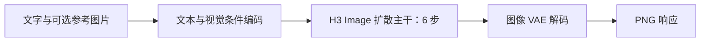

这是一张帮助理解的简化流程图；本次 layerwise offload 作用于编码器，实际执行还包含调度、内存拷贝及接口编解码。

!!! note "实测结果"
    两套引擎各完成 51 个正式压测批次、504 / 504 次请求成功，均返回可解码且尺寸正确的图片。另有预热、质量样例和超限测试；vLLM-Omni 的 16 张参考图请求按预期返回 HTTP 400，因此原控制脚本将其计入失败并显示 partial，不能仅依据 Job 状态判断实验结论。

## 结论：单卡可以用，吞吐和等待时间要分开看

**单张 H20-3e 可以运行本次两套配置，适合低并发图片生成与编辑；要面向多人提供服务，应先做好队列和容量规划。** 两套引擎各完成 504 / 504 次正式请求，但这只表示响应成功、PNG 可解码且尺寸正确，不代表每张图都符合提示词。

| 问题 | 这次实测得到的结论 |
| --- | --- |
| 首图要等多久？ | 2048×2048 文生图、并发 1，vLLM-Omni P50 为 9.442 秒，SGLang 为 8.382 秒。数值是各三轮 P50 的中位数，计时包含收到完整 HTTP 响应，不包含外部网关。 |
| 多个用户同时请求会更快吗？ | 在这组 2048×2048 测试中，vLLM-Omni 从并发 1 增至 4，吞吐约为 0.105 到 0.106 图/秒，P50 从 9.44 秒升到 37.53 秒；SGLang 吞吐约为 0.118 到 0.120 图/秒，P50 从 8.38 秒升到 33.16 秒。短批次里增加并发主要增加等待，不能据此推算长期生产容量。 |
| 4K 成本怎样？ | 4096×4096 文生图并发 1，vLLM-Omni 和 SGLang 的 P50 分别约为 46.50 秒和 45.13 秒。以同一 vLLM-Omni 配置比较，约是 2048×2048 的 4.9 倍；这是本次提示词和配置下的观察。 |
| 该选哪个引擎？ | 本次 SGLang 在已测的这几项延迟上更低，但两个实验的节点和文本编码器卸载方式不同，不能得出引擎本身更快的结论。若显存余量紧张，可先验证本次 vLLM-Omni 逐层卸载配置；需要更多参考图时可评估 SGLang，并重新验证输出质量。 |
| 需要多少资源？ | 本次 vLLM-Omni 的 GPU 采样峰值约 72.66 GiB，SGLang 约 121.06 GiB；工作负载和卸载方式不同，不是公平的显存排名，也不是最低配置。vLLM-Omni 运行中曾观察到约 230 GiB 的容器内存峰值，含文件页缓存。单张 48 GB L20 不能直接照搬这两套已测配置。 |

**部署建议：**先按单卡、低并发上线内部试用，设置有界队列、任务状态与超时，并同时监控显存、主机内存及共享存储。冷启动到服务就绪约需 385 秒（vLLM-Omni）和 375 秒（SGLang），不含镜像拉取与调度，适合采用常驻服务而不是每个请求重新加载。需要更高吞吐时，先用业务图片和流量复测多副本、多卡与成本，再决定扩容。

**多参考图需要单独验收。** 本次 vLLM-Omni 的 8 图请求虽成功，但输出没有正确保留数量和顺序；16 图被该镜像拒绝。SGLang 接受了 16 图并返回可解码图片，但输入有重复素材，数量、顺序和身份尚未验收。不要把接口成功当作多图理解能力通过，也不要把本次版本限制推广到其他版本。

## 先看实际效果

以下图片均来自本次模型服务实际返回，展示版缩放至最长边 1280 像素并压缩为 WebP；没有重绘或修饰生成内容。原始输出为 2048 × 2048 PNG。生成模型的输出会随种子和软件版本改变。


*人像样例：雨天电车站、深蓝色外套；种子 42。人物为模型生成。*

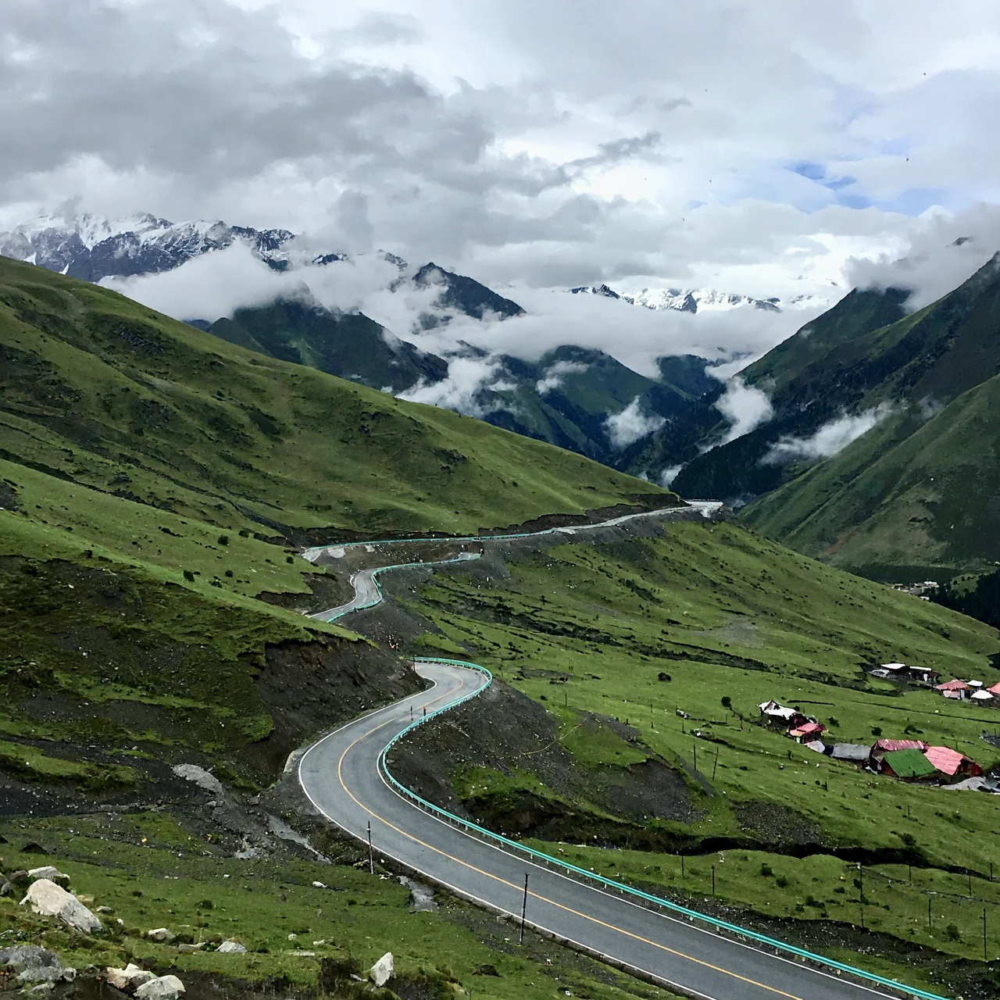

*风景样例：雨后山谷和蜿蜒公路；种子 42。*

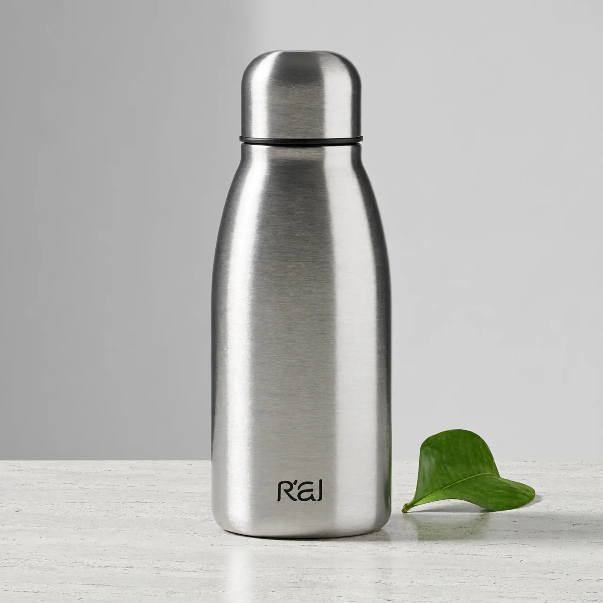

*产品图样例：金属水瓶、浅色石桌和一片绿叶；种子 42。图中瓶身出现了提示词未要求的标记。*

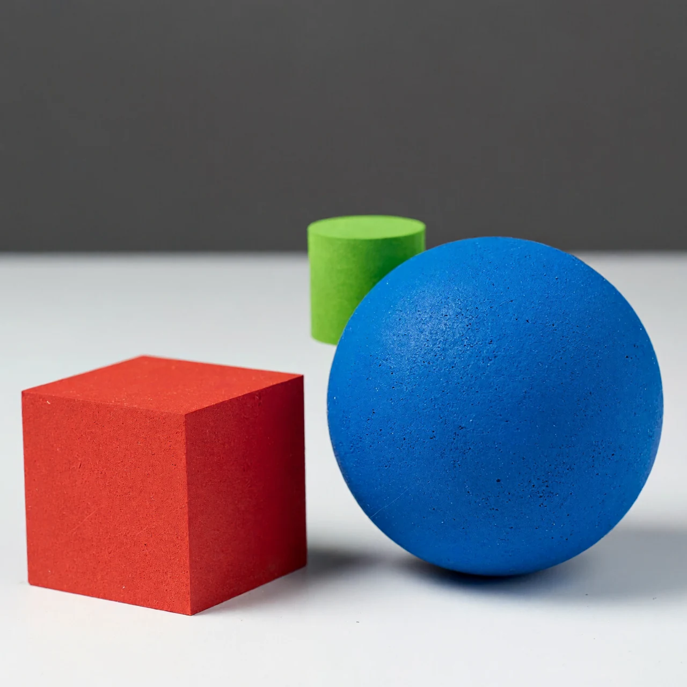

*空间关系样例：提示词要求红色立方体在蓝色球体左侧，绿色圆柱位于球体后方；种子 42 的这个样本基本体现了上述关系。*

文字任务也要看细节：下面第一张的主标题基本符合要求，但画面边缘生成了无意义小字；第二张要求两行分别为 `Kubernetes` 和 `云原生`，这个样本中的文字均可辨认。单个成功样本不能说明所有文字都准确，HTTP 成功也不等同于文字正确性验收。

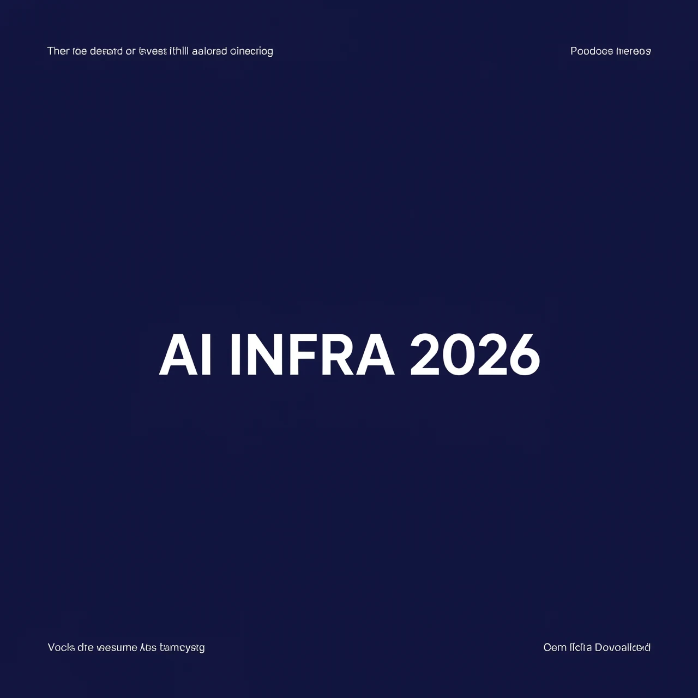

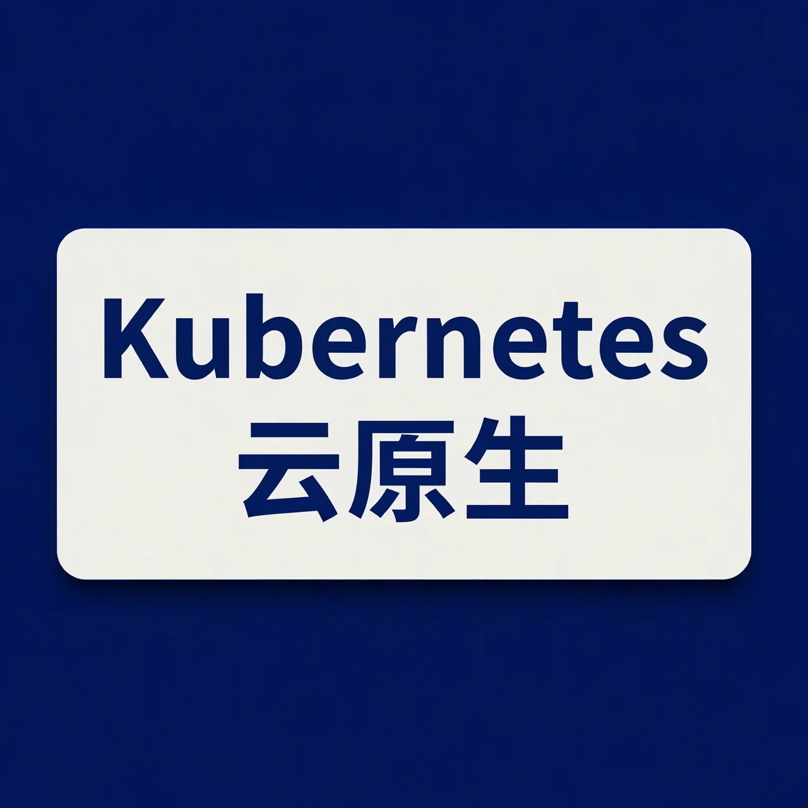

*英文海报和中英标牌的实测输出，均为种子 42；只代表各自一个样本。*

## 真实编辑样例

我们构造一张包含蓝色圆形和红色方块的简单参考图，要求把红色方块改为绿色，同时保留蓝色圆形和背景。

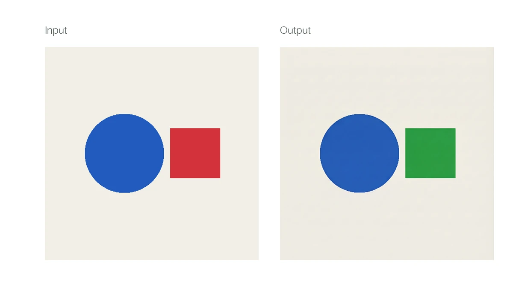

*左侧为输入，右侧为实测输出；仅缩放并拼接以便对照。颜色变化符合要求，但编辑结果不保证未修改区域逐像素一致。*

请求提示词：

```text
<Picture 1> shows simple geometric shapes. Change the red square to green while keeping the blue circle and background unchanged.
```

多参考图测试也暴露了接口和画面质量的区别：4 张和 8 张参考图各有一次请求返回可解码的 2048×2048 PNG，耗时分别约 35.60 秒和 70.13 秒；8 图输出出现了九宫格，不能算是正确保留了八张图的数量和顺序。16 张参考图请求返回 HTTP 400，错误信息说明当前服务最多接受 9 张。这里测试的是当前镜像，不能推广到所有版本；也没有测试恰好 9 张。

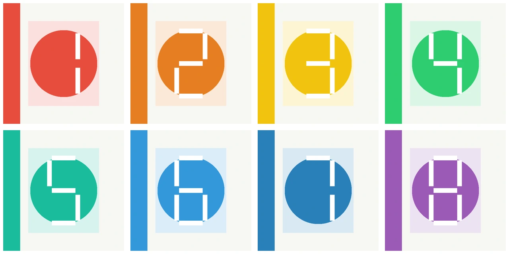

*按提交顺序排列的八张真实参考素材；仅为方便展示拼在一起，实际请求以八个独立文件传入。*

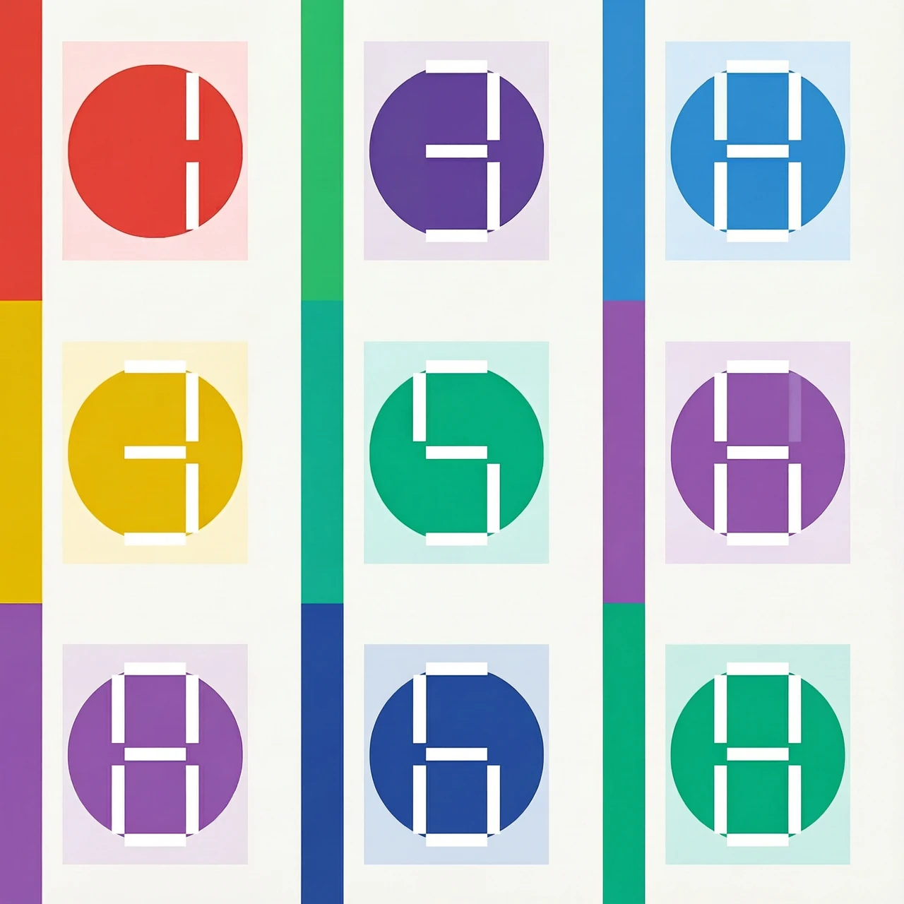

*八张参考图、种子 42 的实际输出；成功返回不等于完整遵循参考图数量和顺序。*

在 2048×2048、并发 1 的正式性能测试中，两张参考图和四张参考图各测三轮、每轮 6 次，均为 18 / 18 请求成功。两图的三轮 P50 中位数为 20.939 秒，四图为 35.475 秒；吞吐中位数分别为 0.04760 和 0.02813 图/秒。素材均为 512 × 512 合成几何图，这些结果不代表复杂照片或更多参考图的性能与质量。

## 环境和测试边界

| 项目 | 本次配置 |
| --- | --- |
| GPU | 1 × H20-3e，141 GB 级显存 |
| 引擎 | vLLM 0.33.0；vLLM-Omni `0.1.dev4171+gc958c8f5f` |
| 软件 | Python 3.12.3、PyTorch 2.14.0+cu130、Diffusers 0.40.0、Transformers 5.19.0 |
| 模型 | MiniMax-H3-Image，包含本地 H3 `text_encoder`；原始精度 |
| 显存策略 | 逐层卸载 text encoder 到主机内存；并非全部权重常驻 GPU |
| 主机资源 | Pod 申请 16 CPU / 256 GiB 内存，限制 32 CPU / 384 GiB；申请值不等于实际用量或最低需求 |
| 工作负载 | 文生图、单图与多图编辑；默认 6 步；固定请求尺寸与种子；几何参考图为 512 × 512 |
| 部署 | Kubernetes 中独立 Job；模型目录只读挂载到容器 |

按官方配方，生成骨干、文本编码器与 VAE 是不同组件；骨干参数不能直接等同于整套系统的显存需求。权重位于共享存储时，加载还受网络和文件系统影响。[组件与请求规格](https://recipes.vllm.ai/MiniMaxAI/MiniMax-H3-Image)

本次固定镜像的内容摘要为 `sha256:77c3f76764346918576ba4183daf169240070b659c919c7fff45df31bbf333c9`；它是内部镜像仓库的镜像摘要，不代表可从公开仓库以相同名称直接拉取。没有对已同步的模型权重重新计算哈希。

实验容器的 Kubernetes 资源配置摘录如下；模型目录通过已有只读存储挂载，实际镜像、存储卷及调度约束需按环境填写。这里展示的是本次申请值，并不是推荐的通用最小值。

```yaml
resources:
  requests:
    cpu: "16"
    memory: 256Gi
    nvidia.com/gpu: "1"
  limits:
    cpu: "32"
    memory: 384Gi
    nvidia.com/gpu: "1"
```

本轮 `/v1/models` 就绪耗时约 385 秒，从服务进程启动开始计时，不包含镜像拉取和 Pod 排队。首次 2048×2048 文生图请求约 9.78 秒、单图编辑约 15.17 秒；每项只有一次，属于冒烟验证，并非稳定的吞吐指标。

北京时间 09:40 至 12:43 的实验容器每秒 `nvidia-smi` 采样记录中，显存占用最高约 72.66 GiB；早期 5 秒采样的 DCGM 在当时窗口观察到约 69.27 GiB，采样频率和时间范围不同。运行中一次查询的容器 cgroup 内存峰值约 230.0 GiB，包含文件页缓存，不等同于模型进程常驻内存；未记录退出时的最终 cgroup 峰值。这是本次测试的采样峰值，不代表其他场景的峰值或最小资源要求；部署时应同时为 GPU 显存和主机内存预留空间。

这也意味着，不能把这次相同配置直接视为适用于单张 48 GB L20：已观测显存占用高于其标称容量。进一步卸载、量化或多卡能否运行及性能如何，必须单独验证，本轮没有测试。

[下载本轮每秒 GPU 采样](../../assets/practices/minimax-h3-image-h20/gpu-samples.csv)。原始 CSV 无表头，字段依次为 UTC 时间、容器内 GPU 索引、GPU 名称、利用率（%）、显存占用（MiB）、功率（W）和温度（℃）。

## 真实监控截图

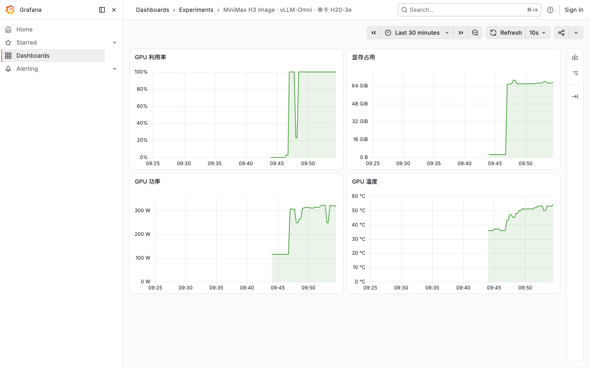

*独立实验 Grafana 的桌面截图；曲线为该实验所分配 GPU 的利用率、显存、功率和温度。该截图覆盖样图生成时段，不代表所有并发压测。GPU 利用率达到 100% 并不单独证明服务已达到最优吞吐。*

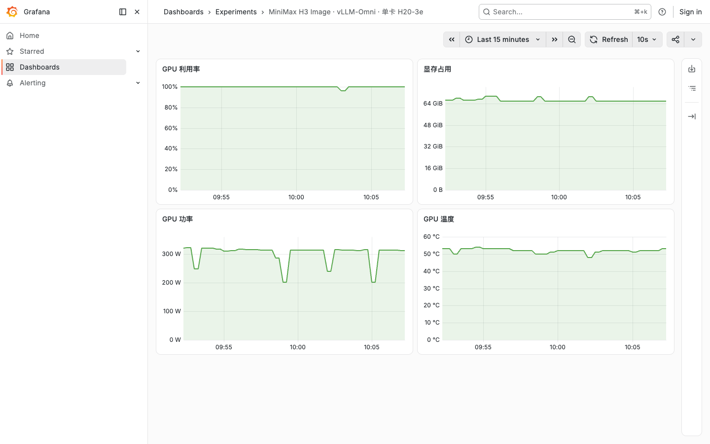

*持续请求期间的实测曲线，覆盖并发 1 和并发 2 阶段；采样间隔为 5 秒。*

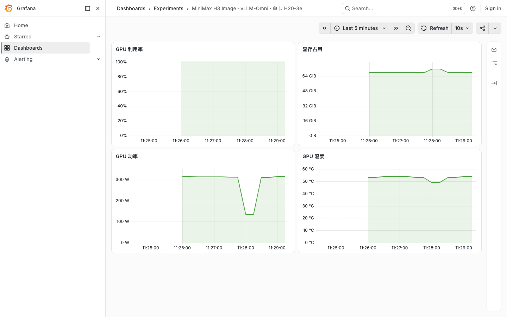

*4K 文生图压测期间的真实截图。实验监控任务中途退出后单独重启，截图只覆盖重启之后的片段，不表示前后监控数据连续；GPU 任务另有独立的每秒采样记录。*

## 启动与请求

下面给出等价的 Linux Docker 复现入口：先将已下载模型目录设为 `MODEL_DIR`。该目录需包含图片模型及 `text_encoder/`。实验使用的内部镜像与下列公开镜像内容摘要相同；Docker 示例使用 host 网络，要求主机端口 8000 空闲。

```bash
export MODEL_DIR=/path/to/MiniMax-H3-Image
docker run --rm -it --gpus 1 --network host --ipc host \
  -v "$MODEL_DIR:/models/MiniMax-H3-Image:ro" \
  --entrypoint /bin/bash \
  vllm/vllm-omni@sha256:77c3f76764346918576ba4183daf169240070b659c919c7fff45df31bbf333c9
```

固定镜像中发现本地 `text_encoder/` 与 `model_index.json` 的外部编码器定位信息同时存在时会产生冲突。本次把模型目录映射到临时工作目录，并仅在临时副本中移除外部定位信息，保留其前两个字段；权重及原始模型目录均未修改。不同版本的加载器可能已经支持直接指定本地编码器，部署时应先按对应版本文档验证。

下面的例子使用只读的 `MODEL_SOURCE` 创建临时视图。仅当第三项确实是指向 `text_encoder` 的对象时移除它，遇到其他结构直接报错；`/work/MiniMax-H3-Image` 必须预先不存在。

```bash
export MODEL_SOURCE=/models/MiniMax-H3-Image
python3 - <<'PY'
import json, os
from pathlib import Path
src = Path(os.environ['MODEL_SOURCE'])
dst = Path('/work/MiniMax-H3-Image')
dst.mkdir(parents=True, exist_ok=False)
for item in src.iterdir():
    if item.name not in ('model_index.json', 'v1'):
        (dst / item.name).symlink_to(item.resolve(), target_is_directory=item.is_dir())
data = json.loads((src / 'model_index.json').read_text())
enc = data.get('text_encoder')
if not isinstance(enc, list) or not (src / 'text_encoder').is_dir():
    raise ValueError('Unexpected local text encoder layout')
if len(enc) == 3 and isinstance(enc[2], dict) and enc[2].get('subfolder') == 'text_encoder':
    data['text_encoder'] = enc[:2]
elif len(enc) != 2:
    raise ValueError('Unexpected encoder metadata')
(dst / 'model_index.json').write_text(json.dumps(data, indent=2) + '\n')
PY
```

实际服务的核心启动参数如下。`/work/MiniMax-H3-Image` 是上述临时目录，`127.0.0.1` 表示只在测试容器内开放；正式部署应另行处理网络、认证、排队与限流。

```bash
export HF_HUB_OFFLINE=1 TRANSFORMERS_OFFLINE=1
vllm serve /work/MiniMax-H3-Image \
  --omni --host 127.0.0.1 --port 8000 --num-gpus 1 \
  --diffusion-offload-config '{"mode":"layer","components":["text_encoder"]}'
```

服务就绪后可通过兼容接口提交文生图请求，模型名要与 `/v1/models` 返回值一致：

```bash
curl -sS http://127.0.0.1:8000/v1/images/generations \
  -H 'Content-Type: application/json' \
  -d '{"model":"/work/MiniMax-H3-Image","prompt":"A brushed silver water bottle on a pale stone table beside a single green leaf, clean studio product photography.","size":"2048x2048","seed":42,"response_format":"b64_json"}' \
  > response.json
python3 -c 'import base64,json; open("generated.png","wb").write(base64.b64decode(json.load(open("response.json"))["data"][0]["b64_json"]))'
```

参考图编辑使用 `/v1/images/edits` 的 multipart 请求；多张图片重复传 `image` 字段，提示词中的 `<Picture 1>` 等从 1 开始引用。请以实际镜像版本的接口为准。官方配方说明，小于默认生成面积的目标图可能先按更大画布生成再缩放，不能简单根据输出分辨率推断成本。[请求规格](https://recipes.vllm.ai/MiniMaxAI/MiniMax-H3-Image)

```bash
curl -sS http://127.0.0.1:8000/v1/images/edits \
  -F 'model=/work/MiniMax-H3-Image' \
  -F 'image=@edit-source-blue-circle-red-square.png;type=image/png' \
  -F 'prompt=<Picture 1> shows simple geometric shapes. Change the red square to green while keeping the blue circle and background unchanged.' \
  -F 'size=2048x2048' -F 'seed=42' -F 'response_format=b64_json' \
  > edit-response.json
python3 -c 'import base64,json; open("edited.png","wb").write(base64.b64decode(json.load(open("edit-response.json"))["data"][0]["b64_json"]))'
```

[测试提示词与参考图清单](../../assets/practices/minimax-h3-image-h20/fixtures/cases.json)、[参考素材包](../../assets/practices/minimax-h3-image-h20/fixtures.zip)和[测试脚本](../../assets/practices/minimax-h3-image-h20/bench.py)可供复核；图像为实验专门生成的几何图形。脚本对每个请求保存结果，固定了本次测试矩阵；使用前须设置脚本开头所需的环境变量和截止时间，并准备好足够存储空间。本轮提供[逐请求 CSV](../../assets/practices/minimax-h3-image-h20/requests.csv) 和批次记录 [JSONL](../../assets/practices/minimax-h3-image-h20/groups.jsonl) / [CSV](../../assets/practices/minimax-h3-image-h20/groups.csv)；逐请求数据也包含预热和预期拒绝的超限请求，不能直接全部计入正式成功率。

### SGLang Diffusion：正式对照结果

使用同一权重、同一套提示词与参考素材，SGLang 镜像 `0.0.0.dev1+g2c597c922` 已在另一台单卡 H20-3e 上完成加载和文生图、单图编辑各一次冒烟；服务进程启动到 `/v1/models` 就绪约 375 秒。两次请求分别约 46.11 秒和 16.90 秒，均返回可解码的 2048×2048 图片；这是首次请求，不是正式性能对比。正式压测 51 个批次共 504 / 504 成功；包括预热、样例和协议测试在内共 566 / 566 成功。节点和卸载策略不同，比较须保留这些条件。

同一组多参考图协议测试中，SGLang 的 4 张、8 张和 16 张参考图各有一次请求返回可解码图片；16 张的单次耗时约 164.38 秒。16 张输入中有重复素材，这只能说明本次接口接收并返回了图片，尚未证明对象数量、顺序或身份正确。此前 vLLM-Omni 对这组 16 张输入返回 HTTP 400；这一差异适用于各自测试的固定镜像，不代表所有版本的限制。

正式压测中，SGLang 在 2048×2048 文生图、并发 1 下完成三轮，各 12 / 12 成功；每轮 P50 分别为 8.382、8.379、8.385 秒，中位数为 8.382 秒。前文 vLLM-Omni 同一请求形状的 P50 中位数为 9.442 秒；两次运行位于不同节点，且 SGLang 使用文本编码器组件卸载、vLLM 使用逐层卸载，不能把差值单独归因于引擎。

文生图并发 1、2、4、8 已各完成三轮，每轮 12 / 12 成功。下图为两次实测各轮吞吐与请求 P50 的中位数，计时都包含完整 HTTP 响应：

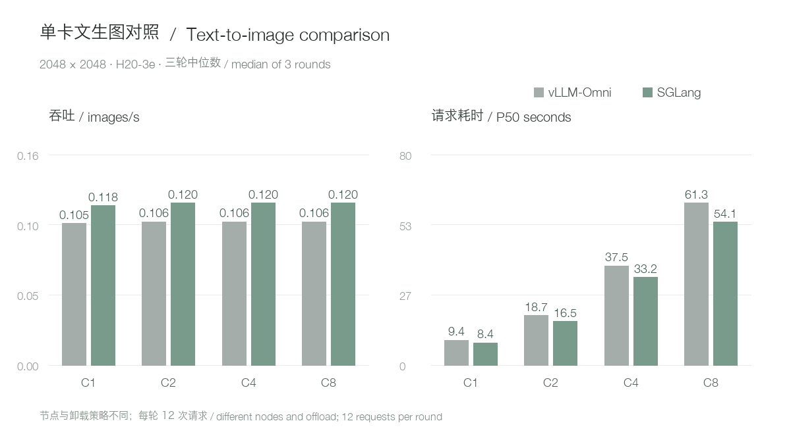

*两次运行使用不同节点和卸载策略；两个指标各用独立纵轴，完整数据见下方批次记录。*

单图编辑并发 1、2、4 也已各完成三轮，每轮 12 / 12 成功。SGLang 的 P50 中位数分别为 13.210、26.218、52.542 秒；vLLM-Omni 分别为 14.930、29.719、59.587 秒。这不是全部模型质量或生产容量结论。

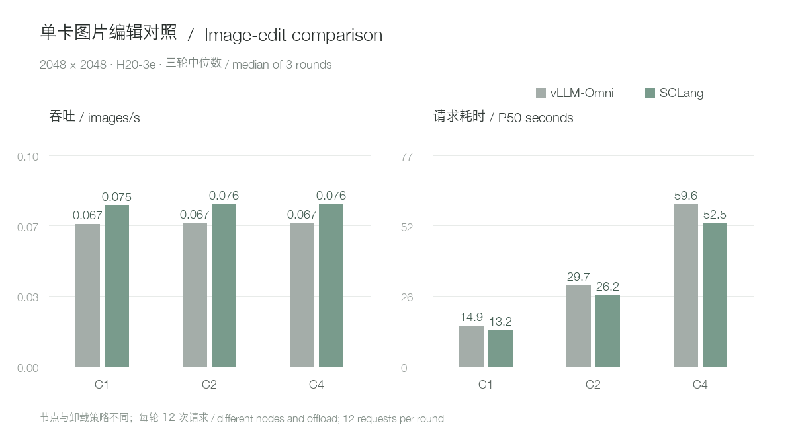

*单参考图编辑三轮中位数；节点、卸载策略及两个指标的纵轴均不同。*

2720×1536 文生图并发 1 和 4 也已各完成三轮、每轮 12 / 12 成功：SGLang P50 中位数分别为 8.320 和 33.000 秒，vLLM-Omni 分别为 9.400 和 37.354 秒。横图编辑并发 1 和 4 均完成三轮、每轮 12 / 12 成功，SGLang P50 中位数分别为 13.047 和 51.956 秒，vLLM-Omni 分别为 14.849 和 59.130 秒。

4096×4096 文生图并发 1 的三轮各为 6 / 6 成功；SGLang P50 中位数约 45.13 秒、吞吐中位数 0.02203 图/秒，vLLM-Omni 分别为约 46.50 秒和 0.02137 图/秒。并发 2 的三轮也各为 6 / 6 成功，SGLang 的 P50 中位数约 89.37 秒、吞吐中位数 0.02228 图/秒，vLLM-Omni 分别为约 92.27 秒和 0.02158 图/秒。4K 单图编辑并发 1 的三轮也各为 6 / 6 成功，SGLang P50 中位数约 52.85 秒、吞吐中位数 0.01882 图/秒，vLLM-Omni 分别约 54.94 秒和 0.01810 图/秒。4K 编辑并发 2 的三轮也各为 6 / 6 成功，SGLang P50 中位数 104.765 秒，vLLM-Omni 为 109.108 秒。双参考图编辑并发 1 的三轮各为 6 / 6 成功，SGLang P50 中位数 18.442 秒，vLLM-Omni 为 20.939 秒。四参考图编辑并发 1 的三轮也各为 6 / 6 成功，SGLang P50 中位数为 30.738 秒，vLLM-Omni 为 35.475 秒。比较仍受节点和卸载配置差异限制。

北京时间 14:23 至 17:15 的 SGLang 实验每秒 GPU 采样中，显存占用最高约 121.06 GiB；这段时间包含一次 16 参考图请求。前述 vLLM-Omni 的 72.66 GiB 来自另一轮测试，两者节点、卸载策略和完成的参考图工作负载不同，不能将峰值差直接归因于引擎。

下载 SGLang [批次记录](../../assets/practices/minimax-h3-image-h20/sglang-groups.jsonl)、[逐请求记录](../../assets/practices/minimax-h3-image-h20/sglang-requests.csv)和 [GPU 采样记录](../../assets/practices/minimax-h3-image-h20/sglang-gpu-samples.csv)。逐请求记录包含预热和协议测试，不能全部计入正式压测分母。

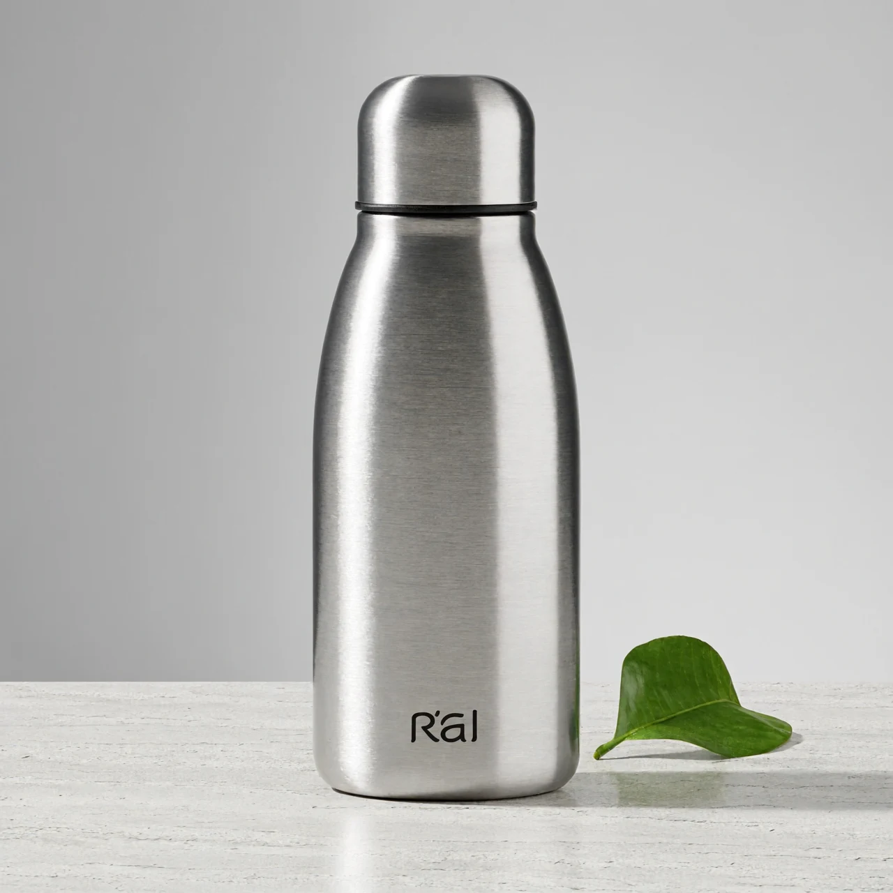

*SGLang 首次文生图结果，沿用前述产品提示词和种子 42；展示图由原始 2048×2048 PNG 缩放压缩。*

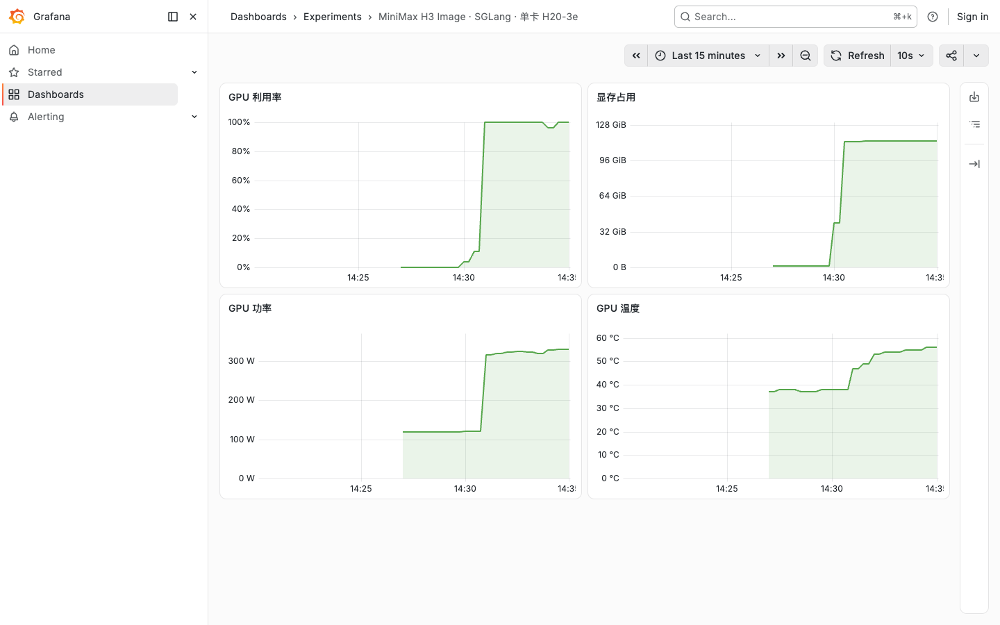

*SGLang 加载与样图生成阶段的浅色桌面截图；不同引擎的卸载策略不同，不直接将显存曲线差异归因于引擎实现。*

先在包含本地模型和文本编码器的 GPU 容器内，执行上文的临时视图命令。实验使用内部镜像的固定摘要；公开上游候选镜像如下，仓库同步可能改变 manifest 摘要，请在实际环境核对版本与依赖：

```bash
export MODEL_DIR=/path/to/MiniMax-H3-Image
docker run --rm -it --gpus 1 --network host --ipc host \
  -v "$MODEL_DIR:/models/MiniMax-H3-Image:ro" \
  --entrypoint /bin/bash \
  lmsysorg/sglang@sha256:dc9929c7f471f31d66aa11da7779a49e1fdb75fd2b120257ff181c55b52c2b74
```

在容器内执行与上文相同的 `MODEL_SOURCE` 临时视图代码后，实际启动命令为：

```bash
export HF_HUB_OFFLINE=1 TRANSFORMERS_OFFLINE=1
sglang serve --model-type diffusion \
  --model-path /work/MiniMax-H3-Image \
  --host 127.0.0.1 --port 8000 --num-gpus 1 \
  --warmup-mode off --text-encoder-cpu-offload true \
  --served-model-name minimax-h3-image
```

请求沿用上面的 `/v1/images/generations` 与 `/v1/images/edits` 示例，把 `model` 改为 `minimax-h3-image`。本镜像的 diffusion CLI 未列出 `--text-encoder-path`，因此不能直接照搬其他版本的参数；`--text-encoder-cpu-offload true` 与前述 vLLM 的逐层卸载并不相同。[SGLang 官方配方](https://docs.sglang.io/cookbook/diffusion/MiniMax/MiniMax-H3-Image)

参数作用：`--model-type diffusion` 指定图片生成后端；`--warmup-mode off` 跳过服务启动时的预热，首个请求可能额外初始化；`--text-encoder-cpu-offload true` 启用文本编码器的 CPU 卸载；`--served-model-name` 设置请求使用的模型名。其他没有显式指定的选项采用该镜像默认值，不应假设与 vLLM 相同。

## 正式压测：文生图并发 1、2、4 与 8

正式压测固定图片尺寸、提示词、种子和推理配置，独立记录预热、各次请求结果、端到端耗时与完整分母；并发是同时提交的客户端请求数，不等同于 GPU 一定并行执行。测试包括文生图和图片编辑，以及不同画幅与多参考图条件。请求成功不等同于画面质量通过。

GPU 是实验独占的单卡，但 CPU 与共享存储并非完全隔离。人工回传横图样本分别与横图文生图并发 4 第二轮、横图编辑并发 1 第二轮重叠；4K 预热图回传与 4K 文生图并发 1 第一轮重叠。这些批次保留原始数据，不把结果描述为完全无 I/O 干扰的对照实验。

2048 × 2048 文生图、并发 1 的三个正式批次已完成。每轮发送 12 次请求；预热请求不计入表格。

| 轮次 | 成功 / 请求 | 吞吐（图/秒） | 请求耗时 P50（秒） | 请求耗时 P95（秒） |
| --- | --- | --- | --- | --- |
| 1 | 12 / 12 | 0.10503 | 9.442 | 9.489 |
| 2 | 12 / 12 | 0.10489 | 9.446 | 9.629 |
| 3 | 12 / 12 | 0.10501 | 9.440 | 9.472 |

三轮吞吐中位数为 0.10501 图/秒，三轮 P50 的中位数为 9.442 秒。耗时从客户端提交到收到完整 HTTP 响应，成功还要求返回的 PNG 可解码且尺寸正确；图像审美和文字准确性需要单独检查。每轮 P95 基于 12 次样本，采用 nearest-rank 算法，样本较少，只用于描述本轮观测。

并发 2 的三轮同样各成功 12 / 12 次：吞吐分别为 0.10622、0.10624、0.10618 图/秒，P50 分别为 18.721、18.723、18.709 秒。三轮中位吞吐约 0.10622 图/秒，仅比并发 1 高约 1.2%，三轮 P50 中位数则升至约 18.721 秒。对当前单卡配置，增加到两个同时请求主要增加了等待时间；是否在其他并发或硬件配置下改善吞吐，还需要进一步测试。

并发 4 的三轮同样各成功 12 / 12 次，吞吐分别为 0.10609、0.10625、0.10635 图/秒，P50 分别为 37.542、37.528、37.494 秒；对应中位数为 0.10625 图/秒与 37.528 秒。这个阶段也没有出现明显的吞吐增长。

并发 8 三轮也各成功 12 / 12 次，吞吐分别为 0.10626、0.10606、0.10638 图/秒，P50 分别为 61.258、61.347、60.964 秒；对应中位数为 0.10626 图/秒与 61.258 秒。每轮只有 12 次请求，后半批的排队形态与长期稳定流量不同，不能把该 P50 外推为长期线上延迟。

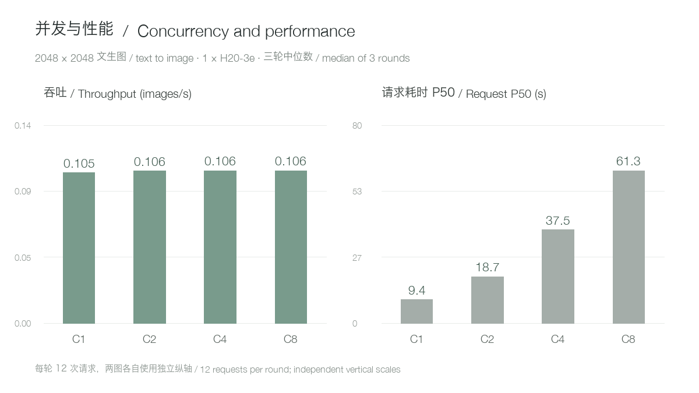

*各项为三轮对应指标的中位数；两幅子图各有独立纵轴，数值和单位不能直接互比。*

吞吐用每批成功数除以从批次开始到最后一条 HTTP 响应收到的时间；客户端在批次执行期间会解码并保存每张图片，因此中间请求的文件写入也可能影响下一条请求的发起。测试使用本机回环访问服务，不包含外网和网关耗时。

根据已完成的测试，单卡更适合先配置有界队列、显示任务状态并限制并发；客户端和网关超时应覆盖排队加生成时间。主机内存和共享存储同样需要监控。多卡、不同模型服务版本、长时间稳定性与实际业务质量都未在这一阶段验证，不能据此直接给出生产容量承诺。

### 单图编辑基线

2048 × 2048 单图编辑的并发 1 已完成三轮，各轮均成功 12 / 12 次；吞吐分别为 0.06665、0.06664、0.06666 图/秒，请求 P50 分别为 14.929、14.930、14.931 秒。三轮吞吐中位数为 0.06665 图/秒、P50 中位数约 14.930 秒。

并发 2 的三轮也各成功 12 / 12 次，吞吐分别为 0.06710、0.06710、0.06707 图/秒，P50 分别为 29.720、29.705、29.719 秒；对应中位数为 0.06710 图/秒与 29.719 秒。

并发 4 的三轮各成功 12 / 12 次，吞吐分别为 0.06684、0.06687、0.06695 图/秒，P50 分别为 59.687、59.554、59.587 秒；对应中位数为 0.06687 图/秒与 59.587 秒。输入为上文几何图形，不能代表所有参考图尺寸、数量及内容下的性能。

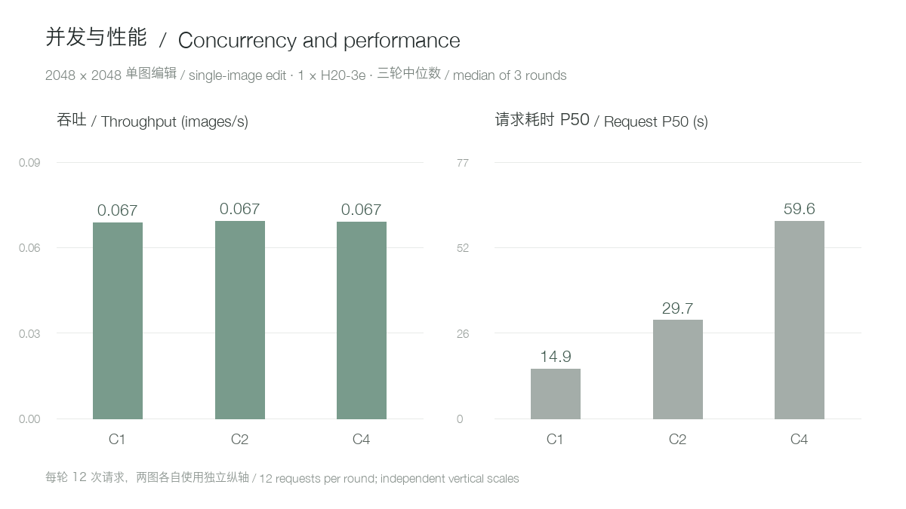

*单图编辑三轮中位数；两个指标各用独立纵轴。*

### 横图与更高分辨率

2720 × 1536 文生图的并发 1 已完成三轮，各为 12 / 12 成功；吞吐分别为 0.10523、0.10521、0.10552 图/秒，P50 分别为 9.400、9.404、9.396 秒。三轮中位吞吐为 0.10523 图/秒，P50 中位数为 9.400 秒。

并发 4 的三轮也各为 12 / 12 成功，吞吐为 0.10678、0.10657、0.10678 图/秒，P50 为 37.354、37.432、37.345 秒；对应中位数为 0.10678 图/秒和 37.354 秒。

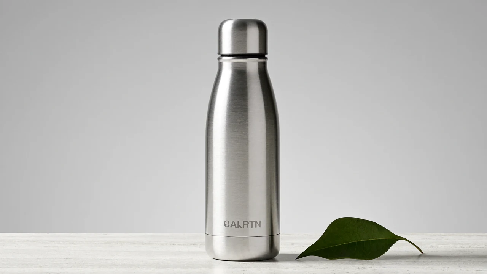

*横图并发 1 正式批次中的实际输出，原始尺寸 2720 × 1536，展示图已缩放压缩；沿用相同的产品提示词与种子 42。*

横图单参考编辑并发 1 的三轮均为 12 / 12 成功，吞吐分别为 0.06702、0.06684、0.06685 图/秒，P50 分别为 14.841、14.854、14.849 秒；对应中位数为 0.06685 图/秒与 14.849 秒。

并发 4 的三轮也均为 12 / 12 成功，吞吐分别为 0.06739、0.06737、0.06753 图/秒，P50 分别为 59.121、59.259、59.130 秒；对应中位数为 0.06739 图/秒与 59.130 秒。


*512 × 512 方形参考图、横图输出的实测样本，原始输出尺寸 2720 × 1536；用于观察画幅变化，并非像素级保真测试。正式应用应按官方建议尽量准备与目标画幅匹配的参考图。*

4096 × 4096 文生图并发 1 已完成三轮，每轮 6 / 6 请求成功；吞吐分别为 0.02138、0.02136、0.02137 图/秒，P50 分别为 46.487、46.528、46.499 秒。三轮中位吞吐为 0.02137 图/秒，P50 中位数为 46.499 秒。相比同配置下 2048×2048 并发 1 的三轮 P50 中位数 9.442 秒，约为其 4.9 倍；这只是本次固定提示词和硬件上的观察，不是分辨率与耗时的通用比例。

4K 并发 2 的三轮也各为 6 / 6 成功，吞吐分别为 0.02159、0.02157、0.02158 图/秒，P50 分别为 92.222、92.302、92.267 秒；对应中位数为 0.02158 图/秒与 92.267 秒。

4K 单参考编辑并发 1 的三轮各为 6 / 6 成功，吞吐分别为 0.01811、0.01810、0.01810 图/秒，P50 分别为 54.939、54.950、54.937 秒；对应中位数为 0.01810 图/秒与 54.939 秒。并发 2 的三轮也各成功 6 / 6 次，吞吐均为 0.01825 图/秒，P50 分别为 109.099、109.108、109.135 秒，中位数为 109.108 秒。

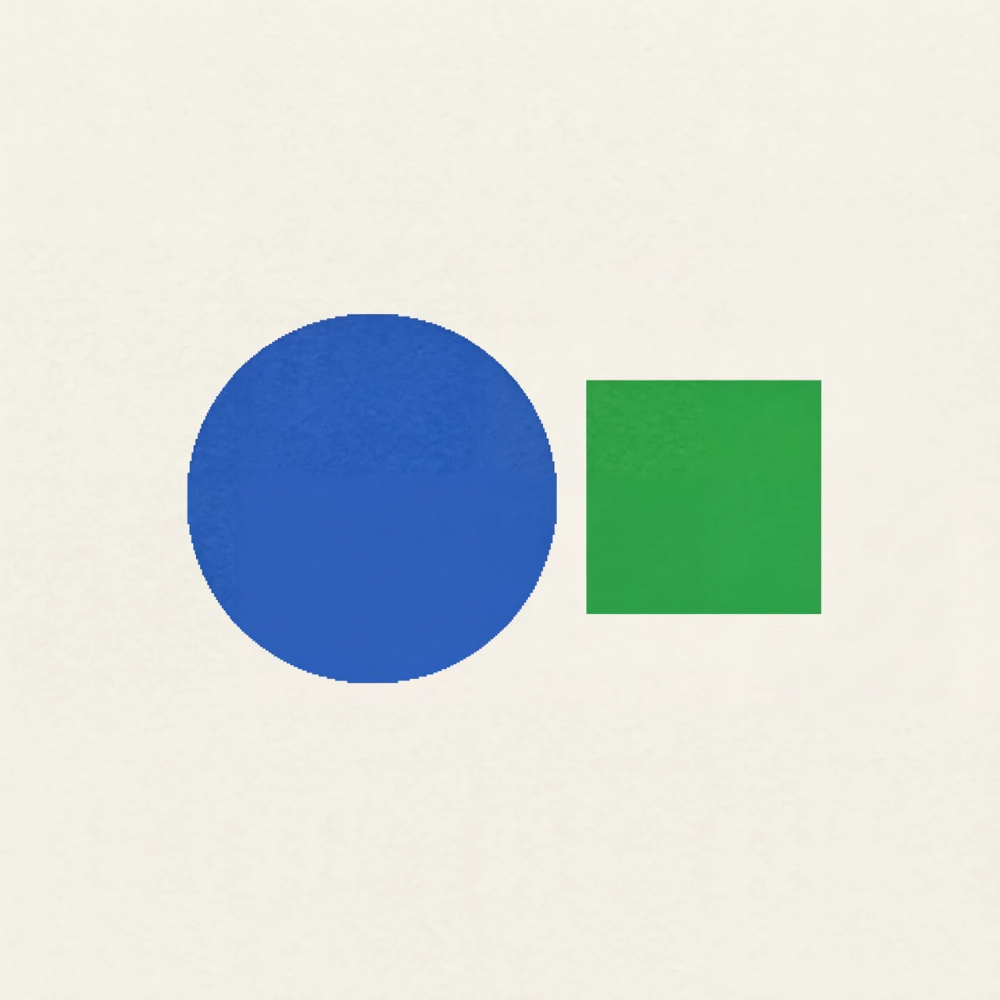

*4K 编辑预热输出，原始 PNG 为 4096 × 4096；展示图已缩放压缩。*

4K 并发 1 第一轮期间，我们回传了一张约 48 MiB 的预热 PNG；回传可能与该轮共享 CPU 和存储 I/O。该轮没有剔除，原值保留在记录中，结果不应解释为完全没有外部 I/O 干扰。

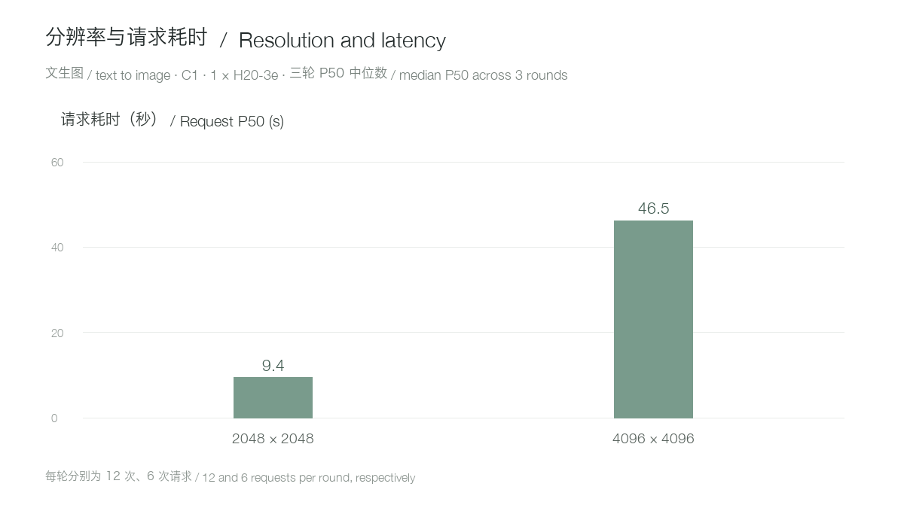

*2048×2048 与 4096×4096 文生图的三轮 P50 中位数；每轮请求数分别为 12 和 6。*

下面展示的是另外一张 4K 预热图，该预热请求约 46.55 秒，不计入正式压测。原图为 4096 × 4096 PNG，第一张缩放展示全图，第二张截取原图 1600 × 1600 的局部后缩放到 1280 × 1280，便于观察瓶身细节；两图均压缩为 WebP。

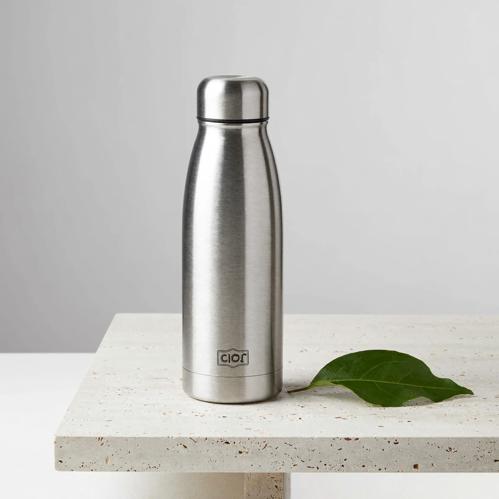

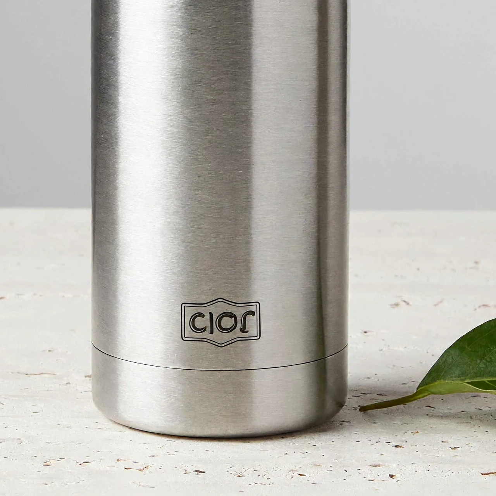

*4K 预热样本全图与局部，均来自同一次种子 42 请求。瓶身出现了提示词未要求的标识。*

[官方模型卡](https://huggingface.co/MiniMaxAI/MiniMax-H3-Image) · [vLLM-Omni 官方配方](https://recipes.vllm.ai/MiniMaxAI/MiniMax-H3-Image) · [Diffusers 模型文档](https://huggingface.co/docs/diffusers/main/api/pipelines/minimax_h3_image)
