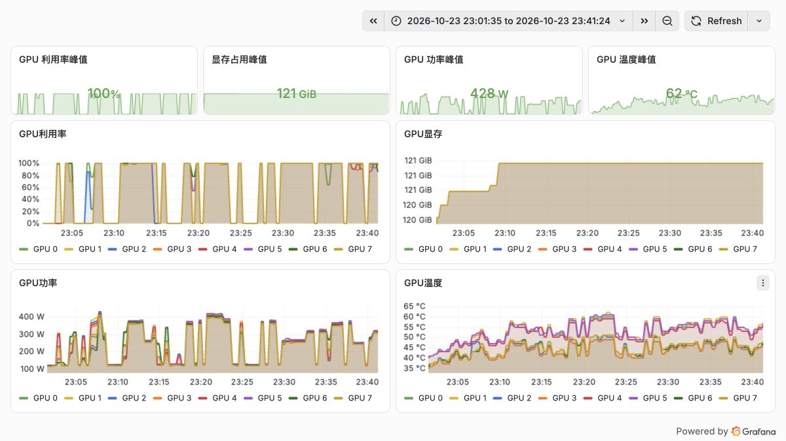
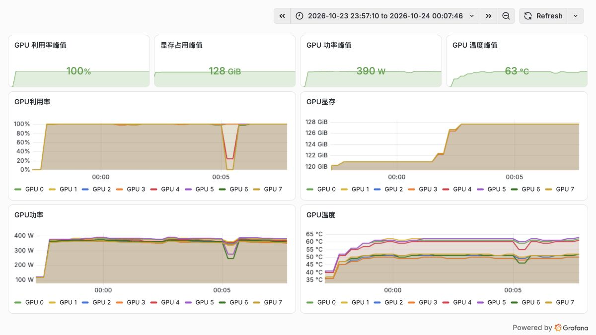

# MiniMax-M3.1-Flash Day0：八卡 H20-3e 的 vLLM 部署与百万 Token 实测

## 1. 先看模型，再看能否部署

MiniMax-M3.1-Flash 是原生多模态混合专家模型（Mixture of Experts，MoE），官方给出约 428B 总参数、23B 激活参数，支持文字、图片和视频输入、文字输出，最长上下文为 1M Token。对现有 GPU 集群而言，值得关注的不只是激活参数，还有权重格式、推理内核和长上下文缓存的实际成本。[官方模型卡](https://huggingface.co/MiniMaxAI/MiniMax-M3.1-Flash)

本次使用官方权重快照 `54e4e69dfc452b1e94a426c24a4fdeeaa8e3ad5e`。配置外层为 `quant_method=mxfp8`，专家部分还包含 `moe_quant_algo=NVFP4`、`moe_quant_format=nvfp4-pack-quantized`。因此，这是一套混合格式权重，部署路径需要同时处理 MXFP8 和打包后的 NVFP4 专家。[锁定版本配置](https://huggingface.co/MiniMaxAI/MiniMax-M3.1-Flash/blob/54e4e69dfc452b1e94a426c24a4fdeeaa8e3ad5e/config.json)

48 个主权重分片的索引张量数据量为 250,103,411,200 bytes，约 232.93 GiB。MoE 每个 Token 只激活部分参数，服务仍需容纳整套权重；文件体积也不包含运行时键值缓存（Key-Value Cache，KV Cache）、索引缓存、计算工作区和 CUDA Graph。

这次八卡 H20-3e 的 vLLM 测试完成了 **66 轮正式性能测试、1,944 个请求，失败数为 0**。独立长上下文配置完成 7 个召回样例，其中三次实际输入超过一百万 Token。本文先报告这组可复核结果；SGLang 尚无完整模型测试成绩，不参与引擎性能比较。

## 2. 实测环境与可复现配置

| 项目 | 本次配置 |
| --- | --- |
| GPU | 单节点 8×H20-3e；每卡报告 143,771 MiB；驱动 580.126.20 |
| 互联与主机拓扑 | GPU 两两 NV18；GPU 0–3 关联 NUMA 0，4–7 关联 NUMA 1 |
| vLLM | 0.1.dev23341+g8744dd2fb.d20261022.cu134 |
| 依赖 | PyTorch 2.14.0+cu130；Transformers 5.19.0；FlashInfer 0.7.2 |
| 并行与专家后端 | 张量并行 TP8；Marlin |
| 基础性能配置 | 最大上下文 32,768；最大序列 32；显存利用率参数 0.85 |
| 长上下文配置 | 最大上下文 1,048,576；最大序列 1 |
| 缓存 | FP8 KV 与 FP8 索引缓存；关闭前缀缓存 |
| 其他 | 不启用 DSpark 投机解码；视频输入上限设为 0 |

镜像为 `vllm/vllm-openai:minimax-m31-flash`，本次 amd64 内容摘要固定为 `sha256:f5ec69891fb7b855762f40598eea1aa5cad6e4f2f0c2a2f81d270e2bdcd93632`。开发标签可能变化，复现时应核对摘要与容器内版本，不能只看标签。Hopper 路径参考官方的 TP8、Marlin、FP8 缓存配置。[vLLM Recipe](https://recipes.vllm.ai/MiniMaxAI/MiniMax-M3.1-Flash)

H20 属于 Hopper 架构。本轮通过 Marlin 处理打包专家权重，运行日志显示相应的 W4A16 路径；这与 Blackwell 原生 FP4 Tensor Core 执行不同，不能把权重中的 NVFP4 字样直接当成硬件计算精度。

下面是本轮基础服务参数。`/model` 为容器内模型目录；末尾解析器插件的用途见后文。

```bash
export LD_LIBRARY_PATH="/usr/local/cuda-13.4/compat:${LD_LIBRARY_PATH:-}"
vllm serve /model \
  --served-model-name MiniMax-M3.1-Flash \
  --host 0.0.0.0 --port 30000 \
  --tensor-parallel-size 8 \
  --reasoning-parser minimax_m3 \
  --tool-call-parser minimax_m3 --enable-auto-tool-choice \
  --block-size 128 --kv-cache-dtype fp8 \
  --attention-config '{"indexer_kv_dtype":"fp8"}' \
  --moe-backend marlin \
  --compilation-config '{"cudagraph_mode":"FULL_AND_PIECEWISE"}' \
  --max-model-len 32768 --max-num-seqs 32 \
  --gpu-memory-utilization 0.85 \
  --limit-mm-per-prompt '{"video":0}' \
  --disable-hybrid-kv-cache-manager \
  --no-enable-prefix-caching --no-enable-log-requests \
  --reasoning-parser-plugin /package/scripts/minimax-reasoning-plugin.py
```

长上下文阶段单独重启服务，将 `--max-model-len` 改为 `1048576`、`--max-num-seqs` 改为 `1`。没有用 32 并发配置证明百万上下文容量。八个 rank 的 AllReduce 数值检查通过；这是单机通信正确性检查，不是跨机带宽测试。

## 3. 两个真正影响运行的问题

### 3.1 权重加载完成，Marlin 重排仍可能失败

首次启动读完了全部 48 个分片，随后在专家权重的 Marlin 重排阶段报出 PTX 工具链不受支持。镜像包含 CUDA 13.4 组件，进程默认看到的驱动 API 为 13.0；仅凭权重加载完成，无法判断服务已经可以生成。

定位时把同一个重排操作缩成小型 GPU 检查：默认动态库搜索路径下失败；将镜像内的兼容库目录置于搜索路径首位后，进程实际加载兼容库，驱动 API 变为 13.4，同一操作通过。正式 vLLM 服务随后沿用这个容器配置，主机驱动没有修改。

这依赖具体 GPU、主机驱动和兼容包的支持组合。复现时应检查实际加载的库，再运行所需内核，不能把设置环境变量当作所有 CUDA 版本问题的通用修复。[NVIDIA Forward Compatibility](https://docs.nvidia.com/deploy/cuda-compatibility/forward-compatibility.html)

### 3.2 推理标记出现在正文：先查解析器如何判断状态

第二次启动后，基础问答和多轮记忆通过，但流式接口把推理标记及其内容一起放进正文，独立推理字段为空。问题出在这版模板和解析器的组合：系统提示词包含推理标记的格式说明，解析器用整个提示词判断推理是否已经结束，误把说明中的结束标记当成当前回答的状态。

本轮插件只调整初始化状态的判断范围：找到最后一个 assistant 前缀，检查该前缀后的内容；生成过程中的流式提取仍沿用原解析器。实际镜像里的前缀样例与多种切块重放均通过，重新部署后，完整流和功能检查也通过。[本轮插件源码](../../assets/practices/minimax-m31-flash-day0/minimax-reasoning-plugin.py)

插件针对本文锁定构建。后续升级应先验证上游解析器是否已修复，再决定是否保留。镜像的依赖一致性检查还报告了 NIXL、CUTLASS DSL、OpenTelemetry 的声明冲突；本文只对实际执行到的路径给出运行结论。

## 4. 压测到底测了什么

主矩阵包含 19 个工况，每格三轮，共 57 轮、1,272 个请求。另有 128→64 Token、并发 1, 4, 8 的三轮历史口径补测，共 9 轮、672 个请求。两部分合计 66 轮、1,944 个请求，预热与校准不计入这个分母。[脱敏数据与逐轮指标](../../assets/practices/minimax-m31-flash-day0/vllm-results.json)

固定长度负载通过 `/v1/completions` 发送，使用锁定镜像内的同一 benchmark 客户端和本地 Tokenizer，温度为 0，设置 `ignore_eos=true` 强制输出长度。它衡量服务性能；随机合成输入的输出不用于评价回答质量。自然语言功能检查采用 temperature=1.0、top_p=0.95，基础推理 effort 为 low。

请求不限制到达速率，但限制客户端在途并发，属于有限批次、固定并发测试。短请求每轮请求数为 8/16/32/64/128，对应并发 1, 4, 8, 16, 32；其他工况详见数据文件。这组结果没有验证持续开放流量下的服务等级目标（Service Level Objective，SLO）。

- TTFT（Time to First Token）：请求发出到首个非空输出片段的时间。
- TPOT（Time per Output Token）：每个请求首尾输出片段间的耗时除以输出 Token 数减一。P95 是请求级平均值的分位数，不是逐 Token 间隔的分位数。
- E2E（End-to-End）：完整请求耗时；输出吞吐为成功输出 Token 数除以整轮耗时。
- 表格分别对每项指标取三轮中位数，图中误差线为轮间最小值至最大值。没有把三轮请求混合后重新计算 P95；小样本尾延迟也不宜直接外推生产。

## 5. 短请求：吞吐上去了，延迟也有代价

128 Token 输入、128 Token 输出的结果如下。

| 并发 | 每轮请求 | 输出吞吐 Token/s | P95 TTFT ms | P95 TPOT ms | P95 E2E s |
| --- | --- | --- | --- | --- | --- |
| 1 | 8 | 141.6 | 126.2 | 6.14 | 0.90 |
| 4 | 16 | 392.9 | 393.4 | 9.85 | 1.39 |
| 8 | 32 | 633.0 | 404.7 | 11.61 | 1.63 |
| 16 | 64 | 1,074.6 | 372.6 | 13.50 | 1.93 |
| 32 | 128 | 1,585.4 | 549.8 | 16.42 | 2.63 |


并发从 1 增加到 32，输出吞吐约提高 11.2 倍，P95 TPOT 从 6.14 ms 增至 16.42 ms。并发 16 的 TTFT 低于并发 8，三轮数据也保留了这种变化；有限批次中排队、合批和阶段交错会影响统计，不应把曲线强行画成单调递增。

下图为主矩阵实际时间范围内的八卡资源曲线。顶部峰值是该窗口内单卡指标的最大值：GPU 利用率 100%，显存约 121 GiB，功率 428 W，温度 62°C。功率不是八卡总功率，显存也不是模型权重本身的大小。



## 6. 长输入和长输出，要分别看

把并发固定在 8，输入形态一变，瓶颈就不同了。

| 输入→输出 Token | 输出吞吐 Token/s | P95 TTFT s | P95 TPOT ms | P95 E2E s |
| --- | --- | --- | --- | --- |
| 128→128 | 633.0 | 0.40 | 11.61 | 1.63 |
| 4,096→256 | 340.8 | 3.58 | 21.41 | 6.45 |
| 8,192→1,024 | 475.0 | 7.19 | 15.83 | 19.16 |
| 16,384→256 | 119.9 | 13.90 | 56.90 | 21.07 |
| 128→2,048 | 808.4 | 0.40 | 9.91 | 20.48 |

长输入需要先完成更多预填充计算，还会与在途请求的解码竞争资源。16K 输入、256 输出在 C8 下的 P95 TTFT 达到 13.90 秒，而短输入、2K 输出的首 Token 仍约 0.40 秒，完整请求却要约 20.48 秒。业务若是检索增强生成（Retrieval-Augmented Generation，RAG）或智能体工作流，需要按照实际输入输出分布做并发限额，不能沿用短问答的吞吐估计。

## 7. 百万 Token：实际送了多少，找回了什么

长上下文测试在长文约 10%、50%、90% 的位置放入三组独立随机代码，要求模型以 JSON 精确返回全部代码。服务最大上下文设为 1,048,576，每次仅一个请求，关闭前缀缓存。通过条件包括服务端 Usage、流结束、有效完成原因和全部代码精确匹配。

| 档位 / 种子 | 服务端输入 Token | 输出 Token | TTFT s | E2E s | 结果 |
| --- | --- | --- | --- | --- | --- |
| 64K / 103101 | 57,344 | 82 | 6.76 | 7.29 | PASS |
| 128K / 103101 | 122,881 | 72 | 14.62 | 15.06 | PASS |
| 256K / 103101 | 253,952 | 195 | 31.80 | 33.11 | PASS |
| 512K / 103101 | 516,095 | 96 | 70.97 | 71.36 | PASS |
| 1M / 103101 | 1,040,383 | 203 | 168.49 | 169.79 | PASS |
| 1M / 103102 | 1,040,384 | 211 | 168.29 | 169.69 | PASS |
| 1M / 103103 | 1,040,384 | 174 | 168.26 | 169.29 | PASS |

三次百万输入分别找回三处代码，本地编码与服务端输入计数一致。这验证了当前部署在单请求条件下的长输入处理与目标召回；多文档推理、矛盾证据处理和复杂任务完成率，需要另一套任务评估。



进入百万输入后，窗口内单卡显存峰值约 128 GiB。与主矩阵约 121 GiB 相比，服务配置和负载都发生了变化，因此不能把两者差值直接解释成每百万 Token 的 KV 内存成本。三次请求的 TTFT 约 168 秒，也说明最长上下文是可用容量，交互体验仍要单独衡量。

## 8. 工具和图片，验证到哪一层

| 检查 | 结果 | 覆盖内容 |
| --- | --- | --- |
| 文本与完整流 | 3/3 | 算术、多轮随机代码、流结束与推理字段分离 |
| 工具调用 | 4/4 | 单工具、模拟工具结果回传、流式参数、嵌套对象 |
| 图片 | 4/4 | 形状计数、样例票据金额、柱状图最大值、双图蔬菜识别 |
| 推理 effort | 5/5 | 五档参数下简单题返回预期结果；未据此比较推理质量 |

工具返回由本地测试桩提供，没有接入生产系统；图片样例使用固定文件和明确答案。这些检查能确认输入、模板、解析、输出链路是否贯通，不能代替长任务智能体或真实文档质量评估。视频和界面定位没有进入本轮成绩。

## 9. 部署时如何取舍

已有八卡 H20-3e 的环境，可以沿本文锁定的 vLLM 构建和 Hopper 配方部署。最先检查的是混合权重内核、兼容库是否真的生效，以及推理和工具字段能否被客户端正确消费；模型返回文字只是第一步。

实际业务上线前，建议先按短问答、长输入、长输出拆分流量，分别确定首 Token 和完整请求的目标，再调整并发与缓存。百万上下文适合确实需要大量原文的请求；如果业务可以通过检索、分段或复用前缀减少预填充，就应单独测量这些方案的收益。本文关闭前缀缓存，避免用跨请求复用把基础性能解释得过于乐观。

SGLang 本轮遇到的启动器问题已定位到镜像不提供独立的 `torchrun` 命令，改用同一解释器的模块入口后重新运行。小型专家内核和单机通信检查已经通过，完整模型结果另行记录；它与 vLLM 的 PTX、解析器问题分别验证，不把一个引擎的问题直接套到另一个引擎。

## 参考资料

- [MiniMax-M3.1-Flash 模型卡](https://huggingface.co/MiniMaxAI/MiniMax-M3.1-Flash)
- [vLLM 部署配方](https://recipes.vllm.ai/MiniMaxAI/MiniMax-M3.1-Flash)
- [SGLang Cookbook](https://docs.sglang.io/cookbook/autoregressive/MiniMax/MiniMax-M3.1)
- [SGLang MiniMax M3.1 支持代码](https://github.com/sgl-project/sglang/pull/45925)
- [NVIDIA CUDA 前向兼容说明](https://docs.nvidia.com/deploy/cuda-compatibility/forward-compatibility.html)
- [此前 MiniMax-M3 双引擎实测](minimax-m3-h20-benchmark.md)
