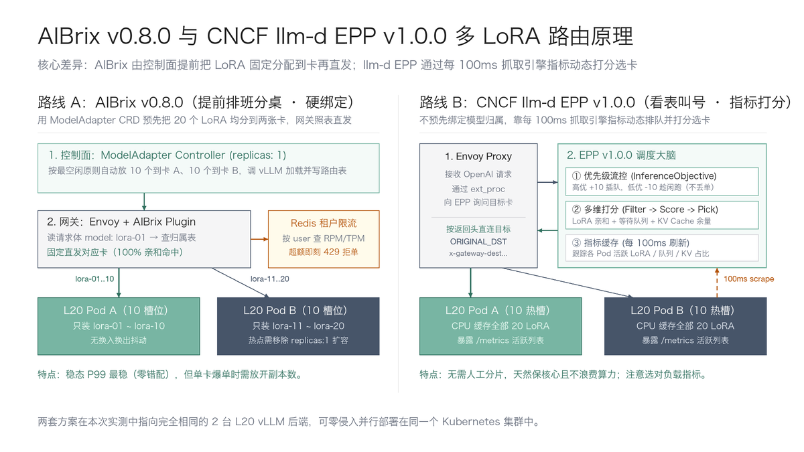
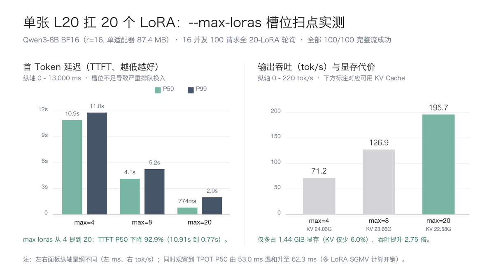
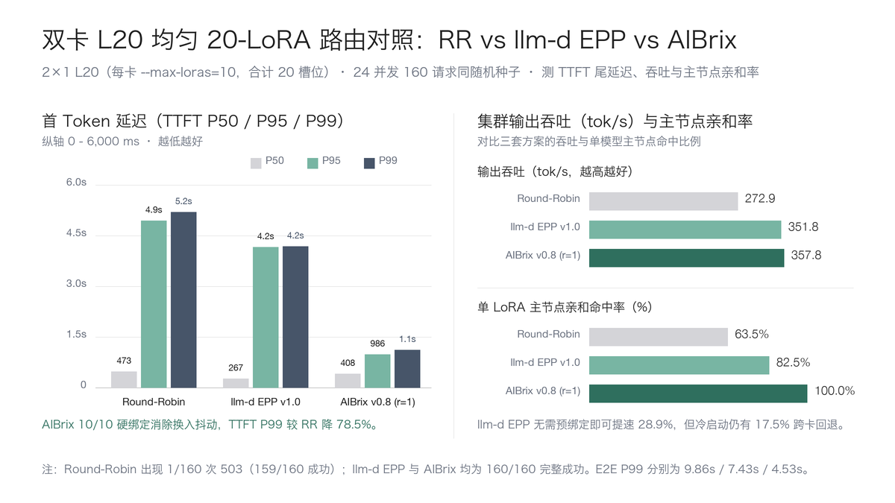
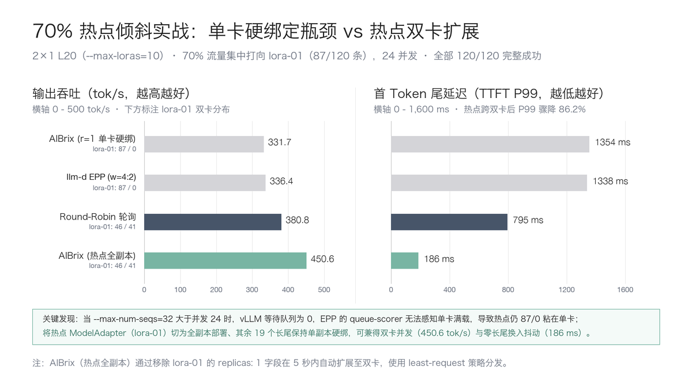
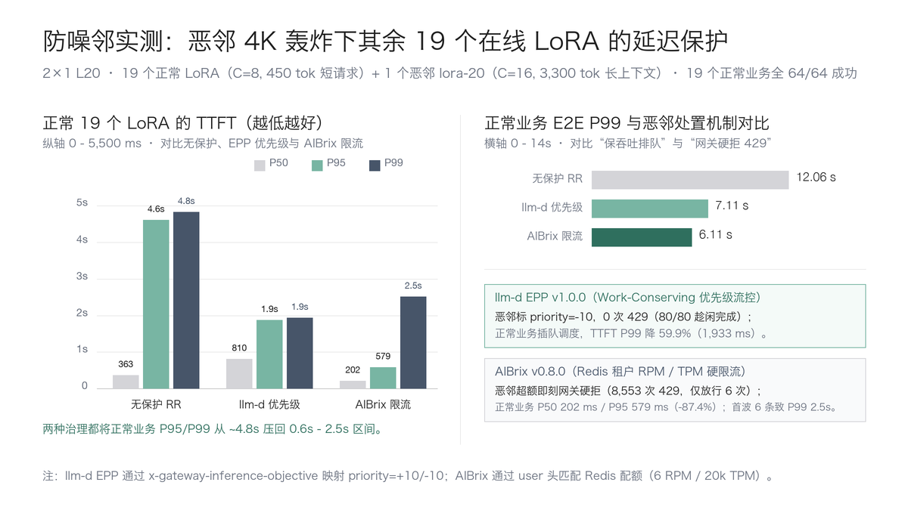

# 多 LoRA 共享集群 L20 实测：AIBrix v0.8.0 vs CNCF llm-d EPP v1.0.0 亲和路由与防噪邻

想象一个很多 AI 平台团队都遇到过的周一早会：公司刚上线了一个开源 `Qwen3-8B` 底座模型，一个月内二十个业务方找上门来——客服团队微调了“售后话术助手”，研发团队微调了“代码评审助手”，法务微调了“合同审查助手”，运营微调了“商品卖点生成器”……

如果按传统做法，每个微调模型各占一张 48 GB L20，20 个业务就得买 20 张卡；不仅预算批不下来，法务、财务这类低频助手一天才几百次调用，卡大部分时间都在空转。把这 20 个微调模型用 **多 LoRA（Multi-LoRA）** 塞进同一套共享 GPU 推理池，本来是极好的降本方案——**但上线第一周，三个真实工单就会接踵而至**：

- **工单 1（卡顿投诉）**：只有 1 张 L20 时，为了省点显存只配了 `--max-loras=4`，结果 16 个同事同时用不同助手，为什么提问要干等 **10 秒** 才蹦出第一个字？
- **工单 2（大促爆单）**：扩到 2 张 L20 后平时 20 个模型平分挺稳的，大促当天运营的“卖点生成器”突然吃掉 **70%** 流量，两张卡一忙一闲，尾延迟怎么拉回 200 毫秒以内？
- **工单 3（“坏邻居”拖垮全厂）**：下午三点，数据分析团队对着“长合同摘要助手”一口气灌进 16 路 3,300 字长文批处理，客服、代码助手等另外 19 个在线业务瞬间卡到 **5 秒** 起跳！

为了把这三个工单一次讲透，我们在真实 **NVIDIA L20（46,068 MiB）** 集群上，用 **`Qwen3-8B` BF16 + 20 个 `r=16` PEFT LoRA（单份权重 87.4 MB）** 跑完了三阶段共 11 组受控压测，并把 2026 年 Kubernetes 社区最主流的两套多 LoRA 路由方案——**AIBrix `v0.8.0`** 与 **CNCF `llm-d` EPP `v1.0.0`**——放在同一对 L20 副本上背靠背对比（逐请求记录流式首字延迟 TTFT、吐字间隔 TPOT、端到端耗时 E2E 及真实落点 `target-pod` / `x-upstream-host`）。核心结论先看四条：

- **单卡 L20 槽位拐点（Stage 1）**：16 并发轮询 20 个 LoRA 时，`--max-loras=4` 因显存热槽位远小于并发模型数，排队换入把 **TTFT P50 拖到 `10,913 ms`（P99 `11,782 ms`）**、吞吐仅 **`71.2 tok/s`**；提到 `--max-loras=20` 仅多占 **1.44 GiB** 显存（KV Cache 仅少 `6.0%`，从 `24.03 GiB` 降至 `22.58 GiB`），却把 **TTFT P50 砍掉 `92.9%`（降至 `774 ms`）**、输出吞吐提升 **2.75 倍（`195.7 tok/s`）**；同时实测到多 LoRA 混合批处理（SGMV 算子）会让 TPOT P50 从 `53.0 ms` 温和升至 `62.3 ms`。
- **双卡均匀 20-LoRA 路由（Stage 2A，每卡 `--max-loras=10`）**：对比普通 Round-Robin 轮询（`272.9 tok/s`，TTFT P99 `5,197 ms`，主节点亲和率 `63.5%`），**`llm-d` EPP `v1.0.0`** 无需提前绑定即可把吞吐提至 **`351.8 tok/s`（+28.9%）**、亲和率升至 `82.5%`、TTFT P50 降至 `267 ms`，但首次未命中时的跨卡回退仍留有 `4,177 ms` P99 尾巴；**AIBrix `v0.8.0` `ModelAdapter`（`replicas: 1`）** 通过每卡固定放 10 个 LoRA 达到 **`100.0%` 亲和与 `357.8 tok/s`**，把 **TTFT P99 压到 `1,117 ms`（较 RR 降 `78.5%`）**、E2E P99 降至 `4.53 s`。
- **70% 热点倾斜反转与隐藏暗坑（Stage 2B）**：70% 流量集中打向 `lora-01` 时，AIBrix 单副本固定绑定（`87/0`）和 `llm-d` EPP（`lora-affinity: 4.0` + `queue-scorer: 2.0`，同样粘成 `87/0`）都受限于单卡（吞吐 `331.7` / `336.4 tok/s`，P99 `1,354` / `1,338 ms`），反而跑不过能拆到双卡的 Round-Robin（`380.8 tok/s`，P99 `795 ms`）。根因在于 `--max-num-seqs=32` 大于并发 `24`，vLLM `waiting` 等待队列始终为 `0`，导致 EPP 的 `queue-scorer` 无法感知单卡满载！而把 AIBrix 中热点 `ModelAdapter/lora-01` 的 `replicas: 1` 移除（5 秒内自动扩至双卡）、其余 19 个长尾继续保持单副本绑定后，**吞吐冲到 `450.6 tok/s`，TTFT P99 暴降至 `186 ms`（-86.2%）**。
- **防噪邻双路线实测（Stage 3）**：恶邻 `lora-20`（16 并发 3,300 token）无保护时把 19 个正常业务的 TTFT P95/P99 拖爆到 **`4,606 / 4,826 ms`**（E2E P99 `12.06 s`）。**`llm-d` EPP `v1.0.0` 优先级流控**（`priority: +10` vs `-10`）实现 **算力不闲置（Work-Conserving）保护**：恶邻 **0 次 `429`**（趁闲完成 `80/80`），同时让正常业务插队调度，把正常业务 **TTFT P99 降 `59.9%` 至 `1,933 ms`**；**AIBrix `v0.8.0` Redis 租户限流**（恶邻设 `6 RPM / 20k TPM`）则在网关层硬拒 **`8,553` 次 `HTTP 429`**，把正常业务 **TTFT P50/P95 压到 `202 / 579 ms`（P95 降 `87.4%`）**，但首秒放行的 6 条长请求仍带来 `2,514 ms` 的 P99 尖刺。

> **实验口径说明**：20 个 LoRA 适配器（外加第 21 个热加载测试适配器 `lora-21-hot`）均按 `/models/Qwen3-8B/config.json` 精确层维度确定性生成标准 PEFT Safetensors 权重（`r=16`、`lora_alpha=32`、7 个投影层、单份 `87.4 MB`），在显存占用、多 LoRA 合并算子计算与 PCIe 换入换出上与真实微调权重等价；本文只评测系统调度、延迟与隔离性能，不评测生成文本质量。所有实验均在相同集群内客户端、关闭 CUDAGraph（`--enforce-eager`）、`temperature=0`、`ignore_eos=true` 与唯一请求前缀（防止前缀缓存掩盖 LoRA 切换开销）条件下完成。

---

## 先用大白话讲清楚：LoRA、AIBrix 与 `llm-d` 各自怎么干活？

如果你平时主要做业务研发或 Kubernetes 运维，之前没接触过模型微调，也没用过 AIBrix 或 `llm-d`，花三分钟看完这一节，后面所有实验数字就能一眼看懂。

### 1. 什么是 LoRA？为什么能“一张卡扛 20 个模型”？

传统全量微调相当于把整本 `15.6 GB` 的通用大模型底座（比如 `Qwen3-8B`）重新改写一遍，改完后每个业务都得独立存一份 `15.6 GB` 的新权重，上线时各自独占一张 GPU。

**LoRA（Low-Rank Adaptation，低秩适配）** 的做法完全不同：它**冻结原有 `15.6 GB` 底座不动**，只在模型的关键矩阵旁边外挂一组体积极小的增量参数矩阵（通常只有几十到上百 MB，本文实测 `r=16` 单份仅 `87.4 MB`，不到底座的 **0.6%**）。你可以把底座想象成一本通用百科全书，把每个业务的 LoRA 想象成贴在书页旁的**专属专业便利贴**：

- 推理服务启动时，GPU 显存里**只需要加载 1 份 `Qwen3-8B` 底座**；
- 收到不同业务请求（例如请求体里写 `"model": "lora-01"` 或 `"model": "lora-12"`）时，vLLM 会把对应的“便利贴”叠加到计算中，**同一张 GPU、同一个进程就能同时服务 20 个专属微调模型**。

### 2. AIBrix `v0.8.0` 与 CNCF `llm-d` EPP `v1.0.0` 的核心工作原理

单卡装不下所有业务、需要多张 GPU 组成集群时，普通的 Kubernetes Service（随机或轮询转发）会出大问题：因为普通负载均衡只看网络连通性，根本不知道哪张卡的显存里刚好摊开了 `lora-01`。为了解决这个问题，社区走出了两条截然不同的路线：

- **AIBrix `v0.8.0`（像“提前排班分桌”的餐厅领班）**：由 vLLM 社区主导的一体化 Kubernetes 推理套件。它不光管流量转发，还管“模型放哪儿”。管理员提交 20 个 `ModelAdapter` CRD 后，AIBrix 控制器先在后台替你决定：**卡 A 固定负责 `lora-01` 到 `lora-10`，卡 B 固定负责 `lora-11` 到 `lora-20`**，并自动调用 vLLM 接口把权重装好、写好归属表。请求进来时，Envoy 旁的 AIBrix 插件读出请求里的 `model` 字段，查完 Redis 租户限流配额（超额直接返 `HTTP 429`）后，**直接按表发给对应的那张卡**。
- **CNCF `llm-d` EPP `v1.0.0`（像“每 100 毫秒巡台叫号”的大厅经理）**：从 Kubernetes 官方 Gateway API Inference Extension 演进而来，2026 年成为 CNCF 项目的云原生推理路由标准栈。它**不干涉你怎么部署或加载模型**（每张卡可在主机内存里缓存全部 20 份 LoRA），而是专注把“这一条请求此刻该发给哪张卡”做到极致。它的核心大脑 **EPP（Endpoint Picker）** 通过 Envoy 的 **`ext_proc`（外部请求处理插件）** 机制工作，分三步走：
  1. **每 `100 ms` 实时巡场**：EPP 主动抓取每台 vLLM Pod 的 `/metrics` 指标，掌握每张卡此刻显存里正在跑哪些 LoRA（`vllm:lora_requests_info`）、排队长度（`vllm:num_requests_waiting`）和 KV Cache 剩余空间；
  2. **按优先级排队叫号**：遇到集群繁忙时，EPP 的 `flowControl` 根据 `InferenceObjective` 给请求分三六九等——在线客服（`priority: 10`）永远排在离线长文批处理（`priority: -10`）前面插队放行，但只要有空闲算力，低优任务也能照常跑完、不直接拒单；
  3. **多维打分选卡**：EPP 按 `Filter -> Score -> Pick` 管道给候选 GPU 打分（显存已热着该 LoRA 加高分、排队少加分、KV 余量多加分），把最高分 Pod IP 写入响应头 `x-gateway-destination-endpoint` 还给 Envoy，Envoy 再通过 `ORIGINAL_DST` 直连目标卡。



### 3. 本文高频术语速查

| 术语 | 一句话大白话解释 | 本文中为什么重要 |
| --- | --- | --- |
| **`r=16`（秩 / Rank）** | LoRA “便利贴”的厚度；数值越大表达能力越强、文件也越大 | 本文统一使用生产最常见的 `r=16`（每份 `87.4 MB`），保证测试开销贴近真实微调模型 |
| **`--max-loras` 与 `--max-cpu-loras`** | 类比**办公桌桌面**（GPU 显存能同时摊开几份 LoRA）和**旁边文件柜**（主机内存能缓存几份 LoRA） | 桌位（`--max-loras`）不够时，请求只能排队等前人用完、把旧 LoRA 收回内存再通过 PCIe 把新 LoRA 搬进显存，引发严重排队 |
| **亲和路由（Affinity Routing）** | 网关尽量把同一个 LoRA 的请求总是发给**显存里已经摊开这份 LoRA 的那张卡** | 避免两张卡来回重复搬运同一份 LoRA，是双卡/多卡降低尾延迟的关键 |
| **Punica / SGMV 算子** | 同一批推理请求里混了多种 LoRA 时，GPU 在单步计算中分别叠加不同 LoRA 的专用合并算子 | 混的 LoRA 种类越多，单步吐字会略微变慢一点（本文实测 TPOT 温和上升约 `9 ms`） |
| **噪邻（Noisy Neighbor）** | 共享同一推理池的某个业务突然发海量超长上下文请求，占满队列与显存，把同卡其他正常业务拖慢 | 多租户共享卡必须治理的核心风险 |
| **Work-Conserving（算力不闲置）** | 高优业务来时优先插队放行，但只要 GPU 有空闲，低优业务照常跑完、不直接拒单 | `llm-d` EPP 优先级流控的核心特点；与之相对的是 AIBrix Redis 超配额直接返 `HTTP 429` 硬拒单 |
| **TTFT / TPOT / E2E** | **TTFT**：发问到看到第一个字的等待时间；**TPOT**：之后每多吐一个字的平均间隔；**E2E**：整条回答吐完的总耗时 | LoRA 换入排队主要恶化 **TTFT**，多 LoRA 同批计算开销主要体现在 **TPOT** |

---

## 实验环境与双入口隔离架构

为了做到 **100% 公平的背靠背对照**，我们在同一集群（Kubernetes `v1.30.4`）上共用完全相同的 **2 个单卡 L20 vLLM 副本**（`vLLM 0.26.0b2.dev1+g3b102b576`、`Qwen3-8B` BF16），同时在不改动集群既有共享 `envoy-gateway:v1.2.8` 与 `aibrix-system` 的前提下，于独立测试命名空间 `lora-bench-lab` 中部署了隔离的 **CNCF `llm-d` EPP `v1.0.0` + Envoy `v1.33.2`**（附带一个无 `ext_proc` 的纯 Round-Robin 监听端口作为对照组）：

```text
                             ┌──▶ Entry A: Shared Envoy Gateway v1.2.8 + AIBrix v0.8.0 (ModelAdapter + Redis RateLimit) ──┐
In-Cluster SSE Benchmark ────┼──▶ Entry B: Isolated Envoy v1.33.2 + CNCF llm-d EPP v1.0.0 (InferencePool + FlowControl)   ├──▶ 2 x 1xL20 Qwen3-8B vLLM
                             └──▶ Entry C: Isolated Envoy v1.33.2 Round-Robin Control (no ext_proc)                       ┘    (21 PEFT LoRAs each)
```

| 组件 | 实测版本 / 关键配置 |
| --- | --- |
| GPU 与底座模型 | NVIDIA L20（`46,068 MiB`）× 1 或 × 2；`Qwen3-8B` BF16（36 层、`hidden=4096`、`intermediate=12288`、`heads=32`、`kv_heads=8`、`head_dim=128`） |
| 推理引擎 | vLLM `0.26.0b2.dev1+g3b102b576`，`--dtype bfloat16 --max-model-len 8192 --max-num-seqs 32 --gpu-memory-utilization 0.90 --enable-lora --max-lora-rank 16 --max-cpu-loras 24 --enable-prefix-caching --enforce-eager`，`VLLM_ALLOW_RUNTIME_LORA_UPDATING=True` |
| LoRA 权重集 | `lora-01` 至 `lora-20` + `lora-21-hot`，每份 `87.4 MB`（`r=16`），由 Pod InitContainer 在约 8 秒内确定性生成至本地 `emptyDir` `/loras` |
| AIBrix 路线 | AIBrix `v0.8.0`（`controller-manager`、`gateway-plugins`、`Redis 7.4.2`、`ModelAdapter v1alpha1`）+ Envoy Gateway `v1.2.8`；实测当 Pod 未注入 `aibrix-runtime` Sidecar 时，`ModelAdapter` 控制器会自动降级直连 vLLM `/v1/load_lora_adapter` 加载本地路径 `/loras/<name>` |
| CNCF `llm-d` 路线 | `ghcr.io/llm-d/llm-d-router-endpoint-picker:v1.0.0` + GAIE `v1.6.2` `InferencePool`（`inference.networking.k8s.io/v1`）+ `llm-d.ai/v1` `InferenceObjective` + Envoy `v1.33.2`（`ext_proc` + `ORIGINAL_DST`） |

> **版本演进提示**：2026 年上游 Kubernetes Gateway API Inference Extension 将完整生产级 EPP（含 `lora-affinity-scorer`、KV-Cache 路由与 `flowControl` 优先级流控）拆分并演进至 CNCF **`llm-d`** 项目的 `llm-d-router-endpoint-picker:v1.0.0`，且 `InferenceObjective` 与 `EndpointPickerConfig` 已升至 `llm-d.ai/v1`。如果集群现有 Envoy Gateway 低于 `v1.4`（本集群为 `v1.2.8`），用独立 Envoy `v1.33.2` 配 `ext_proc` + `ORIGINAL_DST` 即可零侵入接通完整 `v1.0.0` EPP 能力。

---

## 实战一：工单 1 复现——单张 L20 扛 20 个 LoRA，为什么同事都要干等 10 秒？

**业务场景**：项目刚上线只有 1 张 48 GB L20，运维怕多开 LoRA 吃掉对话缓存，把 `--max-loras` 保守地设成 `4`。结果周一早高峰 16 个同事同时调 20 个不同的部门助手（客服、代码、法务、运营），群里立刻炸锅：“怎么发一句话要等 10 秒才出字？”

我们在 **1 张 L20** 上原样复现：把 20 个 LoRA 全部加载进 `--max-cpu-loras=24` 内存池，固定 16 并发轮询发送 100 条流式请求（约 450 token 输入 / 64 token 输出，种子 `101`），依次把 `--max-loras` 从 `4` 调到 `8` 再调到 `20`：



| `--max-loras` | 权重 + LoRA 槽位显存 | 可用 KV Cache（Token 数） | 100 请求总耗时 | 输出吞吐 | TTFT P50 / P95 / P99 | TPOT P50 | E2E P99 |
| --- | ---: | ---: | ---: | ---: | ---: | ---: | ---: |
| **4** | `15.64 GiB` | `24.03 GiB`（`174,944`） | `89.88 s` | `71.2 tok/s` | `10,913 / 11,070 / 11,782 ms` | `53.0 ms` | `15,142 ms` |
| **8** | `16.00 GiB` | `23.66 GiB`（`172,320`） | `50.43 s` | `126.9 tok/s` | `4,117 / 4,821 / 5,235 ms` | `56.8 ms` | `8,933 ms` |
| **20** | `17.08 GiB` | `22.58 GiB`（`164,400`） | `32.71 s` | `195.7 tok/s` | `774 / 1,620 / 1,956 ms` | `62.3 ms` | `6,354 ms` |

三组数字把单卡多 LoRA 的两个真实物理定律拍在了桌面上：

1. **槽位不足比你想象的贵得多，而补足槽位比你想象的便宜得多**：`--max-loras` 限制了同一调度步里 GPU 显存能同时激活的 LoRA 种类上限。设成 `4` 时，16 并发跨 20 个 LoRA 导致 **12 个并发请求被迫在队列里干等槽位释放与 PCIe 换入**，TTFT P50 飙到 **10.91 秒**。而把 `--max-loras` 从 `4` 拉到 `20`（增加 16 个 `r=16` 热槽位），实测只多占 **`1.44 GiB`** 显存（约 `90 MiB`/槽，KV Cache 容量只少了 `6.0%`），直接换来 **TTFT P50 下降 `92.9%`、吞吐暴涨 `2.75×`**。
2. **多 LoRA 同批解码存在温和的合并计算代价**：随着并发激活的 LoRA 种类增加，单字吐字间隔 TPOT P50 从 `53.0 ms` 温和升至 `56.8 ms` 再到 `62.3 ms`（`+17.5%`）。这是因为 vLLM 的多 LoRA 合并计算算子（Punica / SGMV）在单步解码中需要按不同 LoRA 分组做低秩矩阵乘加，混的种类越多，单步会略慢一点点，但相比砍掉 10 秒的排队等待完全划算。

---

## 实战二：工单 2 复现——双卡 L20 亲和路由背靠背（日常平分 vs 大促 70% 热点）

**业务场景**：随着调用量增长，集群扩到了 **2 张 L20**，但随着微调模型越来越多，每张卡的显存桌位只能覆盖全库一半的 LoRA（每卡 **`--max-loras=10`**，双卡合计刚好 **20 个 GPU 热槽位**）。我们先看平时 20 个业务均匀调用时三种转发方式谁更快，再看大促当天某一个助手突然爆单吃掉 70% 流量时会发生什么反转。

### 2A. 均匀 20-LoRA 并发：动态指标亲和 vs 声明式硬放置

`llm-d` EPP `v1.0.0` 的核心配置如下（同时启用 `lora-affinity-scorer`、`queue-scorer`、`kv-cache-utilization-scorer` 与 `flowControl`）：

```yaml
apiVersion: llm-d.ai/v1
kind: EndpointPickerConfig
featureGates:
- flowControl
plugins:
- type: lora-affinity-scorer
- type: queue-scorer
- type: kv-cache-utilization-scorer
- type: max-score-picker
- type: single-profile-handler
- type: soft-reflective-ceiling-policy
schedulingProfiles:
- name: default
  plugins:
  - pluginRef: lora-affinity-scorer
    weight: 4.0
  - pluginRef: queue-scorer
    weight: 2.0
  - pluginRef: kv-cache-utilization-scorer
    weight: 1.0
  - pluginRef: max-score-picker
flowControl:
  usageLimitPolicyPluginRef: soft-reflective-ceiling-policy
  defaultRequestTTL: 15s
```

AIBrix `v0.8.0` 则通过 20 个 `ModelAdapter` CR 声明每个 LoRA 放 1 个副本（控制器自动按 `least-adapters` 把 20 个 LoRA 均匀分配为 **Pod A 10 个 + Pod B 10 个**，48 秒内全部 `Running`）：

```yaml
apiVersion: model.aibrix.ai/v1alpha1
kind: ModelAdapter
metadata:
  name: lora-01
  namespace: lora-bench-lab
  labels:
    model.aibrix.ai/name: "lora-01"
    model.aibrix.ai/port: "8000"
spec:
  baseModel: qwen3-8b-lora
  replicas: 1
  podSelector:
    matchLabels:
      app: qwen3-8b-lora
  artifactURL: /loras/lora-01
  schedulerName: default
```

在完全相同的 **160 请求、24 并发、20 LoRA 均匀轮询（种子 `201`）** 下，三套入口实测结果如下：



| 路由方案 | 完成率 | 总耗时 | 输出吞吐 | TTFT P50 / P95 / P99 | TPOT P50 | E2E P99 | 单 LoRA 主节点亲和率 | 双卡分布 |
| --- | ---: | ---: | ---: | ---: | ---: | ---: | ---: | --- |
| **Round-Robin（对照组）** | `159/160`（1 次 503） | `37.29 s` | `272.9 tok/s` | `473 / 4,936 / 5,197 ms` | `61.0 ms` | `9,860 ms` | `63.5%` | `80 / 79` |
| **`llm-d` EPP `v1.0.0`** | `160/160` | `29.11 s` | `351.8 tok/s`（`+28.9%`） | `267 / 4,154 / 4,177 ms` | `54.4 ms` | `7,433 ms` | `82.5%` | `72 / 88` |
| **AIBrix `v0.8.0`（`r=1`）** | `160/160` | `28.62 s` | `357.8 tok/s`（`+31.1%`） | `408 / 986 / 1,117 ms` | `58.1 ms` | `4,529 ms` | **`100.0%`** | `80 / 80` |

这组对照非常耐看：

- **Round-Robin** 把 20 个 LoRA 随机砸向两张只有 10 个热槽位的 L20，单 LoRA 主节点亲和率仅 `63.5%`，每张卡都被超过 10 种 LoRA 反复冲刷，TTFT P95/P99 飙到 **`4.94 / 5.20 s`**，甚至在切换峰值出现 1 次 `HTTP 503`。
- **`llm-d` EPP `v1.0.0`** 无需提前给 LoRA 划片，靠每 `100 ms` 抓取 vLLM `/metrics` 中的 `vllm:lora_requests_info` 自动把同 LoRA 请求吸回正在运行它的副本，主节点亲和率拉到 **`82.5%`**、吞吐跃升 **`28.9%`**、**TTFT P50 做到全场最低 `267 ms`**；但由于初始阶段同一 LoRA 可能同时落在两张卡上并受限于 10 槽位竞争，P99 仍保留了 **`4,177 ms`** 的尾部换入尖刺。
- **AIBrix `v0.8.0`（`ModelAdapter replicas: 1`）** 由控制面把 20 个 LoRA 精准 10/10 硬拆分到两张卡，从第 1 个请求起就是 **`100.0%` 亲和、零槽位驱逐**，直接把 **TTFT P95 砍到 `986 ms`、P99 砍到 `1,117 ms`（较 RR 降 `78.5%`）**、E2E P99 砍半至 `4.53 s`。

### 2B. 70% 热点倾斜反转：为什么 EPP 和 AIBrix 单副本双双输给 Round-Robin？

均匀流量下硬绑定大获全胜，但生产里最常见的是**突发热点**。我们把 70% 流量集中打到 `lora-01`（`87/120` 条请求），其余 30% 撒给 `lora-02..20`（24 并发，种子 `202`）：



| 方案 | 120 请求耗时 | 输出吞吐 | TTFT P50 / P95 / P99 | E2E P99 | `lora-01` 双卡分布（87 条） |
| --- | ---: | ---: | ---: | ---: | --- |
| **AIBrix `v0.8.0`（`lora-01` `replicas: 1`）** | `23.16 s` | `331.7 tok/s` | `429 / 1,057 / 1,354 ms` | `5,136 ms` | `87 / 0`（单卡硬绑） |
| **`llm-d` EPP `v1.0.0`（`lora:4.0, queue:2.0`）** | `22.83 s` | `336.4 tok/s` | `335 / 1,083 / 1,338 ms` | `5,057 ms` | `87 / 0`（粘在单卡） |
| **Round-Robin** | `20.17 s` | `380.8 tok/s` | `312 / 740 / 795 ms` | `4,974 ms` | `46 / 41`（双卡分担） |
| **AIBrix `v0.8.0`（仅 `lora-01` 扩全副本，其余 19 个保持 `r=1`）** | **`17.04 s`** | **`450.6 tok/s`** | **`160 / 186 / 186 ms`** | **`3,439 ms`** | **`46 / 41`（双卡分担 + 零长尾换入）** |

这组实验挖出了一个极其有价值的 **EPP 真实生产暗坑**：

- 即使我们把 EPP 的 `queue-scorer` 权重调高到 `3.0`、`lora-affinity-scorer` 降到 `1.5` 复测，`lora-01` 依然粘在单卡上（`71/0`）。
- **根因**：`llm-d` EPP 的 `queue-scorer` 读取的是 vLLM 的 `vllm:num_requests_waiting`。在本实验配置 `--max-num-seqs=32` 而总并发为 `24` 时，单张 L20 把所有 24 个并发都吸进了 `running` batch，**`waiting` 队列几乎始终是 `0`**——`queue-scorer` 给两张卡都打了满分并列，于是 `lora-affinity-scorer` 100% 胜出，把 87 条热点全锁死在 1 张卡上！如果希望 EPP 在未排 `waiting` 队列前就能把热点溢出到空闲卡，必须在配置中配合 **`running-requests-scorer`** 或 **`active-request-scorer`**，而不能只靠 `queue-scorer`。
- 反观 **AIBrix `v0.8.0`**：通过 `kubectl patch modeladapter lora-01 --type=json -p='[{"op":"remove","path":"/spec/replicas"}]'` 移除 `replicas: 1`（AIBrix `v0.8.0` 的 `ModelAdapterSpec.Replicas` 仅允许 `1` 或省略表示全副本部署），**5 秒内** `lora-01` 自动加载到第二张 L20，同时其余 19 个长尾 LoRA 仍保持单卡硬绑——**吞吐直接飙到 `450.6 tok/s`（比单副本快 `35.9%`，比 Round-Robin 快 `18.3%`），TTFT P99 骤降至 `186 ms`（-86.2%）**！

### 2C. 动态热加载与卸载（第 21 个 LoRA）

- **vLLM 原生 `/v1/load_lora_adapter`**（单份 `87.4 MB`、`r=16` 本地盘）：Stage 1 三轮 60 次加载均值为 **`1.14–1.47 s`**。
- **AIBrix `v0.8.0` `ModelAdapter` 声明式热加载**：批量提交 20 个 `ModelAdapter` CR 后 **`48.04 s`** 全部 `Running`（约 `2.4 s`/个含控制器调度、Service/EndpointSlice 创建与 vLLM 加载）；单独 `kubectl apply` 第 21 个 `ModelAdapter/lora-21-hot` 后立即探针即命中 **`HTTP 200`**（`target-pod` 准确指向分配节点）；执行 `kubectl delete modeladapter lora-21-hot` 后 4 秒内核验两台 vLLM `/v1/models`，确认已自动调用 `/v1/unload_lora_adapter` 彻底卸载（`has_lora_21: false`）。

---

## 实战三：工单 3 复现——防噪邻隔离，1 个批处理租户怎么不拖垮另外 19 个业务？

**业务场景**：下午三点，客服、研发等 19 个在线业务（`lora-01..19`）正在平稳处理 450 token 的短问答（并发 `8`，共 64 条）；此时数据分析团队跑定时脚本，对着 `lora-20` 一口气灌入 **16 并发、每条 3,300 token 的超长合同摘要任务**（输出 128 token）。我们对比三种应对策略：

1. **无保护基线（Round-Robin）**；
2. **`llm-d` EPP `v1.0.0` 优先级流控**：创建两个 `llm-d.ai/v1` `InferenceObjective`——`lora-critical`（`priority: 10`）和 `lora-sheddable`（`priority: -10`），请求携带 `x-gateway-inference-objective` 头，配合 `flowControl` + `soft-reflective-ceiling-policy`；
3. **AIBrix `v0.8.0` Redis 租户硬限流**：在 `aibrix-redis-master` 中写入租户配额 `aibrix-users/lora-bench-noisy`（`rpm: 6, tpm: 20000`）与 `aibrix-users/lora-bench-normal`（`rpm: 10000`），请求携带 `user` 头。

```yaml
# llm-d v1.0.0 InferenceObjective priority bands (work-conserving flow control)
apiVersion: llm-d.ai/v1
kind: InferenceObjective
metadata:
  name: lora-critical
  namespace: lora-bench-lab
spec:
  priority: 10
  poolRefs:
  - group: inference.networking.k8s.io
    kind: InferencePool
    name: qwen3-8b-pool
---
apiVersion: llm-d.ai/v1
kind: InferenceObjective
metadata:
  name: lora-sheddable
  namespace: lora-bench-lab
spec:
  priority: -10
  poolRefs:
  - group: inference.networking.k8s.io
    kind: InferencePool
    name: qwen3-8b-pool
```



| 治理方案 | 正常 19 LoRA 成功率 | 正常 TTFT P50 / P95 / P99 | 正常 E2E P99 | 恶邻 `lora-20` 处置结果 |
| --- | ---: | ---: | ---: | --- |
| **无保护（Round-Robin）** | `64/64` | `363 / 4,606 / 4,826 ms` | `12,058 ms` | `77/77` 全放行（`200`），拖垮同池全部业务 |
| **`llm-d` EPP 优先级流控（`+10` vs `-10`）** | `64/64` | `810 / 1,875 / 1,933 ms`（**P99 -59.9%**） | `7,113 ms`（`-41.0%`） | **`80/80` 全完成、0 次 `429`**（Work-Conserving 趁闲调度） |
| **AIBrix `v0.8.0` Redis 限流（`6 RPM / 20k TPM`）** | `64/64` | `202 / 579 / 2,514 ms`（**P95 -87.4%**） | `6,114 ms`（`-49.3%`） | **硬拒 `8,553` 次 `HTTP 429`**，仅放行首波 `6` 条 `200` |

这组对比直接揭示了**两种流控哲学的本质差异**：

- **`llm-d` EPP `v1.0.0` 是 Work-Conserving（算力不浪费）的优先级调度**：通过 `llm_d_epp_flow_control_queue_bytes{priority="10"}` 和 `priority="-10"` 指标可以清晰看到请求按优先级进入不同队列带。高优请求插队优先派发，把正常业务 **TTFT P99 从 `4.83 s` 砍到 `1.93 s`**，而且**恶邻一条请求都没丢（`80/80` 全部趁空完成）**——非常适合内部低优批处理与高优在线混跑。
- **AIBrix `v0.8.0` Redis 限流是网关硬配额（Strict Edge Quota）**：超额请求在 Envoy `ext_proc` 阶段毫秒级直接返回 `HTTP 429`（拦截了 `8,553` 次轰炸），让正常 19 个 LoRA 几乎回到空载体验（**P50 `202 ms`、P95 `579 ms`**）。但注意一个细节：固定窗口首秒放行的那 `6` 条 3,300-token 长上下文请求仍会造成短暂队列拥堵，因此 P99（`2,514 ms`）反而不如 `llm-d` 优先级插队（`1,933 ms`）平滑——生产上如果要做到极致，**网关硬限流（AIBrix / Envoy RateLimit）+ 优先级排队（`llm-d` EPP）叠加使用才是终极形态**。

---

## 选型决策表与生产落地建议

| 维度 | AIBrix `v0.8.0`（`ModelAdapter` + Gateway） | CNCF `llm-d` EPP `v1.0.0`（`InferencePool` + `InferenceObjective`） |
| --- | --- | --- |
| **核心架构哲学** | **控制面主动编排 + 硬归属路由**：CRD 决定 LoRA 落在哪台 Pod 并自动管理加载/卸载与 Service/EndpointSlice | **数据面指标感知 + 动态打分路由**：靠 `100 ms` 抓取 vLLM `/metrics`（`vllm:lora_requests_info`）动态选点，不负责权重分发 |
| **均匀长尾多 LoRA（热槽紧张）** | **明显占优**（`100%` 亲和，零槽位抖动，TTFT P99 降 `78.5%`） | 无需预编排即可提速 `28.9%`，但冷启动或高并发仍存在约 `17.5%` 跨卡回退 |
| **突发热点 LoRA** | 单副本硬绑会打爆单卡；需将热点 `ModelAdapter` 改为全副本（去除 `replicas: 1`），改完后实测最优（`450.6 tok/s`, P99 `186 ms`） | 注意避坑：`queue-scorer` 在 `--max-num-seqs` 大于并发时失效，必须搭配 `running-requests-scorer` / `active-request-scorer` 才能触发自动溢出 |
| **防噪邻治理** | 原生 Redis 租户 RPM/TPM + 模型 RPS 硬限流（毫秒级 `429` 掐断恶邻，P95 极低） | 原生 `InferenceObjective` 多优先级带 + `flowControl`（Work-Conserving，保核心 P99 且不浪费空闲算力） |
| **适合场景** | 已有 AIBrix / 希望一套 CRD 管完 LoRA 生命周期、按租户硬配额收费的多租户推理平台 | 追求 Kubernetes Gateway API 标准栈、需要把 LoRA 亲和与 KV-Cache / P/D 分离 / 优先级排队统一在一个 EPP 管道的平台 |

三条可直接落地的配置底线：

1. **先把单卡 `--max-loras` 配够**：`Qwen3-8B`（`r=16`）每个热槽位仅占约 `90 MiB` 显存，尽量让每卡 `--max-loras` 覆盖本卡常驻活跃 LoRA 数，绝不要为了省 1 GiB 显存把 `--max-loras` 压到 4 导致 10 秒级排队。
2. **冷热分层部署**：80% 的长尾微调模型按单副本分散硬绑（避免全集群副本都被长尾占满槽位），20% 的高频热点 LoRA 放开多副本/全副本部署。
3. **恶邻防护别只靠单点**：对外部/高危租户用网关硬配额（RPM/TPM + `max_tokens` 限制）防洪，对内部混跑的批推理用优先级队列（`priority: -10`）吃满空闲算力。

---

## 复现实验包与脱敏观测数据

本文全部三阶段 11 组 L20 实测的脱敏汇总数据、完整 YAML 清单与异步 SSE 压测脚本均已打包：

- **脱敏原始实测汇总 JSON**：[results.json](../../assets/practices/multi-lora-l20-aibrix-vs-llmd/results.json)
- **可复现实验包**：[lab.zip](../../assets/practices/multi-lora-l20-aibrix-vs-llmd/lab.zip)（包含 `llmd-controlplane.yaml`、`vllm-qwen3-8b-lora.yaml`、`aibrix-modeladapter-sample.yaml`、`bench_lora.py` 与 `README.md`）

延伸阅读：

- [AIBrix ModelClaim 单卡实测：小模型双活、14B 轮换与 L20 的显存边界](aibrix-modelclaim-l20.md)
- [AIBrix 路由到底在优化什么：从缓存命中到尾延迟](aibrix-routing-cache-tradeoffs.md)
- [Kubernetes v1.37 DRA 高级三件套实测：跨驱动 PCIe 拓扑绑定、可消耗容量切分与单卡故障隔离](kubernetes-137-dra-topology-sharing-health.md)
- [AIBrix 官方文档：LoRA Dynamic Loading](https://aibrix.readthedocs.io/latest/features/lora-dynamic-loading.html)
- [CNCF llm-d Router & Endpoint Picker (v1.0.0)](https://github.com/llm-d/llm-d-router)
- [Kubernetes Gateway API Inference Extension](https://gateway-api-inference-extension.sigs.k8s.io/)
