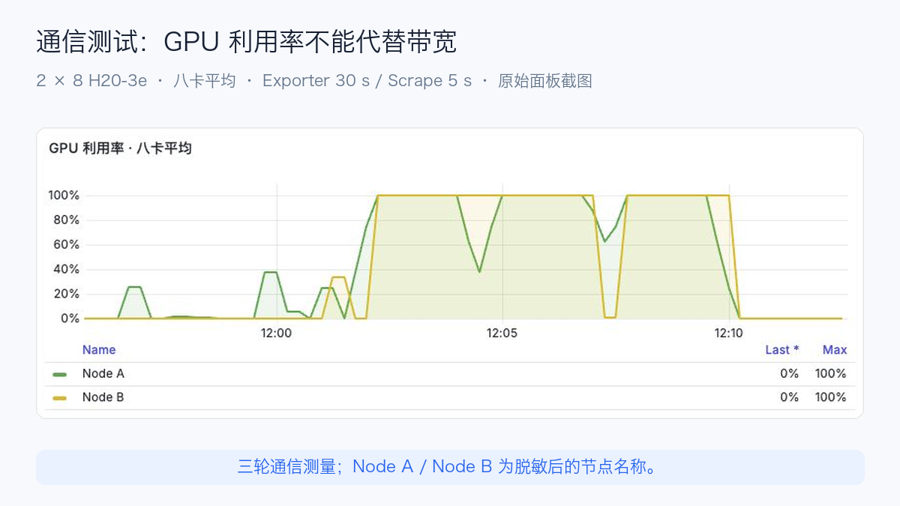
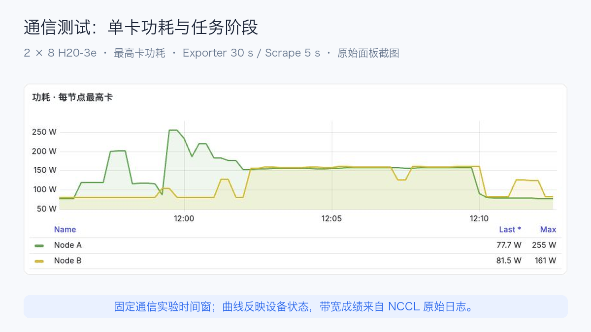
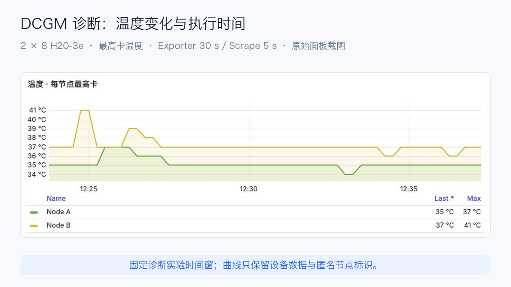
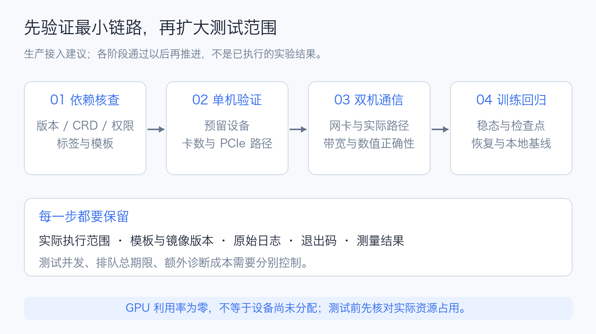
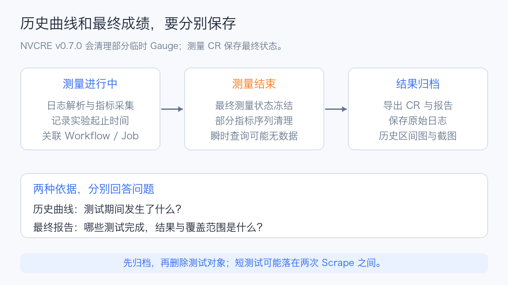

# NVIDIA NVCRE 原理解析与 H20-3e 独立验机实测

GPU 节点 Ready、设备插件正常、显卡利用率达到 100%，并不足以说明一个集群能高效运行多机训练。GPU 与网卡的位置不合适、通信退回 TCP、检查点保存太慢，甚至一台机器偶发停顿，都可能让整个任务持续等待。

2026 年 10 月 12 日，NVIDIA 在 Open Compute Project（开放计算项目，OCP）全球峰会相关发布中，将 **NVIDIA Cluster Readiness Engine，简称 NVCRE**，列入 DSX AI Factory 的开源组件。它在指定节点上主动运行通信、诊断和训练负载，用实际结果判断 GPU 集群是否具备承载工作负载的条件。[NVIDIA OCP 发布](https://blogs.nvidia.com/blog/ocp-global-summit-vera-rubin-scale-ai-factories/)

本文结合 **NVCRE v0.7.0 源码分析**与**双节点 16 张 H20-3e 的独立 NCCL/DCGM 实测**，核查日期为 2026 年 10 月 14 日。**本轮没有部署 NVCRE 控制器，也没有执行其 Certification 验收流程。** 成绩与设备曲线来自普通 Kubernetes Job 运行的底层负载；NVCRE 完整控制器链路的接入条件另行讨论。[v0.7.0 发布说明](https://github.com/NVIDIA/cluster-readiness-engine/releases/tag/v0.7.0)

## 1. 什么时候公开，主要用来做什么

NVCRE 是一个采用 **Apache 2.0 许可证**的开源 Kubernetes 控制器。关于“什么时候开源”，需要区分版本发布和官方集中介绍：

| 日期 | 可核对的公开记录 | 应如何理解 |
| --- | --- | --- |
| 2026-09-01 | GitHub 发布稳定版 v0.1.0，提供 CLI、控制器镜像及 Helm Chart | 已有面向使用者的版本发布记录 |
| 2026-09-23 | NVIDIA 技术博客介绍 NVCRE，明确其开源控制器定位 | 官方系统讲解用途、架构与接入方式 |
| 2026-10-12 | OCP/DSX 发布将 NVCRE 列为开源组件 | 最近一次集中发布与生态介绍 |

因此，它是近期公开的工具，但不能把 10 月 12 日直接写成首次开源日；上述记录也没有给出 GitHub 仓库由私有切换为公开的精确时刻。[v0.1.0 发布记录](https://github.com/NVIDIA/cluster-readiness-engine/releases/tag/v0.1.0)、[2026-09-23 官方技术介绍](https://developer.nvidia.com/blog/validate-gpu-cluster-readiness-before-ai-workloads-land/)

对 GPU 平台而言，NVCRE 将原本分散在脚本、工单和人工核对里的验收流程组织起来：选择节点与测试类别，运行固定负载，对测量结果执行判定，输出失败范围及原因。通信测试使用 NCCL，诊断使用 DCGM，训练测试可以测量有效训练时间比例 Goodput；这些底层工具仍然各自承担测量工作。[v0.7.0 项目说明](https://github.com/NVIDIA/cluster-readiness-engine/blob/v0.7.0/README.md)

这让平台能够分别判断“任务执行完了”和“性能达到了要求”。验收阈值需要根据本站硬件、拓扑和负载建立；一条面向其他 GPU 或机架的带宽阈值，不能直接成为 H20-3e 的准入标准。[阈值配置](https://github.com/NVIDIA/cluster-readiness-engine/blob/v0.7.0/docs/getting-started/first-certification.md)

## 2. 在生产中，验收结果如何转化为动作

NVCRE 最适合接在节点上线、变更和修复流程中。以下是接入设计建议；后面的 H20-3e 实测验证的是底层通信与诊断负载。

| 触发场景 | 选择哪些负载 | 如何使用结果 |
| --- | --- | --- |
| 新节点扩容、交付验收 | 软件诊断、节点内通信、同拓扑跨机通信 | 检查实际卡数与通信路径，满足本站条件后再开放业务调度 |
| 驱动、固件、NCCL 或节点镜像升级 | 升级前后运行相同测试目录与参数 | 对照带宽、延迟、正确性和诊断结果，决定继续灰度或排查、回退 |
| 多机训练变慢，日常健康指标没有明显异常 | 按节点组或拓扑范围复测，必要时使用诊断分组 | 将嫌疑范围缩小，再检查网卡、交换链路、CPU 放置及具体节点 |
| 更换网卡、GPU 或维修节点后 | 原失败项目及关联通信测试 | 留存维修前后结果，复测达到条件后回到业务池 |
| 训练框架或检查点存储变更 | 配置日志解析的训练负载，覆盖保存与恢复 | 比较稳态步骤耗时、恢复成本和 Goodput，判断是否损失有效训练时间 |


例如，一批新节点即将加入训练池，可以先保留在验收资源池，完成单机诊断和节点内通信，再覆盖计划使用的跨机拓扑。节点内结果正常、跨机结果异常时，应先检查网络与跨机配置，而不是把所有节点都判为硬件损坏。通过后，平台记录镜像、驱动、NCCL 版本和报告，再开放调度；异常节点保留原始日志，修复后重新验收。

多机通信失败也不一定能直接对应一台坏机器。NVCRE 的 `diagnose` 策略会拆分失败组并复测，直到配置的最小分组，输出嫌疑节点范围。它有助于减少人工逐组试验，但网络拥塞或共享链路故障仍可能涉及多个组，报告需要与设备、网络和任务指标一起解释。[诊断分组定义](https://github.com/NVIDIA/cluster-readiness-engine/blob/v0.7.0/api/v1alpha1/workflow_types.go)

**NVCRE 输出验收结果，业务平台负责放行、隔离与修复。** 控制器自身不会封禁、驱逐节点或修改节点健康条件。可以由现有运维流程消费报告，也可以评估 NVSentinel 的验收结果接入；后者负责将结果与在线健康治理衔接。[失败归因与治理边界](https://github.com/NVIDIA/cluster-readiness-engine/blob/v0.7.0/docs/concepts/health-monitoring-remediation.md)

验收负载会实际占用 GPU 和网络，应安排在预留节点或维护窗口，限制并发、总期限与拓扑覆盖范围。效果可以用几项数据衡量：上线前发现的异常数、升级前后的性能变化、定位所需的复测次数，以及测试消耗的 GPU 小时。它的生产收益来自减少未验收设备或配置进入业务池，也来自更快缩小排查范围；具体节省多少资源，需要结合实际运行记录计算。

## 3. 两台 H20-3e 的独立验机实测

为了确认现有 Kubernetes 平台能否承载通信与诊断负载，我们先使用普通 `batch/v1 Job` 运行 NCCL Tests 和 DCGM。**本轮实测的是底层验机负载，未安装 NVCRE、Kubeflow Trainer 或 JobSet，也没有执行 Certification。** 这种方式能先验证设备、网络、软件与结果采集，再决定是否接入完整编排系统。

### 3.1 硬件、软件与测试口径

两台节点各有八张 H20-3e。测试前读取实际资源申请、GPU 拓扑、错误计数与网卡状态，两台机器均没有其他 GPU 工作负载。节点内 GPU 两两显示 NV18；GPU 0–3 和 4–7 分别靠近不同的非统一内存访问域，即 Non-Uniform Memory Access（NUMA）域。八个 RDMA 设备与相邻 GPU 显示 PIX，网卡端口为 Ethernet、ACTIVE，报告速率为 200 Gb/s。因此本文跨机路径称为 **RDMA over Converged Ethernet（RoCE，以太网上的 RDMA）**，不把 `/sys/class/infiniband` 目录或 NCCL 的 `IB` 名称当作物理 InfiniBand 网络的证明。

| 项目 | 实际条件 |
| --- | --- |
| Kubernetes | 1.30.0 |
| GPU | 2 节点 × 8 H20-3e；每卡报告 143,771 MiB 显存 |
| 驱动 / CUDA | 580.126.20 / 12.9 |
| NCCL | 2.27.3；运行日志同时核对头文件与加载库版本 |
| NCCL Tests | v2.17.9，固定源码提交 `2535da805b34e96d1dc08be66289be1a6d57f5ad` |
| 构建 | MPI 开启、SM90；两台使用同一份经过哈希校验的二进制 |
| 进程 | 每 GPU 一个 MPI Rank；单机 8 Rank、双机 16 Rank |
| 消息 | 4 KiB 到 1 GiB，按 4 倍递增，共 10 档；float 数据 |
| 每档 | 10 次预热、50 次计时迭代、开启数值校验 |
| 重复 | 每种场景 / 集合操作 3 轮；报告 Out-of-place 结果 |
| 网络 | Pod 独立网络，显式申请 RDMA 设备；MPI 控制通信使用普通以太网接口 |
| DCGM | 4.5.3；诊断插件为 CUDA 13；每节点独立 Unix Socket Hostengine |

镜像内存在两套 NCCL：系统库为 2.27.3，PyTorch 依赖为 2.28.9。测试固定 `LD_LIBRARY_PATH` 到系统库，并从 NCCL Tests 和初始化日志核对实际加载版本。仅记录镜像标签会遗漏这个差异。

单机测试覆盖 AllReduce、AllGather、AllToAll；双机分别测试 RoCE 下的三种集合操作，以及 Socket/TCP 下的 AllReduce。强制 RoCE 的场景设置 `NCCL_NET=IB`，TCP 场景设置 `NCCL_NET=Socket` 和 `NCCL_IB_DISABLE=1`。RoCE 日志出现 `NET/IB/.../GDRDMA`，说明实际使用了 GPUDirect RDMA 路径。

NCCL 的 Algorithm 和 Protocol 保持自动选择，未对单个操作固定算法。日志显示 NVLS 拓扑初始化；本文沿用 NCCL Tests 输出的归一化 Bus Bandwidth，不据此换算 NVLink 利用率或物理网卡线速。

以下命令说明测试参数；主机名、设备名和 MPI 启动方式需按实际平台替换：

```bash
mpirun -np 16 --map-by ppr:8:node --bind-to none \
  --host <node-a>:8,<node-b>:8 \
  -x LD_LIBRARY_PATH -x NCCL_DEBUG -x NCCL_SOCKET_IFNAME \
  -x NCCL_NET -x NCCL_IB_HCA \
  ./all_reduce_perf -b 4096 -e 1G -f 4 \
  -n 50 -w 10 -c 1 -g 1 -d float
```

### 3.2 通信结果：大消息与小消息分别看

| 场景 | 操作 | BusBW 中位数 | 三轮范围 | 耗时中位数 | 数值校验 |
| --- | --- | ---: | ---: | ---: | --- |
| 单机 A · 8 Rank | AllReduce | 465.56 GB/s | 465.02–466.02 | 4.04 ms | 3/3，错误 0 |
| 单机 A · 8 Rank | AllGather | 341.38 GB/s | 339.90–341.85 | 2.75 ms | 3/3，错误 0 |
| 单机 A · 8 Rank | AllToAll | 293.55 GB/s | 293.55–293.76 | 3.20 ms | 3/3，错误 0 |
| 单机 B · 8 Rank（补测） | AllReduce | 465.73 GB/s | 465.63–465.77 | 4.03 ms | 3/3，错误 0 |
| 单机 B · 8 Rank（补测） | AllGather | 341.85 GB/s | 341.62–342.42 | 2.75 ms | 3/3，错误 0 |
| 单机 B · 8 Rank（补测） | AllToAll | 288.66 GB/s | 288.45–288.67 | 3.25 ms | 3/3，错误 0 |
| 双机 RoCE · 16 Rank | AllReduce | 427.58 GB/s | 363.76–452.28 | 4.71 ms | 3/3，错误 0 |
| 双机 RoCE · 16 Rank | AllGather | 172.73 GB/s | 149.15–187.97 | 5.83 ms | 3/3，错误 0 |
| 双机 RoCE · 16 Rank | AllToAll | 37.87 GB/s | 37.69–42.26 | 26.58 ms | 3/3，错误 0 |
| 双机 TCP · 16 Rank | AllReduce | 2.25 GB/s | 2.14–2.29 | 894.75 ms | 3/3，错误 0 |


表中带宽为 1 GiB 消息的 Bus Bandwidth，单位 GB/s；延迟为同一档集合操作耗时。中位数分别对三轮取值，并不是从两个中位数重新相除计算带宽。AllToAll 的 In-place 校验列为 `N/A`，不解释为错误；这里统一使用 Out-of-place 的带宽与正确性结果。[NCCL Tests 性能口径](https://github.com/NVIDIA/nccl-tests/blob/v2.17.9/doc/PERFORMANCE.md)


双机 AllReduce 在 1 GiB 下，RoCE 带宽中位数为 **427.58 GB/s**，TCP 为 **2.25 GB/s**；相同档位的耗时分别约 **4.71 ms** 和 **894.75 ms**，两条路径的差距约 190 倍。RoCE 使用八个 RDMA 设备，TCP 使用普通 Pod 的 `eth0` 网卡；这反映完整部署路径的差异。若研究协议自身的开销，应另外对齐网卡、链路限额与路由。

RoCE 三轮 AllReduce 为 363.76、427.58、452.28 GB/s，最高与最低的差值约为中位数的 21%；单机 AllReduce 则集中在约 465 GB/s。跨机结果有明显波动，当前证据不足以把原因归为交换机、CPU 放置或其他任务争用，应继续关联网络端口计数、NUMA、CPU 和同拓扑历史结果。

小消息更容易受初始化之外的每次同步、协议及延迟影响，大消息才逐步进入带宽主导区间。AllReduce、AllGather、AllToAll 的 Bus Bandwidth 换算和通信图不同，不能用一个 AllReduce 数字替代全部训练通信行为。尤其是专家并行等大量使用 AllToAll 的任务，应单独建立这类集合操作的基线。

本轮没有预先建立 H20-3e 的站点性能阈值。数值校验通过、RoCE 路径明确、重复结果可读，是这次验证直接得到的证据；是否达到某个训练平台的入池标准，还需要同拓扑历史基线与业务模型回归。

### 3.3 DCGM：软件检查与设备诊断

| 节点 | 首轮 Level 1、Level 2 | 修复 Level 1 | 修复 Level 2 |
| --- | --- | --- | --- |
| Node A | 缺 CUDA 13 插件，退出 226 | Software 8/8 GPU Pass，3 s | 超时收尾，730 s，退出 137 |
| Node B | 缺 CUDA 13 插件，退出 226 | Software 8/8 GPU Pass，5 s | 超时收尾，730 s，退出 137 |


首轮诊断在加载插件前失败，原始输出为 `Cannot load plugins ... plugins/cuda13 ... No such file or directory`。实际镜像只安装了 `datacenter-gpu-manager-4-core`。从 NVIDIA 官方仓库取得同版本 `datacenter-gpu-manager-4-cuda13`，核验包 SHA-256、解包后的 15 个文件和动态库依赖，再以只读挂载补到实验容器，作为第二个 attempt；未修改宿主机或既有 Exporter。[DCGM 安装与 CUDA 包选择](https://docs.nvidia.com/datacenter/dcgm/latest/user-guide/getting-started.html)

补齐插件后，两台 Level 1 的 Software 项均报告八张 GPU 为 Pass。Level 2 未取得最终诊断 JSON：执行器配置 720 秒外层期限和 10 秒强制终止宽限，最终两台都在 730 秒收尾，退出 137。等待期间，NVVS 父进程处于 `ep_poll`，两个子进程处于 `futex_wait_queue_me`；Hostengine 还有缺少 NVSwitch 查询库及 HangDetect 警告。**这些是诊断执行链未完成的证据，尚不能确定具体根因，也不能把它写成 GPU 硬件故障。**

后续排查宜把 PCIe、Memory、Memory Bandwidth 等子项分别运行，核对完整 DCGM 依赖、NVSwitch 查询库、驱动组合与子进程行为；不修改通过阈值或忽略错误码来换取成功。本轮 Level 2 的完整硬件诊断结论保持未完成。

这次使用独立 Hostengine，避免把 DCGM Exporter 当作可直接连接的诊断服务。Level 1 与 Level 2 是两次独立执行，保留 JSON 原始状态、退出码与耗时；未执行 Level 3、Level 4 或训练 Goodput。DCGM 诊断检查指定范围内的软件、内存和互连等项目，并不替代厂商离线硬件诊断。[DCGM Diagnostics](https://docs.nvidia.com/datacenter/dcgm/latest/user-guide/dcgm-diagnostics.html)

### 3.4 实际监控与记录留存






通信阶段两台节点的八卡平均利用率都曾达到 100%，其中包括低带宽的 TCP 阶段。采样峰值中，Node A / Node B 的最高卡功耗分别为 254.70 / 161.06 W，温度为 46 / 49°C，显存均约 6.48 GiB。

Prometheus 抓取间隔为 5 秒，既有 DCGM Exporter 的设备刷新间隔为 30 秒，因此这些是采样窗口捕获的峰值，短通信轮次可能被漏采；加快 Scrape 不会提高设备自身的刷新精度。完整通信耗时与带宽来自原始 NCCL 日志，图表用于关联设备活动。

修复轮 DCGM 的显存曲线曾达到约 138 GiB，随后降至很低的占用，温度也回落。说明诊断过程中存在设备活动，但后半段的进程等待不能解释为持续 GPU 压力；完整 Level 2 成绩仍以最终诊断状态为准。



硬件曲线来自既有 DCGM Exporter，本轮独立实验 Prometheus 每 5 秒抓取指标；现有 Exporter 的设备刷新周期为 30 秒，按 GPU 编号核对每节点八张卡。展示用 Node A / Node B 替代内部节点标识。利用率使用每节点八卡平均值，显存、功耗与温度使用每节点最高卡值；这是便于观察的聚合，逐卡数据仍用于核查异常。


通信结果来自保存的 NCCL 原始输出，通过独立 `hw_nccl_*` 指标导出；它们是已经完成的测量值，不是网卡瞬时速率，也不是 NVCRE 控制器的 `nvcre_*` 指标。这些指标在结果归档后更新，判断测试性能仍以原始每档数据为准。

执行时遇到过编排与结果读取问题：Node B 首次缺少执行器，单机九个项目未完成；补齐后作为独立 attempt 重测，首次失败记录保留。AllToAll 的 `N/A` 列及一次网关输出截断由保存的节点日志重新解析，保留原解析结果与修订版本，没有用补测结果覆盖原请求。每个测试保存参数、代码哈希、原始日志和退出状态，结果回传后释放对应工作负载。

可下载[脱敏后的通信明细 CSV](../../assets/nvcre/nccl-measurements.csv)和[结果摘要 JSON](../../assets/nvcre/experiment-summary.json)。它们包含测试条件、各消息档位和重复轮次；内部地址、镜像仓库、凭据及业务标识不在公开结果中。

---

## 4. 已有 GPU 监控，为什么还需要验收工具

日常监控主要回答“设备现在处于什么状态”，验收负载回答“在规定条件下，它能否完成规定的工作”。两类能力可以放进同一套运维体系，但测量对象不同。

| 能力 | 主要观察对象 | 能回答的问题 | 仍需补充的证据 |
| --- | --- | --- | --- |
| DCGM Exporter 与 GPU 看板 | 利用率、显存、功耗、温度、错误指标 | GPU 是否忙、是否有异常信号 | 忙碌是否转化为有效训练进度 |
| 手工 NCCL Tests | 集合通信的时间与带宽 | 多卡、多机通信是否达到预期 | 节点覆盖、重复次数、拓扑和结果归档 |
| 训练监控 | Step 时间、Loss、检查点、重启 | 某个训练任务是否正常推进 | 环境变化后的统一回归与失败定位 |
| NVCRE | 选定节点上的验收工作流与测量结果 | 哪些节点、哪些测试、哪些条件通过或失败 | 业务模型的端到端表现与人工故障确认 |

例如，GPU 很忙但 NCCL 带宽低，应该优先检查通信路径；通信带宽正常而训练有效时间低，则应看重启、检查点、数据供给等开销。NVCRE 的价值在于组织这些验证并保留关联关系，而不是让一个绿色状态替代所有证据。

## 5. 一次验收如何变成 Kubernetes 工作负载

NVCRE 的主要执行链是 `Certification → Workflow → Job → TrainJob`。Certification 表达一次验收，Workflow 按测试类别组织节点分组与迭代，NVCRE Job 表达一次具体执行，Kubeflow Trainer v2 的 TrainJob 负责启动实际工作负载。这里的 NVCRE Job 属于 `nvcre.nvidia.com`，与 Kubernetes 的 `batch/v1 Job` 不同。[工作负载适配说明](https://github.com/NVIDIA/cluster-readiness-engine/blob/v0.7.0/docs/concepts/workload-types.md)


v0.7.0 的 Chart 包含 **7 种自定义资源定义**，即 Custom Resource Definition，简称 CRD。除 LogProfile 外，其余资源都是命名空间级资源。[CRD 目录](https://github.com/NVIDIA/cluster-readiness-engine/tree/v0.7.0/helm/cluster-readiness-engine/crds)

| CRD | 作用 |
| --- | --- |
| Certification | 完整验收入口，选择节点、类别与判定条件 |
| Workflow | 类别级编排，组织分组、迭代、执行和诊断 |
| Job | 具体执行、健康检测、状态与失败信息 |
| WorkloadRun | 简化入口，运行指定负载，不必通过完整验收目录 |
| GoodputMeasurement | 根据训练日志测量有效时间与相关开销 |
| BandwidthMeasurement | 根据 NCCL 日志记录集合通信带宽 |
| LogProfile | 集群级日志解析规则，描述框架日志的匹配方式 |

一个容易误解的细节是：WorkloadRun 虽然提供 `torch`、`mpi`、`exec` 三种框架入口，**最终都转换为 TrainJob**。`exec` 并没有绕过 Trainer。已有旧版 TFJob 或 PyTorchJob Operator，也不等于具备 Trainer v2 的接口。[Job API 与 WorkloadRun 的区别](https://github.com/NVIDIA/cluster-readiness-engine/blob/v0.7.0/docs/concepts/workload-types.md)

## 6. 它测量的三个层次

### 6.1 集合通信：带宽、消息大小与传输路径

NVIDIA Collective Communications Library，简称 **NCCL**，负责 GPU 集合通信。NVCRE 的通信目录包含 AllReduce、AllGather、AllToAll，以及节点内回环等测试。实际性能需要按消息大小和拓扑读，不能只摘取一次最大带宽。[通信测试目录](https://github.com/NVIDIA/cluster-readiness-engine/tree/v0.7.0/pkg/catalog/entries/communication)

常见指标有两种：

| 指标 | 含义 | 读数时要注意 |
| --- | --- | --- |
| Algorithm Bandwidth，`algbw` | 消息量除以操作耗时 | 相同消息大小、集合操作和 Rank 数才便于比较 |
| Bus Bandwidth，`busbw` | 根据集合通信算法作归一化的带宽 | 不是对某一物理网卡瞬时线速的直接采样 |

NCCL Tests 对不同操作采用不同的 `algbw → busbw` 换算。把 AllReduce 与 AllToAll 的数字直接排序，容易得出错误结论。[NCCL Tests 性能计算](https://github.com/NVIDIA/nccl-tests/blob/master/doc/PERFORMANCE.md)

v0.7.0 还可以记录 `BandwidthMeasurement.status.transport`，例如 `IB` 或 `Socket`，但**该字段只记录，不参与通过或失败判定**。因此，测试通过后仍要核对是否用了预期传输路径；期望 Remote Direct Memory Access（远程直接内存访问，RDMA）的环境退回 Socket，应由站点验收规则识别。[带宽测量说明](https://github.com/NVIDIA/cluster-readiness-engine/blob/v0.7.0/docs/concepts/goodput-bandwidth.md)

### 6.2 训练 Goodput：时间有多少变成了有效进度

Goodput 可以理解为有效训练时间的比例。它与 GPU 利用率不同：重新加载、重做未保存的步骤、同步保存检查点，都可能消耗资源，却不形成新的、可保留的训练进度。

v0.7.0 的计算实现为：

```text
Runtime Goodput = (t_w - t_rm - t_ch - t_re - t_save) / (t_w - t_re)
```

其中 `t_w` 是训练墙钟时间，`t_rm` 是恢复开销，`t_ch` 是丢失工作对应的时间，`t_re` 是重调度时间，`t_save` 是保存检查点的开销。**当前实现从分母中排除了重调度时间**，所以它不是“从提交任务开始到结束”的整体效率。评估队列与平台容量时，应另外报告提交到启动的等待及完整结束时间。[Goodput 计算源码](https://github.com/NVIDIA/cluster-readiness-engine/blob/v0.7.0/pkg/goodput/calculator.go)

LogProfile 从框架日志提取步骤、时间和检查点信息。镜像或训练框架改变日志格式后，解析规则必须同步核对；没匹配到日志不能解释为训练没有开销。完成后的测量状态会冻结，便于重复读取相同结果。[测量生命周期](https://github.com/NVIDIA/cluster-readiness-engine/blob/v0.7.0/docs/designs/072-goodput-terminal-freeze.md)

短任务的启动与预热占比很大，不宜照搬长任务阈值。实际验收应固定模型、精度、Batch、并行方式、步骤数、检查点间隔和存储，分别比较稳态 Step 时间及恢复成本。

### 6.3 健康状态与故障定位

内置健康检测使用 Common Expression Language（通用表达式语言，CEL）读取 Kubernetes Node 对象上的 Conditions、Labels、Taints 和 Allocatable。它**没有直接把 DCGM 的全部时序指标作为内置检测输入**。如果要让 Xid 或 ECC 错误触发节点健康判定，需要其他组件提供相应节点状态，或实现自定义 `NodeFailureDetector`。[健康检测与失败归因](https://github.com/NVIDIA/cluster-readiness-engine/blob/v0.7.0/docs/concepts/health-monitoring-remediation.md)

| 失败原因 | 直接表达什么 | 后续排查方向 |
| --- | --- | --- |
| `HardwareFailureDetected` | 配置的健康条件被触发 | 核对驱动日志、Xid/ECC、设备和节点状态 |
| `ThresholdViolation` | 性能没有达到配置阈值 | 排查链路、争用、拓扑、阈值和软件配置 |
| `WorkloadFailed` | 负载退出或停滞 | 看原始退出码、日志、Pod Event 和依赖服务 |

后两项不能直接当作“GPU 坏了”。甚至第一项，也需要确认健康表达式正确表达了硬件状态。

诊断模式可以缩小异常节点组，并尝试跨拓扑边界的节点配对。它会新增实际测试，消耗额外 GPU 时间和网络带宽；多个故障或跨域问题下，不应把二分的理想情况当作固定测试成本。[自适应故障隔离](https://github.com/NVIDIA/cluster-readiness-engine/blob/v0.7.0/docs/how-to-guides/adaptive-fault-isolation.md)

## 7. Kubernetes 1.30 能不能直接安装

需要把最低接口要求和依赖项目支持范围分开看。

| 组件 | 本次核查版本 | 上游说明 | 对 1.30 的判断 |
| --- | --- | --- | --- |
| NVCRE | 0.7.0 | 要求 1.29+，CRD 使用 CEL `quantity()` | 满足其声明的接口下限 |
| Kubeflow Trainer | 安装器固定 2.2.1 | Chart README 标注 1.29+ | 满足该 Chart 的声明下限 |
| JobSet | Trainer Chart 默认依赖 0.11.0 | 该标签 README 的 E2E 列出 1.32、1.33、1.34 | 1.30 不在所列测试范围内 |
| DRA 型号发现备用路径 | `resource.k8s.io/v1` ResourceSlice | NVCRE 文档注明 1.34+ | 1.30 应使用设备插件和真实节点标签 |

来源：[NVCRE 安装前提](https://github.com/NVIDIA/cluster-readiness-engine/blob/v0.7.0/docs/getting-started/install.md)、[Trainer 版本固定逻辑](https://github.com/NVIDIA/cluster-readiness-engine/blob/v0.7.0/pkg/setup/setup.go)、[Trainer 2.2.1 Chart](https://github.com/kubeflow/trainer/blob/v2.2.1/charts/kubeflow-trainer/Chart.yaml)、[Trainer Chart 前提](https://github.com/kubeflow/trainer/blob/v2.2.1/charts/kubeflow-trainer/README.md)、[JobSet 0.11.0 支持说明](https://github.com/kubernetes-sigs/jobset/blob/v0.11.0/README.md)。

这不证明 JobSet 0.11.0 一定无法在 1.30 运行，但也不能据此承诺整套系统兼容。较稳妥的选择是先在依赖项目覆盖的 Kubernetes 版本上验证完整链路。如果必须使用 1.30，应在隔离环境检查 CRD 接受情况、Webhook、JobSet 创建、Indexed Job、Pod 网络与删除回收，再决定是否维护一套经过验证的版本组合。

不建议为了绕过检查而随意降级 JobSet：Trainer 使用哪些字段、默认运行时依赖哪些行为，必须一起校验。现有 JobSet 也有其他消费者时，更不能让安装器替业务升级或删除共享 CRD。

## 8. H20、L20 的问题主要在目录适配

节点发现首先筛选 `nvidia.com/gpu.present=true`，随后读取 `nvidia.com/gpu.product` 判断型号。只有 `nvidia.com/gpu` 可分配资源，并不保证能被正确发现。DRA 的备用型号查询也不会补救缺失的 `gpu.present` 标签。[平台发现逻辑](https://github.com/NVIDIA/cluster-readiness-engine/blob/v0.7.0/docs/concepts/platform-detection.md)

v0.7.0 的产品解析器能够把 `NVIDIA-H20`、`NVIDIA-L20` 解析为型号字符串，但内置硬件默认表**没有 H20 和 L20 项**。未知型号回退为每节点 **4 GPU、0 Mellanox NIC**；`--gpu-arch` 又只接受默认表中已知型号。型号字符串能解析与测试目录已经适配，是两件事。[型号解析](https://github.com/NVIDIA/cluster-readiness-engine/blob/v0.7.0/pkg/gpu/product.go)、[硬件默认表](https://github.com/NVIDIA/cluster-readiness-engine/blob/v0.7.0/pkg/catalog/entries/_lib/gpu-defaults.yaml)、[回退与参数检查](https://github.com/NVIDIA/cluster-readiness-engine/blob/v0.7.0/pkg/catalog/gpu_defaults.go)

| 环境 | 应明确配置 | 应避免的误判 |
| --- | --- | --- |
| 单卡或少卡 L20 | 实际 GPU 数、PCIe 路径、镜像、测试规模 | 四卡默认请求导致 Pending；套用 NVSwitch 阈值 |
| 八卡 H20 节点 | 实际 GPU 数、节点内拓扑、GPU/NIC 对应关系 | 只测试四卡却声称整台机器通过 |
| 多机 H20 与 RDMA | NIC 资源名、设备注入、网卡选择、实际 transport | 没有申请 NIC 或退回 TCP，却按 RDMA 解释 |
| 混合 GPU 池 | 按型号和拓扑拆分目标 | 多数型号被选为整体配置，掩盖异构差异 |

不要给 H20 假装标上 H100，或把 L20 当作 L40S 来借用配置。节点标签应来自真实硬件；测试参数、目录模板与性能基线再按站点适配。少量验证可评估自定义 WorkloadRun，长期使用则需要维护对应目录项及回归记录。

此外，内置通信模板可能在启动时安装 SSH 包，训练模板也有模型与脚本依赖。转存控制器镜像不足以满足离线运行；需要把负载镜像、命令和运行时下载一起检查。[AllReduce 模板](https://github.com/NVIDIA/cluster-readiness-engine/blob/v0.7.0/pkg/catalog/entries/communication/nccl-all-reduce.yaml)

## 9. 生产接入：哪些动作会影响业务

NVCRE 本身不 Cordon、不 Taint、不 Patch Node，但会创建负载、读取日志并管理部分存储资源。**不修改节点，不等于测试没有资源影响。**[控制器权限](https://github.com/NVIDIA/cluster-readiness-engine/blob/v0.7.0/helm/cluster-readiness-engine/templates/manager-role.yaml)

| 对象 | 默认或可选行为 | 生产接入关注点 |
| --- | --- | --- |
| NVCRE 控制器 | 集群级读 Node/Pod/日志，创建 TrainJob 等 | RBAC、可读业务范围、审计与安装主体 |
| 通信负载 | 申请 GPU，运行集合通信，部分 MPI 镜像需额外能力 | GPU 独占、网卡带宽、Pod 安全策略 |
| DCGM Level 4 | 基础模板为 Privileged、HostNetwork；包含较长压力项 | 维护窗口、功耗散热、Hostengine 可达性 |
| RDMA HostPath 模式 | 挂载 `/dev/infiniband` 并设置 Privileged | 优先评估已有设备插件，不为便捷扩大权限 |
| 检查点 | 创建/删除/更新 PVC，并对 PV 有部分操作权限 | StorageClass、容量、回收策略与共享卷边界 |
| 诊断与重试 | 追加测试或重新启动负载 | 总卡时、总期限、网络压力和人工确认 |

DCGM Level 4 的基础目录直接连接 `nvidia-dcgm.gpu-operator.svc:5555`，并把 `targeted_power` 与 `targeted_stress` 的持续时间分别设置为 1200 秒。已有 DCGM Exporter 并不能证明这个 Hostengine 服务存在，更不能把 Level 4 当作轻量在线探针。[DCGM Level 4 模板](https://github.com/NVIDIA/cluster-readiness-engine/blob/v0.7.0/pkg/catalog/entries/diagnostics/dcgm-level4.yaml)

### 9.1 从小范围验证开始



适合的推进顺序是：先核查版本、模板、标签与权限，再验证一台已预留节点上的最小负载；随后做同机多卡、双机通信，最后才扩大到拓扑域和带检查点的训练。每一步都应留下参数、退出码、原始日志与测量结果。

“利用率为零”不是 GPU 空闲的充分条件。设备可能已被模型服务申请，只是没有请求。验收前应核对实际资源申请与分配，明确保留哪些设备。训练和通信测试还可能影响同网段的其他任务，节点隔离与链路余量需要一起考虑。

控制器的 Reconcile 并发只表示同时处理多少个协调请求，不能当成 GPU 测试并发限制。工作负载并发、资源配额和选择器需要分别设置；同一轮的诊断追加测试也应计入预算。

### 9.2 排队、被排除、失败都要有清晰口径

被 Cordon 或 Allocatable 不足的节点可能在执行前被排除，不等于已经验收通过。没有执行的节点应保留排除原因和覆盖率。[节点排除与状态说明](https://github.com/NVIDIA/cluster-readiness-engine/blob/v0.7.0/docs/concepts/health-monitoring-remediation.md)

v0.7.0 会识别持续无法调度的 Pod，并报告 `WorkloadSchedulingBlocked`；被阻塞的时间不计入 `timeoutPerJob`。这样可以避免把租户占用误判为硬件故障，但运行平台还需要一个**包含排队时间的外部总期限**，到期后先归档、再取消负载与回收测试资源。[调度阻塞处理](https://github.com/NVIDIA/cluster-readiness-engine/blob/v0.7.0/docs/designs/083-scheduling-stall-visibility.md)

自动重试也要区分原因：镜像未就绪和短暂 API 连接问题可以有限重试；修改消息大小、GPU 数或训练精度，应视为新配置，保留原始失败结果，不能覆盖成绩。

## 10. 如何接入 Prometheus 与 Grafana

建议在现有 GPU 监控之外补充 NVCRE 的执行与测量指标，并通过集群、命名空间、Workflow、Job 和固定实验时间关联。面板可以按以下维度组织。

| 面板 | 指标或来源 | 看什么 |
| --- | --- | --- |
| 验收状态 | `nvcre_certification_status`、`nvcre_workflow_status`、`nvcre_job_status` | 类别是否结束，哪一步失败 |
| 节点覆盖 | CR 中目标、排除、失败节点；相关拓扑指标 | 分母、实际执行范围及排除原因 |
| 集合通信 | `nvcre_nccl_algbw_gbs`、`nvcre_nccl_busbw_gbs` | 按消息大小、集合操作分组的带宽 |
| 有效训练 | `nvcre_goodput_ratio`、`nvcre_goodput_avg_step_time_seconds` | 有效时间比例与 Step 时间 |
| 恢复与存储 | `nvcre_goodput_resume_time_seconds`、`nvcre_goodput_checkpoint_save_time_seconds`、`nvcre_goodput_lost_work_time_seconds` | 恢复、保存及重做的成本 |
| 设备与基础设施 | 现有 DCGM、CPU、网络、磁盘与 Pod 指标 | 性能异常是否对应硬件、争用或存储变化 |

上表是 NVCRE 指标的接入设计；前面的实测使用独立 `hw_*` 结果指标与 DCGM 设备指标，未运行 NVCRE 控制器。指标名与单位以 [v0.7.0 指标定义](https://github.com/NVIDIA/cluster-readiness-engine/blob/v0.7.0/pkg/controller/metrics.go) 为准；`_gbs` 使用 **GB/s，即字节每秒**，不是 Gb/s。旧 `_gbps` 名称是兼容别名，不应把两套名字一起汇总。

接入时有四个容易漏掉的细节：

1. **选择器。** Chart 默认 ServiceMonitor 标签是 `release: prometheus`，必须与现有 Prometheus 的选择规则匹配；没有 Prometheus Operator CRD 的集群，应关闭该资源，另行配置采集。
2. **认证与 TLS。** 默认通过 HTTPS、ServiceAccount Token 采集，还需给采集主体授予 `/metrics` 读取权限。模板中 `insecureSkipVerify: true` 只跳过证书校验，不能代替身份授权；生产应核对证书链与服务名校验。
3. **标签。** 默认 `honorLabels: true` 保留测量自身的 `job`、`namespace`。如果改掉，查询可能需要 `exported_job` 等标签；跨集群采集应另加明确的集群维度。
4. **保留原有采集。** 变更 kube-prometheus-stack 前导出当前完整 values，以线上配置为基线追加；检查新旧 Job、Secret 引用与规则，升级后同时验证 GPU、控制面与新 Targets。

前述默认配置见 [ServiceMonitor 模板](https://github.com/NVIDIA/cluster-readiness-engine/blob/v0.7.0/helm/cluster-readiness-engine/templates/metrics-monitor.yaml)、[Metrics Reader 权限](https://github.com/NVIDIA/cluster-readiness-engine/blob/v0.7.0/helm/cluster-readiness-engine/templates/metrics-reader-role.yaml)。

### 10.1 结束后的 No data 可能是生命周期行为

NVCRE 为限制临时 Job 引起的时序基数，在测量终止后会清理部分 Gauge。Goodput 的操作时间、TFLOPS、Step 等会清理，完成时保留比例；NCCL 带宽 Gauge 在测量终止时也会清理。删除对象后，还会进一步删除相关序列。[Goodput 指标清理](https://github.com/NVIDIA/cluster-readiness-engine/blob/v0.7.0/pkg/controller/metrics.go)、[带宽终止处理](https://github.com/NVIDIA/cluster-readiness-engine/blob/v0.7.0/pkg/controller/bandwidthmeasurement_controller.go)



因此，最终报告应来自冻结的测量 CR 与导出结果，Grafana 使用实验起止时间查询历史区间。`max_over_time` 可以显示窗口峰值，但不能替代最终平均值或百分位；短测试还可能在两次 Scrape 之间完成，导致 Prometheus 根本没有捕获带宽样本。

实用的结果包应包含：最终 CR 状态、报告 JSON、原始日志、模板与镜像 Digest、节点拓扑、固定时间窗的指标导出，以及真实面板截图。先确认归档成功，再回收测试对象；不要仅凭仪表盘瞬时查询留存成绩。

## 11. 镜像、安装与退出需要一并设计

离线或受限网络环境至少涉及控制器、Trainer、JobSet、通信与诊断镜像、训练框架和模型资源。应固定版本与 Digest，转存 OCI Chart，并保留签名与供应链核验材料。GitHub 发布页分别说明 CLI、Chart 和控制器镜像的验证方式，它们是不同制品，验证其中一个并不覆盖另外两个。[v0.7.0 制品验证](https://github.com/NVIDIA/cluster-readiness-engine/releases/tag/v0.7.0)

安装前先渲染实际 Chart，检查共享 CRD、Webhook、RBAC、PVC/PV 权限，以及实际负载镜像。源码 Chart 的开发默认值不能代替正式发布包。

退出也不能简单执行全局 Reset。`nvcrectl setup reset` 默认会清理 NVCRE 资源及 Trainer 依赖、三个 Trainer CRD；虽然保留共享 JobSet CRD，也可能影响其他 Trainer 使用者。生产试点宜区分“删除本轮测试对象”和“卸载平台组件”，先确认所有权及其他消费者。[安装与卸载语义](https://github.com/NVIDIA/cluster-readiness-engine/blob/v0.7.0/docs/getting-started/install.md)

## 12. 对生产 GPU 平台的采用建议

NVCRE 值得作为 GPU 节点入池与变更回归的一部分，但目前不宜在已有业务池上无差别运行整个默认套件。接入条件可以概括为三层：

| 层次 | 完成后能说明什么 |
| --- | --- |
| 接口与依赖验证 | 指定版本组合能正确创建、运行并回收测试负载 |
| 硬件与目录适配 | 指定型号、GPU 数、拓扑和网络路径被正确覆盖 |
| 性能与运维验收 | 站点基线、失败归因、监控与归档具备可重复性 |

对于 Kubernetes 1.30 的 H20/L20 平台，当前重点是先补齐依赖兼容性证据和真实型号发现，再适配资源数、RDMA 与测试目录。最小负载能运行后，再扩大范围；性能低于阈值应先解释原因，自动摘除节点应建立在充分证据上。

长期收益是把零散的验机脚本变成有明确范围、配置、报告和历史对照的验收流程。它与现有 DCGM、Prometheus、Grafana，以及训练平台的故障恢复机制共同使用，才更容易回答“这批机器为什么可以入池”和“这次升级为什么可以放行”。

## 参考资料

- [NVIDIA Cluster Readiness Engine](https://github.com/NVIDIA/cluster-readiness-engine)
- [v0.1.0 发布记录（2026-09-01）](https://github.com/NVIDIA/cluster-readiness-engine/releases/tag/v0.1.0)
- [NVIDIA 技术介绍（2026-09-23）](https://developer.nvidia.com/blog/validate-gpu-cluster-readiness-before-ai-workloads-land/)
- [OCP/DSX 开源组件发布（2026-10-12）](https://blogs.nvidia.com/blog/ocp-global-summit-vera-rubin-scale-ai-factories/)
- [NVCRE 官方介绍](https://docs.nvidia.com/cluster-readiness-engine/overview/introduction/)
- [v0.7.0 源码与文档](https://github.com/NVIDIA/cluster-readiness-engine/tree/v0.7.0)
- [Kubeflow Trainer 2.2.1](https://github.com/kubeflow/trainer/tree/v2.2.1)
- [JobSet 0.11.0](https://github.com/kubernetes-sigs/jobset/tree/v0.11.0)
- [NCCL Tests 性能计算](https://github.com/NVIDIA/nccl-tests/blob/master/doc/PERFORMANCE.md)

相关专题：[GPU 节点软件栈](../cluster/gpu-node-stack.md)、[GPU 节点故障图鉴](gpu-failure-atlas.md)、[GPU 与训练可观测性](../observability.md)、[Device Plugin、CDI 与 DRA](../accelerators/device-management.md)。
