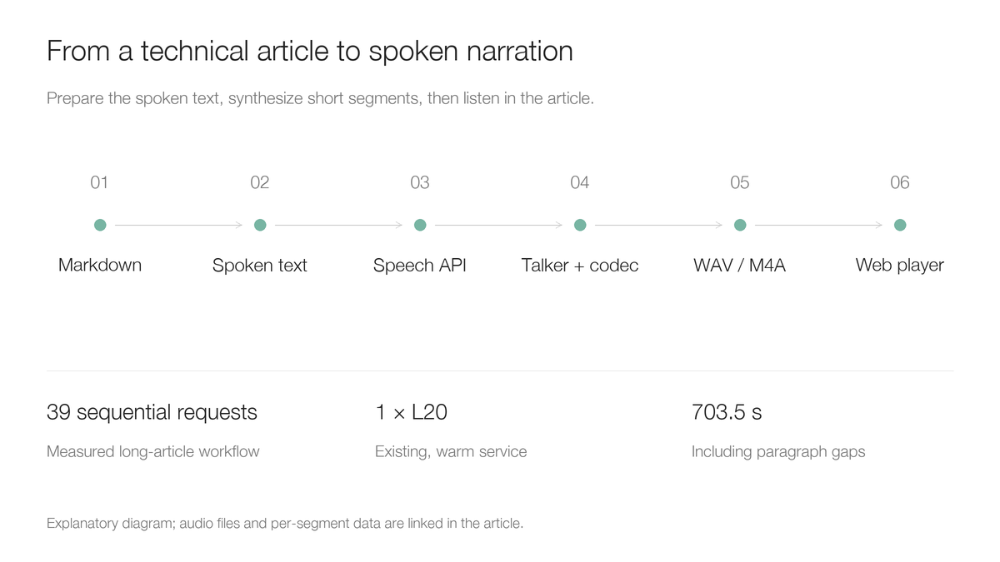
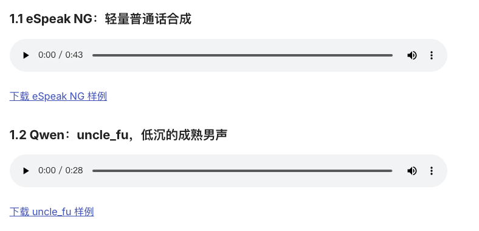

# Qwen3-TTS 部署与试用：把技术文章变成可以听的旁白

技术文章写完后，能不能直接生成一份适合听的版本？这次把 [DeepSeek V4.1 的 vLLM 升级实测](deepseek-v41-vllm032-upgrade.md)改成朗读稿，调用已经部署的 **Qwen3-TTS-12Hz-1.7B-CustomVoice**，生成了 **11 分 43.5 秒**的中文旁白。

先听完整成品。它使用预设男声 `uncle_fu`，没有使用真人录音，也没有克隆作者的声音。数字、缩写和图表说明做了口语化处理，保留主要内容与实验数据，省略图片标记、网址和完整构建哈希；它是文章的朗读改编版。

<audio controls preload="none" aria-label="Qwen3-TTS 完整中文文章朗读" style="width:100%;max-width:720px"><source src="../../assets/practices/qwen3-tts-article-narration/article-uncle-fu.m4a" type="audio/mp4">浏览器不支持音频播放，请使用下方下载链接。</audio>

[下载完整旁白：M4A，约 5.48 MiB](../../assets/practices/qwen3-tts-article-narration/article-uncle-fu.m4a) · [查看实际朗读稿](../../assets/practices/qwen3-tts-article-narration/narration-zh.txt)

本文来自真实服务调用与本地文件处理。集群名、节点地址、私有镜像仓库、入口域名与存储路径均已移除。试听文件只包含公开技术内容；公开页面播放静态音频，不会调用原来的内网服务。

## 1. 同一段文案，先听轻量合成与 Qwen 的差别

为了让比较容易判断，另外用同一段文案生成了四份音频。对照组为 **eSpeak NG 1.51 的普通话 `cmn` 音色**，语速参数为 165；Qwen 使用同一模型、同一风格指令，仅切换预设音色。

```json
{
  "input": "下面我们看一个实际的模型升级实验。两次测试使用相同的硬件、相同的输入长度和并发配置。新版在长输入场景中，首内容等待明显缩短，但是单并发长输出，并没有同步变快。所以，部署验收不能只看一个吞吐数字，还要检查输出是否完整，以及实际任务的质量。",
  "instructions": "自然亲切地讲解技术文章，语速适中，有自然停顿，不要播音腔，不添加内容。"
}
```

### 1.1 eSpeak NG：轻量普通话合成

<audio controls preload="none" aria-label="eSpeak NG 普通话对照样例" style="width:100%;max-width:720px"><source src="../../assets/practices/qwen3-tts-article-narration/espeak-cmn.wav" type="audio/wav">浏览器不支持音频播放，请使用下方下载链接。</audio>

[下载 eSpeak NG 样例](../../assets/practices/qwen3-tts-article-narration/espeak-cmn.wav)

### 1.2 Qwen：uncle_fu，低沉的成熟男声

<audio controls preload="none" aria-label="Qwen uncle_fu 男声样例" style="width:100%;max-width:720px"><source src="../../assets/practices/qwen3-tts-article-narration/qwen-uncle-fu.wav" type="audio/wav">浏览器不支持音频播放，请使用下方下载链接。</audio>

[下载 uncle_fu 样例](../../assets/practices/qwen3-tts-article-narration/qwen-uncle-fu.wav)

### 1.3 Qwen：serena，温暖柔和的年轻女声

<audio controls preload="none" aria-label="Qwen serena 女声样例" style="width:100%;max-width:720px"><source src="../../assets/practices/qwen3-tts-article-narration/qwen-serena.wav" type="audio/wav">浏览器不支持音频播放，请使用下方下载链接。</audio>

[下载 serena 样例](../../assets/practices/qwen3-tts-article-narration/qwen-serena.wav)

### 1.4 Qwen：vivian，明亮的年轻女声

<audio controls preload="none" aria-label="Qwen vivian 女声样例" style="width:100%;max-width:720px"><source src="../../assets/practices/qwen3-tts-article-narration/qwen-vivian.wav" type="audio/wav">浏览器不支持音频播放，请使用下方下载链接。</audio>

[下载 vivian 样例](../../assets/practices/qwen3-tts-article-narration/qwen-vivian.wav)

| 样例 | 音频时长 | 采样率 | 本次控制方式 |
| --- | ---: | ---: | --- |
| eSpeak NG / cmn | 43.44 s | 22,050 Hz | 固定音色、语速参数 165 |
| Qwen / uncle_fu | 28.64 s | 24,000 Hz | 预设音色 + 相同自然语言指令 |
| Qwen / serena | 23.92 s | 24,000 Hz | 预设音色 + 相同自然语言指令 |
| Qwen / vivian | 25.84 s | 24,000 Hz | 预设音色 + 相同自然语言指令 |

试听时，可以留意逗号处的停顿、转折句的重音、句末收尾，以及连续听几分钟是否疲劳。同一文案的输出时长不同，体现了语速和停顿差异；**不能把更短的音频理解成更快的推理速度**。没有对音频变速、移调或添加背景音乐，只做了段落均方根音量调整：目标 −23 dBFS、最多放大 6 dB，并限制峰值。这不是严格的感知响度匹配。

eSpeak NG 的官方说明明确采用共振峰合成，优势是体积小、可离线运行和容易集成，自然度则有取舍。这组对照用来展示一种常见的“能读出来，但像机器”的路径，**不能代表其他神经语音模型或商业语音服务**，也不是严格的听音盲测。本文没有给主观听感编造分数。[eSpeak NG 项目说明](https://github.com/espeak-ng/espeak-ng)

## 2. 这次选的是哪个 Qwen 模型

TTS 是 Text-to-Speech，即文字转语音。它的输入是要说的文字，输出是声音；与把录音转成文字的语音识别方向相反。

| 模型 | 主要输入 | 适合什么需求 | 本次是否运行 |
| --- | --- | --- | --- |
| CustomVoice | 文本、预设音色、风格指令 | 技术解说、固定播讲声音 | 是，1.7B 版本 |
| VoiceDesign | 文本、声音描述 | 根据描述设计新声音 | 否 |
| Base | 文本、参考录音等 | 参考声音克隆、后续定制 | 否 |

这次需要的是“稳定地用某种声音读文章”，没有设计全新声音或克隆真人的需求，因此选择 CustomVoice。`voice` 选择基础音色，`instructions` 调整表达方式。把指令写成“成熟男声”，不等于创建了一种新音色。[CustomVoice 模型说明](https://huggingface.co/Qwen/Qwen3-TTS-12Hz-1.7B-CustomVoice)、[VoiceDesign 模型说明](https://huggingface.co/Qwen/Qwen3-TTS-12Hz-1.7B-VoiceDesign)、[Base 模型说明](https://huggingface.co/Qwen/Qwen3-TTS-12Hz-1.7B-Base)

中文预设还包括带北京口音特点的 `dylan`、带四川口音特点的 `eric`；英文有 `ryan`、`aiden`，日文有 `ono_anna`，韩文有 `sohee`。官方建议优先使用各音色的母语。本轮实际试听的是上面的三种中文声音。[官方音色列表](https://github.com/QwenLM/Qwen3-TTS#custom-voice-generate)

## 3. 实际部署：一张 L20，两个语音阶段

### 3.1 核对运行环境，而不是照抄镜像标签

| 项目 | 本次实际环境 |
| --- | --- |
| GPU | 1 × NVIDIA L20，设备上报 46,068 MiB 显存 |
| NVIDIA 驱动 | 580.173.02 |
| 模型 | Qwen3-TTS-12Hz-1.7B-CustomVoice |
| vLLM | 0.29.0b1+cu129 |
| vLLM-Omni | 0.16.0.dev0+pr7759，自构建预览镜像 |
| PyTorch / Transformers | 2.13.0+cu129 / 5.14.1 |
| 容器资源 | 请求 4 CPU / 24 GiB；上限 12 CPU / 48 GiB；1 GPU |
| 共享内存 | 4 GiB |
| API | `/v1/audio/speech`，WAV 输出 |

这些版本号来自运行容器，不能根据包名把它误写成当前官方正式镜像的成绩。完整镜像摘要与逐段记录见[脱敏数据文件](../../assets/practices/qwen3-tts-article-narration/results.json)。本轮证明了这套配置能在单张 L20 上工作，**没有测出最低显存要求，也没有验证 64 并发容量**。

vLLM-Omni 把服务组织成多个阶段：Talker 生成语音编码，Code2Wav 把编码转换成波形。本次两个阶段都使用可见设备 `0`，属于同一张卡，并不需要各占一张 GPU。配置里两个 `gpu_memory_utilization: 0.3` 是各阶段的显存预算参数，不是“GPU 利用率只有 30%”的监控结论。



这是处理流程示意图；实际结果是文中的音频文件。原文章测试了八张 H20-3e，**负责朗读它的 TTS 服务是单张 L20**，两者不要混淆。

### 3.2 启动命令与阶段配置

运行中的核心命令如下，模型通过只读目录挂载。这里全部使用通用路径。

```bash
vllm serve /models/Qwen3-TTS-12Hz-1.7B-CustomVoice \
  --omni --host 0.0.0.0 --port 8000 \
  --deploy-config /config/qwen3_tts.yaml
```

配套的[完整阶段配置](https://github.com/runzhliu/aik8s/blob/main/examples/qwen3-tts-article/qwen3_tts.yaml)保留实测参数，去掉了原注释。关键点是两个阶段都绑定同一卡、Talker 输出预算为 4,096、Code2Wav 的批处理与上下文上限为 65,536，并通过共享内存连接。阶段配置中的异步分块不代表本文测量了客户端首包延迟：这里请求完整 WAV 后保存，没有进行实时播放延迟测试。

如果从零安装，应先选择成套匹配的 vLLM 与 vLLM-Omni，而不是把普通 vLLM 镜像当成已有语音后端。截至本文核对，官方安装文档提供匹配的 `0.30.0` 安装与镜像示例；它是新环境的候选，**本轮声音并非用它生成**。选定版本后，还应使用对应版本的阶段配置验证一段短音频，再固定镜像摘要。[官方安装说明](https://docs.vllm.ai/projects/vllm-omni/en/latest/getting_started/installation/gpu/)

### 3.3 Kubernetes 怎么部署和访问

仓库提供[脱敏部署清单](https://github.com/runzhliu/aik8s/blob/main/examples/qwen3-tts-article/kubernetes.yaml)。它保留单副本、GPU 请求、健康探针、只读模型挂载和共享内存；镜像是占位符，需要替换为已经验证的构建。清单采用 `Recreate`，便于只有一张空闲卡时升级，代价是升级期间会中断服务。它是根据实测结构整理的复现模板，本次没有重新部署或修改线上服务。

先在 `tts-demo` 命名空间准备名为 `tts-models` 的 PersistentVolumeClaim，持久卷声明；卷根目录下要有完整的 `Qwen3-TTS-12Hz-1.7B-CustomVoice` 模型目录。存储类型与模型分发由自己的环境决定。

```bash
kubectl create namespace tts-demo
kubectl -n tts-demo create configmap qwen3-tts-config \
  --from-file=qwen3_tts.yaml=examples/qwen3-tts-article/qwen3_tts.yaml
# Prepare tts-models PVC and replace the image placeholder before applying.
kubectl apply -f examples/qwen3-tts-article/kubernetes.yaml
kubectl -n tts-demo rollout status deployment/qwen3-tts --timeout=1200s
kubectl -n tts-demo port-forward service/qwen3-tts 8000:8000
```

另一个终端核对健康与模型名：

```bash
curl --fail-with-body http://127.0.0.1:8000/health
curl --fail-with-body http://127.0.0.1:8000/v1/models
```

接口健康不等于声音正确。下一步必须真实合成，检查响应确实是可解码、非静音的音频。端口转发只适合本地验证；多人长期使用时，再接入自己的鉴权、限流与入口代理。

## 4. 第一个请求：音色与说话方式分别控制

把下面内容保存为 `request.json`。`model` 应使用 `/v1/models` 返回的标识，不能把 Hugging Face 仓库名与本地路径随意互换。

```json
{
  "model": "/models/Qwen3-TTS-12Hz-1.7B-CustomVoice",
  "input": "下面我们演示如何把技术文章生成语音旁白。先检查内容，再选择音色，最后保存音频。",
  "voice": "uncle_fu",
  "language": "Chinese",
  "instructions": "自然亲切地向同事讲解，语速适中，有自然停顿，不要播音腔。",
  "response_format": "wav"
}
```

```bash
curl --fail-with-body --max-time 300 \
  http://127.0.0.1:8000/v1/audio/speech \
  -H 'Content-Type: application/json' \
  --data-binary @request.json -o narration.wav
```

想换温暖女声，先把 `voice` 改为 `serena`。希望语速、情绪或停顿有变化，再调整 `instructions`。指令是模型条件，不能理解成每个词都必然严格执行的语音参数。句子写得太长、缩写没有处理，即使加上“自然一点”，也可能仍然不好听。接口字段以所选服务版本为准。[vLLM-Omni 语音接口说明](https://docs.vllm.ai/projects/vllm-omni/en/latest/user_guide/examples/online_serving/text_to_speech/)

## 5. 一整篇文章怎么处理

### 5.1 先做朗读稿，再调用模型

文章里有表格、代码、链接和图。直接把 Markdown 原文传进去，模型可能读出标点、漏掉图里的信息，或者把版本哈希念很久。这次先完成三种改写：

- 把版本号、单位和数字写成适合朗读的表达，例如把 `0.32.0` 写成“零点三十二点零”。
- 把“看下图”改成对数据的口头说明，同时保留统计口径与失败分母。
- 去掉图片语法、参考链接和冗长标识，把缩写首次出现时解释清楚。

这一步是内容编辑。应逐项核对数字，不要为了口语化改变结论。英文产品名如何发音，也值得在短样例里先听；本文的中文试听保留了实际发音，不做“每个英文缩写都正确”的保证。

### 5.2 分段、断点复用与合并

完整朗读稿共 3,159 个字符，按段落与句子拆成 **39 个串行请求**。每段单独保存请求、原始 WAV、耗时和哈希。某一段需要重做时，可以只重生成该段，避免整篇返工。

仓库里的[可运行客户端](https://github.com/runzhliu/aik8s/blob/main/examples/qwen3-tts-article/narrate.py)只依赖 Python 标准库，支持按内容哈希复用、短暂错误有限重试、WAV 校验和音量调整。它复用了本次处理方法，并在三种短音色样例上实际调用验证；同一男声任务再次执行时确认命中缓存，没有重新请求服务。

```bash
python3 examples/qwen3-tts-article/narrate.py narration-zh.txt \
  --base-url http://127.0.0.1:8000 \
  --voice uncle_fu --output-dir narration-output
```

所有段落保持同一声音与指令，正文间补 0.35 秒停顿，短标题后补 0.65 秒。合并时使用实际采样率，避免把 24 kHz 音频当成其他采样率播放。各段先保留原文件，再做音量调整；这不等于配音后期里的完整响度母带处理。

### 5.3 实际花了多久

| 项目 | 2026-10-28 长文任务实测 |
| --- | ---: |
| 串行合成请求 | 39 |
| 成功返回可解码、非静音 WAV | 39 / 39 |
| 各段声音时长合计 | 688.40 s |
| 各段生成调用耗时合计 | 112.379 s |
| 加入停顿后的完整音频 | 703.50 s |
| 最终文件 | 单声道，24 kHz，AAC M4A，5,741,704 bytes |

用各段生成调用耗时，除以各段声音时长，得到 **RTF 约 0.163**。RTF 是 Real-Time Factor，实时因子；小于 1 表示生成耗时短于所生成的声音时长。

这是已有热服务、单任务串行处理的观察，调用耗时包含网络与客户端处理，不包含模型冷启动、朗读稿改写、后期合并和转码。它不是完整端到端制作耗时，也没有测首音频包延迟、多人并发或长时间稳定容量。39 / 39 描述文件级成功，未做逐字自动语音识别核对或主观质量评分。

## 6. 如何复现轻量对照，如何放进文章

### 6.1 不需要 GPU 的对照生成

本次确实构建并运行了仓库中的[小型 eSpeak NG 容器](https://github.com/runzhliu/aik8s/blob/main/examples/qwen3-tts-article/Dockerfile.espeak)。它安装 Debian 的 eSpeak NG 1.51，使用普通话声音，没有拿英文音色读中文来制造差异。

```bash
docker build -f examples/qwen3-tts-article/Dockerfile.espeak \
  -t aik8s-espeak-tts:bookworm examples/qwen3-tts-article
mkdir -p audio-output
docker run --rm \
  -v "$PWD/examples/qwen3-tts-article:/input:ro" \
  -v "$PWD/audio-output:/output" \
  aik8s-espeak-tts:bookworm \
  -v cmn -s 165 -f /input/sample-zh.txt -w /output/espeak-cmn.wav
```

这类工具仍适合离线通知、读屏和资源很少的场景；技术视频、长文播讲则更需要自然停顿、语气变化与连续收听的舒适度。选型应结合真实试听、部署成本和运行约束。本文没有测试其他现代神经 TTS，因此不据此给整个行业排名。

### 6.2 WAV 留底，M4A 用来发布

分段 WAV 适合调试、剪辑与重新合并。完整成品转为 M4A 后，从约 32.2 MiB 的 WAV 降到约 5.48 MiB，网页下载和移动端收听更方便。原始 WAV 继续本地留档。

```bash
# macOS: 24 kHz mono AAC, 64 kbps
afconvert -f m4af -d 'aac ' -b 64000 narration.wav narration.m4a
```

网页使用原生播放器，提供下载链接，并设置 `preload="none"`，避免读者打开长文章时就预加载所有声音。没有设置自动播放。

```html
<audio controls preload="none" aria-label="Article narration">
  <source src="article-uncle-fu.m4a" type="audio/mp4">
</audio>
<a href="article-uncle-fu.m4a">Download audio</a>
```



上图为构建后的真实页面截图，播放器对应本文实际文件，不是 Qwen 官方控制台。官方项目另有演示界面启动方法；本文没有把自制文章页面当作官方 Web UI。

## 7. 真正值得保留的实践

这次得到的不只是一次接口调用，而是一套能复用的文章音频制作流程：先审核朗读稿，再用短文案选声音，分段生成并保留原始文件，核验后合并，最后把静态成品放到文章里。

“人机感”既来自合成系统，也来自文案。共振峰合成与神经语音模型的声音机制不同，而技术缩写、长数字、没有停顿的句子，会继续影响结果。先听本文的四个同文案样例，再决定自己的解说、培训或文章播讲是否值得部署 GPU 服务。

## 参考资料

- [Qwen3-TTS 官方仓库与使用方法](https://github.com/QwenLM/Qwen3-TTS)
- [Qwen3-TTS CustomVoice 模型](https://huggingface.co/Qwen/Qwen3-TTS-12Hz-1.7B-CustomVoice)
- [vLLM-Omni 语音服务](https://docs.vllm.ai/projects/vllm-omni/en/latest/user_guide/examples/online_serving/text_to_speech/)
- [vLLM-Omni GPU 安装](https://docs.vllm.ai/projects/vllm-omni/en/latest/getting_started/installation/gpu/)
- [eSpeak NG](https://github.com/espeak-ng/espeak-ng)
- [本次样例、哈希与逐段数据](../../assets/practices/qwen3-tts-article-narration/results.json)
