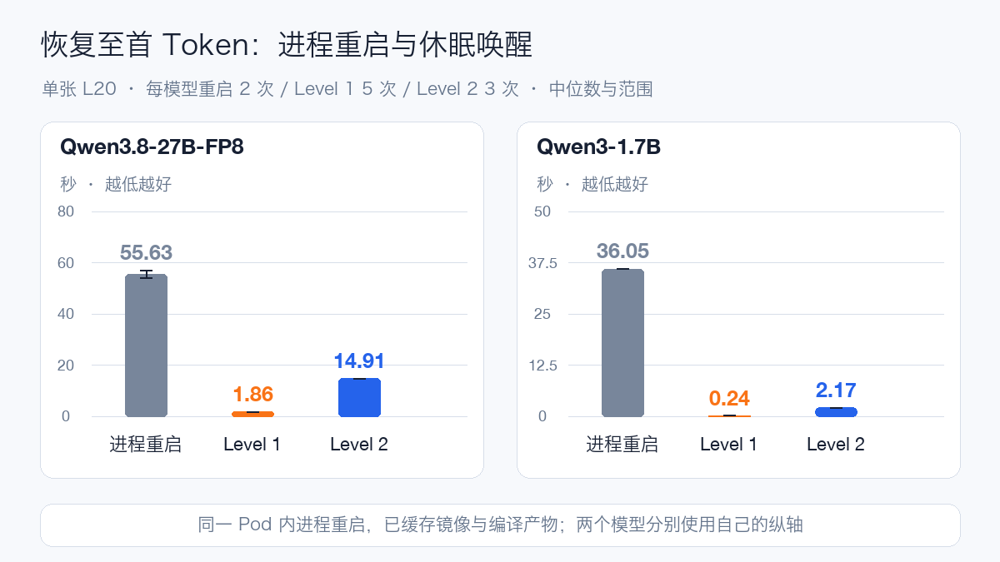
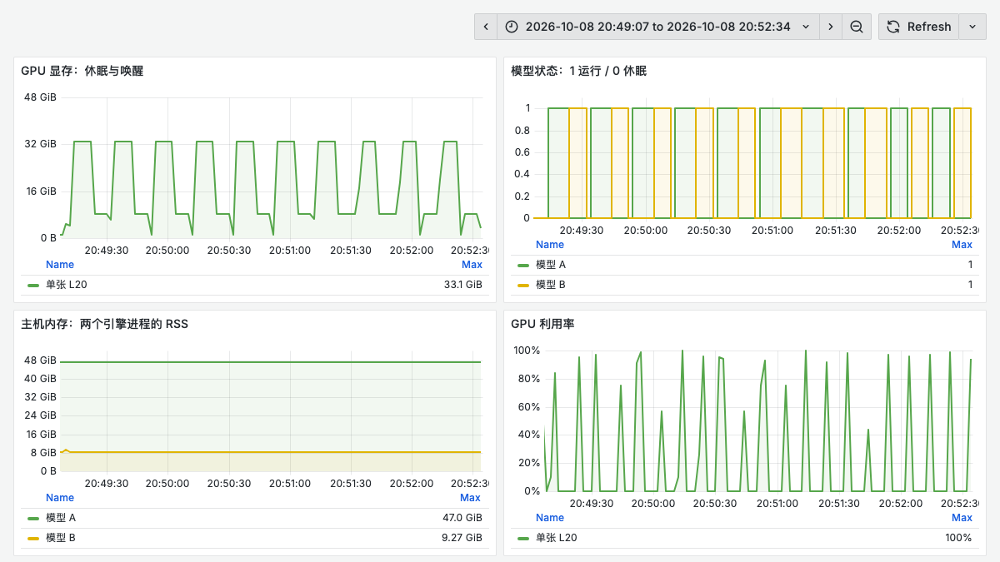
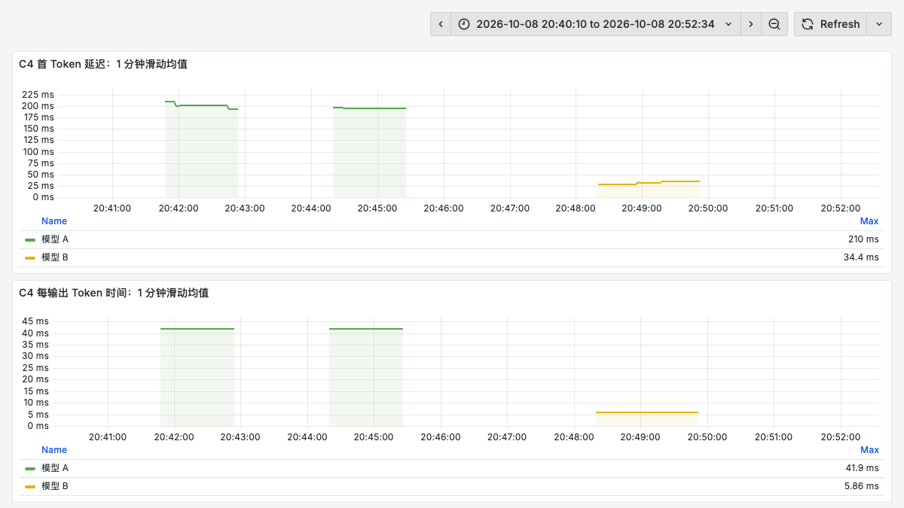
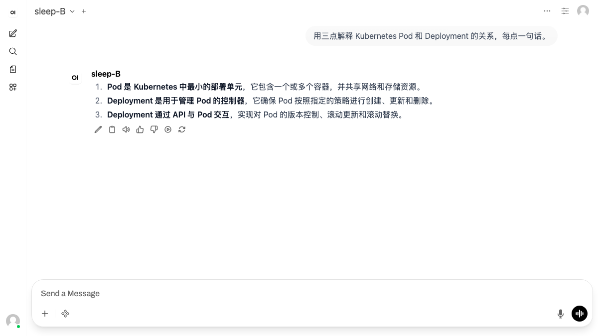

# vLLM Sleep 单卡双模型实测：恢复耗时、显存与 DRA 设计

低频模型一直留在 GPU 上会占住显存；每次从头启动，又会重复引擎初始化和权重加载。vLLM Sleep Mode 提供了第三种选择：保留进程，把大部分显存交出来，需要时再恢复。

这次用单张 L20 运行 Qwen3.8-27B-FP8 与 Qwen3-1.7B，回答三个问题：休眠后的显存是否足够交给另一个模型，唤醒比进程重启快多少，恢复后短时吞吐是否改变。DRA 部分讨论设备共享设计，实际实验使用同一容器里的两个独立引擎。

27B 模型的 Level 1 恢复至首 Token 中位数为 **1.86 秒**，同 Pod 缓存条件下进程重启为 **55.63 秒**。19 次模型交接全部成功，恢复前后 C4 输出吞吐分别为 92.64 与 92.68 tok/s。

## 实测结果

### 恢复比重新启动少了哪些时间

| 模型 | 首次启动至首 Token | 缓存条件下进程重启 | Level 1 恢复至首 Token | Level 2 重载至首 Token |
| --- | ---: | ---: | ---: | ---: |
| Qwen3.8-27B-FP8 | 219.20 s | 55.63 s | 1.86 s | 14.91 s |
| Qwen3-1.7B | 84.06 s | 36.05 s | 0.24 s | 2.17 s |

首次启动单列；缓存条件下的进程重启取 2 次中位数。Level 1 为每模型 5 次、Level 2 为每模型 3 次中位数。恢复计到首个有效内容 token，包含恢复后的正确性请求，不只计 HTTP 控制接口返回。

还要把“第一次休眠”单独考虑：27B 模型首次 Level 1 休眠用了 **18.47 秒**，后续四次为 1.33—1.34 秒；1.7B 模型首次为 2.07 秒，后续四次为 0.17—0.19 秒。本轮没有对主机内存分配和传输开销分别剖析，因此后续切换的数字不能替代首次休眠成本。



### 交替运行时显存如何变化

| 交接方向 | 次数 | 至首 Token 中位数 | 最小—最大 |
| --- | ---: | ---: | ---: |
| A→B | 10 | 1.82 s | 1.78—2.18 s |
| B→A | 9 | 2.26 s | 2.23—2.28 s |

共 19 次真正的模型交接，成功 19 次；第一个双休眠状态下的激活单独计量，不加入方向统计。

两套引擎都已初始化后，A 运行时物理显存约为 **33.05 GiB**，B 运行时约为 **8.31 GiB**，两者均休眠时仍有约 **1.03 GiB** 的残留。Sleep 释放的是大部分权重和缓存空间，进程及 CUDA 环境仍然存在，显存不会归零。

这组模型没有做同时唤醒或并发共存的对照。按独立测量估算，两套模型的显存需求合计可能仍在 L20 容量之内，实际共存还要调整并验证初始化预算。本文验证的是温备恢复与互斥交接，不能据此判断这组模型必须依靠 Sleep 才能部署，或串行切换比并行共存更划算。



图中 A 为 27B FP8，B 为 1.7B BF16；状态 1 为引擎完全唤醒，0 为休眠。显存是这张物理 GPU 的总使用量。主机内存图按引擎及其子进程 RSS 求和，可能重复计入共享页；它解释内存迁移趋势，不能直接作为 Pod 内存限额的依据。曲线按固定历史窗口查询，Prometheus 每 2 秒采集，极短的切换低谷可能落在两个采样点之间。

### 恢复后的短时吞吐

| 模型 | 阶段 | 并发 | 完整流 / 计划 | 输出吞吐 tok/s | P95 TTFT ms | P95 TPOT ms |
| --- | --- | ---: | ---: | ---: | ---: | ---: |
| A | 恢复前 | 1 | 16/16 | 25.35 | 125.97 | 38.96 |
| A | 恢复前 | 4 | 16/16 | 92.64 | 240.95 | 41.93 |
| A | Level 1 恢复后 | 1 | 16/16 | 25.35 | 124.43 | 38.96 |
| A | Level 1 恢复后 | 4 | 16/16 | 92.68 | 227.02 | 41.93 |
| B | 恢复前 | 1 | 16/16 | 175.85 | 19.66 | 5.58 |
| B | 恢复前 | 4 | 16/16 | 655.61 | 34.65 | 5.89 |
| B | Level 1 恢复后 | 1 | 16/16 | 175.89 | 19.19 | 5.57 |
| B | Level 1 恢复后 | 4 | 16/16 | 657.60 | 39.30 | 5.88 |

每个阶段每个并发配置为 8 请求×2 轮。吞吐列为两轮中位数；P95 由这两轮成功请求合并计算。该负载输入很短、固定输出 128 token，不能据此推断长上下文或长期运行表现。


图中的恢复耗时是最近一次已完成操作的 Gauge，线段保持表示读数尚未更新，不能把水平线看作持续发生相同耗时的请求。吞吐曲线也表示最近完成的一轮，而非瞬时解码速率。



这张图使用客户端直方图的 `sum/count` 计算一分钟滑动平均，只选择 C4 性能请求。图中均值与表格的整轮 P95 口径不同；两个模型的恢复前后分别形成两段曲线。模型 A 的性能提示词为 26 token，模型 B 为 25 token。

逐请求记录总计 170 条，完整流成功 170 条，失败 0 条。公开的 [统计数据](../../assets/practices/vllm-sleep-l20/benchmark-summary.json) 保留样本量、范围、配置、统计方法与未执行项目。

## Sleep Mode 保留了什么

vLLM 的 Sleep Mode 让引擎暂时交出大部分显存，服务进程仍在。模型再次使用时，可以恢复已经初始化好的引擎，减少重新建立执行环境的开销。

| 方式 | 权重 | KV Cache | 恢复路径 |
| --- | --- | --- | --- |
| Level 1 | 搬到 CPU 内存 | 内容丢弃 | 从 CPU 恢复权重并重新分配缓存 |
| Level 2 | 内容丢弃；部分模型 buffer 保留 | 内容丢弃 | 分配权重空间、重新加载权重、恢复缓存 |
| 服务进程重启 | 重新加载 | 重新建立 | 启动进程、初始化引擎、加载权重并准备执行 |

Level 1 适合稍后继续使用同一套权重；Level 2 适合不需要保留旧权重、或者主机内存不足的场景。后者需要显式重新加载权重。本实验的 Level 2 恢复仍使用原模型，模型 A/B 的交替运行由两个独立引擎完成。[vLLM 0.31.0 Sleep Mode](https://docs.vllm.ai/en/v0.31.0/features/sleep_mode/)

原来请求的 KV Cache 内容不会随着唤醒恢复。一个对话即使在应用层保留了历史，下一次请求仍要重新处理需要的上下文。因此，“重新出一个短答案很快”和“恢复长对话的成本很低”需要分别测量。

## 测量怎样避免混淆

本次只申请一张 L20，两个 vLLM 进程位于同一个容器中。先完成 A 的独立测试，将 A 休眠；再初始化和测试 B，最后让两个已经初始化的引擎轮流使用显存。节点上存在其他业务，CPU 和共享存储并非独占。

| 项目 | 配置 |
| --- | --- |
| 运行时 | vLLM 0.31.0，CUDA 13.0，PyTorch 2.13.0+cu130 |
| GPU | 单张 NVIDIA L20，驱动 580.173.02，NVML 报告总显存 46,068 MiB |
| 模型 A | Qwen3.8-27B-FP8，纯文本路径 |
| 模型 B | Qwen3-1.7B，BF16 |
| 并行和窗口 | TP=1，服务上下文 4,096 token，最多 4 个运行请求 |
| 缓存预算 | 每个引擎固定 4 GiB，Prefix Cache 关闭 |
| 执行 | 保留默认编译与 CUDA Graph；没有使用 enforce-eager |
| 请求 | temperature=0，关闭 thinking，SSE 流返回 usage |
| 基线 | 每模型首次启动 1 次、同 Pod 内进程重启 2 次；各自记录 |
| 休眠恢复 | 每模型 Level 1 5 次、Level 2 3 次 |
| 短时压测 | 恢复前后各 C1/C4；每配置 8 请求×2 轮，固定输出 128 token |
| 交替运行 | 20 次激活事件，其中第 1 次为双模型均休眠后的初始激活，之后为 19 次模型交接 |

固定 KV Cache 容量是一个关键条件。按照当前“剩余显存”自动推导预算，会让后启动的 B 和最先启动的 A 得到不同容量。固定预算后，两套引擎的休眠前后对照更容易解释；这也意味着本文没有测试大上下文服务的最大容量。

正确性请求为：

```text
只回答一个数字，不要解释：3 加 4 等于多少？
```

必须完整收到内容 `7`、结束标记 `[DONE]` 和有效 token usage 才算通过。性能请求为：

```text
用中文简要解释 Kubernetes 的 Pod 和 Deployment 的关系。
```

性能请求采用 `ignore_eos=true`，强制输出 128 token，目的是固定工作量，而非评估回答质量。它是短输入、短输出、闭环固定并发的性能样本，不包含开放到达率、长提示词、工具调用或生成质量评分。

计时区分三个边界：

- **唤醒 API 耗时**：从发起恢复调用到恢复完成。Level 2 包含权重重载。
- **恢复至首 Token**：恢复调用耗时加上紧接着的正确性请求 TTFT（Time to First Token，首 Token 延迟）；计时不包含休眠期间的等待。
- **交接至首 Token**：从开始休眠当前模型，到目标模型恢复并返回首段内容；包含旧模型交出显存、状态与显存检查的成本。

首次启动与进程重启均计到首个正确性答案的第一段内容。重启发生在同一个 Pod 中，镜像已经拉取，模型文件已可读，编译缓存也可能命中；因此表中重启不是 Kubernetes Pod 的完整冷启动。

吞吐为整轮成功输出 token 数除以整轮墙钟时间。TPOT（Time per Output Token，每输出 Token 的平均时间）用首段到末段内容的时间除以输出 token 数减一计算，受 SSE 分块影响。延迟 P95 使用最近秩法，每个性能配置只有 16 个请求，P95 接近最大样本；表格同时保留成功数与原始计划分母。

## 单卡交替运行怎样控制

运行状态与资源分配是两套状态。Sleep 成功后，`nvidia.com/gpu` 的 Pod 配额仍被占用，Kubernetes 不会因为 NVML 显存下降就把整张卡自动分配给另一个独占 GPU Pod。

本实验把 A、B 放在同一容器里，复用一次 GPU 分配。切换控制器按以下顺序执行：


测试中每轮请求结束后才调用休眠接口，因此没有故意中断在途请求。生产入口应有独立的排空、互斥与超时逻辑。当前版本休眠接口默认使用 `abort` 模式，直接调用它并不等于完成了优雅排空。

失败恢复也要保持单一所有者：B 唤醒失败时，确认 B 已回到可控的休眠或停止状态，才尝试恢复 A。不要在 A 显存尚未交出时，盲目重复唤醒 B。GPU 内存耗尽、主机内存不足和控制器进程崩溃需要分别处理。

## 最小接口验证

下面是 vLLM 0.31.0 的单引擎接口示例，模型目录替换为自己的路径；两套引擎交替运行时需要在此基础上增加排空和切换控制。

```bash
VLLM_SERVER_DEV_MODE=1 vllm serve /models/Qwen3-1.7B \
  --host 127.0.0.1 --port 8000 --served-model-name demo \
  --enable-sleep-mode --tensor-parallel-size 1 \
  --max-model-len 4096 --max-num-seqs 4 \
  --max-num-batched-tokens 4096 \
  --kv-cache-memory-bytes 4294967296 \
  --gpu-memory-utilization 0.85 --no-enable-prefix-caching

# 在途请求结束后，Level 1 休眠和恢复。
curl -X POST 'http://127.0.0.1:8000/sleep?level=1'
curl 'http://127.0.0.1:8000/is_sleeping'
curl -X POST 'http://127.0.0.1:8000/wake_up'

# Level 2 需要重新加载权重；先恢复权重空间，最后恢复缓存。
curl -X POST 'http://127.0.0.1:8000/sleep?level=2'
curl -X POST 'http://127.0.0.1:8000/wake_up?tags=weights'
curl -X POST 'http://127.0.0.1:8000/collective_rpc' \
  -H 'Content-Type: application/json' -d '{"method":"reload_weights"}'
curl -X POST 'http://127.0.0.1:8000/wake_up?tags=kv_cache'
```

控制接口的成功返回之后，仍须发送真实生成请求。`is_sleeping=false` 只能说明引擎已恢复相应资源，不能替代完整输出、usage 和答案正确性的检查。开启开发模式后，应将这些接口限制在可信控制路径。[当前版本的在线接口说明](https://docs.vllm.ai/en/v0.31.0/features/sleep_mode/)

## 如果进一步结合 DRA

DRA（Dynamic Resource Allocation，动态资源分配）为 Kubernetes 提供设备声明与分配机制，`ResourceClaim` 表达设备申请，`ResourceSlice` 描述驱动发布的设备资源。它可以支撑设备共享设计，但引擎的睡眠状态和实际显存使用仍需业务控制器管理。[Kubernetes DRA](https://kubernetes.io/docs/concepts/resource-management/dynamic-resource-allocation/)

本文完成的是同容器 GPU 复用，测试环境没有启用 DRA API，下面是部署设计分析。

| 部署方式 | 是否可能共享同一张卡 | 还需要什么 |
| --- | --- | --- |
| 两个独占 `nvidia.com/gpu: 1` Pod | 第一 Pod 不退出时，第二 Pod 不能靠 Sleep 获得同一独占分配 | 改用支持共享的资源机制 |
| 单容器内两套引擎 | 本文采用的方式 | 排空、互斥、显存与主机内存保护 |
| 多 Pod 共同引用同一个 ResourceClaim | 取决于设备驱动和共享配置 | 核对驱动支持，统一控制器管理活跃模型 |
| 不同 ResourceClaim 使用可消费容量 | 支持该功能的版本与驱动可以将多个申请放到同一设备 | 明确容量口径、准入策略与运行期保护 |

NVIDIA DRA 驱动的 `ConsumableShares` 目前属于默认关闭的 Alpha 功能，其指南要求 Kubernetes 1.34 及以上。它提供的是申请容量的调度记账，不能当作 GPU 显存的运行时硬隔离。以显存额度记账时，Sleep 也不会自动把原 ResourceClaim 的额度归还；想让两套大模型轮流超过各自的静态份额，需要额外协调策略，而不是仅打开一个共享开关。[NVIDIA 可消费容量指南](https://dra-driver-nvidia-gpu.sigs.k8s.io/docs/guides/gpu-allocation/consumable-capacity/)

一个更适合验证的设计是：两个常驻引擎取得允许共享的设备访问，控制器授予唯一的“活跃模型”租约；入口只路由到租约所有者。DRA 负责设备能被哪些 Pod 使用，控制器负责此刻谁可以分配权重和缓存。租约过期、控制器重启及 Pod 失联时，先核对实际设备进程，避免两个控制器同时唤醒两个模型。

## 部署建议

Sleep 适合低频模型的温备、开发环境切换以及有明确轮流执行阶段的任务。对持续高 QPS 或要求毫秒级首响的在线服务，切换等待和缓存重新预填充仍可能成为瓶颈。

1. **先量显存峰值，再决定模型组合。** 以目标模型运行峰值、其他休眠进程的残留和安全余量相加评估；不能只用权重文件大小相加。
2. **Level 1 要预留主机内存。** 权重搬入 CPU 后占用会增加。多模型温备要核对容器内存上限、节点可用内存及 OOM 风险。进程 RSS 求和含共享页重复计量，实际 Pod 容量应结合 cgroup 内存读数评估。
3. **明确恢复目标。** 区分“重新接收请求”“生成首 Token”和“长对话全部重新预填充完成”；只有第一个目标会低估用户等待。
4. **固定每个引擎的缓存预算。** 避免初始化顺序和其他进程改变自动容量估算，保留配置哈希和每次切换的设备状态。权重恢复依赖主机内存与 PCIe 通路，还应检查 GPU 与 CPU 的 NUMA 位置和内存带宽；本轮没有绑定专用 CPU 集合。
5. **把开发控制接口留在可信控制路径。** 本实验的 sleep、wake 和 collective RPC 只监听回环地址，普通服务入口不暴露它们。
6. **控制器与网关一起设计。** 请求排空、切换锁、唤醒探针、失败回滚和防抖不可缺少。频繁切换会把一部分推理时间变成数据搬运时间。

Sleep 的价值在于保留引擎初始化成果，使低频模型可以较快重新投入使用。是否划算，取决于低频请求间隔、权重恢复时间、CPU 内存预算和缓存重建成本。

## 交互验证

Qwen3-1.7B 接入既有聊天界面，使用真实请求解释 Pod 与 Deployment 的关系。该样例独立于 170 条正式请求，只验证交互路径，不作为吞吐或 TTFT 的测量来源。


