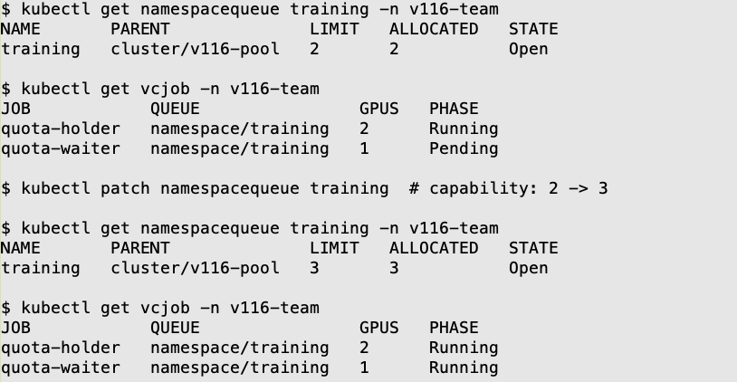
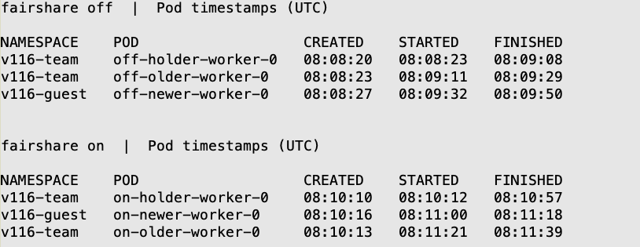
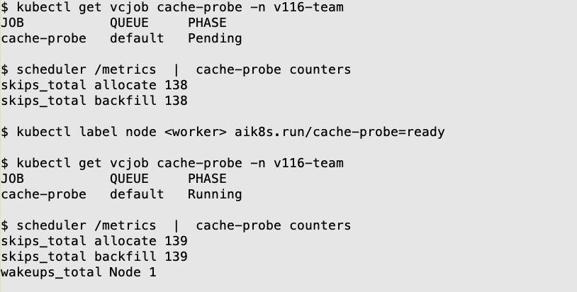

# Volcano 1.16 GPU 调度实战：有空卡为什么还要等，下一张卡又该给谁？

一个团队占着 2 张 GPU，再要第 3 张时，任务一直排队。我们把子队列上限从 2 改成 3，正在跑的 Pod 原地继续，等候的 Pod 随即启动。另一组实验更有意思：两个团队等同一张卡，先提交的团队刚刚用过它。关闭 `fairshare` 时，先来的先跑；打开以后，后来的团队先拿到卡。调度器日志里能看到它比较两队历史用量的那一行。

这是两类不同的运维问题。队列限额决定一个团队还能用多少，历史用量决定有资格竞争的任务谁先获得机会。第三个实验看的是调度器自己：如果任务根本找不到匹配节点，它要重复检查多少次，什么变化能让它再试？这三项都是 Volcano 在 2026 年 10 月 14 日发布的 v1.16.0 中引入的能力。[官方发布说明](https://volcano.sh/blog/volcano-1.16.0-release/)

| 现场问题 | 实测功能 | 最有判别力的证据 |
| --- | --- | --- |
| 集群有空卡，团队的第 3 张卡却拿不到 | NamespaceQueue | 只改子队列上限，已分配量从 2 变为 3 |
| 别的团队第一次来，为何还要排在老用户后面 | fairshare | 保持同一单卡队列，开关插件后两名等待者的启动顺序反转 |
| 同一任务反复 Pending，调度器是否每轮都重算 | UnschedulableJobCache | `allocate` 跳过计数增长，补标签后出现一次 `UpdateNodeLabel` 唤醒 |

## 实验环境与复现入口

1 台控制面、2 台 worker，各 worker 由 Fake GPU Operator 0.2.1 注册 8 个 `nvidia.com/gpu` 设备，型号标签为 `NVIDIA-B300-SXM6-AC`。任务用 BusyBox 申请整卡并执行 `sleep`。Kubernetes 确实创建了容器、分配了设备，Volcano 也真实执行了准入、排序和绑定。这套环境适合验证调度策略；GPU 吞吐、显存利用率、NCCL 通信和大集群调度性能都需要另外测。上游 v1.16 发布说明列出的 Kubernetes 支持版本为 1.36，本次运行于 1.37.2。[Volcano v1.16.0](https://github.com/volcano-sh/volcano/releases/tag/v1.16.0) · [Fake GPU Operator](https://github.com/run-ai/fake-gpu-operator)

下载并解压[实验清单和脚本](../../assets/practices/volcano-116-gpu/lab.zip)。其中包含两个队列、正反例、三个工作负载、两轮公平性对照和清理脚本。下列命令在解压目录运行，需要 `kubectl`、Helm、Bash 和 `jq`。[原始观测摘录](../../assets/practices/volcano-116-gpu/results.txt)包括命名空间拒绝信息、缓存计数、调度器比较日志及六个容器的 UTC 时间。

复现使用独立测试集群，预先安装同版本 Helm release `volcano`，并确认当前 kubeconfig 指向该集群、两个实验命名空间尚未使用。本文按安装时的默认调度配置起步。第一个增量文件开启 `NamespaceQueue`、`UnschedulableJobCache` 和逐作业调试指标。Chart 同时调整 admission、controller、scheduler，并将默认的 `proportion` 换为启用层级的 `capacity`；使用自定义调度配置的平台要自己合并这部分。记录原 revision，最后用它恢复。[固定版本 Helm 配置](https://github.com/volcano-sh/volcano/tree/v1.16.0/installer/helm/chart/volcano)

```sh
helm repo add volcano-sh https://volcano-sh.github.io/helm-charts
helm repo update volcano-sh
helm history volcano -n volcano-system
BASE_REV=$(helm history volcano -n volcano-system -o json | jq -r 'last.revision')
helm upgrade volcano volcano-sh/volcano -n volcano-system --version 1.16.0 \
  --reuse-values -f features.yaml --wait
kubectl create namespace v116-team
kubectl create namespace v116-guest
```

## 实验一：谁能建子队列，谁能用第 3 张卡

平台管理员建集群级 `v116-pool`，上限为 4 张卡，`allowedNamespaces` 只列 `v116-team`。团队在自己的命名空间建 `training`，用 `parent: cluster/v116-pool` 接到父队列，`deserved` 和 `capability` 都先设为 2。作业用 `queue: namespace/training` 引用本命名空间的子队列。省掉 `namespace/` 会引用同名的集群级 Queue，读 YAML 时尤其容易看错。[NamespaceQueue 设计与引用规则](https://github.com/volcano-sh/volcano/blob/v1.16.0/docs/design/namespace-queue.md)

```sh
kubectl create -f queues.yaml
kubectl -n v116-team wait --for=condition=Ready namespacequeue/training --timeout=60s
kubectl create --dry-run=server -f guest.yaml
```

正例返回 `Authorized=True` 和 `Ready=True`。最后一条命令预期返回非零：同样的子队列定义放在 `v116-guest`，API Server 调用 Volcano webhook 后返回 `namespace "v116-guest" is not allowed to use parent Queue "v116-pool"`。这个对照验证了父队列的挂接授权；平台仍要用 Kubernetes RBAC 决定哪些人可以创建和编辑 NamespaceQueue。实验使用管理员身份，没有模拟租户个人账号。

```sh
kubectl create -f quota-holder.yaml
kubectl -n v116-team wait --for=jsonpath='{.status.state.phase}'=Running vcjob/quota-holder --timeout=90s
kubectl create -f quota-waiter.yaml
kubectl -n v116-team get vcjob,podgroup,pod
kubectl -n v116-team get namespacequeue training -o yaml
```

`quota-holder` 先申请 2 张并持续运行；`quota-waiter` 只要 1 张，两者均匹配 B300。此时子队列 `status.allocated["nvidia.com/gpu"]` 为 2，第二个 Pod 已创建，PodGroup 为 `Inqueue`，作业为 `Pending`。保持 holder、节点和 `deserved: 2` 不动，只改这一项：

```sh
kubectl -n v116-team patch namespacequeue training --type=merge \
  -p '{"spec":{"capability":{"nvidia.com/gpu":"3"}}}'
kubectl -n v116-team wait --for=jsonpath='{.status.state.phase}'=Running vcjob/quota-waiter --timeout=60s
```



*上下两段为变更前后的 kubectl 采样。分配量到 3 时，原来的 2 卡作业与新来的 1 卡作业同时处于 Running。终端截图回放实测输出，已裁去本机窗口标题。*

对平台管理员，这个对照提供了一个排查顺序：先核对作业实际引用的队列，再沿父子链看上限、已用量和剩余额度，最后定位到 Pod 对节点的要求。单看 `kubectl get nodes` 只知道总容量。这个样例中，父队列有余量时，子队列确实能超过 `deserved: 2`，直到碰到自己的 `capability`。父队列或集群也吃满时，单独给子队列扩额无法创造设备。

## 实验二：两个团队排同一张卡，历史用量会改变顺序吗

单独建一个集群级队列 `v116-fair`，只允许使用 1 张卡。两轮都由 team 先占 45 秒，再由 team 提交 older、guest 稍后提交 newer。两个等待者运行时间都为 18 秒，优先级、设备型号和卡数相同，均在 holder 仍占卡时进入 Pending。两轮之间只给这个队列启用 `fairshare`，其余调度插件与层级 capacity 配置保持一致。

```sh
kubectl create -f fair-queue.yaml
bash fair-round.sh off
helm upgrade volcano volcano-sh/volcano -n volcano-system --version 1.16.0 \
  --reuse-values -f fairshare-values.yaml --wait
bash fair-round.sh on
cat off-timing.tsv on-timing.tsv
```

| 插件 | team/older 创建 → 启动（UTC） | guest/newer 创建 → 启动（UTC） | 卡释放后的第一位 |
| --- | --- | --- | --- |
| 关 | 08:08:23 → 08:09:11 | 08:08:27 → 08:09:32 | team/older |
| 开 | 08:10:13 → 08:11:21 | 08:10:16 → 08:11:00 | guest/newer |



*按容器启动时间排列。CREATED 来自 Pod 的 creationTimestamp，STARTED 和 FINISHED 取自已退出容器的状态。两轮的 holder 都完整跑了 45 秒。*

为什么顺序会翻转？插件以“队列、命名空间”为单位累计已占资源量和占用时间，再按半衰期衰减历史用量。本实验跟踪 `nvidia.com/gpu`，半衰期 240 分钟，插件位置在 `priority` 之后、`drf` 之前。holder 跑完后，team 当前已释放卡，但仍有使用历史。日志中 `JobOrderFn` 明确选择 guest，比较值为 `0.0 < 47158.5`。这是插件内部计量值；它记录资源分配历史，即使程序只执行 sleep 也会增加。[v1.16 fairshare 排序与资源记账实现](https://github.com/volcano-sh/volcano/blob/v1.16.0/pkg/scheduler/plugins/fairshare/fairshare.go)

如果平台按命名空间区分团队，而且多个团队共享同一队列，这种排序能覆盖“持续提交短作业，一个团队总是先排上”的情况。本轮每个条件只跑一次，验证了启动顺序与排序日志吻合。线上等待时间分布还取决于到达率、作业长度和优先级。这次 `enableEnqueueGate`、`persistState` 都关闭；若希望调度器重启后仍记得历史，用独立灰度队列验证持久化，再决定是否推广。

## 实验三：给节点补一个标签，能否唤醒被缓存的作业

这个实验用默认集群队列。请求仍是 1 张 B300，额外要求 `aik8s.run/cache-probe=ready`。起初所有节点都缺这个标签。复现时将 `WORKER` 设置为本次准备打标签的模拟 GPU worker 名，先确认该键空闲。第一条指标查询在任务进入 Pending 数轮后执行，再继续打标签。

```sh
kubectl create -f cache-probe.yaml
METRICS=/api/v1/namespaces/volcano-system/services/volcano-scheduler-service:8080/proxy/metrics
kubectl get --raw "$METRICS" | grep '^volcano_unschedulable_job_cache_' | grep 'job_name="cache-probe-'
kubectl label node "$WORKER" aik8s.run/cache-probe=ready
kubectl -n v116-team wait --for=jsonpath='{.status.state.phase}'=Running vcjob/cache-probe --timeout=90s
kubectl get --raw "$METRICS" | grep '^volcano_unschedulable_job_cache_' | grep 'job_name="cache-probe-'
kubectl -n v116-team wait --for=jsonpath='{.status.state.phase}'=Completed vcjob/cache-probe --timeout=90s
kubectl label node "$WORKER" aik8s.run/cache-probe-
```



*从实际 scheduler 指标中仅保留本作业的计数。补标签前，allocate 与 backfill 各累计跳过 138 次；下一次采样均为 139，作业已经 Running。完整指标还记录了 resource="Node" 和 action="UpdateNodeLabel"。*

节点选择条件短期内不会自己改变。缓存保存上次拒绝的原因，之后的调度轮次可以跳过对应阶段。节点标签更新属于可重新尝试的事件，调度器收到提示后再做适配检查，成功后正常绑定。两个阶段的计数可能来自同一调度轮，因此不能相加当成节省的轮数，也无法据此推导调度 CPU 降幅。v1.16 要求拒绝路径上的插件都提供安全提示；层级 `capacity` 的配额拒绝并不走这项优化。做缓存实验时特意选择节点标签阻塞，以便把它和第一个实验区分开。[缓存机制与支持范围](https://volcano.sh/blog/volcano-1.16.0-release/)

若集群有大量同条件的长期 Pending 任务，可以从“是否发生跳过、解除阻塞后多久绑定、调度器 CPU 和正常作业等待时间怎样变化”入手验收。逐作业 debug 指标带作业名和命名空间标签，适合在受控窗口采样。这次跑的是单个阻塞作业；大队列的延迟与指标基数仍需用真实到达速率验证。

## 如何收尾

三个实验分别改了配额、排序和失败重试。上线时更容易解释的顺序，也是先把“能领多少卡”约定清楚，再决定“下一张给谁”，最后用缓存减少调度器的重复劳动。对于多团队共享卡池，第二个实验最值得带着业务方重跑：让团队在看到两次启动顺序之后，决定历史公平性该在哪些队列生效。

清理前确认仍在本次测试集群，且缓存实验的节点标签已移除。先删实验作业，再删子队列及父队列，最后回到开始时记录的 Helm revision。本轮已核对回滚后的用户 values 与原值一致，三个 Volcano Deployment 均就绪，实验命名空间和临时节点标签均已清理。

```sh
bash cleanup.sh
helm rollback volcano "$BASE_REV" -n volcano-system --wait
helm get values volcano -n volcano-system
kubectl -n volcano-system get deploy
kubectl get queue
```
