# 集群明明还剩 8 张卡，为什么推理 Pod 起不来？用 Volcano 实测五种 GPU 调度取舍

一台机器剩 4 张卡，另一台也剩 4 张。监控显示空闲 8 张，申请 8 卡的推理 Pod 却连节点都分不到。把同样两份后台作业放到第一台，空卡总数一张没变，推理 Pod 就在第二台启动了。这给 GPU 平台提了一个比“利用率多少”更具体的问题：下一份任务需要的资源形状，集群还凑得出来吗？

这次在同一套环境里依次验证五个问题：小任务放在哪、训练能从推理池借多少、满池时谁被腾走、同一模型的副本能否挤在一个故障域，以及如何申请并验证某一块具体设备。上一篇记录了队列准入、历史公平性和缓存唤醒，本篇跟踪任务提交后每一个 Pod 的去向。[上一篇实测](volcano-116-gpu-scheduling.md)

## 实验怎么读

Kubernetes v1.37.2，Volcano v1.16.0，Fake GPU Operator 0.2.1。两个 worker 各公布 8 张模拟 B300，同一批镜像申请整数个 GPU，启动后休眠。用独立的 PodGroup 和裸 Pod 固定实验对象，驱逐后没有控制器补副本。截图中 A 和 B 是两台节点的别名，running 来自容器所在 Pod 的实际状态，unbound 表示尚未分配节点。这里能验证 kubelet 能否把容器拉起来以及谁被驱逐；首 token 延迟、训练重启时间和 NCCL 带宽需要真实负载来测。

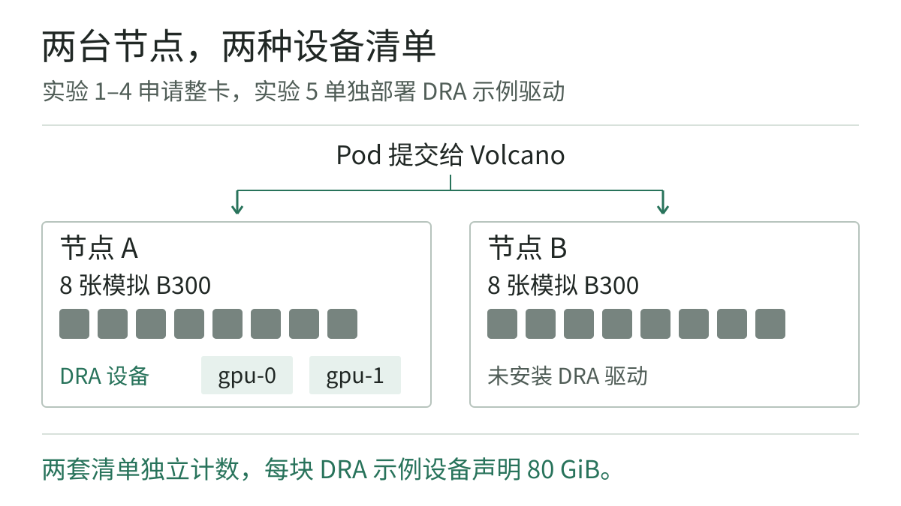

*两台节点贯穿五组实验。第五组单独观察 DRA 设备的分配。*

复现包内有逐步命令、工作负载清单和各轮完整调度配置。涉及驱逐的轮次会改变调度器处理整个集群待调度任务的方式，复现环境应使用独立的空闲测试集群。不同轮次之间先删除实验 Pod 和 PodGroup，只改一个待验证的条件。每一组先等前置负载进入 Running，再提交挑战任务。[下载复现包](../../assets/practices/volcano-gpu-placement/lab.zip) · [下载脱敏观测记录](../../assets/practices/volcano-gpu-placement/results.txt) · [Volcano v1.16.0 发布说明](https://github.com/volcano-sh/volcano/releases/tag/v1.16.0)

## 一、留下 8 张空卡，还是留下一台 8 卡机器

先提交两个各用 4 卡的后台 Pod。第一轮用节点选择器让它们各占一台，第二轮让它们同占 A。随后提交完全相同的单 Pod，申请 8 个 `nvidia.com/gpu`。两轮开始时可分配的总数都是 16，已有负载都用掉了 8。

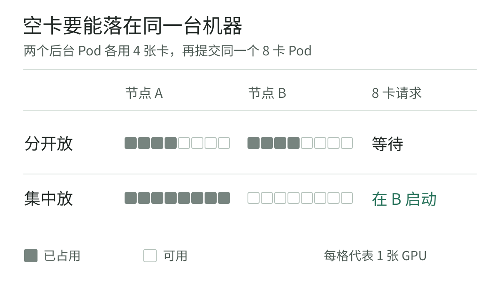

*每格代表一张卡。看新请求到达前哪一行还留有完整的 8 卡节点。*

| 后台占用 A / B | 剩余 A / B | 8 卡 Pod 的结果 |
| --- | --- | --- |
| 4 / 4 | 4 / 4 | 观察 14 秒，仍未绑定 |
| 8 / 0 | 0 / 8 | 绑定 B，进入 Running |

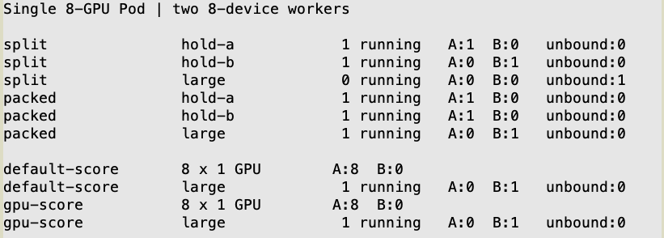

节点过滤先判断单台机器能否容纳整个 Pod；对单 Pod 整卡请求，只要所有节点的剩余卡数都小于 8，排序插件就没有候选节点可以打分。我们又取消固定落点，让 8 个单卡 Pod 逐个自由调度。默认配置和给 GPU 单独加权的配置都得到 A 放 8 个、B 放 0 个，后续大 Pod 两次都能启动。默认 binpack 给 CPU 和内存打分，其他打分插件也在运行，默认落点本身就可能集中。这里证明了碎片的代价，单轮同结果没有显示 GPU 加权的增益。[v1.16.0 Binpack 实现](https://github.com/volcano-sh/volcano/blob/v1.16.0/pkg/scheduler/plugins/binpack/binpack.go)

```yaml
- name: binpack
  arguments:
    binpack.resources: nvidia.com/gpu
    binpack.resources.nvidia.com/gpu: 10
```

推理平台可以同时统计空闲 GPU 总数和“仍能放下 8 卡 Pod 的节点数”。例如在这两次落点里，前者都是 8，后者分别为 0 和 1。如果服务可以跨节点做张量并行，还要单独验证其分布式部署形态和网络代价；调度器不会自动把一份 8 卡 Pod 规格拆开。

## 二、训练池满了，最多借推理池两张卡

把 A 标为训练节点组，B 标为推理节点组。一个训练队列允许使用两组节点，在队列注解里单独限制推理组最多 2 卡。先让一个 8 卡 Pod 占满 A，再从同一队列依次发出三个单卡 Pod。前两个落到 B。第 3 个未绑定时，B 明明还剩 6 张卡。保持已有 Pod 不动，只把同一条注解的值从 2 调到 3，等待中的原 Pod 就在 B 启动了。[节点组限额配置](https://github.com/volcano-sh/volcano/blob/v1.16.0/docs/user-guide/how_to_use_nodegroup_plugin.md)

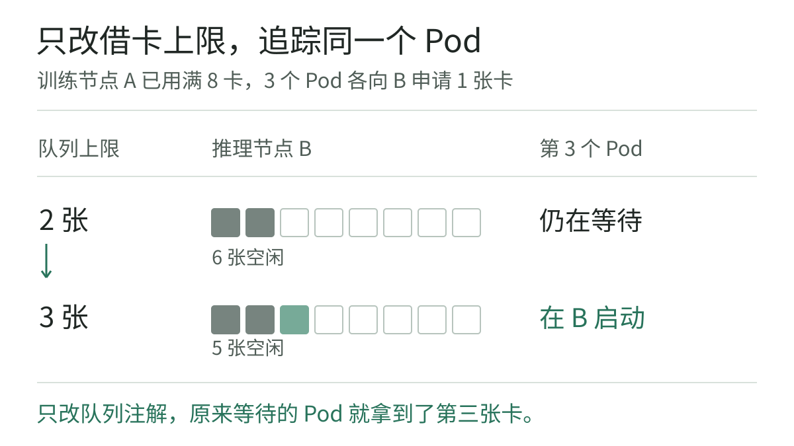

*绿色格子是第 3 个 Pod 在上限调高后拿到的卡。*

```sh
kubectl annotate queue v116-lab-burst \
  'volcano.sh/nodegroup-resource-limits={"v116-lab-serve":{"nvidia.com/gpu":"3"}}' \
  --overwrite
```

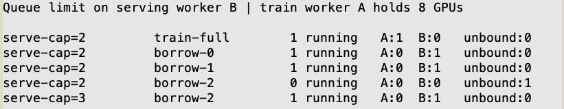

这种配置适合回答“一个训练队列可以占用推理池多少”。如果还有别的队列也能使用 B，它们分别受自己的策略约束。该注解没有为未来某个 8 卡推理 Pod 独占一台机器：哪怕只借出去 1 张，单机 8 卡规格也无法立刻在这台上线。整机保留、启动延迟预算和允许借出的卡数，需要按推理规格一起设计。

## 三、满池时，是停一个进程，还是停一整组

这一组最能看出策略差异。两个低优先级作业各有 2 个 Pod，每个 Pod 要 4 卡，组的最低成员数也是 2。四个 Pod 正好用完 16 卡。再提交一个高优先级的 4 卡 Pod，只需腾出一个旧 Pod 的位置。三轮重建相同负载，保留低优先级 Pod 的驱逐资格，分别更换抢占动作或整组驱逐开关。

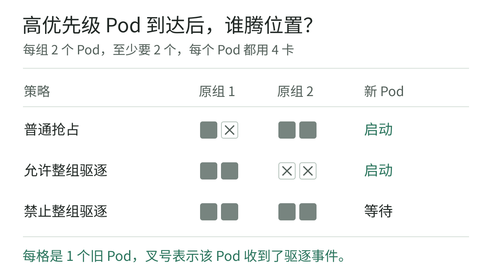

*横向看原组还剩几名成员，纵向看更换抢占策略后的差别。*

| 同队列策略 | 两个原组各剩几个 Running Pod（原来均为 2） | 新 Pod | 收到驱逐事件的旧 Pod |
| --- | --- | --- | --- |
| 普通抢占 | 1、2 | Running | 1 |
| 整组感知，允许整组驱逐 | 2、0 | Running | 2 |
| 整组感知，关闭整组驱逐 | 2、2 | 未绑定 | 0 |

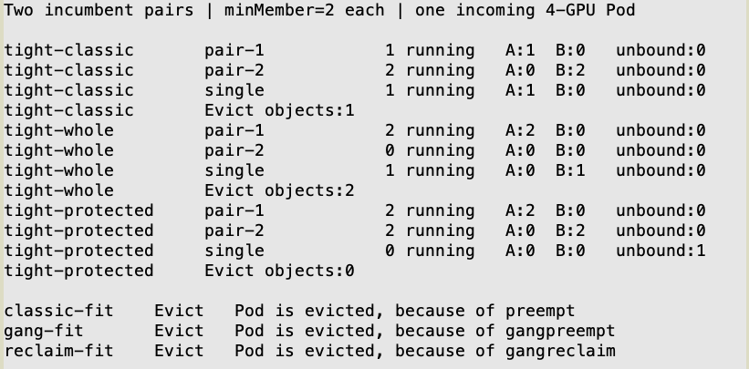

普通抢占留下了一个仍在 Running 的孤立成员。如果应用依赖全员同步，平台仍会显示这 4 张卡被占用；这个实验没有运行训练进程，因此不能把它的损失换算成训练时间。开启整组驱逐时，一个旧组整体退出，新任务取 4 张，还有 4 张可重新分配。关闭整组驱逐后，两组都没有多余成员可让，所以新任务等待。业务上要先决定哪一种停顿可以接受，单看“驱逐 Pod 越少越好”会漏掉残留成员的成本。[整组抢占实现](https://github.com/volcano-sh/volcano/blob/v1.16.0/pkg/scheduler/actions/gangpreempt/gangpreempt.go)

```yaml
configurations:
- name: gangpreempt
  arguments:
    allowWholeBundle: false
```

又跑了三个边界对照，计数时按旧 Pod 的 UID 去重，并核对其最终状态与 Evict 事件。配置沿用上游 v1.16.0 测试的插件层级，把 capacity 放在第一层，每轮只启用所测的驱逐动作。[上游抢占与回收用例](https://github.com/volcano-sh/volcano/blob/v1.16.0/test/e2e/gangevict/gangevict.go)

- **旧组有余量。** 旧组有 4 个四卡 Pod，只需 2 个成员；同队列的高优先级新组申请 2 个四卡 Pod。普通抢占和整组抢占都驱逐 2 个、保住 2 个，新组 2 个都运行。
- **新组总需求超过整池。** 同一旧组面前放入 5 个四卡 Pod，新组至少需要 20 卡。两个策略各观察 16 秒，均为零驱逐、5 个新 Pod 未绑定。
- **跨队列收回份额。** 两个队列各应得 8 卡，一个队列先用满 16 卡。另一个队列以相同优先级提交 2 个四卡 Pod。启用 gangreclaim 后，借方旧组从 4 个成员降到 2 个，另一队列 2 个 Pod 跑起来，两个旧 Pod 的事件都标为 gangreclaim。这一轮体现的是队列的应得份额，第二节的节点组限额承担的是另一项职责。

## 四、两个故障域，能放三个双 Pod 推理副本吗

用两个叶子 HyperNode 表示 A、B 所在的两个逻辑机架，再挂到同一父节点。每个“推理副本”用一个 PodGroup 表示，组内 2 个单卡 Pod 必须在同一个机架，组间按 PodGroup 标签匹配同一服务。依次提交三组，第三组只需 2 卡；前两组安置好后，全池还有 12 张。两轮只改变组间的反亲和强度。[PodGroup 反亲和配置](https://github.com/volcano-sh/volcano/blob/v1.16.0/docs/user-guide/how_to_use_podgroup_anti_affinity.md)

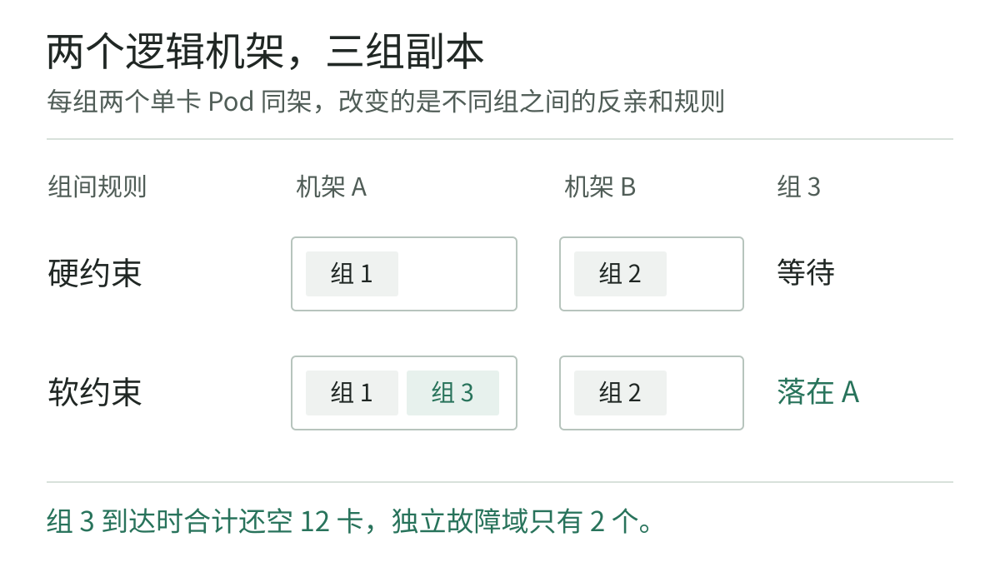

*框里每一组都包含 2 个单卡 Pod。两轮对照只改变组间规则。*

```yaml
spec:
  minMember: 2
  networkTopology:
    mode: hard
    highestTierName: rack
  topologyAffinity:
    podGroupAntiAffinity:
      required:
      - podGroupSelector:
          matchLabels:
            workload: placement-demo
        topologyTierName: rack
```

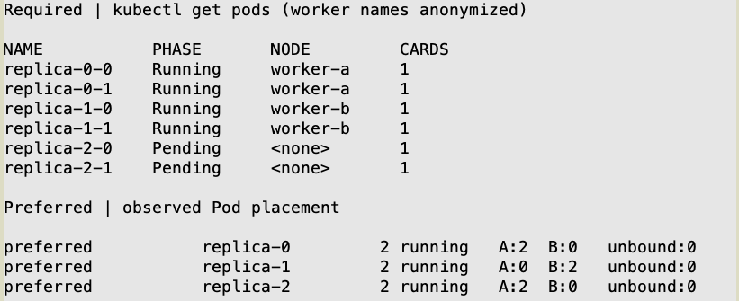

硬反亲和时，前两组各占一个机架，第三组两个 Pod 都未绑定。软反亲和时，前两组照样分开，第三组两个 Pod 被放回 A，与第一组共用一个机架。组内拓扑的 hard 始终开启；软化的是不同副本之间的避让，权重为 80。两个同机架的 Pod 并不等于两份跨机架冗余。需要第三份独立故障域，就要提供第三个合格域。本实验每个域只有一台节点，验证的是声明的域标签与放置逻辑；没有进行物理断电、链路故障或推理流量切换测试。

## 五、如果 Pod 要的是一张特定的卡，DRA 怎么分

前四组都用 `nvidia.com/gpu` 表达“要几张”。同一节点上如果有两块不同的设备，任务还要求单卡显存至少 80 GiB，或者必须用其中一个设备索引，就需要描述“哪一张符合条件”。Kubernetes 的动态资源分配（DRA）允许驱动发布设备清单与属性，Pod 则通过 Claim 声明需求。下面把设备选择、独占、释放重用和容器实际消费串起来。[Kubernetes DRA](https://kubernetes.io/docs/concepts/scheduling-eviction/dynamic-resource-allocation/) · [Volcano 的 DRA 配置](https://volcano.sh/docs/v1.16.0/userguide/user_guide_how_to_enable_dra/)

**两套模拟设备各有自己的清单。** 我们保留了两个节点原有的 16 张模拟 B300，只在 A 安装 Kubernetes SIGs 的示例 DRA 驱动 v0.5.0，另行声明 2 块各 80 GiB 的虚拟设备。API Server 已提供稳定版 `resource.k8s.io/v1`。在 Volcano 的 predicates 插件里显式设置 `predicate.DynamicResourceAllocationEnable: true`。DRA 测试 Pod 选择 Volcano 调度器，只引用 Claim。两套库存分别计数，这里的结果只适用于示例驱动。[固定版本示例驱动](https://github.com/kubernetes-sigs/dra-example-driver/tree/v0.5.0)

沿着一次申请，可以核对四个对象。**ResourceSlice** 公布 A 有 gpu-0 和 gpu-1、索引分别为 0 和 1、各带 80 GiB 的声明容量。**DeviceClass** 选择这个驱动。**ResourceClaimTemplate** 为每个 Pod 生成独立的 ResourceClaim，CEL 表达式写在设备请求上。**Pod** 在自身和容器两处引用申请。调度完成后，Claim 状态给出设备和请求名；kubelet 调用驱动准备设备，容器运行时再通过 CDI 注入。本轮可以从容器日志里读出设备名。

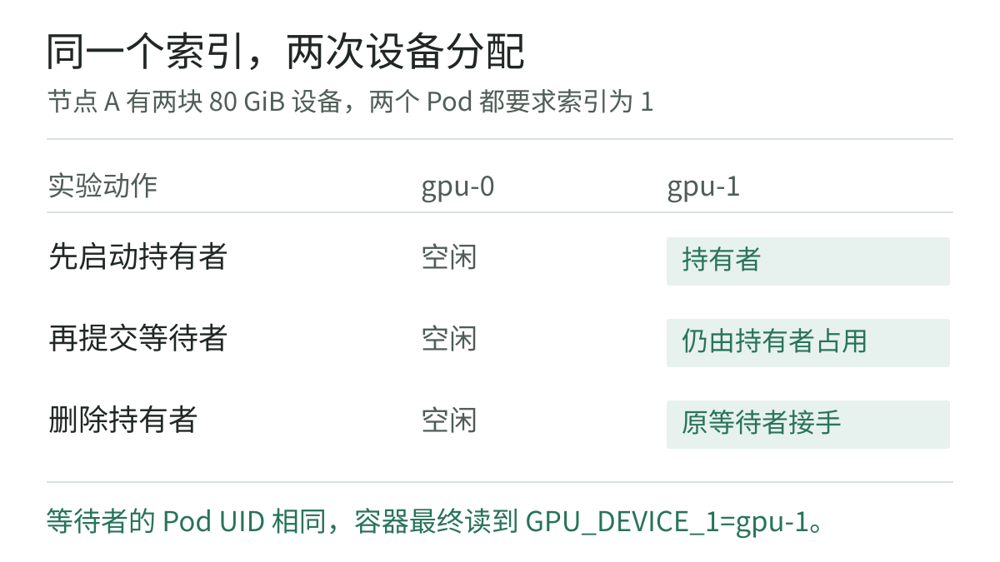

*两个 Pod 各有自己的 Claim。沿着 gpu-1 这一列，可以看清设备从谁手里释放、又被谁取得。*

```yaml
# ResourceClaimTemplate.spec.spec.devices.requests
- name: accel
  exactly:
    deviceClassName: gpu.example.com
    allocationMode: ExactCount
    count: 1
    selectors:
    - cel:
        expression: "device.capacity['gpu.example.com'].memory.compareTo(quantity('80Gi')) >= 0"
    - cel:
        expression: "device.attributes['gpu.example.com'].index == 1"
```

| 实际提交的请求 | 调度和运行结果 |
| --- | --- |
| 单设备至少 96 GiB | Pod 未绑定，Claim 没有分配结果。两块 80 GiB 的容量不能相加来满足该请求 |
| 至少 80 GiB 且索引为 1 | 持有者在 A 运行，Claim 分到 gpu-1，容器读出 `GPU_DEVICE_1=gpu-1` |
| 持有者仍在，再用相同模板建一个 Pod | 新 Pod 等待，自己的 Claim 未分配，此时 gpu-0 空闲。删除持有者后，同一个等待 Pod 的 UID 未变，拿到了 gpu-1 |
| 按顺序首选 96 GiB、其次 80 GiB | 两个候选写入 `firstAvailable`。在 gpu-1 仍被占用时，Claim 记录 `accel/standard`，选中 gpu-0，容器读出 `GPU_DEVICE_0=gpu-0` |

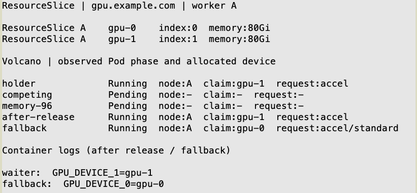

**现场还遇到一次“分到了设备，容器却起不来”。** 第一次部署时，驱动健康检查通过，Volcano 已把 Pod 绑定到 A，Claim 里也有 gpu-1。kubelet 事件却出现 `FailedPrepareDynamicResources`，原因是驱动尚未注册。示例 chart 默认把注册 socket 放在 `/var/lib/kubelet/plugins_registry`，这套集群的 kubelet 使用自定义根目录。根据节点实际路径修正 `kubeletPlugin.kubeletRegistrarDirectoryPath` 和 `kubeletPlugin.kubeletPluginsDirectoryPath`，让驱动重新注册。原 Pod 和 Claim 都保留了 UID，随后容器启动并读到了原先分配的设备。

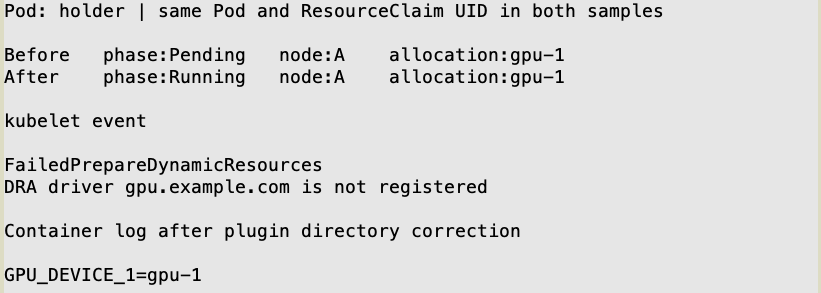

如果线上需要按设备属性选卡或显式允许降档，DRA 比再加一个节点标签多表达了一层设备级约束。这个实验也给出一个排障顺序：Claim 尚未分配，先查设备清单、选择条件和其他 Claim 的占用；Claim 有设备且 Pod 已绑定，转看 kubelet 事件、注册 socket 和 CDI，再核对容器实际看到了什么。示例中的 80 GiB 是驱动公布的容量；真实 B300 的显存、共享隔离及故障恢复还要用实际硬件和厂商驱动验证。

## 平台该选哪一种策略

| 业务需要回答的问题 | 先看什么 | 本次实测给出的取舍 |
| --- | --- | --- |
| 下一份整机推理能立即启动吗？ | 能完整容纳一个副本的节点数 | 装箱影响剩余资源的形状；本轮提高 GPU 权重没有额外收益 |
| 空闲推理池能借多少给训练？ | 每个队列在推理节点组的用量、待启动副本的卡数 | 上限能约束借用量；必须秒起的整机容量要另留 |
| 满载时愿意中断谁？ | 被驱逐的原 Pod、仍完整的旧组、新组成功启动数 | 允许整组驱逐可释放孤立成员占用的卡，但一次会停掉更多原 Pod |
| 更看重副本数量，还是故障域独立？ | 每个副本所在域、符合条件的独立域数量 | 硬约束会等待新域；软约束允许第三组共域，域故障时两组有共同风险 |
| Pod 要特定显存或索引，是否允许降档？ | Claim 分到的设备、命中哪项请求、容器内观测 | 硬条件可让空闲设备被跳过；有序候选能让 Pod 明确退到次选设备 |

如果要把策略带进真实 GPU 集群，我会先按生产副本规格统计一周“明明有足够空卡却没有完整落点”的等待，再拿真实训练作业测一次从 checkpoint 恢复的成本。这两个数分别决定是否值得改变装箱权重，以及为高优先级推理腾卡时，究竟能承受多大的中断。
