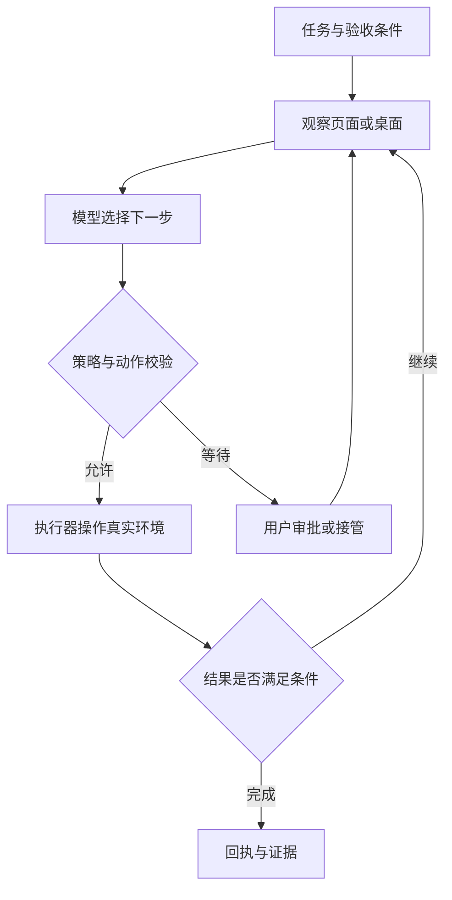
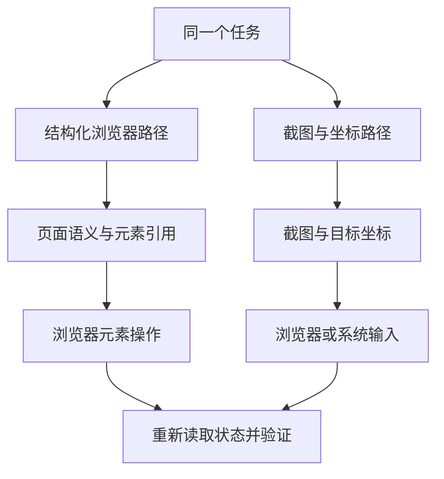
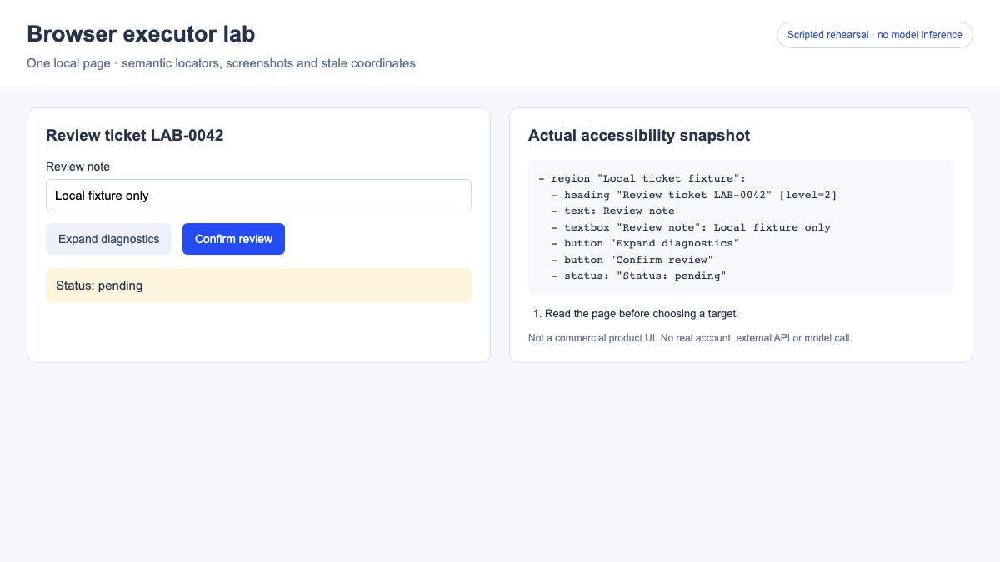
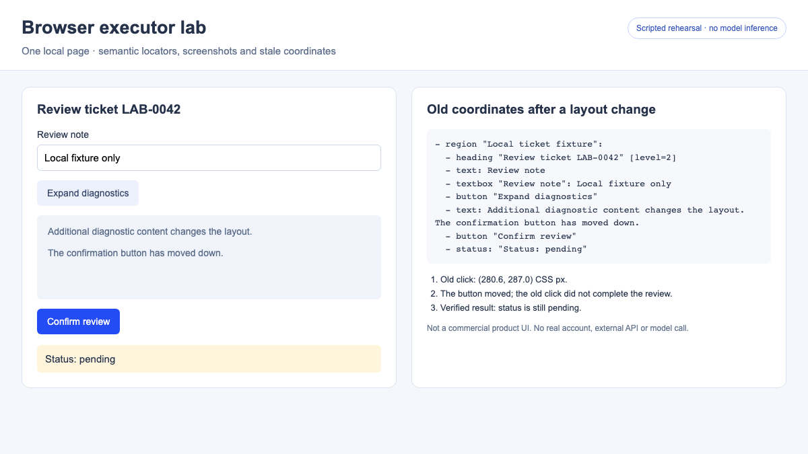
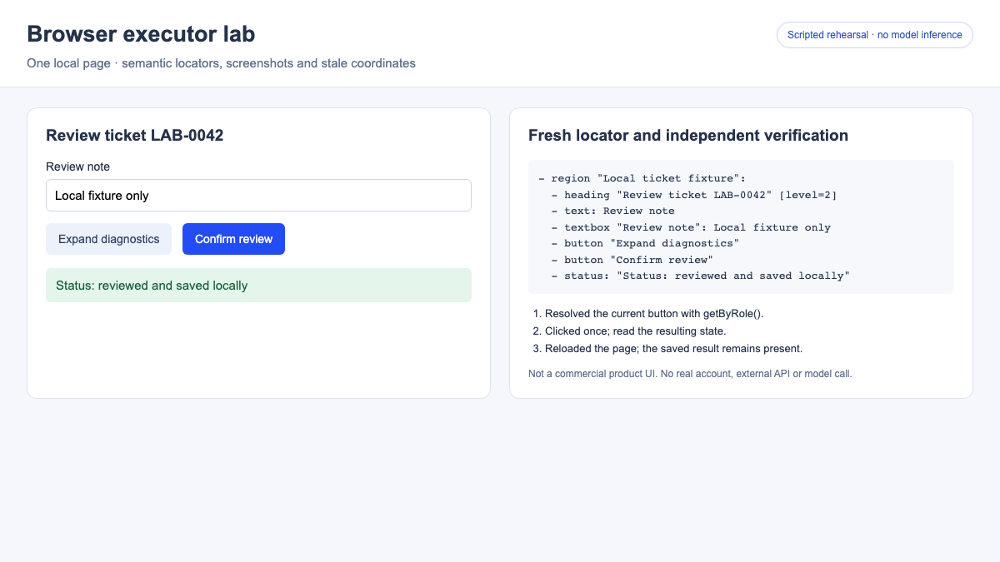
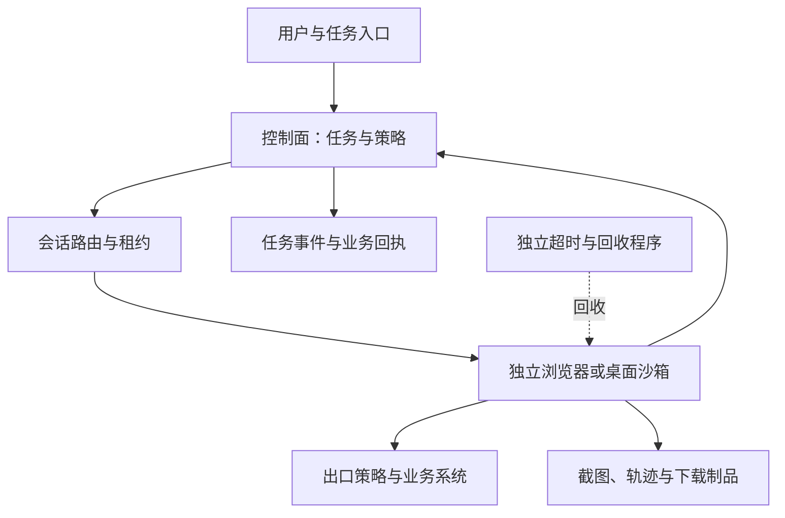

# Agent 的 Computer Use 与 Browser：实现原理、Codex 开源边界与项目选型

让 Agent 打开网页、找到工单、填写说明并提交，背后可能是几套不同的技术：直接调用业务接口，读取网页元素后点击，或者观察截图再移动鼠标。用户看到的都是“它在操作浏览器”，实现成本、可观测性和故障方式却不同。

本文沿着“模型看到了什么、动作怎样落到真实环境、结果怎样验证”来拆解。资料与源码核对日期为 **2026-10-23**；包含一组实际运行的本地浏览器执行器演示。演示没有调用模型，不作为任何框架的任务成功率测试。

## 1. Computer Use 和 Browser 不是两个完全对立的能力

Computer Use 通常指 Agent 通过计算机界面完成操作。Browser Agent 把范围限定在浏览器，但既可以操作页面结构，也可以看截图点坐标，还可以组合两种方法。产品中的 Browser 也可能指一个托管浏览器环境，而非某一种固定的模型工具。

先区分下面几层：

| 名称 | 输入或观察 | 执行动作的地方 | 适合解决的问题 |
| --- | --- | --- | --- |
| 搜索、网页抓取 | 搜索结果、网页文本 | 搜索或抓取服务 | 获取公开资料，无须完成交互 |
| 业务 API 工具 | 结构化字段与业务状态 | 业务服务 | 已有稳定接口的查询、写入与事务 |
| 结构化 Browser 工具 | 页面元素、角色、名称、状态 | 浏览器自动化驱动 | 表单、后台管理、网页测试 |
| 浏览器视觉操作 | 页面截图 | 浏览器的鼠标、键盘接口 | 画布、复杂布局、视觉检查 |
| 桌面 Computer Use | 桌面截图，也可结合系统无障碍信息 | 操作系统或桌面驱动 | 多应用操作、原生应用、系统对话框 |
| MCP | 工具定义、调用与返回值 | MCP Server 所在的执行环境 | 把上述能力接入 Agent |

API 是 Application Programming Interface，即应用程序编程接口；MCP 的全称是 Model Context Protocol，即模型上下文协议。MCP 负责工具连接，不会自动提供浏览器、规划器或权限隔离。无头浏览器也可以截屏和接收鼠标事件；“能截图”并不意味着一定运行了完整桌面。

如果业务接口已经覆盖任务，我会先使用接口；需要验证用户界面或缺少接口时，再引入浏览器；任务跨出网页后，再考虑桌面操作。这是工程上的选型顺序，不能理解为所有任务的性能排名。

## 2. 真正的核心是观察、决策、执行、验证的闭环

模型本身不握着鼠标。它接收当前观察，提出动作；应用中的 Harness，也就是组织模型、工具、状态和权限的运行层，把动作交给执行器，再把实际结果送回模型。[OpenAI Computer Use 指南](https://developers.openai.com/api/docs/guides/tools-computer-use)



以工单操作为例，闭环不是“点击提交后模型说完成”，而是：读取目标工单，确定账号和对象，执行获准动作，再读取工单状态或业务回执。模型生成了调用、工具完成了点击、后台完成了写入，是三个不同阶段。

浏览器会跳转、异步加载、弹窗或失去登录状态，因此观察需要有时间和会话上下文。同一段动作在另一页执行，参数即使格式正确，也可能操作错对象。

## 3. Browser Agent 怎样读懂网页

### 3.1 DOM、无障碍树和截图分别提供什么

DOM 是 Document Object Model，即文档对象模型，包含网页的节点与属性。无障碍树是浏览器为辅助技术提供的语义表示，常见内容有按钮、输入框、名称、选中状态和层级。它不是完整 DOM 的原样复制。

例如，一个带样式的网页按钮，在截图里是一块带文字的区域，在无障碍快照中可以表现为“名称为 Confirm review 的按钮”。模型可以据此选择元素，不必先猜坐标。Playwright 提供了生成与断言无障碍快照的能力。[Playwright 无障碍快照](https://playwright.dev/docs/aria-snapshots)

结构化观察也有边界：网页语义写得差、虚拟列表未展开、跨框架内容未采集、画布里只有像素时，单靠树结构可能不够。截图则能补充布局、图像和覆盖关系，但视觉理解也会受分辨率与页面变化影响。

### 3.2 CDP 把浏览器接到执行器

CDP 是 Chrome DevTools Protocol，即 Chrome 开发者工具协议。通过它，驱动能够连接 Chromium，获得页面、DOM、无障碍信息，并执行受支持的浏览器操作。它不是业务 HTTP API，也不是任意桌面应用的通用控制协议。

在 browser-use 的源码中，页面观察会调用 DOM 快照和无障碍树相关的 CDP 能力，随后组织成便于模型消费的结构；序列化器还维护编号与实际节点的映射。这里的关键工作是筛选和组织页面信息，而不是把整个网页源码直接扔给模型。[DomService 源码](https://github.com/browser-use/browser-use/blob/3df5806a0d097a1546d92c49bcf1b28c9972c3bd/browser_use/dom/service.py)、[序列化与节点映射](https://github.com/browser-use/browser-use/blob/3df5806a0d097a1546d92c49bcf1b28c9972c3bd/browser_use/dom/serializer/serializer.py)

### 3.3 元素引用怎样变成真实点击

Playwright MCP 的典型路径是：获得无障碍快照，给元素分配引用，模型选择引用，再由执行器解析为实际元素并点击。当前文档中的动作参数是 `target`；旧文章中的其他字段名不能直接套用。页面变化后引用可能失效，需要重新观察。[Playwright MCP 快照与引用](https://playwright.dev/mcp/snapshots)

源码中的 `browser_snapshot` 请求组织快照，`browser_click` 解析目标后调用 Locator 的点击方法。实际实现已放在 Playwright 主仓库，阅读时不要只停在 MCP 包的入口文件。[快照与点击实现](https://github.com/microsoft/playwright/blob/20a2087ea43412b90c172c88faef80786ee18b8b/packages/playwright-core/src/tools/backend/snapshot.ts)、[引用解析实现](https://github.com/microsoft/playwright/blob/20a2087ea43412b90c172c88faef80786ee18b8b/packages/playwright-core/src/tools/backend/tab.ts)

Locator 点击还会进行可见性、稳定性、接收事件等动作前检查。直接按坐标点击通常没有这些元素级保证。不过，动作前检查通过，仍然不证明提交后的业务已经成功。[Playwright 自动等待](https://playwright.dev/docs/actionability)

## 4. 截图型 Computer Use 怎样操作桌面

另一条路径是让模型观察图片，输出点击、输入、滚动等动作。执行器把坐标与键盘请求转换成浏览器输入或系统输入，然后重新截图。浏览器视觉操作与桌面操作的区别主要在执行范围，而不在是否使用图片。



Anthropic 的开源示例展示了一套具体实现：Linux 容器启动 Xvfb（X Virtual Framebuffer，X 虚拟帧缓冲）虚拟显示服务、窗口管理器与 VNC（Virtual Network Computing，虚拟网络计算）相关进程；工具层把鼠标键盘动作转换为 xdotool 调用，并负责截图与坐标缩放；循环把工具结果继续交给模型。Xvfb 的作用是提供虚拟屏幕；VNC 和 noVNC 让人远程观看或操作，并不是模型的推理模块。[桌面启动脚本](https://github.com/anthropics/claude-quickstarts/blob/9ec32b91df50b0d4906cae64b13c6298055ff40d/computer-use-demo/image/start_all.sh)、[Computer 工具实现](https://github.com/anthropics/claude-quickstarts/blob/9ec32b91df50b0d4906cae64b13c6298055ff40d/computer-use-demo/computer_use_demo/tools/computer.py)、[模型与工具循环](https://github.com/anthropics/claude-quickstarts/blob/9ec32b91df50b0d4906cae64b13c6298055ff40d/computer-use-demo/computer_use_demo/loop.py)

这只是一个公开实现，不代表所有商业产品都采用 Xvfb 或 xdotool。原生桌面驱动还可以结合系统无障碍能力。OpenAI 的产品文档说明 macOS Computer Use 需要屏幕录制与辅助功能权限，但这些权限要求不足以推导出产品内部完整实现。[Computer Use 产品文档](https://learn.chatgpt.com/docs/computer-use)

坐标还必须明确单位：浏览器通常使用 CSS 像素，截图可能使用设备像素，也可能被裁剪或缩放。若原图被缩小为一半，模型在缩小图中给出的坐标需要相应换算；裁剪图还要加回偏移量。浏览器缩放、滚动和窗口移动后，应重新确认观察是否仍然有效。[驱动坐标说明](https://developers.openai.com/api/docs/guides/tools-computer-use-sdk-drivers)

## 5. Codex 到底开源了哪一部分

**Codex 有开源的 Agent Harness，但不能据此认为整个 Codex 产品或其全部 Computer Use 能力都已开源**。官方公开组件清单列出了 CLI（Command-Line Interface，命令行接口）、SDK（Software Development Kit，软件开发工具包）和 app-server，也明确区分了未开源的 IDE 扩展与云服务。[官方开源组件清单](https://learn.chatgpt.com/docs/open-source)

| 部分 | 可以核实的公开边界 | 对研究实现的意义 |
| --- | --- | --- |
| Codex CLI / 核心 Harness | 在公开仓库中提供，仓库使用 Apache-2.0 | 可研究工具调用、上下文、运行状态和策略处理 |
| Codex app-server | 源码与客户端协议公开 | 可把会话、事件与审批接入自己的产品 |
| Codex SDK | 官方列为开源组件 | 可通过程序启动和组织 Codex 任务 |
| Codex IDE 扩展、Codex Cloud | 官方清单列为未开源 | 不能用 CLI 源码推导全部产品实现 |
| 模型权重与托管推理 | 与开源 Harness 是不同层次 | 开源客户端不等于模型已开放权重 |
| 桌面／内置 Browser 的具体控制驱动 | 产品文档说明能力与权限，不能据此认定整套实现公开 | 需要逐组件检查源码与许可证 |

许可证和开源范围分别核对：[Codex 仓库许可证](https://github.com/openai/codex/blob/8531184b49bcb160175a84e140b659a83a426df7/LICENSE)、[开放 Harness 的官方说明](https://developers.openai.com/blog/codex-as-a-platform)。

### 5.1 可以从源码看到的 MCP 调用链

Codex 的 MCP Handler 会接收工具调用参数，准备对应的 MCP 调用，再交给具体调用逻辑；返回结果还涉及文本、图片和截断策略等处理。具体调用路径中有审批相关逻辑。Browser MCP Server 则可以在另一进程甚至另一台机器上执行浏览器操作。[MCP Handler](https://github.com/openai/codex/blob/8531184b49bcb160175a84e140b659a83a426df7/codex-rs/core/src/tools/handlers/mcp.rs)、[MCP 调用与审批处理](https://github.com/openai/codex/blob/8531184b49bcb160175a84e140b659a83a426df7/codex-rs/core/src/mcp_tool_call.rs)

因此，用 Codex 接入 Playwright MCP，可以组合出一条公开、可检查的浏览器执行路径。它可以用来研究“模型怎样通过工具操作网页”，但不能称为完整复刻了 Codex 桌面端的 Computer Use。

还需要注意两个不同方向：app-server 是自己的应用连接 Codex 运行层；Browser MCP Server 是向 Agent 提供浏览器工具。两者不是同一个服务。CLI 的本地文件沙箱，也不会自动替你限制远端 MCP Server 的浏览器权限。[app-server 实现与协议](https://github.com/openai/codex/blob/8531184b49bcb160175a84e140b659a83a426df7/codex-rs/app-server/README.md)、[Codex MCP 接入](https://learn.chatgpt.com/docs/extend/mcp?surface=cli)

### 5.2 内置浏览器也不只是远端抓取

官方产品文档说明，Codex 可以在桌面应用中操作内置浏览器、检查渲染状态并截图；开发者模式还能提供受控的 CDP 访问。这里可确认的是产品能力，不能把它当成底层所有模块开源的证明。[Browser 产品文档](https://learn.chatgpt.com/docs/browser)

## 6. 几个开源项目分别值得看什么

下面比较的是组件定位，不是统一任务上的跑分。许可证针对表中仓库或示例代码，不包含模型服务、托管平台及全部依赖的使用条件。

| 项目 | 主要定位 | 值得研究的实现 | 常见接入方式 | 代码许可证 |
| --- | --- | --- | --- | --- |
| Codex | 通用编程 Agent Harness | 工具调度、会话、审批、app-server | CLI、SDK、app-server、MCP | Apache-2.0 |
| Playwright MCP | 浏览器工具服务 | 无障碍快照、元素引用、浏览器动作 | 接入已有 MCP Host | Apache-2.0 |
| browser-use | Python 浏览器 Agent 库 | 页面观察、模型动作、节点映射、浏览器事件 | Python Agent 或工具集成 | MIT |
| Stagehand | 浏览器自动化 SDK | 自然语言动作、观察、结构化提取 | 在代码与 Agent 框架中组合 | MIT |
| Anthropic computer-use-demo | 桌面 Computer Use 参考示例 | 截图、系统输入、坐标缩放、模型循环 | Linux 桌面示例 | MIT |

### 6.1 Playwright MCP：适合给现有 Agent 增加浏览器

它本身不负责完整的业务规划。上层 Agent 决定下一步，MCP 服务负责浏览器状态和动作。对于已经有 Coding Agent、只缺浏览器操作能力的团队，这种职责拆分比较直接。需要画布或视觉操作时，还可以考察其 Vision Mode；不要把它理解成只支持文本树。[Playwright MCP 项目](https://github.com/microsoft/playwright-mcp)、[Vision Mode](https://playwright.dev/mcp/vision-mode)

### 6.2 browser-use：适合研究完整的网页 Agent 循环

除了页面抽取，还可以沿着工具服务、浏览器事件和动作 Watchdog，看模型给出的目标怎样被找到并执行。这里的 Watchdog 是浏览器事件处理组件，不等同于宿主机外独立运行的故障看护程序。[工具服务](https://github.com/browser-use/browser-use/blob/3df5806a0d097a1546d92c49bcf1b28c9972c3bd/browser_use/tools/service.py)、[动作 Watchdog](https://github.com/browser-use/browser-use/blob/3df5806a0d097a1546d92c49bcf1b28c9972c3bd/browser_use/browser/watchdogs/default_action_watchdog.py)

开源库与 Browser Use Cloud 也要区分：能本地运行库，不意味着自动获得托管浏览器、生产会话管理或相同的网络能力。[browser-use 项目与许可证](https://github.com/browser-use/browser-use/tree/3df5806a0d097a1546d92c49bcf1b28c9972c3bd)

### 6.3 Stagehand：适合把模型能力嵌入确定性程序

它的重点是把“找哪个元素、怎样提取数据”封装为较高层接口，再与普通程序组合。当前 V4 文档区分了自然语言动作与已观察动作的确定性执行；这为复用已确认目标、减少重复推理提供了接口，但不代表所有任务都能省掉观察。[Stagehand act 文档](https://docs.stagehand.dev/v4/basics/act)

阅读旧教程要注意版本：本次核对的 SDK 为 4.3.0，不能照搬旧版的导入与调用方式。公开仓库还包括浏览器扩展和通信实现；自建集成时应检查实际运行组件，而不只看 SDK 的顶层方法。[Stagehand 项目](https://github.com/browserbase/stagehand/tree/b98abd90086707de575c9ae6ac9af1a436e76d18)、[V3 到 V4 迁移](https://docs.stagehand.dev/v4/migrations/v3)

### 6.4 桌面示例：适合理解最后一段输入链路

如果想弄明白模型输出的动作怎样变成鼠标移动、文字输入与截图，桌面示例比大型平台更容易入手。但示例的容器权限、网络、登录态和数据保留策略，还需要另行设计，不能直接视为多租户生产平台。[Anthropic 官方 Computer Use 文档](https://platform.claude.com/docs/en/agents-and-tools/tool-use/computer-use-tool)

## 7. 实际演示：为什么一次点击还不算任务完成

仓库中提供了一个[可运行的本地示例](https://github.com/runzhliu/aik8s/tree/main/examples/agent-browser-mechanics)。它只创建临时本地 HTTP 服务和 Chromium 页面，使用 Playwright 1.64.1、1200×675 视口，展示执行器机制。网页、动作脚本和断言全部可检查。

**这里没有模型推理，也没有运行 MCP 协议或桌面系统控制**。动作由脚本预先指定；其中旧坐标由布局信息计算出来，并非视觉模型预测。三张图都是实际浏览器截图，不是产品界面或框架性能成绩。

### 7.1 先获得页面事实

左侧是示例工单，右侧是运行时实际调用 `ariaSnapshot()` 得到的工作区无障碍快照。按钮在画面中有位置，在树中有角色和名称；这是两种不同的观察。



右侧只展示左侧工作区的快照，避免把证据面板本身再次读入。实际 Agent 也需要限制观察范围，否则日志、调试面板和历史结果可能挤占上下文。

### 7.2 布局变化后，旧坐标没有完成操作

脚本先记录确认按钮中心，再展开诊断内容。按钮从原来的行内位置移动到下方；继续点击旧位置后，状态仍为待处理。截图右侧同时展示了更新后的快照和本轮动作记录。



这不证明视觉操作一定失败，也不证明语义定位永远可靠。它只验证了一个具体故障：观察过期后仍重放坐标，动作可能没有效果，甚至可能命中另一个控件。处理办法是重新观察，而不是无限重试同一点。

### 7.3 重新定位后，还要验证结果

最后脚本按当前页面中的角色和名称重新定位按钮，点击一次，再读取状态；随后刷新页面，确认示例保存在浏览器本地存储中的结果仍然存在。



| 检查项 | 本轮实际结果 | 能说明的范围 |
| --- | --- | --- |
| 工作区无障碍快照 | 包含输入框、按钮与状态 | 当前页面可被结构化观察 |
| 布局改变后重放旧坐标 | 状态仍为待处理 | 旧坐标没有完成目标操作 |
| 按当前按钮语义重新定位 | 状态变为已处理 | 当前示例的元素动作有效 |
| 刷新页面后读取结果 | 已处理状态仍存在 | 本地存储结果可重新读取，不代表后台事务验证 |

关键调用可以简化为下面几行；完整脚本还会检查布局变化、保存快照并在失败时清理环境。

```javascript
const before = await page.locator('#workspace').ariaSnapshot();
const button = page.getByRole('button', { name: 'Confirm review', exact: true });
await button.click();
assert.equal(await page.locator('#status').getAttribute('data-state'), 'done');
await page.reload();
assert.equal(await page.locator('#status').getAttribute('data-state'), 'done');
```

本地复现：

```bash
cd examples/agent-browser-mechanics
npm install
npx playwright install chromium
npm run demo
```

输出目录中有截图、前后快照和结果 JSON。[本轮结果 JSON](../../assets/rag-agent/agent-computer-browser/run-result.json) 保存了实际检查结果。正式系统应把“读到已完成”替换成相应业务验收，例如读取正确订单号的回执或查询提交后的持久状态。

## 8. 为什么一些 Agent 使用代码执行或持久 REPL

REPL 是 Read–Eval–Print Loop，即读取、执行、输出结果的交互环境。Agent 可以把浏览器对象放在持久运行时中，连续执行短代码，保留标签页、变量和会话，再返回少量文本与必要截图。这样既能批量完成确定性步骤，又可以在不确定处重新观察。[OpenAI 自定义工具与代码运行时说明](https://developers.openai.com/api/docs/guides/tools-computer-use-integration)

但“把十次调用合成一段代码”不自动等于可靠。假设前四步已提交数据，第五步超时，重跑整段代码就可能重复提交。我的建议是让批次止于会改变业务状态的边界，保存已执行动作和回执，再决定续跑位置。

同样，持久 JavaScript 变量并不是恢复机制。运行时重启后，浏览器页面、Cookie、文件和任务事件是否存在，需要分别验证。相关状态设计可以接着看 [Agent 长任务中断续跑](agent-long-running-durable-execution.md)。

## 9. 企业落地：浏览器会话也是有状态执行环境

对 Kubernetes 平台来说，浏览器不只是一个能水平扩容的 HTTP 服务。一次会话包含页面、Cookie、打开的标签页、下载文件和正在执行的动作；如果远端调试连接落到另一实例，往往不能直接继续原操作。

下面是建议架构，不是某个产品内部结构的反向推断：



几个值得提前做的设计选择：

- **按租户或任务隔离会话**。不要让不同用户意外共享已登录浏览器。BrowserContext 能隔离部分浏览器状态，但不能代替操作系统或虚拟机边界。
- **绑定具体执行实例**。会话标识需要映射到对应浏览器；长连接使用负载均衡并不等于会话能够在实例间迁移。
- **把凭据当成执行身份管理**。有登录 Cookie 的浏览器可能具有真实写入权限。尽量由用户接管登录或使用凭据代理，避免让密码进入模型上下文、截图或日志。
- **区分任务重试与动作重试**。读取状态可以重试；提交、发布和付款前后必须先核对是否已经发生副作用。
- **控制出口并保存证据**。限制可访问目标与下载路径；把截图、轨迹、模型调用和业务回执关联到同一任务，同时控制敏感信息的保留范围。
- **独立设置期限与回收**。模型停止输出后仍可能留下浏览器、桌面进程和存储。控制面与执行面都需要可核验的回收结果。

这些是基于会话状态和执行副作用推导的工程建议；具体隔离等级还要结合任务风险。运行环境选型参见 [Agent Sandbox 选型与分析](agent-sandbox-selection.md)。

## 10. 怎样评估这类能力，避免只看录屏

我会把评分拆成目标完成、过程约束和运行成本，而不是统计点击次数。

| 维度 | 建议指标 | 容易误判的地方 |
| --- | --- | --- |
| 结果正确性 | 独立验证的任务完成率、目标对象准确率 | 模型说完成、页面显示提示不等于业务写入成功 |
| 可靠性 | 页面改版、弹窗、超时、登录过期后的恢复率 | 只测试固定页面与顺畅流程 |
| 副作用 | 重复提交、错对象操作、越权动作数量 | 失败后自动重跑却不核对已执行动作 |
| 效率 | 端到端时长、模型轮数、截图量、总费用 | 只比较模型响应时间或单步点击速度 |
| 可运维性 | 轨迹完整率、人工接管时间、会话清理成功率 | 演示成功却找不到原始动作和错误 |

对比框架时，要固定模型、任务集、页面版本、浏览器版本、初始登录态、网络条件、重试预算与完成标准。结构化快照可以减少某些任务中的图像输入，但不能直接推导出固定比例的成本下降；图片裁剪、上下文长度、模型轮数和失败恢复都会影响总成本。

页面文本、截图中的提示和下载文件都是任务数据，不能自行授予新权限。对于跨账号、数据外发或不可逆操作，执行器需要明确的策略边界。稳定的账号授权和正确的结果验证，通常比增加几个“点击技巧”更决定生产可用性。

## 11. 怎么选择第一条实现路线

如果已经在用 Codex，先在隔离环境接入一个浏览器工具，观察真实工具调用和结果，比尝试复刻整个桌面产品更容易验证。如果准备自己开发网页 Agent，可以从 browser-use 研究观察与动作循环；希望把少量模型能力插入固定流程，可以考察 Stagehand；需要原生应用与跨应用操作，再从桌面 Computer Use 示例理解系统输入链路。

这几种方案可以组合。一个任务完全可以通过 API 查业务状态，用 Browser 操作缺少接口的页面，最后用截图检查视觉结果。关键是让每一步都有明确的观察、权限和验收方式。

## 12. 源码核对记录与延伸阅读

以下是本文实际核对的源码快照，不代表各项目最新正式发布版本。短哈希链接指向固定提交，避免后续目录迁移改变文中分析依据。

| 仓库 | 核对提交 | 本文检查内容 |
| --- | --- | --- |
| openai/codex | [8531184b](https://github.com/openai/codex/tree/8531184b49bcb160175a84e140b659a83a426df7) | 许可证、MCP Handler、调用与审批、app-server |
| microsoft/playwright-mcp | [0c4107ac](https://github.com/microsoft/playwright-mcp/tree/0c4107acbecb75472b23c05c0e42471a0011874f) | 包入口、版本信息、源码迁移说明 |
| microsoft/playwright | [20a2087e](https://github.com/microsoft/playwright/tree/20a2087ea43412b90c172c88faef80786ee18b8b) | 实际快照、目标解析与点击实现 |
| browser-use/browser-use | [3df5806a](https://github.com/browser-use/browser-use/tree/3df5806a0d097a1546d92c49bcf1b28c9972c3bd) | DOM、序列化、工具与动作 Watchdog |
| browserbase/stagehand | [b98abd90](https://github.com/browserbase/stagehand/tree/b98abd90086707de575c9ae6ac9af1a436e76d18) | V4 SDK、浏览器运行接口与许可证 |
| anthropics/claude-quickstarts | [9ec32b91](https://github.com/anthropics/claude-quickstarts/tree/9ec32b91df50b0d4906cae64b13c6298055ff40d/computer-use-demo) | 桌面启动、动作执行、模型工具循环与许可证 |

继续阅读：[Agent Harness 技术综述](agent-harness-technology-overview.md)、[Agent 评估方法综述](agent-evaluation-overview.md)。
