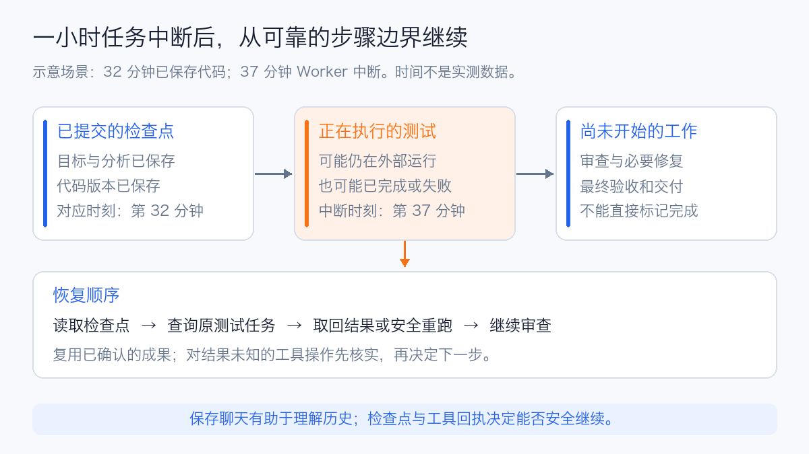
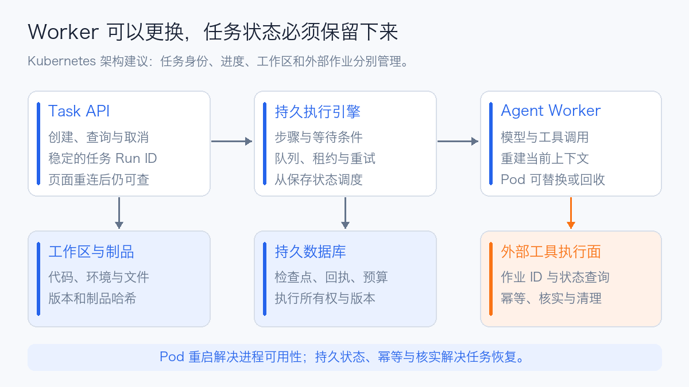

# Agent 长任务中断续跑原理与社区实践

让 Agent 连续工作一小时，真正需要解决的是：进程消失以后，另一个进程能否知道目标、已完成的工作、尚未确认的操作，以及下一步应该做什么。

**可以实现中断续跑，社区也已经有相应框架。通常恢复的是任务状态和执行步骤，而不是模型推理到一半的内部状态。** 已保存的结果可以复用，正在执行的步骤可能重新运行；如果它会写数据库、创建工单或发布内容，就还需要幂等和结果核实。

这件事包含三个相互配合的部分：工作流保存进度，Harness（智能体运行与治理层）重建模型上下文，工具与执行环境保留可查询的结果。仅保存聊天记录、给 Pod 配置自动重启，或者延长接口超时，都不能完整解决它。

## 1. 一小时任务在第 37 分钟中断会丢失什么

假设一个代码改造任务预计需要一小时：先分析仓库，收集资料，修改代码，再运行测试、审查和交付。下面的时间是场景示意，不是性能测试结果。

| 阶段 | 示意时间 | 应留下的恢复依据 |
| --- | --- | --- |
| 明确目标与验收条件 | 0—5 分钟 | 任务说明、限制、验收列表 |
| 收集资料与分析仓库 | 5—20 分钟 | 资料出处、文件位置、经过核实的结论 |
| 修改代码 | 20—32 分钟 | 工作区文件、Git Diff 或 Commit、制品哈希 |
| 运行测试 | 32—40 分钟 | 测试任务 ID、参数、日志、退出码 |
| 审查与补充 | 40—50 分钟 | 审查发现、修复记录、再次验证结果 |
| 交付 | 50—60 分钟 | 最终制品、验收结果、交付回执 |



如果第 37 分钟 Worker 崩溃，恢复进程应先确认第 32 分钟的文件和状态是否可靠保存，然后核对测试任务：仍在运行就重新接入，已经结束就读取结果，任务本身也消失且允许重复执行时才重跑。

不能根据一句“我正在测试”就直接进入交付阶段，也不应默认从分析仓库重新开始。**恢复位置由持久状态和实际结果决定，而不是由最后一段自然语言描述决定。**

## 2. 四种恢复能力不能混为一谈

| 层次 | 恢复什么 | 典型实现 | 边界 |
| --- | --- | --- | --- |
| 会话恢复 | 消息、已记录的工具结果、当前目标 | Session 数据库、JSONL 日志、会话 Resume | 不自动恢复终端进程或外部业务状态 |
| 工作流恢复 | 已提交步骤、下一步、等待条件 | Checkpoint、事件历史、Durable Workflow | 正在执行而未提交的步骤可能重跑 |
| 工作环境恢复 | 仓库、文件、依赖、浏览器配置 | 持久卷、对象存储、环境清单、沙箱快照 | 文件存在不代表原进程还在；登录可能过期 |
| 执行现场恢复 | 内存、进程和部分系统状态 | 专门的进程或虚拟机快照机制 | 外部连接、锁与凭据仍需重新核实 |

Checkpoint 指检查点，Durable Execution 指持久化执行：执行状态独立于某一个 Worker 的生命周期保存，使程序可以在故障后继续推进。

保存完整会话有利于模型理解之前发生了什么，但任务恢复还需要结构化状态。长期记忆适合保存偏好、经验和知识，也不能替代记录“这个操作是否已经完成”的执行账本。两者的区别可参见 [Agent Memory 技术综述](agent-memory-technology-overview.md)。

如果中断发生在一次模型请求的流式输出期间，通常需要重新发起请求，或者使用提供方明确支持的请求结果查询机制。部分输出不应直接算作完整工具参数或完整结论。KV Cache、模型请求内部状态和任务 Checkpoint 属于不同层次。

## 3. 能续跑的任务需要保存哪些信息

一套实用的任务记录，至少应能回答以下问题。

| 信息 | 作用 |
| --- | --- |
| `tenant_id`、`run_id`、目标与验收条件 | 确定归属和任务身份，重启以后仍是同一个任务 |
| 步骤 ID、状态、输入哈希与输出引用 | 分辨完成、失败、等待和结果未知 |
| 原始工具调用、结果、业务回执 | 重建事实，避免把模型推测当成执行结果 |
| 工作区版本与制品哈希 | 找到与检查点对应的文件，发现工作区被修改 |
| 工具版本、工作流版本、模型配置 | 防止旧任务被不兼容的新代码直接接管 |
| 重试次数、费用和总期限 | 恢复时继续使用原预算，而不是重新获得一份预算 |
| 外部任务 ID、审批记录、取消状态 | 查询仍在运行的工作，并保留用户控制 |
| Worker 租约与执行代次 | 防止两个恢复进程同时处理同一任务 |

这些信息不一定存进同一个巨大 JSON。步骤和回执可以放数据库，大文件放对象存储，代码放工作区和版本库，检查点只保存引用与哈希。

恢复进程可以按下面的顺序推进：

1. 加载任务，先检查取消、权限、期限和剩余预算。
2. 校验工作流版本与工作区版本，再取得任务租约。
3. 复用已提交步骤的结果，重新构造模型可见的上下文。
4. 对仍在执行或结果未知的工具调用，先查询和核实。
5. 只重试符合规则的步骤，将新结果提交后再进入下一步。
6. 根据验收条件交付，记录最终制品和交付回执。

这里的“已完成”应表示结果已经持久提交。Worker 内存里的成功标记、日志里的完成文字和模型说“完成了”，都不能单独承担这个含义。

## 4. 社区已经有哪些实现

### 4.1 LangGraph 通过检查点恢复图状态

LangGraph 的 Checkpointer 保存 Thread 的图状态，支持错误恢复、人工中断和继续执行。这里的 Thread 是状态归属标识，不是操作系统线程，同一个 Thread 可以有多次执行。一个 Super-step 是一轮图调度，可能包含并行节点；完整检查点位于它的边界。已经持久写入的成功节点输出还可用于同一轮内的故障恢复，不能简单理解成“并行任务有一个失败就全部重跑”。[LangGraph Checkpointers](https://docs.langchain.com/oss/python/langgraph/checkpointers)

它还提供不同的持久化模式：

| 模式 | 提交时机 | 对崩溃恢复的影响 |
| --- | --- | --- |
| `sync` | 推进下一步前同步保存 | 缩小进度丢失窗口，但增加存储等待 |
| `async` | 保存与后续执行重叠 | 进程突然消失时可能丢失尚未落盘的进度 |
| `exit` | 正常退出、错误退出或人工中断时保存 | 运行中硬崩溃可能丢失中间进度 |

需要防范运行中崩溃的长任务，应明确选择持久化策略。`sync` 仍不能消除“外部工具已执行、图结果尚未保存”的窗口；第五节会单独处理它。[持久化模式](https://docs.langchain.com/oss/python/langgraph/checkpointers#durability-modes)

同样要选对存储：`InMemorySaver` 在进程重启后丢失状态；SQLite 适合本地演示，生产多 Worker 通常选 PostgreSQL 等持久后端。恢复同一任务时需要沿用原来的 `thread_id`，并重新取得该任务的访问权限。[LangGraph Persistence](https://docs.langchain.com/oss/python/langgraph/persistence)

### 4.2 Temporal 通过事件历史恢复编排

Temporal 将编排逻辑放在 Workflow，将模型、工具和其他外部调用放在 Activity。恢复时根据事件历史重建 Workflow，而不是每次重新请求模型来猜测上一次的进度。这种方式适合长时间等待、多步骤业务流程和跨服务任务。[Temporal Durable AI](https://docs.temporal.io/ai)

Activity 执行可能在失败后重试，所以它产生的外部副作用仍需要幂等。长时间 Activity 可以使用 Heartbeat 报告进度，但重试后怎样利用进度继续处理，仍要由 Activity 实现。不要把整个一小时的 Agent 循环包进一个没有内部进度的 Activity，再期待框架自动恢复其每一条工具调用。[Activity Execution](https://docs.temporal.io/activity-execution)、[长时间 Activity 模式](https://docs.temporal.io/ai)

Workflow 的可重放部分要满足框架的确定性要求；模型调用、当前时间、随机数和外部网络访问应使用框架允许的执行边界。已有结果被复用，可以避免重新生成不同的模型决策。[Workflow 确定性约束](https://docs.temporal.io/workflow-definition#deterministic-constraints)

在任务平台的记录中，改变模型或工具参数再执行，应作为新的尝试或分支留下记录。

### 4.3 Restate 将调用结果记录在持久日志中

Restate 使用 Journal 记录执行步骤，在进程更换后通过重放继续执行。它提供 Agent SDK 集成、按键管理的状态和持久等待原语，可把模型、工具及审批连接起来。其官方示例已经展示了模型调用、工具调用与等待审批的持久化组合。[Restate Agent 集成实践](https://restate.dev/blog/durable-orchestration-for-ai-agents-with-restate-and-openai-sdk)

使用时要把需要保存结果的动作放进它的持久执行接口。直接在接口之外执行写入，或者把一长串副作用封装成一个不可查询的步骤，仍然存在重复操作的窗口。

### 4.4 DBOS 以数据库记录步骤执行

DBOS 用 Workflow 和 Step 保存执行进度，恢复时复用已完成步骤的结果。它明确区分 Step 与受支持的数据库 Transaction：未完成 Step 可能重复尝试，数据库事务的保证也不能泛化到任意远端 HTTP 写操作。未处理的异常会使 Workflow 进入错误状态，不等于所有错误都自动续跑。[DBOS Workflows](https://docs.dbos.dev/python/tutorials/workflow-tutorial)

这条路线适合希望以应用代码和数据库为核心引入持久执行的团队。选型时仍要评估数据库可用性、版本更新方式和恢复任务的所有权管理。

### 4.5 Mastra 要区分审批暂停和崩溃恢复

Mastra 提供 Durable Agent 与暂停恢复能力，但当前文档中的默认 `recovery.durableAgents: 'off'` 并不启用运行中任务的自动崩溃恢复。启用 `'auto'` 或配置包含 `running` 的持久化策略，才涉及相应的运行中检查点与恢复路径；存储也必须是持久后端。[Mastra Durable Agents](https://mastra.ai/docs/harness/durable-agents)

恢复可能重新执行模型和工具调用。一个委派给子 Agent 的动作还可能只作为外层单个工具步骤保存，因此重放时整个子 Agent 再运行。**能在人工审批后 Resume，不足以证明任意硬崩溃都能安全恢复。**

### 4.6 Pydantic AI 可以连接持久执行引擎

Pydantic AI 已提供 Temporal、DBOS、Prefect、Restate 等持久执行集成，将模型请求和工具调用放进相应引擎的执行单元。它同时明确区分聊天历史持久化与一次 Run 的崩溃恢复。[Pydantic AI Durable Execution](https://pydantic.dev/docs/ai/capabilities/durable_execution/overview/)

框架之间可以分层组合，但不要未经设计就让两个引擎同时重试同一次副作用。一个可靠的组合方式是：外层负责业务阶段和审批，内层负责阶段内的 Agent 循环；明确谁记录结果、谁处理超时、谁拥有重试预算。

### 4.7 如何选择

下表是基于上述执行模型的工程选型建议，不是吞吐或可靠性排名。

| 需求 | 可优先评估 | 采用前重点核对 |
| --- | --- | --- |
| 已有 Python 图式 Agent，补步骤恢复 | LangGraph + 持久 Checkpointer | 节点粒度、保存模式、外部写入幂等 |
| 一小时以上业务流程，包含审批和跨服务协调 | Temporal | Activity 划分、超时、重试和版本兼容 |
| 服务调用、按键状态、持久等待相结合 | Restate | Journal 边界、服务版本、工具回执 |
| 希望以应用库和数据库引入持久执行 | DBOS | Step 与事务的边界、异常分类、恢复归属 |
| TypeScript Agent 产品，已有 Mastra | Mastra Durable Agents | 持久存储、实际恢复开关、子 Agent 粒度 |
| 已使用 Pydantic AI | 对应持久执行集成 | 选定一个执行引擎，核对其实际语义 |

## 5. 最难的窗口是工具已成功而 Agent 尚未记下来

例如工具已经创建了工单，Worker 在保存工具结果前崩溃。恢复后的检查点没有这张工单，直接重试就可能创建第二张。

这是调用者与外部系统之间的提交窗口。**有事件日志和检查点，不代表远端副作用恰好执行一次。**

可采用下面的操作记录：

```text
action_id       同一业务动作的稳定标识
request_hash    参数内容的哈希
status          PREPARED / IN_FLIGHT / SUCCEEDED / UNKNOWN
provider_id     外部工单、作业或草稿 ID
receipt         可核验的返回值与证据
```

`action_id` 在同一动作的重试间保持不变，不应包含新生成的随机数或 Attempt 编号。外部系统支持幂等键时，用同一个键重复调用并取得原结果；同一个键对应不同参数时拒绝执行。

外部系统没有幂等接口时，就需要业务核实适配器：按已保存的任务 ID 查询状态，按唯一业务标记查找结果，或者利用外部系统提供的请求记录。如果无法区分“请求没到”和“请求成功但响应丢了”，应记录 `UNKNOWN`，等待核实，而不是把超时自动当成失败。

模型请求也存在类似窗口：提供方已经生成并计费，但响应尚未被保存。没有请求查询或去重能力时，重试可能再次生成并计费。任务可以恢复，不代表所有模型费用都只发生一次。

事务 Outbox 可以可靠保存“待发送动作”，但不能独自保证外部系统只执行一次。消费者重发时仍需幂等或核实。只有在可以由同一事务控制的边界内，才可能把业务写入和结果登记一起提交。

对于生成制品，通常可以先写临时对象，验证哈希后更新最终引用。对于发通知、发布内容和付款等副作用，则应使用对应系统的回执与授权规则，不能只凭文件或一条日志判断成功。

## 6. 本地实验展示实际恢复边界

配套 [可复现实验代码](https://github.com/runzhliu/aik8s/tree/main/examples/agent-durable-resume) 使用 LangGraph、SQLite 检查点和一个模拟工具服务，不调用大模型，也不访问生产系统。

流程只有三个节点：`plan → write_draft → finish`。模拟工具服务用另一份 SQLite 数据库保存动作键和回执，在同一事务内完成写入与登记。实验通过 `os._exit(86)` 直接终止进程，绕过正常收尾，再由新进程读取同一个 Thread 恢复。

测试版本为 LangGraph **1.2.15**、langgraph-checkpoint **4.3.0**、SQLite Checkpointer **3.1.2**，使用 `durability="sync"`。

| 中断位置 | 首次退出码 | 中断时工具结果数 | 恢复后节点累计执行次数 | 恢复后工具结果数 |
| --- | --- | --- | --- | --- |
| 工具实际写入之前 | 86 | 0 | plan 1 / write_draft 2 / finish 1 | 1 |
| 工具写入已提交，图结果未提交 | 86 | 1 | plan 1 / write_draft 2 / finish 1 | 1 |

第二个场景的实际日志是：

```text
# 第一个进程
EXECUTE plan
EXECUTE write_draft
TOOL committed receipt draft-7854be0b31d5
CRASH after effect commit, before graph checkpoint

# 恢复进程
EXECUTE write_draft
TOOL reuse receipt draft-7854be0b31d5
EXECUTE finish
```

`plan` 没有重跑，`write_draft` 重跑了一次，模拟工具利用稳定动作键返回旧回执。最后再恢复一个已结束的 Run，也没有再次执行节点。

这验证了“步骤可以重跑、业务结果需要去重”的边界。模拟服务能把写入和回执放在同一 SQLite 事务；真实远端接口必须自己提供等价保证，或者由调用方核实。这个短实验不证明一小时运行、节点故障或真实业务服务的恢复能力。

运行完整验证：

```bash
uv run --python 3.12 \
  --with-requirements examples/agent-durable-resume/requirements.txt \
  python examples/agent-durable-resume/verify.py
```

核心恢复调用如下；创建新的输入或新的 Thread，与继续原执行不是同一件事。

```python
config = {"configurable": {"thread_id": original_run_id}}

with SqliteSaver.from_conn_string("checkpoints.sqlite") as saver:
    graph = builder.compile(checkpointer=saver)
    snapshot = graph.get_state(config)
    if snapshot.next:
        graph.invoke(None, config, durability="sync")
```

## 7. Pi OpenClaw DSH Hermes 的会话恢复能做什么

个人 Agent 和编程助手已经有不少会话续接实践，但应查看具体版本和执行后端。

| 项目 | 当前文档中的能力 | 长任务仍需核对 |
| --- | --- | --- |
| Pi | 按工作目录保存树状 JSONL 会话；`pi -c`、`pi -r` 或指定 Session 继续 | 文件是否仍在、运行中的命令是否结束、是否重复调用外部工具 |
| Hermes Agent | SQLite 保存会话；`hermes -c` 或 `--resume` 载入历史，恢复工作目录等会话信息 | 长命令与外部任务是否可重新接入，工具结果是否已经确认 |
| OpenClaw | Gateway 拥有会话状态；文档已描述重启后尝试自动继续中断 Turn，并保留已记录的工具调用和结果 | 恢复预算、后端能力、权限重验和未完成工具的实际状态 |
| DeepSeek Harness | 区分持久 Session 事件与实时控制事件；已记录事实用于重建会话 | 部署所保留的状态目录、恢复触发方式、工具与沙箱的生命周期 |

资料：[Pi Sessions](https://github.com/earendil-works/pi/tree/main/packages/coding-agent#sessions)、[Hermes Sessions](https://hermes-agent.nousresearch.com/docs/user-guide/sessions)、[OpenClaw Session 源文档](https://github.com/openclaw/openclaw/blob/main/docs/concepts/session.md)、[DeepSeek Harness Agent 生命周期](https://github.com/deepseek-ai/deepseek-harness/blob/master/docs/agent-lifecycle.zh.md)。

尤其不应把 OpenClaw 概括为“只能恢复聊天记录”：当前文档明确包含 Gateway 重启恢复。不过，这仍不能替代某个工具的业务核实；恢复系统知道一个工具调用被中断，不一定知道外部服务是否已经完成它。

在这些助手上执行长任务，一个低成本的改进是维护结构化进度：目标、已验证步骤、当前文件版本、正在运行的任务 ID、失败原因和下次动作。对同一仓库的改动，用 Git 与测试结果作为证据，避免只依赖对话摘要。

Anthropic 的长任务 Harness 实践采用初始化阶段和后续增量执行阶段，配合功能列表、进度文件、Git 记录和端到端测试，帮助新会话接着工作。它主要解决跨上下文窗口的工作交接，不是通用的业务副作用去重协议。[Effective harnesses for long-running agents](https://www.anthropic.com/engineering/effective-harnesses-for-long-running-agents)

## 8. 长时间工具调用应可以重新接入

如果工具内部运行一个四十分钟的构建或测试，工作流只在工具返回以后保存状态，那么它依然有四十分钟的恢复盲区。

更适合长操作的接口可以拆为三个动作：

```text
submit(parameters, action_id) → external_job_id
get_status(external_job_id) → queued / running / completed / failed
get_result(external_job_id) → logs / artifacts / exit_code
```

提交接口也应具备幂等或查找能力，否则“已启动外部作业、尚未保存 Job ID”的窗口仍然存在。Agent 重启后查询旧作业，而不是自动创建一份新作业。

对于批处理，工具可以按已完成分片保存 Cursor；恢复后从最后一个可靠分片继续。仅调用 Heartbeat 报告“还活着”不够，进度数据需要明确包含哪些分片已提交。

`nohup` 或 `tmux` 可以使进程不因终端断开而退出，但不能覆盖节点重启、容器消失或工作区丢失。沙箱快照也不应被当成所有外部连接都能恢复的保证。对关键操作，仍需能够读取结果和核实外部状态。

## 9. Kubernetes 上如何承载可恢复 Agent

下面是一种平台架构建议，核心是把任务身份、进度与制品放到 Worker Pod 之外。



| 组件 | 保存或处理什么 | 故障后的职责 |
| --- | --- | --- |
| Task API | 任务创建、归属、取消、查询 | 返回稳定 Run ID，浏览器重连后仍可查同一任务 |
| 持久执行引擎 | 步骤、等待、队列、重试规则 | 发现中断并按保存的状态重新调度 |
| Agent Worker | 上下文构建、模型与工具调用 | 可以替换，不承担唯一状态存储 |
| 持久数据库 | Checkpoint、回执、预算、所有权 | 可用性、备份和恢复决定续跑基础 |
| 工作区与制品存储 | 仓库、输出、日志、环境清单 | 提供与检查点一致的文件版本 |
| 外部工具执行面 | 长作业、沙箱、浏览器、业务写入 | 提供任务 ID、查询、去重与清理 |

### 9.1 页面断开不应取消后端任务

一小时任务不宜依赖一个持续一小时的 HTTP 请求。创建任务后返回 `run_id`，页面通过查询或事件流显示进度；连接断开只代表失去观察连接。是否取消，使用独立的取消接口决定。

事件流重连可使用持久事件序号取回缺失事件。页面能看到旧日志与 Worker 能继续执行是两项不同能力，应分别验收。

### 9.2 持久卷保存文件 不保存普通进程

持久卷声明（PersistentVolumeClaim，PVC）能帮助保存工作目录，但普通容器的进程、内存和 TCP 连接不会随卷重挂自动恢复。需要执行环境时，使用可重建的镜像和依赖清单；需要继续长作业时，保留独立作业的身份和查询接口。

`emptyDir` 不能作为唯一恢复存储。SQLite 文件演示也不应直接扩展成多个 Worker 共享一个文件锁的生产方案。多 Worker 系统更适合使用支持并发与事务的数据库后端，并为制品设置版本和保留策略。

### 9.3 同一任务只能有一个有效执行所有者

网络分区时，旧 Worker 可能仍在执行，新 Worker 又开始恢复。租约解决认领与失效判断，还应配合执行代次或 Fencing Token（栅栏令牌）：例如旧执行者持有第 3 代令牌，新执行者取得第 4 代后，写入端拒绝第 3 代的写入。关键副作用继续使用稳定动作键。

仅在数据库里加一个 `running=true`，或只依靠 ReadWriteOnce（RWO，单节点读写挂载）存储卷，都不能充分保护业务动作。同节点多个 Pod 仍可访问 RWO 卷。[Kubernetes 存储访问模式](https://kubernetes.io/docs/concepts/storage/persistent-volumes/#access-modes)

数据库记录和外部工具必须知道谁拥有当前执行权，或至少能够防止重复效果。

### 9.4 滚动升级要保留旧任务的执行语义

有序终止时停止接收新任务，尝试在安全边界保存进度，并为正常收尾预留时间。但硬崩溃不会给程序执行退出回调的机会，恢复能力必须在没有回调时也成立。

旧任务应保留工作流、工具和状态 Schema 的版本。新 Worker 不兼容时，将旧任务路由到旧版本 Worker，或者实施明确的状态迁移；不能把重放错误无限重试。

## 10. 哪些中断可以自动继续

| 原因 | 处理方式 |
| --- | --- |
| 页面关闭、浏览器断网 | 后端继续；客户端重新连接同一 Run |
| 限流或临时网络故障 | 在步骤期限和总预算内，按退避规则有限重试 |
| Worker 被回收、Pod 或节点故障 | 新执行者接管，核对工作区与未确认工具，再恢复 |
| 凭据失效、权限撤销 | 等待修复或授权，不能靠重试绕过权限 |
| 人工审批 | 保存等待状态；审批有效且绑定原参数后继续 |
| 用户明确停止或取消 | 保留可审计状态，不把取消当成故障自动重启 |
| 预算或总期限耗尽 | 结束或等待新的预算，不能重启后清零 |
| 外部操作结果未知 | 查询和核实，必要时人工处理 |

审批不能只是写进聊天记录的一句“同意”。至少应绑定主体、动作参数、目标资源和有效范围；参数变化、权限变化或审批失效后，应重新评估授权。恢复权限也不应大于最初执行权限。

对于已经被用户取消的长作业，还要区分“取消请求已发出”与“外部作业已停止”。只有确认停止或完成后，才可以安全清理其执行资源。

## 11. 怎样评价恢复能力

可以给同一个任务在不同边界注入故障，比较最终结果、已完成工作的复用情况和副作用数量。

| 故障注入位置 | 应观察的结果 |
| --- | --- |
| 已完成节点之后强制结束进程 | 已提交结果被复用，不重新分析所有资料 |
| 外部写入成功但保存结果前结束进程 | 重试不产生第二份业务结果，或进入核实状态 |
| 长测试运行过程中结束 Worker | 新 Worker 查找原测试任务，再接入或读取结果 |
| 人工审批等待期间重启 | 等待仍存在，不把重启误当成审批 |
| 撤销权限或修改目标参数后恢复 | 旧授权不能继续驱动新动作 |
| 两个 Worker 同时认领任务 | 只有一个有效所有者，重复效果得到防护 |
| 工作区文件与检查点不匹配 | 发现不一致，按明确规则修复或阻止推进 |
| 已完成任务再次收到恢复请求 | 返回已有结果，不重复执行交付动作 |

平台看板可以包含恢复成功率、恢复等待时长、重复步骤数、未知结果数量、检查点写入失败、重试费用以及孤儿作业数量。这些是建议的指标口径，需要在自己的任务平台实现。

恢复成功率的分母应包含触发恢复的任务；不满足自动恢复条件的任务单独分类。已经消耗的 Token 和工具费用，应算回原 Run，而不是只展示最后一次成功尝试。

分布式 Trace 可以帮助追踪同一个 Run 在不同 Worker 和 Attempt 上的执行，但它不应成为恢复数据库：采样、保留周期和异步写入可能让追踪记录不完整。`run_id` 可以进入日志与 Trace，在指标标签中则应避免无界高基数。

## 12. 从已有 Agent 渐进改造

对于单人使用的 Pi、Hermes、OpenClaw 或 DSH，可以先确保会话和工作区持久化，维护进度文件和验收列表，将长时间 Shell 操作改成可查询任务。恢复时先检查 Diff、作业状态和回执，再让模型提出下一步。

对于已经有多步骤应用的团队，可以进一步引入 LangGraph 或现有框架的持久执行机制，明确保存粒度，并为所有写入工具补上稳定动作键和结果核实。

对于企业多用户平台，长等待、跨服务操作与 Worker 调度可以交给 Temporal、Restate 或 DBOS 等持久执行系统；同时管理租户权限、预算、版本、取消和制品生命周期。模型负责理解与决策，平台负责保存事实和安全推进任务。

判断一套方案是否适合一小时任务，最有价值的验证是：**在最难的提交窗口结束进程，换一个 Worker，最终仍得到正确结果，而且没有重复产生业务效果。**

## 参考资料

- [LangGraph Persistence](https://docs.langchain.com/oss/python/langgraph/persistence)
- [LangGraph Checkpointers 与持久化模式](https://docs.langchain.com/oss/python/langgraph/checkpointers)
- [Temporal Durable AI](https://docs.temporal.io/ai)
- [Temporal Activity Execution](https://docs.temporal.io/activity-execution)
- [Temporal Workflow 确定性与版本约束](https://docs.temporal.io/workflow-definition)
- [Restate Agent 集成实践](https://restate.dev/blog/durable-orchestration-for-ai-agents-with-restate-and-openai-sdk)
- [DBOS Workflows](https://docs.dbos.dev/python/tutorials/workflow-tutorial)
- [Mastra Durable Agents](https://mastra.ai/docs/harness/durable-agents)
- [Pydantic AI Durable Execution](https://pydantic.dev/docs/ai/capabilities/durable_execution/overview/)
- [Anthropic 长任务 Harness 实践](https://www.anthropic.com/engineering/effective-harnesses-for-long-running-agents)
- [OpenClaw Session 文档](https://github.com/openclaw/openclaw/blob/main/docs/concepts/session.md)
- [Pi Coding Agent](https://github.com/earendil-works/pi/tree/main/packages/coding-agent)
- [Hermes Sessions](https://hermes-agent.nousresearch.com/docs/user-guide/sessions)
- [DeepSeek Harness Agent 生命周期](https://github.com/deepseek-ai/deepseek-harness/blob/master/docs/agent-lifecycle.zh.md)
- [Kubernetes 持久卷访问模式](https://kubernetes.io/docs/concepts/storage/persistent-volumes/#access-modes)

延伸阅读：[Agent Harness 技术综述](agent-harness-technology-overview.md)、[Agent Memory 技术综述](agent-memory-technology-overview.md)、[Agent 评估方法综述](agent-evaluation-overview.md)。
