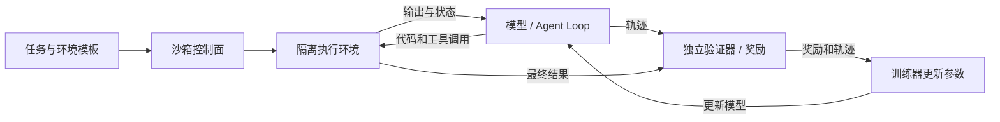

# 大模型训练中的沙箱：从 Agent 强化学习到 Kubernetes 环境工程

模型写出一段代码后，怎样知道它能不能运行？代码 Agent 修改仓库后，怎样知道问题是否解决？训练系统越来越多地让模型进入可执行环境，运行命令、观察结果，再根据反馈调整行为。沙箱为这些操作提供受控空间；任务环境和验证器则决定模型能做什么、怎样判定任务完成。

<strong>训练沙箱是环境基础设施，不是替代 GPU 训练器的模型训练算法。</strong>它尤其适用于代码生成验证、工具调用、软件工程 Agent 和浏览器操作训练。普通文本预训练通常不需要为每条样本启动沙箱；只有训练流程需要执行代码、工具或交互环境时才引入它。

本文是截至 2026-11-09 的公开资料综述；架构图与数值均为说明性示例，不包含本地训练、性能压测或安全认证结果。相关背景参见 [Agent RL：veRL 与 Miles](agent-rl-verl-miles-overview.md) 和 [Agent Sandbox 选型](agent-sandbox-selection.md)。

## 1. 从一道修复任务理解训练沙箱

假设任务是修复一个 Python 项目的计费函数。环境先准备仓库、依赖和测试；模型阅读代码、编辑文件、运行测试，并根据失败信息继续修复。最后由验证器判断行为是否满足任务要求。

这是概念流程，不限定同步执行或组件部署位置。一次完整交互叫做 rollout（采样轨迹）：它可以包括多轮模型输出、工具调用和环境反馈。训练器使用轨迹及奖励更新参数；也可以先只做数据生成或评估，不更新权重。代码执行既可能是多轮交互工具，也可能只用于最终答案的验证，具体依训练配置而定。[verl 的 Sandbox Fusion 集成](https://verl.readthedocs.io/en/latest/sglang_multiturn/sandbox_fusion.html)

| 层次 | 回答的问题 | 示例 |
| --- | --- | --- |
| 任务与环境 | 起点是什么、允许什么操作、何时结束？ | 代码仓库与缺陷、浏览器页面、工具接口 |
| 沙箱 | 代码在哪执行、能访问什么、如何限制资源？ | 容器、gVisor、Kata Containers、MicroVM |
| 验证器与奖励 | 怎么判断结果，给多少分？ | 隐藏测试、目标状态检查、规则或奖励模型 |
| Agent Loop | 模型何时调用工具、观察后如何继续？ | 多轮模型与工具交互 |
| 训练框架 | 如何采样、计算优化目标并更新模型？ | verl 等 |

环境不一定都由一个独立虚拟机构成；模拟器和受控 API 同样可以提供状态与反馈。反过来，一个能运行命令的容器也不自动具备任务、验证器和奖励。

## 2. 三种常见用法

### 2.1 验证生成的代码

模型输出函数后，验证器在隔离环境运行测试，收集退出码、标准输出、超时或异常，按规则评分。这类任务可以是单轮：沙箱负责执行和验证，不一定有持续多轮状态。verl 提供 Sandbox Fusion 对接示例，但具体接口、版本和部署方式应以目标版本文档为准。[verl 示例](https://verl.readthedocs.io/en/latest/sglang_multiturn/sandbox_fusion.html)

### 2.2 训练软件工程 Agent

给 Agent 一个仓库和 Issue，它可以多轮检索、修改和测试。环境要保存同一轨迹中的文件变化，最终由独立测试或其他规则评分。[SWE-Gym](https://github.com/SWE-Gym/SWE-Gym) 提供面向软件工程 Agent 的任务与环境；它与底层沙箱运行时处于不同层次。

<strong>验证器必须防作弊：</strong>如果待训练 Agent 能修改最终测试、读取参考答案或直接改评分结果，“测试通过”就可能是奖励作弊。应保护隐藏测试及评分凭据，并在需要时把最终验证放到 Agent 无法写入的独立执行边界；同时检查补丁质量、资源消耗和超时，不能只看一个成功标志。

### 2.3 浏览器和 Computer Use

环境可以提供浏览器、网页、鼠标键盘或桌面，让 Agent 操作模拟系统；验证器检查业务状态，例如是否正确完成模拟表单。要特别区分只读页面、可回滚的测试数据和真实外部系统，避免训练任务发送真实消息或产生真实交易。状态重置要包括账号、Cookie、缓存与服务端数据，光重启浏览器不足以保证干净。

## 3. 数据如何进入训练

在 Agent 强化学习（Agent RL）中，模型按当前策略生成动作，环境执行并返回观察；采样器记录工具输入输出及 token 等轨迹；奖励可能来自测试、规则、模型或它们的组合；训练器再根据所选算法计算优势和损失并更新权重。并非所有方法都使用相同算法，也不是每次工具调用都必须立刻产生奖励。[verl Agent Loop 和奖励扩展](https://verl.readthedocs.io/en/latest/extend_guide.html)

训练过程要同时保留：任务与环境版本、模型和采样配置、工具调用、最终产物、验证器版本、奖励及失败原因。训练和评估应划分数据集，隐藏测试不进入模型可访问目录，避免把测试泄漏当成泛化能力。评估时分别统计成功、答案错误、超时、环境故障和未执行；环境故障重试要保留原始尝试，不能只报告最终成功的样本。

## 4. 开源组件如何组合

| 项目或技术 | 主要定位 | 可解决的问题 | 不能单独解决什么 |
| --- | --- | --- | --- |
| [verl](https://verl.readthedocs.io/en/latest/sglang_multiturn/sandbox_fusion.html) | 强化学习训练与 Agent Loop | 接入模型采样、工具和奖励 | 不自动提供可靠的业务任务、验证器及隔离策略 |
| [Sandbox Fusion](https://github.com/bytedance/SandboxFusion) | 代码执行与评测服务 | 运行模型代码并返回结果，可与训练流程集成 | 并非完整的多轮 Agent 训练系统 |
| [SWE-Gym](https://github.com/SWE-Gym/SWE-Gym) | 软件工程任务与训练环境 | 仓库级任务和验证 | 不等同于底层隔离运行时 |
| [OpenEnv](https://github.com/openenv/OpenEnv) | 后训练环境接口与生态 | 定义交互环境、工具和奖励 | 接口统一不等于任务或隔离自动安全 |
| [Kubernetes Agent Sandbox](https://agent-sandbox.sigs.k8s.io/docs/) | Kubernetes 沙箱资源与生命周期 | 模板、声明、预热池及运行时集成 | 控制器本身不是隔离内核，也不是训练器 |
| [OpenSandbox](https://github.com/alibaba/OpenSandbox) | 通用 Agent 沙箱平台 | 沙箱生命周期、代码执行和环境接入 | 训练吞吐、隔离和奖励质量仍需实测 |

这些组件可以组合，也存在能力重叠；它们的接口与兼容性随版本变化，不应假设能无适配直接互换。Agent Sandbox 支持选择不同底层运行时；其 Quickstart 也明确将 gVisor、Kata 作为可选的更强隔离配置，而非安装控制器就自动获得虚拟机边界。[官方 Quickstart](https://agent-sandbox.sigs.k8s.io/docs/use-cases/examples/quickstart/)

## 5. Kubernetes 上的架构与选型

可以将训练器和模型推理放在 GPU 资源池，环境控制面与大量沙箱主要放在 CPU 节点池。沙箱执行 GPU 或 CUDA 任务时再单独申请 GPU；是否可用取决于底层运行时、设备透传与驱动兼容性，不能假设所有 MicroVM 或容器隔离方案都支持。

| 隔离方式 | 优点 | 评估重点 |
| --- | --- | --- |
| 常规容器 | 启动和生态成熟、资源开销通常较低 | 与宿主机共享内核；需要限制权限、系统调用、网络与挂载 |
| gVisor | 为容器系统调用提供额外隔离层 | 系统调用兼容性、网络和 I/O 开销 |
| Kata / MicroVM | 提供独立客户机内核的虚拟化边界 | KVM、启动时间、镜像、密度和设备透传 |

这些是隔离方式的典型特征，不构成强弱的绝对排名或安全保证。具体方案要测试逃逸风险、版本配置、补丁、设备访问及多租户边界。

<strong>预热池解决的是冷启动等待，不是免费容量。</strong> 预创建容器或虚拟机可以减少镜像拉取和环境初始化，但会占 CPU、内存和磁盘。复用前要重置文件、进程、凭据、网络连接和业务数据；若不能可靠证明清理完成，就销毁重建。Agent Sandbox 提供模板、Claim 和 WarmPool 等资源模型，不能把官方示例中的启动时间当作自己集群的性能结论。[Agent Sandbox 文档](https://agent-sandbox.sigs.k8s.io/docs/)

在高并发训练中，控制面也会成为瓶颈：频繁创建 Pod、挂载存储、分配 IP、拉镜像与更新状态，会给 API Server、调度器、etcd、镜像仓库和节点磁盘带来压力。要按节点和租户限制并发、平滑补池、设置超时和垃圾回收，并用配额与限流保护共享集群；不要只看 GPU 卡数就估算训练吞吐。

## 6. 运行指标与容量估算

先定义端到端指标：有效完成任务数、验证通过数、每条有效轨迹成本，以及排队、创建、执行、验证各阶段的延迟与失败率。再观察预热命中率、环境创建 P50/P95/P99、镜像拉取、CPU/内存/磁盘、沙箱泄漏、验证器等待和推理 GPU 空闲时间。延迟应按同类任务与环境版本分组，区分冷启动和预热命中。

一个粗略容量示例：若目标每分钟完成 120 个任务，平均每个任务占用沙箱 30 秒，在稳定到达、平均值可代表负载且没有其他瓶颈的理想条件下，平均在用沙箱约为 `120 × 30 / 60 = 60` 个。实际容量还要覆盖到达突发、尾延迟、失败重试、预热余量和节点故障；这不是压测结果。若一个任务多次调用工具，应按环境实际占用的总时长计算，不能直接把工具调用次数当作任务数。

训练排障应追踪整条链路：若 GPU 推理空闲且大量任务等环境，先看预热与调度；若环境就绪但任务等模型，检查推理吞吐与并发；若测试耗时长，检查验证器、磁盘和依赖。相关性需要用同时间窗口的指标验证，不能只凭单个 GPU 利用率归因。

## 7. 建设顺序

1. 先用少量非敏感代码任务跑通“创建环境 → 模型操作 → 独立验证 → 清理”，记录原始轨迹。
2. 设计隔离、密钥、出站网络、验证器权限和数据保留策略；开展负面测试，确认越权行为被阻断。
3. 再测冷启动、预热、并发、失败恢复和污染清理；逐步提高任务规模，并观察 Kubernetes 控制面与存储。
4. 训练接入后同时报告模型成功率与基础设施失败分母；将结果与固定版本的评估集比较，防止优化吞吐时牺牲有效样本质量。

本文讨论的是设计与选型，不能由组件功能推断生产就绪或训练收益。后续如果在测试集群验证，应单独记录版本、实际隔离、任务集、失败及资源占用；已有 [OpenSandbox 实战](opensandbox-kubernetes-practice.md) 和 [沙箱故障与网络策略实战](sandbox-runtime-failure-network-policy.md) 可作为运行时基础，但不能替代训练闭环测试。
