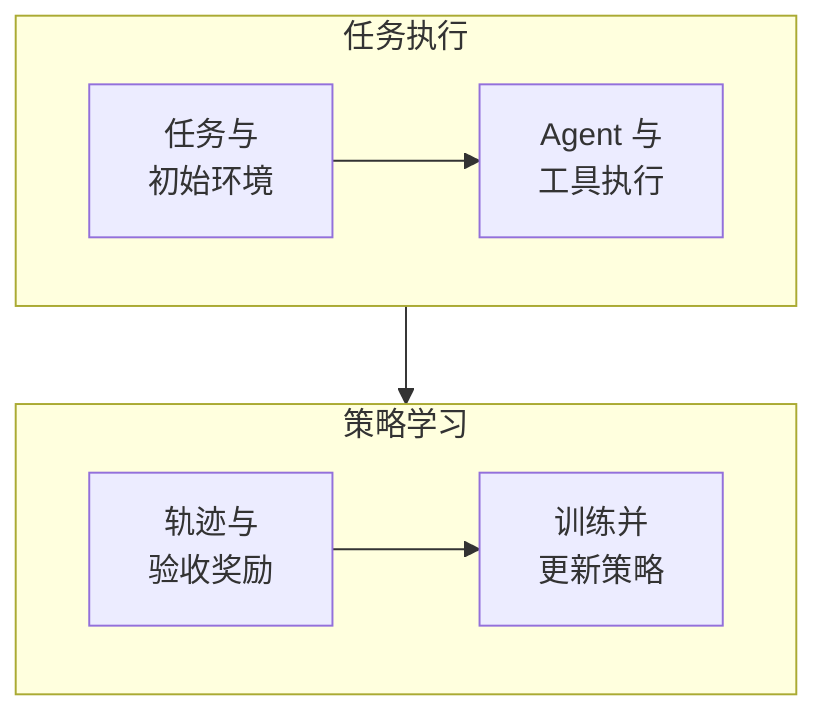
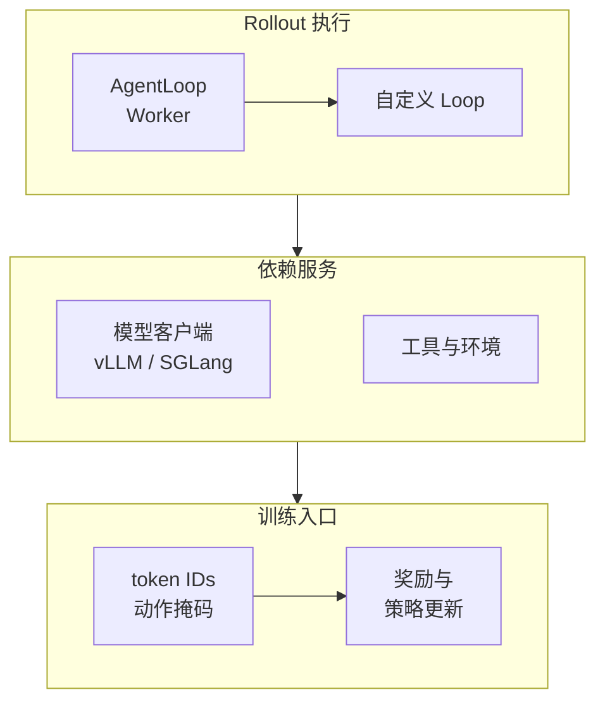
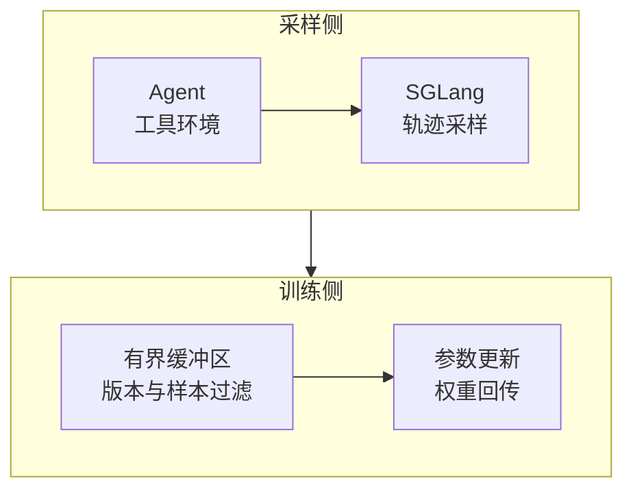

# Agent RL 综述：从工具调用、轨迹与奖励到 veRL 和 Miles

一个代码 Agent 已经会读文件、执行命令和修改程序，为什么还需要强化学习？因为“工具能调用”与“能选择有效的行动、根据反馈纠错、在预算内完成任务”之间，仍有很大距离。Agent Reinforcement Learning（Agent RL，智能体强化学习）把这些完整任务变成训练经验，用任务结果改善后续决策。

本文重点讨论 **大语言模型驱动的 Agent 如何进行后训练**：采集多轮任务轨迹，计算奖励，更新可训练模型的权重，再把新权重送回 Agent。veRL 提供灵活的训练数据流与 Agent Loop 接口；RadixArk 的 Miles 更集中地呈现了 SGLang 采样、分布式训练、会话轨迹和异步流水线的工程组合。两者都需要团队自己解决任务、环境和评分的质量问题。

调研截至 **2026 年 10 月 19 日**。veRL 源码核对到 [`4b26c788`](https://github.com/verl-project/verl/tree/4b26c788d41ce932ce7706c5ee8e249ab52f4c51)，Miles 核对到 [`915e89b7`](https://github.com/radixark/miles/tree/915e89b7bef529b3d0572cf7fd6030202ce7751e)。下文包含架构分析和示意案例，不包含本地训练成绩；官方示例与功能支持均按各自接口边界理解。

## 1. Agent RL 究竟在训练什么

可以把它理解为培训一名能使用电脑的实习工程师：给他一个有缺陷的项目，让他检查、修改、运行测试，最后由独立验收程序判断是否修好。训练系统比较不同尝试，让模型更倾向于产生有效行动。测试程序是否可靠，直接影响他学到的是解决问题还是钻评分规则的空子。

这里的 **Policy（策略）** 通常是产生思考、工具调用和回答的语言模型。**Rollout（采样执行）** 是用某个策略版本完成一次任务的过程；**Trajectory（轨迹）** 包含各轮观察、动作、工具反馈与结果；**Reward（奖励）** 是对结果或过程的评分。

| 方法或组件 | 主要改变什么 | 与 Agent RL 的关系 |
| --- | --- | --- |
| Supervised Fine-Tuning，SFT，监督微调 | 模型权重，学习示范动作 | 常用来先教会工具格式和基本任务流程 |
| Agent RL | 模型权重或可训练适配器，优化奖励目标 | 从自己采集的任务尝试中学习 |
| 提示词、Skill、记忆与检索 | 输入上下文及外部状态 | 可以提升 Agent，但不会因此自动更新模型权重 |
| LangGraph、Agent Harness | 控制流、工具、上下文与恢复 | 承载被训练策略的执行过程 |
| 评测 Harness、Verifier | 任务执行契约和验收程序 | 提供训练奖励，也承担独立评估 |

Reinforcement Learning from Human Feedback（RLHF，基于人类反馈的强化学习）描述反馈来源；Reinforcement Learning with Verifiable Rewards（RLVR，使用可验证奖励的强化学习）强调可程序化验收；Proximal Policy Optimization（PPO，近端策略优化）和 Group Relative Policy Optimization（GRPO，组相对策略优化）则是优化算法。它们不处在同一分类维度。GRPO 最初见于 [DeepSeekMath](https://arxiv.org/abs/2402.03300)，并不专属于多轮 Agent。



*示意图：工具环境产生反馈，训练器更新模型，Agent 再使用更新后的策略执行任务。*

如果 Agent 只调用一个不能训练的商业模型接口，接入日志或奖励系统不会直接改变该模型。可以训练另一个开放策略模型，也可以优化路由器等可训练组件，但必须明确究竟更新了谁。

## 2. 一条可以学习的轨迹长什么样

以“修复一个日期解析函数”为例，下面是流程示意，不是真实训练输出：

| 阶段 | 发生的事情 | 训练时怎样看待 |
| --- | --- | --- |
| 初始观察 | 用户需求、代码仓库、允许使用的工具 | 模型的条件输入 |
| 动作一 | 模型生成读取文件的工具调用 | 模型动作，需要记录原始 token |
| 工具反馈 | 返回源文件内容 | 环境观察，通常不计入策略动作损失 |
| 动作二 | 模型生成补丁并执行测试 | 模型动作，保留调用参数和轮次 |
| 后续反馈 | 测试报错，模型继续修复 | 同一任务的后续观察与动作 |
| 终局 | 独立隐藏测试验收 | 产生结果奖励，记录结束原因 |

这里最容易遗漏的是 **Action Mask / Loss Mask（动作／损失掩码）**。工具输出可能很长，但它是环境提供的观察；策略梯度通常只对模型自己生成的动作 token 计算。否则就相当于要求模型为外部程序返回的内容负责。掩码为零不代表删除上下文：这些观察仍参与后续动作的条件输入。

训练记录还应关联任务、采样参数、模型与 tokenizer 版本、模型动作的采样对数概率、奖励、超时及截断原因。不同算法需要的字段有所不同；不能用“最后一条回答 + 一个总分”替代所有多轮轨迹。

奖励怎样变成权重更新？以 PPO／GRPO 一类方法为例，训练器会计算动作的相对优势，再利用模型对这些动作的概率构造优化目标，鼓励相对更有效的动作，并限制一次更新的幅度。外部测试返回的零或一不必可导，梯度来自语言模型计算的动作概率。PPO 通常借助价值模型估计优势，GRPO 则利用同一任务的组内结果比较，减少对独立价值模型的依赖；实际实现仍有多种变体。

**任务完成、预算耗尽和环境崩溃也应分别记录。** 它们对奖励、价值估计和重试的含义不同。基础设施失败可以按预先定义的规则排除出策略更新，但评测报告必须保留其数量和端到端成功率，避免只统计顺利跑完的任务。

## 3. 现在有哪些框架与工具

下面按项目的主要接入方式和工程重点比较，不做未经同条件实测的性能排名。

| 项目 | 主要定位与当前接口特点 | 适合优先关注的场景 |
| --- | --- | --- |
| [veRL](https://github.com/verl-project/verl) | 通用大模型 RL 训练数据流；Agent Loop 连接多轮执行；可组合 FSDP、Megatron-LM、vLLM、SGLang 等后端 | 自定义算法、奖励和训练数据流，需要较强可修改性 |
| [Miles](https://github.com/radixark/miles) | 从 slime 分支发展；以 SGLang rollout、分布式训练、TITO 和异步调度为重点 | 工具／代码 Agent、较大规模模型与训练推理协同 |
| [slime](https://github.com/THUDM/slime) | RL 扩展框架，核心组合包括 Megatron-LM、SGLang 与 Ray；自定义 rollout 接口 | 围绕已有 Megatron／SGLang 系统开发训练配方 |
| [AReaL](https://github.com/areal-project/AReaL) | 以异步 RL 为基础，提供工作流及代理接口接入 Agent | 长轨迹、在线交互和对策略陈旧程度有明确控制需求的任务 |
| [SkyRL](https://github.com/NovaSky-AI/SkyRL) | 训练库、SkyRL-Agent 和 SkyRL-Gym 分层；当前仓库也在统一训练与推理接口 | 多轮环境、长任务，以及训练系统与环境层分开开发 |
| [OpenRLHF](https://github.com/OpenRLHF/OpenRLHF) | Ray、vLLM、DeepSpeed 组合，提供多轮 Agent 执行与异步训练路径 | 已有 OpenRLHF 基础设施，希望扩展工具型任务 |
| [Agent Lightning](https://github.com/microsoft/agent-lightning) | 当前 v1.0 通过代理连接真实 Harness，训练器使用 veRL／vLLM，可用 Kubernetes Job 运行 Agent | 保留现有 Agent 控制流，降低训练接入改造 |
| [ART](https://github.com/OpenPipe/ART) | 面向 Python 应用的 Agent Reinforcement Trainer，以 GRPO 和任务奖励组织训练；有本地与托管路径 | 应用团队验证某类业务 Agent 能否通过 RL 提升 |

**版本要跟着接口一起看。** Agent Lightning 在 2026 年 8 月发布了重构的 v1.0，不能直接拿早期论文中的组件名称解释当前代码。SkyRL 当前 README 也明确区分统一库、Agent 层与 Gym 层。各项目里的“支持某后端”，都还需要继续核对目标模型、训练精度、并行方式和示例组合。

训练器之外还有一层环境生态：[Harbor](https://www.harborframework.com/docs)组织容器任务与验收；[OpenEnv](https://github.com/huggingface/OpenEnv)提供与训练环境交互的接口；[Verifiers](https://github.com/PrimeIntellect-ai/verifiers)组织 RL 环境和评估；[NeMo Gym](https://github.com/NVIDIA-NeMo/Gym)提供训练环境组件。这些项目可以与训练器组合。沙箱服务又是另一层，负责实际创建、隔离和清理执行环境。

## 4. 重点一：怎样读 veRL 的 Agentic RL 文档

### 4.1 入门页讲的是采样执行如何接入训练

用户常见的入口是 [Agentic RL Training](https://verl.readthedocs.io/en/latest/start/agentic_rl.html)。该页标注更新于 **2025 年 7 月 15 日**，适合用来理解架构：把模型生成服务与 Agent 客户端分开，让多个任务在等待工具时并发推进，然后把任务轨迹交回训练器。

veRL 来自 [HybridFlow](https://arxiv.org/abs/2409.19256) 的训练系统设计。它关注多个模型角色、训练和生成程序之间的数据依赖与资源映射；Agent Loop 是接入交互任务的一层，不需要把整个 RL 系统重新写成某个 Agent 框架。



*示意图：AgentLoop 负责交互，推理引擎负责生成，训练器消费可对齐的轨迹。具体进程与传输方式以所用版本为准。*

### 4.2 最重要的接口是 AgentLoopOutput

[Agent Loop 文档](https://verl.readthedocs.io/en/latest/advance/agent_loop.html)定义了实现 `AgentLoopBase.run()` 的扩展方式。它返回的关键字段包括 `prompt_ids`、`response_ids` 和 `response_mask`，使模型动作与工具观察能够分开处理。

当前[固定版本源码](https://github.com/verl-project/verl/blob/4b26c788d41ce932ce7706c5ee8e249ab52f4c51/verl/experimental/agent_loop/agent_loop.py)进一步包含 `response_logprobs`、`routed_experts`、`reward_score`、`num_turns` 等字段，并使用 Continuous Token builder 处理 Agent Loop 的连续 token 构造。源码仍放在 `experimental/agent_loop` 下，工程接入应固定版本，不能假设旧示例与当前构造函数完全兼容。

为什么这么强调原始 token？模型生成的工具调用可能被解析成结构化 JSON，推理字段也可能被客户端移除或重排；最终保存的 messages 再经过一次聊天模板处理，得到的序列可能已经不同。对普通聊天界面，文本相似有时足够；对训练，动作 token、采样概率与损失位置必须对应。

这也是阅读文档时应优先抓住的主线：**先保证模型当时做了什么被准确记录，再讨论这些动作应该获得多大梯度。**

### 4.3 两种“异步”必须分清

| 异步层次 | 解决的问题 | 是否意味着训练使用旧策略样本 |
| --- | --- | --- |
| Agent Loop 内部异步、请求并发 | 一个 Agent 等工具时，其他 Agent 继续请求模型 | 单凭这一点不能判断；整批仍可等待完成后再更新策略 |
| Rollout 与 Trainer 流水重叠 | 推理采样与参数更新交错执行 | 需要跟踪采样策略版本，处理策略滞后 |
| 部分轨迹跨权重更新继续生成 | 减少等长任务结束造成的停顿 | 轨迹内部可能跨版本，数据与校正更复杂 |

入门页的 `actor_rollout_ref.rollout.mode=async` 主要描述服务化 rollout 模式，不能单靠这个开关证明整个训练是 fully async。veRL 另有 [Fully Async Policy Trainer](https://verl.readthedocs.io/en/latest/advance/fully_async.html)，文档更新于 **2026 年 5 月 25 日**，描述分离的 Rollouter、消息队列、Trainer 和参数同步器，以及陈旧度与 partial rollout 控制。该页列出的组合是 Megatron／FSDP 加 vLLM；不要把其他页面的通用后端列表直接搬成此配方的支持矩阵。

[Rollout Correction](https://verl.readthedocs.io/en/latest/algo/rollout_corr.html)还讨论了训练与推理分布差异的校正。即使权重版本相同，内核、精度和采样实现的差异也可能产生偏差；而异步训练又增加了策略版本差异，两类问题需要分别追踪。

### 4.4 接入现有 Agent 要改哪些地方

对于简单工具 Agent，可以实现自定义 Loop，复用框架提供的模型客户端；对于 LangGraph 等现有执行图，需要把模型节点接到训练采样服务，并保留逐轮 token 和掩码。入门页提供了 LangGraph 适配思路，但具体 recipe 应按固定提交检查。

已有 Agent 是否能直接接入，取决于它是否允许替换模型端点、能否忠实保留工具调用历史，以及是否会执行上下文压缩、重试或回滚。尤其要确认压缩文本来自哪个模型、是否属于待训练动作，不能把辅助模型输出混进当前策略的动作损失。

我的判断是：**veRL 适合需要控制训练逻辑的团队。** 它的抽象帮助组织交互采样，但任务定义、工具实现、奖励和数据契约仍由使用者负责。灵活性越高，越需要团队能核对样本进入 loss 之前的每一步。

## 5. 重点二：Miles 把哪些工程问题放到了一起

### 5.1 定位与训练后端

[Miles](https://github.com/radixark/miles)由 RadixArk 维护，官方定位是面向企业的大模型后训练框架，从 slime 分支发展并继续共同演进。2026 年的公开材料已覆盖异步训练、低精度、混合专家模型和 Agent 环境；[PyTorch 上的 Miles 团队文章](https://pytorch.org/blog/miles-a-pytorch-native-stack-for-large-scale-llm-rl-post-training/)可作为理解其系统设计的入口，其中性能结论属于作者报告。

当前[训练后端文档](https://miles.radixark.com/docs/user-guide/training-backend)列出 Megatron-LM、PyTorch Fully Sharded Data Parallel 2（FSDP2，完全分片数据并行）和 torchtitan。Megatron 是默认后端，适合需要张量、流水线及专家并行的配方；FSDP2 侧重直接加载 Hugging Face 模型；torchtitan 受其自身模型实现范围约束。

**后端功能并不完全对等。** 例如当前表格中的 LoRA（Low-Rank Adaptation，低秩适配）只在 Megatron 列标为支持。模型架构、checkpoint 格式与并行组合，也应按相应后端核对，不能仅替换一个参数就预期所有功能保持不变。

### 5.2 三层接入点，决定谁负责轨迹

[环境接入文档](https://miles.radixark.com/docs/user-guide/environments)把扩展点分成由内向外的三层：

| 接入层 | 主要由接入者负责 | Miles 仍负责的部分 |
| --- | --- | --- |
| Agent function | Agent 与环境的交互循环 | 会话轨迹记录、奖励入口、分组、训练 |
| Generate function | 交互及轨迹拼装 | 数据源、批次组织与训练；奖励按接口接入 |
| Rollout function | 数据源、执行、轨迹、分组与奖励编排 | 训练后端、权重更新和优化器 |

三层不是三个并排必装的服务。改动越靠外，接管的责任越多。Harbor、OpenEnv、NeMo Gym、Verifiers 等连接器处于不同层级，当前文档将它们标为实验性集成。

这层划分很实用：如果现有 Agent 只需要换模型端点，优先保留框架自己的记录和批次逻辑；只有数据组织或采样控制确实不同，才接管更外层。否则容易出现“Agent 跑通了，训练样本却由两套系统各自拼了一次”的问题。

### 5.3 TITO：给现有 Harness 一个可训练的会话入口

[Token-In-Token-Out（TITO，输入输出均保留 token）](https://miles.radixark.com/docs/user-guide/agentic-rollout)会话服务对 Agent 暴露兼容聊天接口的端点，在服务内部保留原始 token IDs、采样对数概率等元数据，再组装训练样本。客户端可以继续传 messages，token 的权威记录则保留在会话端。

对于已有 Harness，这能减少改写模型调用的工作。使用自定义 Agent function 时，官方接口组合包括：

```text
--custom-generate-function-path miles.rollout.generate_hub.agentic_tool_call.generate
--custom-agent-function-path my_agent.run
--use-session-server
--tito-model qwen3
```

*接口片段，仅说明接入位置；不是包含模型、资源、奖励及训练依赖的完整启动命令。`qwen3` 也只适用于匹配的模型家族。*

当前有三个边界需要提前注意：会话 TITO 路径暂不承载图像和视频，视觉模型需核对原生 generate 路径；`--tito-model` 需要选择匹配的家族，不能假设自动识别；线性 v1 会话与实验性树状 v2 会话对历史回放、分支和重试的处理不同。

因此，“兼容聊天 API”并不代表任意 Harness 的上下文压缩、工具参数重写和回滚都能无损接入。应专门验证这些行为，尤其是模型输出经过客户端整理后再次提交的情况。

### 5.4 全异步流水线：吞吐提升来自哪里，代价又在哪里



*示意图：独立 GPU 池可重叠采样与训练；同卡 colocate 模式仍要交替使用设备。*

[Miles Fully Async RL](https://miles.radixark.com/docs/user-guide/fully-async)让后台采样持续提交完成的样本组，训练器从缓冲区取数据，并按配置同步权重。长任务不必让所有短任务一直等待同一个批次边界。

| 控制点 | 文档中的接口 | 需要关注的权衡 |
| --- | --- | --- |
| 在途任务数量 | `--async-max-concurrent-samples` | 太少填不满推理服务；太多增加环境与排队成本 |
| 缓冲区容量 | `--async-data-buffer-capacity-factor` | 过大可能积累旧策略样本 |
| 最大权重版本差 | `--max-weight-staleness` | 当前默认未设置，不能假设已有严格过滤 |
| 权重同步周期 | `--update-weights-interval` | 同步开销与策略新鲜度之间取舍 |

异步的收益取决于两侧速度是否匹配。缓冲区长期为空，说明训练在等采样；长期满载，说明生成赶在训练前面，增加 GPU 数可能只会生产更多过期样本。应该同时观察队列长度、版本差和每个有效训练样本的成本。

还要分清两个版本差：**样本在队列里等了多久**，以及**同一轨迹生成期间经历了多少次权重更新**。只看出队时间无法覆盖后者。全异步模式也不等于完全没有暂停，权重同步和共享推理资源的评估仍有自己的同步边界。

### 5.5 MoE 与低精度：token 对齐之后还有路由对齐

Mixture of Experts（MoE，混合专家）模型会为 token 选择专家。训练与推理即使加载同一组权重，也可能因数值差异得到不同的专家选择。[Rollout Routing Replay（R3，采样路由回放）](https://miles.radixark.com/docs/advanced/miles-router)记录 rollout 的专家选择，在训练前向中回放，以缩小这类不一致。

它需要额外保存路由元数据，并要求模型、训练后端与推理引擎有相应支持。R3 解决的是路由一致性问题，策略滞后、错误的动作掩码和不可靠的奖励仍要分别处理。

低精度也要区分用途：FP8 推理权重、训练中的低精度计算、Quantization-Aware Training（QAT，量化感知训练）是不同环节。下载一个能推理的 FP8 checkpoint，并不能据此推断可以直接用指定后端进行 RL 更新。应先确认可训练权重、优化器状态、参考策略以及权重转换流程。

### 5.6 Kubernetes 与故障恢复的实际边界

当前 [Ray and Kubernetes Backend](https://miles.radixark.com/docs/advanced/cluster-backend)提供默认 Ray 路径，以及由 Miles 自己创建集群对象的 Kubernetes 路径。后者依赖 LeaderWorkerSet（LWS，领导者与工作者集合）控制器，并明确标注处于活跃开发中。Ray 运行在 Kubernetes 上又是另一种部署方式；这些路径都不能概括成“必须先安装 Kubeflow”。

[Fault Tolerance 文档](https://miles.radixark.com/docs/advanced/fault-tolerance)目前直接标注内容过时，新的机制仍在合并。不能据此承诺“开一个开关，就能在任何训练节点、沙箱或协调器故障后无损续跑”。生产评估应按固定版本分别验证推理引擎、训练 rank、数据缓冲区、协调器和环境状态的故障域。

我的判断是：**Miles 对已有 Agent 的训练接入，以及大规模训练推理协同很有吸引力。** 选型时最值得核对的是 TITO、具体训练后端、异步版本管理和环境连接器；恢复能力和部署成熟度则需要以所选提交的验证结果为依据。

## 6. veRL 与 Miles 怎么选

| 维度 | veRL | Miles |
| --- | --- | --- |
| 设计入口 | 训练数据流、算法与 Worker 抽象 | rollout／训练协同与可扩展配方 |
| 自定义 Agent | AgentLoop、工具接口及 recipe | Agent／Generate／Rollout 三层扩展 |
| 轨迹一致性 | 连续 token 构造、动作掩码与 rollout 概率 | TITO 会话或原生 generate 路径 |
| 常见推理组合 | vLLM、SGLang；具体配方分别核对 | 主要围绕 SGLang |
| 完全异步 | 有独立 fully async recipe，不能等同于 Agent Loop 异步 | 有专门采样缓冲区、陈旧度与权重同步控制 |
| 已有 Harness | 评估适配层或基于 veRL 的接入项目 | 可优先评估 TITO 与现成连接器 |
| 大模型／MoE | 查看相应后端的模型 recipe 与校正能力 | Megatron 配方、R3、权重同步是重点核对项 |
| Kubernetes | 结合实际集群编排训练与采样 Worker | 可用 Ray 上 Kubernetes；原生集群后端仍在开发 |
| 主要投入 | 理解并维护训练数据契约与自定义流程 | 核对配方组合、会话语义与异步系统边界 |

如果团队已经熟悉 veRL，通常先把任务接入已有训练系统更经济；如果现有 Agent 很复杂、希望保持 Harness 行为，可比较 Miles TITO、Agent Lightning、AReaL 等代理接入方式。若目标是大规模 MoE，再进一步比较训练后端、权重同步和推理训练一致性，不能仅凭框架名称下结论。

也不应把两者看作永远固定的阵营：它们复用了许多相同基础组件，功能仍在快速演进。真正需要固定的是 **任务 + 模型 + Harness + 奖励 + 训练配方 + 版本** 的完整组合。

## 7. 奖励与评估，怎样避免“分数涨了，Agent 没变好”

一个简化的 GRPO 理解方式是：对同一道任务采样多条轨迹，用组内奖励比较构造相对优势。假设四条轨迹奖励是 `[0, 0, 1, 1]`，均值为 `0.5`，获奖轨迹相对更有优势，失败轨迹相对更差。这里只说明训练信号的方向，实际 loss 还涉及概率比、裁剪、归一化及可选的参考策略约束。

如果一组全部是零或全部是一，标准组内结果奖励没有差异，难以提供区分信号。应检查任务难度、基线能力和奖励分布；不能简单把更多重复采样当作解决办法。组相对奖励也不会自动解释“第几步操作最关键”，长任务的 Credit Assignment（信用分配，即把结果归因到行动）仍是难点。

对于代码、检索和运维 Agent，建议先把评分分成三层：

| 层次 | 可验证的内容 | 容易出现的偏差 |
| --- | --- | --- |
| 最终任务 | 隐藏测试、结果文件、查询正确性、目标状态 | Agent 改写测试，或成功标准过弱 |
| 过程约束 | 工具协议、允许操作、资源预算 | 格式分或步数惩罚压过最终目标 |
| 独立泛化 | 未见任务、不同初始状态、固定预算下的成功率 | 训练集泄漏、只挑有利任务或重试结果 |

LLM-as-a-Judge（用语言模型评分）可以帮助判断开放式质量，但应校准与人工及程序化验收的一致性，防止冗长回答和评分提示注入获得额外好处。训练奖励上涨，必须同时伴随独立任务集上的改进，才能说明目标能力提升。

训练报告至少要回答：总共尝试多少任务，策略失败多少，环境失败多少，严格成功率是多少；成功用了多少 token、工具调用、时间和 GPU 小时。关于任务级评估，可继续阅读[Agent 评估方法综述](agent-evaluation-overview.md)和[Harbor 综述](harbor-agent-evaluation-framework.md)。

## 8. 放到 Kubernetes 上，平台应该怎么分工

Agent RL 的资源形态与纯文本推理不同：GPU 上有训练和生成，CPU 上有大量工具与沙箱，任务之间还可能存在共享存储和外部服务依赖。以下是基于上述接口的工程建议，不是某个框架默认自动完成的能力。

| 平面 | 主要责任 | 优先约束 |
| --- | --- | --- |
| Trainer | 反向传播、优化器、checkpoint | GPU／RDMA 拓扑、成组启动、保存与重建一致性 |
| Rollout | 模型生成、权重接收、会话数据 | 模型版本、并发、上下文预算与内存 |
| Sandbox／工具 | 任务执行、文件与测试环境 | CPU／内存配额、隔离、网络、取消与超时清理 |
| 数据与评估 | 数据集、轨迹、验收、评估快照 | 任务／镜像／Verifier 版本、去重、持久化 |
| 协调与观测 | 提交、背压、故障定位、成本归集 | run／episode／attempt 标识与阶段时间线 |

开始时可以在同一组 GPU 上交替训练和生成，降低起步成本；当两侧需要不同资源或长尾明显，再拆分资源池。拆分会增加权重传输、网络和协调成本，只有实际减少了空闲与等待才值得。

恢复设计至少覆盖模型、优化器、学习率调度器、随机状态、数据游标与采样缓冲区。对正在运行的 Agent，还要明确环境文件系统和工具副作用是否可恢复；无论重放还是重采，都要避免同一轨迹被重复训练或重复执行外部写操作。只有模型权重的导出文件，通常不足以表达完整训练状态。

### 8.1 监控不能只看 GPU 利用率

| 指标 | 它帮助回答的问题 |
| --- | --- |
| 固定验证集成功率、任务成本 | 训练有没有产生业务收益 |
| Reward 分布、组内有差异的比例 | 是否存在有效学习信号 |
| KL、熵、裁剪比例、梯度与非有限值 | 策略是否突然漂移或出现数值异常 |
| Rollout／Train 吞吐及空闲比例 | 哪一侧在等另一侧 |
| 队列长度、策略版本差 | 异步是不是在累积过期数据 |
| 工具耗时 P95、错误率、沙箱准备耗时 | 长尾来自模型还是执行环境 |
| 权重同步、checkpoint 保存／恢复耗时 | 同步与故障恢复的成本有多高 |

Grafana 可以展示这些指标，但前提是应用已输出相应数据。Miles 文档列出了 `rollout/fully_async/queue_size`、`rollout/fully_async/avg_staleness` 等训练日志字段；veRL fully async 文档列出了 `trainer/idle_ratio`、`rollouter/idle_ratio`。它们不一定已经是 Prometheus endpoint，需要明确导出适配和聚合方式。

Prometheus 标签宜保留有限集合的模型、阶段和任务类别。episode ID、完整提示词和逐 token 数据应进入轨迹或日志存储；把它们全做成时序标签，很容易让监控系统本身成为负担。

## 9. 第一轮验证，先证明什么

最容易控制成本的起点，是一个已经会使用工具的可训练小模型，加一个可重复的任务环境，例如固定文件集合上的检索、可验证计算或小型代码修复。这里不应直接沿用旗舰模型的推理部署经验估算训练卡数：梯度、优化器、参考模型、激活与 rollout 缓存都可能增加显存需求。

建议按五步确认闭环：

1. **先建立固定预算的基线。** 固定任务、环境镜像、Harness 和采样参数，保存失败类型。
2. **人工核对少量完整样本。** 检查原始 token、工具观察、动作掩码、采样概率和终止原因，证明数据可以进入训练。
3. **用同步或低复杂度配置验证学习。** 先看奖励分布和独立验证集，避免同时引入异步、低精度与 MoE 路由的多个变量。
4. **只在确认瓶颈后引入异步。** 比较相同资源与任务预算下的成功率、训练时间和有效样本成本。
5. **验证导出、重新加载与恢复。** 用新 checkpoint 运行同一评测 Harness，并检查任务轨迹与训练状态能否对应。

Miles 的[Retool v2 示例](https://github.com/radixark/miles/tree/915e89b7bef529b3d0572cf7fd6030202ce7751e/examples/retool_v2)展示了工具定义、执行和奖励如何接入，也提供单卡 colocate 的示例路径。不过其脚本包含特定模型、数据下载、格式转换及硬件假设，“有单卡示例”不代表任意消费卡都能按默认参数运行。veRL 可从[Agent Loop 教程目录](https://github.com/verl-project/verl/tree/4b26c788d41ce932ce7706c5ee8e249ab52f4c51/examples/tutorial/agent_loop_get_started)追踪同样的数据契约。

对企业而言，值得优先投资的是可重复的任务与验收资产。框架升级后，这些资产仍能用来判断模型是否更可靠，也能帮助决定究竟需要 RL，还是通过改进工具、上下文和流程就已经可以解决问题。

## 10. 推荐阅读顺序

先理解[Agent Harness](agent-harness-technology-overview.md)和任务评估，再读用户给出的[veRL Agentic RL](https://verl.readthedocs.io/en/latest/start/agentic_rl.html)，对照当前源码核对轨迹接口；接着读 Miles 的[环境接入分层](https://miles.radixark.com/docs/user-guide/environments)、[TITO](https://miles.radixark.com/docs/user-guide/agentic-rollout)与[训练后端](https://miles.radixark.com/docs/user-guide/training-backend)。最后才进入两边的 fully async、路由回放和精度优化。

这个顺序对应三个问题：**任务怎样才算完成，样本怎样才算正确，系统怎样才跑得高效。** 前两个问题没有解决，更多 GPU 和更复杂的异步流水线只会更快地放大错误。
