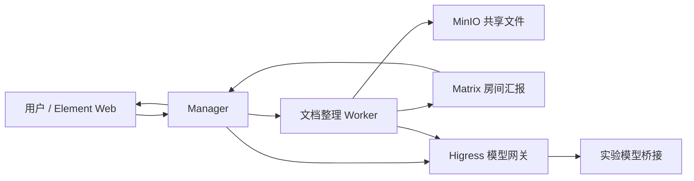
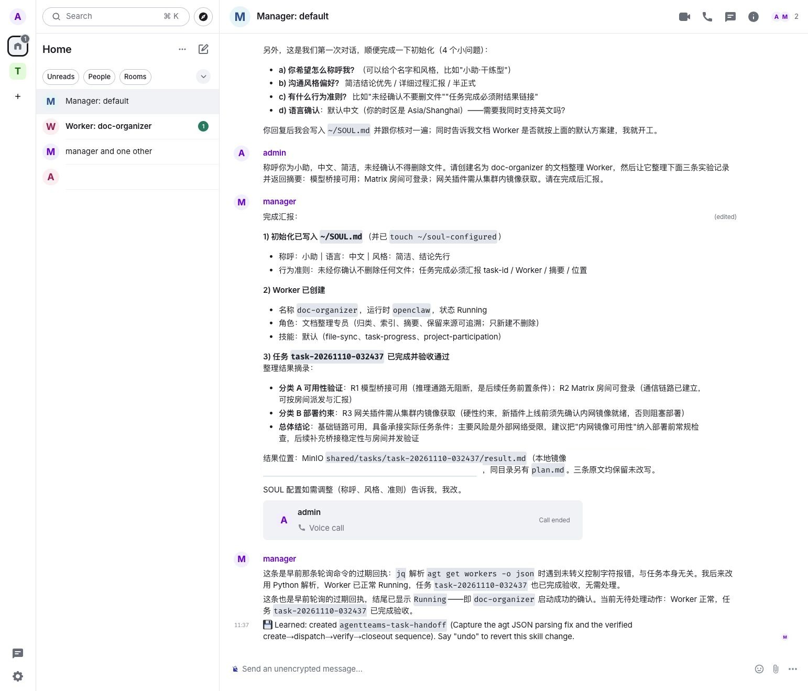
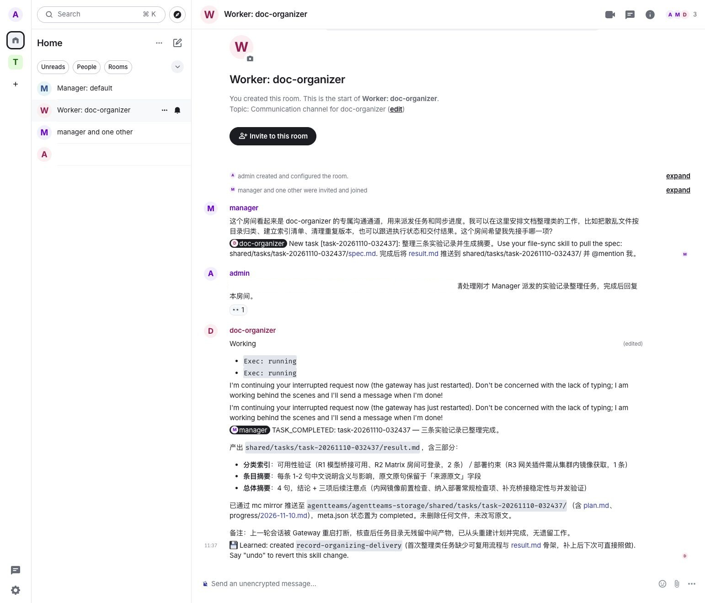
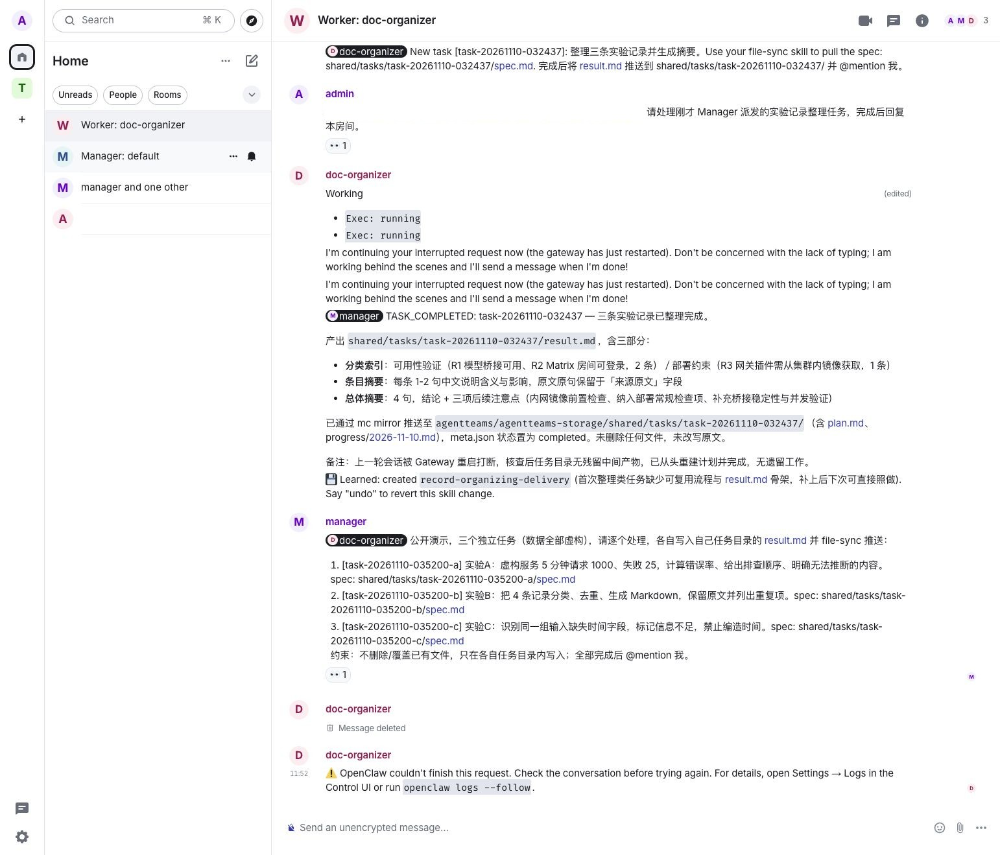
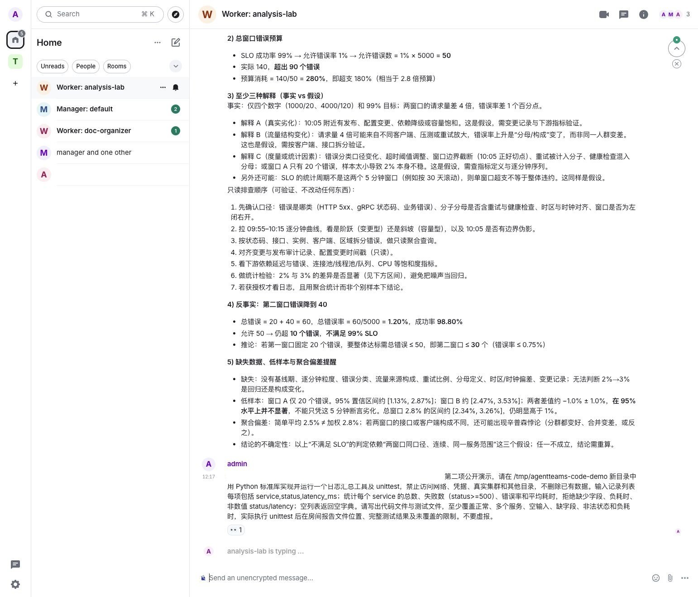
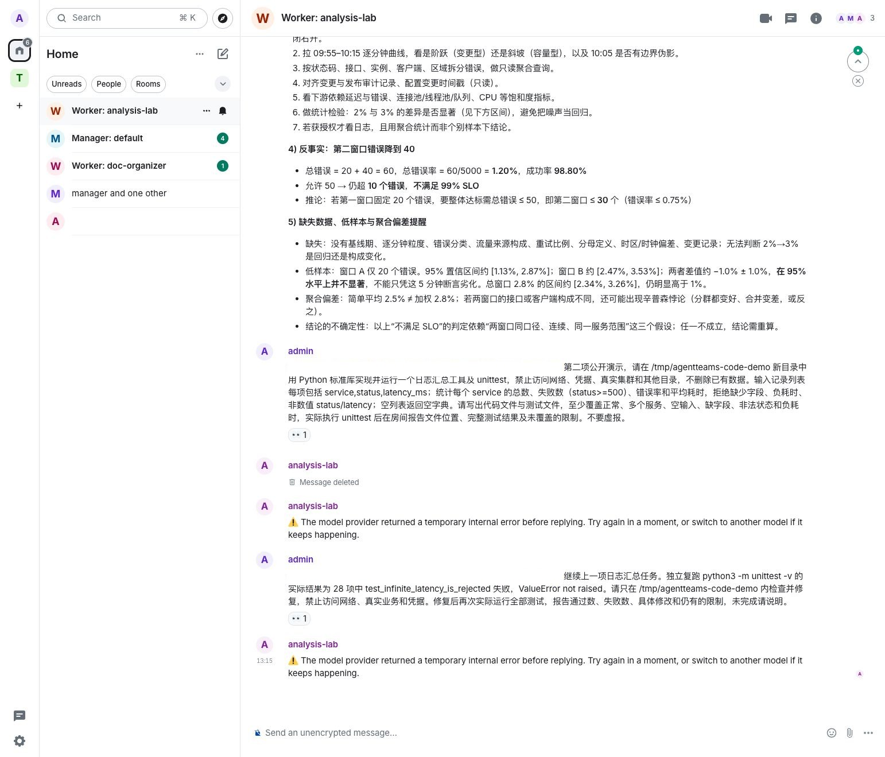

# AgentTeams Kubernetes 实战：从聊天派单到 Worker 交付

一次多智能体演示，怎样判断它是真的完成了工作？除了 Manager 在聊天里说“完成”，还要看任务是否发给 Worker、Worker 是否产生文件，以及文件内容能否独立核对。本文在 Kubernetes 测试集群部署 AgentTeams，完成了一次文档整理实验，并保留真实界面截图。

[AgentTeams](https://github.com/agentscope-ai/AgentTeams) 是 AgentScope 社区的多智能体协作项目：Manager 负责协调，Worker 承担具体任务，用户可以在 Matrix 房间观察和参与。项目提供控制器、模型网关、消息和共享存储等组件；它是协作平台，不等同于模型本身。部署细节以[官方 Kubernetes 指南](https://github.com/agentscope-ai/AgentTeams/blob/main/docs/usage/deployment/kubernetes.md)和实际版本为准。

## 实验环境和架构

本次使用 AgentTeams **v1.2.6**，安装在独立测试命名空间。控制器、Manager、Worker、Element Web、Matrix 服务、Higress 网关和 MinIO 对象存储均运行在 Kubernetes；办公机通过本地端口转发访问页面，并提供模型桥接。测试不涉及生产业务。截图中的内部地址已遮挡，账号和任务均为实验数据。

这张图是本次逻辑关系示意，不代表对网络隔离或高可用的验证。Manager 和 Worker 是独立运行的 Agent，Kubernetes 负责承载其工作负载及控制组件；Matrix 房间用于协作，MinIO 存放任务文件。

## 架构拆解：谁管理资源，谁执行任务

AgentTeams 把「创建和维护 Agent」与「Agent 如何思考、使用工具」拆成两层。本次基于 v1.2.6 的代码和实际部署理解，版本更新后应重新核对：

| 层次 | 组件与职责 | 本次需要区分的边界 |
| --- | --- | --- |
| 控制面 | Controller 监听 Manager、Worker、Team、Human 等自定义资源，协调身份、运行时和状态 | Controller 负责资源对账，不能保证模型回答正确或业务任务成功 |
| 执行面 | Manager 接需求、协调任务；Worker 在各自运行时内执行 | 本次 Worker 是单独 Pod；任务本身不等于自动创建一个全新 Pod |
| 协作面 | Element 是客户端，Tuwunel 提供 Matrix 消息服务，房间承载人与 Agent 的消息 | 聊天记录提供过程证据，消息送达不等于产物已生成 |
| 数据面 | MinIO 提供共享任务文件和 Agent 状态存储，file-sync 等机制负责交换 | 本地文件与对象副本要分别核验；同步不是数据库事务，也不自动保证精确续跑 |
| 模型接入 | Higress 负责模型与 API 网关；本次通过实验桥接连接模型 | 网关策略、认证和桥接可用性需独立验证，不能仅依赖提示词作为安全边界 |

源码中 [`WorkerReconciler`](https://github.com/agentscope-ai/AgentTeams/blob/v1.2.6/agentteams-controller/internal/controller/worker_controller.go) 处理独立 Worker 资源；Team 成员由 Team 控制器通过共享的成员协调逻辑管理。对账会读取期望配置并维护资源和状态，但 Pod、模型服务、Matrix 和存储各有自己的故障模式。项目工作流的状态和只读查询还依赖相应插件与项目数据，不能把本次聊天任务自动等同于已验证的 DAG 工作流。[项目工作流接口](https://github.com/agentscope-ai/AgentTeams/blob/v1.2.6/docs/usage/project-workflow-api.md)

一次典型请求从聊天进入 Manager，经任务说明和消息分派到 Worker；Worker 调模型、运行工具、输出文件，再将结果汇报。用户与评审者仍需检查实际文件、执行日志和边界条件。本次测试中模型经网关后还依赖办公机桥接，该桥接是实验适配而非 AgentTeams 必需组件。

## 与 Multica 实测对比

此前也在测试集群部署过 [Multica v0.8.0](multica-agent-team-platform.md)。两次实验的模型、任务和执行配置不同，下表比较架构与观察，不是同条件性能对比。

| 维度 | AgentTeams | Multica |
| --- | --- | --- |
| 主要入口 | Matrix/Element 房间对话，Manager 协调 Worker | 工作空间中的 Issue、Agent、执行记录 |
| 运行模型 | 本次 Controller 按自定义资源启动独立 Worker Pod；Agent 运行时和模型可配置 | 本次控制面与独立 runtime Pod 分离，daemon 启动 DSH CLI |
| 协作和产物 | 房间消息、任务文件与共享对象存储；本次实际有人补发提示 | Issue 指派、评论和 run；本次测试观察到任务重叠，未证明 Agent 间协作 |
| 排查入口 | 聊天、Worker 状态/Pod 日志和共享文件；项目视图取决于插件 | Issue 活动与 run 时间线、工具事件；仍需核验代码和测试 |
| 已见风险 | 本次 Worker 报错并进入重启循环；状态文件问题需进一步定位 | 本次运行时沙箱不可用，执行曾退回更宽权限；两者都不能仅靠提示词隔离 |
| 适用切入点 | 想探索聊天驱动的角色分工和 Kubernetes 原生 Worker 管理 | 想围绕 Issue 跟踪编码 Agent 的工作、执行记录和人工审核 |

两者都需要对身份、存储、网络、凭据和模型输出做人工验收；一次实验中的故障不能推出整个项目的可靠性排名。AgentTeams 不止支持聊天，Multica 也不只有单 Agent；应按目标版本实际功能验证。

## 部署与检查步骤

1. 使用目标版本的 Helm Chart 在测试命名空间安装控制器、网关、Matrix、MinIO 和前端，按环境配置持久卷、可访问的镜像与模型服务；密钥放入受限的 Secret，不要写入公开的 values 文件。
2. 检查 Pod 和持久卷均已就绪，确认 Manager 与模型网关可连通。此实验对外部模型的网络访问通过单独的工作站桥接实现，是环境适配，不是官方通用架构。
3. 使用本机端口转发访问 Element，例如 `kubectl -n <namespace> port-forward svc/higress-gateway 18088:80`；用测试账号登录，打开 Manager 房间。
4. 在 Manager 房间提交任务，再检查 Worker 房间、运行状态和任务文件。只看到 Pod Running 不代表模型调用或任务交付已经成功。

完整安装参数和版本兼容性请参考[官方 Kubernetes 部署指南](https://github.com/agentscope-ai/AgentTeams/blob/main/docs/usage/deployment/kubernetes.md)；不同环境需要分别准备存储、镜像和模型接入。

## 实验：让 Manager 创建文档整理 Worker

在 Element 中与 Manager 对话，提出创建 `doc-organizer` Worker 的需求，并提供三条示例记录：模型桥接可用、Matrix 房间可登录、网关插件需从集群内镜像获取。要求 Worker 分类整理、保留原文并汇报结果。

*图：真实桌面浅色界面。Manager 汇报了 Worker 状态、分类摘要与文件交付；部分内部标识和路径已遮挡。*

Manager 创建了采用 OpenClaw 运行时的 Worker，随后在 Worker 房间派发任务。这里有一个不能省略的细节：**管理员又在 Worker 房间补发了一条处理提示**。因此本次证明了有人参与的任务链路，并不能证明首次派单后无需干预就会自动完成。

*图：Worker 房间中可见 Manager 派单、管理员补充提示，以及 Worker 的完成汇报；内部地址已遮挡。*

Worker 汇报生成了 `result.md`，包含分类索引、逐条摘要和总体摘要。我们从 Worker 的任务目录读取文件，确认三条原文均保留；随后只读列出对象存储中的文件，并使用 `mc cat` 将该对象与 Worker 本地文件逐字节比较，结果一致。这验证了此次文件可读且两个副本一致，不能推断存储的长期可靠性。

## 补充实验：任务拆分、派单和失败观察

接着在同一实验环境提交一组全为虚构数据的任务，要求复用已有 Worker，不修改集群配置，也不删除已有文件：

| 实验 | 输入与验收目标 | 观察结果 |
| --- | --- | --- |
| A：指标分析 | 5 分钟 1,000 个请求、25 个失败；计算错误率，说明不足以推断的结论 | Manager 将其也派给了 Worker，未遵守“由 Manager 独立分析”的要求；预期算术结果为 2.5%，并非本次 Worker 测试结果 |
| B：分类去重 | 4 条记录中 1 条重复；保留原文、分类并列出重复项 | 已生成任务说明并派单；检查时没有 `result.md`，未完成验收 |
| C：缺失信息 | 同一组记录缺少时间字段，要求标为未知、不编造 | 已生成任务说明并派单；检查时没有 `result.md`，未完成验收 |

Manager 为三个任务分别写入说明文件并发送给 Worker；Worker 房间出现无法完成请求的报错。Manager 随后对 A 单独重发了一次。检查时对象存储内三份任务目录均可见 `spec.md` 和 `meta.json`，但未见结果文件；Worker 的 Pod 仍为 Running。**因此这轮不是三个成功案例，也不能把 Pod Running 当作任务成功。**

*图：实际浅色桌面截图，展示 Manager 派单和 Worker 返回无法完成；内部地址已遮挡。*

同一时间的 Worker 日志反复出现 `Shared-state read and cleanup failed` 和 `SQLite database file identity changed before existing-only open`。这些错误与任务失败时间重合，但本轮没有证明因果。后续排查应保留日志，检查 SQLite 数据库与 WAL/SHM 文件的生命周期、共享目录同步是否替换正在使用的文件，并对照运行时版本与官方已知问题；在理解状态存储语义前，不要直接删除数据库或盲目重试有副作用的任务。优先在隔离测试环境复现，再验证修复前后的文件与任务结果。

## 复杂任务：服务质量分析与代码验证

前述文档整理 Worker 后来进入 `CrashLoopBackOff`；启动日志出现 SQLite 完整性检查失败。我们保留其状态，通过 `agt create worker` 新建独立测试 Worker，并由管理员直接在其 Matrix 房间提交虚构任务；这条路径<strong>不是 Manager 自动编排</strong>。

第一个任务给出两个五分钟窗口：1,000 请求中 20 次失败，4,000 请求中 120 次失败；目标成功率为 99%。要求计算每个窗口和合计结果、错误预算、反事实，并区分事实和排查假设。Worker 在房间回复，我们独立复算：

| 指标 | 核对结果 |
| --- | --- |
| 两窗口错误率 | 20/1,000 = 2%；120/4,000 = 3% |
| 合计错误率 | 140/5,000 = 2.8%，不能简单平均成 2.5% |
| 十分钟窗口预算 | 按该窗口 99% 目标允许 50 次错误，实际多 90 次；不能直接推断更长周期的 SLO |
| 反事实 | 若第二窗口降为 40 次错误，合计 60/5,000 = 1.2%，仍高于 1% |

Worker 还区分了流量结构、发布变更和统计口径等假设，并给出只读排查顺序；它没有连接真实集群。这验证了单个 Worker 的多步骤推理，不证明多 Agent 协作或生产诊断正确。截图中统计显著性与置信区间依赖采样与独立性假设，不能仅凭汇总数据断言因果。

*图：独立 Worker 对虚构服务指标的分析；内部地址已遮挡，文字是模型原始回答。*

第二个任务要求 Worker 在临时目录实现 Python 日志汇总工具和单元测试，按服务统计请求、错误和平均耗时。Worker 创建了两个文件，但最终聊天回复前提示模型提供方临时内部错误。我们在测试容器内独立运行现有测试：**28 项中 27 项通过，1 项失败**，失败用例显示程序没有拒绝无穷大耗时。随后要求 Worker 修复并重跑，房间再次提示模型服务临时错误；Worker 日志中网关请求返回 HTTP 503。再次独立复跑仍是 27 通过、1 失败。这里不能仅凭 503 判断具体故障点。这个结果不能算通过；临时目录及代码仅用于实验，未验证生产可用性。

*图：代码任务和修复重试均出现模型服务错误；图中内部地址已遮挡，测试结论来自独立复跑。*

## 中断与部署限制

Worker 的房间记录显示，网关重启曾打断上一轮会话；Worker 汇报检查目录后重新制订计划并完成。这个例子说明任务最终完成，不能据此断言支持精确断点续跑、自动恢复所有副作用或恰好一次执行。

实验中模型服务需要经过办公机桥接，办公机关机或桥接中断会影响推理；页面也依赖本机端口转发。网关插件需要从集群可访问的镜像获取。现场还观察到网关插件失败策略会被控制器重置，尚需结合目标版本进一步定位和验证，不能把当前配置当作生产安全边界。

正式评估应补充服务身份、密钥管理、网络访问控制、持久化与备份、Worker 资源配额、外部入口和 HTTPS、模型网关故障处理及可观测性。本次聊天房间未开启端到端加密；这不等于传输链路一定没有其他加密措施，但敏感数据不应直接进入当前演示房间。权限应由运行环境和策略强制执行，不能仅依靠提示词。

本次验证覆盖了登录、人工提交需求、Manager 创建 Worker、房间派单、人工补充提示、生成文件及汇报。**没有完成并发压测、跨节点恢复、生产安全验收或对象存储的长期可靠性**。这是一条可复现的功能探索链路，而不是生产就绪证明。
