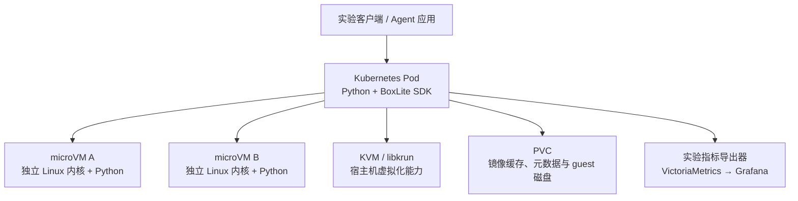
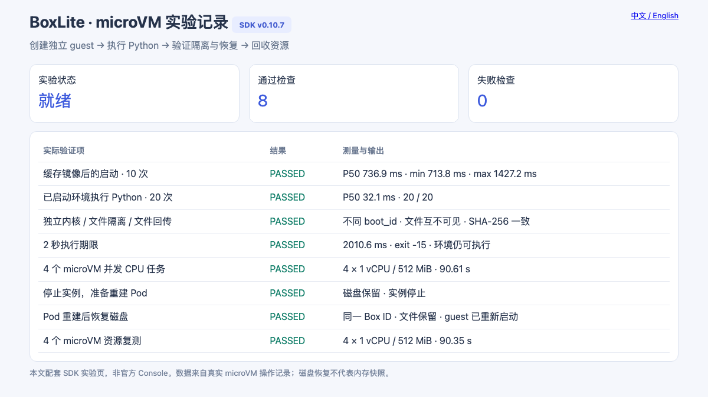
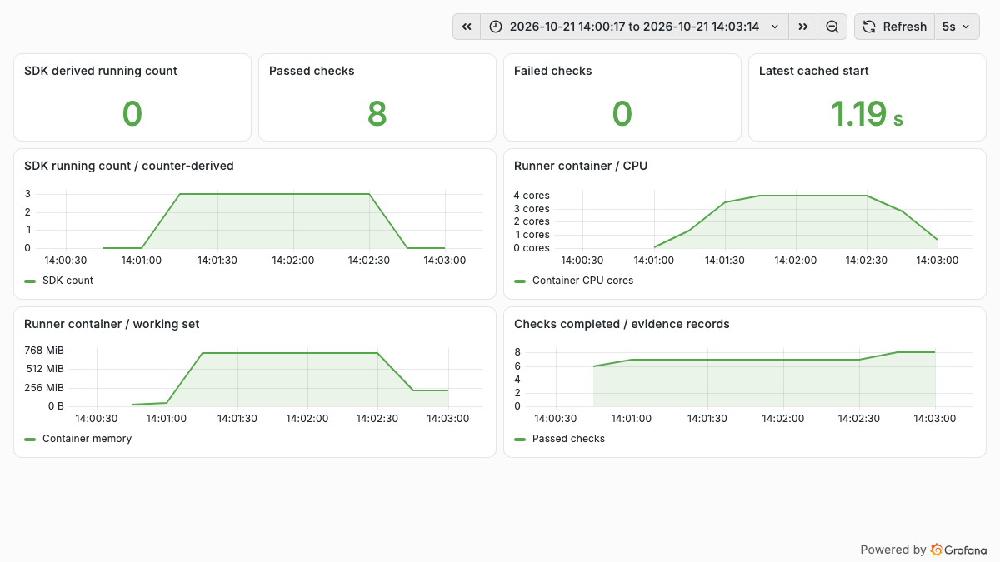

# BoxLite Kubernetes 实战：microVM 启动、代码执行与磁盘恢复

BoxLite 把微型虚拟机（microVM）的创建和使用封装成 SDK。应用可以启动一个独立 Linux 环境，在里面运行 Python、读写文件，再结束环境。对于需要执行模型生成代码的 Agent，这是一条值得验证的实现路线：应用管理任务，BoxLite 提供带独立内核的执行环境。

这次将 BoxLite 0.10.7 部署到一个已有 Kubernetes 测试集群，在单个具备 KVM 能力的节点上完成实际验证。缓存镜像后的启动中位数为 **736.9 ms**，已启动环境执行短 Python 的中位数为 **32.1 ms**；四实例并发、文件隔离、执行期限，以及承载 Pod 重建后的磁盘恢复均完成验证。实验也发现了恢复场景中一个值得注意的 SDK 指标口径问题。

文中的地址、节点名、镜像仓库和集群标识已脱敏。配套[示例与测量数据](https://github.com/runzhliu/aik8s/tree/main/examples/boxlite-kubernetes)可用于复现。

## 1. Kubernetes、BoxLite 与 guest 各负责什么

本次使用的是 BoxLite 的**嵌入式 Python SDK**。Kubernetes 管理一个承载应用的 Pod；该应用进程调用 BoxLite，通过 libkrun 和 KVM 启动多个 microVM。每个 microVM 内再运行 OCI 镜像提供的用户空间。OCI 是 Open Container Initiative，本文所用的 Python 镜像仍是常见的容器镜像格式。[项目说明](https://github.com/boxlite-ai/boxlite/tree/v0.10.7)



因此，Kubernetes 中的一个 Pod 可以对应多个 Box。每个 Box 不会自动成为独立的 Pod、Service 或 Kubernetes 自定义资源。节点选择、应用副本和外层资源限额由 Kubernetes 管理；Box 的创建、命令执行、停止和删除由 SDK 管理。

这一点也解释了它与 [OpenKruise Agents](openkruise-agents-kubernetes-practice.md) 的区别：后者将预热池、领取和生命周期放进 Kubernetes 控制器与自定义资源模型；BoxLite 的嵌入式路径更接近应用内部的虚拟机运行库。两者的能力层次不同，不能仅用启动耗时排出高低。

## 2. 实际部署环境

| 项目 | 本次配置 |
| --- | --- |
| Kubernetes / 容器运行时 | 1.30.4 / containerd 1.7.14，Linux amd64 |
| 宿主机内核 / cgroup | 5.10.134 / cgroup v1 |
| BoxLite | 0.10.7；源码提交 `e140b56b4c6195292cbcf26de76c406e71ab56f4` |
| Python 客户端 | Python 3.12，使用发布的 Linux wheel |
| guest 用户空间 | Python 3.12 slim OCI 镜像，经内部镜像缓存加载 |
| 单个 microVM | 1 vCPU、512 MiB guest 内存 |
| 最大测试并发 | 4 个 microVM，90 秒 CPU 任务 |
| 承载容器 | 请求 1 CPU / 2 GiB，限制 4 CPU / 8 GiB |
| 存储 | 10 GiB、ReadWriteOnce 本地卷，挂载到 `/data` |
| 访问与监控 | localhost port-forward；VictoriaMetrics 采集，Grafana 展示 |

版本锁定在 2026-10-18 发布的 v0.10.7。部署只落到一个选定节点，沿用已有容器运行时和网络，没有安装节点 DaemonSet，也没有调整现有 KubeVirt 配置。实验前后检查，节点上原有五台虚拟机均处于 Running。[版本记录](https://github.com/boxlite-ai/boxlite/releases/tag/v0.10.7)

### 2.1 设备与权限

节点已具备可用的 `/dev/kvm`。实验容器使用特权模式，显式挂载 `/dev/kvm`、`/dev/fuse` 和 `/dev/vhost-vsock`。这是为验证兼容性选择的部署基线，与上游容器化部署示例的方向一致；本轮没有完成最小权限部署验证。[部署模式](https://github.com/boxlite-ai/boxlite/blob/v0.10.7/docs/guides/deployment-patterns.md)

KVM 设备可见只是前提，实际启动成功才是验证结果。首个 guest 返回的内核版本为 **6.12.87**，宿主机为 5.10 系列；后续两个 Box 的 `boot_id` 也不同。这些观测共同证明任务进入了独立 guest，而不只是承载 Pod 中的普通子进程。

### 2.2 两次镜像拉取不能混为一谈

第一层由 kubelet/containerd 拉取实验应用镜像；第二层由 BoxLite 自己拉取 guest OCI 镜像并准备磁盘。节点已经缓存某个容器镜像，不代表 BoxLite 的镜像缓存也已经就绪。

首轮 guest 镜像准备失败。进一步请求仓库 HTTPS 接口后，确认实验镜像内没有信任该仓库使用的自签证书。第二次尝试仅针对这个仓库设置 `ImageRegistry(skip_verify=True)`，随后启动成功。此项属于实验中的明确例外；正式接入应配置可信证书链，而不是把跳过校验作为默认配置。Python SDK 需要显式传入 registry options，不会自动读取 CLI 的配置文件。[镜像仓库配置](https://github.com/boxlite-ai/boxlite/blob/v0.10.7/docs/guides/image-registry-configuration.md)

## 3. 从代码启动一个真实 microVM

普通公共镜像环境下，基本调用如下：

```python
import asyncio
import boxlite

async def main():
    runtime = boxlite.Boxlite(boxlite.Options(home_dir="/data/runtime"))
    try:
        async with boxlite.SimpleBox(
            image="docker.io/library/python:3.12-slim",
            runtime=runtime,
            cpus=1,
            memory_mib=512,
        ) as box:
            result = await box.exec(
                "python", "-c", "print(sum(range(101)))", timeout=20
            )
            print(result.exit_code, result.stdout)
    finally:
        await runtime.shutdown()

asyncio.run(main())
```

本次实际返回退出码 `0` 和结果 `5050`。第一次成功启动的客户端耗时为 **5.466 秒**，其中包含 guest 镜像准备与初始化；它不是纯内核启动时间。SDK 中的 `guest_boot_duration_ms` 此次为 `null`，没有将其填成零或用于绘制启动性能图。

为了让执行结果可以直接查看，配套示例提供了一个读取真实 JSON 记录的实验页：



这张图是**本文配套的 SDK 实验页**。BoxLite 上游确实提供官方 Console，位于 `apps/dashboard`，但官方 Console 依赖 API、认证、数据库及 Runner 等控制面。本轮验证的是嵌入式 SDK 路径，没有将 mock 模式截图作为部署证据，也没有把实验页冒充官方控制台。[官方 Console 说明](https://github.com/boxlite-ai/boxlite/blob/v0.10.7/apps/dashboard/README.md)

## 4. 启动与重复执行测到了什么

启动计时从调用 `SimpleBox.start()` 前开始，到它返回为止，随后再执行一次结果校验。镜像缓存保留，每轮 Box 为新建；上一轮结束后停止并自动删除。

| 测试 | 样本数 | 中位数 | 最小值 | 最大值 |
| --- | --- | --- | --- | --- |
| guest 镜像已缓存后的 `start()` | 10 | 736.9 ms | 713.8 ms | 1,427.2 ms |
| 已启动 Box 中执行短 Python | 20 | 32.1 ms | 31.2 ms | 71.8 ms |

第二行在同一个已启动 Box 中重复执行 `print(sum(range(101)))`，每次均校验退出码和输出。它包含命令通道和 Python 进程启动开销，不包含大模型推理、复杂依赖导入或数据下载。

这些结果适合回答“准备一个小型 Python 执行环境，延迟大致在哪个量级”。样本不足以描述生产尾延迟，也不能与使用不同节点、不同预热策略的沙箱平台直接横向比较。

测试脚本的首轮还出现过一次调用顺序错误：停止 Box 后再读取 `SimpleBox.id`，当前 SDK 会拒绝该操作。修复为停止前保存 ID 后，独立记录第二轮结果。原始失败记录保留，表中的十次、二十次来自修复后的完整测试，没有把首轮未完成的调用算成成功样本。

## 5. 文件、超时与并发验证

### 5.1 文件隔离与回传

同时启动 A、B 两个 Box，在 A 的 `/root/isolation.txt` 写入随机标记。B 中该文件不存在，而且两个 guest 的 `boot_id` 不同。随后将本地文件复制到 A，再复制回承载应用，对回传内容校验 SHA-256，结果一致。

这验证了本轮默认文件系统下的分离和文件传输链路。共享目录、显式卷挂载和网络策略会改变资源可见性，需要在实际应用配置中另外验证。

### 5.2 期限到了，环境还能继续使用吗

guest 中运行一段原计划休眠 20 秒的 Python，忽略 `SIGALRM`，执行时配置 `timeout=2`。实际 **2.011 秒**返回，退出码为 **-15**；随后在同一个 Box 中执行第二条命令，正常返回 `alive`。

因此，此次期限通过命令退出结果判断，而不是等待 Python SDK 抛出超时异常。当前 SDK 的超时调用可能返回非零退出码的 `ExecResult`，调用者必须检查结果。[上游超时测试](https://github.com/boxlite-ai/boxlite/blob/v0.10.7/sdks/python/tests/test_exec_timeout_sigalrm.py)

### 5.3 四个环境同时运行

同时创建四个 Box，每个配置 1 vCPU / 512 MiB，在 guest 中连续执行 SHA-256 CPU 循环 90 秒。首轮并发执行阶段耗时 **90.610 秒**，四个任务均返回正常退出码和有效计数；补采资源曲线的一轮耗时 **90.354 秒**，同样四个任务全部完成。

这里没有将哈希循环包装成 Agent 吞吐分数。它的用途是让四个 guest 同时持续工作，观察承载容器的资源变化以及结束后的回收情况。

## 6. Pod 重建后，究竟恢复了什么

本轮采用 `auto_remove=False` 保留 guest 磁盘，将完整 BoxLite home 放在 PVC 中，而不是只保存某个工作目录。

实际步骤为：

1. 创建命名 Box，在 `/root/marker.txt` 写入随机标记，保存 Box ID 与 guest `boot_id`。
2. 停止 Box，确认准备阶段完成。
3. 对承载 Deployment 执行 `rollout restart`，确认 Pod UID 已改变。
4. 在新 Pod 中使用同一 PVC、同一 home 和同一 Box 名，配置 `reuse_existing=True` 启动。
5. 检查 Box ID、文件内容和新的 guest `boot_id`，随后停止并删除该验证实例。

结果是 **Box ID 相同、文件内容相同、guest boot ID 不同**；重新启动耗时 **712.3 ms**。

这说明保留下来的是磁盘与实例元数据，guest 重新启动了。原进程、Python 内存变量和打开的网络连接不能靠这一过程继续运行。如果 Agent 希望从某个业务步骤接着做，还需要在应用层持久化任务状态和已完成步骤。

本次 PVC 是本地卷，因此验证覆盖同一节点上的 Pod 重建。节点磁盘损坏、迁移到另一节点和存储灾难恢复不在这个结果内。

## 7. 资源曲线，以及一个 SDK 计数陷阱



图中数据来自实验时的实际采集：

| 观测项 | 结果与口径 |
| --- | --- |
| 承载容器 CPU 峰值 | 4.005 核；容器自身 cgroup 累计 CPU 时间的 30 秒速率 |
| 承载容器工作集峰值 | 764,030,976 字节，约 728.6 MiB；usage 减去 inactive file cache |
| 功能检查记录 | 第二轮 8 个检查点通过，包含持久化准备与恢复、一次并发复测 |
| 结束后 | SDK 推导数量为 0，容器内检查未发现 KVM 文件描述符残留 |

资源导出器读取**当前容器的 cgroup 挂载根**，没有读取整机根 cgroup。曲线包含承载应用与它运行的 microVM 进程；它不是单个 guest 的“已用内存”，也不能用 `512 MiB × 4` 与它直接做减法。guest 配置内存与宿主机实际驻留、文件缓存的口径不同。

图中还有一个容易忽略的现象：实际并发为四，但 SDK 数量曲线的平台是三。核对 v0.10.7 实现，`num_running_boxes` 由当前 runtime 进程的 `created - stopped - failed` 计数推导，并非实时枚举活跃实例。这个进程先恢复了一个旧 Box，又停止了它；结合计数实现，能够解释后续新建四个 Box 时少一个的现象。这是基于实验与源码的判断，不是对所有版本的结论。[运行时指标实现](https://github.com/boxlite-ai/boxlite/blob/v0.10.7/src/boxlite/src/metrics/runtime_metrics.rs)

因此保留了原曲线，并将标题明确标为 SDK 推导数量。实际并发与退出状态同时由四个独立命令的结果验证；生产容量和计费不应只依赖这个推导值，尤其要覆盖恢复与重复启动场景。

本轮使用自建导出器桥接 SDK 和容器 cgroup 数据，再通过新增的 `VMServiceScrape` 采集；这不表示 BoxLite Python SDK 自带一个 Prometheus HTTP 端点。原有监控采集配置保持不变。

## 8. cgroup v1 能跑，不等于每个 Box 的宿主机限额都已生效

测试节点使用 cgroup v1。v0.10.7 的 jailer 资源控制代码检查 cgroup v2；建立 cgroup 失败时，调用路径记录警告并继续启动。因此本轮能够执行 microVM，但不能据此声称每个 Box 的宿主机 CPU、内存、进程数限额都已经建立。[cgroup 检测](https://github.com/boxlite-ai/boxlite/blob/v0.10.7/src/boxlite/src/jailer/cgroup.rs)、[继续执行的处理路径](https://github.com/boxlite-ai/boxlite/blob/v0.10.7/src/boxlite/src/jailer/sandbox/bwrap.rs)

这里有三层不同的配置：guest 的 1 vCPU / 512 MiB、承载容器的 4 CPU / 8 GiB，以及 BoxLite 尝试建立的每实例宿主机 cgroup。前两层的配置存在，不能代替第三层的验证。

如果继续评估多租户生产部署，下一步应放到 cgroup v2 环境验证每实例限额、恶意进程与内存压力下的回收，同时收紧可信 launcher 的权限。特权 Pod 本身属于平台信任边界，guest 的虚拟化隔离不能自动消除 launcher 被滥用的风险。

## 9. 如何复现与查看

配套目录提供 Dockerfile、清单渲染器、完整测试脚本、只读记录页和监控配置。将示例中的节点、存储类与镜像替换为自己的环境：

```bash
docker build --platform linux/amd64 -t registry.example.com/lab/boxlite:0.10.7 \
  examples/boxlite-kubernetes
docker push registry.example.com/lab/boxlite:0.10.7

python3 examples/boxlite-kubernetes/render.py \
  --test-node worker-lab --storage-class local-lvm \
  --image registry.example.com/lab/boxlite:0.10.7 \
  --output .local/boxlite-lab

kubectl create namespace boxlite-lab --dry-run=client -o yaml | kubectl apply -f -
kubectl apply --dry-run=server -f .local/boxlite-lab/install.json
kubectl apply -f .local/boxlite-lab/install.json
kubectl -n boxlite-lab rollout status deployment/boxlite-lab
kubectl -n boxlite-lab port-forward service/boxlite-lab 18940:9108
```

浏览器打开 `http://127.0.0.1:18940/` 查看记录。另一个终端提交测试并检查状态：

```bash
curl -X POST http://127.0.0.1:18940/api/suite
curl http://127.0.0.1:18940/api/state
```

`202 Accepted` 只表示已接收。等待 `busy=false` 后逐项检查记录，确认 `persistence_prepare` 成功，再重建 Pod、重新建立 port-forward，并提交 `/api/persistence-verify`。需要资源曲线时，安装示例目录中的采集对象与看板，然后提交 `/api/resource-run`。渲染器不修改 CNI、宿主机运行时或集群现有监控 release。

实验页和采集端口共用一个 Service，只用于受控测试环境；不要直接作为面向多个租户的公网入口。生产平台还需实现调用认证、任务配额、生命周期所有权和故障后的清理协调。

对 Agent 应用而言，这轮验证已经打通了“启动独立执行环境—运行代码—保存磁盘—重建后再次使用”的链路。继续扩展时，重点应放在每实例资源治理、任务恢复语义和监控正确性，而不是把一次 `start()` 成功当作整个平台的验收。
