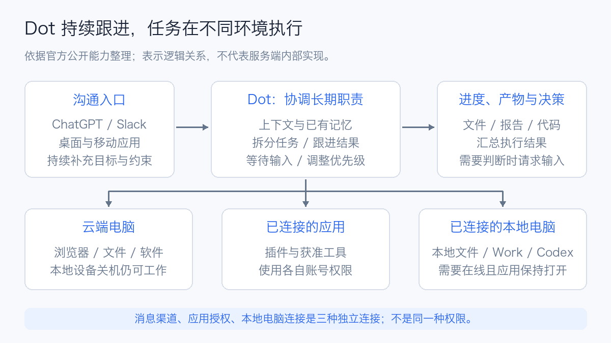
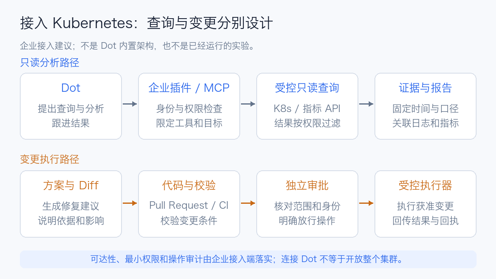

# ChatGPT Dots 技术解析：常驻智能体、云端电脑与企业应用

2026 年 9 月 29 日，OpenAI 在 DevDay 更新中介绍了 **Dots**：用户可以给自己的 **Dot** 一项持续的职责，让它在两次对话之间继续推进工作，再带着结果或需要判断的问题回来。Dots 是产品名称，Dot 指用户自己的常驻智能体。[DevDay 2026](https://learn.chatgpt.com/docs/whats-new/devday-2026)

截至本文核查，官方介绍 Dot 由 **GPT-6 Astra** 驱动，有自己的云端电脑和浏览器，可处理研究、文档、数据和软件工作，也可以协调 ChatGPT Work 与 Codex 任务。[Meet dots](https://learn.chatgpt.com/docs/dots)

理解它时，可以想象一名长期负责发布准备的项目同事：今天收集问题，明天看到新的结果后更新材料，遇到决策再来找你。用户交代的不只是一次输出，还包括应该持续关注什么、依据哪些资料、何时通知，以及哪些动作需要确认。

本文依据截至 **2026 年 10 月 14 日**的官方资料分析产品与工程应用。配图表示公开能力之间的逻辑关系；企业接入图和试用任务为设计建议。

## 1. 发布时间与当前开放范围

Dot 是近期推出的产品，公开更新可以按以下时间线阅读：

| 时间 | 官方更新 | 对使用者的意义 |
| --- | --- | --- |
| 2026-09-29 | DevDay 介绍 Dots，面向符合条件的账户逐步开放 | 开始将持续职责、云端执行和结果回传组织成产品 |
| 2026-09-28—10-02 | 周更新介绍把长期工作交给 Dot，以及与 Work、Codex 协作 | 明确它承担持续跟进和任务协调 |
| 2026-10-05—10-09 | 支持在手机应用创建 Dot，增强 ChatGPT/Codex 上下文使用及任务跟进 | 手机可以成为交代工作和查看结果的入口 |

来源：[DevDay 更新](https://learn.chatgpt.com/docs/whats-new/devday-2026)、[9 月末周更新](https://learn.chatgpt.com/docs/whats-new/september-28-october-2-2026)、[10 月初 Dots 更新](https://learn.chatgpt.com/docs/whats-new/dots-october-9-2026)。

官方当前列出 Pro 100、Pro 200、Pro 500、Business Premium 和 Enterprise 的开放条件；个人 Pro 有年龄和地区限制，Enterprise 默认关闭，需要管理员启用。**符合套餐条件不等于账户立即有入口**，因为产品仍逐步开放。支持桌面应用、桌面浏览器和移动应用，移动网页暂不支持。[访问条件](https://learn.chatgpt.com/docs/dots#access)

与 Dot 对话不计入 ChatGPT 对话使用限额，但它启动或管理的 Work、Codex 任务仍按对应产品计算用量。选择时应检查任务用量和账户条款，而不是把“常驻”理解为无限执行资源。[用量说明](https://learn.chatgpt.com/docs/dots#access)

## 2. 它与聊天、Work、Codex 的关系

这几个入口可以互相协作，区别主要在用户交代的工作形态。

| 入口 | 更适合交代什么 | 交付重点 |
| --- | --- | --- |
| ChatGPT 对话 | 解释问题、讨论方案、起草内容 | 当前对话中的回答与材料 |
| ChatGPT Work | 一项研究、分析、制表或文档任务 | 可以检查的任务结果与文件 |
| Codex | 修改代码、测试、调试和审查 | 代码变更、工具执行与验证结果 |
| Dot | 持续关注一个项目或责任，并跟进变化 | 当前进度、后续任务和需要用户判断的事项 |

例如，开发一个功能可以直接交给 Codex；希望持续跟踪相关反馈、协调修复、更新发布材料，则更适合由 Dot 负责跟进，再把具体代码工作交给 Codex。官方近期更新也明确了 Dot 发起 Codex 工作、跟进已有线程和使用相关上下文的能力。[Work 入门](https://learn.chatgpt.com/docs/get-started-with-work)、[Dots 与 Codex 更新](https://learn.chatgpt.com/docs/whats-new/dots-october-9-2026)

**持续跟进不等于模型全天不断生成 Token。** 官方描述包括等待、暂停与再次继续。可以据此理解为需要执行与等待的任务管理，但官方没有公开底层调度算法、状态数据库或故障恢复实现。

## 3. 从公开能力看工作结构



用户首先给出职责、资料、边界和结果要求。Dot 可以拆分具体工作，再检查返回的结果，继续补充或调整。下面三类连接承担不同功能：

| 连接 | 主要作用 | 需要分别确认的条件 |
| --- | --- | --- |
| 消息渠道 | 发出指令、收到进度和决策请求 | 渠道已连接，通知对象与可见范围明确 |
| 应用插件 | 访问文件、邮件、代码等服务的工具和数据 | 应用账号授权，以及具体读写权限 |
| 本地电脑 | 使用本地文件、应用与开发任务 | 单独允许访问，电脑在线且 ChatGPT 应用保持打开 |

连接 Slack 不会同时授权邮箱或本地电脑。已有浏览器登录也不会自动出现在云端浏览器里。先把这些条件分开检查，更容易解释“能聊天但读不到文件”或“能在云端工作但无法继续本地任务”。[连接与设置](https://learn.chatgpt.com/docs/dots/getting-started#connect-tools-and-contact-methods)、[云端与本地会话](https://learn.chatgpt.com/docs/dots/computers-and-apps)

### 3.1 云端工作与本地工作

云端电脑具有独立的文件、软件和浏览器会话，可以跨使用时段保持状态。本地设备关闭时，云端工作仍可继续；依赖本地文件与工具的步骤则需要本地电脑可用。

官方当前允许连接一台个人电脑。改变选择的电脑不会自动搬迁已有任务；执行位置、工作目录、依赖和登录状态需要单独核对。云端网站登录通过私密登录流程或人工接管完成，登录凭据不需要放进对话。[执行环境与登录](https://learn.chatgpt.com/docs/dots/computers-and-apps)

对工程团队而言，这意味着“从手机继续交代工作”和“任务迁移到手机执行”是两件事。手机可以提供新的约束，实际任务仍使用原来的云端环境或在线电脑。需要企业私网的工作，也必须确认实际执行端能到达对应服务。

### 3.2 Plugin、Skill 与 MCP

Plugin 是可安装的能力包，可以包含 Skill、Model Context Protocol（模型上下文协议，**MCP**）服务器和可选界面。Skill 描述重复任务的操作方法；MCP 服务器提供可调用的工具、参数和认证边界。一个插件可以只有操作指引，也可以包含企业服务端能力。[插件架构](https://developers.openai.com/plugins/concepts/plugins)

将企业查询封装为工具，比给智能体一段不受约束的 Shell 命令更容易管理：服务端可以检查身份、限制查询目标、过滤返回内容，并记录请求。插件能被安装，还不代表它支持 Dot 当前的所有执行环境；本地 Skill 尤其依赖可用的本地电脑。

## 4. 记忆、上下文与任务进度要分开看

Dot 使用当前对话、相关 ChatGPT 记忆和自己保存的笔记。笔记可记录偏好、决定与持续工作，跨对话延续，但不是完整聊天记录；更改 ChatGPT 已保存记忆的设置，也不一定改变 Dot 已经形成的笔记。[任务与记忆](https://learn.chatgpt.com/docs/dots/tasks-and-memory#context-and-memory)

从工程角度，可以用三类信息解释长期任务。这是分析方法，不是官方存储架构：

| 信息 | 示例 | 应如何核对 |
| --- | --- | --- |
| 长期偏好 | 报告应附来源、图表使用固定单位 | 用户修改偏好后，后续产物是否采用新要求 |
| 当前任务进度 | 已完成的检查、未完成项、等待的决定 | 对照文件、日志、任务 ID 与外部系统状态 |
| 工作环境状态 | 文件、依赖、浏览器会话 | 文件是否存在，依赖是否可用，登录是否过期 |

记得“测试报告需要图表”，不等于知道“最后一轮测试是否执行成功”。一句进度描述不能替代任务回执。模型在下一次互动中使用的信息是选取后的上下文，也不能假设每个委派任务都拥有主对话的完整历史。

因此，讨论中断续跑时，应分别测试：能否恢复目标与已完成结果、能否找到仍在运行的任务，以及是否重复执行外部写入。公开指南介绍了任务继续与状态保持，但没有据此承诺任意故障下的精确断点恢复。相关工程机制可参见 [Agent 长任务中断续跑](agent-long-running-durable-execution.md) 与 [Agent Memory 技术综述](agent-memory-technology-overview.md)。

## 5. 定时、事件与主动研究的区别

Dot 可以按保存的时间表工作，也可以在连接服务支持时针对指定事件跟进。前者应明确时区、频率、结束日期和交付位置；后者应明确事件来源与触发条件。连接一个渠道本身不会建立监控任务，设置后应核对它实际保存的任务。[定时与事件任务](https://learn.chatgpt.com/docs/dots/tasks-and-memory#recurring-tasks)

官方还区分了主动研究：它使用受限工具读取获准的信息、整理私有发现，后续发送、修改或电脑操作仍须满足相应授权。这与用户明确交代并授权执行的周期任务不同。[主动研究](https://learn.chatgpt.com/docs/dots/tasks-and-memory#proactive-research)

对周期任务，我更关注四个验收点：是否有保存的触发配置、数据时间窗是否统一、产物落在哪里，以及任务失败后如何通知。对于集群验收或性能测试，还应由执行平台独立设置期限和资源回收，不能只依赖一次自然语言承诺。

## 6. 沟通渠道与控制能力

ChatGPT、Slack 和 Teams 可作为联系同一个 Dot 的渠道。换渠道不会重新创建智能体，但可见消息仍属于各自对话，并不会完整镜像。能够使用私聊上下文，不等于允许将它发到团队频道。[消息渠道](https://learn.chatgpt.com/docs/dots/channels)

当前指南对 Teams 的开放范围注明邀请制 Alpha；短信仍为待推出能力。语音通话结束后，已经交代的工作可能继续。试点应以账户实际开放的入口为准。[渠道状态](https://learn.chatgpt.com/docs/dots/channels)、[管理指南](https://learn.chatgpt.com/docs/enterprise/dots-admin-guide)

在 Slack，当前只有所有者能向个人 Dot 发起工作；其他参与者的消息可以成为上下文，但不会直接启动任务。因此，个人职责跟进与团队共用服务的身份、授权需要分别设计。[参与者权限](https://learn.chatgpt.com/docs/enterprise/dots-admin-guide)

对于动作控制，至少有三个独立层次：应用连接决定能访问什么，工具权限决定允许哪些操作，动作审查决定这一步能否直接执行。用户可配置直接执行、明确要求后执行、事前确认或交给自己操作的规则；规则不会凭空授予应用权限，也不会覆盖内置安全要求。[控制方式](https://learn.chatgpt.com/docs/dots/controls)

停止工作也需要区分范围：

| 操作 | 影响范围 |
| --- | --- |
| Pause | 暂停 Dot 当前主任务 |
| 在 Activity 停止具体任务 | 停止对应的委派任务 |
| 在 Scheduled 禁用或删除计划 | 停止后续定时执行 |

停止不是回滚，已发送消息或外部修改仍需要独立处理。退出一个长期项目时，应核对主任务、委派任务和时间表，避免遗漏仍会运行的工作。[停止工作](https://learn.chatgpt.com/docs/dots/controls#stop-work)

## 7. 企业部署的边界：可以接入集群，但托管 Dot 与自建运行时不同

官方提供的是 ChatGPT 中的托管产品及其电脑、应用连接。本文核查的 Dots 指南没有提供将 Dot 本身安装到 Kubernetes 的发行包或 Helm Chart。

如果企业需要自有执行环境，可以通过受控工具接入现有系统；如果需要掌控整个智能体运行时，则应评估开发接口或自建 Harness。OpenAI 的 Agents API、Agents SDK、Responses API 分别提供托管 Harness、应用内 Agent Loop 和更底层的模型/工具集成选项，不能把其中一种接口直接等同于 Dot 产品。[Agent 运行时选择](https://developers.openai.com/api/docs/guides/agents)

### 7.1 Kubernetes 运维的接入建议



这张图是企业接入建议。先由受控插件或 MCP 服务提供查询能力，限定集群与命名空间，再按用户身份检查 Role-Based Access Control（基于角色的访问控制，**RBAC**）。查询结果包含指标时间窗、原始来源和必要的日志，便于复核。

工具可以从几项明确的能力开始：

| 工具示例 | 返回什么 | 应由服务端限制什么 |
| --- | --- | --- |
| `get_cluster_summary` | 节点、Pod、版本与异常概况 | 可访问集群及字段范围 |
| `query_metrics` | 固定时间窗的指标与查询条件 | 查询时间跨度、结果规模和租户标签 |
| `get_workload_events` | 指定工作负载的事件与状态 | 命名空间、日志范围和敏感信息 |
| `prepare_change` | 修复方案、配置 Diff 和检查结果 | 输出草案，不直接修改生产状态 |

变更可以通过 Pull Request（合并请求，**PR**）与 Continuous Integration（持续集成，**CI**）校验，再由独立审批和执行器操作。这样，智能体负责分析和跟进，企业平台保留变更身份、回执与回滚机制。

云端电脑不会自动继承办公电脑的 Virtual Private Network（虚拟专用网络，**VPN**）和登录。企业必须先解决执行端可达性，再检查数据是否允许进入托管服务；不能用“已经连上 Slack”来推断它已经能访问内部集群。[企业接入条件](https://learn.chatgpt.com/docs/enterprise/dots-admin-guide)

### 7.2 工作区管理需要额外检查的点

管理员可以分别控制 Dot 使用权、Slack 参与、本地电脑访问、应用与动作，以及云端浏览器和网络能力。当前指南还明确：**Enterprise 的模型控制和默认值不适用于 Dots**，不能沿用普通聊天模型设置来推断 Dot 的策略。[管理能力](https://learn.chatgpt.com/docs/enterprise/dots-admin-guide)

试点可以按以下顺序扩大：公开资料研究 → 获准的内部只读任务 → 草案与代码审查 → 受控变更。每一步用具体工作和产物判断收益，不以“已经有一个 Dot”作为上线完成。

离职或权限撤销也要覆盖应用授权、网站会话和已有记忆。断开应用连接不会删除已经取得的信息；管理员审计时还应确认支持的记录覆盖范围。[访问撤销与记录](https://learn.chatgpt.com/docs/enterprise/dots-admin-guide)

## 8. 三个可以开始试用的任务

以下是任务设计示例，不是已执行的功能测试结果。它们分别检验持续跟进、技术证据和长任务管理。

### 8.1 技术项目每周回顾

```text
未来四周，每周五 16:00，使用 Asia/Shanghai 时区，
整理指定项目的官方 Release、文档和公开问题讨论。
区分已发布功能、路线图和未验证观点，给出原始链接。
把本周变更、部署影响和待核实项写到报告。
先确认保存的时间表、资料范围和报告位置。
```

复核时检查版本日期、引用是否支持结论，以及下周是否能正确沿用已确认信息。只有重新打开资料并核查差异，才适合称为回顾；沿用上周摘要可能错过更新。

### 8.2 Kubernetes 异常分析

```text
使用获准的只读工具，分析指定测试集群最近一小时的异常。
统一 API Server、etcd 和工作负载指标的时间窗。
将事实、可能原因和验证办法分开，附查询与日志来源。
输出排查建议；需要配置变更时，先生成 Diff 和检查结果。
```

验收重点是它能否把时序证据连起来，以及是否在数据缺失时保持判断边界。缺少某项指标，不应被解释为该项没有故障。

### 8.3 一小时级测试任务跟进

```text
跟进指定实验任务，记录运行 ID、配置、期限和验收条件。
按约定间隔检查实际任务状态，汇总通过、失败和未执行项。
网络中断后先查询原任务与已保存结果，再决定是否重试。
最终核对报告、日志、图表和执行平台的资源释放回执。
```

这个场景应由实验平台维护期限、重试、结果账本和资源看护。Dot 可以协调与汇总，但不能把它的长期记忆作为唯一执行账本，也不能把任务 Completed 当作全部验收条件通过。

## 9. 怎样评价是否值得使用

一次演示容易看到“它做了很多步骤”，生产评估更应该围绕结果。可以固定一组任务，比较人工完成和采用 Dot 后的结果；以下为建议口径，不是性能成绩。

| 维度 | 建议记录 |
| --- | --- |
| 结果质量 | 满足全部验收条件的任务比例；引用与数据错误数 |
| 持续性 | 新信息到来后是否正确更新；错误使用过期决定的次数 |
| 人工成本 | 准备资料、反复解释、确认和修正所需时间 |
| 执行可靠性 | 等待授权、连接失效、恢复失败和重复写入的次数 |
| 资源成本 | Work/Codex 用量、执行时间，以及任务占用的外部资源 |
| 交付完整性 | 文件、源码、日志和回执是否真的到达目标位置 |

可以先试两周：选择重复出现、有明确资料来源、结果容易复核的职责。若准备上下文和修正结果比人工完成更耗时，应收缩任务范围或调整工具设计；若它持续减少遗漏和重复协调，再扩大权限与职责。

Dots 值得关注的产品方向，是把用户目标、可用工具、持续上下文和任务交付连接起来。企业真正获得的收益仍取决于资料质量、工具边界和可验证的结果。需要自行掌控运行环境与恢复机制时，可进一步阅读 [Agent Harness](agent-harness-technology-overview.md)、[Agent Sandbox 选型](agent-sandbox-selection.md) 和 [Agent 评估方法](agent-evaluation-overview.md)。

## 参考资料

- [DevDay 2026，2026-09-29](https://learn.chatgpt.com/docs/whats-new/devday-2026)
- [Meet dots](https://learn.chatgpt.com/docs/dots)
- [Getting started](https://learn.chatgpt.com/docs/dots/getting-started)
- [Tasks and memory](https://learn.chatgpt.com/docs/dots/tasks-and-memory)
- [Computers and apps](https://learn.chatgpt.com/docs/dots/computers-and-apps)
- [Messaging](https://learn.chatgpt.com/docs/dots/channels)
- [Controls](https://learn.chatgpt.com/docs/dots/controls)
- [Enterprise dots admin guide](https://learn.chatgpt.com/docs/enterprise/dots-admin-guide)
- [Dots 更新，2026-10-05—10-09](https://learn.chatgpt.com/docs/whats-new/dots-october-9-2026)
- [Plugin architecture](https://developers.openai.com/plugins/concepts/plugins)
- [Agent runtime options](https://developers.openai.com/api/docs/guides/agents)
